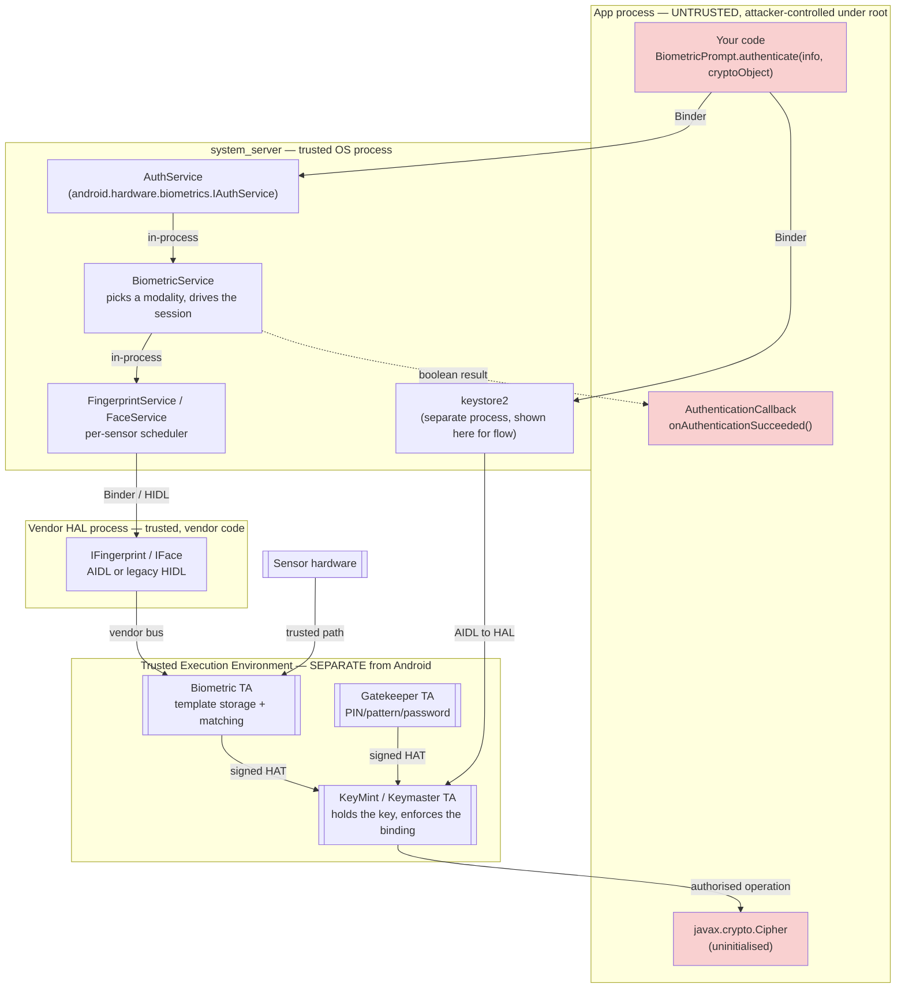
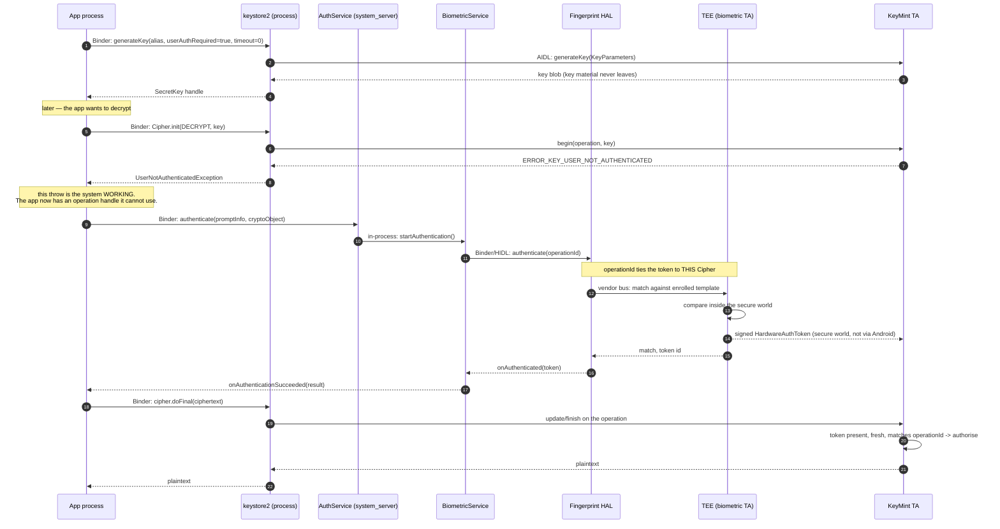
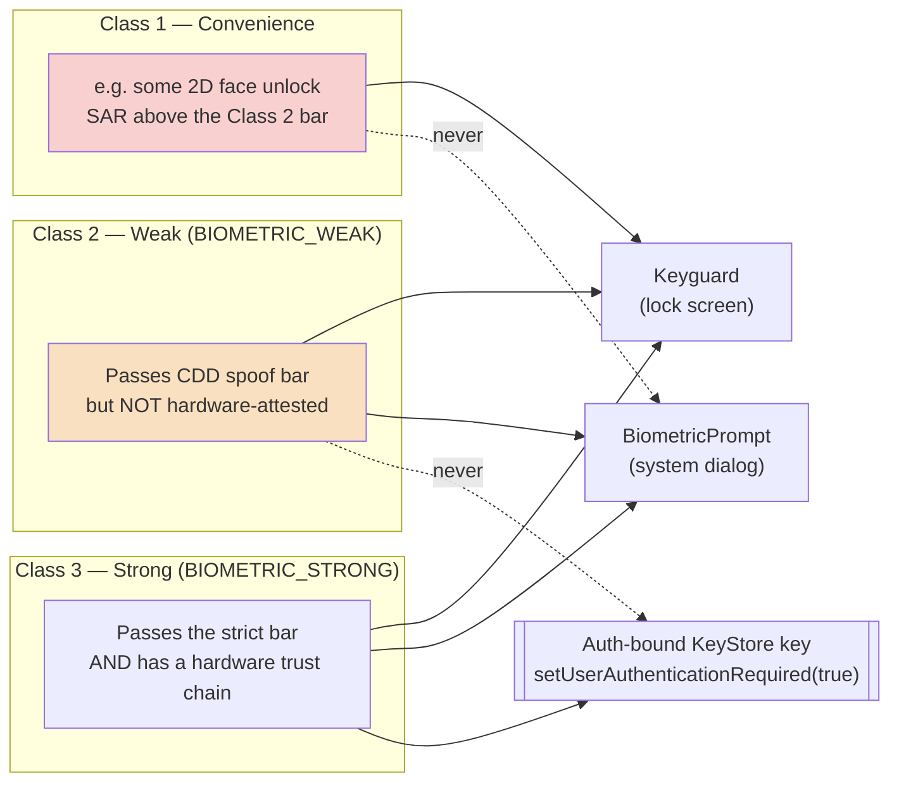
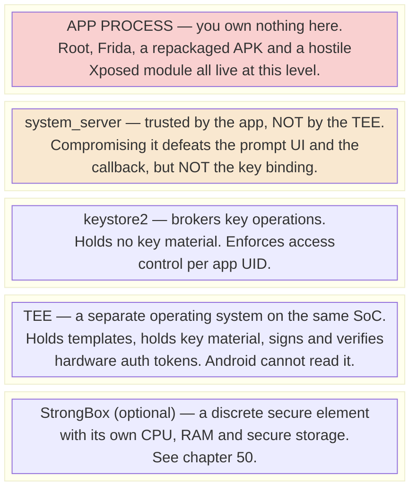
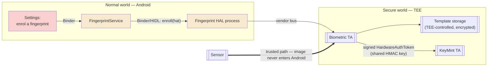
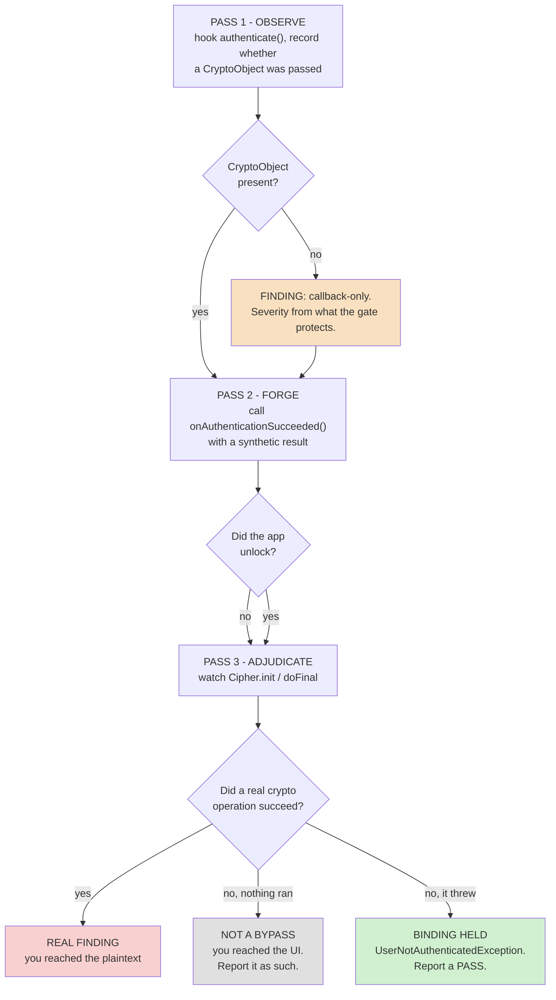
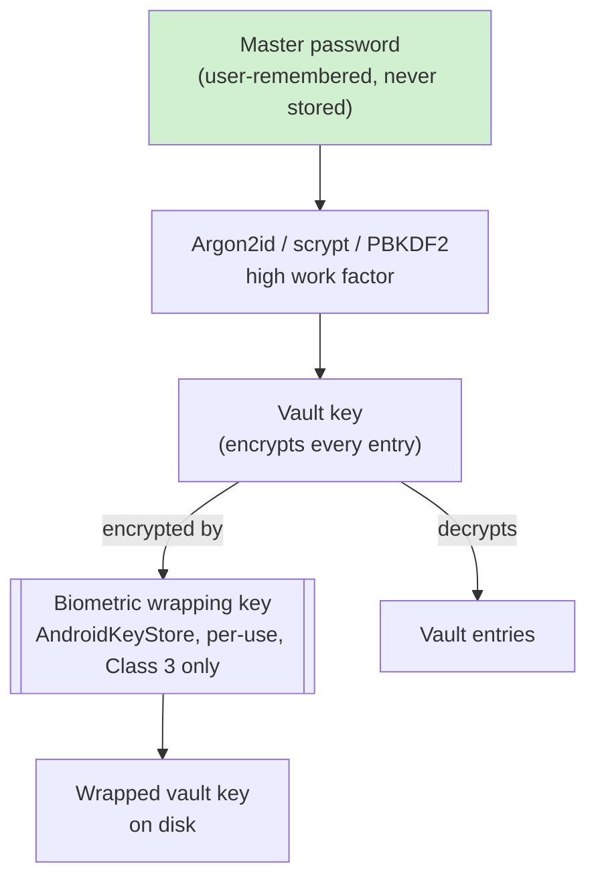
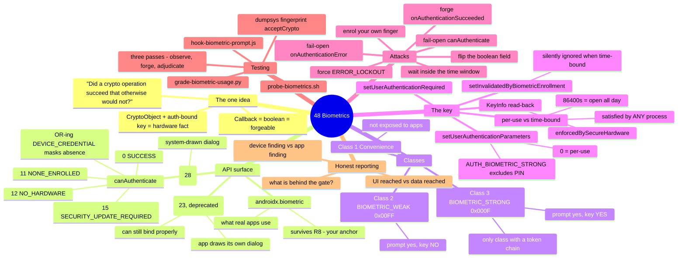

# 48 — Biometrics

> After this chapter you will be able to look at any Android app's biometric login and say, with
> evidence, whether it is real security or a picture of security — and prove which, on a device, in
> under ten minutes.

**Prerequisites:** [04 — Java](../04-Java/README.md), [20 — Security Architecture](../20-Security-Architecture/README.md), [21 — App Sandbox](../21-App-Sandbox/README.md), [25 — Binder](../25-Binder/README.md), [34 — Cryptography](../34-Cryptography/README.md), [47 — Authentication](../47-Authentication/README.md), and — **out of numeric order, so read it first** — [49 — KeyStore](../49-KeyStore/README.md). 49 is the one genuine forward dependency here: this chapter's entire verdict is *"is the biometric result bound to a Keystore key, or is it a boolean?"*, and you cannot form that judgement without the key side. 49 does not depend on this chapter, so reading 49 → 48 costs you nothing.

**Useful alongside:** [50 — Hardware-Backed Security](../50-HardwareBackedSecurity/README.md) for the TEE and StrongBox depth behind §2 — this chapter explains where the sensor, TEE and `system_server` sit on its own. [53 — Frida](../53-Frida/README.md) for the runtime demonstration in §7; the static and on-device parts of this chapter stand without it, and [53's own opening callout](../53-Frida/README.md) explains why `frida-server` may not run on your image at all.

**Applies to:** API 23 (Android 6.0, `FingerprintManager`) through API 35 (Android 15). The modern
surface begins at API 28 (`BiometricPrompt`), the authenticator constants at API 29–30, and
`androidx.biometric` back-ports the whole thing to API 23.

---

## Table of Contents

| § | Section | What it answers |
|---|---|---|
| [1](#1-introduction) | Introduction | Why a fingerprint is not a password, and why that changes everything |
| [2](#2-high-level-architecture) | High-Level Architecture | Where the sensor, the TEE, `system_server` and your app each sit |
| [3](#3-deep-internal-working) | Deep Internal Working | Every class, constant, flag and failure mode — with measurements |
| [4](#4-source-code-walkthrough-aosp) | Source Code Walkthrough (AOSP) | The call path from `authenticate()` to the TEE, in real files |
| [5](#5-security-perspective) | Security Perspective | How it is attacked, misused, tested and reported |
| [6](#6-reverse-engineering-perspective) | Reverse Engineering Perspective | What it looks like in JADX, smali and an obfuscated APK |
| [7](#7-dynamic-analysis) | Dynamic Analysis | Frida, `adb`, and the three-pass method that separates a finding from a screenshot |
| [8](#8-static-analysis) | Static Analysis | Grep, grade, and the two ways a static grader lies to you |
| [9](#9-examples) | Examples | Five graded implementations, simple to enterprise |
| [10](#10-common-interview-questions) | Common Interview Questions | Five tiers with model answers |
| [11](#11-common-mistakes) | Common Mistakes | Developer, pentester, reverse engineer |
| [12](#12-hands-on-labs) | Hands-on Labs | Four labs, the last a CTF |
| [13](#13-summary) | Summary | Mind map, cheat table, recall prompts |
| [14](#14-references) | References | AOSP, CDD, MASVS, related chapters |

---

## 1. Introduction

### 1.1 The hotel key card that is also your face

Imagine a hotel with two kinds of door.

The first door has a receptionist standing beside it. You show her your face; she recognises you;
she says "yes, that's Mr Patel", and she opens the door. The door has no lock. It opens because the
receptionist said so.

The second door has a real lock, and the key is kept inside a safe in the basement that you cannot
reach. There is still a receptionist. She still looks at your face. But when she recognises you she
does not open anything — she signs a slip of paper, timestamped, with a signature the safe knows
how to verify, and sends it down a tube to the basement. The safe reads the slip, checks the
signature and the timestamp, and only then does it turn the key.

Now suppose an attacker gets into the building and can impersonate the receptionist perfectly. At
the first door, they say "yes, that's Mr Patel" and walk in. At the second door, they can shout "yes,
that's Mr Patel" all day and the safe never turns the key, because the safe has never been listening
to the receptionist — it has only ever been listening for a correctly signed slip, and forging that
signature requires being inside the basement.

**Almost every biometric login on Android is the first door.** This chapter is about how to tell
which one you are looking at, and about how to build the second.

> **Mental Model**
> A biometric prompt does not *authenticate*. It *witnesses*. Whether that witness statement is
> worth anything depends entirely on whether something outside your app's process demanded a signed
> receipt. The prompt is the receptionist. The signed slip is a **hardware auth token**. The safe is
> **KeyMint**, inside the TEE.

### 1.2 What existed before, and what broke

Before Android 6.0 (API 23, 2015) there was no platform fingerprint API at all. Manufacturers who
shipped fingerprint sensors — Samsung and Motorola were early — exposed them through proprietary
SDKs. Each SDK had its own idea of what "authenticated" meant, and in practice every one of them
meant the same thing: **the SDK called your callback with a boolean**.

That produced three problems that the platform has spent a decade unwinding.

**Problem one: the template was in the app's world.** Some early vendor SDKs handed the app access
to matching results, and in the worst cases to the sensor image itself. A fingerprint is not
revocable. You cannot issue a user a new thumb. Any design where a compromised app can exfiltrate
enrolment data is catastrophic in a way a leaked password never is.

**Problem two: the decision was in the app's process.** The app asked "is this the user?", the SDK
answered "yes", and the app believed it. Everything downstream of that answer lived in memory the
user's own device fully controls. Rooting the phone, or attaching a debugger, or repackaging the
APK, turns "yes" into a constant.

**Problem three: there was no shared idea of how good a sensor is.** A capacitive fingerprint reader
and a front camera doing 2D face matching are not comparable, but both were called "biometric
unlock", and apps could not tell them apart.

Android's answers, in order:

| Version | API | What arrived | Which problem it addressed |
|---|---|---|---|
| 6.0 Marshmallow | 23 | `FingerprintManager`, `CryptoObject`, `setUserAuthenticationRequired` | 1 and 2 — templates move into the TEE; keys become auth-bound |
| 7.0 Nougat | 24 | `setInvalidatedByBiometricEnrollment` | 2 — a new enrolment destroys old keys |
| 9.0 Pie | 28 | `BiometricPrompt` — a **system-drawn** dialog | 2 — the app no longer draws its own authentication UI |
| 10 Q | 29 | `BiometricManager.canAuthenticate()`, biometric **classes** in the CDD | 3 |
| 11 R | 30 | `Authenticators.BIOMETRIC_STRONG` / `_WEAK` / `DEVICE_CREDENTIAL`, `setAllowedAuthenticators`, `setUserAuthenticationParameters` | 3, and the muddle `setDeviceCredentialAllowed` created |
| 12 S | 31 | `BIOMETRIC_ERROR_SECURITY_UPDATE_REQUIRED` | 3 — a sensor can be *demoted* in the field |

Notice what is missing from that table: **nothing in it stops an app from ignoring all of it**. The
platform gives you the second door. It cannot make you use it. Ten years after `CryptoObject`
shipped, the modal Android biometric implementation is still a one-argument
`authenticate(promptInfo)` and an `if` statement.

### 1.3 The claim this chapter is built on

Read this once slowly, because everything else in the chapter is a consequence of it.

> **Definition — the only definition of "biometric authentication" that means anything**
> An app has performed biometric authentication when a **cryptographic operation succeeded that
> would otherwise have failed**. If, after the biometric, the app could have done exactly what it
> did anyway, then no authentication occurred — a dialog was displayed.

A `BiometricPrompt` that returns success to a callback proves nothing, because
`onAuthenticationSucceeded` is an ordinary public Java method on an ordinary object. Anyone who can
run code in the process can call it. Frida can. A repackaged APK can. A malicious module can. There
is no signature on it, no token in it, nothing about it that could not have been typed by hand.

Authentication becomes real only when it is **bound to a cryptographic operation**: a
`CryptoObject` wrapping an `AndroidKeyStore` key created with `setUserAuthenticationRequired(true)`,
where the *hardware* refuses to use the key unless a fresh hardware auth token is present. The
refusal happens in KeyMint, inside the Trusted Execution Environment, below the operating system.
Root does not reach it. Frida does not reach it. That is the entire value proposition.

Everything else is UI. This chapter grades every pattern it shows you against that line, and so
should you.

### 1.4 What you are *not* attacking

A large amount of published material about "Android biometric hacking" is about fooling sensors.
That material is mostly irrelevant to an application security assessment, and knowing why saves you
from wasting an engagement.

**The biometric template never leaves the TEE.** When a user enrols a fingerprint, the sensor and
the biometric HAL process the image inside a trusted environment; what is stored is a template in
TEE-controlled storage, and on modern devices it is encrypted with a key the normal world does not
have. Your app never sees it. `system_server` never sees it. Root never sees it. There is no
`/data/system/users/0/fpdata` file you can pull and crack — and on the physical device used for
this chapter, no such file exists in the user directory at all.

**The match happens in the TEE too.** The comparison of a presented finger against a stored template
runs in the secure world. The normal world learns only the outcome, and (for a Class 3 sensor) is
handed a signed token attesting to it.

So the attack surface available to an application pentester is not the sensor and not the template.
It is:

1. **The app's own logic** — by far the largest, and the subject of this chapter.
2. **The binding**, or its absence, between the prompt and a key.
3. **Configuration** — asking for the wrong authenticator class, or a validity window so long the
   binding stops meaning anything.
4. **Presentation attacks** against the sensor, which are a hardware assessment, need physical
   access, and are graded by the CDD's spoof-acceptance criteria rather than by anything in the APK.

Category 4 is real and it matters — a Class 1 face unlock defeated by a printed photograph is a
genuine finding — but it is a *device* finding, not an *app* finding, and it belongs in a different
part of your report. §5.6 covers how to assess and write it up responsibly.

### 1.5 What would break if none of this existed

Suppose Android had shipped biometrics with no `CryptoObject` and no auth-bound keys — just a
system dialog and a callback.

Every banking app, password manager and health record on every rooted phone would be openable by a
three-line Frida script, and there would be **no defence available to the developer**, because
there would be nothing to bind to. The best an app could do is obfuscate the check, which buys
minutes. This is not hypothetical: it is precisely the situation for the majority of shipped apps
today, and the only reason it is not a catastrophe is that most attackers cannot get code execution
on most users' phones. The apps that get this right are not relying on that.

Conversely, suppose Android had auth-bound keys but no `BiometricPrompt` — no system-drawn dialog.
Then every app would draw its own fingerprint UI, and users would have no way to distinguish a
legitimate prompt from a phishing overlay drawn by any app on the device. The system dialog exists
so that the pixels asking for your fingerprint are drawn by a process you have no choice but to
trust. That is why `FingerprintManager`'s deprecation matters and why §3.9 treats an app still on
that path as a finding.

The two halves are complementary. The dialog protects the user from the app. The key binding
protects the user from an attacker inside the app.

---

## 2. High-Level Architecture

### 2.1 The whole system, once



**What you are looking at.** Two paths leave the app, and they are completely independent.

The **dotted path** on the right is the callback. Your app calls `authenticate()`, that crosses
Binder into `system_server`, a modality is chosen, a vendor HAL is driven, the TEE matches a finger,
and eventually a result comes back and `onAuthenticationSucceeded` fires. Every arrow on that path
ends inside your own process, in memory the device owner controls. **An attacker with code execution
does not need to traverse this path at all — they can start at the end of it.**

The **solid path** on the left is the binding. The TEE's biometric trusted application, having
matched a finger, mints a **hardware auth token** and hands it — inside the secure world, never
through Android — to KeyMint. Separately, your app's `Cipher` is bound to a KeyMint key. When the
framework asks KeyMint to begin an operation on that key, KeyMint looks for a token that is fresh,
correctly signed, and (for a per-use key) tied to this specific operation. No token, no operation.

The `Cipher` object at the bottom right is shaded as attacker-controlled because it is: it is a Java
object in your heap. But an *uninitialised* Cipher is worthless, and the only thing that can
initialise it against a keystore key is KeyMint. That is the seam the whole design turns on.

> **Under the Hood**
> Notice that the Gatekeeper TA and the biometric TA both feed KeyMint the same kind of token. That
> is why a key configured with a validity window can be satisfied by a PIN — the key does not know
> or care which trusted application signed the token, only that the token is valid, fresh and of an
> accepted authenticator type. §3.6 measures exactly this, and it is the source of the most common
> "correct-looking but useless" implementation in the wild.

### 2.2 The successful path, in order



**Reading this diagram is the chapter.** Three things in it are worth stopping on.

**Step 7 is not an error.** `UserNotAuthenticatedException` at `Cipher.init` is the correct,
expected, healthy behaviour of a per-use auth-bound key. Developers see an exception, catch it,
and "fix" it by regenerating the key without the auth requirement — which is how a correct
implementation becomes a broken one during a bug-fix sprint. If you are reading a codebase and you
find a `catch (UserNotAuthenticatedException)` whose body creates a new key, you have found the
vulnerability.

**The `operationId` at step 12 is what makes per-use binding per-use.** When you pass a
`CryptoObject`, the framework extracts an operation handle from the pending keystore operation and
hands it to the HAL, which asks the TEE to mint a token *for that handle*. A token minted for one
operation cannot authorise another. A time-bound key has no operation handle — it accepts any token
inside the window — which is precisely why time-bound is weaker, and why §3.6's measurement works.

**The token at step 15 never crosses Android.** It goes from the biometric TA to the KeyMint TA
inside the secure world, over a channel the normal world cannot observe or inject into. What crosses
Binder at step 17 is only the *news* that authentication happened. That news is forgeable. The token
is not.

### 2.3 Where each authenticator class can and cannot reach



**What this shows.** There are three tiers, and the top of the diagram is the one that matters.

A **Class 1** authenticator is "convenience" only. It may unlock the lock screen if the OEM allows,
but it is not exposed to apps through `BiometricPrompt` at all. If a device's face unlock is
Class 1, then no app can use it, and an app asking for `BIOMETRIC_WEAK` will not see it.

A **Class 2** authenticator satisfies `BIOMETRIC_WEAK` and can drive `BiometricPrompt`. It **cannot**
release a hardware auth token, so it can never satisfy an auth-bound key. This is not a policy
choice an app can override — the framework rejects the combination. An app that asks for
`BIOMETRIC_WEAK` has, by that single argument, foreclosed the possibility of real binding.

A **Class 3** authenticator satisfies `BIOMETRIC_STRONG`, drives the prompt, **and** has a hardware
trust chain to KeyMint. Only Class 3 can make the second door work.

> **Pentester's Note**
> `BIOMETRIC_WEAK` (`0x00FF`) is a **superset** of `BIOMETRIC_STRONG` (`0x000F`) — every strong
> sensor also satisfies weak. So "the app asks for WEAK" does not mean "the app uses a weak sensor";
> it means "the app will *accept* a weak sensor". On a phone whose only sensor is Class 3, an app
> asking for WEAK behaves identically to one asking for STRONG — right up until the user's next
> phone. Report it as a configuration weakness, not as an exploited one, unless you can show a
> Class 2 sensor on the target device.

### 2.4 Trust boundaries, drawn honestly



**The point of this stack is the second row.** Almost every reader's intuition is that
`system_server` is "the system", and therefore that compromising it or lying to it defeats
everything. It does not. `system_server` is trusted by *apps* — it draws the prompt, it schedules
the sensor, it delivers the callback — but KeyMint does not trust it and never has. That is why a
forged callback delivers a "welcome" screen and not a plaintext, and it is the single most
counter-intuitive fact in the chapter.

The practical consequence for testing: **a bypass that stops at `system_server`'s output is not a
bypass of the key binding.** You have to reach the plaintext to claim the plaintext.

---

## 3. Deep Internal Working

This section is long because the surface is genuinely large and because almost every subtlety in it
has produced a shipped vulnerability. Read §3.4, §3.5 and §3.6 even if you skim the rest — they are
the three that decide whether an implementation is real.

**Everything marked "measured" in this section was run on one of two devices.** Record which,
because the two disagree:

| Device | Model | Release / API | Root | Notes |
|---|---|---|---|---|
| **Physical** | Redmi `M2101K6P` (`sweetin`), MIUI 12.5 | **Android 11 / API 30** | rooted (Magisk/APatch), frida-server 16.1.6 | Fingerprint only. **No** biometric face feature. Keymaster 4.0 HIDL, not KeyMint. Security patch 2021-12-01 |
| **Emulator** | `sdk_gphone16k_x86_64` | **Android 15 / API 35** | `adb root` available | Fingerprint **and** face sensors, both reported Class 3. Software keystore |

### 3.1 The three API surfaces, and which one you are looking at

There are three ways an Android app can ask for a biometric, and a large app often contains all
three at once, on different code paths, reached at different API levels. Identifying which one you
are on is the first move in any assessment.

| API | Package | Since | System-drawn UI | `CryptoObject` | Credential fallback | Status |
|---|---|---|---|---|---|---|
| `FingerprintManager` | `android.hardware.fingerprint` | 23 | **No** — app draws its own | Yes | No | Deprecated at API 28 |
| `BiometricPrompt` (platform) | `android.hardware.biometrics` | 28 | Yes | Yes | API 29+ | Current, but version-gated |
| `BiometricPrompt` (AndroidX) | `androidx.biometric` | library | Yes (delegates or back-ports) | Yes | Yes | **What real apps use** |

> **Definition — AndroidX**
> AndroidX is Google's set of libraries that ship *inside* the app rather than in the OS, so that
> new APIs work on old devices. `androidx.biometric.BiometricPrompt` presents one modern API and,
> at runtime, either delegates to the platform `BiometricPrompt` (API 28+) or emulates it on top of
> `FingerprintManager` (API 23–27) — drawing its own dialog on those old versions, because the
> system had none to draw.

That last clause matters and is widely missed. **On API 23–27, `androidx.biometric` draws an
in-process dialog.** The system-dialog guarantee from §1.5 does not exist there; the pixels
are drawn by the app. An app with `minSdk 23` therefore has a lower security ceiling on old devices
than its code suggests, and that is worth a line in a report even though the developer wrote
entirely modern code.

**Version fragmentation you will actually hit:**

| Behaviour | API 23–27 | API 28 | API 29 | API 30 | API 31+ |
|---|---|---|---|---|---|
| System-drawn dialog | No (androidx draws it) | Yes | Yes | Yes | Yes |
| `canAuthenticate()` | absent | absent | no-arg only | `int` overload | `int` overload |
| `Authenticators.*` constants | absent | absent | absent | present | present |
| `setAllowedAuthenticators` | absent | absent | absent | present | present |
| `setDeviceCredentialAllowed` | absent | absent | present | **deprecated** | deprecated |
| `setUserAuthenticationParameters` | absent | absent | absent | present | present |
| `BIOMETRIC_ERROR_SECURITY_UPDATE_REQUIRED` | absent | absent | absent | absent | present |
| Negative button required | n/a | Yes | Yes, unless credential allowed | Yes, unless `DEVICE_CREDENTIAL` in allowed set | same |

The API 29 row is the awkward one. `setDeviceCredentialAllowed(true)` existed for exactly one
release before being replaced by `setAllowedAuthenticators`. Code written in that window, and never
revisited, is common — and the two APIs **conflict**: setting both throws. If you see a
`Build.VERSION.SDK_INT` ladder around prompt construction, that is why.

### 3.2 `BiometricManager.canAuthenticate()` — and the trap in it

`canAuthenticate(int authenticators)` asks the system a question before you build a prompt. It
returns one of:

| Constant | Value | Meaning | What a tester does with it |
|---|---:|---|---|
| `BIOMETRIC_SUCCESS` | `0` | A prompt of this class would appear and could succeed | Proceed |
| `BIOMETRIC_ERROR_HW_UNAVAILABLE` | `1` | Hardware exists, temporarily busy or locked out | Retry; check whether the app fails open |
| `BIOMETRIC_ERROR_NONE_ENROLLED` | `11` | Hardware exists, user has enrolled nothing | **The classic fail-open trigger.** Test this state deliberately |
| `BIOMETRIC_ERROR_NO_HARDWARE` | `12` | No sensor of this class | Same |
| `BIOMETRIC_ERROR_SECURITY_UPDATE_REQUIRED` | `15` | Sensor **demoted** below the requested class by a security update (API 31+) | Rare and high-value: an app treating this as success has silently lost Class 3 |
| `BIOMETRIC_STATUS_UNKNOWN` | `-1` | Cannot determine without trying | Do not branch on it as if it were an error |
| `BIOMETRIC_ERROR_UNSUPPORTED` | `-2` | This authenticator combination is unsupported here | Usually a bad argument, not a device limit |

**Measured, on the API 35 emulator, in one run, with a PIN set and no biometric enrolled:**

```
canAuthenticate(BIOMETRIC_STRONG)                     -> 11   ERROR_NONE_ENROLLED
canAuthenticate(BIOMETRIC_WEAK)                       -> 11   ERROR_NONE_ENROLLED
canAuthenticate(DEVICE_CREDENTIAL)                    ->  0   BIOMETRIC_SUCCESS
canAuthenticate(BIOMETRIC_STRONG | DEVICE_CREDENTIAL) ->  0   BIOMETRIC_SUCCESS
canAuthenticate(BIOMETRIC_WEAK   | DEVICE_CREDENTIAL) ->  0   BIOMETRIC_SUCCESS
canAuthenticate()   [API 29 no-arg form]              -> 11   ERROR_NONE_ENROLLED
```

> **Warning — the OR trap, measured**
> `canAuthenticate(BIOMETRIC_STRONG)` returned **11** and
> `canAuthenticate(BIOMETRIC_STRONG | DEVICE_CREDENTIAL)` returned **0**, on the same device, in
> the same process, milliseconds apart. `canAuthenticate` answers *"can **any** of these
> authenticators succeed?"*, not *"can **all** of them?"*. An app that OR-s in `DEVICE_CREDENTIAL`
> and then reads `BIOMETRIC_SUCCESS` as "the user has a fingerprint" is wrong, and on a device with
> a PIN and no enrolment it will be wrong every time. This is the mechanism behind a whole family of
> "biometric lock" features that silently degrade to a PIN prompt the user never noticed changing.

The last line of that measurement also settles a documentation question empirically: the no-arg
`canAuthenticate()` returned `11` while `canAuthenticate(DEVICE_CREDENTIAL)` returned `0`, so the
no-arg form is **not** "any authenticator" — it is equivalent to `BIOMETRIC_WEAK`. Legacy code
calling it is asking a narrower question than its authors probably think.

**Measured on the physical Redmi (API 30): `canAuthenticate` could not be called at all from the
shell.** Every call threw:

```
java.lang.SecurityException: Must have USE_BIOMETRIC permission:
    Neither user 2000 nor current process has android.permission.USE_BIOMETRIC.
```

with the device's own stack trace naming `com.android.server.biometrics.AuthService.checkPermission`
and `AuthService$AuthServiceImpl.canAuthenticate`. On the API 35 emulator the identical probe
succeeded, because that build's shell package holds `USE_BIOMETRIC`. **Two devices, two answers, and
neither is "the" answer.** Chapter 60 measured that `com.android.shell` requests around 200
permissions; this is a concrete case where the one you need is not among them. If you need
`canAuthenticate` from a real app context, you must install an app — see §7.3.

### 3.3 The authenticator constants, and what Class 1/2/3 actually mean

The constants live in `BiometricManager.Authenticators`, and their bit patterns are not arbitrary:

| Constant | Value | Binary (low 16 bits) |
|---|---|---|
| `BIOMETRIC_STRONG` | `0x000F` | `0000 0000 0000 1111` |
| `BIOMETRIC_WEAK` | `0x00FF` | `0000 0000 1111 1111` |
| `DEVICE_CREDENTIAL` | `0x8000` | `1000 0000 0000 0000` |

`BIOMETRIC_STRONG`'s bits are a **subset** of `BIOMETRIC_WEAK`'s. That encodes the containment
relationship directly: anything that satisfies STRONG also satisfies WEAK, and the framework can
test `(sensorStrength & requested) == requested`. A Class 3 sensor is labelled with strength
`0x000F`; a Class 2 sensor with `0x00FF`. Asking for `0x000F` therefore excludes the Class 2 sensor,
and asking for `0x00FF` admits both.

**Measured on the API 35 emulator**, `dumpsys biometric` reports exactly this:

```
Sensors:
 ID(0), oemStrength: 15, updatedStrength: 15, modality 2, state: 0, cookie: 0
 ID(4), oemStrength: 15, updatedStrength: 15, modality 8, state: 0, cookie: 0
```

`15` is `0x000F` — both sensors are Class 3. `modality 2` is `TYPE_FINGERPRINT` and `modality 8` is
`TYPE_FACE`, from `BiometricAuthenticator`'s `TYPE_*` bit flags (`CREDENTIAL=1`, `FINGERPRINT=2`,
`IRIS=4`, `FACE=8`). The pair `oemStrength` / `updatedStrength` is the field
`BIOMETRIC_ERROR_SECURITY_UPDATE_REQUIRED` exists for: the OEM declares a strength, and a later
policy update can *downgrade* it in the field without a firmware change. When those two numbers
differ, a sensor has been demoted, and any app that captured "this device is Class 3" at install
time is now wrong.

> **Pentester's Note — `dumpsys biometric` is not portable**
> On the **API 30 Redmi it produced no output at all** — an empty response with exit status 0 — even
> though `service list` shows `biometric: [android.hardware.biometrics.IBiometricService]`
> registered. `dumpsys auth` was also empty. The command that *did* work there was
> `dumpsys fingerprint`. Do not conclude "no biometric hardware" from an empty `dumpsys biometric`;
> conclude "this OEM build does not implement that dump". Try all three.

**The class definitions themselves come from the Android Compatibility Definition Document (CDD),
§7.3.10**, not from the framework. In plain terms:

| Class | CDD name | Spoof/imposter acceptance | Hardware trust chain | Reachable by apps |
|---|---|---|---|---|
| **1** | Convenience | Loosest bar | None required | **No** — cannot drive `BiometricPrompt` |
| **2** | Weak | Stricter bar on spoof and imposter acceptance | Not required | Yes, as `BIOMETRIC_WEAK` |
| **3** | Strong | Strictest bar, plus a maximum re-authentication window | **Required** — must have a secure hardware chain that can release a hardware auth token | Yes, as `BIOMETRIC_STRONG`, and **only this class can back a key** |

The CDD sets numeric thresholds for Spoof Acceptance Rate (SAR) and Imposter Acceptance Rate (IAR)
that differ between Class 2 and Class 3, and it revises them between Android versions. Quote the
CDD for the version you are testing rather than a remembered number; the structure (three classes,
only Class 3 hardware-attested) is stable, the numbers are not.

> **Mental Model**
> Class is not "how good is the sensor". Class is "how much does the platform let this sensor
> *authorise*". A very accurate sensor with no hardware path to KeyMint is Class 2 forever, and a
> mediocre one with a proper trust chain can be Class 3. The distinction is architectural, and it is
> why "our face unlock is 99.9% accurate" is not an answer to "is it Class 3?".

### 3.4 `CryptoObject` — the whole point

A `CryptoObject` is a thin wrapper. Its entire job is to carry an in-flight cryptographic operation
into the authentication so the framework can tie the two together.

It wraps exactly one of:

| Payload | Getter | Typical use |
|---|---|---|
| `javax.crypto.Cipher` | `getCipher()` | Encrypting or decrypting a local secret |
| `java.security.Signature` | `getSignature()` | Signing a server challenge — the strongest pattern, see §9.5 |
| `javax.crypto.Mac` | `getMac()` | HMAC over a request |
| `IdentityCredential` | `getIdentityCredential()` | API 30+, mDL/identity documents |
| `PresentationSession` | `getPresentationSession()` | API 33+ |

**Mechanically, here is what happens.** You create a `Cipher` and call `init()` on it with an
auth-bound key. That call goes through `keystore2` to KeyMint, which *begins* an operation and
returns an **operation handle** — but refuses to authorise it, because there is no token. In Java
you see `UserNotAuthenticatedException`. The `Cipher` object now exists, references a pending
keystore operation, and cannot do anything.

You then hand that `Cipher` to `BiometricPrompt` inside a `CryptoObject`. The framework extracts the
operation handle and passes it to the biometric HAL as the `operationId` of the authentication. When
the TEE matches a finger, the token it mints is stamped with that operation id. KeyMint, seeing a
token whose operation id matches the pending operation, authorises it — once.

Three consequences follow directly, and each one is a test you can run:

1. **A token minted for one operation cannot authorise another.** So a captured, replayed or
   simulated authentication does not generalise.
2. **The `Cipher` you must use is the one in `result.getCryptoObject().getCipher()`**, not the one
   you passed in from the enclosing scope. They are usually the same object, but writing the code to
   read from the result is what makes a forged callback (which carries a `null` or attacker-built
   `CryptoObject`) fail loudly instead of quietly succeeding. `examples/02-CryptoBoundVault.java`
   marks this as FIX 8 and it is the single most commonly botched line in otherwise-correct code.
3. **If the app never calls a two-argument `authenticate()`, none of this happens.** There is no
   partial credit. The `CryptoObject` is either present or the prompt is decorative.

> **Warning**
> A `CryptoObject` wrapping a key that is **not** auth-bound is legal, compiles, runs, and provides
> nothing. The framework does not require the key to have `setUserAuthenticationRequired(true)`.
> Seeing `CryptoObject` in a decompiled app is therefore evidence of *intent*, not of *binding* —
> which is exactly why `scripts/grade-biometric-usage.py` grades a bare `CryptoObject` reference
> at **C** and never at A.

### 3.5 Auth-bound keys: what the flags actually do

The binding is configured entirely on the key, not on the prompt. Four builder methods matter.

| Method | Since | Effect | Failure mode when wrong |
|---|---|---|---|
| `setUserAuthenticationRequired(boolean)` | 23 | The master switch. KeyMint refuses every operation without a valid token | `false` (or absent) = no binding at all, whatever the prompt does |
| `setUserAuthenticationValidityDurationSeconds(int)` | 23, deprecated 30 | `> 0` selects **time-bound**; `-1` selects **per-use** | A long positive value silently converts strong binding into "someone unlocked this phone recently" |
| `setInvalidatedByBiometricEnrollment(boolean)` | 24 | Destroy the key when the enrolled biometric set changes | `false` lets an attacker who can enrol a finger keep using the existing key |
| `setUserAuthenticationParameters(int timeout, int types)` | 30 | Replaces the pair above, and names the accepted authenticator types explicitly | Non-zero `timeout` is time-bound with a nicer spelling |

And two readers on `KeyInfo` that let you verify what was actually stored:

| Reader | Tells you |
|---|---|
| `isUserAuthenticationRequired()` | Whether the master switch took |
| `getUserAuthenticationValidityDurationSeconds()` | The window that was stored — **not necessarily the one you asked for** |
| `isUserAuthenticationRequirementEnforcedBySecureHardware()` | Whether the **TEE** enforces it, or only the framework. This is the line that separates a real guarantee from a software promise |
| `isInvalidatedByBiometricEnrollment()` | Whether enrolment invalidation took — see the measurement below |
| `getUserAuthenticationType()` (API 30+) | Bitmask: `AUTH_BIOMETRIC_STRONG` (`2`), `AUTH_DEVICE_CREDENTIAL` (`1`) |

**Measured behaviour at key creation.** Running `scripts/probe-biometrics.sh` on both devices, six
key configurations were attempted. Two refusals are worth memorising because they are *different*
and are constantly confused:

```
key.peruse.create      REFUSED: java.lang.IllegalStateException:
    At least one biometric must be enrolled to create keys requiring
    user authentication for every use

key.timebound_30.create  REFUSED: java.lang.IllegalStateException:
    Gatekeeper service not available
```

The first refusal is a **device state**: a per-use key cannot be *created* if no biometric is
enrolled, because there would be nothing that could ever authorise it. It reproduced identically on
the API 30 Redmi and the API 35 emulator. An app that creates its key eagerly at first launch, before
the user has enrolled anything, will hit this — and the wrong fix (catch it, fall back to an unbound
key) is a common origin of the vulnerability.

The second refusal is a **probe artefact, and I want to be explicit about it rather than pass it off
as a device property.** `IGateKeeperService` is reachable only by domains whose SELinux policy grants
`find` on it, and the `shell` domain is not one of them. From the device:

```
# adb shell, uid 2000 (shell)
$ service check android.service.gatekeeper.IGateKeeperService
Service android.service.gatekeeper.IGateKeeperService: not found
$ service list | grep -i gatekeeper
19  android.service.gatekeeper.IGateKeeperService: []      # registered, descriptor unreadable

# same emulator after `adb root`
$ service check android.service.gatekeeper.IGateKeeperService
Service android.service.gatekeeper.IGateKeeperService: found
```

Setting a device PIN did **not** clear the error, which rules out "no credential enrolled" as the
cause; running as root did. So `app_process`-based probing, which is otherwise excellent, **cannot
measure time-bound key creation without root**. That limitation is stated in the script's header and
it is the reason lab 02 uses the emulator.

**Measured, and contradicting the API contract: a flag was silently discarded.** On the API 35
emulator, a key was created with `setUserAuthenticationValidityDurationSeconds(30)` *and*
`setInvalidatedByBiometricEnrollment(true)`. `KeyInfo` read back:

```
key.timebound_30.authRequired               true
key.timebound_30.validitySeconds            30
key.timebound_30.invalidatedByEnrolment     false      <-- requested TRUE
key.timebound_30.authType                   3  AUTH_DEVICE_CREDENTIAL AUTH_BIOMETRIC_STRONG
key.timebound_30.enforcedBySecureHardware   false
```

Two findings in four lines.

**`invalidatedByEnrolment` reads `false` when `true` was requested.** Enrolment invalidation applies
to per-use keys; for a time-bound key the builder accepted the argument and dropped it — with no
exception, no warning and no log line. A developer who sets that flag on a time-bound key and then
reasons "an attacker enrolling a finger will destroy my key" is reasoning from a flag that does not
exist. The *only* way to know is to read `KeyInfo` back, which almost nobody does.

**`authType` is `3`, not `2`.** The legacy `setUserAuthenticationValidityDurationSeconds` setter
defaults to accepting **both** a Class 3 biometric **and** the device credential. A "fingerprint
lock" configured this way is unlocked by the PIN. If your threat model includes a shoulder-surfed
PIN — and for a stolen-phone scenario it must — the legacy setter cannot express what you need. Only
`setUserAuthenticationParameters(0, AUTH_BIOMETRIC_STRONG)` on API 30+ says "biometric only".

`enforcedBySecureHardware` is `false` here because the emulator has a software keystore; chapter 50
measured the same thing from the key-material side and it is not a biometric-specific result. On the
Redmi, keys reported `isInsideSecureHardware=true`, and its `android.hardware.strongbox_keystore`
feature is `false` — TEE-backed, no StrongBox. See
[50 — Hardware-Backed Security](../50-HardwareBackedSecurity/README.md) for what those levels mean.

One small correctness note for anyone reading `KeyInfo` in their own tooling: for a key with
`setUserAuthenticationRequired(false)`, `getUserAuthenticationValidityDurationSeconds()` measured
**`0`**, not `-1`. Do not use a non-negative return as evidence that a window was configured.

### 3.6 Time-bound versus per-use — the measurement that decides everything

This is the most important experiment in the chapter, and it is small enough to reproduce in five
minutes.

Three AES-256/GCM keys were created on the API 35 emulator, identical except for the validity
window: **1 second, 30 seconds, 86,400 seconds (24 hours)**. All three had
`setUserAuthenticationRequired(true)`. The probe then tried to `Cipher.init(ENCRYPT_MODE, key)` on
each, **without performing any authentication whatsoever** — no prompt, no biometric, nothing.

**Run 1 — some minutes after the device PIN was set, nothing else done:**

| Window | Result |
|---|---|
| 1 s | `UserNotAuthenticatedException` — hardware refused |
| 30 s | `UserNotAuthenticatedException` — hardware refused |
| **86,400 s** | **`OK — encrypted 20 bytes with NO authentication`** |

**Then a single command was issued from `adb`, by a process entirely unrelated to the app:**

```bash
# host
adb shell locksettings verify --old 1234
Lock credential verified successfully
```

**Run 2 — immediately afterwards, same three keys, same probe, still no prompt of any kind:**

| Window | Result |
|---|---|
| 1 s | `UserNotAuthenticatedException` — hardware refused (the build-push-run cycle took longer than 1 s) |
| **30 s** | **`OK — encrypted 20 bytes with NO authentication`** |
| **86,400 s** | **`OK — encrypted 20 bytes with NO authentication`** |

> **Under the Hood — what those six results prove**
>
> 1. **The window is real and is enforced by the key, not the app.** The only variable between the
>    three keys was the integer. One refused, one flipped from refused to allowed, one always
>    allowed.
> 2. **A time-bound key is not bound to your app's prompt.** The authentication that opened the
>    30-second key was a *credential check issued from `adb` by a different process*. The app showed
>    no dialog and was not involved. The key opened because someone, somewhere on the device,
>    authenticated recently.
> 3. **A 24-hour window is not a security control.** Real users unlock their phones dozens of times
>    a day. A key with a day-long window is, for practical purposes, permanently open.
> 4. **This is why per-use exists.** A per-use key has an operation id in its token. There is no
>    window to sit inside.

The uncomfortable implication for testing: **an app can pass every static check — auth-bound key,
`CryptoObject`, two-argument `authenticate()` — and still be defeated by an attacker who merely
unlocks the phone normally and then runs their code.** That attacker does not need to bypass the
biometric at all. They need the device unlocked once, which for a stolen-phone or evil-maid scenario
is often the premise rather than the challenge.

`examples/03-TimeBoundTrap.kt` is this defect in an app, and it is the file worth showing a
development team, because it looks correct and reviews clean.

**The static tell, and it is a good one.** In a time-bound implementation the `Cipher.init` inside
the `try` block *frequently succeeds*, so the developer writes real work in the `try` branch and
prompts only in the `catch`. In a per-use implementation the `try` branch is **unreachable** — the
init always throws. So:

```java
try {
    cipher.init(Cipher.DECRYPT_MODE, key, spec);
    showSecret(cipher.doFinal(ct));            // <-- real work here means TIME-BOUND
} catch (UserNotAuthenticatedException e) {
    promptThen(cipher);
}
```

If you find work in the `try` branch, the key has a window. Grep for it.

### 3.7 Enrolment invalidation

When a user enrols a new fingerprint, every key created with
`setInvalidatedByBiometricEnrollment(true)` is destroyed. Attempting to use one afterwards throws
`KeyPermanentlyInvalidatedException`.

**Why this exists.** Without it, an attacker who reaches the Settings app — having shoulder-surfed
the PIN, or coerced an unlock — enrols their own finger and then authorises the victim's keys with
it. The victim's secret is protected by "a biometric enrolled on this device", which is now also the
attacker's. Invalidation converts that into "a biometric enrolled on this device *at the time the
key was created*", which the attacker cannot retroactively join.

**Why it is turned off.** Because it generates support tickets. A user who adds a second finger for
convenience loses their saved credentials and has to log in again. Product managers do not like that
sentence. So `setInvalidatedByBiometricEnrollment(false)` appears in real code with a comment about
user experience, and the guarantee quietly leaves the building.

**The three ways apps get the handling wrong**, in increasing order of badness:

1. **Catch and ignore.** `KeyPermanentlyInvalidatedException` is swallowed and the feature silently
   stops working. Annoying, not dangerous.
2. **Catch and regenerate.** The app deletes the key, makes a new one, and re-encrypts whatever it
   still holds in memory. This *feels* like graceful recovery and it destroys the control entirely:
   the attacker enrols a finger, the app cheerfully rebuilds the vault around the attacker's
   biometric, and the user notices nothing. If you find this pattern, it is the finding.
3. **Set the flag to `false` from the start**, so the exception never fires. Same outcome, no
   exception handling required, harder to spot in a review because there is nothing anomalous to
   see.

The correct handling is in `examples/02-CryptoBoundVault.java` FIX 6: delete the key, **discard the
ciphertext**, and require full re-authentication against the server. That is a product decision as
much as a security one, and it should be made deliberately rather than by whoever wrote the catch
block.

> **Pentester's Note**
> This is directly testable with no tooling. Note what the app can do, enrol a second fingerprint in
> Settings, relaunch, and see whether the app still opens its vault. If it does, either the flag is
> `false` or the key is time-bound (§3.5's measurement showed the flag is *ignored* on time-bound
> keys, so both roads lead here). Then check whether the app told the user anything. Silent
> regeneration is worth reporting on its own.

### 3.8 What actually reaches the TEE — enrolment, matching, and the token



**What crosses the boundary, and what does not.** The sensor image travels a trusted path directly
into the TEE. Android — including `system_server`, including root — never receives it. The template
derived from it is written to storage the TEE controls. What comes back out is a **hardware auth
token**: a small structure containing a challenge, a user secure ID, an authenticator ID, the
authenticator type, and a timestamp, authenticated with an HMAC under a key shared between the
biometric/Gatekeeper TAs and KeyMint. Android can carry that token around; Android cannot mint one.

Note the `enroll(hat)` on the enrolment arrow: **enrolling a biometric itself requires a fresh
credential authentication**. You cannot add a fingerprint without first proving the PIN. That is what
makes §3.7's attack require the PIN in the first place.

The token structure and the Gatekeeper chain that produces the credential-side token are owned by
[50 — Hardware-Backed Security §3.7](../50-HardwareBackedSecurity/README.md), which measured them on
this same hardware; this chapter deliberately does not restate them. What matters here is the one
sentence: **the token is the only thing KeyMint believes, and your process cannot produce one.**

> **Under the Hood — a measured OEM surprise**
> On the Redmi, `pm list features` reports **only** `android.hardware.fingerprint`. There is no
> `android.hardware.biometrics.face`. Yet the device has face unlock: `miui.face.FaceService` is a
> registered system service, `com.miui.face` is a running process, `lockscreen.options` contains
> `enable_facelock`, and `settings list secure` shows MIUI's own tuning
> (`facelock_liveliness_recognition_threshold=2.2`, `facelock_detection_threshold=0.0`).
>
> **That face unlock is entirely outside the biometric framework.** It is not a registered sensor,
> `BiometricManager` cannot see it, `canAuthenticate` will never return success for it, and it
> categorically cannot satisfy an auth-bound key. It exists only to unlock the OEM's own keyguard.
>
> The pentesting consequence is sharp: on this device, "unlock with your face" and "unlock with
> `BiometricPrompt`" are **different security systems with different guarantees**, and the user
> cannot tell them apart. Do not infer a device's app-facing biometric capability from what the lock
> screen offers.

### 3.9 Face, fingerprint and iris — the honest trust ranking

| Modality | Typical class | Active or passive | Practical spoof cost | Can back a key |
|---|---|---|---|---|
| Capacitive / optical fingerprint | Usually 3 | **Active** — deliberate touch | Moderate: needs a lifted print and materials | Yes when Class 3 |
| Ultrasonic fingerprint | Usually 3 | Active | Higher | Yes |
| 3D structured-light face | Can be 3 | **Passive** | High: needs depth-accurate replica | Yes when Class 3 |
| 2D camera face | Usually 1 or 2 | **Passive** | **Low** — often a photograph or video | No |
| Iris | Can be 3 | Passive-ish | High | Yes when Class 3 |

Two properties matter more than the table's ranking.

**Active versus passive is a consent question, not an accuracy question.** A fingerprint requires the
user to place a finger — a deliberate act. Face and iris authenticate whoever is pointed at. A
sleeping user, an unconscious user, or a user whose phone is held up in front of them by someone
else is authenticated without agreeing to anything. This is why `setConfirmationRequired(true)`
exists and why leaving it at its default is worth flagging on any app whose gate protects money or
messages. The framework ignores it for active modalities, so it costs nothing on fingerprint devices
and restores intent on face devices.

**"Face unlock" is not one thing.** The same phrase covers a Class 3 structured-light sensor that
can authorise a bank transfer and a Class 1 selfie-camera match that cannot even open a prompt. On
the Redmi it means a third thing again — an OEM system outside the framework entirely (§3.8). When a
report says "the app allows face unlock", it has said almost nothing. Say which class, and say how
you determined it.

### 3.10 The deprecated `FingerprintManager` path

`FingerprintManager` was deprecated at API 28 and remains present. Apps keep it for a `minSdk 23`
fallback branch, and some keep it because it was never removed.

What is worse about it, concretely:

| Property | `FingerprintManager` | `BiometricPrompt` |
|---|---|---|
| Who draws the dialog | **The app** | The system |
| Overlay/phishing resistance | None — any app can draw a convincing copy | The dialog is system-drawn |
| Device credential fallback | None | Yes |
| Face / iris support | None — fingerprint only | All modalities |
| `CryptoObject` support | Yes | Yes |
| Lockout policy | Per-app confusion | System-managed |

The `CryptoObject` row is the interesting one: **`FingerprintManager` can bind properly.** An app on
the old path with a per-use auth-bound key has real cryptographic protection. Its weakness is the UI:
the user has no way to distinguish the app's fingerprint dialog from a hostile app's copy of it, so
the *user* can be phished even though the *key* cannot be forged.

So grade it in two parts. `scripts/grade-biometric-usage.py` gives **F** to a `FingerprintManager`
path with no `CryptoObject` (app-drawn UI *and* a boolean result — the worst combination available)
and **C** to one with a `CryptoObject`, because the binding may well be sound while the dialog is
still untrustworthy.

**Measured on the Redmi:** its fingerprint HAL is
`android.hardware.biometrics.fingerprint@2.1::IBiometricsFingerprint` — the legacy **HIDL** 2.1
interface, not the modern AIDL `IFingerprint`. It also exposes two vendor extension interfaces,
`com.fingerprints.extension@3.0` (FPC's, offering `IFingerprintNavigation` and
`IFingerprintSensorTest`) and `vendor.xiaomi.hardware.fingerprintextension@1.0::IXiaomiFingerprint`.
Vendor extension HALs sitting beside the standard one are normal, and they are also where OEM-
specific weaknesses live; they are outside the CDD's class definitions and are worth enumerating with
`lshal` on any device you assess seriously.

### 3.11 Lockout, and the error codes that unlock apps

The framework rate-limits failures. After several consecutive rejections you get `ERROR_LOCKOUT`
(temporary, typically 30 seconds); after enough of those, `ERROR_LOCKOUT_PERMANENT`, cleared only by
a device credential.

The security-relevant fact is not the lockout. It is what apps do with it.

| Code | Constant | What a fail-open app does |
|---|---:|---|
| `1` | `ERROR_HW_UNAVAILABLE` | "sensor busy, let them in" |
| `5` | `ERROR_CANCELED` | usually handled correctly |
| `7` | `ERROR_LOCKOUT` | "too many tries, let them in" — **and an attacker can force this state deliberately** |
| `9` | `ERROR_LOCKOUT_PERMANENT` | same, worse |
| `10` | `ERROR_USER_CANCELED` | "user hit back, let them in" — seen in the wild |
| `11` | `ERROR_NO_BIOMETRICS` | "nothing enrolled, let them in" |
| `12` | `ERROR_HW_NOT_PRESENT` | "no sensor, let them in" |
| `14` | `ERROR_NO_DEVICE_CREDENTIAL` | "no PIN set, let them in" |

`ERROR_LOCKOUT` is the one to test, because **the attacker controls it**: present a wrong finger
five times and the app is now in its error path, with no tooling required and no root. An app whose
error handler unlocks is defeated by anyone holding the phone.

`examples/01-CallbackOnlyVault.java` MISTAKE 6 is exactly this branch, and it is not a straw man —
the fail-open error handler is a recurring pattern precisely because "biometric unavailable" and
"biometric failed" arrive through the same callback and developers collapse them.

### 3.12 What `dumpsys` will and will not tell you

Three dump surfaces, all worth trying, none universally available.

```bash
# adb shell
dumpsys biometric      # AOSP: sensor list, strengths, current session
dumpsys fingerprint    # per-sensor stats, JSON on both devices tested
dumpsys auth           # AuthService view
```

**Measured on the API 30 Redmi**, `dumpsys biometric` and `dumpsys auth` were both **empty**, and
`dumpsys fingerprint` returned:

```json
{"service":"Fingerprint Manager","prints":[{"id":0,"count":0,"mRequestId":0,
 "accept":3,"reject":2,"acquire":18,"lockout":0,"permanentLockout":0,
 "acceptCrypto":0,"rejectCrypto":0,"acquireCrypto":0,"lockoutCrypto":0}]}
HAL deaths since last reboot: 0
```

> **Pentester's Note — the platform counts crypto-bound authentications separately, and you can
> read the counter**
>
> Look at those field names. `accept` / `reject` / `acquire` / `lockout` are the plain counters.
> `acceptCrypto` / `rejectCrypto` / `acquireCrypto` / `lockoutCrypto` are the **same events for
> authentications that carried a `CryptoObject`**. The framework has always distinguished the two,
> because they are different operations at the HAL.
>
> On this device: **`accept: 3`, `acceptCrypto: 0`.** Three successful biometric authentications
> since boot, **not one of them bound to a cryptographic operation.** That is this chapter's thesis
> as a device-wide statistic, readable with one command, no root and no instrumentation.
>
> Use it as a triage step. Note the counters, exercise the app's biometric flow, note them again. If
> `accept` moved and `acceptCrypto` did not, the app you just tested is callback-only — and you
> knew before you opened Frida. `count: 0` in the same output means no fingerprints are currently
> enrolled, so treat `hasEnrolledFingerprints()` answers accordingly.

The JSON comes from `FingerprintService`'s dump path in
`frameworks/base/services/core/java/com/android/server/biometrics/sensors/fingerprint/FingerprintService.java`,
backed by a per-sensor performance tracker. It is AOSP, not an OEM addition, though whether a given
build emits it is evidently not guaranteed given `dumpsys biometric`'s silence on the same device.

---

## 4. Source Code Walkthrough (AOSP)

File paths in AOSP are stable across releases even when line numbers are not, so paths are given and
line numbers are not. Where a class moved between releases, both locations are named.

### 4.1 The map

| Layer | File | Role |
|---|---|---|
| Public API | `frameworks/base/core/java/android/hardware/biometrics/BiometricPrompt.java` | `authenticate()`, `PromptInfo.Builder`, nested `CryptoObject`, `AuthenticationCallback` |
| Public API | `frameworks/base/core/java/android/hardware/biometrics/BiometricManager.java` | `canAuthenticate()`, nested `Authenticators` interface holding the constants |
| Public API | `frameworks/base/core/java/android/hardware/biometrics/BiometricAuthenticator.java` | `TYPE_*` modality bit flags |
| Deprecated API | `frameworks/base/core/java/android/hardware/fingerprint/FingerprintManager.java` | The API 23 path |
| AIDL | `frameworks/base/core/java/android/hardware/biometrics/IAuthService.aidl` | The Binder interface the app actually calls |
| AIDL | `frameworks/base/core/java/android/hardware/biometrics/IBiometricService.aidl` | Internal, between `AuthService` and `BiometricService` |
| Server | `frameworks/base/services/core/java/com/android/server/biometrics/AuthService.java` | Permission checks, entry point |
| Server | `frameworks/base/services/core/java/com/android/server/biometrics/BiometricService.java` | Modality selection, session state machine |
| Server | `frameworks/base/services/core/java/com/android/server/biometrics/Utils.java` | Authenticator-strength arithmetic, argument validation |
| Server | `frameworks/base/services/core/java/com/android/server/biometrics/sensors/fingerprint/FingerprintService.java` | Per-sensor scheduling; the `dumpsys fingerprint` JSON of §3.12 |
| Server | `frameworks/base/services/core/java/com/android/server/biometrics/sensors/face/FaceService.java` | Same for face |
| Keys | `frameworks/base/core/java/android/security/keystore/KeyGenParameterSpec.java` | The builder whose flags §3.5 dissects |
| Keys | `frameworks/base/core/java/android/security/keystore/KeyInfo.java` | The read-back that catches a discarded flag |
| Keys | `frameworks/base/core/java/android/security/keystore/UserNotAuthenticatedException.java` | The throw that means the system is working |
| Keys | `frameworks/base/core/java/android/security/GateKeeper.java` | `getSecureUserId()` — the call that fails from the shell domain (§3.5) |
| Daemon | `system/security/keystore2/src/` | The Rust `keystore2` service (API 31+) |
| HAL | `hardware/interfaces/biometrics/fingerprint/aidl/android/hardware/biometrics/fingerprint/IFingerprint.aidl` | Modern AIDL fingerprint HAL |
| HAL | `hardware/interfaces/biometrics/fingerprint/2.1/IBiometricsFingerprint.hal` | The **legacy HIDL** interface measured on the Redmi |
| HAL | `hardware/interfaces/biometrics/face/aidl/android/hardware/biometrics/face/IFace.aidl` | Modern AIDL face HAL |
| HAL | `hardware/interfaces/security/keymint/aidl/android/hardware/security/keymint/HardwareAuthToken.aidl` | The token structure |
| HAL | `hardware/interfaces/security/keymint/aidl/android/hardware/security/keymint/Tag.aidl` | `USER_AUTH_TYPE`, `AUTH_TIMEOUT`, `USER_SECURE_ID`, `NO_AUTH_REQUIRED` |
| HAL | `hardware/interfaces/gatekeeper/1.0/IGatekeeper.hal` | The credential side (chapter 50 owns this) |
| Library | AndroidX `biometric` module, `BiometricPrompt.java` and `BiometricFragment.java` | The delegating/back-porting layer real apps compile against |

### 4.2 Tracing one call from the app to the TEE

**Step 1 — the app.** In `androidx.biometric.BiometricPrompt`, `authenticate(PromptInfo, CryptoObject)`
performs argument validation the platform class does not, and this is where the *first* refusal
happens. AndroidX rejects a `CryptoObject` combined with `DEVICE_CREDENTIAL` in the allowed
authenticators, because a credential authentication on a pre-API-30 device cannot mint a Class 3
token. That rejection is a client-side `IllegalArgumentException`, before any Binder call — which is
why the "combine credential with a CryptoObject" mistake shows up as a crash in testing rather than
as a silent downgrade.

**Step 2 — Binder into `system_server`.** The platform `BiometricPrompt.authenticate` ultimately
calls through `IAuthService`. The first thing `AuthService` does is check the caller's permission,
and this is precisely the code that refused our shell-uid probe in §3.2. The device's own stack
trace named the two frames:

```
at com.android.server.biometrics.AuthService.checkPermission(AuthService.java)
at com.android.server.biometrics.AuthService$AuthServiceImpl.canAuthenticate(AuthService.java)
```

`USE_BIOMETRIC` is a **normal** permission — granted at install with no user prompt. It is not a
meaningful barrier to a malicious app; it exists so the system can attribute prompts to a package,
not to restrict who may ask.

**Step 3 — modality selection.** `BiometricService` decides *which* sensor to drive, using the
requested authenticators and each sensor's strength. The arithmetic lives in
`com.android.server.biometrics.Utils`, and it is the containment test §3.3 predicted from the bit
patterns: a sensor qualifies when its strength bits are a superset of what the app asked for. This
is also where `oemStrength` and `updatedStrength` are reconciled, so a demoted sensor stops
qualifying for `BIOMETRIC_STRONG` without the app changing.

**Step 4 — the operation id.** When a `CryptoObject` is present, the framework pulls the pending
keystore operation handle out of it and passes it down as the authentication's `operationId`. In the
HAL interface this is an explicit parameter:

```java
// hardware/interfaces/biometrics/fingerprint/aidl/.../IFingerprint.aidl (shape, not a quote)
ICancellationSignal authenticate(in long operationId, in IFingerprintServiceCallback cb);
```

`operationId == 0` means "no crypto operation" — an unbound authentication. **That single `long` is
the difference between the two doors in §1.1.** Everything about per-use binding is carried by it.

**Step 5 — the TEE.** The HAL asks the biometric TA to match. On success the TA constructs a
`HardwareAuthToken` — challenge (the operation id), user secure ID, authenticator ID, authenticator
type, timestamp, HMAC — and delivers it to KeyMint inside the secure world.

**Step 6 — KeyMint enforces.** When the app calls `doFinal`, `keystore2` drives KeyMint's
`update`/`finish` on the operation. KeyMint checks the key's authorisation tags against the token it
holds:

| Tag | Set by | Checked how |
|---|---|---|
| `NO_AUTH_REQUIRED` | `setUserAuthenticationRequired(false)` | If present, no token is needed at all |
| `USER_SECURE_ID` | derived from Gatekeeper's secure user id | Token's SID must match |
| `USER_AUTH_TYPE` | `setUserAuthenticationParameters(_, types)` or the legacy default | Token's authenticator type must be in the set |
| `AUTH_TIMEOUT` | `setUserAuthenticationValidityDurationSeconds(n)` | Token timestamp must be within `n` seconds. **Absent for per-use keys**, and its absence is what forces the operation-id match instead |

If the check fails, KeyMint returns `ErrorCode.KEY_USER_NOT_AUTHENTICATED`, which `keystore2`
translates into the `UserNotAuthenticatedException` you see in Java.

> **Under the Hood — where §3.6's measurement lives in this list**
> The three keys in §3.6 differed only in `AUTH_TIMEOUT`. Everything else — `USER_SECURE_ID`,
> `USER_AUTH_TYPE` — was identical. The 24-hour key succeeded with no authentication because
> `AUTH_TIMEOUT` is compared against the *most recent token of an accepted type*, and the PIN set
> minutes earlier had produced one. The per-use key has no `AUTH_TIMEOUT` at all, so there is no
> comparison to pass; the only route is a token whose challenge equals this operation's handle.

**Step 7 — the translation layer that decides all of it.** The builder flags in
`KeyGenParameterSpec` are turned into those KeyMint tags by a helper — `KeymasterUtils` on the
legacy `android.security.keystore` path, `KeyStore2ParameterUtils` on the keystore2 path. That
helper is the code that calls `GateKeeper.getSecureUserId()`, and therefore the code that produced
`IllegalStateException: Gatekeeper service not available` for our shell-domain probe in §3.5. It is
also where the silent discarding of `setInvalidatedByBiometricEnrollment` on a time-bound key
happens: the flag is only consulted on the branch that builds a per-use authorisation.

### 4.3 The AndroidX layer, and why it matters to a reverse engineer

`androidx.biometric` is not a thin shim. On API 28+ it delegates to the platform class; below that it
builds its own `DialogFragment` and drives `FingerprintManager` directly. That means:

- **The class names survive obfuscation.** The library ships consumer ProGuard/R8 rules that keep
  its public surface, so `androidx.biometric.BiometricPrompt` is still spelled that way in a release
  APK even when everything around it is `a.b.c`. This is why grepping for it works, and it is the
  single most reliable anchor you have in an obfuscated app (§6.3).
- **A `BiometricFragment` appears in the fragment manager.** On a running app you can see it in
  `dumpsys activity` output, which is a zero-tooling way to confirm the androidx path.
- **The version is legible.** The presence or absence of `setAllowedAuthenticators` in the shipped
  library tells you roughly which release is bundled, which tells you which behaviours to expect.

### 4.4 What `app_process` cannot reach, and why chapter 50's bootstrap is required

Both this chapter's probe and chapter 50's run framework code from the shell via `app_process`. Two
things must be done by hand, and both were rediscovered here:

1. **The JCA provider is not installed.** `app_process` does not run the app initialisation that
   registers `AndroidKeyStore`, so `KeyStore.getInstance("AndroidKeyStore")` throws
   `NoSuchProviderException` and a beginner concludes the device has no hardware keystore. The fix
   is to call `install()` on `android.security.keystore2.AndroidKeyStoreProvider` (Android 12+) or
   `android.security.keystore.AndroidKeyStoreProvider` (Android 6–11). This is chapter 50's finding;
   `scripts/BiometricProbe.java` reuses it and cites it. Measured: the Redmi took the **legacy**
   class, the emulator took the **keystore2** one.
2. **There is no `Context`.** `BiometricManager.from(context)` needs one. Borrowing
   `ActivityThread.systemMain().getSystemContext()` works — it returned a context whose package is
   `android` on both devices — but on MIUI it prints an unrelated `FileNotFoundException` stack trace
   from `miui.content.res.ThemeCompatibilityLoader` first. That trace is noise, not failure; the
   context is returned. Filter it, do not chase it.

---

## 5. Security Perspective

### 5.1 How attackers abuse it

**The one-line bypass.** Against a callback-only implementation, the entire attack is:

```javascript
// frida -U -n com.example.target -l scripts/hook-biometric-prompt.js
Java.choose('com.example.target.LoginActivity$1', {
    onMatch: function (cb) { cb.onAuthenticationSucceeded(null); },
    onComplete: function () {}
});
```

`onAuthenticationSucceeded` is public, unverified, and takes an argument the app usually ignores. If
it does not ignore it, `scripts/hook-biometric-prompt.js`'s `forge(true)` builds a synthetic
`AuthenticationResult` around a `CryptoObject` wrapping an attacker-created `Cipher` — which is
enough for any app that merely *holds* the cipher rather than using it.

**Attacking the boolean instead of the callback.** Often simpler. The gate is a field
(`isUnlocked`, `authenticated`, `mBiometricPassed`), and `Java.use(cls).field.value = true` is the
whole exploit. Look for the field before you look for the callback.

**Attacking the branch.** Cheaper still, and it needs no runtime tooling: repackage the APK and
invert one conditional. Chapter 40 and chapter 67 own the methodology; the relevant point here is
that a boolean gate is *equally* defeated by all three techniques, and a `CryptoObject`-bound gate
by none of them.

**Attacking the error path.** No tooling at all. Present a wrong finger until `ERROR_LOCKOUT` fires
and see what the app does. §3.11's table is the list of codes worth forcing.

**Attacking the enrolment.** Requires the device credential. Enrol your own finger and see whether
the app's vault still opens (§3.7). On a phone with a shoulder-surfed or coerced PIN, this defeats
even a per-use key **unless** `setInvalidatedByBiometricEnrollment(true)` is set and honoured.

**Attacking the time window.** Requires nothing but patience. If the key is time-bound with a long
window, unlock the phone normally and the key is open — §3.6 measured this end to end.

### 5.2 How developers misuse it

Ranked by how often each appears, worst first.

| # | Misuse | Why it is written | Effect |
|---|---|---|---|
| 1 | `authenticate(promptInfo)` with no `CryptoObject` | It is the shorter overload and it works in the demo | No binding. The gate is a boolean |
| 2 | A long `setUserAuthenticationValidityDurationSeconds` | Users complained about re-scanning | Binding degrades to "someone unlocked this phone today" (§3.6) |
| 3 | Fail-open on `canAuthenticate() != SUCCESS` | Support tickets from users with no enrolment | Attacker uses a device with nothing enrolled |
| 4 | Fail-open in `onAuthenticationError` | The error and unavailability paths share a callback | Attacker forces `ERROR_LOCKOUT` by hand |
| 5 | `setInvalidatedByBiometricEnrollment(false)` | Users lose saved credentials when adding a finger | Attacker enrols their own biometric |
| 6 | Catch `KeyPermanentlyInvalidatedException`, regenerate, re-seal | Looks like graceful recovery | Silently rebuilds the vault around the attacker's finger |
| 7 | Reading the `Cipher` from the closure, not from `result` | The variable is right there | Forged callback succeeds against otherwise-correct code |
| 8 | `BIOMETRIC_WEAK` where `BIOMETRIC_STRONG` was meant | Copy-paste; WEAK "supports more devices" | Forecloses key binding entirely (§3.3) |
| 9 | `BIOMETRIC_STRONG \| DEVICE_CREDENTIAL` passed to `canAuthenticate` and read as "has biometrics" | It returns `SUCCESS`, so it looks right | Measured false positive (§3.2) |
| 10 | Own boolean in `SharedPreferences` (`biometric_enabled`) trusted as state | Persisting a user preference | Attacker edits the XML; nothing cryptographic ever happened |
| 11 | `setConfirmationRequired(false)` on a face-capable device | Removes a tap | Passive authentication of an unaware user (§3.9) |

### 5.3 Vulnerability walkthroughs

Each follows the repository's required shape: vulnerable code, why it is written, static detection,
dynamic detection, exploit, fix as code, honest severity.

---

#### V1 — The callback-only gate

**Vulnerable code** (`examples/01-CallbackOnlyVault.java`, condensed):

```java
prompt.authenticate(info);        // one argument

public void onAuthenticationSucceeded(AuthenticationResult r) {
    unlocked = true;
    revealSecret();               // reads Base64 out of SharedPreferences
}
```

**Why developers write it.** It is the first overload in the documentation's simplest sample, it
works immediately, and it produces a convincing demo. Nothing in the compiler, the linter or the
Play Store review will ever mention the other overload.

**Static detection.**

```bash
# host — in a jadx tree
grep -rn "authenticate(" --include=*.java jadx-out | grep -v "CryptoObject"
# in a smali tree, the descriptor is unambiguous:
grep -rn "->authenticate(Landroidx/biometric/BiometricPrompt\$PromptInfo;)V" smali/
# and grade the whole tree:
python3 -B scripts/grade-biometric-usage.py jadx-out --show-evidence
```

Expect grade **D**.

**Dynamic detection.**

```bash
# host
frida -U -n com.example.target -l scripts/hook-biometric-prompt.js
```

Pass 1 prints `PROMPT ... NO CryptoObject` the moment the prompt appears. That alone is the finding.

**Exploit.** From the Frida REPL, `forge()`. The app unlocks with no finger presented.

**Secure fix.** The whole of `examples/02-CryptoBoundVault.java`; the minimum viable version is:

```java
// 1. a per-use auth-bound key
KeyGenParameterSpec.Builder b = new KeyGenParameterSpec.Builder(ALIAS,
        KeyProperties.PURPOSE_ENCRYPT | KeyProperties.PURPOSE_DECRYPT)
    .setBlockModes(KeyProperties.BLOCK_MODE_GCM)
    .setEncryptionPaddings(KeyProperties.ENCRYPTION_PADDING_NONE)
    .setUserAuthenticationRequired(true)                 // <- the master switch
    .setInvalidatedByBiometricEnrollment(true);
if (Build.VERSION.SDK_INT >= Build.VERSION_CODES.R) {
    b.setUserAuthenticationParameters(0, KeyProperties.AUTH_BIOMETRIC_STRONG);
}                                                        // <- 0 = per-use, STRONG only

// 2. a Cipher that the hardware has refused
Cipher cipher = Cipher.getInstance("AES/GCM/NoPadding");
try { cipher.init(Cipher.DECRYPT_MODE, key, spec); }
catch (UserNotAuthenticatedException expected) { /* correct; go and prompt */ }

// 3. the two-argument authenticate
prompt.authenticate(info, new BiometricPrompt.CryptoObject(cipher));

// 4. the plaintext produced ONLY by the authorised cipher, taken FROM THE RESULT
public void onAuthenticationSucceeded(AuthenticationResult r) {
    byte[] plain = r.getCryptoObject().getCipher().doFinal(ciphertext);
}
```

**Honest severity.** *It depends on what is behind the gate, and you must say so.*

| Situation | Severity |
|---|---|
| Gate protects data also readable from `SharedPreferences` with no key | **Low / Informational** — the biometric was never the control; report the storage issue instead |
| Gate protects a session token or vault contents that are otherwise encrypted at rest | **High** |
| Gate protects a payment authorisation or a transaction signature | **High to Critical** |
| Gate protects a UI screen only, and every action re-authenticates server-side | **Informational** |

Note the first row carefully. In `examples/01-CallbackOnlyVault.java` the secret is Base64 in
`SharedPreferences`, so an attacker never needed the prompt at all. **A "biometric bypass" against
data that was not protected in the first place is a Low finding wearing a High costume**, and
writing it up as Critical is how a report loses credibility. Chapter 33 owns the storage side.

---

#### V2 — The one-day window

**Vulnerable code** (`examples/03-TimeBoundTrap.kt`):

```kotlin
.setUserAuthenticationRequired(true)
.setInvalidatedByBiometricEnrollment(true)
.setUserAuthenticationValidityDurationSeconds(86_400)     // <- the defect
```

**Why developers write it.** Because per-use binding means a prompt on every single operation, and
somebody in the room says "users will hate that". The number is then chosen by feel. Anything above
about a minute has the same character.

**Static detection.** `scripts/grade-biometric-usage.py` grades it **B** and prints the window. By
hand:

```bash
# host
grep -rn "setUserAuthenticationValidityDurationSeconds" jadx-out
grep -rn "setUserAuthenticationParameters" jadx-out    # non-zero first argument is the same defect
```

Then look for §3.6's structural tell — real work inside the `try` around `Cipher.init`.

**Dynamic detection.** `hook-biometric-prompt.js` reports it at key construction:

```
KEYSPEC ch48_timebound_key  TIME-BOUND 86400s - satisfied by ANY unlock in that window,
                            by any process, with no prompt from this app
```

**Exploit.** No tooling. Unlock the phone; use the app; observe that the protected operation
completes without a prompt. To demonstrate it cleanly on a test device, `labs/lab-02` reproduces the
measurement with `adb shell locksettings verify` standing in for "the user unlocked their phone".

**Secure fix.** Delete one line, or set the timeout to zero:

```kotlin
.setUserAuthenticationRequired(true)
.setInvalidatedByBiometricEnrollment(true)
// per-use: no validity duration at all
// and on API 30+, say it explicitly and exclude the credential:
if (Build.VERSION.SDK_INT >= Build.VERSION_CODES.R) {
    builder.setUserAuthenticationParameters(0, KeyProperties.AUTH_BIOMETRIC_STRONG)
}
```

If the product genuinely needs a window, make it short (seconds, not hours), and understand that you
have accepted "any unlock by anyone holding the phone" as equivalent to "this user approved this
operation".

**Honest severity.** **Medium** in most apps. It is a real weakening with a real attack path, but the
attack requires the device to be unlocked, which is a materially higher bar than a Frida hook against
V1. Raise it to **High** where the threat model is explicitly a stolen or borrowed unlocked device —
which for a banking or password-manager app it usually is.

---

#### V3 — Fail-open on unavailability

**Vulnerable code:**

```java
int can = bm.canAuthenticate(Authenticators.BIOMETRIC_WEAK);
if (can != BiometricManager.BIOMETRIC_SUCCESS) {
    unlocked = true;              // "they can't use biometrics, let them in"
    revealSecret();
    return;
}
```

**Why developers write it.** Because the alternative — locking a legitimate user out of their own
app because they have not enrolled a fingerprint — generates support load, and because the fallback
that *should* be there (re-authenticate against the server) is more work.

**Static detection.** Look for `canAuthenticate` and follow the non-success branch. In smali the
shape is a comparison against zero followed by a jump into the success path:

```smali
invoke-virtual {v0, v1}, Landroidx/biometric/BiometricManager;->canAuthenticate(I)I
move-result v0
if-eqz v0, :cond_success        # 0 == BIOMETRIC_SUCCESS
# ... whatever is here is the unavailability path. Read it.
```

**Dynamic detection.** Two ways, and the first needs no tooling: test on a device with nothing
enrolled. Or hook it:

```javascript
// frida -U -n com.example.target -l scripts/hook-biometric-prompt.js
Java.use('androidx.biometric.BiometricManager').canAuthenticate.overload('int')
    .implementation = function (a) { return 12; };   // ERROR_NO_HARDWARE
```

**Exploit.** Return `11` or `12` from `canAuthenticate` and the app unlocks itself.

**Secure fix.** Every non-success branch is terminal, and each is distinguished — see
`examples/02-CryptoBoundVault.java` FIX 2. The route back for a user with no enrolment is a full
re-authentication, not a local unlock:

```java
switch (bm.canAuthenticate(Authenticators.BIOMETRIC_STRONG)) {
    case BIOMETRIC_SUCCESS: break;
    case BIOMETRIC_ERROR_NONE_ENROLLED: requirePasswordLogin("Set up a fingerprint, then sign in again."); return;
    case BIOMETRIC_ERROR_NO_HARDWARE:   requirePasswordLogin("No Class 3 sensor on this device.");        return;
    default:                            requirePasswordLogin("Biometric unlock unavailable.");            return;
}
```

**Honest severity.** **High** when it is reachable — and it usually is, because "no biometric
enrolled" is a state the attacker can arrange on their own hardware. This is frequently *easier* to
exploit than V1 because it needs no code execution at all.

---

#### V4 — Silent re-enrolment recovery

**Vulnerable code:**

```java
try {
    cipher.init(Cipher.DECRYPT_MODE, key, spec);
} catch (KeyPermanentlyInvalidatedException e) {
    keyStore.deleteEntry(ALIAS);
    createKey();                                 // new key, new biometric set
    resealSecret(cachedSecretStillInMemory);     // <- the control is now gone
}
```

**Why developers write it.** The exception looks like a transient failure, and "recreate the key and
carry on" is the obvious way to stop a crash. The fact that it also cancels the security guarantee is
invisible from inside the catch block.

**Static detection.**

```bash
# host
grep -rn -A15 "KeyPermanentlyInvalidatedException" jadx-out | grep -nE "generateKey|createKey|deleteEntry"
```

A `generateKey` inside the catch block is the signature.

**Dynamic detection.** Enrol a second fingerprint, relaunch, and watch whether the app recovers
silently. Confirm with `hook-biometric-prompt.js`, whose `KEYSPEC` line fires again when a new key
is built — a second `KEYSPEC` for the same alias after an enrolment change *is* the vulnerability,
printed.

**Exploit.** With the device credential: enrol your own finger, open the app, and it unlocks for you.

**Secure fix.** `examples/02-CryptoBoundVault.java` FIX 6 — delete the key, **discard the
ciphertext**, and force full re-authentication.

**Honest severity.** **Medium to High**, gated on obtaining the device credential first. Report the
precondition honestly; a finding that requires the PIN is not the same as one that does not, and
saying so is what makes the rest of your report believable.

### 5.4 OWASP MASVS / MASTG mapping

| Control | Requirement | This chapter |
|---|---|---|
| **MASVS-AUTH-2** | Local authentication is performed securely | §3.4, §5.3 V1 — the `CryptoObject` requirement |
| **MASVS-AUTH-3** | Biometric authentication is bound to a cryptographic operation, and is not event-bound | §3.4–§3.6 — the entire spine of this chapter |
| **MASVS-CRYPTO-1** | Key management follows best practice | §3.5, and [49 — KeyStore](../49-KeyStore/README.md) |
| **MASVS-STORAGE-1** | Sensitive data is not stored unprotected | §5.3 V1's severity table, and [33 — Storage](../33-Storage/README.md) |
| **MASVS-RESILIENCE-4** | The app detects and responds to tampering | Out of scope here — [37](../37-RootDetection/README.md), [38](../38-TamperDetection/README.md) |

MASTG's biometric tests decompose into exactly the three passes in §7.1: confirm the API in use,
confirm whether a `CryptoObject` is passed, and confirm whether the key is auth-bound. A tester who
completes all three has satisfied MASVS-AUTH-3 either way — with a pass or with a finding.

> **Warning**
> MASVS-AUTH-3 is one of the requirements most often marked "pass" on the basis of a screenshot of a
> fingerprint dialog. A screenshot is evidence that a dialog exists. Attach the `KEYSPEC` line from
> `hook-biometric-prompt.js`, or the `acceptCrypto` counter from §3.12, or nothing.

### 5.5 How malware abuses it

Malware's relationship with biometrics is mostly the inverse of an app developer's: it wants the
prompt to appear, because a prompt is a credible-looking request.

- **Overlay phishing.** A hostile app draws a convincing fingerprint dialog over a banking app. This
  works against `FingerprintManager`-era apps that draw their own UI (§3.10), and against users who
  cannot tell a system dialog from an app-drawn one. `BiometricPrompt`'s system-drawn dialog is the
  mitigation, and it is why the deprecated path is worth flagging even when its key binding is sound.
- **Accessibility-service abuse.** Malware with `BIND_ACCESSIBILITY_SERVICE` can observe and
  sometimes drive the UI around a prompt. It cannot forge the token, but it does not need to if the
  target app is callback-only — and it does not need to at all if it can wait for the user to
  authenticate and then act inside the time window of a time-bound key.
- **Coerced enrolment.** Device-admin or profile-owner malware that can reach Settings can enrol a
  biometric. §3.7's invalidation is the control that stops this being total.

Forensically, the counters in §3.12 are useful after the fact: `dumpsys fingerprint`'s
`accept`/`acceptCrypto` split, plus `HAL deaths since last reboot`, gives an investigator a coarse
timeline of biometric activity and a signal that the crypto path was or was not exercised.

### 5.6 Presentation attacks — what an authorised assessor actually does

A **presentation attack** is an attempt to defeat the sensor itself with an artefact — a lifted
print, a photograph, a mask. This section is deliberately about *assessment*, not fabrication: the
useful professional skill is knowing what to test, what the result means, and how to report it, not
how to make a spoof.

**When it is in scope.** Only when the engagement covers the device, you have physical access, and
the subject has consented to their own biometric being used. In an application assessment it is
almost never in scope, and offering it as a finding against an app is a category error — the app
did not choose the sensor.

**What you assess, and how.**

| Question | Method | Reportable outcome |
|---|---|---|
| What class is each sensor? | `dumpsys biometric` (§3.3), or a `canAuthenticate` probe from an installed app | "Face is Class 2; no app on this device can bind a key to it" |
| Is `oemStrength != updatedStrength`? | `dumpsys biometric` | A sensor demoted in the field; apps assuming Class 3 are now wrong |
| Does the device offer a non-framework biometric? | `pm list features` versus what the lock screen offers | The MIUI case in §3.8 — face unlock outside the framework entirely |
| Does the app require confirmation for passive modalities? | Read `setConfirmationRequired`; observe the dialog | Passive authentication of an unaware user |
| Does liveness detection exist, and is it configurable? | OEM settings; on the Redmi, `facelock_liveliness_recognition_threshold` is a readable secure setting | A tunable liveness threshold is a device-hardening finding |

**What the CDD gives you.** The Class 2/Class 3 thresholds for Spoof Acceptance Rate and Imposter
Acceptance Rate are the industry's agreed bar, measured by a defined protocol. Quoting the CDD
section for the Android version under test is the right way to state a presentation-attack finding,
because it grounds "this sensor is weak" in a published criterion rather than in your own success
with one artefact.

**How to report it.** Separate the device finding from the app finding, always:

> *Device:* the front-camera face unlock on this handset is Class 1 and is not exposed to
> applications; it unlocks the keyguard only. A user who enables it materially weakens device
> unlock. *App:* not affected — the application requests `BIOMETRIC_STRONG` and would not accept
> this authenticator.

That is a useful pair of sentences. "We bypassed the biometric with a photo" is not, because it
tells the reader nothing about which of the two systems failed.

> **Warning — ethics**
> Do not collect, photograph or retain anyone's biometric characteristics without explicit written
> consent, and do not retain them afterwards. In many jurisdictions biometric data is a special
> category of personal data with its own legal regime. A presentation-attack assessment is a
> physical-security exercise with a paperwork requirement, and the paperwork is not optional.

### 5.7 How a pentester tests it — the ten-minute version

1. `adb shell dumpsys fingerprint` — note `accept` and `acceptCrypto` (§3.12).
2. `adb shell pm list features | grep -i biometric` and `dumpsys biometric` — what hardware, what
   class.
3. `python3 -B scripts/grade-biometric-usage.py jadx-out` — the static grade.
4. `frida -U -n <pkg> -l scripts/hook-biometric-prompt.js` — trigger the prompt; read pass 1.
5. `forge()` — see whether the UI unlocks.
6. **Then read the pass-3 output**, which is the step that separates a finding from a screenshot.
7. `adb shell dumpsys fingerprint` again — did `acceptCrypto` move?
8. Write the severity from the table in §5.3 V1, based on **what you actually reached**.

### 5.8 CVEs and vulnerability classes

Rather than list identifiers from memory, here are the **classes** of published biometric issue you
should search for by name against the specific device and Android version you are testing:

| Class | What to search | Where it lives |
|---|---|---|
| Biometric HAL memory corruption | Vendor fingerprint/face HAL in the Android Security Bulletin, by month | Vendor code, `hardware/interfaces` implementations |
| Keyguard bypass via biometric state confusion | Android Security Bulletin, "Framework" and "System" sections | `system_server` |
| Enrolment without credential re-auth | OEM Settings implementations | Device-specific |
| Face unlock defeated by a 2D artefact | Vendor advisories; CDD class claims | Device-specific, Class 1/2 sensors |
| Time-window and re-authentication logic errors in apps | Bug-bounty writeups for the specific app | Application code — this chapter's §3.6 |

Android's monthly Security Bulletin is the authoritative index, and it is searchable by component.
Look up the exact identifier there when you need one; do not carry CVE numbers in your head, and do
not put one in a report you have not read.

---

## 6. Reverse Engineering Perspective

### 6.1 The single most valuable fact for a reverse engineer

**`androidx.biometric` survives obfuscation.** The library ships consumer R8/ProGuard rules that
keep its public API, so in a fully obfuscated release APK where the app's own classes are `a.b.c`,
these strings are still spelled out:

```
androidx.biometric.BiometricPrompt
androidx.biometric.BiometricPrompt$PromptInfo
androidx.biometric.BiometricPrompt$CryptoObject
androidx.biometric.BiometricPrompt$AuthenticationCallback
androidx.biometric.BiometricManager
```

as are the platform classes, which are in the framework and were never renameable:

```
android.security.keystore.KeyGenParameterSpec$Builder
android.security.keystore.UserNotAuthenticatedException
javax.crypto.Cipher
```

So you always have an anchor. You find `BiometricPrompt;->authenticate`, you look at its
**descriptor**, and the descriptor tells you the answer regardless of what the surrounding code is
called. Chapter 40 measured that R8 leaves Kotlin *property* names intact for structural reasons;
this is the analogous structural gift on the biometric surface, and it is stronger, because it is
guaranteed by a shipped keep rule rather than by an accident of the rewriter.

### 6.2 What it looks like in JADX

A callback-only implementation, after obfuscation, decompiles to something like:

```java
// jadx output — class and field names are R8's, framework names are not
public final class d extends androidx.biometric.BiometricPrompt.AuthenticationCallback {
    final /* synthetic */ a a;

    @Override
    public void onAuthenticationSucceeded(androidx.biometric.BiometricPrompt.AuthenticationResult authenticationResult) {
        super.onAuthenticationSucceeded(authenticationResult);
        a.a(this.a, true);          // <- a boolean setter. This is the gate.
        a.b(this.a);
    }
}
```

Two tells, both visible without understanding anything else:

- `authenticationResult` is **never referenced** in the body. If the result carried a `CryptoObject`
  the app needed, it would have to touch it. An unused result parameter is a callback-only gate,
  every time.
- `a.a(this.a, true)` is a static synthetic accessor writing `true` into a field. R8 generates those
  for outer-class field writes from an inner class. Follow it and you have found the boolean.

The bound version looks materially different:

```java
@Override
public void onAuthenticationSucceeded(androidx.biometric.BiometricPrompt.AuthenticationResult authenticationResult) {
    super.onAuthenticationSucceeded(authenticationResult);
    androidx.biometric.BiometricPrompt.CryptoObject cryptoObject = authenticationResult.getCryptoObject();
    if (cryptoObject == null) { return; }
    javax.crypto.Cipher cipher = cryptoObject.getCipher();
    a.c(this.a, cipher.doFinal(a.d(this.a)));    // <- the plaintext comes from HERE and nowhere else
}
```

`getCryptoObject()` followed by `getCipher()` followed by a `doFinal` on the result is the shape you
are looking for. If the `doFinal` is on a cipher from a **field** rather than from the result, note
it: that is misuse #7 in §5.2, and it re-opens the forged-callback attack against otherwise-correct
code.

### 6.3 Smali — the descriptors are the audit

This is the highest-confidence static check available, because a Dalvik method reference carries its
full signature. There is no ambiguity to resolve.

**Callback-only:**

```smali
# smali/com/example/target/LoginActivity.smali
    .line 84
    invoke-virtual {p0}, Lcom/example/target/LoginActivity;->buildPromptInfo()Landroidx/biometric/BiometricPrompt$PromptInfo;
    move-result-object v1

    iget-object v0, p0, Lcom/example/target/LoginActivity;->prompt:Landroidx/biometric/BiometricPrompt;
    invoke-virtual {v0, v1}, Landroidx/biometric/BiometricPrompt;->authenticate(Landroidx/biometric/BiometricPrompt$PromptInfo;)V
    #                                                                          ^^^^^^^^^^^^^^^^^^^^^^^^
    #                                              ONE parameter. No CryptoObject. Grade D.
    return-void
```

**Crypto-bound:**

```smali
    new-instance v2, Landroidx/biometric/BiometricPrompt$CryptoObject;
    iget-object v3, p0, Lcom/example/target/LoginActivity;->cipher:Ljavax/crypto/Cipher;
    invoke-direct {v2, v3}, Landroidx/biometric/BiometricPrompt$CryptoObject;-><init>(Ljavax/crypto/Cipher;)V

    invoke-virtual {v0, v1, v2}, Landroidx/biometric/BiometricPrompt;->authenticate(Landroidx/biometric/BiometricPrompt$PromptInfo;Landroidx/biometric/BiometricPrompt$CryptoObject;)V
    #                                                                              ^^^^^^^^^^^^^^^^^^^^^^^^^^^^^^^^^^^^^^^^^^^^^^^^^^^^^^^^^^^^^^^^^^^^^^^^^^^
    #                                              TWO parameters. Binding is at least attempted.
```

**The key configuration**, which decides whether that binding means anything:

```smali
# building the KeyGenParameterSpec
    const/4 v3, 0x1
    invoke-virtual {v2, v3}, Landroid/security/keystore/KeyGenParameterSpec$Builder;->setUserAuthenticationRequired(Z)Landroid/security/keystore/KeyGenParameterSpec$Builder;
    move-result-object v2
    #  ^ 0x1 = true. The master switch is on.

    const v3, 0x15180
    invoke-virtual {v2, v3}, Landroid/security/keystore/KeyGenParameterSpec$Builder;->setUserAuthenticationValidityDurationSeconds(I)Landroid/security/keystore/KeyGenParameterSpec$Builder;
    move-result-object v2
    #  ^ 0x15180 = 86400 = twenty-four hours. THE DEFECT. Grade B, and this literal is the evidence.
```

> **Pentester's Note — read the constant, not the method name**
> `setUserAuthenticationValidityDurationSeconds` is present in both a correct and a broken
> implementation; only the argument differs. `0x15180` is 86,400. `0xffffffff` / `-0x1` is `-1`, the
> per-use sentinel. `0x0` is per-use on the API 30 setter. Decode the hex. A grep for the method
> name alone tells you nothing, which is exactly why `scripts/grade-biometric-usage.py` resolves
> constants and refuses to grade A when it cannot (see `examples/README.md` for the two occasions
> it graded its own reference files wrong).

**The authenticator class**, in the `PromptInfo` builder:

```smali
    const/16 v3, 0xf
    invoke-virtual {v2, v3}, Landroidx/biometric/BiometricPrompt$PromptInfo$Builder;->setAllowedAuthenticators(I)Landroidx/biometric/BiometricPrompt$PromptInfo$Builder;
    #  ^ 0xf   = BIOMETRIC_STRONG
    #    0xff  = BIOMETRIC_WEAK
    #    0x8000 = DEVICE_CREDENTIAL
    #    0x800f = BIOMETRIC_STRONG | DEVICE_CREDENTIAL   <- rejected with a CryptoObject
```

Learning those four hex values is worth ten minutes; they appear as bare integers everywhere and
nothing labels them.

### 6.4 What obfuscation does, and does not do

| Obfuscation | Effect on this analysis |
|---|---|
| Class/method renaming (R8 default) | Your target's classes become `a.b.c`. **Framework and androidx names are unaffected.** Anchors survive |
| String encryption | Aliases (`"ch48_vault_key"`) become runtime-decrypted. Does not hide the API calls |
| Control-flow flattening (commercial tools) | Makes the `if (unlocked)` hard to follow. Does **not** make `authenticate`'s descriptor ambiguous |
| Reflection wrapping | `Method.invoke("authenticate", ...)` genuinely defeats descriptor analysis. **This is the one that works** — see below |
| Native (JNI) crypto | Moves `doFinal` out of DEX. `hook-biometric-prompt.js`'s pass 3 goes blind; hook `libc`/`libcrypto` instead, or trace the JNI boundary (chapter 16) |
| Packers / dynamic DEX loading | The biometric code is not in `classes.dex` at rest. Dump at runtime — chapter 13's `dump-loaded-dex.js` |

**Reflection is the only one that breaks the descriptor argument**, and it is rare in this specific
area because `BiometricPrompt` needs a `FragmentActivity` and a lifecycle, which is painful to do
reflectively. When you do meet it, fall back to the dynamic side: `hook-biometric-prompt.js` hooks
the *implementation* method, not the call site, so reflection is transparent to it. That asymmetry —
static analysis sees call sites, dynamic analysis sees implementations — is why the two passes are
not redundant.

### 6.5 In the APK on disk, before you decompile anything

```bash
# host — three commands that grade an app before jadx has finished starting
unzip -p target.apk classes.dex | strings -a | grep -c "androidx/biometric"
unzip -l target.apk | grep -i "androidx/biometric"          # resources, if any survive
aapt2 dump strings target.apk 2>/dev/null | grep -iE "fingerprint|biometric|unlock"
```

The `strings` count is a crude but real signal: an app that never mentions `androidx/biometric` in
any DEX has no androidx biometric code, and an app that mentions `CryptoObject` at least imported
it. Neither proves a call, which is why this is triage rather than analysis.

Multi-DEX apps need every `classes*.dex`, and split APKs need every split — chapter 38 measured an
app showing **zero** security controls in `base.apk` because its code shipped in splits. Run against
the merged set or you will report an absence that is not there.

---

## 7. Dynamic Analysis

### 7.1 The three-pass method

Almost every published biometric bypass stops after pass 2. The third pass is what makes the result
a finding.



**Why the middle-right box exists.** The most common error in this area is concluding "bypassed"
from a UI that changed. If you forged a callback, the screen said "welcome", and **no cryptographic
operation ran at all**, you have proved the gate is UI-only — but you have *not* proved that any
protected data was reachable. Those are different claims and they carry different severities. Say
which one you have.

`scripts/hook-biometric-prompt.js` implements all three passes and prints a verdict that refuses to
choose when the evidence is absent (`INCONCLUSIVE`), which is deliberate.

### 7.2 Running the script

```bash
# host — spawn the app under instrumentation
frida -U -f com.example.target -l scripts/hook-biometric-prompt.js

# or attach to a running one
frida -U -n com.example.target -l scripts/hook-biometric-prompt.js
```

Then, in the REPL:

| Command | What it does |
|---|---|
| *(interact with the app)* | Pass 1 output appears as prompts are created |
| `keys()` | Every `KeyGenParameterSpec` the app built, with a verdict per key |
| `forge()` | Pass 2 — fire `onAuthenticationSucceeded` with a null `CryptoObject` |
| `forge(true)` | Pass 2 with a synthetic `CryptoObject` around an unauthorised `Cipher` |
| `report()` | The verdict table |
| `cfg.verbose = true` | Stack trace at every prompt call |

**Reading pass 1.** The two lines you are looking for:

```
[12:04:31.220] PROMPT  androidx.biometric.BiometricPrompt.authenticate(1 args)  NO CryptoObject
[12:04:31.220]         -> the result of this prompt is a boolean in this process. Try forge().
```

versus

```
[12:04:31.220] PROMPT  androidx.biometric.BiometricPrompt.authenticate(2 args)  WITH CryptoObject  [Cipher=AES/GCM/NoPadding]
[12:04:31.220]         -> binding is at least attempted. Pass 3 decides whether it holds.
```

**Reading the `KEYSPEC` lines**, which arrive when the app builds its key and are often the whole
assessment:

```
KEYSPEC ch48_vault_key      PER-USE - requires a CryptoObject and a fresh HAT. This is the strong form.
KEYSPEC session_key         NO AUTH BINDING - any biometric prompt over this key is decoration
KEYSPEC ch48_timebound_key  TIME-BOUND 86400s - satisfied by ANY unlock in that window, by any
                            process, with no prompt from this app
```

**Why `forge(true)` exists.** Some apps dereference `result.getCryptoObject().getCipher()`
immediately. A `null` result then throws a `NullPointerException` and it *looks* like the bypass
failed — when in fact it reached further than you thought, and you learned the app reads from the
result (which is correct behaviour, misuse #7 avoided). `forge(true)` supplies a real `Cipher` over
an attacker-generated, non-auth-bound AES key, so you find out whether the app merely holds the
cipher or actually uses it. If it uses it, GCM's tag check fails and you get an
`AEADBadTagException` — which is the app being protected by its cryptography rather than by its
control flow.

### 7.3 Measuring the device, without installing anything

```bash
# host — build, push, run, clean up
./scripts/probe-biometrics.sh
./scripts/probe-biometrics.sh --json > device-a.json     # for diffing devices
ANDROID_SERIAL=emulator-5554 ./scripts/probe-biometrics.sh
```

This compiles `scripts/BiometricProbe.java`, pushes a DEX to `/data/local/tmp`, runs it under
`app_process` as uid 2000, deletes every key it created, and removes the DEX. No root, no APK, no
Gradle.

**What it can measure:** hardware features, `canAuthenticate` for five authenticator combinations
(where permitted), `FingerprintManager` state, key creation for six configurations, `KeyInfo`
read-back for each, and whether `Cipher.init` is refused.

**What it cannot measure, stated plainly:**

| Limit | Cause | Workaround |
|---|---|---|
| `canAuthenticate` on some devices | The shell package may lack `USE_BIOMETRIC` — measured absent on the API 30 Redmi, present on the API 35 emulator | Install a probe APK |
| Time-bound key creation | `IGateKeeperService` is not `find`-able by the `shell` SELinux domain (§3.5) | `adb root`, or an installed app |
| Anything about the app under test | It measures the *device's* ceiling | Use `hook-biometric-prompt.js` |
| Whether a sensor is genuinely Class 3 | It reports what the framework claims | A hardware assessment (§5.6) |

Run it **before** the Frida work. A "bypass" on a device whose keystore never enforced anything is
not a finding about the app, and this is the command that tells you which situation you are in.

### 7.4 `adb`-only triage, no root and no Frida

Everything here works on a stock, unrooted device.

```bash
# adb shell — what hardware does the framework admit to?
pm list features | grep -iE 'biometric|fingerprint|face|iris'

# adb shell — sensor list and strengths (AOSP builds)
dumpsys biometric

# adb shell — per-sensor counters, including the crypto split (§3.12)
dumpsys fingerprint

# adb shell — is the device locked? time-bound keys are satisfied by any recent unlock
dumpsys trust | grep -o 'deviceLocked=[01]'

# adb shell — which HALs are present, and are they AIDL or legacy HIDL?
lshal 2>/dev/null | grep -iE 'biometric|fingerprint|face'

# adb shell — does the app even hold the permission?
dumpsys package com.example.target | grep -iE 'USE_BIOMETRIC|USE_FINGERPRINT'
```

**The counter trick, in full.** This is the single best no-tooling test in the chapter:

```bash
# adb shell
dumpsys fingerprint | grep -o '"accept":[0-9]*,.*"acceptCrypto":[0-9]*'
#   -> note both numbers
#   -> now use the app's biometric unlock on the device
dumpsys fingerprint | grep -o '"accept":[0-9]*,.*"acceptCrypto":[0-9]*'
#   -> accept moved but acceptCrypto did not?  The app is callback-only. You are done.
```

On the Redmi at the time of measurement this read `"accept":3 ... "acceptCrypto":0` — three
successful biometric authentications since boot, none of them bound to a cryptographic operation.

### 7.5 Objection

```bash
# host
objection -g com.example.target explore

# inside objection
android hooking watch class androidx.biometric.BiometricPrompt
android hooking watch class_method androidx.biometric.BiometricPrompt.authenticate --dump-args
android hooking search classes biometric
android heap search instances androidx.biometric.BiometricPrompt$CryptoObject
```

`--dump-args` on `authenticate` gives you the pass-1 answer directly: one argument or two.

> **Warning**
> Chapter 54 measured that objection's `android sslpinning disable` reports successful hooks against
> an app with no network code at all, because the hooks target platform classes. The same caution
> applies here: `android hooking watch class` succeeding means a class was found in the loaded
> classpath — `androidx.biometric` is present in any app that bundles the library, whether or not it
> ever calls it. A successful hook is not evidence of use. Wait for the hook to *fire*.

### 7.6 Logcat

```bash
# host
adb logcat -c && adb logcat | grep -iE 'biometric|fingerprint|keystore|Keymaster|KeyMint|UserNotAuthenticated'
```

Worth watching for:

- `BiometricService` / `AuthService` session state transitions.
- `UserNotAuthenticatedException` stack traces — an app *logging* this is an app whose binding is
  working; developers often log it while debugging and leave the log in.
- `Keystore` / `keystore2` errors carrying KeyMint error codes.
- Any app-level log that prints "authenticated" or a token — chapter 29 measured that `dumpsys`
  records broadcast extras in cleartext, and app logs are no better.

### 7.7 A worked session

Against `examples/01-CallbackOnlyVault.java` built into an APK (lab 01 builds it):

```
$ frida -U -f com.pentest.ch48.vulnerable -l scripts/hook-biometric-prompt.js
[12:04:29.881] hooked androidx.biometric.BiometricPrompt.authenticate x2
[12:04:29.884] hooked androidx AuthenticationCallback.onAuthenticationSucceeded
[12:04:29.890] hooked KeyGenParameterSpec.Builder
[12:04:29.893] hooked javax.crypto.Cipher.init x4
[12:04:29.893] ready. Interact with the app, then call report().

[12:04:31.204] canAuthenticate[androidx](BIOMETRIC_WEAK (0xff)) -> 0 (SUCCESS)
[12:04:31.220] PROMPT  androidx.biometric.BiometricPrompt.authenticate(1 args)  NO CryptoObject
[12:04:31.220]         -> the result of this prompt is a boolean in this process. Try forge().

[1]-> forge()
[12:04:44.017] FORGING onAuthenticationSucceeded on com.pentest.ch48.vulnerable.CallbackOnlyVault$1
                with a null CryptoObject
[12:04:44.061] forge() returned without throwing. Now check PASS 3 output:

[1]-> report()
================ BIOMETRIC GATE REPORT ================
prompt invocations : 1
  [0] 12:04:31.220  androidx.biometric.BiometricPrompt.authenticate(1 args)
       CryptoObject: NONE

KeyGenParameterSpecs built : 0

forge() attempts : 1
crypto operations observed : 0

---- VERDICT ----
CALLBACK-ONLY. No CryptoObject, no auth-bound key. The prompt is a UI event and
its result is a boolean in this process. Severity depends entirely on what the
gate protects - say what you actually reached, not "biometric bypass".
======================================================
```

Note `crypto operations observed : 0`. The script has told you the truth: you unlocked a screen. The
severity comes from the fact that the "secret" behind it was Base64 in `SharedPreferences` and was
reachable without any of this — which is §5.3 V1's first severity row, and it is **Informational**,
not Critical.

Run the same script against `examples/02-CryptoBoundVault.java` and pass 3 fires:

```
[12:09:02.451] CRYPTO  Cipher.init(AES/GCM/NoPadding) THREW
               UserNotAuthenticatedException - HARDWARE REFUSED
[12:09:02.451]         -> if you forged a callback, this is where it stopped mattering.
```

That line is the deliverable. Attach it to the report as evidence of a **pass**.

---

## 8. Static Analysis

### 8.1 The grep set

Ordered so that the first hit tells you the most.

```bash
# host — in a jadx tree or a source tree

# 1. Which API? (androidx is the answer 90% of the time)
grep -rn "androidx.biometric" --include=*.java --include=*.kt .
grep -rn "android.hardware.biometrics.BiometricPrompt" .
grep -rn "android.hardware.fingerprint.FingerprintManager" .      # deprecated path

# 2. THE question: one argument or two?
grep -rn "\.authenticate(" --include=*.java --include=*.kt .

# 3. Is there a key at all, and is it bound?
grep -rn "setUserAuthenticationRequired" .
grep -rn "setUserAuthenticationValidityDurationSeconds" .          # READ THE ARGUMENT
grep -rn "setUserAuthenticationParameters" .                       # READ THE FIRST ARGUMENT
grep -rn "setInvalidatedByBiometricEnrollment" .

# 4. Which authenticator class?
grep -rn "BIOMETRIC_STRONG\|BIOMETRIC_WEAK\|DEVICE_CREDENTIAL\|setAllowedAuthenticators" .
grep -rn "setDeviceCredentialAllowed" .                            # API 29 legacy

# 5. Fail-open smells
grep -rn -A6 "canAuthenticate" . | grep -nE "true|unlock|proceed|navigate"
grep -rn -A12 "onAuthenticationError" . | grep -nE "true|unlock|proceed|navigate"
grep -rn -A15 "KeyPermanentlyInvalidatedException" . | grep -nE "generateKey|createKey"

# 6. The app's own boolean
grep -rn "biometric_enabled\|isBiometricEnabled\|use_fingerprint\|fingerprint_enabled" .
```

In a smali tree, replace the method-name greps with descriptor greps — §6.3 lists them, and they are
strictly more precise.

### 8.2 The grader

```bash
# host
jadx -d jadx-out target.apk
python3 -B scripts/grade-biometric-usage.py jadx-out --show-evidence
python3 -B scripts/grade-biometric-usage.py jadx-out --json > grades.json
python3 -B scripts/grade-biometric-usage.py smali/ --min-grade C     # only C and worse
```

Grades: **A** per-use binding, **B** time-bound, **C** unproven, **D** callback-only,
**F** `FingerprintManager` with a self-drawn dialog and no `CryptoObject`.

**The worst grade in the tree is the finding.** An app holding one grade-A key while shipping a
grade-D path is exactly as bypassable as an app with only the grade-D path, and multiple grades in
one app is the normal result, not an anomaly.

### 8.3 Two ways a static grader lies to you — measured on this chapter's own files

This is not a hypothetical caution. `scripts/grade-biometric-usage.py` graded the three files in
`examples/` **wrong, twice**, before it graded them right, and both failures are general.

**Failure 1: it read the comments.** File `01-CallbackOnlyVault.java` discusses `CryptoObject` at
length in prose and never uses one; `02-CryptoBoundVault.java` quotes a 30-second window as an
example of what not to do. The first run reported:

```
[C] 01-CallbackOnlyVault.java   CryptoObject referenced but no setUserAuthenticationRequired(true)
[B] 02-CryptoBoundVault.java    time-bound key, validity 30s
```

Both are the inverse of the truth. Decompiler output is essentially comment-free, so this rarely
bites a `jadx` tree — it bites hard on source review, on documented code, and on anything with
Javadoc. Reproduce it with `--keep-comments`.

**Failure 2: it could not resolve a named constant.** `03-TimeBoundTrap.kt` writes

```kotlin
private const val VALIDITY_SECONDS = 86_400
...
.setUserAuthenticationValidityDurationSeconds(VALIDITY_SECONDS)
```

A regex hunting for a literal argument found none, concluded there was no window, and graded the
**worst** file **A**. Real code names its constants; only a decompiler inlines them.

> **Warning — the general form**
> A static grader that cannot see a value reports **the absence of a problem**, not the absence of
> evidence — unless someone made it say so out loud. The fix here was not only to resolve same-file
> constants but to make the tool grade **C** with the unresolved symbol printed when it still
> cannot. This is the same lesson chapter 52 drew from a 17 MB sweep where 15 of 17 HIGH-confidence
> hits were rejected by hand, and chapter 38 drew when its mapper reported a self-signature check in
> 18 of 18 APKs. **If a detector agrees with you about every sample, suspect the detector.**

### 8.3a A measured sweep: 38 real apps

Thirty-eight third-party applications installed on the Redmi (Android 11 / API 30) were pulled —
every split, not just `base.apk` — and every `classes*.dex` searched.

| Stage | Apps | Share |
|---|---:|---:|
| Third-party apps scanned | **38** | — |
| Reference **any** biometric prompt API | **16** | 42% |
| Reference `CryptoObject` | **13** | 34% |
| Reference `setUserAuthenticationRequired` anywhere | **4** | 11% |
| Have **both** a prompt surface and `setUserAuthenticationRequired` | **3** | **8%** |

**Sixteen apps present a biometric surface. Three so much as mention the flag that makes a biometric
mean anything.** That is this chapter's thesis as a measurement, and it matches the shape of chapter
36's finding that 12 of 14 apps had a pinning *surface* while only 4 actually pinned.

Four caveats keep it a lead count rather than a finding count, and
[lab 03 §8](labs/lab-03-audit-a-real-app.md) works through each:

1. These are **string references**, not call sites.
2. The `CryptoObject` column is **structurally inflated** — `androidx.biometric` defines the class,
   so bundling the library produces the reference. Same class of false positive as chapter 38's
   18-of-18 self-signature result.
3. **Two of the four** `setUserAuthenticationRequired` apps reference **no prompt API at all** —
   an auth-bound key can be gated on the device credential, or the flag can sit unused in an SDK.
4. One app's `base.apk` is **326 KB**. Its code is not in the package that was scanned.

> **Warning — the sweep had a bug that produced a clean, confident, wrong answer**
> The first version of this scan piped each inflated DEX through `strings`. The `strings` on `PATH`
> was a Windows Sysinternals-style binary that does not behave like GNU `strings` on a pipe, and
> **all 43 apps reported zero for every signal.** The second version held the DEX in a shell
> variable, and command substitution silently stripped NUL bytes and truncated it. Both runs looked
> like results. The working version pipes straight into `grep -a` and holds nothing.
>
> Chapter 38's rule is *"if a detector agrees with you about every sample, suspect the detector."*
> The inverse is equally true and was the failure here. **Validate any new detector against a
> known-positive before you trust a negative** — `examples/` gives you three files with known
> grades for exactly this purpose.

### 8.4 Manifest and Gradle

```xml
<!-- AndroidManifest.xml -->
<uses-permission android:name="android.permission.USE_BIOMETRIC" />
<!-- API 23-27 legacy; still present in many manifests -->
<uses-permission android:name="android.permission.USE_FINGERPRINT" />

<!-- Optional-hardware declaration. Its absence does not mean much; its presence tells you
     the developer thought about devices without a sensor. -->
<uses-feature android:name="android.hardware.fingerprint" android:required="false" />
```

Both permissions are **normal** protection level — granted at install, no user prompt, no runtime
request. Their presence tells you the app *can* use biometrics; it tells you nothing about how.

```bash
# host — check what the app actually bundles
grep -rn "androidx.biometric" app/build.gradle app/build.gradle.kts gradle/libs.versions.toml
```

The bundled `androidx.biometric` version determines which behaviours are available at all. A 1.0.x
release predates `setAllowedAuthenticators`; anything from 1.1.0 has it. If the version is pinned
old, the API-29 `setDeviceCredentialAllowed` muddle of §3.1 is in play.

### 8.5 Network security config, and the thing it does *not* cover

`network_security_config.xml` has nothing to say about biometrics, and that is worth stating because
of a specific confusion: an app that authenticates biometrically and then sends a bare "user
authenticated: true" flag to its server has moved the whole problem to the network, where the flag
is again attacker-controlled.

**The strong pattern is a signed challenge**, and it is the one place where biometrics and the
network meet properly:

1. The server issues a random challenge.
2. The app signs it with a `Signature` bound to a per-use auth-bound **asymmetric** key.
3. The server verifies with the public key it registered at enrolment.

Now the server has cryptographic evidence that this device's TEE authorised the operation after a
Class 3 biometric — evidence a hooked client cannot fabricate. `§9.5` builds this, and
[46 — Tokens](../46-Tokens/README.md) and [47 — Authentication](../47-Authentication/README.md) own
the server side.

### 8.6 MobSF, and what to distrust in its output

MobSF flags biometric API usage. Treat every such flag as a **lead**:

| MobSF says | What it actually knows | What you must do |
|---|---|---|
| "App uses fingerprint/biometric authentication" | The strings exist in the DEX | Determine which API, and whether a `CryptoObject` is passed |
| "App uses Android KeyStore" | `AndroidKeyStore` appears | Read `setUserAuthenticationRequired` and the validity window |
| No biometric finding | Nothing matched | Could be true; could be reflection, native code, or a split APK |

Chapter 55 owns MobSF. The mapping here is: MobSF answers §8.1 question 1 and never questions
2 or 3, which are the ones that matter.

---

## 9. Examples

Five implementations, graded simple to enterprise. Each states what it is *for*, because the right
design depends entirely on what is behind the gate.

### 9.1 Simple — a convenience gate, honestly labelled

**For:** hiding a screen from someone who picks up an unlocked phone. Not for protecting a secret.

```java
// A correct, complete, minimal prompt. There is no key here and there is not supposed to be.
public class HideMyNotesActivity extends AppCompatActivity {

    private void gate() {
        BiometricManager bm = BiometricManager.from(this);
        // WEAK is genuinely appropriate here: we are not binding a key, so Class 2 costs nothing,
        // and accepting it works on more devices. Saying so out loud is the difference between a
        // considered choice and misuse #8 in section 5.2.
        if (bm.canAuthenticate(BiometricManager.Authenticators.BIOMETRIC_WEAK
                             | BiometricManager.Authenticators.DEVICE_CREDENTIAL)
                != BiometricManager.BIOMETRIC_SUCCESS) {
            // Fail CLOSED even here. The screen stays hidden; the user can use the app's own
            // password. "No biometrics" is not "come in".
            showPasswordScreen();
            return;
        }

        BiometricPrompt prompt = new BiometricPrompt(this, ContextCompat.getMainExecutor(this),
                new BiometricPrompt.AuthenticationCallback() {
                    @Override public void onAuthenticationSucceeded(
                            BiometricPrompt.AuthenticationResult r) {
                        showNotes();
                    }
                    @Override public void onAuthenticationError(int code, CharSequence msg) {
                        showPasswordScreen();      // terminal, always
                    }
                });

        prompt.authenticate(new BiometricPrompt.PromptInfo.Builder()
                .setTitle("Show notes")
                .setAllowedAuthenticators(BiometricManager.Authenticators.BIOMETRIC_WEAK
                                        | BiometricManager.Authenticators.DEVICE_CREDENTIAL)
                .build());
    }
}
```

**Honest grade: D, and that is acceptable *here*.** A tester who reports this as a critical
biometric bypass has not asked what is behind it. The notes are stored in the app's normal
storage; anyone with the device unlocked and a file manager reads them regardless. The prompt is
shoulder-surfing resistance, and it is correctly built for that job. **The finding, if any, is the
storage, not the prompt.**

Note also that no negative button is set: from API 30, supplying `DEVICE_CREDENTIAL` in the allowed
authenticators makes `setNegativeButtonText` illegal, and setting both throws.

### 9.2 Intermediate — per-use encryption of a local secret

**For:** a stored API token, a saved card number, an offline note that must survive a stolen phone.

This is `examples/02-CryptoBoundVault.java` in full. The essential shape:

```java
// key: per-use, Class 3 only, dies on re-enrolment
KeyGenParameterSpec.Builder b = new KeyGenParameterSpec.Builder(ALIAS,
        KeyProperties.PURPOSE_ENCRYPT | KeyProperties.PURPOSE_DECRYPT)
    .setBlockModes(KeyProperties.BLOCK_MODE_GCM)
    .setEncryptionPaddings(KeyProperties.ENCRYPTION_PADDING_NONE)
    .setKeySize(256)
    .setUserAuthenticationRequired(true)
    .setInvalidatedByBiometricEnrollment(true);
if (Build.VERSION.SDK_INT >= Build.VERSION_CODES.R) {
    b.setUserAuthenticationParameters(0, KeyProperties.AUTH_BIOMETRIC_STRONG);
}

// use: init, expect the refusal, prompt, then take the cipher FROM THE RESULT
Cipher cipher = Cipher.getInstance("AES/GCM/NoPadding");
try {
    cipher.init(Cipher.DECRYPT_MODE, key, new GCMParameterSpec(128, iv));
} catch (UserNotAuthenticatedException expected) { /* correct */ }
prompt.authenticate(info, new BiometricPrompt.CryptoObject(cipher));
// ... in onAuthenticationSucceeded:
byte[] plain = result.getCryptoObject().getCipher().doFinal(ciphertext);
```

**Grade A.** Verify it yourself: `python3 -B scripts/grade-biometric-usage.py examples/`.

**What it still does not protect against.** The plaintext exists in the app's heap after `doFinal`.
An attacker with code execution who waits for a *legitimate* authentication can read it from memory.
Auth binding stops forgery; it does not stop observation. Chapter 19 owns the memory side. Say this
in your report rather than implying the app is now impregnable.

### 9.3 Advanced — signing a server challenge

**For:** anything where the *server* needs to believe the authentication, which is most things.

Local decryption proves something to the app. Signing proves something to the server, and the server
is the party that actually grants access.

```java
// ---- enrolment, once ----------------------------------------------------------------------
KeyPairGenerator kpg = KeyPairGenerator.getInstance(
        KeyProperties.KEY_ALGORITHM_EC, "AndroidKeyStore");
KeyGenParameterSpec.Builder b = new KeyGenParameterSpec.Builder(
        "ch48_signing_key", KeyProperties.PURPOSE_SIGN)
    .setAlgorithmParameterSpec(new ECGenParameterSpec("secp256r1"))
    .setDigests(KeyProperties.DIGEST_SHA256)
    .setUserAuthenticationRequired(true)
    .setInvalidatedByBiometricEnrollment(true)
    // Attestation ties the public key to real hardware. The server can verify the chain and see
    // that the private key lives in a TEE, and that it requires user authentication.
    // Chapter 50 owns attestation parsing; chapter 49 owns the key.
    .setAttestationChallenge(serverProvidedNonce);
if (Build.VERSION.SDK_INT >= Build.VERSION_CODES.R) {
    b.setUserAuthenticationParameters(0, KeyProperties.AUTH_BIOMETRIC_STRONG);
}
kpg.initialize(b.build());
kpg.generateKeyPair();

Certificate[] chain = keyStore.getCertificateChain("ch48_signing_key");
sendToServer(chain);      // server verifies the chain, records the public key

// ---- every authentication afterwards ------------------------------------------------------
byte[] challenge = fetchChallengeFromServer();      // fresh, random, single-use, server-side TTL

Signature sig = Signature.getInstance("SHA256withECDSA");
sig.initSign((PrivateKey) keyStore.getKey("ch48_signing_key", null));   // may throw; that is fine

prompt.authenticate(info, new BiometricPrompt.CryptoObject(sig));

// in onAuthenticationSucceeded:
Signature authorised = result.getCryptoObject().getSignature();
authorised.update(challenge);
sendToServer(authorised.sign());     // the server now has cryptographic proof
```

**Why this is the strongest pattern available.** A hooked client can forge its own UI all it likes;
it cannot produce a signature over the server's challenge without KeyMint, and KeyMint will not sign
without a token. The server's verification is the security boundary, and it sits outside the device
entirely. Everything a Frida script can reach is on the wrong side of it.

**What still has to be right on the server**, and is the usual failure point: the challenge must be
random, single-use, short-lived, and bound to the specific action being authorised. A challenge
reused across sessions, or a signature accepted for any operation, throws the guarantee away on the
side of the wire this chapter does not cover. [46 — Tokens](../46-Tokens/README.md) and
[47 — Authentication](../47-Authentication/README.md) own that.

**Grade A+**, and the only pattern in this list that survives full client compromise.

### 9.4 Real application — a password manager

**For:** the case where the biometric is genuinely the only thing between an attacker and everything.

The design is a **two-layer key hierarchy**, which is what real password managers do:



**How it behaves.** On first unlock the user types their master password; the KDF derives the vault
key; the vault key is wrapped by a per-use auth-bound keystore key and the wrapped blob is stored.
Afterwards, a biometric unwraps the vault key. The master password is never stored anywhere.

**The policy decisions that matter more than the code:**

| Decision | Right answer | Why |
|---|---|---|
| Re-authenticate after how long? | Minutes of inactivity, and always on process death | A time-bound *key* is the wrong mechanism (§3.6); enforce the timeout in the app **and** keep the key per-use |
| On re-enrolment? | Wipe the wrapped blob, demand the master password | §3.7. Silent recovery is the vulnerability |
| On root or an unlocked bootloader? | Refuse biometric unlock; master password only | Chapters [37](../37-RootDetection/README.md), [50](../50-HardwareBackedSecurity/README.md). Note honestly that this is a speed bump, not a boundary |
| Copy a password to the clipboard? | Time-limited, flagged sensitive | The gate is pointless if the secret lands somewhere unprotected |
| Screenshot of the unlocked vault? | `FLAG_SECURE` | Same reasoning |

> **Pentester's Note**
> When you assess a password manager, the biometric is rarely the weakest link — the KDF parameters,
> the clipboard behaviour, the backup export path and the autofill service usually are. Check the
> binding (it takes four minutes with §5.7's checklist) and then spend your time where the finding
> actually is.

### 9.5 Enterprise — attested enrolment and policy-driven strength

**For:** a managed fleet where the server must decide, per device, whether biometric unlock is
allowed at all.

The extra idea is that the **server** decides, using evidence rather than the client's claims:

```java
/**
 * Enrolment payload. Every field is evidence the server can verify or reason about; the client's
 * opinion of its own security posture is deliberately absent, because it is worthless.
 */
final class BiometricEnrolmentEvidence {
    Certificate[] attestationChain;   // proves: hardware-backed, auth-required, which security level
    int           canAuthenticateStrong;   // BiometricManager result for BIOMETRIC_STRONG
    boolean       hasStrongBox;            // PackageManager.FEATURE_STRONGBOX_KEYSTORE
    int           apiLevel;
    String        securityPatch;
}
```

Server-side policy, expressed as rules rather than as trust:

| Rule | Rationale |
|---|---|
| Reject if the attestation chain does not verify to a Google root | An emulator produces a perfectly valid chain over `SOFTWARE` keys — chapter 50 measured exactly this. **Chain validity proves the chain, not the hardware** |
| Reject if the attested `securityLevel` is `SOFTWARE` | No TEE, no guarantee |
| Reject if the attestation record lacks the user-authentication authorisations | The key is not actually auth-bound, whatever the client says |
| Reject if `authTimeout` is present and non-zero | Time-bound (§3.6). Require per-use for a managed fleet |
| Reject if `noAuthRequired` is present | Explicitly unbound |
| **Do not** trust `ro.boot.verifiedbootstate` from the client | Chapter 50 measured the property reading `green` while the TEE-signed attestation said `Unverified`, seconds apart, on the same device. **The property lies; the hardware does not** |
| Downgrade to password-only if `canAuthenticate(BIOMETRIC_STRONG)` is not `0` | The device cannot do Class 3 |

Client side, the enterprise addition is to **verify your own key** before relying on it, which
almost nobody does and which is the only way to catch §3.5's silently-discarded flag:

```java
SecretKeyFactory f = SecretKeyFactory.getInstance(key.getAlgorithm(), "AndroidKeyStore");
KeyInfo info = (KeyInfo) f.getKeySpec(key, KeyInfo.class);

if (!info.isUserAuthenticationRequired()
        || info.getUserAuthenticationValidityDurationSeconds() > 0
        || !info.isUserAuthenticationRequirementEnforcedBySecureHardware()) {
    // The key we got is not the key we asked for. Refuse to enable biometric unlock.
    disableBiometricUnlock("key binding not enforced by secure hardware");
}
```

That block would have caught, at runtime, every one of the discrepancies §3.5 measured: the flag
that was dropped, the `authType` that included the device credential, and the software-only
enforcement on an emulator.

---

## 10. Common Interview Questions

### Tier 1 — Beginner

**Q. What does `BiometricPrompt` do?**
It asks the system to display a standard authentication dialog and to drive the device's biometric
sensor. When authentication succeeds or fails, it invokes a callback on your object. Two things it
does *not* do: it does not give your app the biometric data, and it does not by itself protect
anything — the result is a callback into your process.

**Q. Why is `BiometricPrompt` better than `FingerprintManager`?**
Three reasons. The dialog is drawn by the system, so a hostile app cannot convincingly imitate it.
It supports all modalities, not just fingerprint. And it has a device-credential fallback. The one
thing `FingerprintManager` is *not* worse at is key binding — it supports `CryptoObject` too.

**Q. What is a `CryptoObject`?**
A wrapper carrying an in-flight cryptographic operation — a `Cipher`, `Signature` or `Mac` — into
the authentication, so the framework can tie the authentication to that specific operation. Passing
one is what turns a dialog into authentication.

**Q. Where is a user's fingerprint stored?**
In storage controlled by the Trusted Execution Environment, as a template, never as an image. It
never enters Android, so no app and no root user can read it. Matching also happens inside the TEE.

### Tier 2 — Intermediate

**Q. An app shows a fingerprint prompt and then decrypts a token. How do you tell in five minutes
whether that is real?**
Three checks. Statically, look at the `authenticate()` descriptor — one argument or two. Statically,
look for `setUserAuthenticationRequired(true)` on the key and read the validity argument.
Dynamically, hook `Cipher.init` and see whether it throws `UserNotAuthenticatedException` before the
prompt. If it never throws, there is no binding.

**Q. What is the difference between `BIOMETRIC_STRONG` and `BIOMETRIC_WEAK`?**
They are CDD device classes, Class 3 and Class 2, exposed as bitmasks `0x000F` and `0x00FF`.
`STRONG`'s bits are a subset of `WEAK`'s, so every strong sensor also satisfies weak. The decisive
difference is that only a Class 3 authenticator has a hardware trust chain that can release a
hardware auth token, so **only `BIOMETRIC_STRONG` can satisfy an auth-bound key.**

**Q. What happens if you pass a `CryptoObject` and also allow `DEVICE_CREDENTIAL`?**
The framework rejects it. A credential authentication cannot mint the Class 3 token an auth-bound
key requires. Watch out for the "fix" some teams apply, which is to drop the `CryptoObject` — that
converts a strong design into a callback-only one.

**Q. Why does `Cipher.init` throw `UserNotAuthenticatedException`, and what should the app do?**
Because the key requires a hardware auth token and there is none. It is the system working. The
correct response is to hand the uninitialised `Cipher` to `BiometricPrompt` inside a `CryptoObject`.
The dangerous response — which appears in real code — is to catch it and regenerate the key without
the auth requirement.

**Q. What does `setInvalidatedByBiometricEnrollment(true)` protect against?**
An attacker who has the device credential enrolling their own biometric and then using it to
authorise the victim's existing keys. With the flag, adding an enrolment destroys those keys.

### Tier 3 — Senior

**Q. An app calls `setUserAuthenticationRequired(true)` and passes a `CryptoObject`. Is it secure?**
Not necessarily, and this is the question that separates levels. Read the validity window. If
`setUserAuthenticationValidityDurationSeconds` is positive, the key is time-bound: it is satisfied
by *any* authentication of an accepted type within the window, performed by *any* process. I have
measured a 24-hour key encrypting with no authentication at all, and a 30-second key flipping from
refused to allowed after an unrelated `adb shell locksettings verify`. A long window converts the
guarantee into "someone unlocked this phone today".

**Q. You forge `onAuthenticationSucceeded` and the app shows its unlocked screen. What have you
proved?**
That the UI gate is bypassable. Not that any protected data was reachable. Those are different
claims. Check whether a cryptographic operation ran: if `Cipher.init` threw
`UserNotAuthenticatedException`, the binding held and my forged callback bought a welcome screen.
If no cryptographic operation ran at all, the severity comes from what the screen exposed, and if
that data was also readable from `SharedPreferences` then the biometric was never the control.

**Q. Why can't root defeat an auth-bound key?**
Because the check is not in Android. KeyMint runs in the TEE, a separate execution environment on
the same SoC, and it will not authorise an operation without a valid hardware auth token. Tokens are
HMAC-authenticated with a key shared between the biometric/Gatekeeper trusted applications and
KeyMint, and none of that key material is reachable from the normal world. Root gives you the whole
of Android; the TEE is not part of Android.

**Q. How would you tell, on a device you have just been handed, whether any app is using
crypto-bound biometrics?**
`adb shell dumpsys fingerprint`. The JSON carries `accept`/`reject`/`acquire` counters *and* a
parallel `acceptCrypto`/`rejectCrypto`/`acquireCrypto` set. On the phone I measured, `accept` was 3
and `acceptCrypto` was 0 — three successful biometric authentications since boot, none of them
bound to a cryptographic operation. Note the counters, use the app, note them again.

**Q. What is the biggest limitation of static analysis here?**
It sees call sites, not implementations. Reflection defeats it, native crypto defeats it, and a
split APK hides it. It also lies in a specific direction: when it cannot resolve a value it reports
the absence of a problem rather than the absence of evidence. My own grader graded its reference
files backwards twice — once because it read the comments, once because it could not resolve a named
constant — and both are general failure modes, not bugs in that tool.

### Tier 4 — Staff Engineer

**Q. Design biometric unlock for a banking app. Walk me through the key hierarchy and the failure
modes.**
Two layers. A vault key derived from the user's credential or issued by the server, and a per-use
auth-bound `AndroidKeyStore` key that wraps it. Per-use, not time-bound; `AUTH_BIOMETRIC_STRONG`
only, so the PIN alone will not do; `setInvalidatedByBiometricEnrollment(true)`; StrongBox where
available with a documented TEE fallback. For anything that moves money, do not stop at local
decryption — use an EC signing key and have the server issue a challenge, so the server holds
cryptographic evidence rather than the client's assertion.

Failure modes I would design for explicitly: `UserNotAuthenticatedException` is the normal path, not
an error; `KeyPermanentlyInvalidatedException` wipes the wrapped blob and forces full sign-in;
`canAuthenticate` returning anything but success routes to password, never to open; and at every
launch, read `KeyInfo` back and disable biometric unlock if
`isUserAuthenticationRequirementEnforcedBySecureHardware()` is false — because I have seen a
requested flag silently discarded by the builder with no error.

**Q. Your product manager wants to stop prompting on every operation. What do you offer?**
Not a validity window — that is the trap. I would keep the key per-use and enforce the session
timeout in the app, so the *policy* is soft but the *key* is not. A prompt per session rather than
per operation, driven by an app-level inactivity timer, gives the same user experience with a
categorically different security property: at the moment of use, the operation is still bound to a
fresh authentication. If they insist on a window, I would make it seconds, document that it is
satisfied by any device unlock, and get that written down.

**Q. How do you verify at scale, across a fleet, that biometric unlock is actually enforced?**
Server-side, at enrolment, using key attestation rather than client claims. The attestation record
carries the authorisation list: I can check the security level is not `SOFTWARE`, that the user-auth
authorisations are present, that `authTimeout` is absent, and that `noAuthRequired` is not. I would
not trust `ro.boot.verifiedbootstate` from the client — that property has been measured reading
`green` on a device whose TEE-signed attestation said `Unverified` in the same minute. And I would
remember that a valid attestation chain proves the chain, not the hardware: an emulator produces a
perfectly verifying chain over software keys.

**Q. Where does biometric authentication belong relative to your session model?**
It is a *local re-authorisation* of a session the server already granted. It should never be the
thing that mints a session, because the client's assertion that a biometric happened is worthless to
the server. Bind it to a specific operation via a signed challenge, or treat it as UI. The session
lifecycle itself belongs to [47 — Authentication](../47-Authentication/README.md).

### Tier 5 — Principal Engineer

**Q. Argue the case that Android's biometric design is correct, then argue that it is not.**
*For:* the split between a system-drawn prompt and a hardware-enforced key is exactly right. It
separates two different threats — the user being phished by an app, and the app being subverted by
an attacker — and it addresses each with a mechanism at the correct layer. The token design means
the security boundary is the TEE, not the OS, so the guarantee survives root. And it degrades
honestly: a Class 2 sensor cannot reach the key path.

*Against:* the default is wrong. `authenticate(promptInfo)` compiles, runs, demos beautifully and
provides nothing, and it is the shorter overload. Ten years of documentation have not moved the
modal implementation. A design where the insecure path is the ergonomic one has misallocated its
complexity. `setUserAuthenticationValidityDurationSeconds` is worse: it is a security control whose
unit is seconds and whose sensible values span four orders of magnitude, with no guidance encoded
anywhere. And the platform silently discarding `setInvalidatedByBiometricEnrollment` on a time-bound
key — accepting a security-relevant argument and dropping it with no exception, no warning and no
log — is indefensible whatever the reason.

**Q. Where would you place a biometric in a zero-trust mobile architecture?**
As a *possession-plus-presence* signal contributing to a risk score, never as an authorisation
decision by itself. The device proves possession; the biometric proves a human was present at a
specific moment; a per-use signing key proves both to the server for a specific operation. High-risk
operations get a fresh signed challenge; low-risk ones ride the session. The important discipline is
that no server-side decision is ever made from a client-asserted boolean, because a client-asserted
boolean is exactly the thing this whole chapter is about.

**Q. You have to choose between shipping biometric unlock with a 30-second window and not shipping
it. Which, and why?**
Ship it, and write down what it is. A 30-second window is a real improvement over a stored plaintext
token, and refusing to ship anything short of perfect usually means the team ships the stored
plaintext token instead. But it must be recorded as a known limitation with the specific property
named — "satisfied by any device unlock within 30 seconds, including one performed by another
process" — so that nobody later reads the code, sees `setUserAuthenticationRequired(true)`, and
believes the guarantee is stronger than it is. The failure mode I care about is not the 30 seconds;
it is the institutional memory loss about the 30 seconds.

**Q. What single change to the Android platform would most improve real-world biometric security?**
Make `setUserAuthenticationValidityDurationSeconds` with a value above some small bound require an
explicit, differently-named opt-in — the way `cleartextTrafficPermitted` had to become explicit.
Failing that, make `KeyInfo` read-back mandatory in the sense that the builder throws when it cannot
honour a requested flag, instead of silently dropping it. Both changes move the cost from "the
reviewer must notice" to "the compiler or the runtime must be told", which is where security defaults
belong.

---

## 11. Common Mistakes

### 11.1 Developer mistakes

| Mistake | What actually happens | Fix |
|---|---|---|
| `authenticate(promptInfo)` with no `CryptoObject` | The prompt is a UI event; the gate is a boolean | The two-argument overload, over a per-use key |
| Reading the `Cipher` from the enclosing scope, not `result` | A forged callback reaches a `Cipher` the app trusts | `result.getCryptoObject().getCipher()` |
| A long validity window | Any unlock in the window satisfies the key, by any process (§3.6) | Per-use key, app-level session timeout |
| Fail-open on `canAuthenticate() != SUCCESS` | Anyone with nothing enrolled walks in | Every branch terminal; route to password |
| Fail-open in `onAuthenticationError` | An attacker forces `ERROR_LOCKOUT` by hand | Errors never unlock |
| Catch `KeyPermanentlyInvalidatedException` and regenerate | The vault is rebuilt around the attacker's finger | Delete the key, discard the ciphertext, full re-auth |
| `setInvalidatedByBiometricEnrollment(false)` | Enrolment attack works | Leave it `true` and handle the consequence properly |
| Believing that flag on a **time-bound** key | It is silently ignored — measured (§3.5) | Read `KeyInfo` back |
| `BIOMETRIC_WEAK` when binding a key | The framework will refuse; or you drop the binding to make it work | `BIOMETRIC_STRONG` |
| `BIOMETRIC_STRONG \| DEVICE_CREDENTIAL` read as "has biometrics" | Returns `SUCCESS` with only a PIN — measured (§3.2) | Query each separately |
| A `biometric_enabled` boolean in `SharedPreferences` | Attacker edits the XML | The key's existence *is* the state |
| `setConfirmationRequired(false)` on face-capable devices | Passive authentication of an unaware user | Leave it `true` |
| Creating the key at first launch, before enrolment | `IllegalStateException` at creation — measured on both devices (§3.5) | Create it when the user enables the feature |
| Assuming the lock screen's biometric is the app-facing one | On MIUI, face unlock is outside the framework entirely (§3.8) | Check `pm list features` |

### 11.2 Pentester mistakes

| Mistake | Why it is wrong | Do instead |
|---|---|---|
| Reporting "biometric bypass, Critical" after forging a callback | You proved the UI is bypassable, not that data was reachable | Run pass 3; report what you actually reached |
| Not asking what is behind the gate | A bypass over Base64 in `SharedPreferences` is Informational, not Critical | Use §5.3 V1's severity table |
| Concluding "no biometric hardware" from an empty `dumpsys biometric` | It produced no output on an API 30 device that plainly has a fingerprint sensor | Try `dumpsys fingerprint` and `pm list features` too |
| Testing only the happy path | The fail-open branches are the easy findings and need no tooling | Test with nothing enrolled; force `ERROR_LOCKOUT` |
| Not testing re-enrolment | §3.7 is a whole vulnerability class and takes two minutes | Enrol a second finger, relaunch |
| Trusting `objection`'s "hooked successfully" | Chapter 54 measured hooks reporting success against an app with no relevant code | Wait for the hook to *fire* |
| Trusting a static grade without dynamic confirmation | Reflection, native crypto and split APKs all defeat it | Confirm every grade below A |
| Testing a time-bound key on an unlocked device and concluding it is fine | The window was open the whole time | Check `dumpsys trust`; lock the device first |
| Reporting a presentation attack as an app finding | The app did not choose the sensor | Separate the device finding from the app finding (§5.6) |
| Running the probe as shell and reporting its refusals as device properties | `Gatekeeper service not available` is an SELinux artefact of the shell domain (§3.5) | Say which uid produced the measurement |

### 11.3 Reverse engineer mistakes

| Mistake | Why it is wrong | Do instead |
|---|---|---|
| Grepping for `CryptoObject` and calling it bound | An import is not a call, and the wrapped key may not be auth-bound | Read the `authenticate` descriptor and the key builder |
| Grepping for `setUserAuthenticationValidityDurationSeconds` and stopping | The method name is identical in correct and broken code; only the argument differs | Decode the constant. `0x15180` is 86,400 |
| Assuming R8 renamed everything | `androidx.biometric` ships keep rules; the names survive | Use them as anchors |
| Reading only `classes.dex` | Multi-DEX and split APKs; chapter 38 measured zero controls in a `base.apk` whose code was in splits | Merge every DEX and every split |
| Reading only the decompiled Java | Chapter 56 built a case where clean Java returns 100 and the bytecode returns 105 | Confirm anything load-bearing in smali |
| Trusting comments in a source tree | This chapter's own grader graded backwards because of them (§8.3) | Strip comments before matching |
| Assuming a `try` around `Cipher.init` means per-use | Work inside the `try` branch means the init frequently succeeds, i.e. time-bound (§3.6) | Read which branch does the work |

---

## 12. Hands-on Labs

Four labs, increasing in difficulty, the last a CTF. Each states up front what hardware it needs,
because half of this chapter's material cannot be measured on a device that lacks a sensor or root.

| Lab | Title | Needs | What you will have proved |
|---|---|---|---|
| [01](labs/lab-01-callback-vs-crypto.md) | Callback versus crypto — the same attack, twice | Device or emulator, Frida | That one Frida script defeats one implementation and is defeated by the other |
| [02](labs/lab-02-auth-bound-keys.md) | Measuring the binding yourself | Any device; **root or an emulator** for the time-bound half | The 1s/30s/86400s measurement from §3.6, reproduced by you |
| [03](labs/lab-03-audit-a-real-app.md) | Audit a real app end to end | Any device, `jadx`, Frida optional | A complete, defensible finding with an honest severity |
| [04](labs/lab-04-ctf-the-fifth-finger.md) | **CTF — The Fifth Finger** | Any device or emulator | Four flags across four different biometric failures |

### 12.1 Hardware reality check — read before starting

Two devices were used to write this chapter and they differ in what they can prove:

| | Redmi `M2101K6P` | Emulator `sdk_gphone16k_x86_64` |
|---|---|---|
| Android / API | 11 / 30 | 15 / 35 |
| Root | yes (Magisk/APatch) | `adb root` |
| frida-server | yes, 16.1.6 | not installed by default |
| Fingerprint sensor | yes, real, Class 3 | simulated |
| Face sensor exposed to apps | **no** (OEM face unlock is outside the framework) | yes |
| `dumpsys biometric` | **empty** | works |
| `dumpsys fingerprint` | works, JSON | works |
| `USE_BIOMETRIC` for shell | **no** | yes |
| Keystore security level | TEE (no StrongBox) | `SOFTWARE` |

**Consequences for the labs.** Lab 01 needs frida-server, so use a rooted device or install
frida-server on an emulator. Lab 02's time-bound half needs the Gatekeeper service reachable, which
means root or an emulator (§3.5). Lab 03 and lab 04 need neither. If a lab step cannot run on your
hardware, the lab says so rather than pretending.

### 12.2 Lab summaries

**Lab 01 — Callback versus crypto.** Build `examples/01-CallbackOnlyVault.java` and
`examples/02-CryptoBoundVault.java` into two APKs, attack both with the identical
`scripts/hook-biometric-prompt.js`, and watch `forge()` unlock the first and produce
`UserNotAuthenticatedException` against the second. The point is that *nothing about the attack
changes* — the defence is entirely on the defender's side.

**Lab 02 — Measuring the binding yourself.** Run `scripts/probe-biometrics.sh`, then reproduce the
three-window experiment: create keys with 1-, 30- and 86400-second validity, try them cold, issue a
single credential verification from `adb`, and try them again. You will produce §3.6's table
yourself. The lab also walks the two refusals — "at least one biometric must be enrolled" and
"Gatekeeper service not available" — and shows why only one of them is a device property.

**Lab 03 — Audit a real app.** Take an app you are authorised to test, run the full §5.7 checklist,
grade it statically, confirm dynamically, and write the finding with a severity you can defend. The
lab's grading rubric is deliberately harsh about the difference between "I reached the UI" and "I
reached the data".

**Lab 04 — CTF: The Fifth Finger.** Four flags in one deliberately broken app. Flag 1 is a
callback-only gate. Flag 2 is a fail-open error path. Flag 3 is a time-bound key with a window you
must notice and exploit without any hooking at all. Flag 4 is a properly bound key whose *key
management* is broken elsewhere — and the intended lesson is that the fourth flag cannot be taken by
attacking the biometric, so a solver who only knows `forge()` gets stuck at three.

---

## 13. Summary

### 13.1 Key points

- A `BiometricPrompt` callback is an ordinary public Java method. Anyone with code execution in the
  process can call it. **A callback result proves nothing.**
- Authentication is real only when it is **bound to a cryptographic operation**: a `CryptoObject`
  over an `AndroidKeyStore` key with `setUserAuthenticationRequired(true)`, where **KeyMint in the
  TEE** refuses the operation without a valid hardware auth token.
- `UserNotAuthenticatedException` at `Cipher.init` is the system **working**. Catching it and
  regenerating the key without the auth requirement is how a correct implementation becomes broken.
- **Per-use beats time-bound, and the gap is enormous.** Measured: a 24-hour key encrypted with no
  authentication at all; a 30-second key flipped from refused to allowed after an unrelated
  `adb shell locksettings verify` by a different process. A time-bound key is not bound to your
  app's prompt.
- Only **Class 3 / `BIOMETRIC_STRONG`** can back a key. `BIOMETRIC_WEAK` is a *superset* bitmask
  (`0x00FF` ⊃ `0x000F`) and forecloses binding.
- `canAuthenticate` answers *"can **any** of these succeed?"*. Measured: `BIOMETRIC_STRONG` returned
  `11` while `BIOMETRIC_STRONG | DEVICE_CREDENTIAL` returned `0` on the same device in the same run.
- **The platform counts crypto-bound authentications separately and you can read the counter.**
  `dumpsys fingerprint` reports `accept` alongside `acceptCrypto`. Measured `3` and `0` on a real
  phone: three successful biometric authentications, none of them bound to anything.
- The template never leaves the TEE. You are not attacking the sensor; you are attacking the app's
  logic, its binding, and its configuration.
- **Say what you actually reached.** Forging a callback that changes a screen is not the same claim
  as decrypting a secret, and a bypass over data that was already readable is Informational.

### 13.2 Mind map



### 13.3 Condensed cheat table

| Question | Command / check | Bad answer |
|---|---|---|
| Which API? | `grep -rn androidx.biometric` | `FingerprintManager` only |
| Bound? | `authenticate` descriptor: 1 arg or 2 | one argument |
| Key bound? | `setUserAuthenticationRequired` | absent or `false` |
| Per-use? | validity argument | `> 0` (decode the hex: `0x15180` = 86400) |
| Which class? | `setAllowedAuthenticators` | `0xff` (WEAK) when binding a key |
| PIN accepted? | `KeyInfo.getUserAuthenticationType()` | `3` = credential also accepted |
| Hardware-enforced? | `KeyInfo.isUserAuthenticationRequirementEnforcedBySecureHardware()` | `false` |
| Enrolment invalidation? | `setInvalidatedByBiometricEnrollment` | `false`, or `true` on a time-bound key |
| Fail-open? | non-success branches of `canAuthenticate` / `onAuthenticationError` | anything that unlocks |
| Device-wide reality | `dumpsys fingerprint` | `accept > 0` with `acceptCrypto == 0` |
| Sensor class | `dumpsys biometric` `oemStrength` | `oemStrength != updatedStrength` (demoted) |
| Device locked? | `dumpsys trust \| grep deviceLocked` | `0` while testing a time-bound key |

### 13.4 Quick revision

- The two doors — the receptionist and the safe.
- `onAuthenticationSucceeded` is a public method. Say why that matters in one sentence.
- The four hex constants: `0x000F`, `0x00FF`, `0x8000`, `0x800f`.
- One argument or two.
- Per-use has an operation id; time-bound has a window.
- `0x15180` is how many hours?
- What did `accept: 3, acceptCrypto: 0` tell us?
- Why does the shell get `Gatekeeper service not available`?
- What does `UserNotAuthenticatedException` at `Cipher.init` mean?
- What does forging a callback prove, and what does it not?
- Which class can back a key, and which bitmask contains which?
- On MIUI, where does face unlock live?
- Two ways a static grader lied about this chapter's own files.
- What is the first question to ask about any biometric bypass?

---

## 14. References

### AOSP source

| Path | Contents |
|---|---|
| `frameworks/base/core/java/android/hardware/biometrics/BiometricPrompt.java` | `authenticate()`, `PromptInfo.Builder`, `CryptoObject`, `AuthenticationCallback` |
| `frameworks/base/core/java/android/hardware/biometrics/BiometricManager.java` | `canAuthenticate()` and the `Authenticators` constants |
| `frameworks/base/core/java/android/hardware/biometrics/BiometricAuthenticator.java` | `TYPE_*` modality flags (`FINGERPRINT=2`, `IRIS=4`, `FACE=8`) |
| `frameworks/base/core/java/android/hardware/biometrics/IAuthService.aidl` | The Binder interface the app calls |
| `frameworks/base/core/java/android/hardware/fingerprint/FingerprintManager.java` | The deprecated API 23 path |
| `frameworks/base/services/core/java/com/android/server/biometrics/AuthService.java` | Permission enforcement — the frame that refused our shell probe |
| `frameworks/base/services/core/java/com/android/server/biometrics/BiometricService.java` | Modality selection and session state |
| `frameworks/base/services/core/java/com/android/server/biometrics/Utils.java` | Authenticator-strength arithmetic |
| `frameworks/base/services/core/java/com/android/server/biometrics/sensors/fingerprint/FingerprintService.java` | Per-sensor scheduling; source of the `dumpsys fingerprint` JSON |
| `frameworks/base/core/java/android/security/keystore/KeyGenParameterSpec.java` | The builder whose flags decide everything |
| `frameworks/base/core/java/android/security/keystore/KeyInfo.java` | Read-back that catches a discarded flag |
| `frameworks/base/core/java/android/security/keystore/UserNotAuthenticatedException.java` | The throw that means it is working |
| `frameworks/base/core/java/android/security/GateKeeper.java` | `getSecureUserId()` |
| `system/security/keystore2/src/` | The Rust `keystore2` daemon (API 31+) |
| `hardware/interfaces/biometrics/fingerprint/aidl/` | Modern AIDL fingerprint HAL, incl. the `operationId` parameter |
| `hardware/interfaces/biometrics/fingerprint/2.1/IBiometricsFingerprint.hal` | The legacy HIDL interface measured on the Redmi |
| `hardware/interfaces/biometrics/face/aidl/` | Modern AIDL face HAL |
| `hardware/interfaces/security/keymint/aidl/android/hardware/security/keymint/HardwareAuthToken.aidl` | The token structure |
| `hardware/interfaces/security/keymint/aidl/android/hardware/security/keymint/Tag.aidl` | `USER_AUTH_TYPE`, `AUTH_TIMEOUT`, `USER_SECURE_ID`, `NO_AUTH_REQUIRED` |
| `hardware/interfaces/gatekeeper/1.0/IGatekeeper.hal` | The credential side — see chapter 50 |

### Official documentation

- Android Developers — *Biometric authentication* and the `androidx.biometric` guide.
- Android Developers — `BiometricPrompt`, `BiometricManager.Authenticators`, `KeyGenParameterSpec`,
  `KeyInfo` reference pages. The `KeyGenParameterSpec` page is the one to read closely; the
  interaction between `setUserAuthenticationValidityDurationSeconds` and
  `setInvalidatedByBiometricEnrollment` is documented there and is what §3.5 measured.
- Android Open Source Project — *Security > Authentication*, covering Gatekeeper, biometrics and the
  auth-token flow.
- **Android Compatibility Definition Document, §7.3.10 Biometric Sensors** — the normative
  definition of Class 1/2/3 and the SAR/IAR thresholds. Read the CDD for the exact Android version
  you are testing; the class structure is stable, the numbers are not.
- Android Security Bulletin — the authoritative index for biometric CVEs, searchable by component.
  Look identifiers up there rather than quoting them from memory.

### OWASP

| Identifier | Requirement |
|---|---|
| **MASVS-AUTH-2** | Local authentication is performed securely |
| **MASVS-AUTH-3** | Biometric authentication is bound to a cryptographic operation and is not event-bound |
| **MASVS-CRYPTO-1** | Key management follows best practice |
| **MASTG** | Testing Biometric Authentication (Android); Testing Local Authentication |

### Research and talks

Rather than cite a fixed list that will date, the searches worth running:

- *"Android biometric bypass CryptoObject"* — the technique in this chapter, published many times.
- *"Android keystore auth-bound key attack"* — the key-side literature; overlaps chapters 49 and 50.
- *"presentation attack detection Android CDD"* — for the sensor-class material in §5.6.
- Conference tracks worth watching for this topic: Black Hat / DEF CON mobile tracks, OBTS, and
  Android Security Symposium.

### This chapter's own artefacts

| File | What it is |
|---|---|
| [`scripts/probe-biometrics.sh`](scripts/probe-biometrics.sh) | Build/push/run/clean-up runner for the device probe |
| [`scripts/BiometricProbe.java`](scripts/BiometricProbe.java) | The probe itself — features, `canAuthenticate`, six key configurations, `KeyInfo` read-back |
| [`scripts/hook-biometric-prompt.js`](scripts/hook-biometric-prompt.js) | The three-pass Frida script: observe, forge, adjudicate |
| [`scripts/grade-biometric-usage.py`](scripts/grade-biometric-usage.py) | Static grader, A–F, with constant resolution and comment stripping |
| [`examples/01-CallbackOnlyVault.java`](examples/01-CallbackOnlyVault.java) | Grade D — deliberately vulnerable |
| [`examples/02-CryptoBoundVault.java`](examples/02-CryptoBoundVault.java) | Grade A — the correct counterpart |
| [`examples/03-TimeBoundTrap.kt`](examples/03-TimeBoundTrap.kt) | Grade B — the one that passes review |
| [`cheatsheet.md`](cheatsheet.md) · [`mindmap.md`](mindmap.md) · [`faq.md`](faq.md) | Revision material |
| [`references/README.md`](references/README.md) | Annotated links and the related-chapter map |

### Related chapters

| Chapter | Boundary |
|---|---|
| [34 — Cryptography](../34-Cryptography/README.md) | GCM, AEAD, why a wrong key fails loudly |
| [37 — Root Detection](../37-RootDetection/README.md) | The anti-tamper controls this chapter deliberately does not restate |
| [38 — Tamper Detection](../38-TamperDetection/README.md) | Repackaging and integrity, including its measured `TracerPid` result |
| [46 — Tokens](../46-Tokens/README.md) | What the biometric protects, and JWT failure classes |
| [47 — Authentication](../47-Authentication/README.md) | **Owns** credentials, sessions, MFA and account flows. Links here for the prompt and the binding |
| [49 — KeyStore](../49-KeyStore/README.md) | **Owns** key material and the KeyStore API surface. §3.5.3 is the key-side view of §3.4 here |
| [50 — Hardware-Backed Security](../50-HardwareBackedSecurity/README.md) | **Owns** TEE vs StrongBox, the Gatekeeper→HAT chain, key attestation, and `ro.boot.verifiedbootstate`. §3.7 there is the token this chapter's prompt produces |
| [53 — Frida](../53-Frida/README.md) | The instrumentation this chapter's dynamic work rests on |
| [54 — Objection](../54-Objection/README.md) | Its measured caution about "successful hook" messages applies here |
| [67 — Bypassing Protections](../67-BypassingProtections/README.md) | Owns the bypass methodology; this chapter supplies one of its seams |
| [71 — OWASP Mobile](../71-OWASP-Mobile/README.md) | MASVS-AUTH placement |

