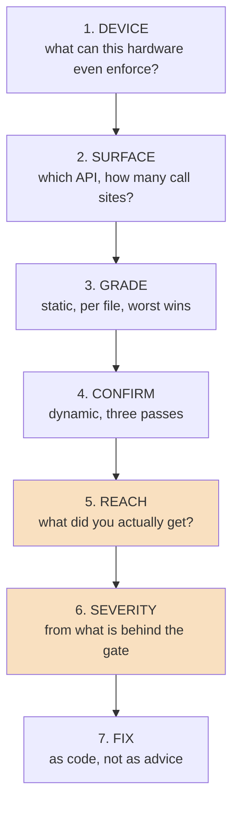

# Lab 03 — Audit a real app, end to end

> **Objective:** take an application you did not write and are authorised to test, determine whether
> its biometric authentication is real, and produce a finding whose severity you can defend under
> challenge. The deliverable is not a bypass. It is a paragraph.

| | |
|---|---|
| **Difficulty** | Intermediate to advanced |
| **Time** | 2–3 hours for a first pass |
| **Needs** | Any device; `jadx`; Frida optional but recommended |
| **Chapter sections** | [§5.3](../README.md), [§5.7](../README.md), [§6](../README.md), [§7](../README.md), [§8](../README.md) |
| **Files** | [`../scripts/grade-biometric-usage.py`](../scripts/grade-biometric-usage.py), [`../scripts/hook-biometric-prompt.js`](../scripts/hook-biometric-prompt.js), [`../scripts/probe-biometrics.sh`](../scripts/probe-biometrics.sh) |

> **Warning — scope**
> Run this only against an app you are authorised to test: your own, a deliberately vulnerable
> training app, or one covered by a written engagement scope. Instrumenting a third-party app on a
> device you own is a grey area in many jurisdictions and a clear breach of most terms of service.
> When in doubt, use a training target — [`../examples/`](../examples/README.md) builds two, and
> lab 04 provides a third.

---

## 0. The shape of the work

Most people run this backwards. They open Frida, hook something, watch a screen unlock, and then go
looking for a justification. That produces reports that fall apart on the first question from a
developer.

The order that works:



Steps 5 and 6 are shaded because they are the ones people skip, and they are the ones that make the
report survive review.

---

## 1. Step 1 — What can the device enforce?

Before you learn anything about the app, learn what its environment is capable of. A "bypass" on a
device whose keystore never enforced anything is not a finding about the app.

```bash
# host
./scripts/probe-biometrics.sh --json > /tmp/device-baseline.json
```

Then read the three lines that matter:

```bash
# host
grep -E 'securityLevel|enforcedBySecureHardware|strongbox' /tmp/device-baseline.json
```

| Reading | What it means for your findings |
|---|---|
| `securityLevel: SOFTWARE` | **You are on an emulator or a device with no TEE keystore.** Nothing you conclude about *enforcement* is transferable. Say so, or move to real hardware |
| `securityLevel: TRUSTED_ENVIRONMENT` | Normal. Enforcement is real |
| `securityLevel: STRONGBOX` | A discrete secure element; see chapter 50 |
| `strongbox_keystore: false` | The app cannot use StrongBox here even if it asks |

Also record the lock state, because it silently changes what a time-bound key does:

```bash
# adb shell
dumpsys trust | grep -o 'deviceLocked=[01]'
```

### 1.1 The counter baseline

```bash
# adb shell
dumpsys fingerprint
```

Write down `accept` and `acceptCrypto`. You will read them again after exercising the app, and the
delta is a zero-tooling verdict.

> **Pentester's Note**
> This step takes four minutes and it has saved entire engagements. On the API 30 device used for
> this chapter, `dumpsys biometric` produced **no output at all** while the phone plainly had a
> working fingerprint sensor. A tester who took that as "no biometric hardware" would have written
> the wrong report. Run all three dump commands.

---

## 2. Step 2 — Map the surface

### 2.1 Get every DEX, not just `base.apk`

```bash
# host
PKG=com.example.target
adb shell "pm path $PKG"
```

If more than one path comes back, the app is split. **Pull every one.** Chapter 38 measured a real
app showing *zero* security controls in `base.apk` because its code shipped in splits — a
methodology trap that produces a confident wrong answer.

```bash
# host
mkdir -p /tmp/audit && cd /tmp/audit
for p in $(adb shell "pm path $PKG" | tr -d '\r' | sed 's/package://'); do
    adb pull "$p" .
done
ls -la
```

### 2.2 Cheap triage before jadx starts

```bash
# host
for a in *.apk; do
    echo "== $a"
    unzip -p "$a" 'classes*.dex' | grep -ac 'androidx/biometric/BiometricPrompt'
    unzip -p "$a" 'classes*.dex' | grep -ac 'CryptoObject'
    unzip -p "$a" 'classes*.dex' | grep -ac 'setUserAuthenticationRequired'
done
```

> **Warning — this exact command has a bug you should know about**
> An earlier version of this triage piped the DEX through `strings`. On the machine this chapter was
> written on, `strings` on `PATH` was a Windows Sysinternals-style binary that does not behave like
> GNU `strings` on a pipe, and **every app in a 43-app sweep reported zero for every signal.** The
> output looked like a clean, confident result. `grep -a` on the inflated DEX avoids the dependency
> entirely.
>
> The general lesson is chapter 38's, inverted: *if a detector disagrees with you about every
> sample, suspect the detector* — exactly as you should when it agrees with you about every sample.
> Validate any new detector against a known-positive before you trust a negative. In this case,
> `../examples/` gives you three files with known grades.

### 2.3 Decompile and grade

```bash
# host
jadx -d jadx-out base.apk
python3 -B <chapter>/scripts/grade-biometric-usage.py jadx-out --show-evidence
```

**Read jadx's failure count from the tree, not from its console summary.** Chapter 56 measured jadx
reporting `finished with errors, count: 61` on a real 17.5 MB APK whose output tree contained
**2,104 refused methods across 1,424 files** — a 30× under-report. If your biometric class is among
the refused ones, you will be reading a stub and not know it:

```bash
# host
grep -rl "Failed to decompile\|JADX ERROR" jadx-out | wc -l
grep -rn "JADX ERROR" jadx-out | grep -i biometric
```

If the second command returns anything, fall back to smali for those classes (§6.3 of the chapter).

---

## 3. Step 3 — Read the grade critically

The grader gives you A–F per file, and a worst-grade-in-tree. **The worst grade is the finding**, but
the grade is a hypothesis, not a conclusion.

### 3.1 Confirm the grader is working on this tree

Before trusting a grade, sanity-check the tool against known input:

```bash
# host
python3 -B <chapter>/scripts/grade-biometric-usage.py <chapter>/examples/
# must print: A=1  B=1  D=1
```

If that does not reproduce, your Python, your paths or your checkout are wrong and nothing
downstream is trustworthy.

### 3.2 The two ways it lies

Both were measured against this chapter's own reference files, and both are general:

| Failure | Symptom | Guard |
|---|---|---|
| It reads comments | A documented source tree grades backwards | Comments are stripped by default; reproduce the bug with `--keep-comments` |
| It cannot resolve a named constant | A time-bound key grades **A** because the window is a symbol | Same-file constants are resolved; unresolved ones now force grade **C** with the symbol printed |

If a file grades **C** with "unresolved symbol", **that is the tool asking you to do the work**, not
a clean result. Go and read the constant.

### 3.3 What the grade cannot see

- Reflection (`Method.invoke("authenticate", ...)`).
- Native crypto behind JNI.
- Dynamically loaded DEX.
- A second, worse code path in a split you did not pull.
- Whether the gate protects anything worth protecting.

Write each of these down as a stated limitation of the static phase. A report that names its own
blind spots is believed; one that does not is audited.

---

## 4. Step 4 — Confirm dynamically, in three passes

```bash
# host
frida -U -n $PKG -l <chapter>/scripts/hook-biometric-prompt.js
```

### 4.1 Pass 1 — observe, change nothing

Exercise every biometric entry point you can find: first launch, re-launch, settings toggle, a
protected action, an expired session. Record for each:

| Entry point | `authenticate()` args | `KEYSPEC` line | `Cipher.init` before the prompt |
|---|---|---|---|
| | | | |

Multiple rows with different answers is the normal result for a large app, and the worst row is the
finding.

### 4.2 Pass 2 — forge

```
[1]-> forge()
[1]-> forge(true)      # if the first throws on a null CryptoObject
```

### 4.3 Pass 3 — adjudicate

```
[1]-> report()
```

and independently:

```bash
# adb shell
dumpsys fingerprint      # did acceptCrypto move?
```

### 4.4 The four possible outcomes

| Pass 3 shows | Verdict | What you may write |
|---|---|---|
| A real `Cipher.doFinal` succeeded after your forge | **Bypass confirmed** | "Protected data was decrypted without authentication" |
| `UserNotAuthenticatedException` | **Binding held** | "The biometric gate is cryptographically bound and resisted callback forgery" — this is a **pass**, report it as one |
| Nothing cryptographic ran at all | **UI-only gate** | "The gate is a UI control; its result is a boolean in the process" — then say what the UI exposed |
| Inconclusive | **Not a finding yet** | Nothing. Go back and exercise the protected path properly |

The script deliberately prints `INCONCLUSIVE` rather than guessing. Respect that.

---

## 5. Step 5 — What did you actually reach?

This is the step that separates a professional from an enthusiast. Answer, in writing:

1. **What is behind the gate?** Name the concrete data or action.
2. **Was it reachable without the bypass?** Check `SharedPreferences`, the app's databases, its
   files, `adb backup`, and the logs. Chapter 33's methods apply here.
3. **What did the bypass add?** If the answer is "nothing, the data was already readable", your
   finding is the storage, not the prompt.
4. **What did the bypass not get you?** Did the server still reject the session? Did a second factor
   still apply?

```bash
# adb shell, with root or run-as on a debuggable app
run-as $PKG ls -la /data/data/$PKG/shared_prefs /data/data/$PKG/databases
run-as $PKG cat /data/data/$PKG/shared_prefs/*.xml | head -50
```

> **Pentester's Note — `run-as` refuses in two distinct ways**
> Chapter 60 measured this precisely: a debuggable third-party app succeeds; a debuggable **system**
> app returns `package not an application`; a non-debuggable app returns `package not debuggable`.
> The real rule is `FLAG_DEBUGGABLE` **and** an application uid. Reading the first message as "not
> debuggable" loses a genuine finding.

Also check the SQLite write-ahead log, not just the tables:

```bash
# adb shell
run-as $PKG ls -la /data/data/$PKG/databases/
# a *-wal file can hold rows the database reports as deleted -- chapter 33 measured
# four secrets readable in a 61,832-byte WAL after a logout deleted two rows
```

---

## 6. Step 6 — Severity, defended

Use this table, and write the row you chose into the report:

| What is behind the gate | Also reachable without the bypass? | Severity |
|---|---|---|
| A UI screen; every action re-authenticates server-side | — | **Informational** |
| Data stored in plaintext or a reversible encoding | **Yes** | **Low** — and the *real* finding is the storage |
| A session token or credentials, otherwise encrypted at rest | No | **High** |
| Payment authorisation or transaction signing | No | **High to Critical** |
| Anything, but the exploit needs the device credential first | — | **Reduce one level**, and state the precondition |
| Anything, but the exploit needs root or code execution | — | **State the precondition explicitly** |

The last two rows are where reports lose credibility. A finding that requires root is still a
finding — many threat models include a stolen and rooted phone — but it is a different finding from
one that does not, and pretending otherwise is what makes developers stop reading.

### 6.1 The paragraph

Write it now, before you feel finished. Template:

> **Finding.** The application's biometric unlock is implemented with a one-argument
> `BiometricPrompt.authenticate(PromptInfo)` call and no `AndroidKeyStore` key configured with
> `setUserAuthenticationRequired(true)`. The result of the prompt is a boolean field in the
> application process.
>
> **Evidence.** Static: `<file>:<line>` shows the one-argument call; the grader reports grade D; no
> `setUserAuthenticationRequired` appears anywhere in the merged DEX set (N splits pulled).
> Dynamic: a forged `onAuthenticationSucceeded` unlocked the vault with no biometric presented;
> `dumpsys fingerprint` shows `acceptCrypto` unchanged across the session.
>
> **Reach.** The bypass exposed `<concrete data>`. This data is/is not independently readable from
> `<location>`.
>
> **Precondition.** Code execution in the application process (root, an instrumented device, or a
> repackaged build).
>
> **Severity.** `<row from the table>`, because `<reason>`.
>
> **Remediation.** `<code, from §7>`

---

## 7. Step 7 — The fix, as code

Never write "use a CryptoObject" and stop. Write the diff.

```java
// BEFORE
prompt.authenticate(promptInfo);

@Override
public void onAuthenticationSucceeded(BiometricPrompt.AuthenticationResult result) {
    this.unlocked = true;
    showVault();
}
```

```java
// AFTER
// 1. key: per-use, Class 3 only, invalidated on re-enrolment
KeyGenParameterSpec.Builder b = new KeyGenParameterSpec.Builder(ALIAS,
        KeyProperties.PURPOSE_ENCRYPT | KeyProperties.PURPOSE_DECRYPT)
    .setBlockModes(KeyProperties.BLOCK_MODE_GCM)
    .setEncryptionPaddings(KeyProperties.ENCRYPTION_PADDING_NONE)
    .setKeySize(256)
    .setUserAuthenticationRequired(true)
    .setInvalidatedByBiometricEnrollment(true);
if (Build.VERSION.SDK_INT >= Build.VERSION_CODES.R) {
    b.setUserAuthenticationParameters(0, KeyProperties.AUTH_BIOMETRIC_STRONG);
}
// NOTE: no setUserAuthenticationValidityDurationSeconds. A positive window is satisfied by any
// device unlock in that period, by any process, with no prompt from this app.

// 2. prompt: ask for STRONG only, and pass the pending operation
promptInfo = new BiometricPrompt.PromptInfo.Builder()
    .setTitle("Unlock")
    .setAllowedAuthenticators(BiometricManager.Authenticators.BIOMETRIC_STRONG)
    .setNegativeButtonText("Use password")
    .setConfirmationRequired(true)
    .build();
prompt.authenticate(promptInfo, new BiometricPrompt.CryptoObject(cipher));

// 3. use the cipher FROM THE RESULT, never from a field
@Override
public void onAuthenticationSucceeded(BiometricPrompt.AuthenticationResult result) {
    BiometricPrompt.CryptoObject co = result.getCryptoObject();
    if (co == null || co.getCipher() == null) { fail(); return; }
    showVault(new String(co.getCipher().doFinal(ciphertext), StandardCharsets.UTF_8));
}

// 4. verify at runtime that the platform honoured what you asked for
KeyInfo info = (KeyInfo) SecretKeyFactory
        .getInstance(key.getAlgorithm(), "AndroidKeyStore")
        .getKeySpec(key, KeyInfo.class);
if (!info.isUserAuthenticationRequired()
        || info.getUserAuthenticationValidityDurationSeconds() > 0
        || !info.isUserAuthenticationRequirementEnforcedBySecureHardware()) {
    disableBiometricUnlock("key binding not enforced by secure hardware");
}
```

Point 4 is not padding. This chapter measured a builder accepting
`setInvalidatedByBiometricEnrollment(true)` on a time-bound key and reading it back as `false`, with
no error and no warning. The only defence against that class of platform behaviour is to read the
key back and refuse to proceed if it is not what you asked for.

The full reference is [`../examples/02-CryptoBoundVault.java`](../examples/02-CryptoBoundVault.java).

---

## 8. Worked shape — what a sweep actually looks like

### 8.1 A real sweep, measured

Thirty-eight third-party applications installed on the Redmi `M2101K6P` (Android 11 / API 30) were
pulled — every split, not just `base.apk` — and every `classes*.dex` in each was searched for the
symbols in §2.2.

| Stage | Apps | Share |
|---|---:|---:|
| Third-party apps scanned | **38** | — |
| Reference **any** biometric prompt API (`androidx.biometric.BiometricPrompt`, platform `BiometricPrompt`, or `FingerprintManager`) | **16** | 42% |
| Reference `CryptoObject` | **13** | 34% |
| Reference `setUserAuthenticationRequired` **anywhere** | **4** | 11% |
| Have **both** a prompt surface **and** `setUserAuthenticationRequired` | **3** | **8%** |

**Sixteen apps present a biometric surface. Three of them so much as mention the flag that makes a
biometric mean anything.**

That is this chapter's thesis as a measurement rather than an argument, and it lines up with the
shape of every analogous sweep in this repository: chapter 36 found 12 of 14 apps with a *pinning
surface* and only 4 that actually pinned.

### 8.2 Why this is a lead count, not a finding count — four honest caveats

**These are string references in DEX, not call sites.** A symbol in the constant pool proves the
type is referenced somewhere in the merged code, not that the app calls it on a reachable path.
Every one of the sixteen needs jadx and §3 before it becomes a grade.

**The `CryptoObject` column is structurally inflated.** `androidx.biometric` *defines*
`BiometricPrompt$CryptoObject`, so any app bundling the library carries the reference whether or not
it ever constructs one. This is the same class of false positive as chapter 38's mapper reporting a
self-signature check in 18 of 18 APKs because `getPackageInfo` is how every SDK reads its own
version string. Treat the `CryptoObject` count as "the library is present".

**Two of the four `setUserAuthenticationRequired` apps show no prompt API at all.** In the measured
data, `com.vendor.oemshop` and `com.vendor.marketplace` reference the key flag with no
`androidx.biometric` or platform `BiometricPrompt` reference alongside it. That is not a
contradiction: an auth-bound key can be gated on the *device credential* rather than a biometric, or
the flag can sit unused inside a bundled SDK. It is a reminder that a symbol tells you a library was
compiled in, not what the app does.

**One app's `base.apk` is 326 KB.** `com.vendor.professionalnet`'s installed base package contains almost
no code. Whatever it does happens in code that is not in the package you just scanned. Chapter 38
measured exactly this trap — an app reporting zero security controls in `base.apk` because its code
ships in splits — and a scan that does not notice it will confidently report an absence that is not
there.

> **Mental Model**
> Read the funnel as three questions, each narrower than the last: *does the app have a biometric
> surface?* (16), *does it have the vocabulary of binding?* (13, mostly from a bundled library),
> *does it have the one flag that creates the guarantee?* (4). Only the third question is about
> security, and only jadx plus §3 turns it into an answer.

### 8.3 The distribution to expect

Based on this repository's measurements of analogous sweeps:

| Sweep | Result | Chapter |
|---|---|---|
| 17 MB commercial app, secrets | 16,836 raw hits → 168 leads → **15 of 17 HIGH rejected by hand**; the real finding sat at MEDIUM | 52 |
| 14 apps, certificate pinning | 12 had a pinning *surface*; only **4** actually pinned | 36 |
| 18 APKs, anti-tamper | mapper first reported 18/18 self-signature checks; **13/18** after the patterns were anchored | 38 |
| Chrome data, secret hunting | **132 high-confidence hits, 132 false positives** | 33 |

The pattern is identical every time: **a sweep produces leads, not findings, and confidence ranking
is not severity ranking.** Budget your time for adjudication, not for scanning.

---

## 9. Success criteria

- [ ] A device baseline recorded, including keystore security level and lock state.
- [ ] Every split pulled, with the count written down.
- [ ] The grader validated against `../examples/` before being trusted on the target.
- [ ] A per-entry-point table from pass 1 (args, `KEYSPEC`, pre-prompt `Cipher.init`).
- [ ] A pass-3 verdict, not a pass-2 screenshot.
- [ ] Before/after `acceptCrypto` counters.
- [ ] An explicit answer to "was this data reachable without the bypass?"
- [ ] A severity chosen from §6's table, with the row named.
- [ ] A remediation written as a code diff.
- [ ] A written list of what your analysis could **not** see.

---

## 10. Hints

<details>
<summary>The app has no biometric code at all and I expected some</summary>

Check, in order: did you pull every split? Is there a dynamically loaded DEX (chapter 13's
`dump-loaded-dex.js`)? Is the app using a cross-platform framework (React Native, Flutter, Xamarin)
where the biometric call lives in a plugin under a different package name? Search for `LocalAuth`,
`local_auth`, `Fingerprint` and `TouchID` as well.
</details>

<details>
<summary>Frida attaches and immediately dies</summary>

Anti-instrumentation. That is chapters 37, 38 and 67's territory, not this one. Note it as a finding
in its own right and consider a static-only assessment plus a patched build.
</details>

<details>
<summary>The prompt appears but no hook fires</summary>

The app may be calling the platform `BiometricPrompt` through a wrapper, or using reflection. The
script hooks implementations rather than call sites, so reflection is transparent to it — but a
wrapper *class* in the app is not hooked. Try
`android hooking search classes biometric` in objection to find the wrapper.
</details>

<details>
<summary>The grade is A but I still think something is wrong</summary>

Good instinct. Grade A is a claim about the code path that was *found*. Look for a second path: a
legacy `FingerprintManager` branch for old API levels, a "remember me" flow that skips the prompt
entirely, or a debug/QA build flag. The worst path is the finding.
</details>

---

## 11. Where to go next

- [Lab 04 — CTF: The Fifth Finger](lab-04-ctf-the-fifth-finger.md) tests whether you can apply this
  method under time pressure, including one flag that cannot be taken by attacking the biometric at
  all.
- [52 — Static Analysis](../../52-StaticAnalysis/README.md) for the funnel discipline this lab
  borrows.
- [71 — OWASP Mobile](../../71-OWASP-Mobile/README.md) for placing the finding in MASVS-AUTH.
