# 48 — Biometrics · Mind Map

One map of the whole chapter. Read the centre first: everything else hangs off the single question
in **The one idea**.

```mermaid
mindmap
  root((48<br/>Biometrics))

    The one idea
      A callback is a public Java method
        anyone with code execution can call it
        AuthenticationResult is an ordinary object
        no signature, no token, nothing unforgeable
      Binding is the only real thing
        CryptoObject wraps a pending operation
        key has setUserAuthenticationRequired true
        KeyMint in the TEE refuses without a token
        root does not reach the TEE
      The test
        "did a crypto operation succeed<br/>that would otherwise have failed?"
        if no - a dialog was displayed

    API surface
      FingerprintManager
        API 23, deprecated at 28
        app draws its OWN dialog
        no credential fallback
        CAN still bind properly
        grade F only when no CryptoObject
      BiometricPrompt platform
        API 28
        system-drawn dialog
        version-gated constants
      androidx.biometric
        what real apps use
        delegates above 28
        DRAWS ITS OWN DIALOG on 23-27
        survives R8 - your static anchor
      Version fragmentation
        29 canAuthenticate no-arg
        29 setDeviceCredentialAllowed
        30 Authenticators constants
        30 setAllowedAuthenticators
        30 setUserAuthenticationParameters
        31 SECURITY_UPDATE_REQUIRED

    canAuthenticate
      0 SUCCESS
      1 HW_UNAVAILABLE
      11 NONE_ENROLLED
      12 NO_HARDWARE
      15 SECURITY_UPDATE_REQUIRED
      Answers "can ANY of these succeed"
        STRONG returned 11
        STRONG or CREDENTIAL returned 0
        same device, same run
      no-arg form equals BIOMETRIC_WEAK

    Classes CDD 7.3.10
      Class 1 Convenience
        not exposed to apps at all
      Class 2 Weak 0x00FF
        drives the prompt
        NEVER releases a token
        cannot back a key
      Class 3 Strong 0x000F
        hardware trust chain
        the only class that can back a key
      STRONG bits are a SUBSET of WEAK
      Class is architectural, not accuracy

    The key
      setUserAuthenticationRequired
        the master switch
      Per-use
        no validity window
        operationId in the token
        Cipher.init ALWAYS throws
      Time-bound
        AUTH_TIMEOUT tag
        satisfied by ANY process
        1s refused / 30s flipped / 86400s always open
        work in the try branch is the tell
      setInvalidatedByBiometricEnrollment
        stops the enrolment attack
        SILENTLY IGNORED on time-bound keys
      setUserAuthenticationParameters
        timeout 0 equals per-use
        AUTH_BIOMETRIC_STRONG excludes the PIN
        legacy setter defaults to authType 3
      KeyInfo read-back
        nobody does it
        enforcedBySecureHardware is the real line

    Under the hood
      Sensor to TEE on a trusted path
      Template never enters Android
      Match happens in the secure world
      HardwareAuthToken
        challenge, SID, authenticator id, type, timestamp
        HMAC under a shared key
        crosses TEE to TEE, not via Android
      KeyMint tags
        NO_AUTH_REQUIRED
        USER_SECURE_ID
        USER_AUTH_TYPE
        AUTH_TIMEOUT
      system_server is trusted by APPS, not by the TEE

    Attacks
      Forge onAuthenticationSucceeded
      Write the boolean field
      Repackage and invert the branch
      Fail-open on canAuthenticate
      Fail-open on onAuthenticationError
      Force ERROR_LOCKOUT - no tooling
      Enrol your own finger
      Wait inside the time window - no tooling
      The no-tooling attacks carry the higher severities

    Dynamic
      Three passes
        1 observe - record CryptoObject
        2 forge - does the UI open
        3 adjudicate - did crypto run
      hook-biometric-prompt.js
        keys, forge, forge true, report
        prints INCONCLUSIVE rather than guessing
      probe-biometrics.sh
        no root, no APK, app_process
        needs AndroidKeyStoreProvider install
        cannot reach Gatekeeper as shell
      dumpsys fingerprint
        accept vs acceptCrypto
        measured 3 and 0 on a real phone
      dumpsys trust deviceLocked

    Static
      One argument or two
      Smali descriptors are unambiguous
      Decode the constant
        0xf 0xff 0x8000
        0xe10 one hour
        0x15180 one day
      grade-biometric-usage.py A to F
      Two ways a grader lies
        it reads comments
        it cannot resolve a named constant
        reports absence of problem, not absence of evidence
      Sweep of 38 real apps
        16 with a prompt surface
        13 reference CryptoObject
        4 mention setUserAuthenticationRequired
        3 have both

    Reverse engineering
      androidx names survive R8
      Unused AuthenticationResult parameter
      Synthetic boolean setter in the callback
      getCryptoObject then getCipher then doFinal
      Reflection is the one thing that breaks descriptors
      Native crypto blinds pass 3
      Pull every split

    Modalities
      Fingerprint - ACTIVE, deliberate touch
      Face - PASSIVE, authenticates the unaware
      Iris - passive-ish
      setConfirmationRequired restores intent
      "Face unlock" is three different things
        Class 3 structured light
        Class 2 or 1 camera match
        OEM system outside the framework entirely

    Honest reporting
      What is behind the gate?
      UI reached vs data reached
      Device finding vs app finding
      State the precondition
      A sweep produces leads, not findings
      Presentation attacks are a hardware assessment

    Boundaries
      47 sessions, credentials, MFA
      49 key material and the KeyStore API
      50 TEE, StrongBox, Gatekeeper, attestation
      33 storage of what the gate protects
      37 and 38 anti-tamper
      67 bypass methodology
```

---

## How to use this map

**Left to right is not a reading order.** The branches are independent views of the same subject and
you should enter from whichever matches your task:

| You are | Start at |
|---|---|
| Learning the topic | *The one idea*, then *API surface*, then *The key* |
| Auditing an APK statically | *Static*, then *Reverse engineering* |
| Testing a running app | *Dynamic*, then *Attacks*, then *Honest reporting* |
| Writing the implementation | *The key*, then *Classes*, then *Under the hood* |
| Writing the report | *Honest reporting*, then *Attacks* for the precondition |

**The two branches most people skip** are *Honest reporting* and the *no-tooling* leaves under
*Attacks*. They are where the professional difference lives: the attacks that need nothing carry the
higher severities, and the finding you can defend is worth more than the one that demos well.
