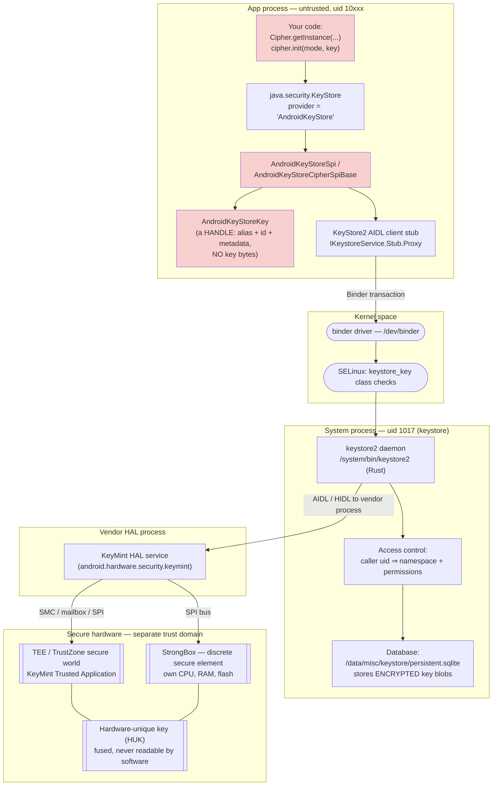
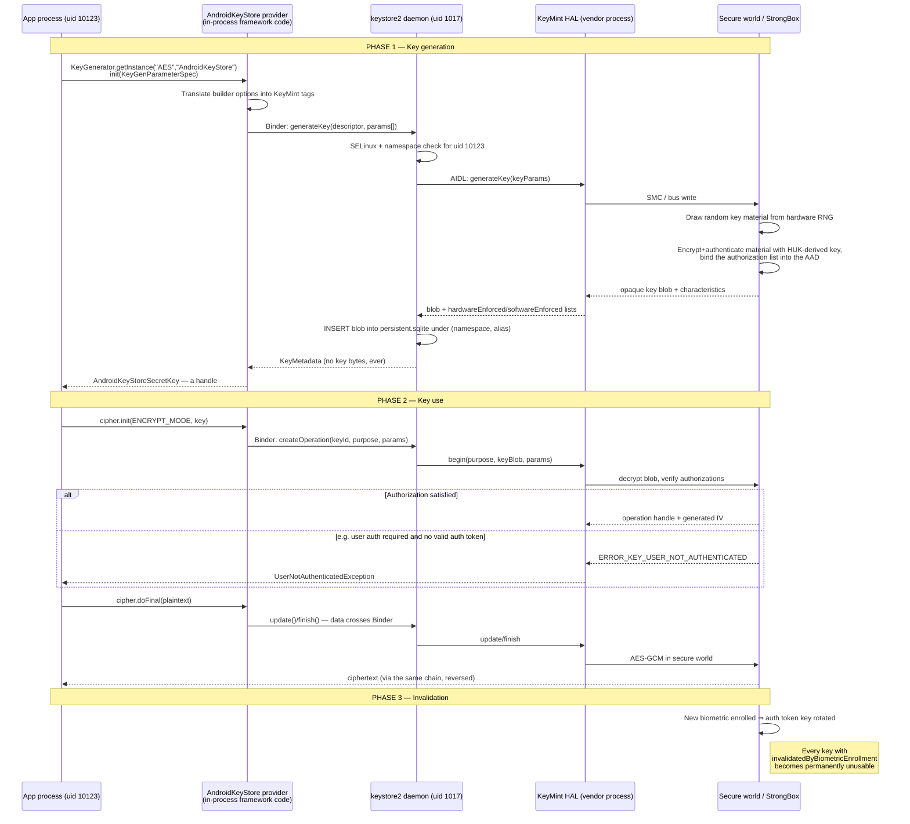
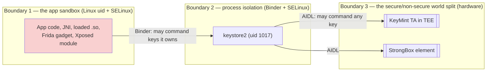
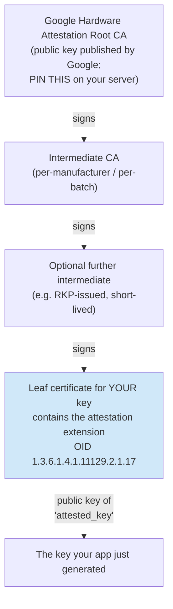
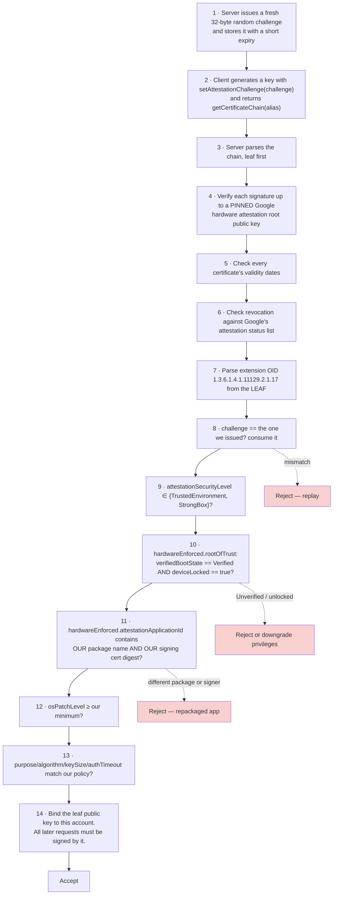
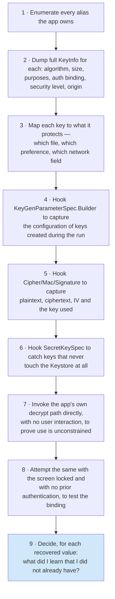
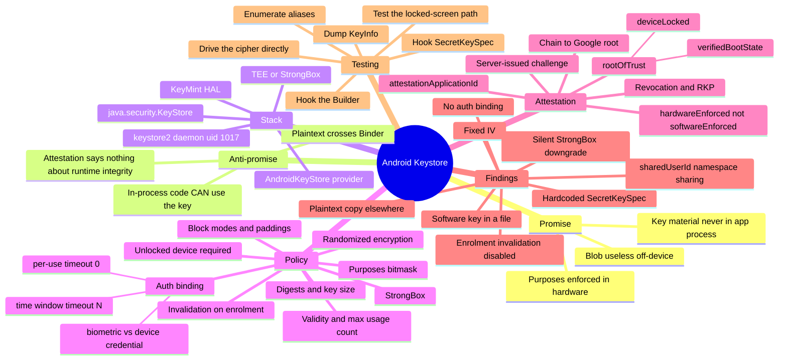

# 49 — Android Keystore

> After this chapter you can state precisely what the Android Keystore guarantees and what it does not, generate and inspect a key with every relevant `KeyGenParameterSpec` option, read a key attestation certificate field by field, enumerate and profile every key an app holds on a live device, and prove — with a Frida script in front of the developer — that "we store it in the Keystore" is not the same sentence as "an attacker cannot use it".

**Prerequisites:** [04 — Java](../04-Java/README.md), [20 — Security Architecture](../20-Security-Architecture/README.md), [21 — App Sandbox](../21-App-Sandbox/README.md), [24 — IPC](../24-IPC/README.md), [25 — Binder](../25-Binder/README.md), [33 — Storage](../33-Storage/README.md), [34 — Cryptography](../34-Cryptography/README.md), [47 — Authentication](../47-Authentication/README.md)

**Useful alongside:** [48 — Biometrics](../48-Biometrics/README.md) — this chapter owns key material and the Keystore API surface, and explains `setUserAuthenticationRequired` on its own terms; 48 is where the auth-bound key is demonstrated against a live prompt. 48 names this chapter a prerequisite; this chapter does not need 48 first. [50 — Hardware-Backed Security](../50-HardwareBackedSecurity/README.md) for what the TEE underneath is actually doing.

**Applies to:** Android 4.3 (API 18) through Android 16 (API 36). The working baseline for this chapter is Android 12–16 (API 31–36), where the `keystore2` daemon and the KeyMint HAL are in place. Behaviour on older releases is flagged in Version Matrix tables throughout.

---

## Table of Contents

1. [Introduction](#1-introduction)
2. [High-Level Architecture](#2-high-level-architecture)
3. [Deep Internal Working](#3-deep-internal-working)
4. [Source Code Walkthrough (AOSP)](#4-source-code-walkthrough-aosp)
5. [Security Perspective](#5-security-perspective)
6. [Reverse Engineering Perspective](#6-reverse-engineering-perspective)
7. [Dynamic Analysis](#7-dynamic-analysis)
8. [Static Analysis](#8-static-analysis)
9. [Examples](#9-examples)
10. [Common Interview Questions](#10-common-interview-questions)
11. [Common Mistakes](#11-common-mistakes)
12. [Hands-on Labs](#12-hands-on-labs)
13. [Summary](#13-summary)
14. [References](#14-references)

---

## 1. Introduction

### 1.1 The problem: a secret that must be used but must not be readable

Consider a bank application. When you log in, the server hands it a session token. The application must be able to present that token again tomorrow morning without asking you to type your password. So the token has to be stored somewhere on the phone.

Where? The application's private directory, `/data/data/com.bank.app/`, is protected by the Linux user-ID sandbox: no other application can read it. That is a real protection and it stops most attacks. But it is a protection *provided by the operating system to a process*, and it has three well-known failure modes:

1. **A rooted device.** The `root` user reads every file. The person holding the phone can become `root`. Your sandbox evaporates.
2. **A backup, a bug, or a leak.** Files get copied into `adb backup` archives, into crash-report attachments, into cloud backup, into a world-readable log, into external storage by an over-broad "export data" feature.
3. **Offline analysis of the flash chip.** If the device is powered off and the attacker desolders the storage, file permissions are metadata in a filesystem they now control.

The obvious next thought is: *encrypt the token before writing it*. Good — but with what key? If the encryption key is a constant in your code, an attacker reads it out of the APK in ninety seconds. If it is derived from a device identifier, the attacker computes it. If it is randomly generated at first run and saved to a file, you have moved the problem: now the attacker steals the key file instead of the token file.

This is the **key storage regress**. Every layer of encryption you add on top of a file needs a key, and that key needs storage, and that storage needs protection. The regress only terminates when you reach something that is *not a file* — something that can perform cryptographic operations on your behalf without ever handing you the key material.

That thing is the **Android Keystore**.

> **Definition — key material**
> The actual bytes of a cryptographic key: for AES-256, thirty-two specific bytes; for RSA, the modulus and the private exponent. Key material is the thing that must never leak. Everything else about a key — its algorithm, its size, its allowed uses — is metadata and is not secret.

> **Definition — Android Keystore**
> A system service that generates, stores and *operates* cryptographic keys on behalf of applications, in such a way that the key material is never returned to the calling application and, on the overwhelming majority of modern devices, never exists in any form inside the phone's main operating system at all. The application holds only a *handle* — an alias string and a Java object that refers to a key it can command but cannot read.

### 1.2 The physical-world analogy

Imagine a bank branch with a signing machine bolted to the floor behind bulletproof glass. You can pass documents through a slot. The machine stamps them with the bank's seal and passes them back. You can use the seal as often as the bank's rules allow. You can never see the seal, hold it, photograph it, or take it home.

Three consequences fall straight out of that picture, and understanding them is the whole chapter:

- **You cannot steal the seal.** Even if you smash up the lobby, the seal is behind the glass. Copying the branch's furniture to another town gives you nothing.
- **But while you are standing at the slot, you can stamp whatever you like.** If you get into the lobby, you can stamp a thousand fraudulent documents. You never learn the seal's shape, and you do not need to.
- **The bank can limit you at the slot.** It can require you to show ID before each stamp, refuse to stamp after closing time, refuse to stamp more than five documents, and refuse to stamp anything except a specific form. Those limits are enforced by the machine, not by your politeness.

The Android Keystore is that machine. The limits it can enforce are the `KeyGenParameterSpec` options in §3.5. The lobby is your application's process. And "getting into the lobby" is exactly what a Frida script does.

### 1.3 The promise, stated precisely — and the anti-promise

This is the single most important paragraph in the chapter, and the one that decides the severity rating of roughly half the findings you will ever write in this area. Read it twice.

> **Mental Model — extraction versus use**
> The Android Keystore protects the **confidentiality of key material**. It does not, by itself, protect the **use of the key**.
>
> An attacker who achieves code execution inside your application's process — through Frida, through a Zygote-injected module, through LSPosed, through a malicious dynamically loaded library, or through a memory-corruption bug in your own native code — **cannot extract the key**, and **can freely use it**. They will call the same `Cipher` object your code calls, with the same key handle, and receive the same plaintext your code receives.
>
> The Keystore's guarantee is: *the key does not leave the device and does not survive off the device.* Its guarantee is **not**: *only your legitimate code path may invoke the key.*

Write this out in your own words before you continue. Then hold it against these two findings, which look similar and are not:

| Finding | What actually happened | Real severity |
|---|---|---|
| App stores an AES key as a hardcoded `byte[]` and uses `SecretKeySpec` | The key is in the APK. Anyone who downloads the app from the store, on any device, extracts it. It decrypts **every user's** data. No device access needed. | **High to Critical** — a break-once-run-everywhere key compromise |
| App generates an AES key in the Keystore, and a rooted user hooks `Cipher.doFinal` to read plaintext | The attacker had to root **their own** device and instrument **their own** app instance. They obtained only their own data, which they already had. The key itself did not leave the device. | **Informational to Low** — unless the plaintext is somebody else's secret, or the key gates a server-side privilege |

If you rate the second finding as "High — cryptographic key compromise" you will be corrected by any competent reviewer, and rightly. If you rate the first as "Low — requires reverse engineering" you have failed the client. The distinction is not pedantry; it is the job.

> **Pentester's Note**
> The corollary is that hooking a Keystore-backed `Cipher` is not, on its own, a *finding*. It is a *demonstration*. It becomes a finding when the plaintext you recover is something the current user should not have — a shared secret, an HMAC key used for server-side authorisation, a licence key, another user's data, or a value that lets you forge requests the server trusts. Always answer the question: **what did I learn that I did not already have?**

### 1.4 What would break if the Keystore did not exist

- **Disk-encryption keys would have to live in RAM in a readable form.** Android's file-based encryption derives keys inside the same hardware the Keystore uses; without it, an attacker with a cold-boot or DMA attack reads the disk key.
- **Lock-screen credential verification would be pure software.** Any offline copy of the password hash could be brute-forced at GPU speed. Gatekeeper's hardware-enforced throttling (see [50 — Hardware-Backed Security](../50-HardwareBackedSecurity/README.md)) is what makes a four-digit PIN survive theft.
- **Biometric authentication would be advisory.** `BiometricPrompt` returning "true" would be a boolean an attacker flips. Binding a Keystore key to authentication is what turns a boolean into a cryptographic fact. See [48 — Biometrics](../48-Biometrics/README.md).
- **There would be no anchor for device attestation.** "Is this a real, unmodified Pixel?" is answerable only because a key that cannot be extracted signs a statement about the device. Without it, every integrity check is a client-side boolean, and client-side booleans are negotiable.
- **A stolen phone would be a stolen database.** The whole point of `setUnlockedDeviceRequired` and auth-bound keys is that the flash contents are inert without the human.

### 1.5 The three sentences you will hear from developers

You will hear these in every engagement. Learn to answer them.

**"The token is safe because we use the Android Keystore."** Ask *what* is in the Keystore. Nine times out of ten it is an AES key that wraps a token stored in `SharedPreferences`, with no authentication binding, in an app with no anti-instrumentation. That is a reasonable design and a genuine improvement over plaintext. It is not "safe" against a rooted user, and it was never meant to be.

**"It is hardware-backed, so it cannot be compromised."** Ask them to show you `KeyInfo.getSecurityLevel()` output. Then ask what stops a hooked `Cipher` call. Hardware backing raises the cost of *extraction* to near-infinite; it does nothing about *use*.

**"We encrypt with AES-256, so it is military grade."** Ask where the key comes from. In the finding catalogue in §5.2 you will see that the algorithm is almost never the weakness. The key's *provenance* is.

---

## 2. High-Level Architecture

### 2.1 The full stack, from your `Cipher` call to the silicon



Walk the diagram from the top, because every arrow is a place where a tester can stand.

Your code calls a perfectly ordinary JCA (Java Cryptography Architecture) API: `Cipher.getInstance("AES/GCM/NoPadding")`. Nothing about that line says "hardware". The magic is in the `Key` object you pass to `init()`. If that key came from `KeyStore.getInstance("AndroidKeyStore")`, it is an instance of `AndroidKeyStoreSecretKey`, and — this is the crucial fact — **calling `getEncoded()` on it returns `null`**. There are no bytes to return. The object is a handle: an alias, a numeric key ID, a security level, and a copy of the key's metadata.

When `Cipher.init()` runs, the JCA framework looks up the `CipherSpi` implementation registered by the `AndroidKeyStore` provider rather than the default Conscrypt one. That implementation does not perform AES in your process. It opens a *KeyMint operation* through Binder and streams your data through it.

The Binder call lands in `keystore2`, a daemon written in Rust running as UID 1017 (`keystore`). It is a separate process, so it is a separate memory space and a separate SELinux domain. `keystore2` performs access control — which caller may touch which key — and then forwards the operation to the KeyMint HAL.

The KeyMint HAL is vendor code. Its job is to marshal the request across whatever physical channel reaches the secure hardware: on ARM systems-on-chip this is typically an `SMC` (Secure Monitor Call) instruction that traps to EL3 and switches the CPU into the secure world; for StrongBox it is usually a serial bus such as SPI to a physically separate chip.

Inside the secure world, the KeyMint trusted application decrypts the key blob using a hardware-unique key that software has never seen and cannot read, checks the authorisations attached to the blob, performs the AES operation, and returns only the ciphertext or plaintext.

> **Under the Hood**
> Notice what crosses the trust boundary in each direction. **Into** the secure world: the encrypted key blob, the operation parameters, your data. **Out of** the secure world: the result of the operation, and never the key. That asymmetry is the entire security property. Everything in the app process — including your `Cipher` object, your `SecretKey` handle, and your plaintext buffers — is on the attacker's side of the line the moment the attacker has code execution in your process.

### 2.2 The lifecycle of one key, as a sequence



Three things in that sequence deserve attention now and will be developed in §3.

First, **your plaintext crosses Binder**. The secure world does the cryptography, but the data being encrypted travels from your process, through the kernel's Binder driver, into `keystore2`, into the HAL, and into the TEE. Anyone with root can observe that path. The Keystore protects keys, not data in transit through the system.

Second, **authorisation is checked at `begin()`**, not at `getKey()`. Retrieving a key handle always succeeds if the alias exists and you own it. The failure — `UserNotAuthenticatedException`, `KeyPermanentlyInvalidatedException` — happens when you try to *start an operation*. This is why buggy apps look fine until the user changes their fingerprint.

Third, **invalidation is a side effect of an event in the secure world**, not a decision your app makes. Your app finds out by catching an exception.

### 2.3 Where the bytes physically live

```
Device filesystem
└── /data/misc/keystore/                      ← SELinux: keystore_data_file, uid 1017
    ├── persistent.sqlite                     ← Android 12+ (keystore2): key blobs + metadata
    ├── persistent.sqlite-shm / -wal
    └── user_0/                               ← Android ≤ 11 (legacy keystore daemon)
        ├── 10123_USRPKEY_my_ec_key           ← <uid>_USRPKEY_<alias>  : private key blob
        ├── 10123_USRCERT_my_ec_key           ← leaf certificate
        ├── 10123_CACERT_my_ec_key            ← chain
        └── .masterkey                        ← legacy software-encryption master key

Inside a blob (conceptual, vendor-specific):
┌───────────────────────────────────────────────────────────────┐
│ version │ nonce/IV │ AES-GCM(key material, K_huk-derived)      │
│         │          │ tag over (ciphertext ‖ authorization list)│
├───────────────────────────────────────────────────────────────┤
│ hardware-enforced authorization list (ALGORITHM, PURPOSE,      │
│ KEY_SIZE, BLOCK_MODE, PADDING, DIGEST, USER_AUTH_TYPE,         │
│ AUTH_TIMEOUT, ORIGIN, OS_VERSION, OS_PATCHLEVEL, …)            │
├───────────────────────────────────────────────────────────────┤
│ software-enforced authorization list (CREATION_DATETIME, …)    │
└───────────────────────────────────────────────────────────────┘
```

> **Definition — key blob**
> The on-disk representation of a Keystore key. It is *ciphertext*: the key material encrypted, with an authenticated cipher, under a key derived from the device's hardware-unique key (HUK) — a value fused into the SoC at manufacture, readable only by the secure world's crypto engine, and different on every single device. The authorization list is included in the authentication tag, so an attacker cannot flip "requires fingerprint" to "does not require fingerprint" and have the blob still verify.

This explains a fact that surprises people: **a stolen key blob is worthless.** Copy `persistent.sqlite` to another phone, to a laptop, to a cluster of GPUs — the HUK is not there. There is no password to guess, no KDF to attack, no reduced key space. The blob decrypts on exactly one piece of silicon, and only from inside its secure world.

> **Warning**
> "Worthless off-device" is not "worthless". A blob plus the original device plus root is still an oracle: root can ask `keystore2` to use keys belonging to other UIDs only if SELinux and the namespace checks allow it, which on a stock policy they largely do not — but root can also inject into the owning process, which is the easier path. See §5.2, Finding 9.

### 2.4 Trust boundaries, drawn explicitly



A finding's severity is a function of which boundary the attacker crossed.

| Attacker position | Can read key material? | Can use the key? | Typical route |
|---|---|---|---|
| Another app on the device | No | No | Blocked by uid separation and keystore namespaces |
| Code in the target app's process | No | **Yes, fully** | Frida, LSPosed, malicious SDK, native bug |
| `root` on the device | No (blob is opaque) | Yes, by injecting into the app | Magisk |
| Kernel compromise | No | Yes | Kernel exploit |
| TEE compromise | **Yes** | Yes | TA vulnerability — see [50](../50-HardwareBackedSecurity/README.md) |
| Physical, chip-off, device off | No | No | HUK not extractable by this method |

Note the column that stays "No" almost all the way down. That is what you are buying. Note the column that turns "Yes" on the second row. That is what you are not.

---

## 3. Deep Internal Working

### 3.1 What the Keystore *is*, as an object graph

The Android Keystore is exposed through the standard Java Cryptography Architecture. That is a deliberate design decision with a security consequence, so it is worth being precise about the pieces.

> **Definition — JCA provider**
> The Java Cryptography Architecture is a plug-in system. A *provider* registers implementations of abstract "service provider interface" (SPI) classes — `KeyStoreSpi`, `CipherSpi`, `SignatureSpi`, `KeyGeneratorSpi`, `KeyPairGeneratorSpi`, `MacSpi` — under names. When you call `Cipher.getInstance("AES/GCM/NoPadding")`, the framework searches registered providers in priority order for one that offers that transformation. When you call `Cipher.getInstance("AES/GCM/NoPadding", "AndroidKeyStore")` you demand a specific provider.

| Class | Package | Role |
|---|---|---|
| `java.security.KeyStore` | JDK | Generic keystore façade; `getInstance("AndroidKeyStore")` selects Android's |
| `AndroidKeyStoreProvider` | `android.security.keystore2` | Registers all the SPIs under the provider name |
| `AndroidKeyStoreSpi` | `android.security.keystore2` | Implements `aliases()`, `getKey()`, `deleteEntry()`, `setEntry()` |
| `AndroidKeyStoreKey` | `android.security.keystore` | Base class of the *handle*; holds alias + `KeyDescriptor`, never bytes |
| `AndroidKeyStoreSecretKey` | `android.security.keystore2` | Symmetric handle (AES, HMAC) |
| `AndroidKeyStorePrivateKey` | `android.security.keystore2` | Asymmetric private handle (RSA, EC) |
| `AndroidKeyStoreCipherSpiBase` | `android.security.keystore2` | Streams data over Binder to a KeyMint operation |
| `KeyGenParameterSpec` | `android.security.keystore` | The *policy* object — the subject of §3.5 |
| `KeyProperties` | `android.security.keystore` | The constants used in that policy |
| `KeyInfo` | `android.security.keystore` | Read-back of a key's actual, as-created properties |
| `KeyProtection` | `android.security.keystore` | Policy object used when *importing* a key |

> **Mental Model**
> `KeyGenParameterSpec` is what you *ask for*. `KeyInfo` is what you *got*. They can differ — most importantly in security level, if you asked for StrongBox and did not get it, or if you did not ask for hardware at all and the device silently gave you software. Never audit an app by reading its `KeyGenParameterSpec` alone; read back the `KeyInfo` on a real device. §7.3 gives the script.

### 3.2 The `keystore2` daemon

On Android 12 (API 31) and later, the daemon is `keystore2`, written in Rust, started by `init`, running as UID 1017 (`keystore`) in SELinux domain `keystore`. Before that, the daemon was `keystore`, written in C++, with a different Binder interface.

| Aspect | Legacy `keystore` (≤ Android 11) | `keystore2` (Android 12+) |
|---|---|---|
| Language | C++ | Rust |
| Interface | `android.security.IKeystoreService` (custom Binder) | `android.system.keystore2.IKeystoreService` (AIDL) |
| Backend HAL | Keymaster HIDL (`android.hardware.keymaster@N.M`) | KeyMint AIDL (`android.hardware.security.keymint`) |
| Storage | One file per key under `/data/misc/keystore/user_N/` | SQLite database `persistent.sqlite` |
| Access model | UID-based, `KeyStore` grants | *Namespaces* defined in SELinux policy, plus per-key grants |
| Notable additions | — | `PURPOSE_AGREE_KEY`, `PURPOSE_ATTEST_KEY`, device-properties attestation, per-key `SecurityLevel` reporting |

> **Under the Hood — why Rust matters here**
> `keystore2` sits between untrusted app input and a vendor HAL that talks to secure hardware. Historically that position produced memory-safety bugs; the Android Keystore has had at least one publicly documented stack buffer overflow reachable from an app-controlled alias string (CVE-2014-3100, reported by IBM's X-Force research team against the KitKat-era daemon — verify the NVD entry before citing it in a report). Rewriting the daemon in Rust removes that entire bug class from the parsing layer. It does not remove logic bugs, and it does not touch the vendor HAL or the TA, which remain C.

### 3.3 Namespaces, ownership and grants

Every key belongs to a **namespace**. For ordinary applications the namespace is the app's UID, which means:

- App A cannot list, use, or delete App B's keys. `aliases()` returns only your own.
- Two apps sharing a `sharedUserId` share a UID and therefore share keys. This is a real finding when one of the two is less protected than the other.
- Uninstalling an app deletes its keys. Reinstalling gives you a fresh, empty namespace — and `KeyPermanentlyInvalidatedException` for anything you cached.
- System components use *named* namespaces declared in SELinux policy (for example the Wi-Fi stack, the VPN stack) rather than raw UIDs.

The `grant()` API lets an app hand another specific UID the right to use one specific key. It is rare in third-party apps; when you see it, follow it, because it is an explicit widening of the trust boundary.

> **Pentester's Note**
> `android:sharedUserId` in the manifest is deprecated but still present in older enterprise and OEM apps. If the target shares a UID with a second, weaker APK — a "companion", a "plugin", an old "lite" version — then compromising the weaker one gives you the stronger one's Keystore namespace without any root at all. That is a genuine, non-root, cross-application key-use finding, and it is worth Medium to High. Check `adb shell dumpsys package <pkg> | grep -i userId` and compare across the vendor's whole portfolio.

### 3.4 Algorithms, sizes and what the hardware will actually do

| Algorithm | `KeyProperties` constant | Sizes commonly supported | Notes |
|---|---|---|---|
| AES | `KEY_ALGORITHM_AES` | 128, 192, 256 | API 23+. GCM strongly preferred. |
| HMAC | `KEY_ALGORITHM_HMAC_SHA256` (and SHA1/224/384/512) | 64–512 bits typical | API 23+. Digest fixed at generation. |
| RSA | `KEY_ALGORITHM_RSA` | 2048, 3072, 4096 | API 18+ (asymmetric was the original feature). |
| EC | `KEY_ALGORITHM_EC` | P-224/256/384/521 | API 23+ via `KeyGenParameterSpec`; curve chosen by size or by `setAlgorithmParameterSpec`. |
| 3DES | `KEY_ALGORITHM_3DES` | 168 | API 28+, and often only in software. Avoid; flag its use. |
| Ed25519 / X25519 | via `setAlgorithmParameterSpec` | 256 | Support is device-dependent even on recent releases. Verify on the target, do not assume. |

> **Warning**
> "Supported" is a property of the device's KeyMint implementation, not of the API level. A `KeyGenParameterSpec` that works on a Pixel may throw on a low-cost device with a minimal TEE, and the app may silently fall back to a software key. That fallback path is where the vulnerability lives, and it is invisible in static analysis of the happy path. Always read `KeyInfo.getSecurityLevel()` at runtime on the actual target hardware.

### 3.5 `KeyGenParameterSpec` — every builder option

This is the policy language of the Keystore. Each option becomes a **KeyMint tag** baked into the key blob's authenticated authorization list. Once the key is created, these cannot be changed; you can only delete the key and make a new one.

The constructor itself takes two arguments:

```java
// Android app code — Java
new KeyGenParameterSpec.Builder(
        "my_key_alias",                                  // the alias: your handle
        KeyProperties.PURPOSE_ENCRYPT | KeyProperties.PURPOSE_DECRYPT)  // bitmask of purposes
```

#### 3.5.1 The complete option table

| Builder method | Min API | What it constrains | Default if omitted | Why a pentester cares |
|---|---|---|---|---|
| `setBlockModes(String...)` | 23 | Which AES block modes may be used: `ECB`, `CBC`, `CTR`, `GCM` | **None permitted** — must be set for AES | `BLOCK_MODE_ECB` present on an AES key is an immediate finding: ECB leaks plaintext structure |
| `setEncryptionPaddings(String...)` | 23 | `NONE`, `PKCS7`, `RSA_PKCS1`, `RSA_OAEP` | None permitted | `ENCRYPTION_PADDING_RSA_PKCS1` for encryption is Bleichenbacher-adjacent; prefer OAEP |
| `setSignaturePaddings(String...)` | 23 | `RSA_PKCS1`, `RSA_PSS` | None permitted | PKCS#1 v1.5 signatures are acceptable but PSS is the modern choice |
| `setDigests(String...)` | 23 | `NONE`, `MD5`, `SHA1`, `SHA-224/256/384/512` | None permitted | `DIGEST_SHA1` or `DIGEST_MD5` on a signing key is a finding; `DIGEST_NONE` on RSA enables raw signing of attacker-chosen data |
| `setKeySize(int)` | 23 | Bit length | AES 128, RSA 2048, EC 256 | Undersized RSA (1024) should be rejected by the hardware, but check |
| `setAlgorithmParameterSpec(AlgorithmParameterSpec)` | 23 | Curve for EC, public exponent for RSA | P-256 / F4 (65537) | An RSA public exponent of 3 is legacy and worth noting |
| `setUserAuthenticationRequired(boolean)` | 23 | Whether the key may be used at all without a recent user authentication | **`false`** | *The* control. `false` on a key protecting a payment or a session token is the most common Keystore finding after hardcoded keys |
| `setUserAuthenticationValidityDurationSeconds(int)` | 23 (deprecated 30) | `-1` = auth per use (crypto-object binding); `>0` = a time window after any unlock | n/a | A window of 300 seconds means the "biometric prompt" you saw is decorative for five minutes |
| `setUserAuthenticationParameters(int timeout, int type)` | 30 | Replaces the above; `type` is a bitmask of `AUTH_BIOMETRIC_STRONG` and `AUTH_DEVICE_CREDENTIAL` | n/a | `AUTH_DEVICE_CREDENTIAL` alone means a shoulder-surfed PIN is enough; check whether the app's threat model allows that |
| `setUserAuthenticationValidWhileOnBody(boolean)` | 24 | Key stays authenticated while an on-body sensor says the device has not been removed | `false` | Wearables only; hardware support is rare. Treat a `true` here as an assumption to test |
| `setInvalidatedByBiometricEnrollment(boolean)` | 24 | Whether adding a new fingerprint/face permanently invalidates the key | **`true`** | Explicitly setting `false` is a real finding: an attacker who can reach the settings screen enrols their own finger and inherits the key |
| `setIsStrongBoxBacked(boolean)` | 28 | Demand the discrete secure element | `false` | Throws `StrongBoxUnavailableException` if absent — check the catch block for a silent software fallback |
| `setUnlockedDeviceRequired(boolean)` | 28 | Key unusable while the screen is locked, even for background work | `false` | Excellent control, rarely used. Its absence is a hardening note, not a vulnerability, unless the app decrypts in the background |
| `setRandomizedEncryptionRequired(boolean)` | 23 | Forbids caller-supplied IV; requires the IV be generated inside KeyMint | **`true`** | `false` is a genuine finding: it enables IV reuse, which destroys GCM and weakens CBC |
| `setAttestationChallenge(byte[])` | 24 | Causes generation to produce an attestation certificate chain over this challenge | `null` (no attestation) | If it is present, the *server* must verify the chain. If the challenge is a constant, attestation is replayable and worthless |
| `setDevicePropertiesAttestationIncluded(boolean)` | 31 | Adds brand/device/product/manufacturer/model to the attestation | `false` | Useful in fleet policy; also a privacy consideration |
| `setKeyValidityStart(Date)` | 23 | Key unusable before this instant | none | Enforced against the secure clock where available |
| `setKeyValidityEnd(Date)` | 23 | Key unusable after this instant | none | |
| `setKeyValidityForOriginationEnd(Date)` | 23 | Expiry for encrypt/sign only | none | Lets you keep decrypting old data with an expired key |
| `setKeyValidityForConsumptionEnd(Date)` | 23 | Expiry for decrypt/verify only | none | |
| `setMaxUsageCount(int)` | 30 | Hardware-enforced use counter; key self-destructs after N operations | unlimited | Excellent for one-shot keys (single transaction signing). Rare in the wild |
| `setCertificateSubject(X500Principal)` | 23 | Subject of the self-signed cert wrapping an asymmetric key | `CN=fake` | Cosmetic |
| `setCertificateSerialNumber(BigInteger)` | 23 | Serial of that cert | 1 | Cosmetic |
| `setCertificateNotBefore/NotAfter(Date)` | 23 | Validity of that cert | epoch / 2048 | Cosmetic, but a cert that has "expired" trips naive validators |
| `setUserPresenceRequired(boolean)` | 28 | Requires a physical presence signal (e.g. a StrongBox button) | `false` | Hardware support is essentially absent on phones |
| `setUserConfirmationRequired(boolean)` | 28 | Requires Android Protected Confirmation — a TEE-rendered dialog | `false` | See [50](../50-HardwareBackedSecurity/README.md); very rare, very strong |
| `setUid(int)` | 23 (hidden/system) | Create the key in another namespace | caller | System apps only |
| `setAttestKeyAlias(String)` | 31 | Use a separate `PURPOSE_ATTEST_KEY` key to sign the attestation | none | Part of Remote Key Provisioning designs |

#### 3.5.2 Key purposes and how they are enforced

| Constant | Value | Meaning | Min API |
|---|---|---|---|
| `PURPOSE_ENCRYPT` | 1 | Key may encrypt | 23 |
| `PURPOSE_DECRYPT` | 2 | Key may decrypt | 23 |
| `PURPOSE_SIGN` | 4 | Key may sign / compute MAC | 23 |
| `PURPOSE_VERIFY` | 8 | Key may verify | 23 |
| `PURPOSE_WRAP_KEY` | 32 | Key may be used to import wrapped keys | 23 |
| `PURPOSE_AGREE_KEY` | 64 | ECDH key agreement | 31 |
| `PURPOSE_ATTEST_KEY` | 128 | Key may sign other keys' attestation certificates | 31 |

The enforcement is not a Java check. The purpose bitmask becomes `Tag::PURPOSE` entries in the blob's authenticated authorization list, and KeyMint refuses the `begin()` call if the requested purpose is absent. This survives every kind of in-process tampering: hooking will not turn a decrypt-only key into a signing key, because the rejection happens on the other side of the trust boundary.

> **Mental Model**
> Everything in `KeyGenParameterSpec` splits into two categories. **Cryptographic constraints** (purpose, algorithm, padding, digest, block mode, key size, validity, usage count) are enforced *inside the secure hardware* and cannot be bypassed by in-process code. **The auth-binding constraints** (`setUserAuthenticationRequired` and friends) are also enforced inside the hardware, but the *user interface that produces the authentication* is in your process and is fully attacker-controlled. So an attacker cannot make a decrypt key sign, but an attacker who can trick the user into authenticating once — or who is the user — gets everything the key can do.

#### 3.5.3 The `-1` versus positive-timeout distinction, in detail

This is the single subtlest security-relevant option, so it gets its own treatment.

```java
// Android app code — Java. Two very different security postures.

// (A) AUTH-PER-USE: the key can only be used by a Cipher that was itself
//     authorised. BiometricPrompt must be given a CryptoObject wrapping
//     THIS cipher, and the hardware ties the authorisation to that one operation.
new KeyGenParameterSpec.Builder(alias, PURPOSE_DECRYPT)
    .setUserAuthenticationRequired(true)
    .setUserAuthenticationParameters(0, KeyProperties.AUTH_BIOMETRIC_STRONG)  // timeout 0 = per-use
    .build();

// (B) TIME-WINDOW: any authentication in the last 30 seconds authorises
//     ANY use of this key, by any code in the process, without a CryptoObject.
new KeyGenParameterSpec.Builder(alias, PURPOSE_DECRYPT)
    .setUserAuthenticationRequired(true)
    .setUserAuthenticationParameters(30, KeyProperties.AUTH_BIOMETRIC_STRONG
                                       | KeyProperties.AUTH_DEVICE_CREDENTIAL)
    .build();
```

Form (A) is the strong one. The hardware issues an authentication token bound to a specific operation handle; there is no window in which unrelated code can ride along. Form (B) creates a window: for thirty seconds after the user unlocks the device for *any reason*, a hooked call can use the key with no prompt at all.

> **Under the Hood — this is now measured, not asserted**
> [48 — Biometrics](../48-Biometrics/README.md) §3.6 built three keys on an API 35 device, identical except for the window — 1 s, 30 s and 86,400 s — and tried each with **no authentication performed at all**. The 24-hour key encrypted successfully; the other two threw `UserNotAuthenticatedException`. A single `adb shell locksettings verify` was then issued **by an unrelated process**, and the 30-second key flipped to allowed while the 1-second key stayed refused. Two corrections to the intuition above, both in the direction of *worse*: no hook is required — ordinary app code walks through the window — and the authenticating process need have no relationship to the key's owner at all.

---


> **Pentester's Note**
> When you see `BiometricPrompt.authenticate(promptInfo)` with **no** `CryptoObject` argument, and the app then decrypts something, you are looking at form (B) or at no binding at all. The prompt is a UI event whose result is a boolean in the app's memory. Hook the callback's `onAuthenticationSucceeded` and call it yourself — if the decryption then works, the biometric was decorative. This is a reliable, repeatable, high-value demonstration. See [48 — Biometrics](../48-Biometrics/README.md) §7 for the full technique, and §7.5 below for the Keystore-side proof.

### 3.6 Importing keys, and why importing is a confession

You can put an existing key into the Keystore:

```java
// Android app code — Java
KeyStore ks = KeyStore.getInstance("AndroidKeyStore");
ks.load(null);
ks.setEntry(
    "imported_key",
    new KeyStore.SecretKeyEntry(new SecretKeySpec(rawKeyBytes, "AES")),
    new KeyProtection.Builder(KeyProperties.PURPOSE_ENCRYPT | KeyProperties.PURPOSE_DECRYPT)
        .setBlockModes(KeyProperties.BLOCK_MODE_GCM)
        .setEncryptionPaddings(KeyProperties.ENCRYPTION_PADDING_NONE)
        .build());
```

After this call the key is protected exactly like a generated one. But look at the argument: `rawKeyBytes`. The plaintext key material existed as a `byte[]` in the application's heap. Therefore:

- It came from somewhere — a server response, a file, a constant, a derivation. Follow it. That source is now the weakest link, and it is where you attack.
- It was in memory, so it was hookable, dumpable, and potentially swapped or included in a heap dump.
- `KeyInfo.getOrigin()` / the attestation `Tag::ORIGIN` will report `IMPORTED` rather than `GENERATED`, and that difference is visible to a verifying server. A server that accepts attestations should reject imported keys for anything that claims device-binding.

> **Definition — key origin**
> A KeyMint tag recording whether the key material was created inside the secure hardware (`GENERATED`), imported from outside (`IMPORTED`), or derived (`DERIVED`). It is hardware-enforced and appears in attestation. `IMPORTED` means "at some point, software saw this key".

**Secure key import** (API 28+, `WrappedKeyEntry`) closes this gap. The server wraps the key under a Keystore-generated wrapping key whose public half was attested, and the plaintext key material never exists in the app's process at all. It is uncommon, and finding it is a sign of a mature team.

### 3.7 Key attestation, in full

This is the most consequential and least understood part of the Keystore, so it gets the most space.

#### 3.7.1 The problem attestation solves

Your server receives a request claiming "I am the genuine app, on a genuine, locked, unmodified device, and this public key's private half is in that device's secure hardware." Every part of that claim, if made by ordinary app code, is a lie the attacker can tell. Root checks, signature checks, emulator checks — all of it is client-side code that a client-side attacker owns. See [37 — Root Detection](../37-RootDetection/README.md).

Attestation is the escape from that circularity. The *hardware* makes the statement, signs it with a key that software cannot reach, and the signature chains to a root certificate that Google published. Your server checks the chain. The device's claim about itself becomes verifiable by someone who does not trust the device.

#### 3.7.2 Requesting it

```java
// Android app code — Java. The challenge MUST come from the server, per request.
KeyPairGenerator kpg = KeyPairGenerator.getInstance(
        KeyProperties.KEY_ALGORITHM_EC, "AndroidKeyStore");
kpg.initialize(new KeyGenParameterSpec.Builder("attested_key",
            KeyProperties.PURPOSE_SIGN | KeyProperties.PURPOSE_VERIFY)
        .setDigests(KeyProperties.DIGEST_SHA256)
        .setAttestationChallenge(serverNonce)        // ← 32 random bytes, server-issued, single-use
        .setIsStrongBoxBacked(true)                  // optional, raises the bar
        .build());
kpg.generateKeyPair();

Certificate[] chain = KeyStore.getInstance("AndroidKeyStore")
        .apply(k -> k.load(null))                    // pseudo; load() then getCertificateChain
        .getCertificateChain("attested_key");
// Send the whole chain to the server. Verify NOTHING important on the device.
```

#### 3.7.3 The chain



The leaf certificate's public key is the public half of the key you generated. Its signature was produced *inside the secure hardware* by a factory-provisioned attestation key. Therefore, if the chain verifies to the Google root, everything in the leaf's attestation extension was asserted by that hardware, not by your app.

#### 3.7.4 The attestation extension, field by field

The extension lives at OID `1.3.6.1.4.1.11129.2.1.17` and its ASN.1 structure is, in outline:

```
KeyDescription ::= SEQUENCE {
    attestationVersion         INTEGER,       -- schema version (1,2,3,4,100,200,300…)
    attestationSecurityLevel   ENUMERATED,    -- Software(0), TrustedEnvironment(1), StrongBox(2)
    keymasterVersion           INTEGER,       -- KeyMint/Keymaster implementation version
    keymasterSecurityLevel     ENUMERATED,    -- where the KEY lives
    attestationChallenge       OCTET_STRING,  -- YOUR server nonce, echoed back
    uniqueId                   OCTET_STRING,  -- usually empty for third-party apps
    softwareEnforced           AuthorizationList,
    hardwareEnforced           AuthorizationList  -- a.k.a. teeEnforced
}

AuthorizationList ::= SEQUENCE {
    purpose            [1]  EXPLICIT SET OF INTEGER OPTIONAL,
    algorithm          [2]  EXPLICIT INTEGER OPTIONAL,
    keySize            [3]  EXPLICIT INTEGER OPTIONAL,
    digest             [5]  EXPLICIT SET OF INTEGER OPTIONAL,
    padding            [6]  EXPLICIT SET OF INTEGER OPTIONAL,
    ecCurve            [10] EXPLICIT INTEGER OPTIONAL,
    rsaPublicExponent  [200] EXPLICIT INTEGER OPTIONAL,
    activeDateTime     [400] EXPLICIT INTEGER OPTIONAL,
    originationExpire  [401] EXPLICIT INTEGER OPTIONAL,
    usageExpire        [402] EXPLICIT INTEGER OPTIONAL,
    noAuthRequired     [503] EXPLICIT NULL OPTIONAL,
    userAuthType       [504] EXPLICIT INTEGER OPTIONAL,
    authTimeout        [505] EXPLICIT INTEGER OPTIONAL,
    allowWhileOnBody   [506] EXPLICIT NULL OPTIONAL,
    trustedUserPresenceRequired [507] EXPLICIT NULL OPTIONAL,
    trustedConfirmationRequired [508] EXPLICIT NULL OPTIONAL,
    unlockedDeviceRequired      [509] EXPLICIT NULL OPTIONAL,
    creationDateTime   [701] EXPLICIT INTEGER OPTIONAL,
    origin             [702] EXPLICIT INTEGER OPTIONAL,
    rootOfTrust        [704] EXPLICIT RootOfTrust OPTIONAL,
    osVersion          [705] EXPLICIT INTEGER OPTIONAL,
    osPatchLevel       [706] EXPLICIT INTEGER OPTIONAL,
    attestationApplicationId [709] EXPLICIT OCTET_STRING OPTIONAL,
    vendorPatchLevel   [718] EXPLICIT INTEGER OPTIONAL,
    bootPatchLevel     [719] EXPLICIT INTEGER OPTIONAL
    -- device-properties tags (brand 710, device 711, product 712,
    --   serial 713, imei 714, meid 715, manufacturer 716, model 717)
    --   appear only when device-properties attestation was requested
}

RootOfTrust ::= SEQUENCE {
    verifiedBootKey    OCTET_STRING,   -- hash of the key that signed the boot image
    deviceLocked       BOOLEAN,        -- bootloader lock state
    verifiedBootState  ENUMERATED,     -- Verified(0) SelfSigned(1) Unverified(2) Failed(3)
    verifiedBootHash   OCTET_STRING    -- digest of the verified boot state (schema 3+)
}
```

The fields that actually decide things:

| Field | What it tells you | Server rule |
|---|---|---|
| `attestationSecurityLevel` | Where the *attestation itself* was produced | Must be `TrustedEnvironment` or `StrongBox`. `Software` means the whole statement is worthless |
| `keymasterSecurityLevel` | Where the *attested key* lives | Match to your policy; StrongBox for high-value |
| `attestationChallenge` | Echo of your nonce | Must byte-equal the nonce you issued, and that nonce must be single-use and recent. **This is the anti-replay control.** |
| `rootOfTrust.verifiedBootState` | Boot integrity | `Verified` for a stock, unmodified device. `SelfSigned` = custom key flashed (rooted, custom ROM). `Unverified` = bootloader unlocked. `Failed` = verification failed |
| `rootOfTrust.deviceLocked` | Bootloader lock | `true` required for any "unmodified device" claim |
| `rootOfTrust.verifiedBootKey` | Which key signed boot | On a stock device this is the OEM's; a custom value with `SelfSigned` names the attacker's own key |
| `osVersion`, `osPatchLevel` | Android version and security-patch date, as understood by the *bootloader* | Enforce a minimum patch level; this is a hardware-asserted value the app cannot forge |
| `attestationApplicationId` | The package names and signing-certificate digests of the apps that share the calling UID | **Bind this to your app.** Without it, a repackaged app on the same device produces an equally valid attestation |
| `origin` | `GENERATED` (0) or `IMPORTED` (2) | Require `GENERATED` |
| `noAuthRequired` / `userAuthType` / `authTimeout` | The key's auth binding | If you require a biometric-bound key, verify it here rather than trusting the client |
| `purpose`, `algorithm`, `keySize`, `digest`, `padding` | The key's cryptographic policy | Verify it matches what you demanded |

> **Warning — the softwareEnforced trap**
> Every `AuthorizationList` field appears twice: once in `softwareEnforced` and once in `hardwareEnforced`. Values in `softwareEnforced` were asserted by the Android framework, which is on the attacker's side of the line. **A verifier that reads `rootOfTrust` or `origin` from the software-enforced list is trivially defeated.** This is a genuine, recurring server-side vulnerability. When you review an attestation verifier, the first thing to check is which list it reads from. Any parser that merges both lists into one dictionary has this bug.

#### 3.7.5 How a server verifies, step by step



Step 14 is the one people forget. Attestation proves a key is in hardware *at one moment*. Its value comes from then using that key for every subsequent request. An app that attests at registration and then sends bearer tokens has thrown the guarantee away.

#### 3.7.6 Revocation and Remote Key Provisioning

Attestation keys have been extracted from devices before, by researchers and by others; when a batch is known compromised, Google publishes its serial numbers in a revocation status list served from Google's attestation status endpoint. A correct verifier fetches and honours it.

The longer-term answer is **Remote Key Provisioning (RKP)**, introduced in Android 12 and increasingly mandatory on newer devices. Rather than shipping one long-lived factory attestation key per device, the device holds a factory-provisioned identity and periodically obtains *short-lived* attestation certificates from a Google backend. The consequence for you: on an RKP device, the chain is longer, the intermediates are short-lived, and a naive verifier that pinned an intermediate rather than the root will break. That is a real, reportable robustness bug in a server.

#### 3.7.7 The honest limits of attestation

| Limit | Consequence |
|---|---|
| It attests the **device and the key**, not your app's runtime integrity | An attested key on a locked, verified device can still be used by a Frida script if the attacker can get code into the process — attestation says nothing about that moment |
| Verification must be **server-side** | An app that checks its own attestation locally has built an expensive `return true;` |
| Devices without secure hardware, or with software-only attestation, exist | Your fallback policy is a design decision; "allow with a warning" is usually where the real bug is |
| The chain proves the *manufacturer's* claim | It inherits any compromise of that manufacturer's provisioning process or TEE |
| Not all devices are provisioned correctly | Real-world false negatives exist; a hard-fail policy has support-cost consequences that push teams towards soft-fail, which attackers then abuse |

> **Pentester's Note**
> When an app uses attestation, split your testing in two. On the **client**, confirm the challenge is server-issued and single-use — replay the same attestation blob twice and see if the server accepts it. On the **server**, if you have access, review which authorization list it reads and whether it pins the root or an intermediate. The client side is usually fine; the server side is where the exploitable bug is.

### 3.8 Determining the security level at runtime

```java
// Android app code — Java. Works for a symmetric key.
SecretKey key = (SecretKey) keyStore.getKey("my_key_alias", null);
SecretKeyFactory factory = SecretKeyFactory.getInstance(key.getAlgorithm(), "AndroidKeyStore");
KeyInfo info = (KeyInfo) factory.getKeySpec(key, KeyInfo.class);

if (Build.VERSION.SDK_INT >= 31) {
    int level = info.getSecurityLevel();          // API 31+
    // KeyProperties.SECURITY_LEVEL_SOFTWARE            = 0
    // KeyProperties.SECURITY_LEVEL_TRUSTED_ENVIRONMENT = 1
    // KeyProperties.SECURITY_LEVEL_STRONGBOX           = 2
    // KeyProperties.SECURITY_LEVEL_UNKNOWN             = -1
    // KeyProperties.SECURITY_LEVEL_UNKNOWN_SECURE      = -2
} else {
    boolean hw = info.isInsideSecureHardware();   // API 23–30, deprecated at 31
}
```

For an asymmetric key the same information comes from `KeyFactory.getInstance(alg, "AndroidKeyStore").getKeySpec(privateKey, KeyInfo.class)`.

| Value | Meaning | What it implies for your report |
|---|---|---|
| `SECURITY_LEVEL_SOFTWARE` (0) | Key material is protected only by the OS. On a rooted device it is recoverable | The "hardware-backed" claim is false on this device |
| `SECURITY_LEVEL_TRUSTED_ENVIRONMENT` (1) | Key lives in the TEE | The normal, expected result |
| `SECURITY_LEVEL_STRONGBOX` (2) | Key lives in a discrete secure element | Strongest available |
| `SECURITY_LEVEL_UNKNOWN` (-1) | The platform could not determine it; treat as software | Investigate; often a legacy Keymaster |
| `SECURITY_LEVEL_UNKNOWN_SECURE` (-2) | Secure, but the exact level is unreported | Acceptable |

> **Warning**
> `isInsideSecureHardware()` returning `true` on an old device tells you only "not pure software". It does not distinguish a strong TEE from a minimal one, and it says nothing about whether the TA has known bugs. It is a floor, not a grade.

### 3.9 Version Matrix

| Android | API | Keystore capability introduced |
|---|---|---|
| 4.3 Jelly Bean | 18 | `AndroidKeyStore` provider appears. Asymmetric keys only (`KeyPairGeneratorSpec`). Software-only on most hardware of the era |
| 4.4 KitKat | 19 | ECDSA support broadened |
| 6.0 Marshmallow | 23 | **The modern API.** `KeyGenParameterSpec`, symmetric AES and HMAC, per-key authorisation, `setUserAuthenticationRequired`, `setRandomizedEncryptionRequired`, fingerprint binding |
| 7.0 Nougat | 24 | Key attestation (`setAttestationChallenge`), `setInvalidatedByBiometricEnrollment`, `setUserAuthenticationValidWhileOnBody`. CDD pushes hardware-backed keystores hard |
| 8.0 Oreo | 26 | Key attestation required by CDD for devices launching with 8.0 and Google Play. Keymaster 2/3 features |
| 9 Pie | 28 | **StrongBox** (`setIsStrongBoxBacked`), `setUnlockedDeviceRequired`, secure key import (`WrappedKeyEntry`), Protected Confirmation, 3DES |
| 10 | 29 | `BiometricPrompt` becomes the sanctioned auth path; `setUserAuthenticationValidityDurationSeconds` semantics tighten |
| 11 | 30 | `setUserAuthenticationParameters(timeout, type)`, `setMaxUsageCount`, `AUTH_BIOMETRIC_STRONG` / `AUTH_DEVICE_CREDENTIAL` constants |
| 12 | 31 | **`keystore2` + KeyMint.** `getSecurityLevel()`, `PURPOSE_AGREE_KEY`, `PURPOSE_ATTEST_KEY`, `setDevicePropertiesAttestationIncluded`, `setAttestKeyAlias`, Remote Key Provisioning begins |
| 13 | 33 | KeyMint v2; RKP expands |
| 14 | 34 | KeyMint v3; stricter attestation requirements on new launches |
| 15–16 | 35–36 | Continued RKP rollout; curve and algorithm additions are device-dependent |

> **Pentester's Note**
> An app with `minSdkVersion` below 23 usually contains a *second* crypto implementation for old devices — a software fallback with a key in `SharedPreferences`. That fallback path is almost always the weakest code in the app, it is almost never tested, and it is often reachable on a modern device by making the version check fail. Search for `Build.VERSION.SDK_INT` near crypto code. This is one of the highest-yield greps in this chapter.

### 3.10 Interaction with the wider system

**With the kernel.** Every Keystore call is a Binder transaction: an `ioctl(BINDER_WRITE_READ)` on `/dev/binder`. The kernel copies your parcel into `keystore2`'s address space. See [25 — Binder](../25-Binder/README.md). This matters because it means Keystore calls are visible to anything that can trace syscalls, and because large `doFinal()` payloads have a real cost — Binder transaction buffers are finite (about 1 MB per process), which is why streaming AES through the Keystore is slower than doing it in-process with an unwrapped key. That performance fact is why some apps use the Keystore only to wrap a locally held data-encryption key, which is a perfectly sound design and creates the "the real key is in the heap" situation you will meet in §5.

**With SELinux.** The `keystore_key` object class governs which domains may perform which operations on which key namespaces. A third-party app in domain `untrusted_app` gets a specific allow-set. Even as root, you cannot ask `keystore2` for another app's key unless policy permits it; you inject into the app instead. See [22 — SELinux](../22-SELinux/README.md).

**With ART.** Nothing special — but `AndroidKeyStoreKey` handles are ordinary Java objects on the ART heap, and they are exactly what a Frida script enumerates. See [13 — ART](../13-ART/README.md).

**With Gatekeeper and biometrics.** The hardware auth token (HAT) that satisfies `setUserAuthenticationRequired` is produced by Gatekeeper (PIN/pattern/password) or by the biometric HAL, signed with a key shared with KeyMint, and carries a timestamp, an authenticator ID and a challenge. That signature is what makes the auth binding real rather than a boolean. See [50](../50-HardwareBackedSecurity/README.md) §3 and [48 — Biometrics](../48-Biometrics/README.md).

---

## 4. Source Code Walkthrough (AOSP)

The paths below are the stable, long-lived locations in the AOSP tree. Line numbers move between releases, so none are quoted; navigate by symbol name.

### 4.1 The map

| Layer | Path |
|---|---|
| Framework provider (modern) | `frameworks/base/keystore/java/android/security/keystore2/` |
| Framework provider (legacy) | `frameworks/base/keystore/java/android/security/keystore/` |
| Public policy classes | `frameworks/base/keystore/java/android/security/keystore/KeyGenParameterSpec.java`, `KeyProperties.java`, `KeyInfo.java`, `KeyProtection.java` |
| `keystore2` AIDL | `system/hardware/interfaces/keystore2/aidl/android/system/keystore2/` |
| `keystore2` daemon (Rust) | `system/security/keystore2/src/` |
| KeyMint HAL AIDL | `hardware/interfaces/security/keymint/aidl/android/hardware/security/keymint/` |
| Legacy Keymaster HIDL | `hardware/interfaces/keymaster/` |
| Reference KeyMint implementation | `system/keymint/` (Rust reference), plus vendor-proprietary TAs |
| Attestation utilities | `system/security/keystore2/src/` and the AOSP `KeyAttestationExample` test code under `cts/` |

### 4.2 Following `KeyGenerator.generateKey()` all the way down

**Step 1 — provider selection.** `AndroidKeyStoreProvider` (in `frameworks/base/keystore/java/android/security/keystore2/AndroidKeyStoreProvider.java`) registers service entries in its constructor, in the shape:

```java
// AOSP — frameworks/base/keystore/java/android/security/keystore2/AndroidKeyStoreProvider.java
// (illustrative excerpt; names are stable, formatting is not)
putSecretKeyFactoryImpl("AES");
put("KeyGenerator.AES", PACKAGE_NAME + ".AndroidKeyStoreKeyGeneratorSpi$AES");
put("KeyStore.AndroidKeyStore", PACKAGE_NAME + ".AndroidKeyStoreSpi");
put("Cipher.AES/GCM/NoPadding", PACKAGE_NAME + ".AndroidKeyStoreCipherSpiBase$AES$GCM$NoPadding");
```

The reason `Cipher.getInstance("AES/GCM/NoPadding", "AndroidKeyStore")` behaves differently from `Cipher.getInstance("AES/GCM/NoPadding")` is entirely contained in that registration table.

**Step 2 — translating the spec into tags.** `AndroidKeyStoreKeyGeneratorSpi.engineInit(AlgorithmParameterSpec)` validates the `KeyGenParameterSpec` and builds a list of `KeyParameter` objects — the AIDL representation of KeyMint tags. Each builder option becomes one or more entries: `setBlockModes` becomes `Tag::BLOCK_MODE` entries, `setUserAuthenticationRequired(false)` becomes `Tag::NO_AUTH_REQUIRED`, and so on. Note the inversion: the tag records *no auth required*, so the absence of `NO_AUTH_REQUIRED` is what makes a key auth-bound. When you read an attestation, look for `noAuthRequired [503]`; if it is present, there is no authentication binding.

**Step 3 — crossing Binder.** `KeyStore2` (a thin Java wrapper in the same package) obtains the `IKeystoreService` binder via `ServiceManager.getService("android.system.keystore2.IKeystoreService/default")`, then calls `getSecurityLevel(securityLevel)` to obtain an `IKeystoreSecurityLevel`, then `generateKey(KeyDescriptor, attestationKey, KeyParameter[], flags, entropy)`.

The `KeyDescriptor` carries the domain (`APP`, `SELINUX`, `GRANT`, `KEY_ID`, `BLOB`), the namespace, and the alias. For a third-party app the domain is `APP` and the namespace is the caller's UID — which is filled in by `keystore2` from the Binder caller identity, not from anything the app supplies. That is why an app cannot claim to be another UID.

**Step 4 — the daemon.** In `system/security/keystore2/src/`, `service.rs` implements the AIDL entry points; `security_level.rs` implements `generateKey`; `database.rs` owns `persistent.sqlite`; `permission.rs` performs the SELinux `keystore_key` checks. The generate path checks permissions, calls the KeyMint binder, and on success inserts the returned blob and its key characteristics into the database inside a transaction.

**Step 5 — the HAL.** The AIDL interface is `IKeyMintDevice`, declared in `hardware/interfaces/security/keymint/aidl/android/hardware/security/keymint/IKeyMintDevice.aidl`. Its core methods are:

| Method | Purpose |
|---|---|
| `getHardwareInfo()` | Security level, name, author |
| `generateKey(keyParams, attestationKey)` | Create a key, return blob + characteristics + cert chain |
| `importKey(keyParams, keyFormat, keyData, attestationKey)` | Import plaintext key material |
| `importWrappedKey(...)` | Secure import of a wrapped key |
| `begin(purpose, keyBlob, params, authToken)` | Start an operation; returns an `IKeyMintOperation` |
| `deleteKey` / `deleteAllKeys` / `destroyAttestationIds` | Lifecycle |
| `getRootOfTrustChallenge` / `getRootOfTrust` / `sendRootOfTrust` | Root-of-trust transfer (KeyMint 2+) |

and the operation interface `IKeyMintOperation` has `updateAad`, `update`, `finish`, `abort`.

**Step 6 — the secure world.** Below the HAL, the implementation is vendor-specific and usually closed. The reference implementation in `system/keymint/` (Rust) is the clearest available description of the intended semantics; read `tag.rs` and `keys.rs` there if you want to know exactly which tag combinations are legal.

### 4.3 Following `Cipher.doFinal()` — where your plaintext goes

`AndroidKeyStoreCipherSpiBase.engineDoFinal()` does not compute AES. It:

1. ensures an operation exists (calling `IKeystoreSecurityLevel.createOperation()` if `engineInit` deferred it);
2. chunks the input, because Binder transactions are bounded, and calls `update()` repeatedly;
3. calls `finish()` with the remainder and, for GCM, collects the tag.

`KeyStoreCryptoOperationChunkedStreamer` is the helper that performs the chunking. The security consequence is direct and testable: **your plaintext is copied, in the clear, from your process into `keystore2` and then into the HAL process.** A root user tracing Binder or reading `keystore2`'s memory sees it. The Keystore is not a confidentiality boundary for *data*; only for *keys*.

> **Under the Hood**
> This is also why apps that encrypt megabytes with a Keystore key are slow, and why the common pattern is: generate a random AES data-encryption key (DEK) in the app, encrypt the bulk data with it locally using Conscrypt, and use the Keystore key only to wrap the DEK. That design is sound — but it means the DEK is a plain `byte[]` in the app heap while in use, and *that* is what you dump with Frida. See §7.6.

### 4.4 The exception paths, and what they tell an attacker

| Exception | Thrown when | What it tells you as a tester |
|---|---|---|
| `KeyPermanentlyInvalidatedException` | Biometric enrolment changed, or the lock screen was removed, for a key that was bound to it | The key *was* correctly auth-bound. Good sign for the app |
| `UserNotAuthenticatedException` | Auth-bound key used without a valid, recent auth token | The binding is real and hardware-enforced |
| `StrongBoxUnavailableException` | `setIsStrongBoxBacked(true)` on a device without one | Follow the catch block — a silent retry without StrongBox is the finding |
| `InvalidKeyException` | Requested transformation is outside the key's authorised policy | Confirms KeyMint is enforcing purposes/paddings |
| `UnrecoverableKeyException` | Key blob cannot be decrypted, typically after a factory reset or corruption | |
| `ProviderException` wrapping a `KeyStoreException` | Vendor HAL error | Often the visible symptom of a device-specific limitation |

---

## 5. Security Perspective

### 5.1 How to think about severity here

Before the catalogue, fix the rating framework, because Keystore findings are the ones testers most often over- or under-rate.

| Question | If yes… |
|---|---|
| Does the attack work on a **stock, unrooted** device? | Severity rises sharply |
| Does it compromise **other users**, not just the attacker's own account? | Severity rises sharply |
| Does the recovered secret let you **forge server-trusted requests**? | Severity rises sharply |
| Does it require **physical possession plus root plus instrumentation**, and yield only the attacker's own data? | Severity is Low or Informational |
| Is the affected control the **only** thing standing between an attacker and money? | Severity rises |

> **Mental Model**
> Ask: *after this attack, what does the attacker have that they did not have before?* If the answer is "their own data, which they already had", it is not a High. If the answer is "a key that decrypts every user's backup", it is Critical, and the fact that a hardware Keystore was involved somewhere in the app is irrelevant.

### 5.2 The findings catalogue

---

#### Finding 1 — A hardcoded AES key via `SecretKeySpec` (the single most common mistake)

**Vulnerable code**

```java
// Android app code — Java. This is the archetype.
public class CryptoUtil {
    private static final String KEY = "MySuperSecretKey1234567890123456"; // 32 chars = AES-256
    private static final String IV  = "0123456789abcdef";

    public static String encrypt(String plaintext) throws Exception {
        SecretKeySpec key = new SecretKeySpec(KEY.getBytes("UTF-8"), "AES");
        IvParameterSpec iv = new IvParameterSpec(IV.getBytes("UTF-8"));
        Cipher c = Cipher.getInstance("AES/CBC/PKCS5Padding");
        c.init(Cipher.ENCRYPT_MODE, key, iv);
        return Base64.encodeToString(c.doFinal(plaintext.getBytes("UTF-8")), Base64.NO_WRAP);
    }
}
```

**Why developers do it.** It works on the first try. It has no lifecycle, no exceptions, no `KeyPermanentlyInvalidatedException`, no device-compatibility problems, and it lets the *server* decrypt the same data with the same constant — which is often the real requirement that pushed them here. The Keystore cannot do that, because Keystore keys never leave the device, and nobody explained to them that the correct answer is TLS plus a server-side key, not a shared constant.

**Detection.** Static: `grep -rn "SecretKeySpec" .` over the JADX output, then look at every argument. Any literal `String`, any `byte[]{...}` array, any value derived from `BuildConfig`, any value read from `strings.xml` or `assets/`, is hardcoded. Also check `getBytes()` on a constant, `Base64.decode` of a constant, and `char[]` built from arithmetic. Dynamic: hook the `SecretKeySpec` constructor (§7.4) and print the bytes — this catches obfuscated and runtime-assembled keys that grep misses.

**Exploitation.** Extract the key, then decrypt any stored ciphertext, from any user, on any device, offline. If the same key protects data at rest on the server or in transit, the blast radius is the entire user base. Note carefully that **no device access is required for the extraction step** — the key is in the APK on the store.

**Secure fix**

```java
// Android app code — Java. Generate in hardware; never hold key material.
private static final String ALIAS = "data_key_v1";

private static SecretKey getOrCreateKey() throws Exception {
    KeyStore ks = KeyStore.getInstance("AndroidKeyStore");
    ks.load(null);
    SecretKey existing = (SecretKey) ks.getKey(ALIAS, null);
    if (existing != null) return existing;

    KeyGenerator kg = KeyGenerator.getInstance(
            KeyProperties.KEY_ALGORITHM_AES, "AndroidKeyStore");
    kg.init(new KeyGenParameterSpec.Builder(ALIAS,
                KeyProperties.PURPOSE_ENCRYPT | KeyProperties.PURPOSE_DECRYPT)
            .setBlockModes(KeyProperties.BLOCK_MODE_GCM)
            .setEncryptionPaddings(KeyProperties.ENCRYPTION_PADDING_NONE)
            .setKeySize(256)
            .setRandomizedEncryptionRequired(true)   // IV must come from KeyMint
            .setUserAuthenticationRequired(true)     // if the data warrants it
            .setUserAuthenticationParameters(0, KeyProperties.AUTH_BIOMETRIC_STRONG)
            .setUnlockedDeviceRequired(true)
            .build());
    return kg.generateKey();
}
```

If the server genuinely must read the data, the fix is not a shared key at all: send the data to the server over TLS and let the server encrypt it with a key the client never sees.

**Severity: High to Critical.** A break-once-run-everywhere key compromise, exploitable without device access, affecting all users.

---

#### Finding 2 — A software key generated at runtime and written to a file

**Vulnerable code**

```java
// Android app code — Java
private SecretKey getKey(Context ctx) throws Exception {
    SharedPreferences p = ctx.getSharedPreferences("crypto", Context.MODE_PRIVATE);
    String stored = p.getString("aes_key", null);
    if (stored != null) {
        return new SecretKeySpec(Base64.decode(stored, Base64.DEFAULT), "AES");
    }
    KeyGenerator kg = KeyGenerator.getInstance("AES");   // ← default provider, NOT AndroidKeyStore
    kg.init(256);
    SecretKey k = kg.generateKey();
    p.edit().putString("aes_key", Base64.encodeToString(k.getEncoded(), Base64.DEFAULT)).apply();
    return k;
}
```

**Why developers do it.** It looks much better than Finding 1: the key is random and per-device. Many teams believe this *is* using the Keystore, because the class is called `KeyGenerator` and the file is called "crypto". The absence of the `"AndroidKeyStore"` provider argument is a single missing string.

**Detection.** Static: `KeyGenerator.getInstance("AES")` with one argument. `key.getEncoded()` returning non-null. Anything Base64-encoding a key into preferences. Dynamic: pull the app's data directory and look for base64 blobs of exactly 44 characters (32 bytes) in `shared_prefs/*.xml`.

**Exploitation.** Root the device (or use `adb backup` on older targets, or any path-traversal or arbitrary-file-read bug in the app), read `shared_prefs/crypto.xml`, decrypt everything.

**Secure fix.** As Finding 1: pass `"AndroidKeyStore"` and use `KeyGenParameterSpec`. The key never becomes a `byte[]`.

**Severity: Medium to High.** Requires device access, but every protected value falls at once and there is no per-user isolation on a shared device.

---

#### Finding 3 — The Keystore encrypts a value that also exists in plaintext elsewhere

**Vulnerable code**

```java
// Android app code — Java
void onLoginSuccess(String jwt) {
    prefs.edit().putString("token_enc", keystoreEncrypt(jwt)).apply();   // careful
    prefs.edit().putString("last_token", jwt).apply();                   // …and then this
    Log.d(TAG, "session established: " + jwt);                           // …and this
    analytics.setUserProperty("session", jwt);                           // …and this
}
```

**Why developers do it.** The encryption was added late, as a remediation, by a different engineer from the one who wrote the caching, the logging and the analytics integration. Nobody removed the old paths. This is the most common *real* outcome of a "we fixed it, we now use the Keystore" remediation cycle, and finding it is exactly the value a retest provides.

**Detection.** Do not read code first. Instead, exercise the app and then sweep every storage channel: `shared_prefs/`, `databases/`, `files/`, `cache/`, `no_backup/`, external storage, `logcat`, the WebView's local storage and cookie database, the accessibility node tree, and any third-party SDK's own store. Then search all of it for the token value you know. §7 and [51 — Dynamic Analysis](../51-DynamicAnalysis/README.md) §5 give the systematic procedure.

**Exploitation.** Read the plaintext copy. The Keystore is irrelevant to you.

**Secure fix.** Delete the redundant copies; add a `Log` stripping rule in ProGuard/R8; audit analytics and crash-reporting payloads; put the app data directory under a data-minimisation review.

**Severity: matches the value of the leaked secret** — commonly High for a session token, because it is directly usable against the server.

---

#### Finding 4 — `setUserAuthenticationRequired(false)` on a key gating sensitive data

**Vulnerable code**

```java
// Android app code — Java
new KeyGenParameterSpec.Builder("payment_key",
        KeyProperties.PURPOSE_ENCRYPT | KeyProperties.PURPOSE_DECRYPT)
    .setBlockModes(KeyProperties.BLOCK_MODE_GCM)
    .setEncryptionPaddings(KeyProperties.ENCRYPTION_PADDING_NONE)
    // .setUserAuthenticationRequired(true)  ← omitted, so the default false applies
    .build();
```

**Why developers do it.** Auth-bound keys break background work. The app wants to refresh the session at 3 a.m., pre-fetch content, or show a balance on a widget. Requiring authentication makes those features fail with `UserNotAuthenticatedException`, and the fastest fix is to remove the requirement. Sometimes it is worse: the requirement was never there, and the team believed the Keystore itself implies user presence. It does not.

**Detection.** Static: find every `KeyGenParameterSpec.Builder` and check for the call. Dynamic: hook the builder (§7.2) and log each key's full configuration — this is far more reliable than reading obfuscated code. Also readable from attestation: the `noAuthRequired [503]` tag present in `hardwareEnforced` means exactly this.

**Exploitation.** With the device locked or with no authentication performed at all, drive the app's decrypt path directly through Frida and recover the protected value. Because there is no binding, you do not need the user's finger, their PIN, or even the screen unlocked in some configurations. On a stolen, locked phone this is the difference between "inert brick" and "wallet".

**Secure fix**

```java
// Android app code — Java
new KeyGenParameterSpec.Builder("payment_key", PURPOSE_ENCRYPT | PURPOSE_DECRYPT)
    .setBlockModes(KeyProperties.BLOCK_MODE_GCM)
    .setEncryptionPaddings(KeyProperties.ENCRYPTION_PADDING_NONE)
    .setUserAuthenticationRequired(true)
    .setUserAuthenticationParameters(0, KeyProperties.AUTH_BIOMETRIC_STRONG)  // per-use
    .setInvalidatedByBiometricEnrollment(true)
    .setUnlockedDeviceRequired(true)
    .build();
```

and split the design: a *separate*, non-auth-bound key for genuinely background-safe data, and an auth-bound key for anything that authorises money or identity.

**Severity: Medium to High**, depending on what the key protects and whether the threat model includes a lost or stolen device — which for a payment app it always does.

---

#### Finding 5 — `setInvalidatedByBiometricEnrollment(false)`

**Vulnerable code**

```java
// Android app code — Java
.setUserAuthenticationRequired(true)
.setInvalidatedByBiometricEnrollment(false)   // explicit, and wrong
```

**Why developers do it.** Support tickets. When a user adds a second fingerprint, every key invalidates, the app must re-enrol the user, and the help desk fills up. Setting this to `false` makes the tickets stop. The engineer who does it usually does not know that the security property they just removed is the *only* thing preventing an attacker who has the device's screen-unlock secret from enrolling their own biometric and inheriting the key.

**Detection.** Static grep for `setInvalidatedByBiometricEnrollment`. Dynamic: the builder hook. From attestation: it is not a distinct tag, so verify on-device rather than from a certificate.

**Exploitation.** Given a device that is unlocked or whose PIN you know (shoulder-surfed, coerced, or a family member's), go to Settings, add your own fingerprint, return to the app, and authenticate as yourself. The key still works. You now have persistent, biometric-gated access with *your* finger.

**Secure fix.** Remove the call, or set it to `true`. Handle `KeyPermanentlyInvalidatedException` gracefully: detect it, wipe the local ciphertext, and take the user through re-authentication once. That is a UX cost worth paying, and it is the intended design.

**Severity: Medium.** Requires the device's unlock credential, which is a meaningful precondition — but that precondition is exactly the "stolen phone with a known PIN" scenario the whole feature exists to survive.

---

#### Finding 6 — A key with no auth binding, usable by any code in the process

**Vulnerable code**

```java
// Android app code — Java
public class SecureStore {
    // A single process-wide key, no auth, used by every feature and every SDK
    private static SecretKey KEY = getOrCreateKeystoreKey("app_master");

    public static String decrypt(String b64) { /* uses KEY */ }   // public, static, callable
}
```

**Why developers do it.** Convenience and a genuine misunderstanding: "it is in the Keystore, so only our code can use it." The Keystore's namespace is the *UID*, not the *class*. Every line of code in the process — including a third-party analytics SDK, an ad SDK, a crash reporter, a dynamically loaded module, and any injected agent — has the same rights to that key as the code that created it.

**Detection.** Look for public/static decrypt helpers. Enumerate the app's third-party SDKs (§8.5) and ask which of them could reach that method. Dynamically, call the method from Frida with no user interaction (§7.5).

**Exploitation.** One line of Frida. This is the demonstration to put in front of a developer who insists the Keystore makes the data safe.

**Secure fix.** There is no fix that makes in-process code untrustworthy-proof; that is not achievable on a general-purpose OS. What *is* achievable, and what you should recommend:

- bind the key to per-use authentication so that using it requires a fresh, hardware-attested user action;
- scope keys narrowly — one key per purpose, not one master key;
- minimise the third-party code in the process, especially in the process that touches the key;
- move the security decision server-side so that possession of the key is not sufficient to cause harm;
- add tamper and instrumentation detection ([38](../38-TamperDetection/README.md), [67](../67-BypassingProtections/README.md)) knowing full well it raises cost rather than providing a guarantee.

**Severity: Low to Informational** on its own — but it is the *mechanism* that converts many other findings into exploits, and it belongs in the report as an architectural note that explains why client-side-only controls cannot be relied upon.

---

#### Finding 7 — `setRandomizedEncryptionRequired(false)` and a fixed IV

**Vulnerable code**

```java
// Android app code — Java
.setRandomizedEncryptionRequired(false)
...
byte[] iv = new byte[12];                       // all zeroes, every time
cipher.init(Cipher.ENCRYPT_MODE, key, new GCMParameterSpec(128, iv));
```

**Why developers do it.** They wanted deterministic ciphertext so they could use it as a database lookup key, or they wanted to avoid storing the IV alongside the ciphertext, or they hit an exception when passing their own IV and setting this flag to `false` made the exception stop.

**Detection.** Static: `setRandomizedEncryptionRequired(false)`, `new IvParameterSpec(` or `new GCMParameterSpec(` with a constant or zero-filled array, `IvParameterSpec` built from a `String`. Dynamic: hook `Cipher.init` and log the IV for repeated calls; identical IVs across encryptions are conclusive.

**Exploitation.** For AES-GCM, IV reuse under the same key is catastrophic: it leaks the XOR of plaintexts and, worse, allows recovery of the GHASH authentication subkey, which lets an attacker forge arbitrary authenticated ciphertexts. For AES-CBC, a fixed IV makes encryption deterministic, which leaks equality of plaintexts and enables chosen-plaintext distinguishing attacks. Demonstrate by encrypting two known plaintexts and showing the ciphertexts share a prefix (CBC) or that the keystream repeats (GCM).

**Secure fix.** Leave `setRandomizedEncryptionRequired(true)` (the default), do not pass an IV on encryption, and read the generated one back with `cipher.getIV()`, storing it alongside the ciphertext. It is not secret.

**Severity: Medium to High.** For GCM, treat it as High — forgery is a stronger break than confidentiality loss.

---

#### Finding 8 — StrongBox requested, silently downgraded

**Vulnerable code**

```java
// Android app code — Java
try {
    spec.setIsStrongBoxBacked(true);
    kg.init(spec.build());
    kg.generateKey();
} catch (StrongBoxUnavailableException e) {
    spec.setIsStrongBoxBacked(false);
    kg.init(spec.build());
    kg.generateKey();          // silently weaker — and the app now claims StrongBox in its UI
}
```

**Why developers do it.** The fallback is *necessary* — most devices have no StrongBox, and without a fallback the app would not run. The bug is not the fallback; it is that nothing downstream knows the fallback happened. The UI still says "Protected by secure hardware", the server still applies the high-value policy, and the risk model is silently wrong.

**Detection.** Static: the `catch (StrongBoxUnavailableException)` block. Dynamic: read back `KeyInfo.getSecurityLevel()` and compare with what the app displays or reports.

**Exploitation.** Not an exploit so much as a misrepresentation. Where it becomes exploitable is when the *server* grants elevated privileges on the strength of a client claim rather than on the attestation's `keymasterSecurityLevel` field.

**Secure fix.** Fall back, but record the actual level, surface it honestly in the UI, include it in the attestation sent to the server, and let the *server* decide which features to enable.

**Severity: Low on the client, Medium to High if the server trusts the client's claim.**

---

#### Finding 9 — "We use the Keystore" that survives no scrutiny

You will meet several variants. Each is worth checking explicitly.

| Claimed | Actually |
|---|---|
| "Keys are in the Keystore" | The *alias string* is in the Keystore; the actual data key is a constant in `BuildConfig` |
| "We use `EncryptedSharedPreferences`" | They do — but they also write the same values to a plain `SharedPreferences` for a legacy code path |
| "The Keystore protects the token" | The Keystore protects a key that encrypts a *cached copy* of a token that is also in memory for the whole session and in the WebView's `localStorage` |
| "Hardware-backed" | `KeyInfo.getSecurityLevel()` returns `SECURITY_LEVEL_SOFTWARE` on the tested device, because the device has no TEE Keymaster and the framework fell back |
| "Biometric protected" | `BiometricPrompt` is called without a `CryptoObject`; the key has `noAuthRequired` |
| "We attest the device" | The app generates an attestation and verifies it *locally*, then sends a boolean to the server |
| "Keys are rotated" | A new alias is created but the old one is never deleted; `aliases()` shows twelve generations |

**Detection.** For each claim, the answer is the same: enumerate the aliases and dump every key's real properties on a real device (§7.3), then trace what each key actually protects.

**Severity: varies**, but the *finding* to write is often "security control not implemented as documented", which has weight with management that a technical finding sometimes lacks.

---

#### Finding 10 — Keys shared through `sharedUserId`, or granted to another UID

**Vulnerable configuration**

```xml
<!-- AndroidManifest.xml of both the main app and a small companion APK -->
<manifest xmlns:android="http://schemas.android.com/apk/res/android"
    package="com.example.bank"
    android:sharedUserId="com.example.shared">
```

**Why developers do it.** Legacy. A "lite" version, an OEM pre-install pairing, a plugin architecture, or a split from years ago when `sharedUserId` was the recommended way to share data.

**Detection.** `grep sharedUserId AndroidManifest.xml`, then find every other APK on the device with the same value: `adb shell dumpsys package | grep -B5 sharedUser`.

**Exploitation.** Compromise the weaker APK — it is usually smaller, older, less obfuscated, has an exported component, or is even signed with a leaked key. From inside it, you have the *same Keystore namespace* as the strong app, so you can use its keys. **No root required.** This is one of the few genuinely serious, non-root Keystore findings.

**Secure fix.** Remove `sharedUserId` (this requires a migration, since changing it breaks upgrades) and use explicit, permission-guarded IPC instead.

**Severity: High** when the weaker app is realistically compromisable.

---

### 5.3 OWASP MASVS / MASTG mapping

| Requirement | Relevance |
|---|---|
| **MASVS-CRYPTO-1** — the app uses current, strong cryptography and follows industry best practice | Findings 1, 7 |
| **MASVS-CRYPTO-2** — the app performs key management according to industry best practice | Findings 1, 2, 6, 8, 10 — the core of this chapter |
| **MASVS-STORAGE-1** — the app securely stores sensitive data | Findings 2, 3 |
| **MASVS-STORAGE-2** — the app prevents leakage of sensitive data | Finding 3 |
| **MASVS-AUTH-2** — the app uses local authentication correctly | Findings 4, 5 |
| **MASVS-AUTH-3** — biometric authentication is bound to a cryptographic operation | Findings 4, 5, and [48](../48-Biometrics/README.md) |
| **MASVS-RESILIENCE-1/4** — platform integrity and anti-tampering | Finding 6, and the whole extraction-versus-use discussion |
| MASTG tests | The MASTG "Testing Key Management" and "Testing Biometric Authentication" test cases correspond directly to §7 of this chapter |

### 5.4 Vulnerability classes in the Keystore itself

Distinguish carefully between *apps misusing the Keystore* (everything in §5.2, and where you will spend your time) and *the Keystore or the TEE below it being broken* (rare, extremely high impact, and mostly the domain of dedicated vulnerability research).

Publicly documented work in the second category includes:

| Reference | Class of issue |
|---|---|
| CVE-2014-3100 | A stack buffer overflow in the KitKat-era `keystore` daemon reachable from an app-supplied key name — a memory-safety bug in the parsing layer, the class of bug the Rust rewrite targets |
| CVE-2015-6639, CVE-2016-2431 | Privilege escalation into Qualcomm's Secure Execution Environment, used in published research to extract Keymaster-derived key material on affected devices — the class where the *TEE itself* is the target |
| CVE-2021-25444, CVE-2021-25490 | Issues in a Samsung Keymaster trusted application analysed in the 2022 USENIX Security paper "Trust Dies in Darkness: Shedding Light on Samsung's TrustZone Keymaster Design": an IV-reuse flaw allowing key material recovery, and a downgrade path back to the vulnerable version |

> **Warning**
> Verify every identifier above against the NVD or the Android Security Bulletin before putting it in a client report. Identifiers are quoted here to point you at the *class* of research, not as a substitute for checking. Never invent one; a fabricated CVE number in a report destroys your credibility permanently, and it is trivially checkable by the reader.

The practical lesson from that body of work is the one in §2.4: the TEE is a strong boundary and it is not a magic one. It is code, written in C, running with high privilege, parsing attacker-influenced structures. See [50 — Hardware-Backed Security](../50-HardwareBackedSecurity/README.md) §5.

### 5.5 How malware abuses the Keystore

Malware rarely attacks the Keystore; it uses it. Banking trojans and stalkerware store their own command-and-control keys in `AndroidKeyStore` precisely because it makes *forensic recovery* harder: an analyst who images the device gets an opaque blob that will not decrypt anywhere else. Ransomware families have used Keystore-generated keys so that the key cannot be recovered from a memory dump after the fact.

For a forensic analyst this is the significant consequence: **you cannot recover a Keystore key from an image.** You need the live device, and you need to run code in the owning app's context. If the device is powered off and the app is uninstalled, that key is gone permanently. Plan acquisition accordingly — live imaging and key-use interception before shutdown.

### 5.6 Bug bounty patterns

Without citing specific reports, the recurring shapes in this area are:

- A hardcoded key found by static analysis that decrypts a backup, an exported file, or a network payload used by all users.
- A server-side attestation verifier that reads `rootOfTrust` from the software-enforced list, or that does not check `attestationApplicationId`, allowing a repackaged app to pass.
- An attestation challenge that is a constant or a client-chosen value, making the whole attestation replayable from a single captured chain.
- A key shared across a `sharedUserId` boundary with a weaker sibling application.
- A "biometric-protected" feature whose `BiometricPrompt` has no `CryptoObject`, defeated by hooking the success callback.

---

## 6. Reverse Engineering Perspective

### 6.1 What Keystore usage looks like in JADX

The API is verbose and its class names are in `android.*`, which R8 and ProGuard cannot rename. **That is the key insight: you can always find Keystore usage, no matter how obfuscated the app is**, because the framework class and method names are fixed. Only the app's own identifiers are lost.

Recognisable, un-obfuscatable anchors:

```java
// JADX output from a heavily obfuscated app — note what survives
public final class a {
    public static final SecretKey a(String str) {
        KeyStore keyStore = KeyStore.getInstance("AndroidKeyStore");   // ← literal survives
        keyStore.load(null);
        Key key = keyStore.getKey(str, null);
        if (key != null) { return (SecretKey) key; }
        KeyGenerator keyGenerator = KeyGenerator.getInstance("AES", "AndroidKeyStore");
        KeyGenParameterSpec.Builder builder = new KeyGenParameterSpec.Builder(str, 3);  // 3 = ENCRYPT|DECRYPT
        builder.setBlockModes("GCM");
        builder.setEncryptionPaddings("NoPadding");
        keyGenerator.init(builder.build());
        return keyGenerator.generateKey();
    }
}
```

Two reading skills matter here.

**Decoding the purpose bitmask.** Obfuscated code shows integers, not constants. Memorise the table: 1 encrypt, 2 decrypt, 3 both, 4 sign, 8 verify, 12 sign+verify, 32 wrap, 64 agree, 128 attest.

**Noticing what is absent.** The finding in Finding 4 is a *missing* call. When reading obfuscated code, build the complete list of builder methods invoked on each `Builder` instance and compare against the expected set. The dynamic hook in §7.2 does this for you and is far more reliable.

### 6.2 In Smali

```smali
# Smali — the canonical "get the AndroidKeyStore" sequence
const-string v0, "AndroidKeyStore"
invoke-static {v0}, Ljava/security/KeyStore;->getInstance(Ljava/lang/String;)Ljava/security/KeyStore;
move-result-object v1
const/4 v2, 0x0
invoke-virtual {v1, v2}, Ljava/security/KeyStore;->load(Ljava/security/KeyStore$LoadStoreParameter;)V

# Building the spec — note the integer purpose mask
new-instance v3, Landroid/security/keystore/KeyGenParameterSpec$Builder;
const-string v4, "payment_key"
const/4 v5, 0x3                                     # PURPOSE_ENCRYPT | PURPOSE_DECRYPT
invoke-direct {v3, v4, v5}, Landroid/security/keystore/KeyGenParameterSpec$Builder;-><init>(Ljava/lang/String;I)V

const/4 v6, 0x1
invoke-virtual {v3, v6}, Landroid/security/keystore/KeyGenParameterSpec$Builder;->setUserAuthenticationRequired(Z)Landroid/security/keystore/KeyGenParameterSpec$Builder;
```

`setUserAuthenticationRequired(Z)` with `const/4 vN, 0x0` immediately before it is Finding 4, visible in two instructions. This is a patchable point: change `0x0` to `0x1` and re-sign to *strengthen* an app for a demonstration, or the reverse to weaken it for a lab.

### 6.3 The hardcoded-key pattern in Smali

```smali
# Smali — Finding 1's fingerprint
const-string v0, "MySuperSecretKey1234567890123456"
invoke-virtual {v0}, Ljava/lang/String;->getBytes()[B
move-result-object v1
new-instance v2, Ljavax/crypto/spec/SecretKeySpec;
const-string v3, "AES"
invoke-direct {v2, v1, v3}, Ljavax/crypto/spec/SecretKeySpec;-><init>([BLjava/lang/String;)V
```

A `const-string` or a `fill-array-data` immediately feeding a `SecretKeySpec` constructor is the signature. String-encryption obfuscators break the `const-string` link by replacing it with a call to a decryptor, which is precisely why the dynamic hook in §7.4 exists — it sees the plaintext bytes regardless.

### 6.4 In native code

Some apps move key derivation into a `.so` to slow analysis down. In Ghidra or IDA, look for:

- `JNI_OnLoad`, and the `RegisterNatives` table that maps Java method names to native functions;
- calls into `libcrypto.so` (BoringSSL): `AES_set_encrypt_key`, `EVP_EncryptInit_ex`, `EVP_aead_aes_256_gcm`;
- long `.rodata` byte arrays of exactly 16, 24 or 32 bytes;
- string obfuscation loops that XOR a `.data` blob at load time.

Crucially, native code **cannot** hold a Keystore key either. It must come back through JNI to the framework, or open the `keystore2` binder itself, which almost nothing does. So a native "key" is a software key by definition, and it is extractable — with more effort. See [15 — Native Code](../15-Native-Code/README.md) and [57 — Ghidra](../57-Ghidra/README.md).

### 6.5 What obfuscation can and cannot hide

| Element | Survives obfuscation? | Why |
|---|---|---|
| `"AndroidKeyStore"` string | Usually yes | It is a runtime lookup key; renaming it breaks the app. String encryption can hide it, but the decrypted value still appears at runtime |
| `android.security.keystore.*` class names | **Always** | Framework classes; R8 cannot rename the platform |
| `javax.crypto.Cipher` method names | **Always** | Same reason |
| Alias strings | Often no | Frequently string-encrypted. Recover them at runtime with `aliases()` |
| The app's own wrapper class and method names | No | Fully renamed |
| The *shape* of the call sequence | Yes | `getInstance` → `load` → `getKey` → `Cipher.init` is a recognisable idiom |

> **Pentester's Note**
> This asymmetry is why Keystore review is one of the few areas where a heavily obfuscated app is barely harder to audit than a clear one. Grep for the framework class names, hook the framework methods, and the app's obfuscation is irrelevant. Say so in the report when a client claims obfuscation as a mitigating control.

---

## 7. Dynamic Analysis

Everything here assumes a rooted device or emulator with `frida-server` running. For the environment build, see [51 — Dynamic Analysis](../51-DynamicAnalysis/README.md) §3; for Frida itself, [53 — Frida](../53-Frida/README.md); for ADB, [60 — ADB](../60-ADB/README.md).

### 7.1 The methodology, as a process



Step 9 is not optional. It is the step that turns a screenshot into a finding.

### 7.2 Hooking the builder — learn every key's policy

Full script: [`scripts/hook-keygenparameterspec.js`](scripts/hook-keygenparameterspec.js). The idea:

```javascript
// Frida — run: frida -U -f com.target.app -l hook-keygenparameterspec.js
// Records every option set on every KeyGenParameterSpec.Builder in the process.
Java.perform(function () {
    var Builder = Java.use('android.security.keystore.KeyGenParameterSpec$Builder');

    Builder.$init.overload('java.lang.String', 'int').implementation = function (alias, purposes) {
        console.log('[KGPS] new Builder alias=' + alias + ' purposes=' + decodePurposes(purposes));
        this._alias = alias;
        return this.$init(alias, purposes);
    };

    Builder.setUserAuthenticationRequired.implementation = function (b) {
        console.log('[KGPS] ' + this._alias + '.setUserAuthenticationRequired(' + b + ')'
                    + (b ? '' : '   <<< NO AUTH BINDING'));
        return this.setUserAuthenticationRequired(b);
    };
    // …and one of these for every builder method in the §3.5.1 table
});
```

This single hook answers Findings 4, 5, 7 and 8 in one run, with no code reading, and it works through any obfuscation.

### 7.3 Enumerating and profiling existing keys

Full script: [`scripts/enumerate-keystore.js`](scripts/enumerate-keystore.js). It loads `AndroidKeyStore`, iterates `aliases()`, and for each key resolves a `KeyInfo` through the appropriate factory, printing algorithm, key size, block modes, paddings, digests, purposes, `isInsideSecureHardware`/`getSecurityLevel`, `getOrigin`, `isUserAuthenticationRequired`, the auth validity duration, `isInvalidatedByBiometricEnrollment`, and the key validity dates.

Its output is the raw material of the "Keystore inventory" table that should appear in every report where the client claims Keystore use:

| Alias | Alg | Size | Purposes | Auth required | Timeout | Sec level | Origin | Protects |
|---|---|---|---|---|---|---|---|---|
| `db_key_v2` | AES | 256 | ENCRYPT, DECRYPT | false | – | TRUSTED_ENVIRONMENT | GENERATED | Room database passphrase |
| `bio_key` | AES | 256 | ENCRYPT, DECRYPT | true | 0 (per-use) | STRONGBOX | GENERATED | Stored refresh token |
| `legacy_key` | AES | 128 | ENCRYPT, DECRYPT | false | – | SOFTWARE | IMPORTED | Nothing — orphaned from v3.1 |

That last row is a real and common finding in its own right: keys are created and never deleted, and the orphan is often the weak one.

### 7.4 Catching keys that never reach the Keystore

```javascript
// Frida — run: frida -U -f com.target.app -l hook-secretkeyspec.js
// Prints the raw material of EVERY SecretKeySpec constructed, with a stack trace.
Java.perform(function () {
    var SKS = Java.use('javax.crypto.spec.SecretKeySpec');
    SKS.$init.overload('[B', 'java.lang.String').implementation = function (bytes, alg) {
        console.log('[SecretKeySpec] alg=' + alg + ' len=' + bytes.length
                    + ' hex=' + toHex(bytes));
        console.log(stack());
        return this.$init(bytes, alg);
    };
});
```

This is the single highest-value Keystore-adjacent hook, because it finds Finding 1 even when the key is assembled at runtime from XOR-obfuscated fragments, decrypted from `assets/`, or built in native code and passed up through JNI. Run it for the whole session on every engagement.

### 7.5 The proof: using the key without the user

This is the demonstration that settles arguments. Full script: [`scripts/hook-cipher-keystore.js`](scripts/hook-cipher-keystore.js) captures plaintext; the snippet below actively drives the key.

```javascript
// Frida REPL — after attaching to the target
// Directly invoke the app's own decryption path with no user interaction at all.
Java.perform(function () {
    var KeyStore = Java.use('java.security.KeyStore');
    var Cipher   = Java.use('javax.crypto.Cipher');
    var GCMSpec  = Java.use('javax.crypto.spec.GCMParameterSpec');

    var ks = KeyStore.getInstance('AndroidKeyStore');
    ks.load(null);

    var key = Java.cast(ks.getKey('payment_key', null),
                        Java.use('javax.crypto.SecretKey'));

    // Ciphertext and IV read from the app's own SharedPreferences.
    var iv  = hexToBytes('9f2c1d...');
    var ct  = hexToBytes('a71e04...');

    var c = Cipher.getInstance('AES/GCM/NoPadding');
    c.init(2 /* DECRYPT_MODE */, key, GCMSpec.$new(128, iv));
    var pt = c.doFinal(ct);
    console.log('[+] recovered: ' + Java.use('java.lang.String').$new(pt));
});
```

If that prints the token while the app has never shown a biometric prompt, you have proven three things at once: the key has no authentication binding, the Keystore does not constrain *who* in the process may use it, and the app's local security decision is not enforceable. Screenshot it. Put it in the report next to the developer's claim.

> **Warning**
> If the key *is* correctly bound with per-use authentication, this script fails with `UserNotAuthenticatedException` — and that failure is a *positive* result for the app that you should report as such. Testers who only report what they broke give clients no way to know which controls worked.

### 7.6 Finding the data-encryption key in the heap

When an app uses the Keystore only to wrap a locally used DEK (see §4.3), the DEK is a `byte[]` in the ART heap while in use.

```javascript
// Frida — enumerate live SecretKeySpec instances and print their material.
Java.perform(function () {
    Java.choose('javax.crypto.spec.SecretKeySpec', {
        onMatch: function (inst) {
            var enc = inst.getEncoded();
            console.log('[heap] ' + inst.getAlgorithm() + ' ' + enc.length + ' bytes: ' + toHex(enc));
        },
        onComplete: function () { console.log('[heap] scan complete'); }
    });
});
```

`Java.choose` walks the heap for instances of a class. Because `AndroidKeyStoreSecretKey` holds no material, this finds exactly the keys that are *not* hardware-protected — which is precisely the set you care about.

### 7.7 Without Frida

Not every engagement allows instrumentation. A great deal is still available:

```bash
# host — is there hardware Keystore support at all?
adb shell getprop | grep -Ei 'keystore|keymaster|keymint|strongbox'
adb shell pm list features | grep -Ei 'hardware_keystore|strongbox|keystore'

# host — which HAL is present?
adb shell 'lshal 2>/dev/null | grep -i keymint'
adb shell 'service list | grep -i keystore'

# device root — the keystore database (blobs are opaque; metadata is not)
# The OUTER quotes are load-bearing: `adb shell` joins its arguments with spaces,
# so an unquoted `su -c 'sqlite3 DB "select ...;"'` reaches the device with the
# quoting already gone and the `;` terminating the command line early.
adb shell "su -c 'ls -la /data/misc/keystore/'"
adb shell "su -c 'sqlite3 /data/misc/keystore/persistent.sqlite \".tables\"'"
adb shell "su -c 'sqlite3 /data/misc/keystore/persistent.sqlite \"select id, domain, namespace, alias from keyentry;\"'"

# host — what the app writes, which is where the real leaks are
adb shell "su -c 'ls -laR /data/data/com.target.app/'"
adb logcat -d | grep -Ei 'token|bearer|secret|password|key='
```

> **Pentester's Note**
> `pm list features | grep hardware_keystore` reports the *feature version* the device declares, which tells you the Keymaster/KeyMint generation. It is a fast, root-free way to confirm whether a device could possibly satisfy an app's hardware claims — useful when you are testing on a device the client supplied and want to know whether a software fallback is even in play.

### 7.8 Objection

```bash
# host — Objection gives you a lot of this without writing a script
objection -g com.target.app explore

# inside the Objection REPL
android keystore list                 # every alias and its type
android keystore watch                # live log of keystore operations
android hooking watch class javax.crypto.Cipher
android hooking watch class_method javax.crypto.spec.SecretKeySpec.$init
android heap search instances javax.crypto.spec.SecretKeySpec
```

See [54 — Objection](../54-Objection/README.md).

---

## 8. Static Analysis

### 8.1 The grep table

Run these over JADX output (`jadx -d out app.apk`) and over Smali (`apktool d app.apk`).

| Pattern | What it finds | Priority |
|---|---|---|
| `SecretKeySpec` | Any key built from raw bytes — Finding 1 and Finding 2 | **Highest** |
| `IvParameterSpec\|GCMParameterSpec` | Caller-supplied IVs; check for constants — Finding 7 | High |
| `"AndroidKeyStore"` | Every Keystore entry point | High |
| `KeyGenParameterSpec` | Key creation policy sites | High |
| `setUserAuthenticationRequired` | Present-and-false, or absent entirely — Finding 4 | High |
| `setInvalidatedByBiometricEnrollment` | Finding 5 | High |
| `setRandomizedEncryptionRequired` | Finding 7 | High |
| `setIsStrongBoxBacked` | Finding 8; check the catch block | Medium |
| `setAttestationChallenge` | Attestation in use; check the challenge's origin | Medium |
| `KeyGenerator.getInstance\("AES"\)` (one argument) | Software key generation — Finding 2 | High |
| `getEncoded\(\)` | Code that expects raw key bytes; on a Keystore key this returns null, so its presence implies a software key | High |
| `KeyProtection\|setEntry\|WrappedKeyEntry` | Key import — §3.6 | Medium |
| `BLOCK_MODE_ECB\|"AES/ECB` | ECB mode | High |
| `MODE_PRIVATE\|getSharedPreferences` near crypto | Where the ciphertext and often the key land | Medium |
| `EncryptedSharedPreferences\|MasterKey\|EncryptedFile` | Jetpack Security; check for parallel plaintext writes | Medium |
| `Build.VERSION.SDK_INT` within crypto classes | The legacy fallback path — §3.9 | **High** |
| `BiometricPrompt` without `CryptoObject` | Findings 4 and 5, from the auth side | High |
| `KeyPermanentlyInvalidatedException` | A `catch` that deletes and regenerates without re-authenticating is a downgrade path | Medium |

### 8.2 The invocations

```bash
# host — decompile and sweep
jadx -d out/ target.apk
grep -rn --include=*.java -E 'SecretKeySpec|IvParameterSpec|GCMParameterSpec' out/sources/ | tee raw-keys.txt
grep -rn --include=*.java -E 'AndroidKeyStore|KeyGenParameterSpec' out/sources/ | tee keystore-sites.txt
grep -rn --include=*.java -E 'setUserAuthenticationRequired\s*\(\s*false' out/sources/
grep -rn --include=*.java -E 'setInvalidatedByBiometricEnrollment\s*\(\s*false' out/sources/
grep -rn --include=*.java -E 'setRandomizedEncryptionRequired\s*\(\s*false' out/sources/

# host — Smali, when JADX fails on a class
apktool d -o smali_out target.apk
grep -rn 'SecretKeySpec;-><init>' smali_out/
grep -rn -B3 'setUserAuthenticationRequired' smali_out/ | grep -E 'const/4 v[0-9]+, 0x0'

# host — resources and assets, where "hardcoded" often really lives
grep -rniE '(key|secret|token|password|passphrase)' out/resources/res/values/strings.xml
ls -la out/resources/assets/
strings -n 16 lib/arm64-v8a/*.so | grep -iE 'key|secret|aes|password'
```

### 8.3 Reading a `KeyGenParameterSpec` correctly — the checklist

For each construction site, fill in this table. Empty cells are findings.

| Question | Where to look |
|---|---|
| What is the alias, and is it versioned? | Constructor arg 1 |
| Which purposes? | Constructor arg 2 (decode the bitmask) |
| Block mode — is ECB present? | `setBlockModes` |
| Padding — is it appropriate for the mode? | `setEncryptionPaddings` / `setSignaturePaddings` |
| Digest — SHA-1 or MD5 present? | `setDigests` |
| Key size adequate? | `setKeySize` |
| Is authentication required? | `setUserAuthenticationRequired` — **absence means false** |
| Per-use or time-window? | `setUserAuthenticationParameters` first argument |
| Which authenticator types? | Second argument |
| Invalidation on enrolment? | `setInvalidatedByBiometricEnrollment` — absence means true, which is correct |
| Randomised encryption? | `setRandomizedEncryptionRequired` — absence means true, which is correct |
| StrongBox, and what happens if it is missing? | `setIsStrongBoxBacked` and the enclosing try/catch |
| Unlocked device required? | `setUnlockedDeviceRequired` |
| Attestation, and where does the challenge come from? | `setAttestationChallenge` |
| Validity or usage limits? | `setKeyValidity*`, `setMaxUsageCount` |

### 8.4 Manifest and configuration

```bash
# host
grep -E 'sharedUserId|allowBackup|debuggable|extractNativeLibs' out/resources/AndroidManifest.xml
```

| Attribute | Why it matters to Keystore work |
|---|---|
| `android:sharedUserId` | Finding 10 — shared Keystore namespace |
| `android:allowBackup="true"` | Ciphertext (and often the software key) leaves the device in a backup; the Keystore key does not, so restore breaks — which is why apps that back up often use a *software* key |
| `android:debuggable="true"` | `run-as` and JDWP access without root; makes every dynamic test in §7 available on a stock device |
| `android:fullBackupContent` / `dataExtractionRules` | Which files leave the device |

### 8.5 Third-party SDK inventory

Because any code in the process can use any of the app's keys (Finding 6), the SDK list is part of the Keystore attack surface.

```bash
# host — a fast SDK census from the package layout
find out/sources -maxdepth 3 -type d | sed 's|out/sources/||' | cut -d/ -f1-3 | sort -u | head -100
```

Note every analytics, advertising, attribution, crash-reporting and A/B testing SDK. Each is code you did not write, running with full access to your Keystore namespace. Report the count and the notable ones.

---

## 9. Examples

The runnable versions live in [`examples/`](examples/).

### 9.1 Simple — generate, encrypt, decrypt

See [`examples/01-basic-aes-key.java`](examples/01-basic-aes-key.java). The minimum correct AES-GCM Keystore usage: generate if absent, encrypt returning IV plus ciphertext, decrypt. No authentication binding — this is the baseline for non-sensitive data such as a cache.

### 9.2 Intermediate — an authentication-bound key with `BiometricPrompt`

See [`examples/02-auth-bound-key.java`](examples/02-auth-bound-key.java). Per-use binding, a `CryptoObject` passed to `BiometricPrompt`, and correct handling of `KeyPermanentlyInvalidatedException`. This is the pattern you should be recommending in reports.

### 9.3 Advanced — key attestation, client and server

See [`examples/03-key-attestation.java`](examples/03-key-attestation.java) for generation and chain export, and [`examples/04-verify-attestation.py`](examples/04-verify-attestation.py) for a Python verifier that parses the extension and applies every check in §3.7.5.

### 9.4 Real application — an encrypted token store

See [`examples/05-secure-token-store.kt`](examples/05-secure-token-store.kt). A Kotlin implementation of the pattern most apps actually need: a versioned alias, StrongBox when available with an *honest* recorded fallback, GCM with a KeyMint-generated IV, per-use authentication for the refresh token, and no plaintext copies anywhere.

### 9.5 Enterprise — a keyed-hash request signer with rotation

Also in [`examples/05-secure-token-store.kt`](examples/05-secure-token-store.kt), the second half: an HMAC key used to sign outgoing requests, with a rotation scheme that creates `sig_key_v{n+1}`, migrates, and **deletes** `sig_key_v{n}` — the deletion being the step teams forget, which is why §7.3 so often finds a dozen orphaned aliases.

---

## 10. Common Interview Questions

### Beginner

**Q. What is the Android Keystore?**
A system service that generates and uses cryptographic keys on the app's behalf without ever giving the app the key material. The app holds an alias and a handle; `getEncoded()` on a Keystore key returns `null`.

**Q. Where are Keystore keys stored?**
As encrypted blobs, on Android 12+ in `/data/misc/keystore/persistent.sqlite`, owned by UID 1017. The encryption key derives from a hardware-unique key inside the secure hardware, so the blob is useless on any other device.

**Q. Can another app read my Keystore key?**
No. Keys are scoped to the owning UID. The exception is apps sharing a `sharedUserId`, which share a namespace.

**Q. What is the difference between `SecretKeySpec` and a Keystore key?**
`SecretKeySpec` wraps raw key bytes that exist in your process's heap. A Keystore key is a handle to material that has never been in your process. The first is extractable; the second is not.

### Intermediate

**Q. Does the Keystore stop a rooted attacker from decrypting the data?**
No, and this is the central point. Root lets an attacker execute code in the app's process, and code in the process can command the key. Root does not let them extract the key. Extraction and use are different guarantees.

**Q. What does `setUserAuthenticationRequired(true)` actually do?**
It removes the `NO_AUTH_REQUIRED` tag from the key's hardware-enforced authorization list. KeyMint then refuses to `begin()` an operation unless it is presented with a valid, signed hardware auth token from Gatekeeper or the biometric HAL, within the configured window.

**Q. Why would a key become permanently invalid?**
Because the user enrolled a new biometric (when `setInvalidatedByBiometricEnrollment` is true, which is the default), removed the lock screen, or the device was factory reset. The app sees `KeyPermanentlyInvalidatedException`.

**Q. What is a key blob and why can it not be stolen?**
It is the key material encrypted under a device-unique hardware key, with the authorization list bound into the authentication tag. Off the device there is nothing to decrypt it with, and the tag prevents tampering with the key's permissions.

**Q. What does `KeyInfo.getSecurityLevel()` tell you and why should you check it?**
It reports whether the key is in software, the TEE, or StrongBox on *this* device. Apps that request hardware backing may silently receive software keys, so the request in the code is not evidence of the outcome.

### Senior

**Q. Walk me through what happens between `cipher.doFinal(data)` and the ciphertext coming back.**
The `AndroidKeyStore` `CipherSpi` chunks the data, sends `update()` and `finish()` Binder transactions to `keystore2`, which forwards them over AIDL to the KeyMint HAL, which crosses into the secure world where the blob is decrypted, the authorizations checked, and AES executed. Only the result returns. The plaintext itself crosses two process boundaries in the clear, which is a distinct exposure from the key.

**Q. How would you assess whether an app's biometric protection is real?**
Enumerate the aliases, read `isUserAuthenticationRequired` and the validity duration, and check whether the app passes a `CryptoObject` to `BiometricPrompt`. Then hook the success callback and invoke it artificially. If decryption then works, the binding is absent; if the operation throws `UserNotAuthenticatedException`, the binding is real.

**Q. Design a client-server flow that resists a rooted client.**
Do not try to trust the client. Attest a Keystore-generated key at enrolment with a server-issued single-use challenge, verify the chain server-side against a pinned Google root, check `verifiedBootState`, `deviceLocked` and `attestationApplicationId` from the hardware-enforced list, then bind that public key to the account and require every subsequent security-relevant request to be signed by it with a per-use authentication requirement. Keep authorisation decisions on the server.

**Q. An app requests StrongBox and falls back. Is that a vulnerability?**
The fallback itself is a compatibility necessity. The vulnerability is any downstream consumer — the UI, the server policy — that assumes StrongBox without checking. Report it as a misrepresentation, and escalate it if the server grants privileges based on an unverified client claim.

### Staff Engineer

**Q. Where does the trust in key attestation ultimately come from, and what are its failure modes?**
From a batch attestation key provisioned into secure hardware at manufacture, whose certificate chains to a Google-published root. Failure modes: extraction of an attestation key from a device (mitigated by the revocation status list and, structurally, by Remote Key Provisioning); a compromised or careless OEM provisioning process; a verifier that pins an intermediate rather than the root and breaks when RKP rotates it; and — the most common in practice — a verifier that reads the software-enforced authorization list.

**Q. You need to support devices with no secure hardware. How do you structure the risk?**
Tier the product. Determine the security level at enrolment, record it server-side as a property of that device registration, and gate features by it: full functionality on `TrustedEnvironment` or `StrongBox`, reduced limits and additional server-side friction on `Software`. Never make the tiering decision on the client, and never present a software key to the user as hardware protection.

**Q. Argue for and against adding anti-Frida detection to protect a Keystore key.**
For: it raises the cost of casual abuse, filters out low-effort fraud and script-kiddie tooling, and is a compliance expectation in some sectors. Against: it cannot be a security boundary, since the detector runs in the memory the attacker controls; it produces false positives on legitimately modified devices; it grows into an arms race that consumes engineering time better spent on server-side controls. The honest position is that it is a cost-raising measure and must never be load-bearing.

### Principal Engineer

**Q. What is the deepest structural limitation of the Android Keystore, and how would you address it at a platform level?**
That the *authorisation* to use a key is decided by a hardware boundary, but the *intent* to use it is expressed by software the attacker owns. The gap is bridged only where the platform can render the intent itself in the secure world. Android Protected Confirmation is the existing partial answer: the TEE draws the dialog and signs the exact text the user saw, so the signature attests to human intent rather than to an app's assertion of it. Extending that model — trusted display and trusted input as first-class, widely available primitives, with StrongBox-held keys that only sign what was actually displayed — is the direction that closes it. The cost is hardware, UX friction, and fragmentation, which is why adoption has been slow.

**Q. How would you design a key hierarchy for a large financial application across a heterogeneous fleet?**
Separate keys by function and by risk: an attested device-identity key (EC P-256, `PURPOSE_SIGN`, StrongBox where available, attested once at enrolment, bound server-side to the account); a transaction-signing key with per-use `AUTH_BIOMETRIC_STRONG` and, where hardware allows, `setMaxUsageCount` and Protected Confirmation; a storage-wrapping key with `setUnlockedDeviceRequired` for data at rest; and no shared master key. Version every alias, migrate on rotation, and delete the predecessor. Push all authorisation to the server, treat the client's key purely as a possession factor, and record the observed security level per registration so that policy can differ by device without the client deciding.

---

## 11. Common Mistakes

### 11.1 Developer mistakes

| # | Mistake | Consequence |
|---|---|---|
| 1 | `SecretKeySpec` with a constant | Break-once-run-everywhere key compromise |
| 2 | Omitting the `"AndroidKeyStore"` provider argument | Software key with no hardware protection |
| 3 | Believing the Keystore prevents *use* of the key by hooked code | The whole design rests on a guarantee that was never made |
| 4 | Omitting `setUserAuthenticationRequired` on a sensitive key | Key usable on a locked, stolen device |
| 5 | `setInvalidatedByBiometricEnrollment(false)` to stop support tickets | Attacker enrols their own finger and inherits the key |
| 6 | Encrypting a value that is also logged, cached or sent to analytics | The encryption is bypassed, not broken |
| 7 | Catching `KeyPermanentlyInvalidatedException` by silently regenerating | The invalidation was the security event; regenerating discards it |
| 8 | Verifying attestation on the device | An expensive way to write `return true` |
| 9 | Using a constant attestation challenge | Attestation becomes replayable |
| 10 | Never deleting rotated aliases | Old, weaker keys remain usable |
| 11 | Storing the IV inside the encrypted blob's key, or reusing a fixed IV | GCM forgery, CBC determinism |
| 12 | Assuming `KeyGenParameterSpec` options are honoured on every device | Silent downgrades on low-end hardware |

### 11.2 Pentester mistakes

| # | Mistake | Correction |
|---|---|---|
| 1 | Rating a Frida-hooked `Cipher` as "cryptographic key compromise, High" | It is a demonstration of an inherent platform property. Rate it by what it *yields* |
| 2 | Reporting "keys not hardware-backed" without checking `KeyInfo` on the target device | The request in code is not the outcome on hardware |
| 3 | Reading only the code and missing that the vulnerable path is the `SDK_INT` fallback | Test on an old API level too |
| 4 | Not enumerating aliases, so missing the orphaned legacy key | Always inventory |
| 5 | Grepping for `SecretKeySpec` only in Java, missing runtime-assembled keys | Add the runtime hook |
| 6 | Claiming the blob can be "cracked" | It cannot; say so, and say why |
| 7 | Testing only the happy path and never the locked-screen or unauthenticated path | The binding is only proven by the failure case |
| 8 | Fabricating or mis-citing a CVE for a TEE issue | Describe the class; verify identifiers before citing |
| 9 | Failing to report controls that worked | Clients need to know what to keep |

### 11.3 Reverse engineer mistakes

| # | Mistake | Correction |
|---|---|---|
| 1 | Assuming obfuscation hides Keystore usage | Framework class names cannot be renamed |
| 2 | Reading the purpose integer as a count instead of a bitmask | 3 means encrypt+decrypt, not "three" |
| 3 | Missing that a *missing* builder call is the finding | Enumerate calls per builder instance and diff against expectation |
| 4 | Hunting for the key inside the native library when the app uses the Keystore correctly | The key is not there and never was; look at the data path instead |
| 5 | Trusting decompiled control flow after aggressive optimisation | Verify with Smali or at runtime |

---

## 12. Hands-on Labs

| Lab | Focus | Difficulty |
|---|---|---|
| [Lab 01 — Keystore inventory and profiling](labs/lab-01-keystore-inventory.md) | Enumerate every alias on a device and build the inventory table | Beginner |
| [Lab 02 — Prove extraction versus use](labs/lab-02-extraction-vs-use.md) | Demonstrate that a hardware key cannot be extracted and can be freely used | Intermediate |
| [Lab 03 — Read a key attestation certificate](labs/lab-03-attestation-analysis.md) | Generate, export and parse an attestation chain field by field | Advanced |
| [Lab 04 — CTF: the vault that lies](labs/lab-04-ctf-broken-vault.md) | A deliberately broken app with five chained Keystore flaws | CTF |

---

## 13. Summary

### 13.1 Key points

- The Android Keystore generates and uses keys so that **key material never enters the application's process**. The app holds an alias and a handle; `getEncoded()` returns `null`.
- The guarantee is **non-extractability**, not **non-usability**. Code executing inside the app's process can use every key the app owns. This distinction decides the severity of most findings in the area.
- Keys are stored as blobs encrypted under a hardware-unique key. A stolen blob is inert on any other device, and its authorization list is authenticated so its permissions cannot be edited.
- `KeyGenParameterSpec` is the policy language. Cryptographic constraints are enforced inside the secure hardware and cannot be hooked away; the *user interface* that satisfies authentication constraints is in the attacker's process.
- `setUserAuthenticationRequired(true)` with a zero timeout gives per-use binding via a `CryptoObject`. A positive timeout creates a window in which any code can use the key with no prompt.
- Key attestation is the only mechanism that lets a *server* verify the device and the key without trusting the device. Its value depends entirely on a server-side verifier that pins the Google root, checks a fresh challenge, reads the **hardware-enforced** list, and binds `attestationApplicationId`.
- The most common real-world failure is not a broken Keystore; it is a key that never went near it — a `SecretKeySpec` built from a constant.
- Always determine the *actual* security level at runtime with `KeyInfo.getSecurityLevel()`. What the code requests and what the device provides are different facts.

### 13.2 Mindmap



### 13.3 Condensed cheat sheet

| Need | Do this |
|---|---|
| List aliases on a device | `frida -U -f pkg -l scripts/enumerate-keystore.js` |
| See how every key is configured | `frida -U -f pkg -l scripts/hook-keygenparameterspec.js` |
| Catch non-Keystore keys | `frida -U -f pkg -l scripts/hook-secretkeyspec.js` |
| Capture plaintext through a Keystore key | `frida -U -f pkg -l scripts/hook-cipher-keystore.js` |
| Check hardware support | `adb shell pm list features \| grep -i keystore` |
| Check the security level of a key | `KeyInfo.getSecurityLevel()`, API 31+ |
| Decode a purpose bitmask | 1 enc · 2 dec · 4 sign · 8 verify · 32 wrap · 64 agree · 128 attest |
| Find the attestation extension | OID `1.3.6.1.4.1.11129.2.1.17`, in the leaf certificate |
| Confirm auth binding is real | Operation throws `UserNotAuthenticatedException` without a valid auth |

### 13.4 Quick revision prompts

- What exactly does the Keystore guarantee, in one sentence, and what does it not guarantee?
- Why is a stolen key blob worthless on another device?
- What is the difference between a timeout of `0` and a timeout of `30` in `setUserAuthenticationParameters`?
- Which authorization list must a server read, and what happens if it reads the other one?
- What does `noAuthRequired` in an attestation tell you?
- What does `getEncoded()` return on a Keystore key, and why is that diagnostic?
- Name three ways a "hardware-backed" claim can be false on a real device.
- What is the highest-value single Frida hook in this chapter, and why?
- Why can obfuscation not hide Keystore usage?
- After hooking a Cipher and printing plaintext, what question must you answer before writing the finding?

---

## 14. References

See [`references/README.md`](references/README.md) for the annotated list. In brief:

**AOSP source**
- `frameworks/base/keystore/java/android/security/keystore2/` — the framework provider
- `frameworks/base/keystore/java/android/security/keystore/KeyGenParameterSpec.java` — the policy class
- `system/security/keystore2/src/` — the Rust daemon
- `hardware/interfaces/security/keymint/aidl/` — the KeyMint HAL interface
- `system/keymint/` — the Rust reference KeyMint implementation

**Official documentation**
- Android Developers: "Android Keystore system"
- Android Developers: "Verifying hardware-backed key pairs with Key Attestation"
- Android Open Source Project: Security → Encryption → Hardware-backed Keystore, KeyMint, StrongBox
- Android Compatibility Definition Document, section 9.11 (Keys and Credentials)

**Standards and specifications**
- The attestation extension OID `1.3.6.1.4.1.11129.2.1.17` and its ASN.1 schema, as published by AOSP
- NIST SP 800-38D (GCM), RFC 5116 (AEAD), RFC 5280 (X.509 path validation)

**OWASP**
- MASVS-CRYPTO-1, MASVS-CRYPTO-2, MASVS-STORAGE-1, MASVS-AUTH-2, MASVS-AUTH-3
- MASTG: key management and biometric authentication test cases

**Research**
- Shakevsky, Ronen, Wool — "Trust Dies in Darkness: Shedding Light on Samsung's TrustZone Keymaster Design", USENIX Security 2022
- Published TrustZone exploitation research by Gal Beniamini on Qualcomm's Secure Execution Environment

**Related chapters**
- [34 — Cryptography](../34-Cryptography/README.md) · [47 — Authentication](../47-Authentication/README.md) · [48 — Biometrics](../48-Biometrics/README.md) · [50 — Hardware-Backed Security](../50-HardwareBackedSecurity/README.md) · [51 — Dynamic Analysis](../51-DynamicAnalysis/README.md) · [52 — Static Analysis](../52-StaticAnalysis/README.md) · [53 — Frida](../53-Frida/README.md)
