# 49 — Android Keystore · Mind Map

One picture of the whole chapter. Read it outward from the centre.

The Keystore exists to solve one problem: an application needs to *use* a secret without being able to
*read* it. Everything on the left of this map is how that is achieved — a daemon, a HAL, and secure
hardware that holds the key material and performs operations on request. Everything on the right is
the consequence people get wrong: the guarantee is **non-extractability**, never **non-usability**. An
attacker with code execution in the app's process cannot steal the key and does not need to, because
the key will do whatever they ask.

Every branch corresponds to a section of [the chapter README](README.md). Use it as a revision map
before an engagement or an interview.

```mermaid
mindmap
  root((Android Keystore))
    The problem
      A secret must be usable but not readable
      Any byte array in the heap is dumpable
        hooked read by Frida
        recovered from a heap dump
        swapped or logged
        shipped in the APK if it is a constant
      Obfuscation raises cost not category
      The answer is to move the secret OUT of the process
    The promise
      Key material never enters the app process
      getEncoded returns null
      Blob is encrypted under a hardware unique key
        useless on any other device
        authorization list is authenticated
        permissions cannot be edited
      Purposes enforced inside KeyMint
        hooking cannot make a decrypt key sign
        rejection happens across the trust boundary
    The anti-promise
      In-process code CAN use every key the app owns
      Plaintext crosses Binder in both directions
      Attestation says nothing about runtime integrity
      Root does not extract the key
        root gives code execution in the process
        code in the process commands the key
        extraction and use are DIFFERENT guarantees
      This distinction decides most severities here
    The stack
      java.security.KeyStore facade
      JCA provider model
        AndroidKeyStoreProvider
        AndroidKeyStoreSpi
        AndroidKeyStoreKey holds alias not bytes
        AndroidKeyStoreSecretKey
        AndroidKeyStorePrivateKey
        AndroidKeyStoreCipherSpiBase streams over Binder
      keystore2 daemon
        uid 1017 SELinux domain keystore
        written in Rust from Android 12
        removes the parsing memory safety bug class
        does NOT remove logic bugs
        does NOT touch the vendor HAL or the TA
      Legacy keystore daemon
        C++ through Android 11
        IKeystoreService custom Binder
        Keymaster HIDL backend
        one file per key
      KeyMint HAL
        AIDL from Android 12
        begin update finish operation model
      Secure hardware
        TEE TrustedEnvironment
        StrongBox discrete secure element
        vendor trusted application
    Storage
      persistent.sqlite from Android 12
      data misc keystore user N before that
      keyentry table has id domain namespace alias
      blobs are opaque
      metadata is NOT opaque and is worth reading
    Namespaces and ownership
      Namespace is the app UID for ordinary apps
      aliases returns only your own
      sharedUserId means shared keys
        a real finding when one sibling is weaker
        compromise the weak app get the strong app's keys
        no root required
      Uninstall deletes the keys
      Reinstall gives a fresh empty namespace
      grant API widens the boundary explicitly
      System components use named namespaces from policy
    Policy language KeyGenParameterSpec
      Two arguments alias and purposes bitmask
      Purposes
        ENCRYPT 1 DECRYPT 2
        SIGN 4 VERIFY 8
        WRAP_KEY 32
        AGREE_KEY 64 from API 31
        ATTEST_KEY 128 from API 31
      Cryptographic constraints
        block modes ECB is an immediate finding
        encryption paddings prefer OAEP
        signature paddings prefer PSS
        digests SHA1 or MD5 on signing is a finding
        key size
        algorithm parameter spec curve or exponent
        validity start end origination consumption
        max usage count hardware use counter
        ENFORCED IN HARDWARE cannot be hooked away
      Auth binding constraints
        setUserAuthenticationRequired default FALSE
        setUserAuthenticationParameters timeout and type
          timeout 0 means per use with CryptoObject
          timeout N means an N second free window
        AUTH_BIOMETRIC_STRONG
        AUTH_DEVICE_CREDENTIAL a shoulder surfed PIN
        setInvalidatedByBiometricEnrollment default TRUE
        setUnlockedDeviceRequired
        setUserPresenceRequired essentially absent on phones
        setUserConfirmationRequired Protected Confirmation
        ALSO enforced in hardware
        BUT the UI that produces the auth is in the attacker's process
      Hardware selection
        setIsStrongBoxBacked
        throws StrongBoxUnavailableException
        read the catch block for a silent fallback
      Randomized encryption
        default TRUE forbids caller supplied IV
        false enables IV reuse
        IV reuse destroys GCM
      Attestation
        setAttestationChallenge
        setDevicePropertiesAttestationIncluded
        setAttestKeyAlias
    KeyInfo what you actually got
      Spec is what you asked for
      KeyInfo is what you received
      They can differ
      getSecurityLevel from API 31
        SOFTWARE 0 the claim is false here
        TRUSTED_ENVIRONMENT 1
        STRONGBOX 2
        UNKNOWN minus 1 treat as software
        UNKNOWN_SECURE minus 2 acceptable
      isInsideSecureHardware is a floor not a grade
      getOrigin GENERATED IMPORTED DERIVED
      Never audit from the spec alone
      Read it back on the REAL target hardware
    Importing is a confession
      setEntry with a SecretKeySpec
      rawKeyBytes existed in the heap
      therefore it came from somewhere
      follow that source it is the weakest link
      origin reports IMPORTED in attestation
      a server should reject IMPORTED for device binding claims
      Secure key import with WrappedKeyEntry closes the gap
      finding secure key import means a mature team
    Attestation
      The problem it solves
        every client side claim is a lie the attacker can tell
        root checks are code the attacker owns
        the HARDWARE makes the statement instead
        signed by a key software cannot reach
        chains to a Google published root
      The chain
        Google hardware attestation root PIN THIS
        per manufacturer intermediates
        possibly short lived RKP intermediates
        leaf carries the extension
        OID 1.3.6.1.4.1.11129.2.1.17
      KeyDescription fields
        attestationVersion
        attestationSecurityLevel
        keymasterVersion
        keymasterSecurityLevel
        attestationChallenge your nonce echoed
        uniqueId usually empty
        softwareEnforced ATTACKER SIDE ignore it
        hardwareEnforced the only one that counts
      rootOfTrust
        verifiedBootKey
        deviceLocked
        verifiedBootState Verified SelfSigned Unverified Failed
        verifiedBootHash
      attestationApplicationId
        package names and signing cert digests
        bind it to YOUR app
        without it a repackaged app attests just as well
      Server verification order
        issue a fresh single use challenge
        verify the chain to the pinned ROOT
        check validity dates
        check revocation status list
        parse the extension from the LEAF
        compare and consume the challenge
        require TrustedEnvironment or StrongBox
        read rootOfTrust from hardwareEnforced
        match attestationApplicationId
        enforce a minimum osPatchLevel
        match purpose algorithm keySize authTimeout
        BIND the leaf public key to the account
      The softwareEnforced trap
        every field appears twice
        software list is asserted by the framework
        a verifier reading rootOfTrust from it is defeated
        merging both lists into one dictionary has this bug
        check this FIRST when reviewing a verifier
      Revocation and RKP
        extracted attestation keys have happened
        Google publishes a status list
        RKP issues short lived certificates
        pinning an INTERMEDIATE breaks under RKP
      Honest limits
        attests the device and the key not app runtime integrity
        verification must be server side
        a local check is an expensive return true
        software only attestation devices exist
        the fallback policy is where the real bug is
        inherits any compromise of the manufacturer
    The ten findings
      1 hardcoded SecretKeySpec never touches the Keystore
        THE most common real mistake
        assembled from XOR fragments
        decrypted from assets
        built in native code and passed through JNI
      2 software key generated then written to a file
      3 Keystore value ALSO stored in plaintext elsewhere
        makes the whole thing decorative
        prefs cache logs shared storage backups
      4 setUserAuthenticationRequired false on sensitive data
      5 setInvalidatedByBiometricEnrollment false
      6 no auth binding usable by any code in process
      7 randomized encryption off with a fixed IV
      8 StrongBox requested silently downgraded
      9 a Keystore claim that survives no scrutiny
        security level is SOFTWARE
        or it only wraps a DEK left in the heap
      10 keys shared through sharedUserId or grant
    Testing methodology
      Enumerate every alias the app owns
      Dump full KeyInfo for each
      Map each key to WHAT it protects
      Hook the Builder to see keys created during the run
      Hook Cipher Mac Signature for plaintext and IV
      Hook SecretKeySpec for keys that never arrive
      Drive the decrypt path directly with no user interaction
      Repeat with the screen locked and no prior auth
      Ask what did I learn that I did not already have
      Report the controls that WORKED too
        UserNotAuthenticatedException is a positive result
        a report that only lists breakage gives no signal
    Reverse engineering
      Obfuscation cannot hide it
        AndroidKeyStore is a platform string
        framework class and method names survive
        the Smali sequence is recognisable
      JADX patterns
        KeyStore.getInstance AndroidKeyStore
        KeyGenParameterSpec Builder chains
        Cipher.getInstance transformation strings
      Smali fingerprint of finding 1
        new-instance SecretKeySpec
        init with a byte array and an algorithm string
      Native code
        keys built in C and passed up through JNI
        the SecretKeySpec hook still catches them
    Related
      34 Cryptography the primitives
      47 Authentication where the tokens come from
      48 Biometrics CryptoObject and the prompt
      50 Hardware Backed Security TEE and StrongBox
      21 App Sandbox why the process is the boundary
      37 Root Detection why client side checks fail
      53 Frida the instrumentation
```

