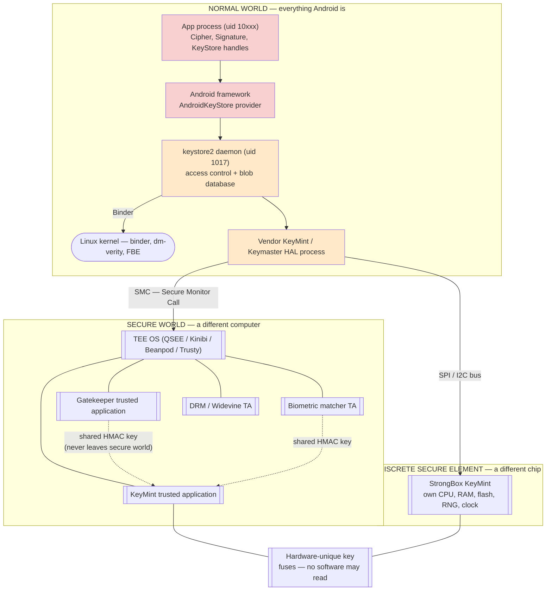
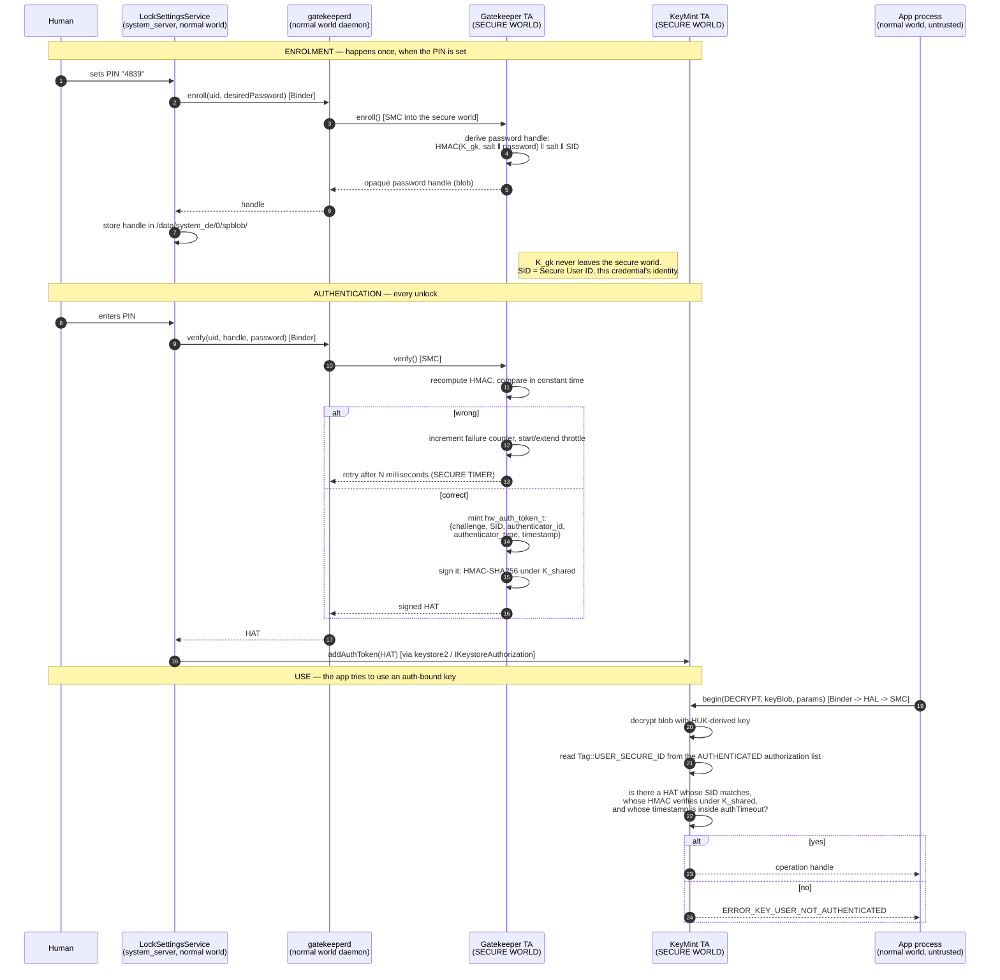
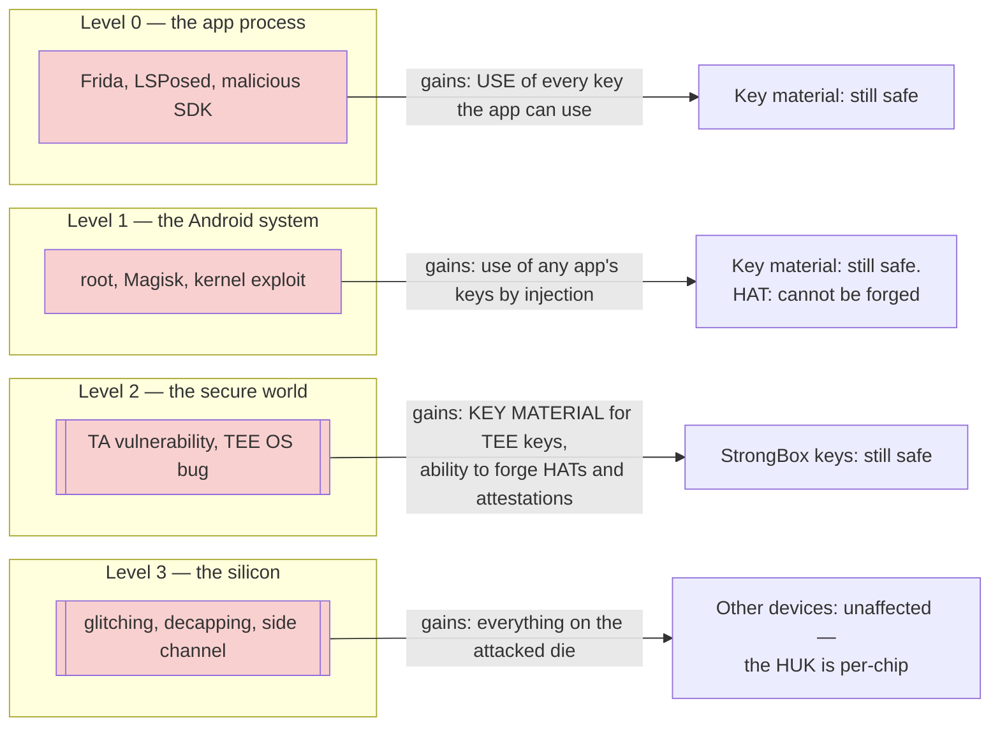
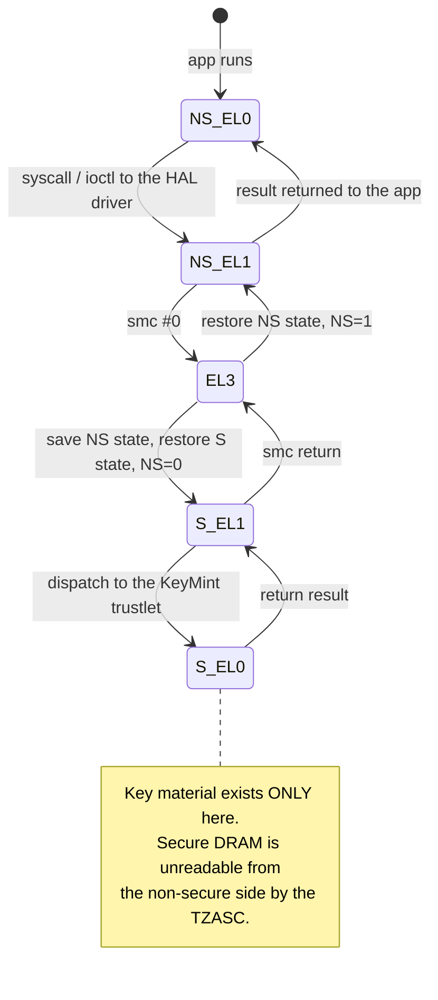
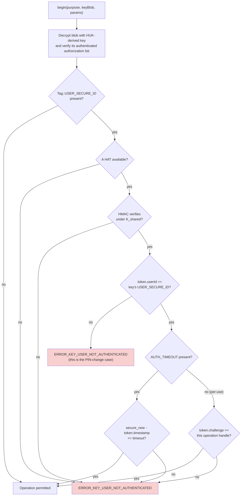
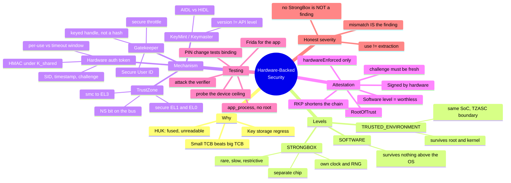

# 50 — Hardware-Backed Security

> After this chapter you can say exactly which piece of silicon is holding a given key, prove it by measurement rather than by reading the app's source, explain how a four-digit PIN survives a stolen phone, read a key attestation certificate offline and state precisely what it does and does not prove — and, most importantly, tell the difference between a device that lacks StrongBox (not a finding) and an app that claims hardware backing it never verified (a finding).

**Prerequisites:** [18 — ARM](../18-ARM/README.md), [19 — Memory](../19-Memory/README.md), [20 — Security Architecture](../20-Security-Architecture/README.md), [21 — App Sandbox](../21-App-Sandbox/README.md), [22 — SELinux](../22-SELinux/README.md), [25 — Binder](../25-Binder/README.md), [34 — Cryptography](../34-Cryptography/README.md), [49 — Keystore](../49-KeyStore/README.md)

**Applies to:** Android 4.3 (API 18) through Android 16 (API 36). The working baseline is Android 9–16 (API 28–36), where StrongBox exists as a concept and `KeyInfo` can report a security level. Everything measured for this chapter was measured on three real targets, named in §0 below.

---

## Table of Contents

1. [Introduction](#1-introduction)
2. [High-Level Architecture](#2-high-level-architecture)
3. [Deep Internal Working](#3-deep-internal-working)
4. [Source Code Walkthrough (AOSP)](#4-source-code-walkthrough-aosp)
5. [Security Perspective](#5-security-perspective)
6. [Reverse Engineering Perspective](#6-reverse-engineering-perspective)
7. [Dynamic Analysis](#7-dynamic-analysis)
8. [Static Analysis](#8-static-analysis)
9. [Examples](#9-examples)
10. [Common Interview Questions](#10-common-interview-questions)
11. [Common Mistakes](#11-common-mistakes)
12. [Hands-on Labs](#12-hands-on-labs)
13. [Summary](#13-summary)
14. [References](#14-references)

---

### What this chapter owns, and what it does not

This chapter sits directly underneath [49 — Keystore](../49-KeyStore/README.md), and the boundary between them is worth stating before anything else, because confusing the two produces bad reports.

| Question | Chapter |
|---|---|
| What is `KeyGenParameterSpec`, what does each option mean, how do I create and use a key? | [49](../49-KeyStore/README.md) |
| What is an alias, a namespace, a grant? Why can't an attacker extract the key but can freely use it? | [49](../49-KeyStore/README.md) |
| What is the thing the key is actually *inside*, and what does that thing guarantee? | **50 — here** |
| How does a PIN become something a chip will honour? What is a hardware auth token? | **50 — here** |
| Why can't an attacker with root forge "the user authenticated"? | **50 — here** |
| What does an attestation certificate prove about the *hardware*, and how do I read one offline? | **50 — here** (the server-side policy is [49 §3.7](../49-KeyStore/README.md)) |
| What is Verified Boot, AVB, dm-verity, Play Integrity? | [20](../20-Security-Architecture/README.md) |
| How do apps detect root, and how is that detection bypassed? | [37](../37-RootDetection/README.md), [38](../38-TamperDetection/README.md), [67](../67-BypassingProtections/README.md) |

49 owns the API. **This chapter owns the hardware underneath it.** Where the two touch — the security level of a key, the meaning of `setUserAuthenticationRequired`, the attestation extension — 49 states the developer-facing fact and points here for the mechanism. This chapter does not restage 49's material; it explains why 49's guarantees are true.

### 0. The devices these measurements came from

Every number, error message and certificate field in this chapter was produced on one of these three targets, and each claim below names which one. This matters more here than in almost any other chapter, because **the answers genuinely differ per device** — that is one of the chapter's central lessons, not an inconvenience.

| Target | Model | Android / API | SoC | Keystore daemon | Backing HAL | Root | StrongBox |
|---|---|---|---|---|---|---|---|
| **A** | `i9000S` | 13 / API 33 | MediaTek MT8768 (`mt6765`) | `keystore2` | `android.hardware.keymaster@4.1-service.beanpod` (**legacy HIDL**) | no | **absent** |
| **B** | Redmi `M2101K6P` (`sweetin`) | 11 / API 30 | Qualcomm `sm6150` | legacy `keystore` | `android.hardware.keymaster@4.0-service-qti` | **yes** | **absent** |
| **C** | `sdk_gphone16k_x86_64` emulator | 15 / API 35 | `ranchu` / goldfish | `keystore2` | software KeyMint 3.0 | n/a | **absent** |

> **⚠️ Warning — the device under your desk is not the device in the last paragraph**
> Target A vanished from `adb devices` in the middle of this chapter's measurement run and target B appeared in its place. That is not a metaphor; it happened, mid-command, and the same thing has happened to other chapters in this repository. **Run `adb devices -l && adb shell getprop ro.product.model && adb shell getprop ro.build.version.sdk` immediately before any measurement you intend to quote**, and record the answer next to the number. A hardware-security claim attached to the wrong device is worse than no claim at all.

---

## 1. Introduction

### 1.1 Where the regress has to stop

[49 §1.1](../49-KeyStore/README.md) sets up the problem and this chapter finishes it, so it is worth restating in one paragraph.

You want to protect a secret on a phone. You encrypt it. Now you have to protect the encryption key, so you encrypt *that*, and now you have to protect the second key. Every layer of protection you add is itself a thing that needs protecting. This is the **key storage regress**, and it does not terminate anywhere in software, because every byte in software is readable by something else in software given enough privilege.

The regress terminates in exactly one place: **a value that was physically created inside a chip, has never left it, and cannot be read out by any software instruction at all.** Not by your app. Not by the operating system. Not by `root`. Not by the kernel. On the best hardware, not even by an attacker with an oscilloscope and a laser.

That value is the **hardware-unique key**, and everything in this chapter is built on it.

> **📖 Definition — hardware-unique key (HUK)**
> A secret, typically 128 or 256 bits, burned into one-time-programmable fuses inside a system-on-chip during manufacture, or derived deterministically from such fuses by a hardware key-derivation block. It is different on every individual chip that leaves the factory. It is wired directly into the crypto engine: software can ask the engine to *use* it, and there is no instruction, register or debug path that returns it. Sometimes called the *root key*, *device root key*, *HUK*, or *chip-unique key* depending on vendor.

If you understand nothing else in this chapter, understand this asymmetry. Software can say "encrypt this using the HUK". Software cannot say "tell me the HUK". Every guarantee in the rest of this chapter is a consequence of that one design decision, applied recursively.

### 1.2 Three analogies, in increasing order of accuracy

**The safe-deposit box (wrong, but where everyone starts).** People imagine the TEE as a locked box that holds secrets. This is wrong in an important way: it implies you could pick the lock and take the contents out. The keys are not in a box you could open. They are, in the normal case, *not on the device at all* between operations — they exist as ciphertext on the flash chip, decryptable only by silicon that will never show you the plaintext.

**The signing machine behind bulletproof glass ([49 §1.2](../49-KeyStore/README.md)).** Closer. You pass a document through a slot and get it back stamped. You never see the stamp. The machine enforces the rules about who may stamp what. This is exactly right for describing *use versus extraction*, which is why 49 uses it.

**Two computers in one package (the accurate one, and the one this chapter runs on).** Your phone contains, at minimum, two logically separate computers sharing one physical CPU. One of them runs Android: billions of lines of code, a browser, your apps, and — sooner or later — a bug. The other runs a few tens of thousands of lines of code, has no network stack, no display driver in the ordinary sense, no user-installable software, and does exactly four or five jobs: hold keys, verify credentials, decode DRM video, and match biometrics. They cannot read each other's memory. The hardware, not the software, enforces that.

The second computer is smaller *on purpose*. Its security comes overwhelmingly from being small. It is the only realistic response to the fact that no one knows how to write a hundred million lines of bug-free code.

> **🧠 Mental Model**
> Android's security architecture is a series of walls, and each wall costs the attacker more to cross. The app sandbox is a wall in software, enforced by the kernel. The kernel is a wall in software, enforced by the CPU's privilege levels. **The TEE is a wall in hardware, enforced by wires.** When you cross a software wall you exploit a bug in code. When you cross a hardware wall you must exploit a bug in *different* code that runs on the other side, or attack the silicon itself. The prices are not comparable.

### 1.3 What would break without hardware backing

Take each away and watch what happens. These are not hypotheticals; each describes how Android worked before the corresponding hardware feature landed, or how it works today on devices that lack it (target C, the emulator, is exactly such a device).

**Your lock screen would be a hash to crack.** This is the big one and it is the reason this chapter exists. A four-digit PIN has ten thousand possible values. A six-digit PIN has a million. If verifying a PIN were a pure software operation — take the PIN, hash it, compare against a stored hash — then anyone who obtained the stored hash could try every possible PIN offline, on a machine with as many GPUs as they cared to rent. Ten thousand candidates against even a deliberately slow hash is over in less time than it takes to read this paragraph. **Your PIN is not secure because it is hard to guess. It is secure because something that is not a general-purpose computer refuses to answer more than a few guesses per minute, and that refusal cannot be copied off the device.** That something is Gatekeeper, and it is §3.6.

**Biometric authentication would be a boolean an attacker flips.** `BiometricPrompt` returns success or failure. In the app's process, that result is a `boolean` in RAM, and an attacker with code execution in that process — a Frida script, an injected module — can set it to `true`. What stops that from being the whole story is that the *hardware* also issues a signed token, and a key configured with `setUserAuthenticationRequired(true)` will not perform a single operation without one. The forged boolean gets you a UI that says "welcome". It does not get you the plaintext. That chain is §3.7, and the biometric prompt itself belongs to chapter 48.

**Disk encryption keys would sit in readable RAM.** Android's file-based encryption derives per-user, per-directory keys inside the same hardware. Without it, the class keys would be ordinary kernel memory, and a cold-boot or DMA attack would recover them. See [20 §3.4](../20-Security-Architecture/README.md).

**There would be no way for a server to learn anything true about a device.** Every root check, emulator check and integrity check written in app code is a claim made by code the attacker controls, to a server that has no independent way to check it. Key attestation is the one exception in the entire platform: a statement signed by a key the attacker cannot reach, chaining to a root the server already trusts. Without hardware, every remote-attestation scheme collapses into `return true;`. This is why [20](../20-Security-Architecture/README.md) can talk about Play Integrity at all.

**A stolen phone would be a stolen database.** With hardware backing, powering off a phone renders its flash inert: the keys are ciphertext under a HUK on a chip that will not decrypt them until a human proves who they are. Without it, "the disk was encrypted" means "the key was on the disk".

### 1.4 The honest framing, stated before anything else

There is one failure mode that dominates real reports in this area, and correcting for it up front will save you from writing a bad finding.

> **🔍 Pentester's Note — "no StrongBox" is not a finding**
> The overwhelming majority of Android devices in the world do not have StrongBox. All three targets measured for this chapter lack it, including a 2024-era emulator image and two physical phones from different silicon vendors. Writing "the application does not use StrongBox" as a vulnerability is like writing "the application does not require the user to own a Pixel". It is a *hardware availability fact*, not an application defect, and reviewers will discount your whole report for it.
>
> **The finding is always a mismatch.** Specifically:
>
> - The app *claims* hardware backing (in marketing, in a security whitepaper, in a code comment, to a regulator) and **never verified it at runtime** — so on any device with a weak or software-only Keystore, it silently gets software keys and never notices.
> - The app *requests* StrongBox, catches `StrongBoxUnavailableException`, and **falls back to software** — not to the TEE, to *software* — because the fallback path forgot to re-request without the StrongBox flag but with everything else intact.
> - The app *requires* user authentication in its UI but **never bound that authentication to a key**, so the requirement is a boolean and not a cryptographic fact.
> - The app *verifies attestation on the device itself*, which is an expensive way of writing `return true;`.
> - The server *reads `rootOfTrust` from the software-enforced list*, which an attacker supplies.
>
> Every one of those is a real defect that exists independently of what hardware the user happens to own. Every one of them is measurable. None of them is "no StrongBox".

### 1.5 The three sentences you will hear, and the measurement that answers each

| What they say | What to ask for | How to get it |
|---|---|---|
| "The keys are hardware-backed." | `KeyInfo.getSecurityLevel()` **for every key the app creates, on the device in question** | [`scripts/probe-security-levels.sh`](scripts/probe-security-levels.sh) for the device ceiling; [lab 01](labs/lab-01-measure-every-key-type.md) for the app itself |
| "It's protected by the fingerprint." | Proof the key is auth-bound, not that a prompt appeared | Attestation `userAuthType` / `authTimeout` in the **hardware-enforced** list; §3.7 |
| "The device is unrooted, we check `ro.boot.verifiedbootstate`." | The same fact from a source the device cannot rewrite | `rootOfTrust.verifiedBootState` from an attestation. On target B the property said `green` and the hardware said `Unverified`. §5.1 |

That last row is the single most useful measurement in this chapter, and §5.1 shows the full evidence.

---

## 2. High-Level Architecture

### 2.1 The trust hierarchy, drawn once

Three levels, one picture. Everything else in this chapter is a detail of one of these boxes or one of these arrows.



Read it in three passes.

**Pass one: the boxes.** The top group is Android. Everything in it — your app, the framework, `keystore2`, the kernel, the vendor HAL process — is *normal world*. It is a lot of code and it contains bugs. The middle group is the secure world: a separate operating system running on the same physical CPU cores, with its own memory that the normal world cannot address. The bottom group is StrongBox: not a partition of the same chip, but a *physically separate chip* on the circuit board, connected by a serial bus, with its own processor and its own storage.

**Pass two: the arrows into the secure world.** There are exactly two, and they are narrow on purpose. `SMC` is a single ARM instruction that traps to the highest privilege level and switches worlds — a doorway one instruction wide. The `SPI` bus to StrongBox is a serial line carrying a byte-oriented protocol. Neither is a shared memory mapping. An attacker in the normal world can send messages through these doorways; they cannot reach through them.

**Pass three: the dotted arrows.** Gatekeeper and the biometric matcher share an HMAC key with KeyMint, and that key exists only inside the secure world. This is the mechanism that turns "the user authenticated" from an opinion into a fact, and §3.7 is entirely about it.

Notice what the diagram does *not* show: any path from the app to the HUK, and any path from the normal world into the secure world's memory. Those omissions are the security property.

### 2.2 The three security levels, and what each actually guarantees

This is the table to memorise. It is also the table that most published summaries get subtly wrong, because they describe what each level is *called* rather than what it *promises*.

| | `SECURITY_LEVEL_SOFTWARE` (0) | `SECURITY_LEVEL_TRUSTED_ENVIRONMENT` (1) | `SECURITY_LEVEL_STRONGBOX` (2) |
|---|---|---|---|
| Where the key material is when in use | The Android kernel's memory | Secure-world RAM on the same SoC | RAM inside a separate chip |
| Where the key material is at rest | Encrypted under a key derived from the lock screen and stored on flash | Encrypted under a HUK-derived key, on flash | Encrypted, and often *inside the element's own flash* |
| Survives `root`? | **No** — root reads the master key and the blob | **Yes** for extraction | **Yes** for extraction |
| Survives a kernel compromise? | No | **Yes** for extraction | **Yes** for extraction |
| Survives a compromise of the TEE OS? | No | **No** | **Yes** — separate chip, separate code |
| Survives physical attack on the SoC (glitching, decapping, side channel)? | No | **Usually not** — the TEE shares the SoC's power rails, clock and caches | **Designed to resist it** — that is the entire point |
| Rate limiting is enforced by | Nothing meaningful | The TEE, using a secure timer | The element, using its **own** clock |
| Typical performance | Fastest | Slower (world switches) | **Much slower** (serial bus, weak CPU) |
| Typical key size limits | None | Generous | **Restrictive** — often 2048-bit RSA maximum, limited key slots |
| Present on how many devices? | All | Nearly all since ~2015 | **A small minority** — flagship Pixel, some Samsung, few others |

> **📖 Definition — the guarantee of each level, in one sentence each**
> **Software:** the key is protected by the same operating system that is protecting everything else, so it is exactly as strong as the OS and no stronger.
> **TEE:** the key material is not visible to *any code running under Android*, including the kernel and including `root`; extracting it requires breaking the secure world's own code or the silicon.
> **StrongBox:** additionally, the key material is not on the same die as the application processor, so an attack that compromises the main SoC — including physical attacks on it — does not reach the key.

> **🧠 Mental Model — the levels answer different questions**
> The three levels are not "good, better, best" on a single axis. They answer *whose compromise is survivable*:
> - Software survives nothing above the app.
> - TEE survives compromise of **Android** (kernel included).
> - StrongBox survives compromise of **the SoC**, including the TEE itself.
>
> Choosing between them is choosing your adversary, and if your threat model is "a user with root on their own phone", TEE and StrongBox are identical: neither prevents *use*, and use is what that adversary wants. See [49 §1.3](../49-KeyStore/README.md).

### 2.3 Measured: what three real devices actually did

Run [`scripts/probe-security-levels.sh`](scripts/probe-security-levels.sh) and you get one row per key type. Below is the real output, condensed, for all three targets. **These are measurements, not a compatibility table copied from documentation.**

| Key requested | A — `i9000S`, API 33, MediaTek | B — Redmi, API 30, Qualcomm | C — emulator, API 35 |
|---|---|---|---|
| AES-128 GCM | TRUSTED_ENVIRONMENT | TRUSTED_ENVIRONMENT | **SOFTWARE** |
| AES-256 GCM | TRUSTED_ENVIRONMENT | TRUSTED_ENVIRONMENT | **SOFTWARE** |
| AES-256 GCM `+StrongBox` | `StrongBoxUnavailableException` | `StrongBoxUnavailableException` | `StrongBoxUnavailableException` |
| HMAC-SHA256 / SHA512 | TRUSTED_ENVIRONMENT | TRUSTED_ENVIRONMENT | **SOFTWARE** |
| 3DES CBC/PKCS7 | **`NoSuchAlgorithmException`** | TRUSTED_ENVIRONMENT (168-bit) | **`NoSuchAlgorithmException`** |
| RSA-2048 / 3072 / 4096 PSS | not reached (device swapped) | TRUSTED_ENVIRONMENT | **SOFTWARE** |
| **RSA-1024** | not reached | **TRUSTED_ENVIRONMENT — accepted** | **SOFTWARE — accepted** |
| EC P-256 / P-384 / P-521 | not reached | TRUSTED_ENVIRONMENT | **SOFTWARE** |
| Ed25519 | not reached | `Unsupported EC curve name: ed25519` | generated, but `KeyFactory` refuses `EdDSA` |
| X25519 | not reached | `Unsupported EC curve name: x25519` | `x25519 may only be used for key agreement` |
| `setMaxUsageCount(1)` | not reached | **`NoSuchMethodError`** on an API 30 device | SOFTWARE, accepted |
| Auth-bound (per-use) | not reached | `IllegalStateException: Gatekeeper service not available` | same |
| Attestation chain length | not reached | **4** certificates, roots at Google | **3**, roots at "Google Test LLC" |

Four things in that table deserve to be pulled out, because each contradicts something commonly written down.

**1. The same API returns a different security level on different devices, and the app cannot tell without asking.** Identical code produced TEE keys on two phones and software keys on the emulator. Nothing in `KeyGenParameterSpec` changed. This is the whole reason `KeyInfo.getSecurityLevel()` exists and the whole reason ignoring it is a defect.

**2. Support is per-algorithm, not per-device.** Target B put 3DES in the TEE. Targets A and C do not implement 3DES in the Keystore *at all* — `NoSuchAlgorithmException: no such algorithm: DESede for provider AndroidKeyStore`. Neither device supports Ed25519 or X25519 through this path. A "supported since API 28" table in the documentation describes the API, not the silicon.

**3. RSA-1024 was accepted, in hardware, on a modern device.** [49 §3.5.1](../49-KeyStore/README.md) says undersized RSA "should be rejected by the hardware, but check". Checked: it is not rejected. Target B generated a 1024-bit RSA key and reported `TRUSTED_ENVIRONMENT`. The hardware enforces *the policy attached to the key*; it does not enforce your idea of good cryptography. Do not assume a weak parameter will be refused for you.

**4. `setMaxUsageCount` threw `NoSuchMethodError` on an API 30 device**, despite the documentation placing it at API 30:

```
NoSuchMethodError: No virtual method setMaxUsageCount(I)Landroid/security/keystore/KeyGenParameterSpec$Builder;
in class Landroid/security/keystore/KeyGenParameterSpec$Builder;
(declaration of 'android.security.keystore.KeyGenParameterSpec$Builder'
 appears in /system/framework/framework.jar!classes2.dex)
```

The device is a MIUI 12.5 build. Whether the cause is an OEM framework that omits the method or a documentation/API-level discrepancy, the operational lesson is the same and it is one of this chapter's themes: **an API level is a promise about AOSP, not about the phone in your hand.** Code that calls a recent builder method without a `try`/`catch` or a version guard can crash on a shipping device at the exact API level the documentation blesses.

### 2.4 From PIN to permitted operation: the whole chain in one sequence

This is the chapter's spine. Everything in §3.6 and §3.7 is an expansion of one of these arrows.



Three observations that decide how you test this.

**The HMAC key `K_shared` exists only inside the secure world.** Gatekeeper has it, KeyMint has it, the biometric TA has it. Nothing in Android has it. Therefore an attacker with `root`, a kernel exploit, or arbitrary code in `system_server` **cannot manufacture a valid HAT**. They can suppress one, delay one, or replay one within its validity window — but they cannot mint one. This is precisely why `setUserAuthenticationRequired(true)` is a real control and a UI-level "did the prompt succeed" boolean is not.

**The check happens at `begin()`, inside KeyMint.** Not in your app, not in the framework, not in `keystore2`. Hooking anything in the normal world does not change the answer. [49 §2.2](../49-KeyStore/README.md) makes the same point from the API side.

**The throttle lives with the Gatekeeper TA and its counter is stored in secure, monotonic state.** You cannot reset it by wiping a file in `/data`, and you cannot outrun it by copying the handle to a faster machine, because the handle is useless without `K_gk`. §3.8.

### 2.5 Where the boundaries are, and what crossing each one buys an attacker



| Attacker position | Reads key material? | Uses the key? | Forges a HAT? | Forges attestation? | Severity language for a report |
|---|---|---|---|---|---|
| Code in the app's process | No | **Yes** | No | No | Informational to Low unless the plaintext is somebody else's secret — see [49 §1.3](../49-KeyStore/README.md) |
| `root` on the device | No | Yes, by injecting into the app | No | No | Same. Root is a *precondition you supplied*, not a finding |
| Kernel compromise | No | Yes | No | No | Critical as a kernel bug; the Keystore holds |
| **Secure-world compromise** | **Yes, for TEE keys** | Yes | **Yes** | **Yes** | Critical, and it invalidates every attestation from that device family |
| Physical attack on the SoC | Yes, on that one device | Yes | Yes | Yes | Device-specific; the HUK is per-chip so it does not scale |
| Physical attack, StrongBox present | TEE keys yes, StrongBox keys **no** | — | — | — | This is what the separate chip buys you |

The column that stays "No" until row four is what hardware backing sells. The column that turns "Yes" on row one is what it does not.

---

## 3. Deep Internal Working

### 3.1 What "hardware-backed" means at the level of wires

Start below the software. A modern Android SoC contains, at minimum:

| Block | What it is | Why it matters here |
|---|---|---|
| Application processor (AP) | The ARM cores that run Linux and your app | The thing that must not be trusted with keys |
| Fuse array / OTP | One-time-programmable bits burned at manufacture | Holds or seeds the HUK. Physically irreversible |
| Hardware key ladder / crypto engine | A block that can perform AES/HMAC using a key it reads from the fuse array over a private bus | The only consumer of the HUK. It has an input for "derive a key from the HUK using this context" and an output for the *result*, never the HUK |
| TrustZone address space controller (TZASC / TZC-400) | A memory controller that tags physical DRAM regions as secure or non-secure | This is what makes secure-world RAM unreadable by Linux. It is a *bus filter*, not a software check |
| Secure boot ROM | Immutable code that starts execution and verifies the next stage | The root of [Verified Boot](../20-Security-Architecture/README.md) |
| Secure timer / monotonic counter | A counter that only increases and is not resettable from the normal world | Makes throttling and rollback resistance possible |
| Optional: discrete secure element | A separate packaged chip on the board | StrongBox |

> **🔬 Under the Hood — why the TZASC is the real boundary**
> The most common misconception about TrustZone is that it is a software mode. It is not. `NS` (non-secure) is a physical signal on the AMBA/AXI bus, asserted alongside every memory transaction the CPU issues. The TZASC is configured at boot to mark certain physical address ranges as secure-only. When the AP is running in non-secure state and issues a read to a secure range, **the memory controller refuses it in hardware** — no exception handler decided that, no code was consulted. The kernel could be entirely under an attacker's control and the read would still fail. This is why "root can read all memory" stops being true at the secure-world boundary.

> **📖 Definition — TEE, precisely**
> A **Trusted Execution Environment** is an execution context on the same physical processor as the main OS, isolated from it by hardware, with its own operating system, its own memory, and a controlled entry point. On ARM it is normally implemented with TrustZone. It is *not* a separate chip; it *is* separate memory and separate privilege. Code inside it is called a **trusted application** or **trustlet**.

### 3.2 ARM TrustZone mechanics

Read [18 — ARM](../18-ARM/README.md) for exception levels in general; here is the part that matters for keys.

An ARMv8-A core has four exception levels and two *security states*:

| | Non-secure state (normal world) | Secure state (secure world) |
|---|---|---|
| EL0 | Your app's code | Trusted applications (KeyMint TA, Gatekeeper TA) |
| EL1 | Linux kernel | Secure OS kernel (QSEE, Kinibi, Beanpod, Trusty) |
| EL2 | Hypervisor (pKVM on newer devices) | Secure EL2 (ARMv8.4+, rarely used yet) |
| EL3 | — | **Secure Monitor** — the only code that switches worlds |

The world switch is one instruction:

```asm
// Executed by the vendor HAL's kernel driver, in normal-world EL1
smc  #0            // Secure Monitor Call: trap to EL3
```

When `smc` executes, the CPU traps to EL3, where the Secure Monitor saves the normal world's register state, restores the secure world's, flips the `NS` bit, and jumps into the secure OS. Arguments are passed in general-purpose registers per the SMC Calling Convention. Larger payloads — a key blob, your plaintext — are passed through a pre-agreed region of *non-secure shared memory* whose address is handed over in a register; the secure world copies the data in, works on it, and copies the result out.

That last detail matters to an attacker. **The data you encrypt is in normal-world memory before and after the call.** The key never is. [49 §2.2](../49-KeyStore/README.md) makes the same point at the Binder level: the Keystore protects keys, not the data flowing through it.



**What the picture does not show, and should:** the cost. A world switch flushes pipeline state and often costs microseconds. This is why streaming a large file through a Keystore AES key is dramatically slower than doing AES in-process, and it is why so many real apps use the Keystore only to wrap a data-encryption key that then lives in the app's heap. That design is *sound* — and it creates the "the real key is in the heap" situation that dominates [49 §5](../49-KeyStore/README.md).

### 3.3 The TEE operating systems you will actually meet

There is no single "the TEE". Which one you are looking at changes the attack surface, the published research, and the CVEs that apply.

| TEE OS | Vendor | Typically found on | How to spot it |
|---|---|---|---|
| **QSEE / QTEE** | Qualcomm | Most Snapdragon devices | `ro.hardware=qcom`, HAL services named `*-service-qti`, `/vendor/firmware/*.mbn` |
| **Kinibi** | Trustonic (with Samsung/MediaTek) | Many Samsung Exynos, some MediaTek | `/dev/mobicore`, `t-base` strings, `*.tlbin` trustlets |
| **TEEGRIS** | Samsung | Newer Samsung Exynos | `/dev/tzdev`, `tzdaemon` |
| **Beanpod** | MediaTek/Beanpod | MediaTek mid-range | `ro.hardware.gatekeeper=beanpod`, HAL named `*-service.beanpod` — **measured on target A** |
| **Trusty** | Google (open source, in AOSP) | Pixel, some others | `/dev/trusty-ipc-dev0`, AOSP `trusty/` tree |
| Software-only | AOSP reference | Emulators, cheap devices | Attestation reports `Software` — **measured on target C** |

Target A's inventory output identified its TEE without any guesswork:

```
# host, adb shell
$ adb shell getprop ro.hardware.gatekeeper
beanpod
$ adb shell 'ps -A -o NAME' | grep -i keymaster
android.hardware.keymaster@4.1-service.beanpod
```

> **🔍 Pentester's Note**
> Identifying the TEE OS is a two-minute step that changes what you should read next. "Is there published research on extracting keys from this TEE?" has a very different answer for QSEE (extensive) than for Beanpod (almost none, which is not the same as "secure"). Record the TEE vendor in every report alongside the device model.

### 3.4 KeyMint and Keymaster — and why the version you assume is wrong

The interface between Android and the secure world has been renamed and re-specified several times.

| Name | HAL style | Introduced | Notable |
|---|---|---|---|
| Keymaster 0 | Legacy `keymaster_device_t` | Android 4.3 | Asymmetric only, no enforcement of most tags |
| Keymaster 1 | HIDL `@1.0` | Android 6 | Symmetric keys, authorization lists, auth binding |
| Keymaster 2 | HIDL `@2.0` | Android 7 | Attestation, version binding |
| Keymaster 3 | HIDL `@3.0` | Android 8 | ID attestation |
| **Keymaster 4 / 4.1** | HIDL `@4.0` / `@4.1` | Android 9 / 10 | **StrongBox**, `EARLY_BOOT_ONLY`, `DEVICE_UNIQUE_ATTESTATION` |
| **KeyMint 1** | **AIDL** `V1` | Android 12 | Rust reference implementation, `ATTEST_KEY`, `AGREE_KEY` |
| KeyMint 2 | AIDL `V2` | Android 13 | Certificate-chain changes, RKP maturity |
| KeyMint 3 | AIDL `V3` | Android 14 | — measured on target C, which reports `attestationVersion 300` |

> **⚠️ Warning — "Android 12+ means KeyMint" is false, and this chapter measured it false**
> Target A runs **Android 13 (API 33)** and its Keystore is backed by:
>
> ```
> android.hardware.keymaster@4.0::IKeymasterDevice/default
> android.hardware.keymaster@4.1::IKeymasterDevice/default
> ```
>
> — a **legacy HIDL Keymaster 4.1 HAL**, not KeyMint. `keystore2` drives it through a compatibility shim, visible in `service list` as `android.security.compat: [android.security.compat.IKeystoreCompatService]`. The framework is modern; the silicon's interface is not. A device that ships with a new Android version on old hardware keeps the old HAL, and every KeyMint-only capability is simply absent. Read the running HAL, never the API level.

The version is also readable as a feature flag from API 31 onwards — and its encoding is worth knowing:

```
# host, adb shell — target A
$ adb shell pm list features | grep keystore
feature:android.hardware.hardware_keystore=41
```

The value `41` means Keymaster 4.1. KeyMint versions are encoded as hundreds: `100` is KeyMint 1.0, `200` is 2.0, `300` is 3.0. And a trap that this chapter measured:

```
# host, adb shell — target B (Android 11 / API 30)
$ adb shell pm list features | grep -c keystore
0
```

Target B declares **no keystore feature at all** and still puts every key in the TEE. The feature constant did not exist before API 31, so its absence on an older device is meaningless. **A feature-flag check is a capability ceiling, not a measurement.** The measurement is `KeyInfo.getSecurityLevel()`.

### 3.5 StrongBox, precisely

> **📖 Definition — StrongBox**
> A KeyMint implementation running on a **physically separate, tamper-resistant secure element** with its own CPU, RAM, non-volatile storage, random number generator and clock, connected to the application processor over a serial bus. Requested with `setIsStrongBoxBacked(true)`, advertised by `PackageManager.FEATURE_STRONGBOX_KEYSTORE`, and reported by `KeyInfo.getSecurityLevel()` as `SECURITY_LEVEL_STRONGBOX` (2).

What the separate chip buys you, concretely:

| Property | Why the separate chip provides it |
|---|---|
| Survives compromise of the TEE | It runs different code on a different processor. A bug in the vendor's TEE OS is not reachable |
| Resists physical attack | Secure elements are built for it: shields, sensors, glitch detectors, randomised clocks, memory encryption. The main SoC is built for performance |
| Independent, tamper-resistant clock | Rate limiting and key validity cannot be defeated by manipulating the AP's clock |
| Its own entropy source | The RNG does not depend on the AP's |
| Real rollback resistance | It has its own non-volatile storage, so "this key is deleted" can be written somewhere the normal world cannot restore from a backup |

What it costs, and why apps that demand it break:

| Cost | Consequence |
|---|---|
| A serial bus and a small CPU | Operations are **much** slower. RSA-4096 in a secure element can take seconds |
| Limited storage | A finite number of key slots. Generating StrongBox keys in a loop can exhaust the element |
| Restricted algorithm/size support | Commonly: RSA capped at 2048 bits, a limited digest set, EC limited to P-256. `setIsStrongBoxBacked(true)` combined with an unsupported parameter throws |
| Present on a minority of devices | Every StrongBox code path needs a fallback, and **the fallback is where the bug is** |

```java
// Android app code — Java. The correct shape. See examples/StrongBoxAwareKeyFactory.java
KeyGenParameterSpec.Builder base = new KeyGenParameterSpec.Builder(alias,
        KeyProperties.PURPOSE_ENCRYPT | KeyProperties.PURPOSE_DECRYPT)
    .setBlockModes(KeyProperties.BLOCK_MODE_GCM)
    .setEncryptionPaddings(KeyProperties.ENCRYPTION_PADDING_NONE)
    .setKeySize(256);

SecretKey key;
try {
    key = generate(base.setIsStrongBoxBacked(true).build());     // ask for the best
} catch (StrongBoxUnavailableException e) {
    key = generate(base.setIsStrongBoxBacked(false).build());    // fall back to TEE, NOT to software
}
// AND THEN — the step everybody skips:
int actual = readSecurityLevel(key);      // KeyInfo.getSecurityLevel()
reportToServer(actual);                   // the server decides what this device is allowed to do
```

> **⚠️ Warning — the fallback that becomes the vulnerability**
> The dangerous version of the code above catches a broader exception:
>
> ```java
> try {
>     key = generateInKeystore(specWithStrongBox);
> } catch (Exception e) {                      // ← catches everything
>     key = new SecretKeySpec(deriveFromDeviceId(), "AES");   // ← software key, not even in the Keystore
> }
> ```
>
> On a device without StrongBox — that is, almost every device — this app has *never once* used hardware-backed cryptography, and it will happily tell you it does. `examples/AssumesHardwareKeyManager.java` is exactly this, written out and annotated so you can recognise it in decompiled output.

**Measured:** all three targets threw `StrongBoxUnavailableException`. On target A the feature list confirms it independently: `android.hardware.strongbox_keystore` is absent while `android.hardware.hardware_keystore=41` is present. **Again: this is not a finding about any of them.** It is the baseline condition against which the app's behaviour is judged.

### 3.6 Gatekeeper — how a four-digit PIN survives a stolen phone

This is the chapter's most important mechanism and the one [49 §1.4](../49-KeyStore/README.md) explicitly defers here.

#### 3.6.1 The problem

A lock-screen credential is short. Four digits is 10<sup>4</sup> possibilities; six digits is 10<sup>6</sup>; a typical pattern is fewer than 400,000. Any of those spaces is exhaustible in milliseconds by a machine that can test candidates freely.

A password-hashing function (scrypt, Argon2, bcrypt) buys you *some* margin by making each guess expensive — but only linearly, and the attacker's hardware budget is not linear. Suppose you tune scrypt so that one guess costs 100 ms on the phone. An attacker with a modest GPU cluster does 10<sup>4</sup> guesses in seconds. Slow hashing alone does not save a four-digit PIN. It never has.

The only thing that saves it is **making guesses impossible to perform offline**, which means the verification must require a secret the attacker cannot copy, and the rate must be enforced by something the attacker cannot fast-forward.

#### 3.6.2 What Gatekeeper is

> **📖 Definition — Gatekeeper**
> The Android component that enrols and verifies lock-screen credentials (PIN, pattern, password) **inside the TEE**, throttles failed attempts using secure hardware state, and — on success — issues a cryptographically signed **hardware auth token** that KeyMint will accept as proof the user authenticated. It exists as a trusted application in the secure world, a vendor HAL (`android.hardware.gatekeeper@1.0::IGatekeeper`), and a normal-world daemon (`gatekeeperd`) that relays between the framework and the HAL.

Its interface is two operations:

| Operation | Inputs | Outputs |
|---|---|---|
| `enroll` | uid, current password handle (if any), current password, desired password | A new opaque **password handle** |
| `verify` | uid, challenge, enrolled password handle, provided password | On success: a signed **hardware auth token**. On failure: a **retry timeout** in milliseconds |

The password handle is the crucial object:

```
password_handle_t (conceptually — the exact layout is vendor-defined)
┌────────────────────────────────────────────────────────────────┐
│ version                                                        │
│ user_id  (Secure User ID, "SID" — identity of this credential) │
│ flags                                                          │
│ salt     (random, per-enrolment)                               │
│ signature = HMAC-SHA256( K_gk , salt ‖ user_id ‖ password )    │
└────────────────────────────────────────────────────────────────┘
        K_gk lives ONLY inside the secure world.
```

**This is the entire trick.** The stored handle is not a password hash in any useful sense — it is a *keyed* MAC, and the key is in hardware. Copy the handle to a GPU farm and you can compute nothing: you do not have `K_gk`, and no amount of compute derives it. Verification is not "hash the candidate and compare"; it is "ask the chip, which is the only thing that can compute the comparison value".

> **🧠 Mental Model**
> An ordinary password hash lets *anyone with the hash* try candidates. Gatekeeper's handle lets *only the chip that made it* try candidates. That single change converts an offline attack into an online one, and an online attack is one the hardware can rate-limit. Everything else — the throttle, the auth token, the key binding — is built on top of that conversion.

#### 3.6.3 Throttling, and why it cannot be reset

On a failed `verify`, the Gatekeeper TA increments a failure counter held in secure, non-volatile or monotonically-protected storage and returns a timeout to the caller. The AOSP reference behaviour is roughly:

| Consecutive failures | Behaviour |
|---|---|
| 1–4 | No delay |
| 5–9 | 30 seconds |
| 10–29 | 30 seconds, escalating |
| 30+ | Doubling, up to a long cap (commonly one day in vendor implementations) |

Vendors tune the exact numbers, and the framework layers its own policy on top (for example, wiping after N failures under device policy). What matters is *where the counter lives*.

> **🔬 Under the Hood — three ways people try to defeat the throttle, and why each fails**
> **"Delete the counter file in `/data`."** The framework-side lockout state does live in `/data/system`, and clearing it does clear the *UI* lockout. It does not clear the TA's counter, which is why the correct PIN still gets refused with a retry timeout after you have done it. The framework counter and the Gatekeeper counter are different objects.
> **"Reboot to reset it."** Gatekeeper implementations persist the counter or bind it to a monotonic counter precisely so that a reboot does not help. Some early implementations were weaker here; that was a bug class, not the design.
> **"Copy the handle off and brute-force it elsewhere."** There is nothing to brute-force. Without `K_gk` the handle is a random string.
> **"Set the system clock backwards."** The throttle uses a *secure* timer sourced inside the TEE, not the normal world's clock. On StrongBox the element has its own clock entirely.

#### 3.6.4 The Secure User ID (SID), and why your keys die on a PIN change

`enroll` produces a **Secure User ID**: a random 64-bit value that identifies *this credential enrolment*. It is not the Linux uid and not the Android user id.

When you create a key with `setUserAuthenticationRequired(true)`, the framework asks Gatekeeper for the current SID and bakes it into the key's authenticated authorization list as `Tag::USER_SECURE_ID`. At `begin()` time, KeyMint requires a HAT whose SID matches that tag.

Change the PIN and a new enrolment happens with a **new SID**. Every existing key bound to the old SID can never be satisfied again, and using one throws `KeyPermanentlyInvalidatedException`. This is not a bug and not a rough edge — it is the point. A credential change must invalidate everything the old credential authorised, or an attacker who can change the credential inherits everything it protected.

> **🔍 Pentester's Note**
> This gives you a clean, non-destructive test. Ask the user to change their PIN (on a test device you own), then use the app. If the app's auth-gated feature **still works with no re-enrolment**, its "biometric protection" was not bound to a key — it was a UI check. If it correctly throws and re-enrols, the binding is real. This is one of the few tests in this area that needs neither root nor Frida.

#### 3.6.5 Measured: reading Gatekeeper's state from an ordinary shell

```
# host, adb shell — target B (Redmi, API 30)
$ adb shell dumpsys lock_settings
Current lock settings service state:

User State:
  User 0
    SP Handle: db7d9cba3308b20e
    Last changed: 2026-08-12 00:37:44 (a1a02f9d20b4a6ed)
    SID: 0
    Quality: 0
    CredentialType: None
    SeparateChallenge: true

Storage:
  User 0 [/data/system_de/0/spblob]:
    16384 db7d9cba3308b20e.secdis
       89 db7d9cba3308b20e.pwd
       72 db7d9cba3308b20e.metrics
      186 db7d9cba3308b20e.spblob
```

Read that carefully, because four separate lessons are in it.

**`SID: 0` with `CredentialType: None` means no lock-screen credential exists.** Gatekeeper holds no password handle for this user, there is no Secure User ID, and therefore **no auth-bound key can be created at all**. The probe's attempt failed with exactly that consequence:

```
AES-256 auth-bound (per-use)    REFUSED    IllegalStateException: Gatekeeper service not available
```

That message is misleading and it is worth pausing on. It reads like a missing service. There are two possible causes and the probe deliberately reports both rather than guessing: (a) no credential is set, so there is no Secure User ID to bind to; (b) the `shell` domain cannot see `IGateKeeperService` at all — and on this device, `service check android.service.gatekeeper.IGateKeeperService` does return `not found` even though `service list` shows the name. `dumpsys lock_settings` is what settles it. Here, (a) is definitely true.

**The `spblob` directory is the synthetic-password machinery.** Android does not hand the raw PIN to Gatekeeper for key derivation; it uses a **synthetic password** — a high-entropy secret, protected by the credential — from which disk-encryption keys and the Gatekeeper enrolment are derived. That indirection is what lets the system change the credential without re-encrypting everything. The `.spblob`, `.pwd` and `.secdis` files are its on-disk state, and they are readable only by `system`.

**The handle name is stable and the timestamp tells you when the credential last changed.** In an investigation, `Last changed` is evidence.

**`Quality: 0`** is the `DevicePolicyManager` password quality constant — 0 is "unspecified", consistent with no credential.

### 3.7 The hardware auth token — the chain 49 points here for

[49 §3.10](../49-KeyStore/README.md) states the fact — "the HAT that satisfies `setUserAuthenticationRequired` is produced by Gatekeeper … signed with a key shared with KeyMint" — and defers the mechanism. Here it is.

#### 3.7.1 The structure

The token is a fixed-layout binary structure, historically `hw_auth_token_t` in the Keymaster HAL headers and `HardwareAuthToken` in the KeyMint AIDL:

| Field | Size | Meaning |
|---|---|---|
| `version` | 1 byte | Token format version (0 for the classic layout) |
| `challenge` | 8 bytes | Operation-specific nonce. For per-use binding this is the KeyMint **operation handle** |
| `userId` | 8 bytes | The **Secure User ID** — which credential enrolment authenticated |
| `authenticatorId` | 8 bytes | Identifies the *biometric* enrolment set, when the authenticator was a biometric |
| `authenticatorType` | 4 bytes, big-endian | `0` = none, `1` = password/credential, `2` = fingerprint |
| `timestamp` | 8 bytes, big-endian | Milliseconds since boot, **from the secure timer** |
| `hmac` | 32 bytes | HMAC-SHA256 over all preceding fields, under `K_shared` |

`K_shared` is provisioned into the secure world at boot and is known to Gatekeeper, the biometric TA, and KeyMint — and to nothing else in the system.

#### 3.7.2 How KeyMint checks it

At `begin()`, for a key whose authorization list contains `Tag::USER_SECURE_ID`, KeyMint:

1. Verifies the token's HMAC under `K_shared`. A token whose bytes were altered fails here, which is the anti-forgery property.
2. Compares the token's `userId` against the key's `Tag::USER_SECURE_ID`. A token from a *different* credential enrolment is rejected — this is the PIN-change invalidation from §3.6.4.
3. Compares the token's `authenticatorType` against the key's `Tag::USER_AUTH_TYPE`. A key that demands a fingerprint is not satisfied by a PIN, and vice versa, if the key said so.
4. Applies the timing rule:
   - **`Tag::AUTH_TIMEOUT` present (a positive timeout):** the token's `timestamp` must be within that many seconds of the secure clock's "now". Any operation with this key, from any code in the process, succeeds inside that window.
   - **`Tag::AUTH_TIMEOUT` absent (per-use / auth-per-operation):** KeyMint requires a token whose `challenge` equals **this operation's handle**. The token is useless for any other operation. This is what `BiometricPrompt.CryptoObject` produces.



Everything in that diagram happens **inside the secure world**. That is the answer to "why can't a rooted framework forge it": the framework is not a participant in the check. It carries the token from Gatekeeper to KeyMint and it can *fail* to carry it, but it cannot produce one, alter one, or persuade KeyMint to skip the check.

> **🧠 Mental Model — what root can and cannot do to the HAT**
> Root **can**: suppress a token (denial of service), replay a token within its validity window, hook `BiometricPrompt` callbacks so the *UI* reports success, and use any key that is not auth-bound.
> Root **cannot**: mint a token, change a token's SID or timestamp, satisfy a per-use binding without a real authentication, or make KeyMint ignore `Tag::USER_SECURE_ID`.
> Therefore the correct reading of a "biometric bypass" demonstration is: *did the attacker get the plaintext, or did they only get the UI to say yes?* [49 §3.5.3](../49-KeyStore/README.md) and chapter 48's material on `BiometricPrompt` are the other halves of this test.

#### 3.7.3 The replay window is the real weakness, and it is a design choice

A positive `AUTH_TIMEOUT` creates a period during which *any* code in the process can use the key with no further authentication. Thirty seconds is common; three hundred is not rare. Within that window:

- A hooked call performs the operation with no prompt.
- The user's authentication for one purpose authorises a completely different one.
- The "biometric prompt" the user saw is, for the rest of the window, decorative.

Per-use binding (`setUserAuthenticationParameters(0, …)`, or the deprecated `setUserAuthenticationValidityDurationSeconds(-1)`) closes it, because the token names one operation handle. **When you review a design, the timeout value is the control worth arguing about.**

### 3.8 Rollback resistance, secure storage, and what "deleted" means

> **📖 Definition — rollback resistance**
> A KeyMint key is *rollback-resistant* if the implementation guarantees that once the key is deleted, it can never be used again — even if an attacker restores an old copy of the entire flash storage. Represented by `Tag::ROLLBACK_RESISTANCE` (KeyMint) / `Tag::ROLLBACK_RESISTANT` (Keymaster 3 and earlier).

Why it is hard: an ordinary Keystore key is a *blob on flash*. Delete the row from `persistent.sqlite` and the key is gone from the database — but if an attacker took a raw image of the partition yesterday, restoring that image restores the blob, and the blob still decrypts, because the HUK has not changed. Deletion in the database is not destruction in the hardware.

Real rollback resistance requires the secure world to keep per-key state in storage the normal world cannot roll back: on-chip non-volatile memory, a monotonic counter, or an RPMB (Replay Protected Memory Block) partition on the eMMC/UFS device that only the secure world can write. That storage is small and precious, so implementations that support it usually support only a limited number of rollback-resistant keys.

**Measured:** neither physical target's attestation carried a rollback-resistance tag, and the framework builder method is not public API on either:

```
AES-256 rollback-resistant    NO-PUBLIC-API    setRollbackResistant is @hide on this platform
```

The honest reading is: **assume your keys are not rollback-resistant unless an attestation says otherwise.** For a pentester this has a concrete consequence — "the app deletes the key on logout" is a weaker statement than it sounds, if an attacker can snapshot storage.

Related, and often confused with it:

| Tag | Guarantee | Confusion to avoid |
|---|---|---|
| `ROLLBACK_RESISTANCE` | Deletion is permanent | Not about *use* counting |
| `USAGE_COUNT_LIMIT` (`setMaxUsageCount`) | The key self-destructs after N operations | Requires secure counter storage; commonly unsupported. **Threw `NoSuchMethodError` on target B** |
| `EARLY_BOOT_ONLY` | Key usable only before the user has unlocked for the first time after boot | For system components, not apps |
| `UNLOCKED_DEVICE_REQUIRED` | Key unusable while the screen is locked | Enforced by the framework signalling KeyMint; strong but not a hardware clock guarantee |

### 3.9 Attestation: the only claim a device can make that a server can check

[49 §3.7](../49-KeyStore/README.md) covers the *API and the server-side policy* in depth and this chapter does not repeat it. What belongs here is the part about the hardware: what makes the claim credible, and precisely how far it reaches.

#### 3.9.1 What the certificate chain actually proves

When you generate a key with `setAttestationChallenge(nonce)`, the secure world produces a leaf certificate for that key, containing an extension at OID `1.3.6.1.4.1.11129.2.1.17`, and signs it with a **factory-provisioned attestation key that also lives in the secure world**. That signing key's certificate chains up to a root whose public key Google publishes.

So a verifying server that checks the chain learns exactly this:

> *A device whose attestation key was provisioned by a manufacturer in Google's chain of trust asserts that a key with this public half exists in security level X, was created with these exact authorisations, on a device whose boot state was Y, and that the generating request carried this challenge.*

Every clause of that sentence is load-bearing, and the things it does **not** say are what separate a competent reviewer from a credulous one:

| It does NOT say | Why not |
|---|---|
| That the app calling the key is legitimate | The attestation was made at key-generation time. Nothing about the calling code at any later moment is attested. A Frida script in a legitimate app uses an honestly-attested key. |
| That the device is not rooted *right now* | `verifiedBootState` describes the boot chain, not the current process list. A device can boot verified and be exploited afterwards |
| That the key is being used by the party who registered it | Only if the server also *binds the key to the account* and requires every subsequent request to be signed by it — [49 §3.7.5](../49-KeyStore/README.md) step 14 |
| That the TEE is unbroken | The chain inherits the manufacturer's provisioning integrity and the TEE's soundness. A broken TEE produces perfect attestations |
| Anything at all, if `attestationSecurityLevel` is `Software` | The claim was then made by the Android framework, which the attacker owns |

> **🧠 Mental Model**
> Attestation converts "trust me" into "trust the manufacturer's silicon, and check the maths yourself". That is an enormous improvement and a bounded one. It moves the trust, it does not eliminate it — and it says nothing about the *moment of use*, which is where [49](../49-KeyStore/README.md)'s extraction-versus-use distinction lives.

#### 3.9.2 The `softwareEnforced` / `hardwareEnforced` split, shown rather than asserted

Every authorisation appears in one of two lists inside the extension. The distinction is the single highest-yield thing to check in an attestation, and this chapter can *show* it rather than assert it, because target C produces the pathological case naturally.

**Target B (real TEE, Qualcomm), read with [`scripts/parse-attestation.py`](scripts/parse-attestation.py):**

```
  attestationSecurityLevel : TrustedEnvironment      <- where the STATEMENT was made
  keymasterSecurityLevel   : TrustedEnvironment      <- where the KEY lives

  HARDWARE-ENFORCED (trustworthy)
    purpose                     : ['SIGN', 'VERIFY']
    algorithm                   : EC
    keySize                     : 256
    digest                      : ['SHA-256']
    ecCurve                     : P-256
    noAuthRequired              : True
    origin                      : GENERATED
    rootOfTrust:
      verifiedBootState : Unverified
      deviceLocked      : False
      verifiedBootKey   : 0000000000000000000000000000000000000000000000000000000000000000
    osVersion                   : 110000
    osPatchLevel                : 202112
    vendorPatchLevel            : 20211201
    bootPatchLevel              : 20211201

  SOFTWARE-ENFORCED (asserted by Android, NOT trustworthy)
    creationDateTime            : 1786555966000
    attestationApplicationId:   package : UnknownPackage (version 1)
```

**Target C (emulator, software KeyMint 3.0), same tool:**

```
  attestationSecurityLevel : Software      <- where the STATEMENT was made
  keymasterSecurityLevel   : Software      <- where the KEY lives

  HARDWARE-ENFORCED (trustworthy)
    (empty)

  SOFTWARE-ENFORCED (asserted by Android, NOT trustworthy)
    purpose                     : ['SIGN', 'VERIFY']
    algorithm                   : EC
    keySize                     : 256
    noAuthRequired              : True
    origin                      : GENERATED
    rootOfTrust:
      verifiedBootState : Unverified
      deviceLocked      : False
      verifiedBootKey   : 0000000000000000000000000000000000000000000000000000000000000000
    osVersion                   : 150000
    osPatchLevel                : 202409
    attestationApplicationId:
      package : com.android.shell (version 35)
      signer  : 301aa3cb081134501c45f1422abc66c24224fd5ded5fdc8f17e697176fd866aa
```

Put them side by side and the trap is obvious. **On the emulator the hardware-enforced list is completely empty and every field the verifier cares about — `origin`, `rootOfTrust`, `purpose`, `keySize` — has moved into the software-enforced list.** A verifier that merges the two lists into one dictionary and then reads `origin` sees `GENERATED` and `rootOfTrust` and is satisfied, having read values supplied by the very software it was trying to check. This is not a hypothetical parser bug; it is the natural result of writing `fields = {**software, **hardware}` because it made the code shorter.

That is the concrete substance behind the claim other chapters make about emulators — *"no real hardware-backed KeyStore; StrongBox is absent and TEE attestation is emulated"*. On target C the emulated attestation even chains to a visibly different root:

```
[2] subject : O=Google Test LLC, CN=Droid Unregistered Device CA
    issuer  : O=Google Test LLC, CN=Droid Unregistered Device CA
```

against target B's chain, which terminates at the well-known Google hardware attestation root:

```
[3] subject : serialNumber=f92009e853b6b045
    issuer  : serialNumber=f92009e853b6b045
    key     : rsa-4096
    spki-sha256 : feb2ea7551ee316ed4bb443c8293b884dbfdea40b603ee3e4f4a897e4580fbae
```

> **🔍 Pentester's Note**
> A server that does not pin the root will accept the emulator's chain, because it is internally perfectly valid — every signature verifies. `parse-attestation.py` reports `PASS` for all three links on target C's chain and still tells you the attestation is worthless, because *chain validity and trustworthiness are different questions*. When you review a verifier, the two things to check are: which root it pins, and which list it reads. Everything else is detail.

#### 3.9.3 Remote Key Provisioning, in one paragraph

Shipping one long-lived attestation key per device means that extracting one key compromises that device forever and gives an attacker a signing oracle. **Remote Key Provisioning (RKP)**, from Android 12 onwards and increasingly mandatory, replaces it: the device holds a factory-provisioned *identity* and periodically fetches short-lived attestation certificates from a Google backend. Consequences you will meet in practice: chains get longer, intermediates are short-lived, and a verifier that pinned an *intermediate* rather than the root breaks on its own within weeks. That is a genuine reportable robustness bug, and it is the sort of thing that only shows up in production.

### 3.10 Verified Boot's role here, and where that chapter's scope begins

[20 §3.1](../20-Security-Architecture/README.md) owns Verified Boot and AVB. The connection to this chapter is one specific object: **`RootOfTrust`**, the structure inside the attestation extension.

```
RootOfTrust ::= SEQUENCE {
    verifiedBootKey    OCTET_STRING,   -- digest of the key that verified the boot image
    deviceLocked       BOOLEAN,        -- bootloader lock state
    verifiedBootState  ENUMERATED,     -- Verified(0) SelfSigned(1) Unverified(2) Failed(3)
    verifiedBootHash   OCTET_STRING    -- digest of the verified boot state
}
```

The bootloader passes these values to the secure world **once, at boot, before the normal world starts running**, and the secure world latches them so they cannot be changed afterwards. That ordering is the whole reason the values are trustworthy: by the time any attacker-controllable code exists, the value is already fixed inside the TEE.

The same four facts also exist as ordinary system properties. **They are not the same object and they do not have the same trust level.** §5.1 gives the measurement that proves it.

### 3.10a The other trustlets, and why they belong in your threat model

KeyMint and Gatekeeper are the two this chapter is about, but they are not alone in the secure world,
and the others matter for one specific reason: **a vulnerability in any trustlet is a vulnerability
in the environment that holds your keys.** Trustlets are not isolated from each other the way apps
are; on many TEE implementations they share an address space or, at best, are separated by the TEE
OS's own (much less battle-tested) isolation.

| Trustlet | Job | Why an attacker cares |
|---|---|---|
| **KeyMint / Keymaster** | Hold and operate keys; produce attestations | The direct target. Compromise yields key material *and* the ability to forge attestations for the whole device family |
| **Gatekeeper** | Verify lock-screen credentials, throttle, mint HATs | Compromise yields unlimited PIN guessing and forged auth tokens |
| **Biometric matcher** | Match fingerprint/face templates, mint HATs | Templates never leave the TEE. Compromise yields forged biometric HATs — and biometric templates, which are not revocable |
| **DRM (Widevine and equivalents)** | Decrypt protected media, hold content keys | Historically the **most attacked**, because there is a commercial market for the output. Several of the best-known TrustZone exploits started here |
| **Secure UI / Protected Confirmation** | Render a dialogue the normal world cannot draw over or read | Compromise defeats the one anti-overlay control that is not defeatable from Android |
| **Vendor-specific** (payment, SIM lock, RPMB management, sensor attestation) | Varies | Unknown surface. The single strongest argument for reading `lshal` output carefully |

> **🔬 Under the Hood — the DRM trustlet is the reason so many TEE exploits exist**
> A media-decryption trustlet has to parse attacker-supplied, structurally complex data — licence
> blobs, container metadata, key requests — arriving from a normal-world app. That is a parser
> attack surface inside the highest-privilege environment on the device, which is close to the
> worst combination available. KeyMint, by contrast, parses key blobs it produced itself and a small
> fixed set of tags. **The trustlet with the largest attack surface is not the one holding your
> keys, and it does not need to be, because they share a trust domain.** When you assess a device,
> the DRM stack's patch level is relevant to the security of the Keystore.

### 3.10b Two controls almost nobody uses, and why they are worth knowing

#### Android Protected Confirmation

Introduced with StrongBox in Android 9 (API 28), reached through `ConfirmationPrompt`, and requested
on a key with `setUserConfirmationRequired(true)`.

The problem it solves is one nothing else on Android solves. Suppose the user is shown "Pay £5.00 to
Alice" and taps Confirm. What was actually signed? The dialogue was rendered by the app's process,
so an attacker with code execution there can display one thing and sign another. Overlay attacks,
tapjacking and simple in-process manipulation all produce the same outcome: **the human agreed to a
sentence, and the key signed a different one.**

Protected Confirmation closes it by rendering the prompt in the **secure world**, on a display path
the normal world cannot draw over or read, and having the TEE produce a signed structure that
includes the exact text shown. The key will not sign anything else. The server can then verify not
just "this device signed the transaction" but "a human on this device was shown *this specific
string* and physically confirmed it".

> **🔍 Pentester's Note**
> You will almost never see this in the wild — it requires hardware support that few devices have,
> and no target measured for this chapter supports it. Its value to you is as a *comparison*: when a
> developer argues that their in-app confirmation dialogue is a security control, this is the thing
> that shows what an actual confirmation control looks like, and how far theirs is from it. Do not
> report its absence as a finding; use it to frame what the absence means.

#### Weaver

Some devices (Pixels among them) place an additional secret in a discrete secure element and require
it, alongside the credential, to derive the disk-encryption key. The element enforces its own
throttling with its own clock, independently of the TEE.

The effect is that even a total compromise of the *TEE* does not by itself enable offline attack on
the lock-screen credential, because the second factor lives on the other chip. It is the same
architectural argument as StrongBox, applied to the credential rather than to app keys, and it is
another reason "does this device have a discrete secure element?" is a more interesting question
than it first appears.

### 3.10c Key upgrade: the failure mode that appears only after an OS update

A KeyMint key blob is bound to the device's OS version and patch level at creation time
(`Tag::OS_VERSION`, `Tag::OS_PATCHLEVEL`). This is deliberate: it is what lets an attestation assert
a patch level, and it is what stops an attacker rolling the device back to a vulnerable OS and
reusing keys created under a patched one.

The consequence is that **after an OS update, existing key blobs no longer match the running system's
version binding.** KeyMint has an explicit remedy — the key is *upgraded*: the blob is re-encrypted
with the new version binding, transparently, and the app carries on. `keystore2` performs this on
demand.

What this means in practice:

| Situation | Result |
|---|---|
| Normal OS update | Blobs upgrade silently on first use after the update. Nothing to see |
| A device rolled *back* to an older OS | The blob's version binding is **newer** than the system. Upgrade is refused, by design, and keys become unusable |
| An OEM update that changes the TEE implementation | Vendor-dependent. On some devices keys survive; on others they do not, and users experience it as "the app forgot my login after the update" |

> **🔍 Pentester's Note**
> "Users lost their saved credentials after the system update" is a support-ticket phrase that
> usually means keys were invalidated by a version binding or a TEE change, not that the app has a
> bug. It matters to you because it is one of the pressures that pushes teams towards a
> `catch (Exception)` and a software fallback — the vulnerability in §5.3.2 frequently starts life
> as a fix for exactly this.

### 3.10d Enumerating the attack surface, honestly

When you write the "what could go wrong here" section of a report, this is the surface, ordered by
how likely you are to be able to say anything useful about it.

| Layer | Attack surface | Can an app assessment test it? |
|---|---|---|
| The app's use of the Keystore | Everything in §5.3 | **Yes.** This is your job, and where the findings are |
| The server's verifier | §3.9.2, §5.9 | **Yes, if you have access.** Highest value per hour of anything here |
| `keystore2` | A Rust daemon parsing app-controlled input | Rarely. It is a hardened, memory-safe, well-reviewed component |
| The vendor HAL | C++ marshalling between Binder and the secure world | Not in an app assessment. A legitimate firmware-audit target |
| The TEE OS | Task isolation, memory management, the SMC interface | No. Specialist vulnerability research |
| Trustlets | Parser bugs, crypto misuse (§5.4) | No, but you **can** report the attested `vendorPatchLevel` and `bootPatchLevel` |
| The silicon | Glitching, side channels, decapping | No. And per-device, so it does not scale |

The discipline this table enforces is the one this repository keeps returning to: **say what you
tested, say what you did not, and do not let the second list quietly become part of the first.** A
report that claims the TEE is secure because the app assessment found nothing has overstated its
evidence. The correct sentence is "the TEE was not in scope; its attested patch level is X".

### 3.11 Version matrix

| Android | API | Hardware-security capability introduced |
|---|---|---|
| 4.3 | 18 | `AndroidKeyStore`. Hardware backing existed on some devices, with no way for an app to tell |
| 6.0 | 23 | Keymaster 1: authorization lists, `setUserAuthenticationRequired`, Gatekeeper in the TEE, `isInsideSecureHardware()` |
| 7.0 | 24 | Keymaster 2: **key attestation**, version binding of OS/patch level into keys |
| 8.0 | 26 | Keymaster 3: ID attestation. CDD requires attestation on devices launching with Google Play |
| 9 | 28 | Keymaster 4: **StrongBox**, `FEATURE_STRONGBOX_KEYSTORE`, `setUnlockedDeviceRequired`, secure key import, Protected Confirmation, 3DES |
| 10 | 29 | Keymaster 4.1: `EARLY_BOOT_ONLY`, `DEVICE_UNIQUE_ATTESTATION` |
| 11 | 30 | `setUserAuthenticationParameters(timeout, type)`, `setMaxUsageCount` (**documented at 30; absent on target B**) |
| 12 | 31 | **KeyMint 1 (AIDL)**, `keystore2`, `KeyInfo.getSecurityLevel()`, `PURPOSE_ATTEST_KEY`, `FEATURE_HARDWARE_KEYSTORE` feature constant, **RKP begins** |
| 13 | 33 | KeyMint 2. RKP expands. **A device at this level may still run Keymaster 4.1 — target A does** |
| 14 | 34 | KeyMint 3, stricter attestation requirements for new launches |
| 15–16 | 35–36 | Continued RKP rollout; curve support remains device-dependent |

### 3.12 Interaction with the rest of the system

**With the kernel.** The kernel is a *transport*, not a participant. It carries Binder transactions to `keystore2` (see [25 — Binder](../25-Binder/README.md)) and hosts the vendor driver that issues the `smc`. It never holds key material for a TEE-backed key. This is why "a kernel exploit gives you everything" is false for exactly one class of secret.

**With SELinux.** The `keystore_key` object class governs which domain may perform which operation on which namespace ([22 — SELinux](../22-SELinux/README.md)). Two measured consequences of this chapter's method: the `shell` domain **can** reach `keystore2` on all three targets (which is why the probe works with no root at all), and it **cannot** reach `IGateKeeperService` (`service check` returns `not found` even though `service list` names it). Both facts are policy, not accident.

**With `system_server`.** `LockSettingsService` owns the credential and the synthetic password; `gatekeeperd` relays to the TEE. Neither can forge a HAT, and both run in the normal world. The framework's role is orchestration, and orchestration is exactly the part an attacker with root controls.

**With ART.** Nothing special, with one operational exception this chapter exploits: because the Keystore is reached through ordinary framework classes, you can drive it from **any** ART process — including one started by `app_process` from an `adb shell`, with no app installed and no root. §7.2.

---

## 4. Source Code Walkthrough (AOSP)

Paths below are the stable locations in the AOSP tree. Line numbers move between releases and none are quoted; navigate by symbol name. Where a component has moved between releases, that is said explicitly rather than guessed at.

### 4.1 The map

| Layer | Path | What lives there |
|---|---|---|
| Gatekeeper reference implementation | `system/gatekeeper/` | The portable C++ library a TEE vendor builds its trustlet from: `gatekeeper.cpp`, `include/gatekeeper/gatekeeper.h`, `gatekeeper_messages.cpp` |
| Gatekeeper HAL | `hardware/interfaces/gatekeeper/1.0/IGatekeeper.hal` | `enroll`, `verify`, `deleteUser`, `deleteAllUsers` |
| Gatekeeper daemon | `system/core/gatekeeperd/` historically; navigate by the registered service name `android.service.gatekeeper.IGateKeeperService` if your tree differs | Relays framework calls to the HAL, and hands the resulting HAT to the Keystore |
| The auth-token structure | `hardware/libhardware/include/hardware/hw_auth_token.h` (classic) and `hardware/interfaces/security/keymint/aidl/android/hardware/security/keymint/HardwareAuthToken.aidl` (modern) | The exact field layout in §3.7.1 |
| KeyMint HAL interface | `hardware/interfaces/security/keymint/aidl/android/hardware/security/keymint/` | `IKeyMintDevice.aidl`, `IKeyMintOperation.aidl`, `Tag.aidl`, `TagType.aidl`, `KeyPurpose.aidl`, `SecurityLevel.aidl`, `KeyParameter.aidl`, `Algorithm.aidl`, `EcCurve.aidl` |
| KeyMint reference implementation | `system/keymint/` | Google's Rust reference KeyMint. The best readable source of truth for what each tag *means*, since vendor TAs are closed |
| Legacy Keymaster HAL | `hardware/interfaces/keymaster/` | `3.0`, `4.0`, `4.1` HIDL — **still the live interface on target A** |
| The compatibility shim | the `km_compat` component inside `system/security/keystore2/` | Lets `keystore2` drive a legacy Keymaster HAL. Its runtime face is the `android.security.compat` Binder service, which is present on target A |
| `keystore2` daemon | `system/security/keystore2/src/` | Rust. Access control, namespaces, the SQLite blob database, operation multiplexing |
| Keystore AIDL | `system/hardware/interfaces/keystore2/aidl/android/system/keystore2/` | `IKeystoreService.aidl`, `IKeystoreSecurityLevel.aidl`, `KeyDescriptor.aidl`, `KeyMetadata.aidl` |
| Auth-token delivery to the Keystore | `system/security/keystore2/` plus the AIDL at `system/hardware/interfaces/keystore2/aidl/android/security/authorization/IKeystoreAuthorization.aidl` | The path a HAT takes from `gatekeeperd` into KeyMint's view |
| Lock screen and synthetic password | `frameworks/base/services/core/java/com/android/server/locksettings/` | `LockSettingsService.java`, `SyntheticPasswordManager.java`, `LockSettingsStorage.java` — the `spblob` files from §3.6.5 |
| Framework Keystore provider | `frameworks/base/keystore/java/android/security/keystore2/` and `.../keystore/` | See [49 §4](../49-KeyStore/README.md), which owns this layer |
| Attestation schema | Documented in the KeyMint AIDL package and in Android's key-attestation documentation | The ASN.1 in §3.9 and in `scripts/parse-attestation.py` |

### 4.2 Reading the Gatekeeper reference implementation

`system/gatekeeper/` is unusually rewarding to read because it is small, portable C++ with no Android dependencies — a vendor is expected to compile it into their trustlet and supply four platform hooks. The class in `include/gatekeeper/gatekeeper.h` declares roughly:

```cpp
// system/gatekeeper/include/gatekeeper/gatekeeper.h  (shape, not a verbatim quote)
class GateKeeper {
public:
    void Enroll(const EnrollRequest &request, EnrollResponse *response);
    void Verify(const VerifyRequest &request, VerifyResponse *response);

protected:
    // Platform hooks a vendor MUST implement inside the secure world:
    virtual bool GetAuthTokenKey(const uint8_t **auth_token_key, uint32_t *length) const = 0;
    virtual void GetPasswordKey(const uint8_t **password_key, uint32_t *length) = 0;
    virtual void ComputePasswordSignature(uint8_t *signature, uint32_t signature_length,
                                          const uint8_t *key, uint32_t key_length,
                                          const uint8_t *password, uint32_t password_length,
                                          salt_t salt) const = 0;
    virtual void GetRandom(void *random, uint32_t requested_size) const = 0;
    virtual void ComputeSignature(uint8_t *signature, uint32_t signature_length,
                                  const uint8_t *key, uint32_t key_length,
                                  const uint8_t *message, const uint32_t length) const = 0;
    virtual uint64_t GetMillisecondsSinceBoot() const = 0;
    virtual bool GetFailureRecord(uint32_t uid, secure_id_t user_id,
                                  failure_record_t *record, bool secure) = 0;
    virtual bool WriteFailureRecord(uint32_t uid, failure_record_t *record, bool secure) = 0;
};
```

Every security property in §3.6 is visible in that list of hooks, and it is worth reading them as a checklist:

- **`GetPasswordKey`** returns `K_gk`. It is a pure virtual because AOSP cannot supply it — only the secure world can, from the HUK. This is where "the handle cannot be brute-forced off-device" comes from.
- **`GetAuthTokenKey`** returns `K_shared`, the key the HAT is signed with. The same value must be visible to KeyMint. This is the entire trust link between Gatekeeper and KeyMint.
- **`GetMillisecondsSinceBoot`** must come from the secure timer. If a vendor wires it to a normal-world clock, the throttle becomes bypassable — that is a real vendor bug class, and it is invisible from Android.
- **`GetFailureRecord` / `WriteFailureRecord`** take a `secure` flag. Where the record is *not* stored securely, an attacker who can restore storage can reset the throttle. Rollback resistance for the failure counter is the same problem as §3.8, applied to a different object.

The `Verify` path in `gatekeeper.cpp` follows this order, and the order itself is a security property:

1. Deserialise the request; validate the handle's version and length.
2. Fetch the failure record. **Compute the retry timeout first**, and if the caller is throttled, return the timeout *without ever comparing the password*. A constant-time compare is useless if the throttle can be probed around it.
3. Recompute the signature over `salt ‖ user_id ‖ password` using `K_gk`, and compare with a constant-time `memcmp_s`-style routine.
4. On failure: increment and persist the failure record, return the new timeout.
5. On success: clear the failure record, mint an `hw_auth_token_t`, sign it with `K_shared`, return it.

> **🔬 Under the Hood — why step 2 comes before step 3**
> If the implementation compared the password first and applied the throttle afterwards, the timing difference between "wrong password" and "throttled" would leak, and — worse — an attacker who could crash or reset the TA between the compare and the counter write would get unlimited attempts. Throttle-then-compare is the ordering that makes the counter authoritative. When you audit any rate-limited authentication, this ordering is the first thing to check, and it generalises well beyond Android.

### 4.3 The KeyMint side: where an authorisation actually becomes enforcement

The tag vocabulary lives in `hardware/interfaces/security/keymint/aidl/android/hardware/security/keymint/Tag.aidl`. Its structure is worth understanding because it explains why the attestation extension looks the way it does: each tag's numeric value encodes its type in the high bits and its identity in the low bits.

| Tag | Number | Set by | Enforced where |
|---|---|---|---|
| `PURPOSE` | 1 | `KeyGenParameterSpec` purposes | KeyMint, at `begin()` |
| `ALGORITHM` | 2 | key type | KeyMint |
| `KEY_SIZE` | 3 | `setKeySize` | KeyMint |
| `DIGEST` | 5 | `setDigests` | KeyMint |
| `PADDING` | 6 | `setEncryptionPaddings` / `setSignaturePaddings` | KeyMint |
| `EC_CURVE` | 10 | `setAlgorithmParameterSpec` | KeyMint |
| `ROLLBACK_RESISTANCE` | 303 | not public API | KeyMint, if supported |
| `USER_SECURE_ID` | 502 | framework, from Gatekeeper | **KeyMint, against the HAT** |
| `NO_AUTH_REQUIRED` | 503 | absence of `setUserAuthenticationRequired` | KeyMint |
| `USER_AUTH_TYPE` | 504 | `setUserAuthenticationParameters` type | KeyMint |
| `AUTH_TIMEOUT` | 505 | `setUserAuthenticationParameters` timeout | KeyMint, against the secure clock |
| `UNLOCKED_DEVICE_REQUIRED` | 509 | `setUnlockedDeviceRequired` | KeyMint, signalled by the framework |
| `ORIGIN` | 702 | KeyMint itself | KeyMint |
| `ROOT_OF_TRUST` | 704 | the bootloader, at boot | KeyMint (read-only) |
| `OS_VERSION` / `OS_PATCHLEVEL` | 705 / 706 | the bootloader | KeyMint |
| `ATTESTATION_APPLICATION_ID` | 709 | the **framework** | Software-enforced — see §3.9.2 |

Two of those rows are the whole reason to read this table.

**`USER_SECURE_ID` (502) never appears in an attestation.** Look back at the measured output in §3.9.2: `noAuthRequired` is present, but no SID. That is deliberate — the SID is a stable per-credential identifier and publishing it would be a tracking vector. What a verifier gets instead is `noAuthRequired`, `userAuthType` and `authTimeout`, which is enough to check the *policy* without learning the identifier.

**`ATTESTATION_APPLICATION_ID` (709) is supplied by the framework and lands in the software-enforced list.** Both measured chains confirm it. That is *normal and correct* — KeyMint has no way to know package names — but it means a verifier cannot treat "the package name is right" as a hardware-backed fact on its own. It is one signal among several, and the chain plus challenge is what carries the weight.

### 4.4 One complete path: from a typed PIN to a usable key

Trace it once, end to end, naming a real component at every hop.

| # | Where | What happens |
|---|---|---|
| 1 | `Settings` app, normal world | User sets a PIN. `LockPatternUtils.setLockCredential()` |
| 2 | `system_server`, `LockSettingsService.java` | Generates/updates the **synthetic password**; writes `spblob` state under `/data/system_de/<user>/spblob/` (the files listed in §3.6.5) |
| 3 | `system_server` → `gatekeeperd` | Binder call to `android.service.gatekeeper.IGateKeeperService.enroll()` |
| 4 | `gatekeeperd` → HAL | HIDL/AIDL call into `android.hardware.gatekeeper@1.0::IGatekeeper::enroll` — on target B this is the process `android.hardware.gatekeeper@1.0-service-qti` |
| 5 | Vendor HAL → secure world | `ioctl` on the vendor's TEE device node, then `smc` — the world switch of §3.2 |
| 6 | **Secure world**, Gatekeeper TA | `GateKeeper::Enroll` (§4.2). Draws a salt, computes `HMAC(K_gk, salt ‖ SID ‖ password)`, returns the handle. A **new SID** is generated |
| 7 | Back in `system_server` | Handle persisted. Every key bound to the *previous* SID is now permanently unusable |
| 8 | App, later | `KeyGenerator.init(spec.setUserAuthenticationRequired(true))` |
| 9 | Framework | Asks Gatekeeper for the current SID and adds `Tag::USER_SECURE_ID` to the key parameters |
| 10 | `keystore2` → KeyMint | Key generated in the secure world; the SID is inside the **authenticated** authorization list, so it cannot be edited afterwards |
| 11 | User unlocks | Steps 3–6 again, but `verify`: throttle checked, HMAC recomputed, HAT minted and signed with `K_shared` |
| 12 | `gatekeeperd` → `keystore2` | HAT delivered through `IKeystoreAuthorization.addAuthToken` |
| 13 | App | `cipher.init(DECRYPT_MODE, key)` → `begin()` |
| 14 | **Secure world**, KeyMint TA | Verifies the HAT's HMAC, matches SID, applies the timeout or per-use challenge rule (§3.7.2). Permits or returns `ERROR_KEY_USER_NOT_AUTHENTICATED` |

Steps 6, 10, 11 and 14 happen on the other side of the hardware boundary. **Every other step is attacker-controllable given root, and none of them can produce the outcome that step 14 gates.**

### 4.5 Reading the attestation schema against the code

The ASN.1 in [49 §3.7.4](../49-KeyStore/README.md) is the authoritative field list, and `scripts/parse-attestation.py` implements it. Two implementation details are worth calling out because they trip up hand-written parsers:

**The `purpose` values in an attestation are KeyMint's `KeyPurpose` enum, not Java's `KeyProperties.PURPOSE_*` bitmask.** In Java, `PURPOSE_ENCRYPT` is `1` and `PURPOSE_SIGN` is `4`. In `KeyPurpose.aidl`, `ENCRYPT` is `0`, `DECRYPT` is `1`, `SIGN` is `2`, `VERIFY` is `3`. A parser that decodes the attestation's purpose set with the Java constants will confidently report the wrong purposes, and the numbers are close enough that the output looks plausible. `parse-attestation.py` carries a comment at that exact table for this reason.

**Tags whose ASN.1 type is `NULL` are statements by presence.** `noAuthRequired`, `rollbackResistance`, `unlockedDeviceRequired` and friends carry no value; the tag being there *is* the assertion. A parser that tries to read an integer out of them either crashes or silently skips them — and silently skipping `noAuthRequired` means a verifier believes a key is auth-bound when it is not.

---

## 5. Security Perspective

### 5.1 The measurement that should change how you test: a property that lies, and a chip that does not

Target B is rooted. Ask it about its own boot state:

```
# host, adb shell — target B (rooted Redmi)
$ adb shell getprop ro.boot.verifiedbootstate
green
$ adb shell getprop ro.boot.veritymode
enforcing
```

`green` means "the boot chain verified with the OEM's key, nothing has been modified". That is what an app reading system properties would conclude. It is false.

Now ask the hardware, by generating a key with an attestation challenge on the same device, seconds later, and reading the TEE-signed extension:

```
# host — the whole procedure, no root needed
$ ./scripts/probe-security-levels.sh --attest | sed -n '/BEGIN CHAIN/,/END CHAIN/p' > chain.pem
$ python3 -B ./scripts/parse-attestation.py chain.pem
...
  attestationSecurityLevel : TrustedEnvironment
  HARDWARE-ENFORCED (trustworthy)
    rootOfTrust:
      verifiedBootState : Unverified
      deviceLocked      : False
      verifiedBootKey   : 0000000000000000000000000000000000000000000000000000000000000000
```

**`verifiedBootState = Unverified`, `deviceLocked = false`, and an all-zero verified boot key** — the bootloader is unlocked and no OEM key verified this boot. The property said `green`; the silicon says otherwise, and the silicon is signed.

This is the cleanest possible demonstration of the chapter's thesis, and it has direct consequences for how you work:

| Consequence | Detail |
|---|---|
| **Every property-based device-state check is defeated by default on a rooted phone.** | `ro.boot.verifiedbootstate`, `ro.boot.flash.locked`, `ro.secure`, `ro.debuggable` are ordinary properties in the normal world. Rewriting them is a standard feature of every mainstream rooting stack. See [37](../37-RootDetection/README.md) and [62](../62-Magisk/README.md) |
| **An app that wants a true answer has exactly one option.** | Generate an attested key and have a *server* read `rootOfTrust` from the hardware-enforced list. There is no client-side substitute |
| **This is why "check `ro.boot.verifiedbootstate`" is bad advice in most published hardening guides.** | It is not merely weak. On a rooted device it returns the *wrong* answer with total confidence, which is worse than returning nothing |
| **It also bounds what root can do.** | Root rewrote the property. Root could not rewrite the attestation, because root cannot reach `K_attest`. The two facts together are the whole trust model in one experiment |

> **🔍 Pentester's Note**
> Run this experiment on any rooted test device before you next argue with a developer about integrity checks. It takes two minutes, needs no app, and produces a signed contradiction of the device's own claim about itself. It is the single most persuasive artefact in this chapter.

### 5.2 How attackers abuse hardware-backed security

**They do not attack the hardware. They attack the assumption.** In every engagement worth the name, the exploitable thing is a piece of software that *believed* something about the hardware and never checked.

| Attack | Mechanism | What the attacker actually needs |
|---|---|---|
| **Ride the key** | The key stays in hardware; the attacker calls it | Code execution in the app process. Frida, LSPosed, a malicious SDK. See [53](../53-Frida/README.md), [65](../65-Hooking/README.md) |
| **Widen the auth window** | The key has `AUTH_TIMEOUT` of 30–300 s; the attacker acts inside it | Any authentication by the real user, then in-process code |
| **Skip the prompt entirely** | The app treats `onAuthenticationSucceeded` as the gate and never binds a key | Hook one callback. This is the most common real finding in this area |
| **Force the software fallback** | Make StrongBox or hardware generation fail, and land in a `catch` that produces a software key | Sometimes just a device without StrongBox. Sometimes filling the element's key slots |
| **Replay an attestation** | The server issues a constant or predictable challenge | One captured chain and a request replay |
| **Feed a merged authorization list** | The server merges `softwareEnforced` and `hardwareEnforced` | An emulator or a patched framework — exactly target C's chain, which verifies perfectly |
| **Downgrade the security level** | The server accepts `Software` attestation, or accepts a missing `rootOfTrust`, "for compatibility" | A device that produces one. The emulator is free |
| **Attack the TEE itself** | A vulnerability in the trustlet or the TEE OS | Serious research effort — and when it lands, everything above it falls |

### 5.3 How developers misuse it

Each of these is a vulnerable pattern, why a competent developer writes it, how to detect it statically and dynamically, and the fix as code. The examples in `examples/` are the runnable versions.

#### 5.3.1 Claiming hardware backing without ever reading it back

```java
// VULNERABLE — Android app code, Java
KeyGenerator kg = KeyGenerator.getInstance("AES", "AndroidKeyStore");
kg.init(new KeyGenParameterSpec.Builder(ALIAS, PURPOSE_ENCRYPT | PURPOSE_DECRYPT)
        .setBlockModes(BLOCK_MODE_GCM)
        .setEncryptionPaddings(ENCRYPTION_PADDING_NONE)
        .build());
SecretKey key = kg.generateKey();
// The security whitepaper now says "keys are stored in hardware-backed storage".
// Nothing in this code has established that.
```

*Why developers write it:* the API gives no error and no warning. On the developer's own flagship phone it is true. On a low-cost device, or an emulator, or a device whose Keystore fell back to software, it is false — and the code is byte-identical.

*Static detection:* a `KeyGenParameterSpec` with no corresponding `KeyInfo` read anywhere in the app. §8.1.

*Dynamic detection:* the Frida script in §7.3 prints the real level for every key the app creates.

*Fix:*

```java
// FIXED
SecretKey key = kg.generateKey();
KeyInfo info = (KeyInfo) SecretKeyFactory
        .getInstance(key.getAlgorithm(), "AndroidKeyStore")
        .getKeySpec(key, KeyInfo.class);
int level = (Build.VERSION.SDK_INT >= 31)
        ? info.getSecurityLevel()
        : (info.isInsideSecureHardware() ? 1 : 0);
if (level == KeyProperties.SECURITY_LEVEL_SOFTWARE) {
    // A decision, not a crash: report it, degrade the feature, or refuse the
    // high-value operation. What you must not do is claim hardware backing.
    posture.recordSoftwareOnlyKeystore();
}
```

*Honest severity:* **Low on its own; Medium to High when a specific control is justified by the claim** — for example a regulator-facing statement, or a server that grants elevated privileges to "hardware-backed" clients.

#### 5.3.2 The catch-all that silently downgrades to a software key

```java
// VULNERABLE
try {
    return generateInKeystore(specWithStrongBox);
} catch (Exception e) {                                   // catches StrongBoxUnavailable AND everything else
    Log.w(TAG, "keystore unavailable, using local key");
    return new SecretKeySpec(deriveFromAndroidId(), "AES"); // not in the Keystore at all
}
```

*Why:* it is defensive coding by a developer who was told never to crash. The fallback usually starts life as a debug convenience.

*Static detection:* `catch (Exception` or `catch (Throwable` in the same method as `KeyGenParameterSpec`, and any `SecretKeySpec` construction anywhere near key management. §8.1.

*Dynamic detection:* hook the constructor of `SecretKeySpec` — [49's `hook-secretkeyspec.js`](../49-KeyStore/scripts/hook-secretkeyspec.js) does exactly this and is the right tool. If it fires, the app has raw key bytes in its heap.

*Fix:* catch `StrongBoxUnavailableException` **specifically**, retry without the StrongBox flag and with everything else unchanged, and let anything else propagate. `examples/StrongBoxAwareKeyFactory.java` versus `examples/AssumesHardwareKeyManager.java`.

*Honest severity:* **Medium to High** — this is a real, device-independent defect that removes hardware protection entirely, and it is invisible on the developer's own device.

#### 5.3.3 Authentication that was never bound to a key

```java
// VULNERABLE
biometricPrompt.authenticate(promptInfo);                 // no CryptoObject
// ... in onAuthenticationSucceeded:
String token = decryptWithKeystoreKey(blob);              // key has no auth binding
```

*Why:* `BiometricPrompt` works perfectly without a `CryptoObject`, the tutorial the developer read did not use one, and the UI is indistinguishable.

*Detection:* statically, `authenticate(` with one argument. Dynamically, the PIN-change test in §3.6.4 — with no root and no tooling — or hooking `onAuthenticationSucceeded` and calling it directly.

*Fix:* generate the key with `setUserAuthenticationRequired(true)` and per-use parameters, initialise the `Cipher`, and pass it as `new BiometricPrompt.CryptoObject(cipher)`. Then the decryption *cannot* happen without a real HAT, and the whole class of "hook the callback" bypasses stops working. See [49 §3.5.3](../49-KeyStore/README.md).

*Honest severity:* **Medium to High**, depending on what the gate protects. This is the finding that most often survives review, because it is a genuine defeat of the control the user was shown.

#### 5.3.4 Verifying attestation on the device

*Why:* it feels like defence in depth, and it is easy to test.

*The problem:* the code doing the verification is on the attacker's side of the boundary. An attested key, checked by client code, verified against a root pinned in client code, with the result stored in a client-side boolean, is an elaborate `return true;`. [20 §5](../20-Security-Architecture/README.md) makes the same argument for integrity checks generally.

*Fix:* send the chain to the server. The client's only job is to generate the key with a server-issued challenge and transmit the certificates.

*Honest severity:* **Informational to Low as a design comment; High if the server trusts the client's verdict.**

#### 5.3.5 A constant or client-generated attestation challenge

If the challenge is `"attestation".getBytes()`, or a UUID the client picks, then one captured chain is valid forever and for everyone. The attestation proves a key was in hardware *somewhere, once*.

*Detection:* read the challenge out of the attestation with `parse-attestation.py` on two separate runs. If it is identical, or if it correlates with something the client controls, you have the finding. The parser prints it as both hex and ASCII precisely so a constant string is immediately obvious.

*Honest severity:* **High** — it converts attestation from a per-request proof into a one-time trophy.

### 5.4 Real vulnerability classes, and identifiers

Named identifiers are given only where the issue is well documented and the identifier is well known. **Verify every one against NVD before it goes in a client report** — this repository's standing rule, and it applies with force here because TEE advisories are frequently renumbered by vendor.

| Class | What it is | Named examples |
|---|---|---|
| **Trustlet memory corruption** | A parsing bug in a TA reachable from the normal world. Because TAs often run with high privilege in the secure world, this can lead to full secure-world compromise and key extraction | The Qualcomm QSEE research line of 2015–2016, including the widely-documented Widevine/QSEE privilege-escalation chain tracked as **CVE-2015-6639** and **CVE-2016-2431** |
| **Cryptographic misuse inside the TA** | The trustlet's own implementation is wrong. The most instructive published case is IV reuse in a Keymaster TA's AES-GCM key wrapping, which allows key material to be recovered | **CVE-2021-25444** (Samsung Keymaster IV reuse) and the downgrade issue **CVE-2021-25490**, both analysed in the USENIX Security 2022 paper *"Trust Dies in Darkness: Shedding Light on Samsung's TrustZone Keymaster Design"* |
| **Attestation key extraction** | If a device's factory attestation private key is extracted from a TEE, an attacker can produce valid attestations for keys that are not in hardware, on any machine. Google's response is the revocation status list plus RKP | Described as a class here; specific incidents are documented by the researchers involved rather than by CVE |
| **Downgrade to a weaker keymaster/TA version** | The device is persuaded to use an older, vulnerable implementation | The Samsung downgrade issue above is the canonical example |
| **Side channel against the TEE** | Cache, power or electromagnetic analysis recovering secrets across the world boundary. Applies because the TEE shares the SoC's caches and power rails — precisely what StrongBox is designed to avoid | An active academic literature; treat as a class |
| **Weak or normal-world timer for throttling** | If a vendor wires Gatekeeper's `GetMillisecondsSinceBoot` to a manipulable clock, offline-style guessing becomes possible | Class; a vendor-specific audit target |
| **Rollback of the failure record** | If the Gatekeeper failure record is stored without rollback protection, restoring storage resets the throttle | Class; see §3.8 and §4.2 |

> **⚠️ Warning**
> Do not write "the device's TEE is vulnerable" in a report on the strength of the device being old. TEE advisories are vendor- and model-specific, patch levels for the TEE are carried in `ro.vendor.build.security_patch` and in the attestation's `vendorPatchLevel`/`bootPatchLevel` — which is *why* those fields exist. Target B attested `vendorPatchLevel: 20211201`. That is a checkable fact; "old phones are insecure" is not.

### 5.5 OWASP MASVS and MASTG mapping

| Control | Relevance |
|---|---|
| **MASVS-STORAGE-1** | Sensitive data is stored using the platform's secure storage. Hardware backing is what makes that meaningful |
| **MASVS-CRYPTO-1** | The app uses proven cryptographic implementations. Keystore-backed keys satisfy this; a `SecretKeySpec` fallback does not |
| **MASVS-CRYPTO-2** | Keys are managed according to industry best practice. The security level and origin are the evidence |
| **MASVS-AUTH-2** | Local authentication is bound to a cryptographic operation — **this is §3.7 exactly**, and the difference between a bound key and a UI boolean |
| **MASVS-AUTH-3** | Sensitive operations require authentication. Auth timeouts and per-use binding are how strongly |
| **MASVS-RESILIENCE-1/-4** | Platform integrity and anti-tamper. Attestation is the only mechanism here that is not client-side |
| **MASTG-TEST-0012 area (Android key material and Keystore usage)** | The practical test procedures; measure the level rather than reading the manifest |

### 5.6 How pentesters test it — the order that actually works

1. **Identify the device.** `adb devices -l`, model, API level. Record it. (§0 exists because this step gets skipped.)
2. **Inventory the hardware.** `scripts/hw-security-inventory.sh`. Which HAL, which TEE, StrongBox present, is a lock-screen credential set.
3. **Measure the ceiling.** `scripts/probe-security-levels.sh`. What does *this device* give each key type? No root and no installed app required.
4. **Measure the app.** [Lab 01](labs/lab-01-measure-every-key-type.md). What does *the app's* key actually get? This is the number that goes in the report.
5. **Compare the two.** A device that offers TEE and an app that holds software keys is a finding. A device that offers nothing and an app that holds software keys is a device limitation — unless the app claimed otherwise.
6. **Test the auth binding without any tooling.** Change the PIN. Does the app's protected feature break (bound) or keep working (not bound)?
7. **Attest and read it offline.** `probe-security-levels.sh --attest`, then `parse-attestation.py`. Compare `rootOfTrust` against `ro.boot.*`.
8. **Attack the verifier, not the phone.** Replay a chain. Send an emulator's chain. Strip `rootOfTrust` from the hardware list and leave it in the software one. The server is where the exploitable bug lives.

### 5.7 How malware abuses it

Malware's interest in hardware-backed security is mostly *defensive*: it wants the same protections you do.

- **Ransomware** generates its encryption key in the Keystore with `setUserAuthenticationRequired(false)` so that the key is unextractable even by a forensic analyst with root. The victim's own hardware becomes the thing that prevents recovery. This is a genuine, observed pattern and it is a good illustration that hardware backing is a neutral capability.
- **Banking trojans** ride keys rather than steal them (§5.2 row 1): they wait for the user to authenticate and then use the session inside the auth window.
- **Anti-analysis** uses attestation *against the analyst*: a sample that refuses to run unless `verifiedBootState` is `Verified` will not run in your emulator, and — unlike a property check — you cannot patch your way past it without breaking the signature. Chapters [39](../39-EmulatorDetection) and [69](../69-MalwareAnalysis) will meet this from the other side.
- **DRM and licence abuse** targets the same TEE from a different angle; Widevine's TA is the classic research subject.

### 5.8 How forensic analysts investigate

| Artefact | Where | What it tells you |
|---|---|---|
| `dumpsys lock_settings` | Live device | Whether a credential exists, its type and quality, and **when it last changed** |
| `/data/system_de/<user>/spblob/` | Live device, root | Synthetic password state. Timestamps are evidence; contents are not readable secrets you should exfiltrate |
| `/data/misc/keystore/persistent.sqlite` | Live device, root | Which apps hold how many keys, with what metadata. **The blobs are useless off the device** (§3.1) |
| An attestation chain | Generated live | Boot state, patch levels, and whether the device was ever in a verified state, signed by hardware |
| `ro.vendor.build.security_patch` and attested `vendorPatchLevel` | Both | A disagreement between them is itself interesting |

The forensic headline is the one from §3.1: **you cannot take the keys with you.** An image of the flash gives you ciphertext under a HUK that stayed in the phone. Analysis of hardware-backed key material is live-device work or it is nothing.

### 5.8a Writing the finding: three worked severities

The hardest part of this subject is not the measurement. It is deciding what the measurement is
worth. Here are three real shapes, with the reasoning written out, because "Medium" with no argument
is worth nothing to a client.

#### Case 1 — the app never checks (Low, or Medium with a claim attached)

*What you measured:* the app creates six keys; a decompiled search finds zero calls to
`KeyInfo.getSecurityLevel()` or `isInsideSecureHardware()`; on your test device all six land in the
TEE anyway.

*The temptation:* rate it Informational, because on this device nothing bad happened.

*The correct reasoning:* nothing bad happened **on this device**. The app has no mechanism to
discover that anything bad happened on any other. The severity therefore depends entirely on what
rests on the claim:

| If the app | Severity |
|---|---|
| Never claims hardware backing anywhere | **Informational** — a hardening recommendation |
| Says "hardware-backed" in its store listing or help text | **Low** — a false statement to users |
| Says it in a security whitepaper, a compliance submission, or a contract | **Medium** — an unverified assertion that a third party relies on |
| Has a server that grants extra privilege to "hardware-backed" clients on the app's word | **High** — the control is a client-side boolean |

Write the last row's version like this: *"the backend's `hardwareBacked: true` flag is set by the
client and is never verified against `KeyInfo`, so a modified client asserts it unconditionally."*
That is a finding about a **trust boundary**, which is always easier to defend than a finding about
a missing API call.

#### Case 2 — the silent downgrade (Medium to High, and easy to over-rate)

*What you measured:* `catch (Exception)` around key generation, falling back to `SecretKeySpec`
derived from `ANDROID_ID`; the Frida script's `SecretKeySpec` alarm fires on a device without
StrongBox.

*The temptation:* rate it Critical — "hardcoded key material".

*The correct reasoning:* it is not hardcoded, and the distinction is real. The derived value is
per-device, so compromising one user's key does not compromise everyone's. But it *is* recomputable
by anyone who can read `ANDROID_ID` on that device, it lives in the heap, and it survives no
attacker who reaches the device at all. Compare against the two rows in
[49 §1.3](../49-KeyStore/README.md): this is much worse than a Keystore key and much better than a
constant in the APK.

**Medium to High**, and say which of those it is by naming what the key protects. If it wraps a
session token, Medium. If it wraps stored payment data or other users' content, High.

#### Case 3 — no StrongBox (not a finding, and you should still write a paragraph)

*What you measured:* every StrongBox request throws.

*What to write:*

> StrongBox is unavailable on the tested device, as it is on the large majority of Android devices;
> all StrongBox key requests raise `StrongBoxUnavailableException`. This is recorded as context
> rather than as a finding. It is relevant only because it means the application's StrongBox
> fallback path (Finding N) is not an edge case but the **normal** execution path on most devices —
> including every device tested.

That paragraph does two jobs. It stops a later reviewer re-raising the non-finding, and it converts
a hardware fact into the thing that makes your *real* finding more severe rather than less.

### 5.9 Bug bounty patterns

The bounty-relevant bugs in this area are almost never on the phone.

| Pattern | Why it pays |
|---|---|
| Server accepts a replayed attestation | Full bypass of a device-binding control, remotely, with no device access |
| Server reads `rootOfTrust` from `softwareEnforced` | An emulator becomes an accepted "verified device" |
| Server pins an intermediate rather than the root | Breaks under RKP — a reliability bug that becomes a security bug when the team's fix is "stop checking" |
| Server accepts `attestationSecurityLevel: Software` | An emulator, again |
| Attestation used at registration only | The device binding evaporates for every subsequent request |
| A vendor TA reachable from an unprivileged app | Rare, hard, and the highest-value class in the whole area |

---

## 6. Reverse Engineering Perspective

### 6.1 What hardware-security decisions look like in JADX

The whole subject reduces, in decompiled code, to a handful of very recognisable shapes. Learn these five and you can triage an APK's hardware posture in ten minutes.

**Shape 1 — a StrongBox request with a fallback.** The presence of `setIsStrongBoxBacked` tells you the developer thought about this at all; the `catch` block tells you whether they thought about it correctly.

```java
// JADX output, lightly cleaned
try {
    builder.setIsStrongBoxBacked(true);
    keyGenerator.init(builder.build());
    generateKey = keyGenerator.generateKey();
} catch (StrongBoxUnavailableException unused) {
    builder.setIsStrongBoxBacked(false);          // GOOD: retries in the TEE
    keyGenerator.init(builder.build());
    generateKey = keyGenerator.generateKey();
}
```

versus the bad one, which is just as easy to spot once you know to look:

```java
} catch (Exception unused) {                      // BAD: any failure, not just StrongBox
    generateKey = new SecretKeySpec(m4571a(), "AES");   // BAD: raw key bytes in the heap
}
```

**Shape 2 — a security-level read.** Its *absence* is the finding. Grep the decompiled tree for `getSecurityLevel`, `isInsideSecureHardware` and `KeyInfo`. An app with dozens of `KeyGenParameterSpec` sites and zero `KeyInfo` reads has never checked what it got.

**Shape 3 — the attestation OID as a string constant.** `1.3.6.1.4.1.11129.2.1.17` appearing anywhere in the DEX means the app is parsing attestations locally, which is §5.3.4.

**Shape 4 — property-based device-state checks.** `getprop`-style reads of `ro.boot.verifiedbootstate`, `ro.boot.flash.locked`, `ro.debuggable` via `SystemProperties.get` or `Build.TAGS`. §5.1 tells you what those are worth. [37](../37-RootDetection/README.md) owns the wider pattern.

**Shape 5 — the auth binding, or its absence.** `setUserAuthenticationRequired(true)` next to `setUserAuthenticationParameters(0, …)` is the strong form. `authenticate(` with a single argument and no `CryptoObject` anywhere is the weak one.

### 6.2 Smali

The builder chain survives obfuscation nearly intact, because the framework method names cannot be renamed. This is the strong form:

```smali
# From a KeyGenParameterSpec builder chain, arm64 APK, cleaned for readability
new-instance v0, Landroid/security/keystore/KeyGenParameterSpec$Builder;
const-string v1, "vault_key"
const/4 v2, 0x3                                  # PURPOSE_ENCRYPT | PURPOSE_DECRYPT
invoke-direct {v0, v1, v2}, Landroid/security/keystore/KeyGenParameterSpec$Builder;-><init>(Ljava/lang/String;I)V

const/4 v3, 0x1
invoke-virtual {v0, v3}, Landroid/security/keystore/KeyGenParameterSpec$Builder;->setUserAuthenticationRequired(Z)Landroid/security/keystore/KeyGenParameterSpec$Builder;
move-result-object v0

const/4 v4, 0x0                                  # timeout 0 == per-use binding
const/4 v5, 0x2                                  # AUTH_BIOMETRIC_STRONG
invoke-virtual {v0, v4, v5}, Landroid/security/keystore/KeyGenParameterSpec$Builder;->setUserAuthenticationParameters(II)Landroid/security/keystore/KeyGenParameterSpec$Builder;
move-result-object v0

const/4 v6, 0x1
invoke-virtual {v0, v6}, Landroid/security/keystore/KeyGenParameterSpec$Builder;->setIsStrongBoxBacked(Z)Landroid/security/keystore/KeyGenParameterSpec$Builder;
move-result-object v0
```

Three readings, all mechanical:

- The **second argument to the constructor** is the purpose bitmask, in the *Java* encoding: `0x3` is encrypt+decrypt, `0xc` is sign+verify. Do not confuse it with the KeyMint enum (§4.5).
- **`setUserAuthenticationParameters(II)` with a first argument of `0`** is per-use binding — the strong form. A non-zero first argument is a window, and the number is the finding.
- The **`Z` argument to `setIsStrongBoxBacked`** tells you whether StrongBox was requested; the surrounding `:try_start`/`:catch` labels tell you what happens when it is not available.

The weak form is recognisable by what is *missing*: a builder chain with no `setUserAuthenticationRequired` at all, and often no `setRandomizedEncryptionRequired`.

> **🔍 Pentester's Note — what obfuscation does and does not do**
> R8/ProGuard cannot rename `android.security.keystore.KeyGenParameterSpec$Builder` or its methods; they are platform API. What obfuscation removes is the *app's* names — the wrapper class, the alias constant (often moved into a `StringFogged` decryptor), and the control flow around the fallback. So after obfuscation you can still find every builder chain and read every option, but you may not be able to tell *which feature* a key belongs to without dynamic analysis. See [40](../40-Obfuscation/README.md), [41](../41-ProGuard/README.md), [42](../42-R8/README.md).

### 6.3 Native code

Some apps do their key handling through JNI, and a few large ones talk to the Keystore from C++.

| What to look for | Where | Meaning |
|---|---|---|
| `AndroidKeyStore` as a string in `.rodata` | `libfoo.so` | JNI code calling `KeyStore.getInstance` reflectively |
| `1.3.6.1.4.1.11129.2.1.17` | `.rodata` | Native attestation parsing |
| Calls to `android_get_application_target_sdk_version`, `__system_property_get` | `.text` | Property-based device-state checks in native code, which are exactly as spoofable as the Java ones |
| `keymaster`/`keymint` strings | vendor libraries | You are looking at the HAL, not the app |

See [15 — Native Code](../15-Native-Code/README.md), [16 — JNI](../16-JNI/README.md), [57 — Ghidra](../57-Ghidra/README.md).

### 6.4 The trustlets themselves

Occasionally you will want to look at the other side of the boundary. Trustlet binaries live in the vendor partition and are, on most devices, signed and encrypted:

| Vendor | Typical location and form |
|---|---|
| Qualcomm | `/vendor/firmware/*.mbn`, `/vendor/firmware_mnt/image/*.mdt` + `*.bNN` — ELF with Qualcomm hash-table segments |
| Trustonic/Kinibi | `*.tlbin` trustlet binaries, `*.drbin` drivers |
| MediaTek/Beanpod | Vendor-specific containers under `/vendor/`, loaded by the `*-service.beanpod` HALs |
| Trusty (AOSP) | Built from the `trusty/` tree; ELF apps with a UUID-based naming scheme |

This is deep-water reverse engineering — different ABI, no symbols, no debugger, and a wrong guess costs you a bricked test device rather than a stack trace. It is out of scope for an app assessment and firmly in scope for vulnerability research; [70 — Vulnerability Research](../70-VulnerabilityResearch) will own it. What belongs in an app report is the *identification*: naming the TEE vendor and the attested `vendorPatchLevel` is useful and defensible. Speculating about its bugs is not.

### 6.5 Recognising the emulator from the artefacts alone

Given only an attestation chain and no other context, target C is identifiable in three independent ways, and any one of them is enough:

1. `attestationSecurityLevel` is `Software`.
2. The `hardwareEnforced` list is **empty**.
3. The chain's root is `O=Google Test LLC, CN=Droid Unregistered Device CA` rather than the Google hardware attestation root.

That is a useful triage skill in its own right: when someone sends you a chain and asks whether it is real, you can answer offline in one command.

---

## 7. Dynamic Analysis

### 7.1 The order of operations

| Step | Tool | Needs root? | Needs an installed app? | Answers |
|---|---|---|---|---|
| 1. Identify the device | `adb` | no | no | Which phone am I holding? |
| 2. Inventory the hardware | [`scripts/hw-security-inventory.sh`](scripts/hw-security-inventory.sh) | no | no | What could this device do? |
| 3. Measure the device | [`scripts/probe-security-levels.sh`](scripts/probe-security-levels.sh) | **no** | **no** | What does it actually do, per algorithm? |
| 4. Attest and read offline | `--attest` plus [`scripts/parse-attestation.py`](scripts/parse-attestation.py) | no | no | What does the hardware say about itself? |
| 5. Measure the app | [`scripts/hook-security-level.js`](scripts/hook-security-level.js) | **yes** | yes | What does *this app's* key get? |
| 6. Test the auth binding | nothing but your fingers | no | yes | Is the biometric bound, or decorative? |

Steps 1–4 are the unusual part and worth dwelling on: **you can measure the entire hardware-security posture of a device with no root, no Frida, and no APK installation at all.** Most published methodology assumes otherwise.

### 7.2 The no-root technique: running real Keystore code through `app_process`

`app_process` is the binary Zygote itself is started from. It boots an ART runtime with the whole Android framework on the classpath and runs a `main()` you choose. From `adb shell` it runs as uid 2000 (`shell`) — and on all three targets, SELinux permits the `shell` domain to talk to `keystore2`.

```bash
# host — the entire technique in four commands
javac -source 8 -target 8 -bootclasspath "$ANDROID_HOME/platforms/android-35/android.jar" \
      -d out SecurityLevelProbe.java
d8 --lib "$ANDROID_HOME/platforms/android-35/android.jar" --output . out/*.class
adb push classes.dex /data/local/tmp/probe.dex
adb shell "CLASSPATH=/data/local/tmp/probe.dex app_process /data/local/tmp SecurityLevelProbe"
```

Two traps that will stop you dead, both measured here:

**Trap 1 — the JCA provider is not registered.** Nothing in `app_process` installs the `AndroidKeyStore` provider; that happens on the app startup path. Without it you get a message that reads like a device limitation and is not one:

```
java.security.KeyStoreException: AndroidKeyStore not found
Caused by: java.security.NoSuchAlgorithmException: AndroidKeyStore KeyStore not available
```

The fix is one reflective call, and the class name differs by platform generation:

```java
// android.security.keystore2.AndroidKeyStoreProvider on Android 12+ (keystore2)
// android.security.keystore.AndroidKeyStoreProvider  on Android 6-11 (legacy)
Class.forName(name).getMethod("install").invoke(null);
```

**Trap 2 — on Android 11 and earlier, the legacy provider demands an application Context.** Captured verbatim from target B:

```
java.lang.IllegalStateException: Failed to obtain application Context from ActivityThread
    at android.security.KeyStore.getApplicationContext(KeyStore.java)
    at android.security.keystore.AndroidKeyStoreSpi.engineLoad(AndroidKeyStoreSpi.java)
    at java.security.KeyStore.load(KeyStore.java)
```

There is no application in an `app_process` invocation. Manufacture the system context instead:

```java
android.os.Looper.prepareMainLooper();
Class<?> at = Class.forName("android.app.ActivityThread");
Object thread = at.getMethod("systemMain").invoke(null);
Object ctx = at.getMethod("getSystemContext").invoke(thread);   // now KeyStore.load(null) works
```

On target B this also emits a harmless MIUI stack trace about a missing `theme_compatibility.xml`, which is noise from the OEM's `Resources` subclass and can be ignored. `SecurityLevelProbe.java` does all of this automatically and prints which path it took:

```
context bootstrap  : needed - IllegalStateException: Failed to obtain application Context from ActivityThread
                     ActivityThread.systemMain() -> android.app.ContextImpl
```

> **🔬 Under the Hood — where the keys you create actually go**
> Running as uid 2000 puts your keys in the **shell's** keystore namespace, not an app's. That is what makes the technique safe on a daily driver: you cannot touch an app's keys and an app cannot touch yours. It also has one visible consequence in the attestation — target B's chain reported `attestationApplicationId: package : UnknownPackage`, because uid 2000 has no single owning package, while target C's reported `com.android.shell (version 35)` with a real signing digest. Neither is a defect; both are the honest answer to "which package is calling?".

### 7.3 The Frida script, and what it prints

[`scripts/hook-security-level.js`](scripts/hook-security-level.js) hooks the whole `KeyGenParameterSpec.Builder` chain and then reads `KeyInfo` back after generation, so you see the request and the result together. Run it against a real app:

```bash
# host
frida -U -f com.target.app -l scripts/hook-security-level.js
```

**Validated on target B against `com.android.settings`** — the capability header, every hook installing cleanly, and the audit timer firing:

```
[ch50] package                 : com.android.settings
[ch50] FEATURE_STRONGBOX       : false
[ch50] FEATURE_HARDWARE_KEYSTORE: false   (absent below API 31 regardless of the hardware)
[ch50] device                  : M2101K6P API 30
[ch50] note  Builder.setMaxUsageCount not present on this platform
[ch50] hooks installed. Now DRIVE THE APP - log in, open the protected feature.
...
[ch50] AUDIT after startup the app has NOT read KeyInfo.getSecurityLevel() or
[ch50]       isInsideSecureHardware() even once. If it claims hardware-backed storage
[ch50]       anywhere, that claim has never been verified on this device.
```

That `note Builder.setMaxUsageCount not present on this platform` line is worth pausing on. It is the **same defect §2.3 found from an entirely different direction**: the probe found it by calling the method and catching `NoSuchMethodError`; Frida found it by enumerating the class and failing to find the overload. Two independent mechanisms agreeing is much stronger evidence than either alone, and it is why the claim is stated as a measurement rather than a suspicion.

> **⚠️ Warning — Frida's Java bridge and `app_process` do not mix, measured**
> Attaching the same script to an `app_process` invocation on target B produced `Java.available = true` but the `Java.perform()` callback **never ran**; attaching to `com.android.settings` on the same device, seconds later, ran it immediately. The two techniques in this chapter are complementary, not interchangeable: use `app_process` when you have no root and want the *device's* answer, and Frida when you have root and want the *app's* answer. Do not try to drive the probe under Frida.

### 7.4 Testing the auth binding with no tooling at all

This is the highest value-to-effort test in the chapter and it needs nothing but a test device you control.

1. Set a PIN. Use the app. Enrol whatever biometric it offers. Confirm the protected feature works.
2. **Change the PIN** (Settings → Security → Screen lock → change).
3. Use the app again.

| Result | Diagnosis |
|---|---|
| The app throws, logs `KeyPermanentlyInvalidatedException`, or asks you to set the feature up again | **The key was genuinely bound.** The SID changed (§3.6.4) and the hardware refused. This is correct behaviour |
| The protected feature keeps working exactly as before | **The key was not bound.** The "biometric protection" is a UI check with no cryptographic backing. Confirm by hooking `onAuthenticationSucceeded`, then write it up |

Enrolling an *additional* fingerprint is the second half of the same test, against `setInvalidatedByBiometricEnrollment`.

### 7.5 ADB reads worth knowing by heart

```bash
# host — device identity, before anything else
adb devices -l && adb shell getprop ro.product.model && adb shell getprop ro.build.version.sdk

# which HAL actually backs the Keystore
adb shell 'ps -A -o NAME' | grep -iE 'keystore|keymaster|keymint|gatekeeper'
adb shell lshal | grep -iE 'keymaster|keymint|gatekeeper'

# StrongBox and the Keymaster/KeyMint version (API 31+ for the value to exist)
adb shell pm list features | grep -iE 'strongbox|hardware_keystore'

# is there a lock-screen credential? SID 0 / CredentialType None means no
adb shell dumpsys lock_settings | grep -E 'SID|CredentialType|Quality'

# what the NORMAL WORLD claims about boot - remember section 5.1
adb shell getprop ro.boot.verifiedbootstate
adb shell getprop ro.boot.veritymode

# the TEE vendor
adb shell getprop ro.hardware.gatekeeper
```

### 7.5a A complete session, start to finish

The full sequence as it would actually be run, with the decisions marked. This is the thing to copy
into an engagement notebook.

```bash
# host — 1. IDENTIFY. Never skip. Record the output next to every later number.
adb devices -l
MODEL=$(adb shell getprop ro.product.model | tr -d '\r')
SDK=$(adb shell getprop ro.build.version.sdk | tr -d '\r')
echo "target: $MODEL API $SDK  at $(date -u +%FT%TZ)" | tee session.log

# 2. CEILING. What could this device do?
./scripts/hw-security-inventory.sh | tee -a session.log

# 3. MEASUREMENT. What does it actually do? No root, no installed app.
./scripts/probe-security-levels.sh | tee -a session.log

# 4. THE SIGNED TRUTH. Compare the hardware against the device's own claims.
./scripts/probe-security-levels.sh --attest \
  | sed -n '/BEGIN CHAIN/,/END CHAIN/p' > chain.pem
python3 -B ./scripts/parse-attestation.py chain.pem | tee -a session.log
adb shell getprop ro.boot.verifiedbootstate | tee -a session.log   # compare with rootOfTrust

# 5. POLICY. What would a competent server conclude?
python3 -B ./scripts/parse-attestation.py chain.pem --json > parsed.json
python3 -B ./examples/hardware_posture_policy.py parsed.json | tee -a session.log

# 6. THE APP. Needs root. Everything above did not.
frida -U -f com.target.app -l ./scripts/hook-security-level.js -o app-keys.log
#    ... now DRIVE THE APP: log in, enrol, open the protected feature ...

# 7. THE ZERO-TOOLING TEST. Change the PIN in Settings, then use the app again.
adb shell dumpsys lock_settings | grep -E 'SID|CredentialType'   # before and after

# 8. IDENTIFY AGAIN. Devices get swapped. Confirm you are still on the same one.
adb shell getprop ro.product.model
```

Step 8 is not paranoia. While this chapter was being written the attached device changed between two
commands, and half a results table had already been produced against the previous one.

### 7.6 Logcat

Keystore and Gatekeeper failures surface in logcat, and the tags are stable enough to filter on:

```bash
# host
adb logcat -c
adb logcat | grep -iE 'keystore|keymint|keymaster|gatekeeper|StrongBox|KeyPermanentlyInvalidated'
```

What to look for, in order of usefulness:

| Pattern | Meaning |
|---|---|
| `KeyPermanentlyInvalidatedException` | A credential or biometric change invalidated a bound key — evidence the binding is real |
| `UserNotAuthenticatedException` / `ERROR_KEY_USER_NOT_AUTHENTICATED` | KeyMint refused at `begin()`. This is §3.7.2 firing |
| `StrongBoxUnavailableException` | The app asked for the secure element on a device without one. Watch the *next* few lines to see what it did about it |
| `Failed to obtain application Context` | Someone is driving the Keystore from a process with no Application — possibly you |
| Vendor tags such as `QSEECOMAPI`, `Beanpod`, `[TZ]` | The vendor's own TEE plumbing. Rarely actionable, occasionally revealing |

### 7.7 Objection

Objection wraps Frida and is quicker for a first pass, though it does not read security levels back:

```bash
# host
objection -g com.target.app explore
# then, inside objection:
android keystore list          # aliases and key types the app holds
android keystore watch         # live Keystore operations
android hooking watch class android.security.keystore.KeyGenParameterSpec$Builder
```

Use it to find *that* keys exist; use `hook-security-level.js` to find out *what they are*. [49's `enumerate-keystore.js`](../49-KeyStore/scripts/enumerate-keystore.js) is the more thorough enumerator.

### 7.8 What you cannot do dynamically, and should stop trying

| Attempt | Why it fails |
|---|---|
| Dump key material from a TEE key | There is nothing in the process to dump. `getEncoded()` returns `null` because there are no bytes |
| Read `/data/misc/keystore/persistent.sqlite` and decrypt it | Ciphertext under a HUK-derived key. Off-device it is random noise (§3.1) |
| Forge a HAT with root | `K_shared` is inside the secure world (§3.7) |
| Patch KeyMint's authorisation check | It runs on the other side of an `smc`. Your debugger does not go there |
| Reset the Gatekeeper throttle by deleting files | The counter is secure-world state (§3.6.3) |
| Make an attestation say `Verified` | The bootloader latched the value before any of your code existed (§3.10) |

Every one of those is a *good* outcome to record in a report: it is the hardware doing exactly what it was bought to do. The finding is never "I could not break the TEE"; it is what the application did with the TEE it had.

---

## 8. Static Analysis

### 8.1 Source and decompiled code

The greps below assume a `jadx -d out app.apk` tree or a source checkout. Run them in this order; each one narrows the next.

```bash
# host — 1. does the app touch the Keystore at all?
grep -rn "AndroidKeyStore" out/sources/ | head

# 2. every key policy the app declares
grep -rn "KeyGenParameterSpec" out/sources/

# 3. does it ever ASK for hardware?
grep -rn "setIsStrongBoxBacked\|STRONGBOX\|strongbox" out/sources/

# 4. does it ever CHECK what it got?  ABSENCE HERE IS THE FINDING
grep -rn "getSecurityLevel\|isInsideSecureHardware\|KeyInfo" out/sources/

# 5. the silent-downgrade smell: a broad catch near key generation
grep -rn -A5 "StrongBoxUnavailableException\|catch (Exception\|catch (Throwable" out/sources/ \
  | grep -B2 -A5 "SecretKeySpec\|KeyGenParameterSpec"

# 6. raw key bytes anywhere near key management
grep -rn "SecretKeySpec\|IvParameterSpec(" out/sources/

# 7. local attestation parsing - see section 5.3.4
grep -rn "1\.3\.6\.1\.4\.1\.11129\.2\.1\.17" out/

# 8. device-state checks that section 5.1 shows to be worthless on a rooted phone
grep -rn "verifiedbootstate\|flash.locked\|ro\.debuggable\|SystemProperties" out/sources/

# 9. the auth binding, and whether it is per-use or a window
grep -rn "setUserAuthenticationRequired\|setUserAuthenticationParameters\|setUserAuthenticationValidityDurationSeconds" out/sources/

# 10. is the prompt bound to a CryptoObject, or free-floating?
grep -rn "CryptoObject\|authenticate(" out/sources/
```

**The single highest-yield comparison** is between the counts from steps 2 and 4:

| `KeyGenParameterSpec` sites | `KeyInfo` reads | Reading |
|---|---|---|
| Many | Zero | The app has never verified its own hardware claim. Write it up |
| Many | One, at startup, for one key | Partial. Which key? Is it the one that matters? |
| Many | One per key, result reported to a server | Mature. Say so |
| Zero | — | The app is not using the Keystore at all; look for `SecretKeySpec` instead |

### 8.2 Smali, when the app is obfuscated

```bash
# host
apktool d app.apk -o app-smali
grep -rn "setIsStrongBoxBacked\|setUserAuthenticationParameters\|getSecurityLevel" app-smali/smali*/
```

Framework method names survive obfuscation intact (§6.2), so this works on APKs where the Java-level grep of decompiled output is a mess of `a.b.c`.

### 8.3 The manifest and resources

There is no manifest attribute that turns hardware backing on — a fact worth knowing because people look for one. What the manifest *does* tell you:

| What to check | Why |
|---|---|
| `android:minSdkVersion` | Below 23 means a second, older crypto path exists somewhere. It is usually the weakest code in the app ([49 §3.9](../49-KeyStore/README.md)) |
| `android:sharedUserId` | A shared uid is a shared keystore namespace. Compromising the weaker package gets the stronger package's keys with no root ([49 §3.3](../49-KeyStore/README.md)) |
| `<uses-feature android:name="android.hardware.strongbox_keystore">` | Rare. If `required="true"`, the app has excluded most of the market — check whether that was intentional |
| `android:allowBackup` | Not about keys directly, but a backup that carries a *wrapped* blob whose key is gone is a data-loss bug, and one that carries an unwrapped key is a finding ([33](../33-Storage/README.md)) |

### 8.4 Native libraries

```bash
# host
unzip -o app.apk 'lib/*' -d libs/
strings -a libs/arm64-v8a/*.so | grep -iE 'AndroidKeyStore|keystore|keymint|11129\.2\.1\.17'
llvm-readelf --dyn-syms libs/arm64-v8a/*.so | grep -i 'property\|keystore'
```

Native key handling is uncommon but not rare in payment and DRM code. See [15](../15-Native-Code/README.md) and [16](../16-JNI/README.md).

### 8.5 Gradle and build configuration

```bash
# host
grep -rn "minSdk\|targetSdk\|compileSdk" app/build.gradle*
```

A `compileSdk` below 31 means `KeyInfo.getSecurityLevel()` is not even available to the developer, so the app *cannot* be checking properly — a useful, mechanical inference from a build file alone.

### 8.6 Reviewing the server, which is where the bug is

If you have the backend source, this is a far better use of an hour than any amount of APK grepping.

```bash
# host — on the server codebase
grep -rn "11129" .                                   # attestation parsing at all?
grep -rn "softwareEnforced\|teeEnforced\|hardwareEnforced" .
grep -rn "verifiedBootState\|deviceLocked\|rootOfTrust" .
grep -rn "challenge" . | grep -i attest              # is the challenge server-issued and single-use?
```

Three questions decide the review, and each maps to a §5.9 bounty pattern:

1. **Which list does it read?** Any code shaped like `{**software_enforced, **hardware_enforced}` or `dict(sw, **hw)` has the merge bug from §3.9.2.
2. **What does it pin?** The root, or an intermediate that RKP will rotate out from under it (§3.9.3)?
3. **Where does the challenge come from, and is it consumed?** A challenge that is not stored, matched and deleted is a replay waiting to happen.

---

## 9. Examples

Five, from a first measurement to a production posture. The two contrasting key factories ship as runnable files.

### 9.1 Simple — ask the device what it can do

```java
// Android app code — Java. The three questions, in the order they should be asked.
PackageManager pm = context.getPackageManager();

boolean strongBoxDeclared = pm.hasSystemFeature(PackageManager.FEATURE_STRONGBOX_KEYSTORE);

int keystoreVersion = -1;                       // Keymaster/KeyMint version, API 31+
if (Build.VERSION.SDK_INT >= 31 && pm.hasSystemFeature(PackageManager.FEATURE_HARDWARE_KEYSTORE)) {
    // 41 = Keymaster 4.1, 100 = KeyMint 1.0, 200 = KeyMint 2.0, 300 = KeyMint 3.0
    keystoreVersion = pm.getSystemFeatureVersion(PackageManager.FEATURE_HARDWARE_KEYSTORE);
}

Log.i(TAG, "strongBox=" + strongBoxDeclared + " keystoreVersion=" + keystoreVersion);
```

**What this does not tell you**, and the reason §9.2 exists: on target B both features are *absent* and every key still lands in the TEE, because the feature constants postdate that device's API level. A feature flag is a ceiling, never a measurement.

### 9.2 Intermediate — measure the key you actually got

```java
// Android app code — Java
public static int securityLevelOf(SecretKey key) throws GeneralSecurityException {
    KeyInfo info = (KeyInfo) SecretKeyFactory
            .getInstance(key.getAlgorithm(), "AndroidKeyStore")
            .getKeySpec(key, KeyInfo.class);
    if (Build.VERSION.SDK_INT >= 31) {
        return info.getSecurityLevel();                       // SOFTWARE / TEE / STRONGBOX / UNKNOWN
    }
    return info.isInsideSecureHardware()
            ? KeyProperties.SECURITY_LEVEL_TRUSTED_ENVIRONMENT
            : KeyProperties.SECURITY_LEVEL_SOFTWARE;          // a floor, not a grade
}
```

The pre-31 branch is honest about its own limits: `isInsideSecureHardware()` distinguishes "not pure software" from "pure software" and nothing finer. It cannot tell a StrongBox key from a TEE key, and it cannot tell a good TEE from a minimal one.

### 9.3 Advanced — request the best available and degrade correctly

The full, annotated file is [`examples/StrongBoxAwareKeyFactory.java`](examples/StrongBoxAwareKeyFactory.java). The shape:

```java
// Android app code — Java (abridged; see examples/StrongBoxAwareKeyFactory.java)
public Result createKey(String alias) throws GeneralSecurityException {
    KeyGenParameterSpec.Builder base = baseSpec(alias);       // one place, reused verbatim
    try {
        return generate(base.setIsStrongBoxBacked(true).build(), alias);
    } catch (StrongBoxUnavailableException e) {
        // ONLY this exception, and the retry changes ONLY the StrongBox flag.
        return generate(base.setIsStrongBoxBacked(false).build(), alias);
    }
    // Anything else propagates. A key we cannot create is not a key we quietly replace.
}
```

The three rules the file exists to demonstrate:

1. **Catch `StrongBoxUnavailableException` specifically.** A broad catch is the vulnerability in §5.3.2.
2. **The fallback changes exactly one thing.** Dropping the auth binding "to make the fallback work" silently removes the control the key existed for.
3. **Read the level back and report it.** The app does not get to decide that software is acceptable; the server does, because the server is the party with something to lose.

### 9.4 Real application — the anti-pattern, written out

[`examples/AssumesHardwareKeyManager.java`](examples/AssumesHardwareKeyManager.java) is the same feature written the way it actually appears in shipped apps: a broad `catch`, a `SecretKeySpec` fallback derived from a device identifier, no read-back, and a comment claiming hardware backing. It exists so you can:

- recognise its decompiled shape (§6.1, shape 1);
- run `hook-security-level.js` against it and watch the `SecretKeySpec` alarm fire;
- hand a developer a diff between the two files rather than a paragraph of advice.

It is deliberately *plausible* code. Nobody writes an obviously bad key manager; they write a defensive one that never crashes, and the never-crashing is the bug.

### 9.5 Enterprise — posture as a first-class, server-side decision

The mature pattern, in four parts:

1. **At enrolment**, the client generates a key with a **server-issued, single-use challenge** and sends the whole certificate chain.
2. **The server** verifies the chain to a pinned root, reads `attestationSecurityLevel`, `keymasterSecurityLevel` and `rootOfTrust` **from the hardware-enforced list only**, matches the challenge, and matches `attestationApplicationId` against its own package and signing digest.
3. **The server assigns a tier** rather than a boolean:

   | Attested posture | Tier | What it may do |
   |---|---|---|
   | StrongBox, `Verified`, locked, current patch | Full | High-value transactions, long sessions |
   | TEE, `Verified`, locked | Standard | Normal use |
   | TEE, `SelfSigned` or unlocked | Restricted | Read-only; step-up authentication for anything else |
   | `Software` attestation, or none | Minimal | Treat as a browser session. No device binding claimed |

4. **Every subsequent request is signed by the attested key.** Without this, attestation was a one-off ceremony and the session is a bearer token like any other ([46 — Tokens](../46-Tokens/README.md)).

The tiering is the part teams skip, and it is the part that makes the whole scheme survivable: a hard fail on `Software` generates support tickets from users with legitimate but limited devices, so teams relax it to a warning, and the warning becomes the bypass. Tiering gives you somewhere to put those users that is neither "blocked" nor "fully trusted".

[`examples/hardware_posture_policy.py`](examples/hardware_posture_policy.py) implements exactly this decision, taking `parse-attestation.py`'s JSON output and returning a tier with reasons.

---

## 10. Common Interview Questions

### Beginner

**Q: What is a TEE?**
A separate execution environment on the same physical processor as Android, isolated by hardware rather than by software. It has its own small operating system and its own memory, which the main OS cannot address. On ARM it is normally built with TrustZone. Code inside it is called a trusted application or trustlet.

**Q: What is the difference between a TEE and StrongBox?**
The TEE shares the main SoC. StrongBox is a physically separate chip with its own processor, memory, storage, clock and random number generator. The practical difference is what each survives: a TEE key survives compromise of Android; a StrongBox key additionally survives compromise of the TEE and physical attack on the main chip.

**Q: If my phone is rooted, are my Keystore keys stolen?**
No. Root cannot read TEE-backed key material — there is nothing in Android's memory to read. Root *can* use the keys, by injecting into the owning app. Extraction and use are different guarantees and only the first one is provided. See [49 §1.3](../49-KeyStore/README.md).

**Q: How do I know whether a key is in hardware?**
Read `KeyInfo.getSecurityLevel()` on API 31+, or `KeyInfo.isInsideSecureHardware()` below that. Do not infer it from the API level, the manifest, or a feature flag.

### Intermediate

**Q: Walk me through what happens when a user types their PIN.**
`LockSettingsService` hands it to `gatekeeperd`, which calls the Gatekeeper HAL, which enters the secure world. The Gatekeeper TA checks the throttle *first*, then recomputes `HMAC(K_gk, salt ‖ SID ‖ password)` and compares it in constant time against the stored handle. On success it mints a hardware auth token containing the SID, a timestamp from the secure clock and an authenticator type, signs it with `K_shared`, and returns it. The token reaches KeyMint through the Keystore, and KeyMint checks it when an auth-bound key is used.

**Q: Why can't a rooted device forge that token?**
`K_shared` exists only inside the secure world; Gatekeeper, the biometric TA and KeyMint have it, and nothing under Android does. Root can suppress a token or replay one inside its validity window, but it cannot mint one, and KeyMint's check happens on the other side of the world switch.

**Q: Why do my keys stop working when the user changes their PIN?**
Enrolment generates a new Secure User ID. Auth-bound keys carry the old SID in their authenticated authorization list, and KeyMint will never see a matching token again. `KeyPermanentlyInvalidatedException` is the correct, designed behaviour: a credential change must revoke everything the old credential authorised.

**Q: What does a key attestation certificate actually prove?**
That a device whose attestation key chains to a root you trust asserts that a key with this public half exists at security level X, with these exact authorisations, on a device whose boot state was Y, generated in a request carrying this challenge. It proves nothing about the app using the key at any later moment, and nothing at all if `attestationSecurityLevel` is `Software`.

### Senior

**Q: An app requests StrongBox and catches the exception. What do you check?**
Three things, in order. What exactly does the `catch` clause catch — `StrongBoxUnavailableException` or `Exception`? What does the retry change — only the StrongBox flag, or does it also drop the auth binding or the key size? And is the resulting key's level read back and acted on? A broad catch that lands on `SecretKeySpec` means the app has never used hardware cryptography on any device without a secure element, which is most of them.

**Q: A server verifies attestation. Where is the bug?**
Usually one of four places. Which authorization list it reads — merging `softwareEnforced` and `hardwareEnforced` lets an emulator supply `rootOfTrust`. What it pins — an intermediate breaks under Remote Key Provisioning. Whether the challenge is server-issued, single-use and consumed. And whether the attested key is actually bound to the account and used to sign later requests, or whether attestation was a one-off ceremony.

**Q: How would you prove to a developer that `ro.boot.verifiedbootstate` is worthless?**
Generate an attested key on their rooted test device and read `rootOfTrust.verifiedBootState` from the hardware-enforced list. On the device measured for this chapter the property said `green` and the hardware said `Unverified`, `deviceLocked=false`, with an all-zero verified boot key. It takes two minutes and needs no app.

**Q: What is rollback resistance and why do so few keys have it?**
A guarantee that deleting a key destroys it permanently, so restoring an old flash image cannot resurrect the blob. It requires per-key state in storage the normal world cannot roll back — on-chip non-volatile memory, a monotonic counter, or RPMB — and that storage is scarce. Assume your keys do not have it unless an attestation says otherwise.

### Staff Engineer

**Q: Design the device-trust tier for a banking app.**
Server-issued single-use challenge at enrolment; full chain verification against a pinned root with revocation checking; hardware-enforced list only; `attestationApplicationId` matched to package and signing digest; a *tier* rather than a boolean, so that a `Software`-attestation device gets a limited session rather than a hard failure that pushes the team into a soft-fail bypass; the attested key bound to the account and required to sign every subsequent request; per-use auth binding on the key that authorises transactions, not a timeout window; and an explicit re-attestation cadence, because a device that was verified last March is not evidence about today.

**Q: Your team wants `setUserAuthenticationValidityDurationSeconds(300)` for usability. Argue both sides.**
For: fewer prompts, and the window is bounded by a secure clock rather than by app logic. Against: for five minutes after any device unlock, any code in the process can use the key with no prompt, so an attacker with in-process execution gets a free pass and the user's authentication for one purpose authorises every other purpose. The defensible compromise is per-use binding on the small number of genuinely sensitive operations and a window on the rest — and the window's length should be in the threat model document, not chosen by whoever wrote the line.

**Q: What breaks if a vendor implements Gatekeeper's clock hook using the normal-world timer?**
Throttling becomes bypassable: an attacker who can influence that clock can fast-forward past the retry timeout and guess a four-digit PIN at machine speed. The credential's entire security rests on rate limiting, so this single hook decides whether a stolen phone's lock screen is a real control. It is invisible from Android and only findable by auditing the vendor's TA.

### Principal Engineer

**Q: The TEE is compromised on a device family. What is your response?**
Distinguish what actually falls. Key material for TEE-backed keys on affected devices is exposed, and attestations from them can be forged — so revoke those attestation keys, and treat every device-binding decision made using them as unproven. StrongBox keys, where present, do not fall. Then decide policy: refuse the affected security level, or downgrade its tier. The reason a *tier* is better than a boolean is exactly this moment — you need somewhere to put half a trust level, and you need it without shipping an update that locks out a population of legitimate users overnight.

**Q: Where does the trust in attestation actually terminate, and is that acceptable?**
In the manufacturer's provisioning process and in Google's root. The chain proves a *manufacturer's* claim, so it inherits any compromise of their factory, their TEE, or their key handling. That is a real, bounded dependency, and it is strictly better than the alternative, which is trusting code the attacker controls. Remote Key Provisioning narrows the blast radius by making attestation certificates short-lived, but it does not remove the dependency; it moves part of it to an online service, which has its own availability consequences.

**Q: Why is `attestationApplicationId` in the software-enforced list, and does that matter?**
Because KeyMint has no way to know package names — that is framework knowledge, so the framework supplies it. It matters in that a verifier cannot treat it as a hardware-backed fact on its own. It does not matter as much as people fear, because the field is covered by the attestation signature over the whole extension, so a *normal-world attacker cannot alter it without invalidating the chain*; what they can do is have a compromised framework supply a false value at generation time. The correct weight is: use it as a strong signal, alongside the challenge and the chain, not as the sole binding.

---

## 11. Common Mistakes

### 11.1 Developer mistakes

| Mistake | Consequence | Fix |
|---|---|---|
| Never reading back `KeyInfo` | The "hardware-backed" claim is unverified and often false | §5.3.1 |
| `catch (Exception)` around key generation | Silent downgrade to a software key, or to no Keystore at all | §5.3.2, `examples/StrongBoxAwareKeyFactory.java` |
| A fallback that also drops the auth binding | The degraded path loses the control the key existed for | Change exactly one thing in the retry |
| `BiometricPrompt` without a `CryptoObject` | The prompt is decorative; hooking one callback bypasses it | §5.3.3 |
| A generous `AUTH_TIMEOUT` | A window in which any in-process code uses the key freely | Per-use binding for sensitive operations |
| Verifying attestation on the device | An expensive `return true;` | Verify on the server |
| A constant attestation challenge | The attestation is replayable forever | Server-issued, single-use, consumed |
| Trusting `ro.boot.verifiedbootstate` | Returns the wrong answer confidently on rooted devices | §5.1 |
| Requiring StrongBox | Excludes most of the market | Request it, degrade to TEE, report the level |
| Calling a recent builder method with no guard | `NoSuchMethodError` on a shipping device at the documented API level — measured for `setMaxUsageCount` on target B | Guard by capability, not by API level |
| Assuming the hardware will reject weak parameters | Target B generated a **1024-bit RSA key in the TEE** | Enforce your own minimums |

### 11.2 Pentester mistakes

| Mistake | Why it is wrong |
|---|---|
| **Reporting "StrongBox is not used" as a vulnerability** | Almost no device has it. This is the single most common bad finding in this area (§1.4) |
| Reporting "keys are software-backed" without checking the device | On the emulator every key is software. That is the emulator's limitation, not the app's defect |
| Reporting a Frida hook of a Keystore key as "key compromise" | You demonstrated *use*, not extraction, on your own device, against your own data ([49 §1.3](../49-KeyStore/README.md)) |
| Testing on an emulator and generalising | Target C reports `Software` for everything and produces an attestation that verifies internally and means nothing |
| Not recording which device produced a number | Every claim in this area is device-specific. Two devices were swapped mid-session while this chapter was being measured |
| Trusting a feature flag | `android.hardware.hardware_keystore` was absent on a device where every key landed in the TEE |
| Concluding "no lock screen" from `Gatekeeper service not available` | Two causes: no credential, or the shell cannot see the service. `dumpsys lock_settings` settles it |
| Stopping at the client | The exploitable bug is nearly always in the server's verifier (§5.9) |
| Calling a TEE "broken" because the device is old | Patch levels are attested and checkable. Vague age is not evidence |

### 11.3 Reverse engineer mistakes

| Mistake | Why it is wrong |
|---|---|
| Decoding attestation `purpose` with Java's `KeyProperties.PURPOSE_*` values | The extension uses KeyMint's `KeyPurpose` enum: `ENCRYPT` is 0 there and 1 in Java. The output looks plausible and is wrong (§4.5) |
| Merging `softwareEnforced` and `hardwareEnforced` while parsing | You have reproduced the exact verifier bug you should be hunting (§3.9.2) |
| Treating a NULL-typed tag as a value | `noAuthRequired` carries no value; presence *is* the assertion. Skipping it means believing a key is auth-bound when it is not |
| Assuming a self-signed `CN=Android Keystore Key` certificate means hardware | Without the extension it proves nothing at all — the Keystore wraps every asymmetric key in such a certificate |
| Assuming Android 12+ implies KeyMint | Target A is Android 13 on a Keymaster 4.1 HIDL HAL (§3.4) |
| Reading `getEncoded()` and expecting bytes | It returns `null` for a Keystore key. Bytes coming back means the key is not in the Keystore, which is itself the finding |
| Trying to reverse a TEE trustlet during an app assessment | Wrong scope, huge effort, and a wrong step can brick the device. Identify the TEE and its attested patch level instead (§6.4) |

---

## 12. Hands-on Labs

Four labs, increasing in difficulty, the last a CTF. Each is self-contained and states up front what it needs.

| Lab | Objective | Needs root? | Needs an app? |
|---|---|---|---|
| [Lab 01 — Measure the real security level of every key](labs/lab-01-measure-every-key-type.md) | Establish, by measurement, exactly what this device gives every key type an app can ask for — and then what a *specific app's* keys get | no (device) / yes (app) | no |
| [Lab 02 — Gatekeeper and the auth-token chain](labs/lab-02-gatekeeper-and-the-hat-chain.md) | Trace a PIN from the keyboard to a hardware decision. Prove the binding is real by breaking it deliberately | no | no |
| [Lab 03 — Read an attestation offline and catch a lying phone](labs/lab-03-attestation-offline.md) | Parse a chain with no network, find the `softwareEnforced` trap, and contradict `ro.boot.verifiedbootstate` with a signed fact | no | no |
| [Lab 04 — CTF: The Honest Phone](labs/lab-04-ctf-the-honest-phone.md) | Five attestation chains and a broken verifier. Decide which devices are real, which are lies, and which verifier bug lets the lie through | no | no |

Every lab runs on the scripts in [`scripts/`](scripts/), and every one of them can be completed on an unrooted device — deliberately, because most published methodology in this area assumes root and therefore never gets run.

---

## 13. Summary

### 13.1 Key points

- The key-storage regress terminates in a **hardware-unique key** that no software instruction can read. Everything else in this chapter follows from that one asymmetry.
- There are **three security levels**, and they answer different questions: software survives nothing, TEE survives compromise of Android, StrongBox survives compromise of the SoC including the TEE.
- **The TEE is a hardware boundary, not a software one.** The TZASC refuses secure-memory reads from the non-secure side in the memory controller; no code decides it.
- **Gatekeeper is why a four-digit PIN survives theft.** The stored handle is a *keyed* MAC under a key that never leaves the secure world, so there is nothing to brute-force offline, and the throttle is enforced with secure state and a secure clock.
- **The hardware auth token is what makes `setUserAuthenticationRequired` real.** It is signed with a key shared only between Gatekeeper, the biometric TA and KeyMint. Root can suppress or replay one; root cannot mint one.
- **Auth binding dies on a credential change** because the Secure User ID changes. That is the design, and it gives you a zero-tooling test for whether a binding exists at all.
- **Attestation is the only claim a device can make that a server can independently check.** It proves the key's location and policy and the device's boot state at generation time. It proves nothing about the code using the key one second later.
- **The `hardwareEnforced` / `softwareEnforced` split is the highest-yield thing to check** in any attestation or any verifier. On the emulator the hardware list is empty and everything moves into the software list — and the chain still verifies perfectly.
- **A system property is not a hardware fact.** Measured: `ro.boot.verifiedbootstate` said `green` while the TEE-signed attestation said `Unverified`, `deviceLocked=false`, on the same device seconds apart.
- **"No StrongBox" is not a finding.** The finding is a mismatch — an unverified claim, a silent downgrade, an unbound authentication, or a credulous verifier.
- **Measure, do not assume.** Support is per-device *and* per-algorithm; a documented API level can be missing from a shipping device; and the device on your desk may not be the one from the last paragraph.

### 13.2 The chapter as a map



### 13.3 Condensed cheat-sheet

| Question | Command or field |
|---|---|
| Which device am I on? | `adb devices -l && adb shell getprop ro.product.model` |
| Is StrongBox present? | `pm list features \| grep strongbox` (and believe the exception, not the flag) |
| Which KeyMint/Keymaster version? | `pm list features \| grep hardware_keystore` (API 31+), else `ps \| grep keymaster` |
| Which TEE? | `getprop ro.hardware.gatekeeper`, HAL process name |
| Is a lock-screen credential set? | `dumpsys lock_settings \| grep -E 'SID\|CredentialType'` |
| What level does a key really get? | `KeyInfo.getSecurityLevel()`; `scripts/probe-security-levels.sh` |
| Is the device really verified-boot? | attestation `rootOfTrust.verifiedBootState`, **hardware-enforced list** |
| Is the key auth-bound? | attestation `userAuthType` / `authTimeout`; or change the PIN and see |
| Is attestation replayable? | is the challenge constant across two runs? |
| Is the verifier sound? | which list does it read; what does it pin; is the challenge consumed |

### 13.4 Quick revision

- What cannot software read, ever? **The hardware-unique key.**
- What does TEE survive that software does not? **Compromise of Android, root included.**
- What does StrongBox survive that TEE does not? **Compromise of the SoC, the TEE included.**
- Why can a four-digit PIN be safe? **The verification needs a key inside the chip, so guessing must happen on the chip, where it is throttled.**
- What is a HAT signed with? **A key shared only between Gatekeeper, the biometric TA and KeyMint.**
- Can root forge a HAT? **No. It can suppress or replay one.**
- Why do keys die on a PIN change? **A new enrolment means a new Secure User ID.**
- Which attestation list is trustworthy? **`hardwareEnforced`. Only that one.**
- What does a valid chain prove about the app? **Nothing.**
- Is "no StrongBox" a finding? **No. A mismatch is.**
- What is the fastest way to prove a device-state property is lying? **Attest and compare.**
- What must you record beside every measurement? **Which device produced it.**

---

## 14. References

Grouped, annotated, and ending with the related-chapters table. Full annotations are in [`references/README.md`](references/README.md).

### AOSP source

- `system/gatekeeper/` — the portable Gatekeeper reference implementation. Small, readable, and the clearest statement of what the secure world must provide.
- `system/keymint/` — Google's Rust reference KeyMint. The best available source of truth for what each tag means.
- `hardware/interfaces/security/keymint/aidl/android/hardware/security/keymint/` — `IKeyMintDevice.aidl`, `Tag.aidl`, `KeyPurpose.aidl`, `SecurityLevel.aidl`, `HardwareAuthToken.aidl`.
- `hardware/interfaces/gatekeeper/1.0/IGatekeeper.hal` — `enroll` and `verify`, the whole interface.
- `hardware/interfaces/keymaster/` — the legacy HIDL Keymaster HALs, still live on shipping devices.
- `hardware/libhardware/include/hardware/hw_auth_token.h` — the classic auth-token layout.
- `system/security/keystore2/src/` — the Rust Keystore daemon, including the `km_compat` shim.
- `frameworks/base/services/core/java/com/android/server/locksettings/` — `LockSettingsService`, `SyntheticPasswordManager`.

### Official documentation

- Android Open Source Project — Security: Hardware-backed security, Gatekeeper, Keystore, Key attestation, StrongBox, Remote Key Provisioning.
- Android Compatibility Definition Document (CDD) — the section on cryptography states what a device *must* implement to ship with Google Play. This is where "hardware-backed keystore required" comes from.
- Android developer documentation — `KeyGenParameterSpec`, `KeyInfo`, `KeyProperties`, `PackageManager.FEATURE_STRONGBOX_KEYSTORE`, `FEATURE_HARDWARE_KEYSTORE`, `BiometricPrompt.CryptoObject`.
- ARM — TrustZone for Cortex-A, the SMC Calling Convention, and the TZC-400 documentation.

### Standards

- GlobalPlatform TEE System Architecture and TEE Internal Core API — the vendor-neutral specification most TEE OSes claim conformance to.
- RFC 2104 (HMAC), RFC 5280 (X.509), RFC 5480 (EC in SPKI), RFC 8017 (PKCS#1) — the primitives behind the auth token and the attestation chain.

### Research and CVEs

- *"Trust Dies in Darkness: Shedding Light on Samsung's TrustZone Keymaster Design"*, USENIX Security 2022 — the IV-reuse and downgrade issues, **CVE-2021-25444** and **CVE-2021-25490**. The best available worked example of cryptographic misuse *inside* a TA.
- The Qualcomm QSEE research line of 2015–2016, including **CVE-2015-6639** and **CVE-2016-2431**, on reaching and exploiting trustlets from the normal world.
- **Verify every identifier above against NVD before quoting it in a client report.** TEE advisories are frequently renumbered by vendor, and this repository does not repeat an identifier it has not checked.

### OWASP

- MASVS-STORAGE-1, MASVS-CRYPTO-1, MASVS-CRYPTO-2, MASVS-AUTH-2, MASVS-AUTH-3, MASVS-RESILIENCE-1, MASVS-RESILIENCE-4.
- MASTG — the Android key-material and local-authentication test procedures.

### Related chapters

| Chapter | Relationship |
|---|---|
| [49 — Keystore](../49-KeyStore/README.md) | **The chapter above this one.** Owns the API, aliases, namespaces, the extraction-versus-use distinction, and the server-side attestation policy. Read it first |
| [20 — Security Architecture](../20-Security-Architecture/README.md) | Owns Verified Boot, AVB, dm-verity, FBE and Play Integrity. This chapter consumes its `RootOfTrust` |
| [34 — Cryptography](../34-Cryptography/README.md) | The primitives: AES-GCM, HMAC, ECDSA, RSA padding |
| [18 — ARM](../18-ARM/README.md) | Exception levels, the `smc` instruction, the instruction set the secure world runs |
| [19 — Memory](../19-Memory/README.md) | Why key material in normal-world memory is recoverable, and why the secure world's is not |
| [21 — App Sandbox](../21-App-Sandbox/README.md) | The uid boundary that keystore namespaces are built on |
| [22 — SELinux](../22-SELinux/README.md) | The `keystore_key` class, and why `shell` can reach `keystore2` but not `IGateKeeperService` |
| [25 — Binder](../25-Binder/README.md) | The transport for every Keystore call |
| [37 — Root Detection](../37-RootDetection/README.md) | Owns detection. §5.1 here explains why the property-based half of it does not work |
| [38 — Tamper Detection](../38-TamperDetection/README.md) | Signature and integrity checks, and why attestation is the only non-client-side one |
| [46 — Tokens](../46-Tokens/README.md) | What happens after attestation, if the attested key is not used for later requests |
| [53 — Frida](../53-Frida/README.md), [65 — Hooking](../65-Hooking/README.md) | The instrumentation used in §7 |
| [62 — Magisk](../62-Magisk/README.md) | The rooting stack that rewrote `ro.boot.verifiedbootstate` in §5.1 |
| [67 — Bypassing Protections](../67-BypassingProtections/README.md) | Owns bypass technique; this chapter owns what cannot be bypassed and why |
| [15 — Native Code](../15-Native-Code/README.md), [16 — JNI](../16-JNI/README.md), [57 — Ghidra](../57-Ghidra/README.md) | For the native-code and trustlet material in §6.3 and §6.4 |

[48 — Biometrics](../48-Biometrics/README.md) owns the `BiometricPrompt` API, enrolment, and the sensor pipeline. This chapter owns the hardware auth-token chain that a biometric authentication feeds into (§3.7); 48 links here for the token, and this chapter links there for the prompt. Chapter 48 also measured the consequence of §3.7 that matters most to an app: a key with `setUserAuthenticationValidityDurationSeconds(86400)` performed a cryptographic operation with **no authentication at all**, while a 30-second key flipped from refused to allowed after a credential verification issued by an unrelated process — the token is what KeyMint checks, and it does not care which process caused it to be minted.
