# 50 — Hardware-Backed Security — Mind Map

One map of the whole chapter. Read it outward from the centre; each branch is a section of
[README.md](README.md).

```mermaid
mindmap
  root((50 · Hardware-Backed<br/>Security))

    (1 · Why it exists)
      Key storage regress
        every key needs a key
        terminates only outside software
      Hardware-unique key
        fused at manufacture
        per chip, never readable
        crypto engine uses it, never returns it
      Small TCB beats large TCB
        Android: 100M lines, has bugs
        TEE: tens of thousands, few jobs
      What breaks without it
        lock screen becomes a crackable hash
        biometrics become a boolean
        disk keys sit in RAM
        no verifiable claim to a server
        stolen phone = stolen database

    (2 · The three levels)
      SOFTWARE
        protected only by the OS
        root reads it
      TRUSTED_ENVIRONMENT
        survives root and kernel
        same SoC
        does NOT survive TEE compromise
      STRONGBOX
        separate chip
        own CPU, RAM, flash, RNG, clock
        resists physical attack
        slow, restrictive, rare
      They answer different questions
        whose compromise is survivable
        none of them prevents USE

    (3 · Mechanism)
      TrustZone
        NS bit on the AMBA bus
        TZASC filters DRAM in hardware
        smc traps to EL3
        secure EL1 = TEE OS, EL0 = trustlets
        data crosses; keys do not
      TEE operating systems
        QSEE / QTEE  Qualcomm
        Kinibi  Trustonic
        TEEGRIS  Samsung
        Beanpod  MediaTek
        Trusty  AOSP
      KeyMint vs Keymaster
        Keymaster = HIDL, KeyMint = AIDL
        API level does NOT imply HAL
        km_compat shim
        feature value: 41 vs 100/200/300
      Gatekeeper
        handle is a KEYED MAC, not a hash
        K_gk never leaves the TEE
        throttle before compare
        failure record in secure storage
        SID identifies one enrolment
        synthetic password in spblob
      Hardware auth token
        HMAC under K_shared
        SID, timestamp, authenticatorType
        challenge = operation handle
        per-use vs timeout window
        checked inside KeyMint at begin
      Rollback resistance
        deletion must be permanent
        needs RPMB or on-chip NV
        assume you do not have it

    (4 · AOSP)
      system/gatekeeper
        the platform hooks are the security model
      system/keymint
        Rust reference, best tag documentation
      hardware/interfaces/security/keymint/aidl
      hardware/interfaces/gatekeeper/1.0
      system/security/keystore2/src
      locksettings/SyntheticPasswordManager
      hw_auth_token.h

    (5 · Security)
      The lying property
        ro.boot.verifiedbootstate = green
        attestation = Unverified, unlocked
        measured on the same device
      Attacks on assumptions, not silicon
        ride the key
        widen the auth window
        skip an unbound prompt
        force the software fallback
        replay an attestation
        merged authorization lists
      Developer misuse
        never reads KeyInfo
        catch Exception then SecretKeySpec
        auth not bound to a key
        attestation verified on-device
        constant challenge
      Vulnerability classes
        trustlet memory corruption
        crypto misuse inside the TA
        attestation key extraction
        version downgrade
        side channel
        normal-world timer for throttling
      OWASP
        MASVS-CRYPTO-1/2
        MASVS-AUTH-2/3
        MASVS-RESILIENCE-1/4

    (6 · Reverse engineering)
      Five shapes in JADX
        StrongBox request + fallback
        absence of a KeyInfo read
        the attestation OID as a string
        property-based state checks
        prompt with no CryptoObject
      Smali survives obfuscation
        platform names cannot be renamed
        purpose bitmask in the constructor
        timeout 0 = per-use
      Trustlets
        mbn, tlbin, ELF
        identify, do not reverse, in an app test

    (7 · Dynamic)
      app_process, NO ROOT
        install the JCA provider by reflection
        bootstrap a Context on API <= 30
        keys land in the shell namespace
      Frida, needs root
        builder options asked for
        KeyInfo level actually got
        SecretKeySpec alarm
        Java bridge does not work in app_process
      PIN change test
        zero tooling
        proves whether binding is real
      What you cannot do
        dump TEE key material
        forge a HAT
        patch KeyMint
        reset the throttle

    (8 · Static)
      policies vs checks
        many specs, zero KeyInfo = finding
      the OID in the DEX
      manifest: sharedUserId, minSdk
      the server is where the bug is

    (9 · Honest severity)
      no StrongBox is NOT a finding
      software keys on a software device is NOT a finding
      the MISMATCH is the finding
        unverified claim
        silent downgrade
        unbound authentication
        credulous verifier
      use is not extraction
      record which device produced each number
```

## How to use this map

- **Reading the chapter for the first time:** follow branches 1, 2, 3 in order and stop. They are
  the model; everything else is application of it.
- **Preparing for an assessment:** branches 7, 8 and 9. Start at "app_process, NO ROOT" — most of
  the work needs neither root nor an installed app.
- **Reviewing a backend:** branch 5's "merged authorization lists" and the verifier checklist in
  [cheatsheet.md](cheatsheet.md) §6.
- **Writing the report:** branch 9, before you write a single severity rating.
- **Interview preparation:** branch 3 is where senior questions live. If you can explain
  "Gatekeeper's handle is a keyed MAC, not a hash" and "root can suppress a HAT but not mint one",
  you can answer most of them.
