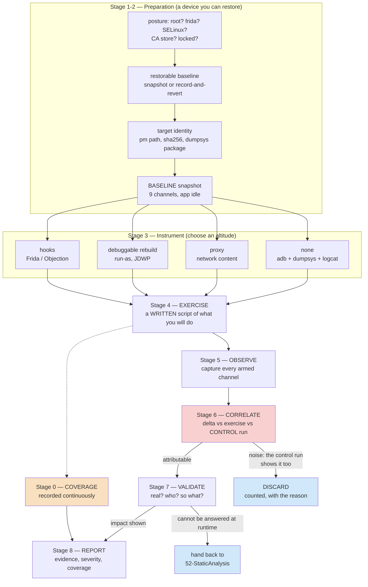
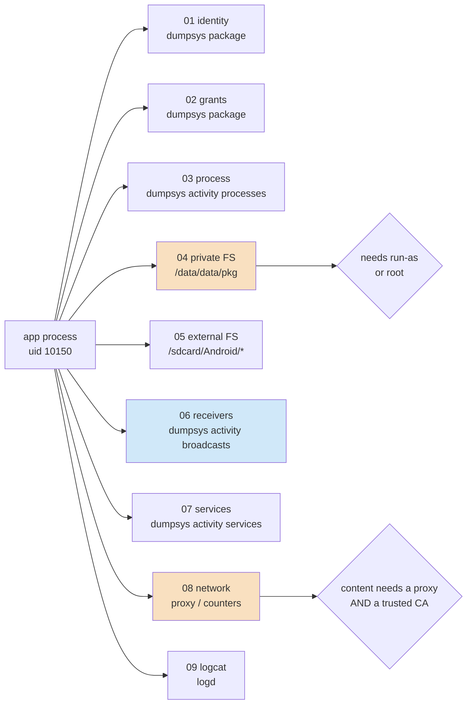
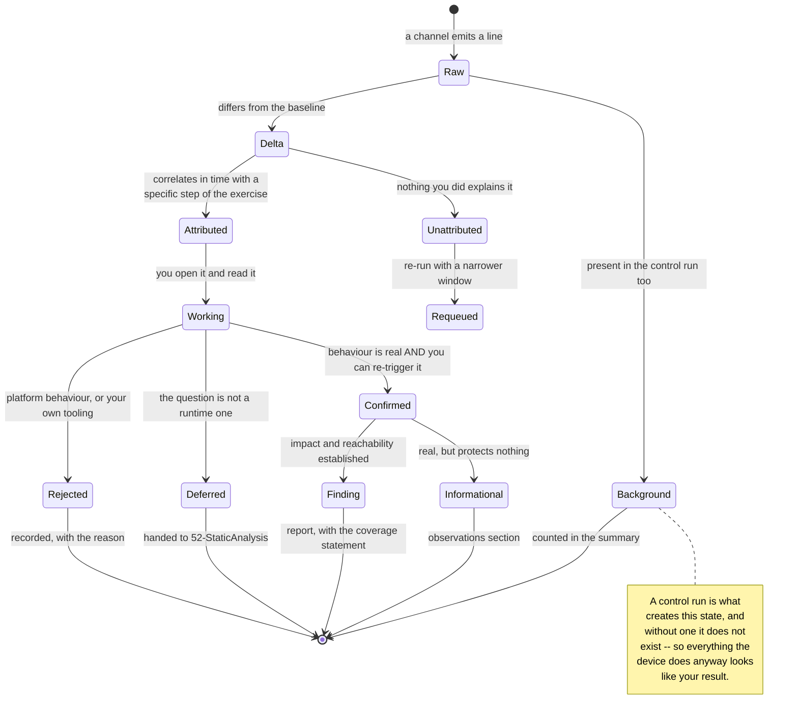
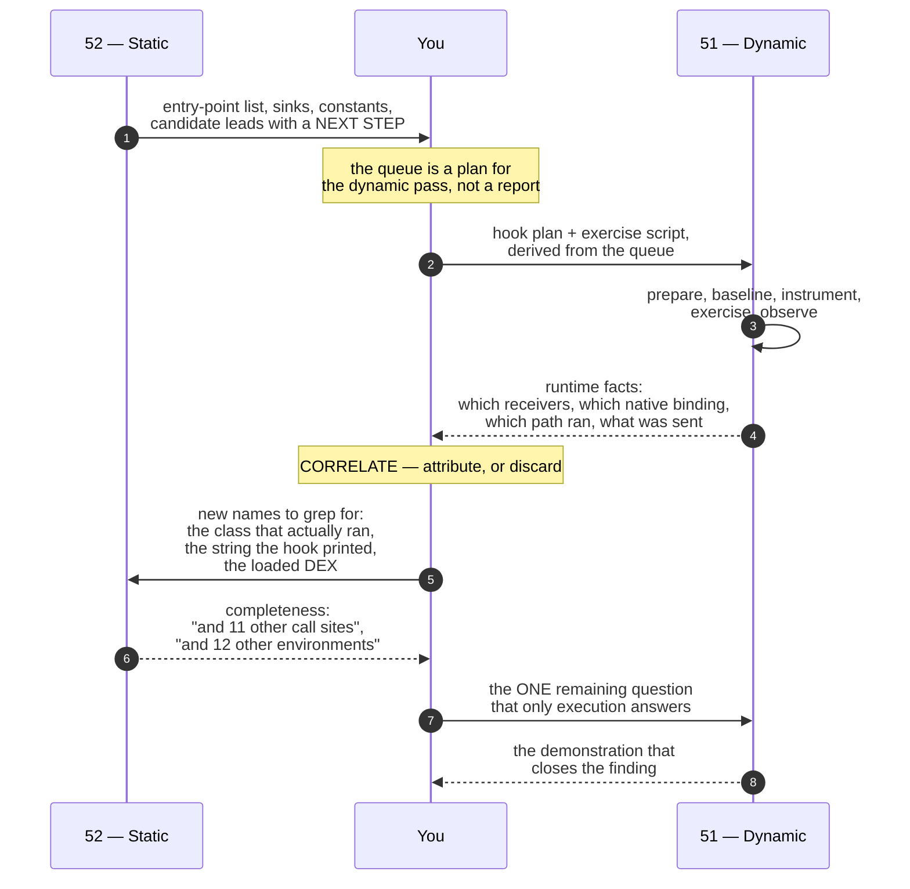
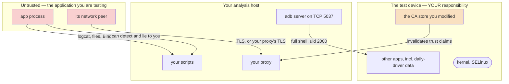
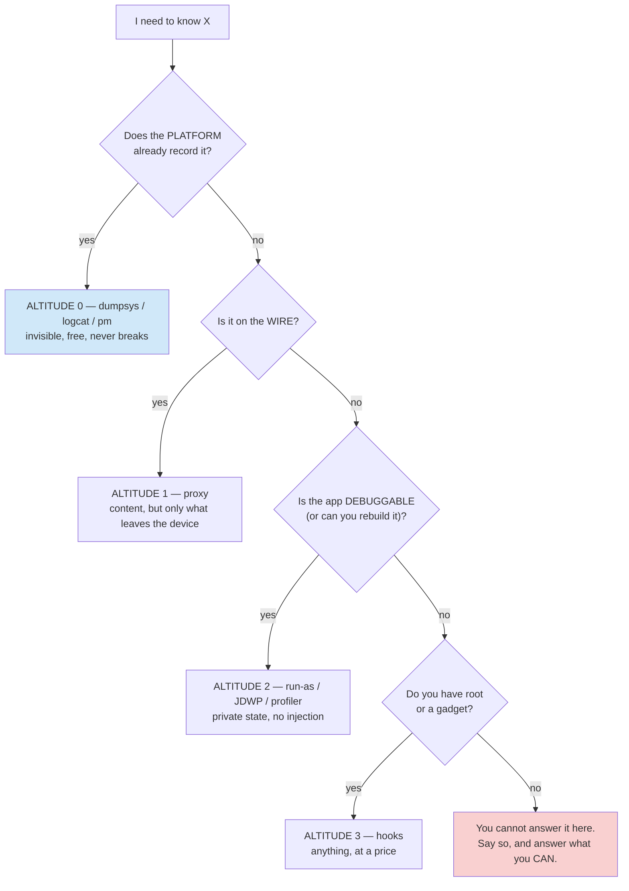
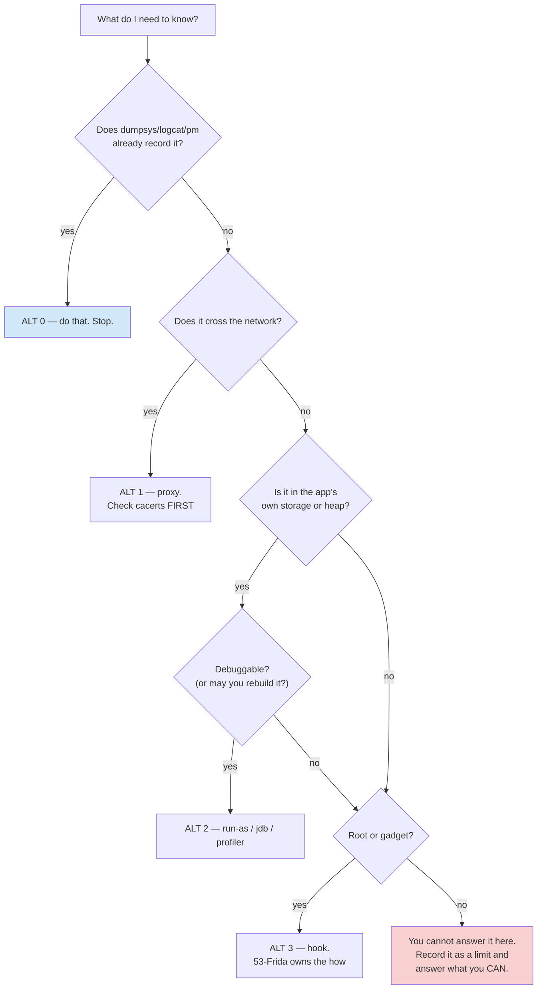
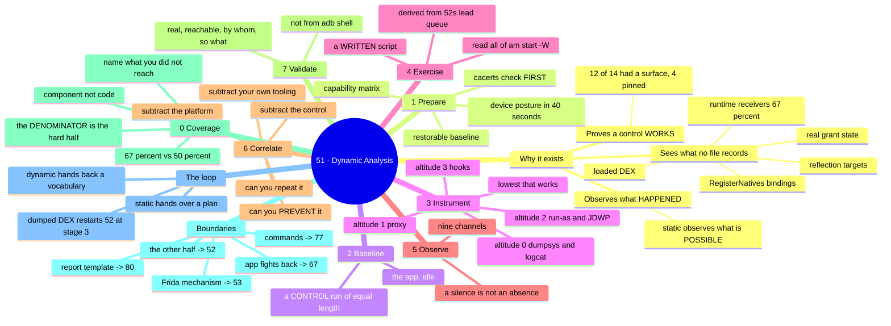

# 51 — Dynamic Analysis

> After this chapter you can take an application you have never run, prepare a device you can restore,
> establish a baseline, instrument at the lowest altitude that answers your question, exercise the app
> deliberately, observe nine channels at once, **correlate** what changed with what you did, validate
> the result into a defensible finding — and state precisely which parts of the application you never
> reached, because that is the only honest limit dynamic analysis has.

**Prerequisites:** [09-Android-App-Internals](../09-Android-App-Internals/README.md),
[24-IPC](../24-IPC/README.md),
[26-Intent](../26-Intent/README.md), and — **out of numeric order, so read it first** —
[60-ADB](../60-ADB/README.md). 60 is a genuine forward dependency: every command in this chapter is
an `adb` command, and 60 depends on nothing after it, so reading 60 → 51 costs you nothing.

**Useful alongside:** [52-StaticAnalysis](../52-StaticAnalysis/README.md) — the two are peers, not a
sequence. This chapter hands questions it cannot answer at runtime *back* to 52, and §7 there marks
the same line from the other side; either can be read first.

**Applies to:** every Android version. The pipeline is version-independent; individual observation
channels are not, and the chapter gives a version matrix at each point. Everything measured here was
measured on a physical **`i9000S`, Android 13 / API 33, arm64, SELinux Enforcing, NOT rooted, no
frida-server**. That constraint is not an apology — it is the point of §3.4. Where a claim could not
be measured on that device, the chapter says so instead of guessing.

---

## Table of Contents

1. [Introduction](#1-introduction)
2. [High-Level Architecture](#2-high-level-architecture)
3. [Deep Internal Working](#3-deep-internal-working)
4. [Source Code Walkthrough (AOSP)](#4-source-code-walkthrough-aosp)
5. [Security Perspective](#5-security-perspective)
6. [Reverse Engineering Perspective](#6-reverse-engineering-perspective)
7. [Dynamic Analysis](#7-dynamic-analysis)
8. [Static Analysis](#8-static-analysis)
9. [Examples](#9-examples)
10. [Common Interview Questions](#10-common-interview-questions)
11. [Common Mistakes](#11-common-mistakes)
12. [Hands-on Labs](#12-hands-on-labs)
13. [Summary](#13-summary)
14. [References](#14-references)

---

## 1. Introduction

### 1.1 The problem that existed before

[52-StaticAnalysis](../52-StaticAnalysis/README.md) opens with a sealed machine and two ways to find
out whether it is safe: switch it on and watch, or take it apart on a bench and read the wiring. That
chapter is the bench. **This one is the switch.**

The two halves are not interchangeable and neither is a superset of the other. The bench tells you
about every path the machine *can* take, including the ones it never took in front of you. The switch
tells you the truth about the paths it *did* take, including — and this is the part people forget —
paths that are not drawn on any diagram, because on Android the wiring is partly built while the
current flows.

> **📖 Definition**
> **Dynamic analysis** is the examination of a program's *behaviour* while it runs. It is not "using
> Frida", and it is not "putting a proxy in front of the phone". Those are instruments. Dynamic
> analysis is the discipline of arranging a controlled execution, observing it through channels you
> chose in advance, and attributing what changed to what you did. The instruments are
> interchangeable; the discipline is not.

Before there was a discipline here, mobile runtime testing looked like this: install the app, proxy
it, tap every button you can find, paste whatever appeared in Burp into a document. That approach has
two fatal properties, and they pull in opposite directions.

**It over-claims.** Everything it saw is real, so everything in the document feels solid. Nothing in
the document says which of the app's twelve screens were never opened, so a reader reasonably assumes
all twelve were.

**It under-observes.** A proxy is one channel. While you were reading HTTP, the app wrote a session
token to `shared_prefs`, logged a bearer header at `Log.d`, registered four broadcast receivers that
appear in no manifest, and loaded a DEX from `assets/`. None of that is in Burp, and none of it is in
the document either.

### 1.2 What would break without it

Take dynamic analysis away and five things become impossible. Each has a measured number attached
somewhere in this repository, because "static analysis has blind spots" is a slogan and
"static analysis is blind to two thirds of the broadcast surface" is a finding.

| What you lose | Why static cannot supply it | The measurement |
|---|---|---|
| **The runtime broadcast surface** | `registerReceiver()` builds an `IntentFilter` at runtime; nothing is written to any manifest | [29-BroadcastReceivers](../29-BroadcastReceivers/README.md) measured **299 of 431 distinct actions (69%)** on an API 30 device with no manifest-declared receiver anywhere. This chapter re-measured it on API 33: **214 of 321 (67%)** — §3.9.2 |
| **`RegisterNatives` bindings** | The Java-to-native mapping is a `JNINativeMethod[]` array passed at runtime, usually from `JNI_OnLoad`. No `Java_`-prefixed symbol exists to read | Universal in anything that wants its native surface hidden. [16-JNI](../16-JNI/README.md) and §4.6 |
| **Reflection targets** | `Class.forName(s)` where `s` is built at runtime creates no textual edge | Present in essentially every app. 52's sweep of a small training app found reflective dispatch in **313 files** and could name none of the targets |
| **Dynamically loaded DEX** | The code is not in the artefact you analysed | Rare, and almost always the most severe row when present |
| **Actual grant state, actual behaviour** | The manifest says what was *requested*. The platform decides what was *granted*, and the user decides again at runtime | §3.3 and §7.3.2 |

There is a sixth that is easy to miss and is often the whole engagement: **whether a control that
exists actually works.** [36-CertificatePinning](../36-CertificatePinning/README.md) examined 14 real
applications and found **12 with a pinning surface — a `TrustManager`, a `CertificatePinner`, a
`<pin-set>` — and only 4 that actually pinned.** A static reviewer who reports "the application
implements certificate pinning" because the class is present is wrong roughly two times in three.
Only an intercept attempt settles it, and an intercept attempt is dynamic analysis.

### 1.3 What dynamic analysis sees that static cannot — stated as a claim you can check

The five rows above are the structural cases. Here is the same idea in the form you will actually
meet it: a single application, and the same question asked of both halves.

```
STATIC says:  "registerReceiver is called in 3 files."
DYNAMIC says: "SCREEN_ON, com.vendor.SYNC_DONE and 12 others are live right now,
               registered by pid 4211, none of them guarded by a sender permission,
               and none of them is in any manifest on this device."
```

Static was not wrong. Static was answering a different question — *does this construct exist* — and
the question that mattered was *what is it listening for*. That gap is not a defect in anyone's tool.
It is a property of the platform: `IntentFilter` is a runtime object.

> **🧠 Mental Model**
> Static analysis draws the map. Dynamic analysis drives the roads. The map shows roads nobody drives
> — that is over-approximation, and it is where false positives come from. **And the driver keeps
> finding roads the map does not have**, because on Android roads are built at runtime. 52 §3.9
> phrases this from the other side, and the two sentences are the whole relationship between the
> chapters.

### 1.4 What it costs, stated as plainly as the benefits

Dynamic analysis pays for behavioural truth with one weakness, and it is a big one.

> **⚠️ Warning**
> **Dynamic analysis sees only the code you caused to run.** A clean dynamic pass proves that nothing
> bad happened on the paths you drove. It proves *nothing whatsoever* about the paths you did not.
> The sentence "we found no evidence of X" is defensible only when it is followed by "during a
> 40-minute window covering login, browse, checkout and logout, in which 11 of 19 components were
> reached".

Three corollaries, each of which is a real reporting failure:

| Failure | What it sounds like | What it should say |
|---|---|---|
| **Coverage laundering** | "The app does not log credentials." | "No credential appeared in logcat during the window described in §N. The refund and SSO flows were not exercised." |
| **Window laundering** | "The token is not sent over the network." | "The token did not appear in 340 captured requests. The app's background sync interval is 6 hours and the window was 40 minutes." |
| **Privilege laundering** | "The exported Activity is reachable." | "The Activity was started from `adb shell`, which runs as uid 2000. Reachability from an ordinary app is a separate demonstration." |

That last one is the discipline [60-ADB](../60-ADB/README.md) exists to enforce, and it measured why:
`platform.xml` grants the shell GID **only `INTERNET`**, while the `com.android.shell` *package*
requests **200 permissions**, 183 granted at install and **16 runtime permissions pre-granted
`SYSTEM_FIXED`** including `CAMERA`, `RECORD_AUDIO` and `READ_SMS`. Anything you did from `adb shell`
was done by a party far more privileged than an attacker's app.

### 1.5 Why this chapter exists separately from the tool chapters

Nine chapters in this repository perform dynamic analysis in their §7, and each does it *for one
thing*: [37-RootDetection](../37-RootDetection/README.md) hooks a root check,
[27-ContentProviders](../27-ContentProviders/README.md) probes a provider,
[40-Obfuscation](../40-Obfuscation/README.md) dumps a decrypted string,
[24-IPC](../24-IPC/README.md) drives a Binder interface. Each of those is an *instance* of a method.
**This chapter is the method**, and several of those chapters say so in their own references tables:
*"the general runtime methodology §7 specialises"*.

Three more chapters own the *instruments*, and this chapter is careful not to restage them:

| Chapter | Owns | This chapter's role |
|---|---|---|
| [53-Frida](../53-Frida/README.md) | The instrumentation engine: injection, the Java bridge, `Interceptor`, `Stalker`, the four reasons a hook does not fire, the agent-building workflow | Cited. 51 decides **whether and where** to hook; 53 is **how** |
| [67-BypassingProtections](../67-BypassingProtections/README.md) | Everything that happens when the app fights back: the five seams, altitude, the escalation ladder, anti-debug and anti-Frida, triaging an instant death | Cited. **51 hands off to 67 the moment instrumentation stops being routine** — §6.4 |
| [77-UsefulCommands](../77-UsefulCommands/README.md) | The command surface itself, with a "Talks to" column naming the service behind each command | Cited. 77 is the *what*; this chapter is the *when, why and in what order*. Its own references table says so: *"the methodology these commands serve"* |
| [80-Appendix](../80-Appendix/README.md) | The report template and the severity rubric | Cited. This chapter produces evidence; 80 formats it |

What the method owns, and none of those chapters owns:

1. **The pipeline** — prepare, baseline, instrument, exercise, observe, correlate, validate — and why
   that order and no other.
2. **Channel selection.** There are nine observation channels and you cannot watch all of them
   attentively. Choosing is a skill and §7.3 is the catalogue.
3. **Correlation.** The stage where a delta becomes evidence *for* something. This is the centre of
   gravity of the chapter and the stage almost every published methodology skips entirely.
4. **Coverage.** A plain, measured statement of what you did not exercise — the honest limit, and the
   exact mirror of 52's blind-spot statement.
5. **Honest severity.** Observing a behaviour is not a finding. Impact and reachability decide.

> **⚠️ Warning**
> If you are here to learn Frida, you are in the wrong chapter and the right one is linked above.
> This chapter deliberately ships no hooking tutorial and no command catalogue. Its two scripts are
> the two things no other chapter provides: a **delta recorder** and a **coverage reporter**.

### 1.6 A first look at the whole thing

Here is the entire chapter in nine lines, so that everything after it has somewhere to attach:

```
1. PREPARE     a device you can restore, whose posture you have recorded
2. BASELINE    what the app and the device look like BEFORE you touch anything
3. INSTRUMENT  the lowest altitude that can answer your question
4. EXERCISE    a written, repeatable script of what you will do
5. OBSERVE     capture every channel you armed, for the whole window
6. CORRELATE   attribute what changed to what you did -- and rule out what you did not
7. VALIDATE    real? reachable by whom? what does it get them? -> finding or rejection
8. REPORT      evidence, honest severity, and the coverage statement
0. THROUGHOUT  record what you did NOT exercise
```

Stage 6 is what separates an analyst from someone reading a log. Stage 0 is what separates an honest
report from a dangerous one. Notice that both of those sentences are structurally identical to the
ones 52 writes about *its* stages 7 and 0 — the two chapters have the same skeleton because they are
the same job done from two directions.

---

## 2. High-Level Architecture

### 2.1 The pipeline



Read that in four parts. The **top block** is preparation and it is where engagements are lost — not
dramatically, but by producing a day of measurements on a device whose posture invalidates them.
[44-NetworkSecurityConfig](../44-NetworkSecurityConfig/README.md) lost exactly that day, and §3.1.6
tells the story because it is worth more than any command.

The **middle** is where most people spend the entire engagement, and it produces raw output, which is
worth almost nothing on its own. Ten thousand logcat lines is not a finding; it is not even a lead.

The **red box** is the stage this chapter is about. Every observed change is either attributed to
something you did, or discarded because a control run produced it too, or handed back to static
analysis because the question is not a runtime question. That third arrow is the mirror image of the
one in 52's pipeline diagram, which reads *"cannot be answered statically → hand to
51-DynamicAnalysis"*. **The two diagrams point at each other on purpose. That is the loop.**

The **amber box** runs the whole time and feeds the report. Everything you did not exercise is part
of the deliverable.

Note what the diagram does **not** contain: an arrow from OBSERVE straight to REPORT. There is no
such arrow, and its absence is the single most important line in this chapter — exactly as the
missing SWEEP-to-REPORT arrow is in 52.

### 2.2 The nine observation channels, and what each can and cannot see

An application under test emits evidence through nine channels. They differ in cost, in privilege
required, and — critically — in what a *silence* on that channel means.



The two amber channels are the ones that cost people findings, and the blue one is the one that
produces them.

**Channel 04 is where the interesting data lives and it is the one that needs privilege.** On an
unrooted device you get it only if the app is debuggable. §3.4 measures exactly when `run-as` works
and — more usefully — the two distinct ways it refuses.

**Channel 08 counts bytes for free and tells you content only through a proxy**, and a proxy is only
as good as the device's trust store. This repository's other test device has an interception CA
promoted into the *system* store by a `trustusercerts` module, which means a successful intercept
there proves nothing about user-CA trust. Run `mount | grep cacerts` before any trust claim; §3.1.6.

**Channel 06 is the one static analysis cannot approximate at all**, and it is cheap: one `dumpsys`,
no privilege, no instrumentation.

Now the property that matters more than any of that — **what a silence means on each channel**:

| Channel | A silence means | A silence does NOT mean |
|---|---|---|
| 01 identity | The package was not updated during the window | — |
| 02 grants | No permission flipped during the window | The app does not use the permission |
| 03 process | The process did not start, die or change band | The app did nothing |
| 04 private FS | No file was created, deleted or rewritten | The app stores nothing — it may hold it in memory, or write on a path you did not drive |
| 05 external FS | Nothing was written outside the sandbox | — |
| 06 receivers | The runtime receiver set was identical at both ends | No receiver was registered — one registered in `onResume` and dropped in `onPause` is in **neither** snapshot |
| 07 services | No service started or gained a client | — |
| 08 network | Counters did not move | The app made no request — a request smaller than the platform's own chatter is invisible in counters |
| 09 logcat | Nothing was attributed to the app | The app logged nothing — the process name may differ from the package, and the ring buffer wraps |

That table is the honest reading of a clean report, and it is why `session-recorder.sh` prints a
sentence like *"That is a real negative result and it is bounded by the window length"* rather than a
green tick.

> **🔬 Under the Hood**
> On the test device `adb logcat -g` reports `main: ring buffer is 256 KiB (251 KiB consumed, 1 MiB
> readable)`. A 256 KiB ring on a chatty device holds **minutes**, not hours. If your exercise window
> is longer than the ring, the early part of it is gone before you read it — which is why
> `session-recorder.sh` marks a timestamp and reads with `logcat -T` rather than clearing the buffer
> at the start and hoping.

### 2.3 The life of an observation

The pipeline diagram shows the flow of work. This one shows the flow of a *single observation*, and
it is the state machine `examples/coverage-ledger.md` records.



Five things in that diagram are worth arguing about, so they are stated explicitly:

- **`Background` only exists if you took a control run.** Without one there is no way to
  distinguish "the app wrote this" from "the device does this every 30 seconds". §3.7.1 shows the
  measured control run for this chapter, in which two interfaces moved and nothing else did.
- **`Attributed` requires *time*, not just difference.** A file that changed some time during a
  40-minute window is barely evidence. A file that changed within two seconds of the step you
  labelled "tap Login" is evidence.
- **`Unattributed` is a legitimate state and its exit is a narrower window**, not a guess. Re-running
  with a 60-second window around one action is cheap and is how ambiguity is resolved.
- **`Deferred` is a professional answer.** "How many other places does this happen?" is a completeness
  question and completeness is static's home ground. Handing it back is respecting the boundary, not
  failing.
- **`Confirmed` splits.** A behaviour can be entirely real and protect nothing. §5.6 works a measured
  example where exactly that happened and the honest answer was Informational.

### 2.4 The other half of the loop

Seven chapters describe 51 and 52 as two halves of one thing.
[57-Ghidra](../57-Ghidra/README.md) puts it most plainly in its companions table: *"the other half of
the loop"*. Here is the loop, drawn, with the handoff in both directions named.



Read the arrows, not the boxes. **Static hands dynamic a plan; dynamic hands static a vocabulary.**

The second of those is the half people miss. A runtime pass is the cheapest possible deobfuscator:
when a hook on `Method.invoke` prints `com.vendor.pay.a.b`, you now have a name to grep for, and 52's
sweep — which had no reason to look at `a.b` among four thousand identically-named classes — becomes
targeted. [40-Obfuscation](../40-Obfuscation/README.md) §6.1 says the same thing from its own side,
and [57-Ghidra](../57-Ghidra/README.md) §1 says it about native code in one sentence worth
memorising: *"go back to 51-DynamicAnalysis and let the running app tell you which functions
matter."*

**Concretely, what crosses in each direction:**

| Static hands dynamic | Dynamic hands static |
|---|---|
| The entry-point list — which becomes the **coverage denominator** (`coverage-reporter.py --components`) | The classes that actually ran, by name, including obfuscated ones |
| Candidate sinks: `openFile`, `exec`, `loadUrl`, `query` | The arguments those sinks actually received |
| Constants worth watching for: a token, a key, a hostname | Which of them ever appeared on the wire or on disk |
| "A `TrustManager` exists" | "The app accepted my CA" — or refused it |
| "`registerReceiver` is called in 3 files" | The 14 actions those calls registered |
| "A native method is declared" | The `.so` and offset that implements it |
| "`InMemoryDexClassLoader` is referenced" | The dumped DEX, which restarts 52's pipeline at stage 3 |
| A confidence-ranked lead queue | A verdict per lead: fired, did not fire, or not reached |

> **🧠 Mental Model**
> **Use dynamic analysis to understand and static analysis to be exhaustive, in that order**,
> whenever both are available. 52 §7.6 phrases it identically and
> [40-Obfuscation](../40-Obfuscation/README.md) §6.1 phrases it from a third side. Three chapters
> arriving at the same sentence independently is the strongest signal in this repository that the
> sentence is right.

### 2.5 The trust boundary you are standing on



Four consequences, all of which have bitten real analysts:

- **The app knows you are there and may behave differently.** This is not paranoia; it is the entire
  subject of [37-RootDetection](../37-RootDetection/README.md),
  [38-TamperDetection](../38-TamperDetection/README.md) and
  [67-BypassingProtections](../67-BypassingProtections/README.md). A dynamic result from an
  instrumented process is a result about *the instrumented process*. When the app fights back, §6.4
  hands you to 67 rather than improvising.
- **Your device modifications invalidate your own measurements.** The clearest case is the trust
  store: [35-SSL](../35-SSL/README.md) diagnosed a `trustusercerts` module *promoting* an
  interception CA into the system store, so that
  `NetworkSecurityConfig.getDefaultBuilder()` returned 139 anchors at **every** `targetSdk` — 23, 24,
  28, 30, 34 — which looks exactly like the API 24 user-CA rule not existing. It does exist. The CA
  simply was not a *user* CA any more. **A device whose posture you have not established will teach
  you the opposite of the truth.**
- **You are uid 2000 and an attacker is not.** See §1.4.
- **The device is somebody's.** Both physical devices in this repository are daily drivers. Every
  command in this chapter is read-only unless it says otherwise in bold, and the mutations that are
  unavoidable — `am force-stop`, launching an Activity — are named as mutations at the point of use
  and reversed afterwards.

> **🔍 Pentester's Note**
> Record the device posture into the evidence directory at the start of every session, not into your
> memory. `session-recorder.sh` writes `device.txt` with fourteen properties including
> `security_patch`, `ro.debuggable`, `getenforce` and `deviceLocked`, and it does it before it does
> anything else. Six months later, that file is what makes a measurement re-checkable —
> and it is what catches the case in this repository's own history where **two physical devices were
> swapped mid-project without warning** and differed in root, in Frida availability, and in API
> level.

---

## 3. Deep Internal Working

This is the long section. It walks the eight stages, and for each: **what** it is, **why** it is in
that position, **when** you can skip it, **where** its output goes, and **how** it fails.

### 3.1 Stage 1 — Prepare: the environment build

**What.** Produce a device whose capabilities you know, whose posture you have recorded, and whose
state you can return to.

**Why first, and why it is not a formality.** Every version-gated claim you make for the rest of the
engagement depends on facts established here, and every one of them is cheap to check and expensive
to get wrong.

#### 3.1.1 The four questions a device must answer before you trust it

```bash
# host — the whole of stage 1's mandatory part, and it takes forty seconds
adb devices -l
adb shell getprop ro.product.model
adb shell getprop ro.build.version.release
adb shell getprop ro.build.version.sdk
adb shell getprop ro.build.version.security_patch
adb shell getenforce
adb shell "which su; su -c id"                       # rooted?
adb shell "ps -A -o NAME" | grep -i frida            # frida-server running?
adb shell mount | grep cacerts                       # trust store modified?
adb shell dumpsys trust | grep -o "deviceLocked=[01]"
```

Real output from the device used throughout this chapter:

```
80062527052150   device product:i9000S model:i9000S device:i9000S transport_id:1
i9000S
13
33
2021-11-05
Enforcing
/system/bin/sh: su: inaccessible or not found
(no frida process)
(no cacerts mount)
deviceLocked=0
```

Five things in that block change what the rest of the engagement can claim, and one of them is a
finding about the device itself:

| Observation | Consequence |
|---|---|
| `Android 13 / API 33` | Scoped storage is mandatory; `MANAGE_EXTERNAL_STORAGE` is gated; `exported` must be explicit for filtered components from targetSdk 31 |
| `security_patch 2021-11-05` on an Android 13 build | **The platform is four-and-a-half years behind its own release.** On a fleet device that is a finding in its own right, and it means public platform vulnerabilities are in play. Vendor builds ship this way more often than anyone likes |
| `su: inaccessible or not found` | Every method in this chapter must have an unrooted path, or be labelled as unavailable. §3.4 |
| no `frida-server` | 53's entire toolchain is unavailable here without deploying a gadget into an app you build. §3.5.4 |
| no `cacerts` mount | Trust-store questions **can** be answered honestly on this device, unlike the other one in this repository |

> **⚠️ Warning**
> `ro.build.version.release` and the security patch level are independent, and OEMs decouple them
> routinely. Never infer one from the other, and never infer "modern platform" from "modern version
> string".

#### 3.1.2 The capability matrix — what each device class can and cannot do

Published methodology overwhelmingly assumes a rooted device with `frida-server`, and then does not
say so. This table is the honest version. It is the single most useful thing in §3 if your device is
the unrooted one.

| Capability | Unrooted stock | Unrooted + **debuggable target** | Rooted | Emulator (AVD, Google APIs) |
|---|---|---|---|---|
| `dumpsys` all services | yes | yes | yes | yes |
| logcat, all buffers | yes | yes | yes | yes |
| Enumerate live receivers | yes | yes | yes | yes |
| Actual grant state | yes | yes | yes | yes |
| Read the app's private dir | **no** | **yes — `run-as`** | yes | yes (`adb root` on non-Play images) |
| Attach a Java debugger (JDWP) | **no** | **yes** | yes | yes |
| Frida injection | no | **gadget only, in an app you rebuild** | yes, `frida-server` | yes |
| Proxy HTTP with a user CA | yes, if the app trusts user CAs | yes | yes | yes |
| Install a CA into the **system** store | no | no | yes | yes (writable system) |
| `strace` a process | no | no | yes | yes |
| Read another app's `/proc/<pid>/maps` | **no — SELinux denies it on Android 13** | no | yes | yes |
| Full-device snapshot / restore | no | no | partial | **yes, and this is the emulator's killer feature** |

Two rows deserve emphasis because they invert expectations.

**"Unrooted + debuggable target" is a genuinely powerful column**, and it is available far more often
than people assume — this chapter found a `DEBUGGABLE`, `TEST_ONLY` third-party application already
installed on a stock retail device (§3.4.3). It buys you private storage and a Java debugger, which
between them cover a large fraction of a storage-and-auth assessment.

**The emulator's advantage is not root, it is `snapshot`.** A restorable baseline is the difference
between an experiment and a mess, and §3.1.5 is about nothing else.

#### 3.1.3 Building the environment: the rooted path

Where you have a rooted device or a writable-system emulator, the standard build is four steps and is
owned in detail by other chapters. It is given here in outline so that §3 is a complete environment
build, as several chapters promise it will be.

```bash
# host — 1. deploy frida-server matching your CLIENT version exactly
frida --version                                   # e.g. 16.5.9
#     download frida-server-16.5.9-android-arm64 to match
adb push frida-server-16.5.9-android-arm64 /data/local/tmp/frida-server
adb shell "chmod 755 /data/local/tmp/frida-server"
adb shell "su -c '/data/local/tmp/frida-server &'"
frida-ps -U | head                                # the three-second smoke test

# host — 2. a proxy the device trusts
adb shell settings put global http_proxy 192.168.1.10:8080
#     install the proxy CA; on API 24+ a USER CA is not trusted by an app
#     unless its network security config says so -- see chapter 44

# host — 3. Objection, when you want the fast path rather than the mechanism
objection -g com.example.target explore

# host — 4. record what you did, so that you can undo it
adb shell settings put global http_proxy :0       # the reversal
```

> **🔬 Under the Hood**
> Version matching is the single most common setup failure and it is not a warning, it is a hard
> requirement: the frida client and `frida-server` speak a versioned protocol.
> [53-Frida](../53-Frida/README.md) §7.1 covers this, the ABI selection problem, the SELinux
> execute-permission problem and the compilation-state problem in full. Do not re-derive them.

#### 3.1.4 Building the environment: the emulator path

An AVD is not a lesser device, it is a *different* device, and for several questions it is strictly
better. [80-Appendix](../80-Appendix/README.md)'s tool inventory assigns Android Studio and the AVD to
this chapter, so here is what actually matters about them.

```bash
# host — create an image you can root. The distinction is the image, not the tool:
#   "Google Play"       -> production build, adb root is REFUSED
#   "Google APIs"       -> userdebug-like, adb root WORKS
#   "AOSP / no images"  -> same, and lighter
sdkmanager "system-images;android-33;google_apis;arm64-v8a"
avdmanager create avd -n test33 -k "system-images;android-33;google_apis;arm64-v8a"

# host — start with a writable system when you need to touch the CA store
emulator -avd test33 -writable-system -no-snapshot-load

# host — the capability that no physical device gives you
adb emu avd snapshot save clean
#   ... destroy the state completely ...
adb emu avd snapshot load clean
```

| Emulator strength | Emulator weakness |
|---|---|
| **Snapshots.** Restore to a known-clean state in seconds | No real hardware-backed KeyStore. StrongBox is absent, and TEE attestation is emulated — [49-KeyStore](../49-KeyStore/README.md) and [50-HardwareBackedSecurity](../50-HardwareBackedSecurity/) matter here |
| `adb root` on Google APIs images | Emulator detection is trivial and many apps refuse to run — [39-EmulatorDetection](../39-EmulatorDetection/) |
| Reproducible: colleagues can run your exact image | x86_64 hosts run arm64 apps through translation, so native timing and some `.so` behaviour differ |
| Nothing on it is anybody's daily driver | No SIM, no real telephony, no real sensor data |

**The Android Studio profiler and debugger** are the other half of what 80 assigns here, and they are
under-used by testers because they are packaged as developer tools. Three things they do that are
awkward elsewhere:

- **The Network Inspector** shows request and response bodies for `HttpsURLConnection` and OkHttp
  without a proxy or a CA at all, because it instruments the client rather than the transport. That
  sidesteps pinning entirely for the traffic it can see — and it is limited to a **debuggable** app.
- **The Memory Profiler** captures an `.hprof` heap dump on demand. §5.4.5 uses this for the
  credential-in-a-`String` sweep that [04-Java](../04-Java/README.md)'s FAQ points here for.
- **The Database Inspector** reads a live SQLite database in place, including — importantly — data
  that a file copy would miss because it is still in the WAL. [33-Storage](../33-Storage/README.md)
  measured a `logout` deleting 2 rows while all four secrets remained readable in a 61,832-byte
  `-wal` file.

#### 3.1.5 The restorable baseline — the checklist item 80 asks for

> **📖 Definition**
> A **restorable baseline** is a recorded device state that you can return to, so that an experiment
> can be repeated and so that you leave the device as you found it. It is not a backup. It is a
> written record plus a reversal procedure.

Three tiers, in descending order of goodness:

| Tier | Mechanism | Restores | Use when |
|---|---|---|---|
| **Snapshot** | `adb emu avd snapshot save/load` | Everything | Emulator |
| **App-scoped reset** | `pm clear <pkg>` then re-drive the login | The app's own data only | You own the app or have written permission. **Destructive** |
| **Record-and-revert** | Write down every setting you change and change it back | What you remembered | A daily driver — which is the case in this repository |

The third tier is the realistic one and it is worth doing properly, because "I think I turned the
proxy off" is not a restoration. The mutations a dynamic pass typically makes, and their reversals:

| Mutation | Reversal | Notes |
|---|---|---|
| `settings put global http_proxy H:P` | `settings put global http_proxy :0` | Not `""` — that leaves a literal empty proxy on some builds |
| `pm grant`/`pm revoke` | The inverse | **Record the original `granted=` state first**, from channel 02 |
| `am force-stop <pkg>` | Relaunch the app | Reversible, but it *is* a mutation. This chapter used it and says so at §9.3 |
| `am set-debug-app` | `am clear-debug-app` | Easy to forget; leaves the next launch waiting for a debugger |
| `adb reverse tcp:N tcp:N` | `adb reverse --remove tcp:N` | 67 §7.4 uses this to make a control fire honestly with no root |
| Pushed binaries in `/data/local/tmp` | `rm` them | `frida-server`, `strace`, test APKs |
| An installed CA | Remove it in Settings | And re-check `mount | grep cacerts` |

```bash
# host — capture the reversible state BEFORE you touch anything
adb shell "settings get global http_proxy"       > baseline/proxy.txt
adb shell "dumpsys package $PKG | grep granted=" > baseline/grants.txt
adb shell "ls /data/local/tmp"                   > baseline/tmp.txt
adb shell "getprop"                              > baseline/props.txt
```

`session-recorder.sh` writes the equivalent of the second of those into every evidence directory as
`before/02-grants.txt`, which means every session it records carries its own revert list.

#### 3.1.6 How stage 1 fails: the trust-store trap, measured

This is the failure that costs a whole day, and it has happened twice in this repository, so it gets
its own subsection rather than a warning box.

```bash
# adb shell — on this repository's OTHER device
mount | grep cacerts
# APatch on /system/etc/security/cacerts type tmpfs (rw,seclabel,...)
# /dev/block/dm-10 on /system/etc/security/cacerts/d41b5e2a.0 type f2fs (...)
```

APatch replaced the system CA directory with a tmpfs and bind-mounted certificates into it,
**including an interception CA**. 139 certificates are present. The consequence is severe and easy to
miss: **a successful intercept on that device does not prove an app trusts user-installed CAs**,
because the proxy CA is in the *system* store. That is precisely the distinction
[35-SSL](../35-SSL/README.md) and [44-NetworkSecurityConfig](../44-NetworkSecurityConfig/README.md)
exist to make, and it cannot be measured there without first undoing the modification.

Two further facts, both measured on that device and both contradicting common tables:

- **The Conscrypt APEX move is API 34, not earlier.** On API 30 `/apex/com.android.conscrypt/` exists
  but has **no `cacerts` directory**; the live store is `/system/etc/security/cacerts` with 139 files.
  `ls -d` both rather than trusting any version table.
- Store filenames are **`subject_hash_old`** (MD5), not `subject_hash`, and the files are **DER**.

> **🔍 Pentester's Note**
> Chapter 44 hit this and wrote it up as a first-class methodology trap rather than publishing a
> conclusion it could not support. That is the correct response and it is the model for every
> environment problem: **when the device cannot answer the question, say the device cannot answer the
> question.** A report that says so is worth more than one that guesses, and infinitely more than one
> that guesses confidently.

**When you can skip stage 1.** Never. It is forty seconds.

### 3.2 Stage 2 — Baseline

**What.** Capture what the app and the device look like *before* you touch anything, through every
channel you intend to observe.

**Why it is stage two and not an afterthought.** Because a delta needs two terms. Without a baseline,
every observation is absolute — "there is a file called `auth.xml`" — and absolute observations are
almost useless. What you want is "`auth.xml` **appeared**, 380 bytes, within four seconds of the step
labelled *tap Login*", and that sentence is impossible to write without a before.

**Two baselines, not one.** This is the part most people skip and it is what makes correlation
possible at all:

1. **The app baseline.** The nine channels, app installed and idle.
2. **The control run.** The *same* nine channels, over a window of the *same length*, with the app
   idle and you doing nothing. Whatever changes in a control run is background: it is what the device
   does anyway, and it must be subtracted from anything you want to attribute.

```bash
# host — the app baseline plus a 45-second control run, in one command
bash scripts/session-recorder.sh --package com.example.target \
     --out ./evidence/control --wait 45
```

The control run measured for this chapter is worth printing in full, because its shape is the lesson:

```
### 04 Private filesystem
No file under the private data directory was created, deleted or rewritten.

### 06 Runtime-registered receivers
No change.

### 08 Network counters
  dummy0        rx +0             tx +5877
  lo            rx +4017          tx +4017
```

**Two interfaces moved and nothing else did.** So on this device, over 45 seconds: loopback and a
dummy interface churn by a few kilobytes for free, and every other channel is quiet. That is now a
*calibrated* instrument. Any private-filesystem change in a subsequent run is attributable; any
loopback traffic under about 4 KB per 45 seconds is not.

> **🧠 Mental Model**
> A control run turns your evidence from *anecdote* into *measurement*, and it costs one command and
> the length of your window. Scientists call this a negative control and would not publish without
> one. Neither should you.

**How this stage fails.** By being taken *after* the app has already been driven. A baseline captured
from an app that is already logged in, already synced and already warm is a baseline of the end
state, and it will hide exactly the file-creation events you were hoping to see. Capture it first, or
capture it after a `pm clear` if you own the app.

**When you can skip it.** When the question is purely observational and has no before — "which
actions does this app register receivers for" is answered by one `dumpsys`. Everything about *change*
needs a baseline.

### 3.3 Reading the platform's own record: what `dumpsys package` settles

Before instrumenting anything, there is a class of question the platform will simply answer, and it
answers authoritatively — because `dumpsys package` reports what PackageManagerService *parsed and
applied*, not what a file claims about itself.

```bash
# adb shell — the platform's view, which beats any file you decoded
dumpsys package com.example.target | grep -E \
  "versionName|versionCode|targetSdk|minSdk|flags=|privateFlags=|installerPackageName|userId="
```

Real output for the target used in §9.3 (anonymised package name; every other value is as measured):

```
    userId=10150
    codePath=/data/app/~~z0up5iFqU_...==/com.vendor.fieldmgr-9aaZV1tX...==
    versionCode=9 minSdk=21 targetSdk=33
    versionName=1.9
    flags=[ DEBUGGABLE HAS_CODE ALLOW_CLEAR_USER_DATA TEST_ONLY ALLOW_BACKUP ]
```

That `flags=` line is four findings-worth of information in one row, and it took no instrumentation
at all:

| Flag | What it means | Why it matters here |
|---|---|---|
| `DEBUGGABLE` | `android:debuggable="true"` survived into the shipped build | `run-as` and JDWP are open to anyone with ADB. §3.4 and §9.3 |
| `TEST_ONLY` | The APK was built with `android:testOnly`, so it can only be installed with `pm install -t` | This build was never meant to leave a lab |
| `ALLOW_BACKUP` | `allowBackup` is not disabled | Backup-adjacent extraction paths; [33-Storage](../33-Storage/README.md) |
| `ALLOW_CLEAR_USER_DATA` | The default | Not a finding |

And the second half of the same command is the grant state, which no artefact can give you:

```
android.permission.ACCESS_FINE_LOCATION: granted=true,  flags=[ USER_SET|... ]
android.permission.READ_EXTERNAL_STORAGE: granted=false, flags=[ ...|RESTRICTION_INSTALLER_EXEMPT ]
android.permission.CAMERA: granted=false, flags=[ USER_SENSITIVE_WHEN_GRANTED|... ]
```

> **📖 Definition**
> A manifest `<uses-permission>` is a **request**. `granted=` is the **answer**. The gap between them
> is where a great many "the app has camera access" claims die, and it is only visible at runtime.
> [23-Permissions](../23-Permissions/README.md) owns the model; this chapter owns reading it live and
> watching it change, which is channel 02.

**Why this is in §3 and not §7.** Because it is not a command, it is a stage: *establish what the
platform believes before you form any hypothesis about the app*. When a static lead and the platform
disagree, the platform wins — 52 §3.1 says the same, and this is that sentence's runtime half.

### 3.4 The unrooted path, measured

Most published dynamic methodology silently assumes root and `frida-server`. The device this chapter
was written on has neither. This section is what actually works, with the measurements.

#### 3.4.1 `adb jdwp` — the free debuggable-app enumerator

One command, no root, no static analysis, no APK:

```bash
# host — every debuggable process on the device, right now
adb jdwp
# 2863
```

`adb jdwp` streams the pid of every process that has an open JDWP connection, which is exactly the
set of processes the platform considers debuggable. On the test device it returned exactly one pid —
and that pid was a third-party application. **That is a finding located in one command**, before any
tool was opened.

The whole-device version, which is worth running once per engagement on any fleet device:

```bash
# adb shell — every package the platform recorded as debuggable
for p in $(pm list packages | sed s/package://); do
  f=$(dumpsys package $p 2>/dev/null | grep -m1 "flags=")
  case "$f" in *DEBUGGABLE*) echo "$p $f";; esac
done
```

Measured on the `i9000S`, five packages carried `DEBUGGABLE`:

```
com.ubx.gpstest          flags=[ SYSTEM DEBUGGABLE HAS_CODE ALLOW_CLEAR_USER_DATA ]
com.vendor.fieldmgr      flags=[ DEBUGGABLE HAS_CODE ALLOW_CLEAR_USER_DATA TEST_ONLY ALLOW_BACKUP ]
com.udroid.poskey        flags=[ SYSTEM DEBUGGABLE HAS_CODE ALLOW_CLEAR_USER_DATA ALLOW_BACKUP ]
com.ubx.factorykit       flags=[ SYSTEM DEBUGGABLE HAS_CODE ALLOW_CLEAR_USER_DATA ALLOW_BACKUP ]
com.udroid.portinstall   flags=[ SYSTEM DEBUGGABLE HAS_CODE ALLOW_CLEAR_USER_DATA ALLOW_BACKUP ]
```

Four of the five are **OEM system applications shipped debuggable on a retail device**. That is a
device-posture finding and it belongs in a report about the device, not about any app.

#### 3.4.2 `run-as`, and the two distinct ways it refuses

The folklore rule is "if the app is debuggable, `run-as` works". That is half right, and the half
that is wrong is the half you meet first on a real device. Three packages, one command each, measured:

```bash
# host — a debuggable, non-system, third-party app
adb shell "run-as com.vendor.fieldmgr id"
# uid=10150(u0_a150) gid=10150(u0_a150) groups=10150(u0_a150),1004(input),1007(log),
#   1011(adb),1015(sdcard_rw),1028(sdcard_r),3003(inet),... ,50150(all_a150)
#   context=u:r:runas_app:s0:c150,c256,c512,c768

# host — a debuggable SYSTEM app
adb shell "run-as com.ubx.factorykit id"
# run-as: package not an application: com.ubx.factorykit

# host — a NON-debuggable third-party app
adb shell "run-as com.vendor.fieldapp id"
# run-as: package not debuggable: com.vendor.fieldapp
```

**Two different refusals with two different causes**, and the messages distinguish them precisely:

| Message | Cause | Fix |
|---|---|---|
| `package not debuggable` | `FLAG_DEBUGGABLE` is clear | Rebuild the app debuggable, or use a different channel |
| `package not an application` | The flag IS set, but the uid is a system uid below 10000 | None. `run-as` refuses system packages by design, regardless of the flag |

So the correct rule is: **`run-as` requires `FLAG_DEBUGGABLE` *and* an application uid.** Anyone who
tries `run-as` on a debuggable system app and reads "not an application" will conclude the app is not
debuggable, which is the opposite of true.

> **🔬 Under the Hood**
> Note the SELinux context in the success case: `u:r:runas_app:s0:c150,c256,c512,c768`. Two things
> are worth reading there. It is **not** the app's own domain — `run-as` transitions to a dedicated
> `runas_app` domain, which is why it can read the data directory but is not simply "being the app".
> And there are **four MCS categories, not two**. [21-App-Sandbox](../21-App-Sandbox/README.md) and
> [22-SELinux](../22-SELinux/README.md) give the pair as `c[appId & 0xff]` and `c[256 + (appId >> 8)]`
> — for appId 150 that is `c150,c256`, which matches exactly. The additional `c512,c768` encode the
> **user id** and are the API 31+ four-category form. The two-category formula is not wrong; it is the
> first half of a four-category label on a modern device. Anyone parsing MCS pairs from a device this
> new needs to expect four.

#### 3.4.3 What the unrooted path actually buys you, end to end

With `run-as` available, the full private-storage channel opens without root:

```bash
# host — the whole of channel 04, no root
PKG=com.vendor.fieldmgr
adb shell "run-as $PKG ls -la /data/data/$PKG"
adb shell "run-as $PKG find /data/data/$PKG -type f -exec stat -c%s,%Y,%n {} +"
adb shell "run-as $PKG find /data/data/$PKG -type f -exec md5sum {} +"
adb shell "run-as $PKG cat /data/data/$PKG/shared_prefs/${PKG}_preferences.xml"
```

Measured on the target (values redacted; the *shape* is what matters):

```xml
<map>
    <string name="appname">REDACTED</string>
    <boolean name="Permission_Overlay" value="true" />
    <string name="packagename">REDACTED</string>
    <string name="dty_deviceid">REDACTED</string>
    <string name="showdelay">REDACTED</string>
    <string name="tmp_file_name">REDACTED</string>
</map>
```

Six device-configuration strings. **No credential, no token, no session.** That negative result is
exactly as important as a positive one would have been, and §5.6 uses it as the worked example of
honest severity: the *reachability* is real and demonstrated, and the *asset* behind it is nearly
nothing, and both facts go in the report.

> **⚠️ Warning**
> `adb shell` does not preserve your host shell's quoting. It joins its arguments with spaces and
> hands the result to the device's `/system/bin/sh`, so a nested
> `run-as $PKG sh -c 'stat -c "%s %Y"'` arrives with its quotes already eaten and silently produces
> nothing at all. This cost [09-Android-App-Internals](../09-Android-App-Internals/README.md) two
> whole root sections, which looked fine and were broken. The fix used throughout this chapter's
> tooling is to pass a **quote-free argv** and let `run-as` exec the binary directly — which is why
> the `stat` format above is comma-separated rather than space-separated.

#### 3.4.4 Everything else the unrooted path gives you

| Channel | Unrooted command | Requires |
|---|---|---|
| Live receiver surface | `dumpsys activity broadcasts` | nothing |
| Actual grants | `dumpsys package $PKG` | nothing |
| Process state and oom_adj | `dumpsys activity processes` | nothing |
| Services and their clients | `dumpsys activity services $PKG` | nothing |
| Activity stack and history | `dumpsys activity activities` | nothing |
| Full logcat | `adb logcat -T '<ts>'` | nothing |
| External storage writes | `find /sdcard/Android/data/$PKG` | nothing |
| Recent broadcast history **with extras** | `dumpsys activity broadcasts` | nothing |
| Private storage | `run-as` | debuggable + app uid |
| Java debugger, live objects, method breakpoints | `adb jdwp` + `jdb` | debuggable |
| Network content | a proxy the app trusts | user-CA trust, or a rebuild |
| Frida | `frida-gadget` embedded in a rebuild | you can rebuild the APK |

> **🔍 Pentester's Note**
> [67-BypassingProtections](../67-BypassingProtections/README.md) demonstrated the most interesting
> entry in that table's spirit: it used **`adb reverse tcp:27042 tcp:27042`** to create a *real*
> listening socket on the device inside `adbd`, so that an app's anti-Frida port check genuinely
> succeeded — **with no root and no frida-server at all**. That is the shape of unrooted work at its
> best: not simulating a condition, but finding a legitimate mechanism that produces it honestly.

### 3.5 Stage 3 — Instrument: choosing an altitude

**What.** Arm the channels you need, at the lowest cost that can answer your question.

> **📖 Definition**
> **Altitude** is the distance between where you intervene and the decision you care about.
> [20-Security-Architecture](../20-Security-Architecture/labs/lab-03-integrity-gate-bypass.md)
> introduced the word in this repository and
> [67-BypassingProtections](../67-BypassingProtections/README.md) built its five seams on it. For
> *observation* the same idea applies: a low-altitude instrument sees a lot cheaply and vaguely; a
> high-altitude one sees exactly one thing precisely and is fragile.

**Why "lowest that works" and not "most powerful".** Four reasons, in the order they bite:

1. **Detectability.** A hook is observable. `dumpsys` is not. Any instrument the app can detect is an
   instrument that can change the behaviour you came to measure.
2. **Fragility.** A hook on `com.vendor.a.b.c` breaks at the next release. A `dumpsys` command does
   not.
3. **Cost.** Frida on an unrooted device means rebuilding the APK. `dumpsys` means typing.
4. **Honesty.** An observation from an uninstrumented process is a stronger claim than the same
   observation from an instrumented one, and reviewers know it.

#### 3.5.1 The four altitudes



The blue box is where a surprising fraction of real questions land, and the red box is the honest
terminal state that published methodology never draws.

#### 3.5.2 Altitude 0 — the platform's own records

Everything in §3.4.4's "requires nothing" column. Cheap, invisible, and authoritative about the
platform's own state. This is where a session starts and it is where most sessions should spend their
first hour. [77-UsefulCommands](../77-UsefulCommands/README.md) is the reference for the commands
themselves; this chapter's contribution is the ordering and the reason.

#### 3.5.3 Altitude 1 — the proxy

A proxy answers one question extremely well — *what did this app send and receive* — and it answers
it with content, which no counter does.

```bash
# host — device-wide proxy (a MUTATION; record and revert)
adb shell settings put global http_proxy 192.168.1.10:8080
# ... test ...
adb shell settings put global http_proxy :0
```

Three failure modes, in the order you will meet them:

| Symptom | Cause | Where it is owned |
|---|---|---|
| App works, no traffic in the proxy | Not HTTP. Raw sockets, gRPC over a non-proxied port, WebSocket, or a VPN app | Use a transparent/TUN capture rather than an HTTP proxy |
| TLS errors, app refuses to connect | The app does not trust your CA — either user CAs are not trusted (API 24+ default) or it pins | [44](../44-NetworkSecurityConfig/README.md), then [36](../36-CertificatePinning/README.md) |
| Intercept succeeds — and proves nothing | Your proxy CA is in the **system** store | §3.1.6. This is the trap |

> **⚠️ Warning**
> **A successful intercept is not evidence of missing pinning until you have established where your
> CA lives.** Run `adb shell mount | grep cacerts` and check whether a root module has promoted it.
> Chapter 44 declined to publish a conclusion for exactly this reason.

#### 3.5.4 Altitude 2 — debuggable-only instruments

The JDWP path is the most under-used capability in unrooted Android testing.

```bash
# host — find the debuggable process, forward its JDWP channel, attach
adb jdwp                                   # -> 2863
adb forward tcp:8700 jdwp:2863
jdb -attach localhost:8700
```

From a `jdb` prompt you get live classes, live objects, field reads and method breakpoints — a large
fraction of what people reach for Frida to do — with no injection at all.

> **🔬 Under the Hood**
> **A JDWP debugger does not set `TracerPid`.** [38-TamperDetection](../38-TamperDetection/README.md)
> attached `jdb`, enumerated threads, and read `TracerPid: 0` throughout. Many published anti-debug
> tables list `TracerPid` as *the* debugger check; it detects `ptrace`-based attachment, not a Java
> debugger. An app relying on it alone is not detecting the debugger most testers actually use — and
> for you, that means the JDWP path is often available on apps that believe they have anti-debug.

The **debuggable rebuild** is the other half of this altitude, and it is what makes the unrooted path
complete for an app you are allowed to modify:

```
1. Pull the shipped APK          (52 stage 1 — and hash it)
2. apktool d, set android:debuggable="true", apktool b
3. Re-sign with your own key     (apksigner)
4. Install
5. run-as, jdb, and frida-gadget are all now available
```

> **⚠️ Warning**
> A rebuilt APK is **not the shipped artefact** and every finding derived from it carries that
> caveat. Re-signing changes the signing certificate, which breaks any self-verification the app
> performs and can change behaviour. [38-TamperDetection](../38-TamperDetection/README.md) measured
> the flip side and it is worth knowing: re-signing with a different key changed the signature digest
> (`f4a76558…` → `e9ff1d0f…`) while `classes.dex` CRC stayed **identical** (`5e504f9e`), because
> nothing in the code changed. So a DEX-integrity check would have passed your repackaged APK, and a
> signature check will not. **Only instrument apps you built or are permitted to modify.** Against a
> third-party app on somebody's phone, the discipline is observation only.

#### 3.5.5 Altitude 3 — hooks

Owned by [53-Frida](../53-Frida/README.md), which covers injection, the Java bridge, `Interceptor`
versus `replace`, `Stalker`, and — the section to read before you blame anything else — the four
reasons a hook does not fire. This chapter's only contributions are *when* to climb to this altitude
and *what to do with the result*.

**Climb to altitude 3 when, and only when, all three are true:**

1. The question is about something that never leaves the process — a decrypted buffer, an argument, a
   reflection target, a native binding.
2. Altitudes 0–2 have been tried and named as insufficient in your notes.
3. You are permitted to instrument this application.

**The three hooks that pay for themselves on almost every engagement**, because each converts a
structural blind spot into a list:

| Hook | Converts | Chapter |
|---|---|---|
| `ContextWrapper.registerReceiver` | "3 files call it" → the 14 actions | [29](../29-BroadcastReceivers/README.md) ships `hook-broadcast.js` |
| `java.lang.reflect.Method.invoke` | "313 files reflect" → the 37 targets | 52 ships `blindspot-recorder.js`, which hooks all five |
| `art::JNI::RegisterNatives` | "no `Java_` symbols" → the 41 bindings and their offsets | [16-JNI](../16-JNI/README.md), [53](../53-Frida/README.md) |

**Do not write these yourself.** 52's `blindspot-recorder.js` already hooks all five blind-spot
mechanisms and prints a delta report; 53's `native-tracer.js` recovers the JNI table. This chapter
tells you to run them and where their output goes in the pipeline — which is stage 6, correlation,
not stage 8, report.

#### 3.5.6 Syscall and library tracing, honestly

[80-Appendix](../80-Appendix/README.md)'s tool inventory assigns `strace` and `ltrace` to this
chapter, so here is the honest position, measured:

```bash
# adb shell — on the i9000S, Android 13 / API 33
which strace
ls -la /system/bin/strace
# ls: /system/bin/strace: No such file or directory

which simpleperf
# /system/bin/simpleperf
```

**There is no `strace` on this device and there is no way to use one without root**, because
`ptrace`-attaching to another app's process is exactly what the sandbox prevents. The honest table:

| Tool | Available here | What it answers | Substitute when unavailable |
|---|---|---|---|
| `strace` | **no** (absent, and needs root anyway) | Every syscall: `openat`, `connect`, `stat` — the file a native root check really opens | Push a static `strace` from the NDK and run it as root; on an emulator, `adb root` |
| `ltrace` | **no**, and it is broken on bionic in general | Library calls | `frida-trace -i 'libc.so!open*'` does the same job better on Android |
| `simpleperf` | **yes**, on-device | Sampling profile: which functions consume time, which is a proxy for which functions *run* | — |
| `frida-trace` | needs Frida | Named function tracing with argument decoding | — |
| Perfetto / `atrace` | yes | System-wide tracing including Binder transactions | — |

> **🔍 Pentester's Note**
> `strace` earns its reputation for one specific job: finding a **native** root or integrity check
> that Java-level hooking missed, by showing the `openat("/system/xbin/su")` that no Java hook ever
> saw. [67-BypassingProtections](../67-BypassingProtections/README.md) §7.8 owns that technique. If
> you have no root, the substitute is not another tracer — it is
> [57-Ghidra](../57-Ghidra/README.md) on the `.so`, and the runtime narrowing in §6.2 to decide which
> function to read.

#### 3.5.7 Native debugging: `lldb` against a live Android process

[01-Computer-Science-Basics](../01-Computer-Science-Basics/labs/lab-03-stack-frames-and-overflow.md)
points here for the transfer from host `gdb` to Android, so it is stated concretely.

```bash
# host — the NDK ships both halves
adb push $NDK/toolchains/llvm/prebuilt/<host>/lib64/clang/*/lib/linux/aarch64/lldb-server \
         /data/local/tmp/
adb shell "chmod 755 /data/local/tmp/lldb-server"
adb shell "su -c '/data/local/tmp/lldb-server platform --listen *:5039 --server'"

# host
lldb
(lldb) platform select remote-android
(lldb) platform connect connect://localhost:5039
(lldb) process attach --pid 2863
```

Once attached, the AArch64 registers are the same data
[01](../01-Computer-Science-Basics/README.md) taught on the host:

| What you read | `lldb` | The Frida equivalent |
|---|---|---|
| Stack pointer | `register read sp` | `this.context.sp` |
| Return address | `register read x30` | `this.context.x30` |
| First four arguments | `register read x0 x1 x2 x3` | `args[0]`…`args[3]` |
| Memory at the stack | `memory read -f x -s 8 -c 16 $sp` | `hexdump(this.context.sp, {length: 128})` |

That equivalence is the point: `Interceptor.attach` gives you a debugger's view in a callback, and a
debugger gives you Frida's view without injection. Choose by what you have, not by habit.
[18-ARM](../18-ARM/README.md) owns AAPCS64 and the instruction set;
[19-Memory](../19-Memory/README.md) owns the heap you will be reading.

> **⚠️ Warning**
> `lldb-server` needs root to attach to another app's process, and on Android 13 `adb shell` is
> **SELinux-denied from reading another app's `/proc/<pid>/maps`** — measured in this repository, and
> the reason `19-Memory/examples/fixture-app-maps.txt` is synthetic and labelled as such. On an
> unrooted device this row of the capability matrix is simply closed, and the chapter says so rather
> than printing commands that cannot work.

### 3.6 Stages 4 and 5 — Exercise and Observe

**What.** Drive the application according to a written plan, while every armed channel records.

**Why the plan is written down.** Three reasons, and the third is the one that matters:

1. It is repeatable, so a colleague can reproduce your finding.
2. It is the input to the coverage statement — you cannot report what you exercised if you did not
   record it.
3. **It is what makes correlation possible.** Correlation needs a timeline of *your actions* to line
   up against the timeline of *observations*. Without a written script, stage 6 degenerates into
   guessing.

#### 3.6.1 What an exercise script looks like

Not a paragraph. A numbered list with timestamps, at the granularity of one user-visible action:

```
T+00:00  launch from the launcher (cold start)
T+00:20  tap "Log in"
T+00:35  enter credentials, submit
T+01:10  open Settings
T+01:25  toggle "Offline mode"
T+01:40  background the app (HOME)
T+02:10  foreground it from recents
T+02:30  log out
```

`session-recorder.sh --exec` takes exactly this and makes it reproducible:

```bash
# host — an unattended, repeatable exercise
bash scripts/session-recorder.sh -p com.example.target -o ./ev/s02 \
  --exec 'adb shell am start -W -n com.example.target/.MainActivity;
          sleep 25;
          adb shell input tap 540 1200;
          sleep 20;
          adb shell input keyevent KEYCODE_HOME; sleep 10'
```

#### 3.6.2 Choosing what to exercise: the queue from static

**The exercise script is not improvised, it is derived.** 52's stage 6 hands you a ranked lead queue
in which every lead carries a *next step* — and a large fraction of those next steps are runtime
steps. Reading them in order is the exercise plan.

| 52 hands over | The exercise step it implies |
|---|---|
| `AuthWebView` calls `setJavaScriptEnabled(true)` | Reach the screen that instantiates it; capture the URL it loads |
| An exported `CheckoutActivity` | Start it with `am start`, then again from an unprivileged app |
| A `Domain` enum with 13 environments | Drive the environment switcher if one is reachable; otherwise this is static's finding alone |
| `putString("auth_token", …)` | Log in, then read `shared_prefs` — channel 04 |
| A `TrustManager` subclass | Attempt an intercept |
| `InMemoryDexClassLoader` referenced | Drive the feature that would trigger it; hook the constructor |

#### 3.6.3 How much exercise is enough

There is no complete answer and anyone who gives you one is selling something. What there is, is a
*floor* and a *measurement*:

- **The floor:** every entry point in the manifest that a user can reach, plus install, first-run,
  login, the primary workflow, background, foreground, logout, and uninstall.
- **The measurement:** `coverage-reporter.py`, which turns "I clicked around for a while" into "11 of
  19 components, and here are the 8 I did not reach".

#### 3.6.4 How this stage fails, measured

This chapter's own exercise run failed in a way worth printing, because it is the most common failure
and it is completely silent unless you look:

```
$ adb shell am start -W -n com.vendor.fieldmgr/com.vendor.fieldmgr.MainActivity
Starting: Intent { cmp=com.vendor.fieldmgr/com.vendor.fieldmgr.MainActivity }
Warning: Activity not started, intent has been delivered to currently running top-most instance.
Status: ok
LaunchState: UNKNOWN (0)
Activity: com.android.permissioncontroller/.permission.ui.GrantPermissionsActivity
TotalTime: 0
WaitTime: 32
Complete
```

Read the fifth line. **The Activity that ended up in front was `GrantPermissionsActivity`, from
`com.android.permissioncontroller` — not the app's.** A pending runtime-permission dialog was on top,
the launch was absorbed, and the app's UI was never reached. The subsequent delta report said
"no change" on every channel, and a careless reader would have concluded *the app writes nothing on
launch*. The correct conclusion was **the exercise did not happen**.

Three defences, all cheap:

| Defence | Command |
|---|---|
| Always use `am start -W` and **read all of it** | The `Activity:` line names what actually ended up in front |
| Check the focused window after each step | `dumpsys window \| grep mCurrentFocus` |
| Check the app is still alive at the end | `pidof <pkg>` — channel 03 catches this automatically |

> **🧠 Mental Model**
> **"Nothing changed" and "nothing ran" produce identical delta reports.** Distinguishing them is
> what logcat is for, and it is the first thing to check whenever a channel is silent. A silent
> report from a session in which the app never started is not a negative result; it is a void one.

### 3.7 Stage 6 — Correlate

**This is the chapter.** Everything before it is preparation; everything after it is writing.

**What.** Attribute each surviving delta to a specific thing you did, or discard it.

**Why it is a separate, named stage.** Because when it is not a named stage it does not happen. The
economics are hostile in exactly the way 52 describes for *its* validation stage: correlating one
observation is slow and produces one line, while pasting the capture is instant and produces four
hundred. The only defence is to make correlation a stage with a deliverable — the annotated
transcript in `examples/session-transcript-annotated.md` — so that its absence is visible.

#### 3.7.1 The three subtractions

A raw delta is not evidence. It becomes evidence after three subtractions, in this order, because
each is cheaper than the next.

**Subtraction 1 — the control run.** Anything that also changed while you did nothing is background.
Measured for this chapter, over 45 idle seconds:

```
  dummy0        rx +0             tx +5877
  lo            rx +4017          tx +4017
```

So on this device, roughly 4 KB of loopback and 6 KB on `dummy0` per 45 seconds is free. Any network
claim below that floor is unattributable, and — importantly — **every other channel was silent**, so
any private-filesystem, receiver, service or grant change in a real run *is* attributable.

**Subtraction 2 — the platform.** A great deal of what appears in logcat and in `dumpsys` deltas is
the platform talking about your app rather than your app doing anything. Learn the shapes:

| Looks like the app | Actually | Tell |
|---|---|---|
| `ActivityManager: Force stopping com.x` | The platform, because *you* ran `am force-stop` | `from pid <your shell's pid>` |
| `game_scn`, `mtkpower_client`, `libPowerHal`, `PowerHalWrapper` | Vendor power/thermal management noticing an app state change | Vendor tag names, present for every app on the device |
| `UsageStatsService: Unexpected activity event reported!` | The platform's own bookkeeping | System uid |
| `InputManager-JNI: Input channel object … disposed without first being removed` | A window teardown the platform is complaining about | System uid |

**Subtraction 3 — your own tooling.** Your proxy, your hooks and your `adb` commands all leave
traces. `am start` from the shell logs `from uid 2000`. A Frida injection changes the process's memory
map. Anything you can see in your own tooling's output must not be reported as the app's behaviour.

> **🔍 Pentester's Note**
> The single line in this chapter's own logcat capture that proves subtraction 3 matters:
> `ActivityTaskManager: START u0 {…cmp=com.vendor.fieldmgr/…MainActivity} from uid 2000`. **`from uid
> 2000` is you.** That is not the app launching itself and it is not another app launching it. It is
> the shell. Any reachability claim built on that line is a claim about the shell.

#### 3.7.2 The four correlation questions

For each surviving delta, in this order:

| # | Question | How you answer it | If "no" |
|---|---|---|---|
| 1 | **Did it also happen in the control run?** | Diff against the control | Discard: background |
| 2 | **Does it line up in TIME with a step of your script?** | Timestamps: file `mtime`, log timestamp, request time | Requeue with a narrower window |
| 3 | **Can you make it happen again?** | Re-run the same step alone | Not reproducible — record it, do not report it |
| 4 | **Can you make it NOT happen?** | Run everything except that step | If it still happens, your attribution is wrong |

Question 4 is the one people skip and it is the strongest of the four. A file that appears when you
tap Login and does **not** appear when you drive the identical session without tapping Login is
attributed beyond argument. That is a controlled experiment, it takes one extra run, and it converts
"I think this is the session token" into "this is written by the login step".

#### 3.7.3 Correlating across channels — where findings actually come from

The highest-value correlations are between *different* channels, because a single channel almost
never contains a finding on its own.

| Channel A | Channel B | What the pair proves |
|---|---|---|
| Proxy shows a bearer token issued at T | Channel 04 shows `auth.xml` written at T+0.4s | **The token is persisted to disk**, and now you can ask who can read it |
| Channel 04 shows a file created | Channel 09 shows the same value logged | The credential is in two places, and logcat is the worse one |
| Channel 06 shows a receiver registered at T | Channel 09 shows the app foregrounding at T | The receiver is lifecycle-scoped, so a snapshot method will miss it — go to a hook |
| Channel 02 shows `CAMERA granted=true` at T | Channel 09 shows the grant dialog at T | The user granted it; the app did not obtain it silently |
| Channel 08 counters move | Proxy shows nothing | **Traffic that is not HTTP through your proxy.** This is how you find a raw socket or a pinned channel |
| Channel 03 shows the process died | Channel 09 shows a native abort | The app is fighting you. Stop and go to [67](../67-BypassingProtections/README.md) §7.3 |

That last row is the handoff, and it is worth stating as a rule: **when the app's response to your
instrumentation is death, correlation is over and triage begins.** 67 owns triage — its
`bypass-triage.py` reads `dumpsys activity exit-info` plus the tombstone and classifies the reason,
the status, the mechanism and the seam. Its measured signature table distinguishes an `abort()` in
`JNI_OnLoad` (reason 5, status 6, and **not one Activity lifecycle event**) from a
`System.exit(42)` (reason 1, status 42) — which tells you *where* the check lives before you have
read a single line of its code.

#### 3.7.4 The worked correlation from this chapter's own session

Three runs against the same application on the same device, in the same hour. This is stage 6 in
miniature and it is why the chapter insists on control runs.

| Run | Exercise | Private FS | Process | Logcat | Verdict |
|---|---|---|---|---|---|
| **control** | none, 45 s idle | no change | no change | 0 lines | Background: `lo` +4,017 B, `dummy0` +5,877 B |
| **warm** | `am start` while running | no change | no change | 1 line | **Void.** `am start -W` reported the intent was delivered to the running top-most instance and the visible Activity was `GrantPermissionsActivity`. The exercise did not happen |
| **cold** | `force-stop`, then `am start` | **no change** | **pid appeared: 30140** | 44 lines | Attributable. The app cold-started and wrote **nothing** to private storage during 35 seconds of foreground life |

The third row is a genuine, bounded negative result and it is the sort of sentence a report should
contain: *"Across a cold start and 35 seconds of foreground operation, the application created,
deleted and rewrote nothing under its private data directory. This does not establish that it never
writes; it establishes that it does not write on the launch path."*

The second row is the more valuable teaching artefact, because it is the failure that looks exactly
like the success.

#### 3.7.5 How correlation fails

- **Post hoc ergo propter hoc.** Two things happening in the same window is not causation, and on a
  device with 187 installed packages the window is crowded. Question 4 of §3.7.2 is the cure.
- **Attributing your own tooling to the app.** §3.7.1, subtraction 3.
- **Windows that are too wide.** A 40-minute window correlates everything with everything. Narrow to
  60 seconds around one action when it matters.
- **Trusting a green tick over an evidence line.** `coverage-reporter.py` deliberately prints *what
  the evidence proves* next to every "reached", because `START … cmp=X` proves the platform was asked
  to start X and nothing more. §3.6.4 is the case where that distinction was the whole answer.

### 3.8 Stage 7 — Validate

A correlated observation is still not a finding. It becomes one when four questions have answers, and
they are deliberately the same four questions [52-StaticAnalysis](../52-StaticAnalysis/README.md)
§3.7 asks — because the questions belong to the assessment, not to the technique.

| # | Question | The runtime way to answer it | If the answer is "no" |
|---|---|---|---|
| 1 | **Is the behaviour real?** | You reproduced it. Twice | Reject: noise or tooling artefact |
| 2 | **Is it reachable?** | It happened during ordinary use — and you have the stack trace or the log line to show from where | Downgrade: reachable only under conditions you created |
| 3 | **Who can reach it?** | **From an app, not from `adb shell`.** Build a caller, or show a network path | Downgrade heavily |
| 4 | **What does reaching it get them?** | The asset. **This is the severity** | Informational |

**Question 3 is where runtime evidence is strongest and weakest at once.** Strongest, because you can
actually *do* it — write a fifteen-line attacker app and see whether the call succeeds — which no
static argument can match. [25-Binder](../25-Binder/README.md) demonstrated the value: it wrote a
chosen UID into `sender_euid` and sent the transaction anyway, and claiming uid 0, claiming uid 1000
and claiming nothing **all** produced the same `SecurityException: "Disallowed call for uid 2000"`.
Three data points, no root, and an argument settled permanently.

Weakest, because the shell is not an app, and the temptation to use it is enormous.

> **⚠️ Warning**
> Never write "an attacker can start this component" on the strength of an `adb shell am start`. The
> shell holds capabilities no app has. Write **"the component started successfully when invoked from
> `adb shell` (uid 2000); reachability from an unprivileged application was
> [demonstrated with the attacker app in `examples/…` | not established]"**. The second half of that
> sentence is what makes the first half worth reading.

**Reachability, honestly.** Runtime reachability has the mirror-image weakness of static
reachability. A static closure over-approximates: it finds paths that never execute. A runtime
observation under-approximates: it misses paths you never drove. Neither is proof, and the honest
sentences are:

- Static: *"no static path found"* — never *"unreachable"*.
- Dynamic: *"the method executed during ordinary use; the stack shows it is reached from
  `CheckoutActivity.onPay`"* — or *"the method did not execute during 40 minutes of use covering
  login, browse and checkout"*.

Neither of those is *"the app does not do X"*. **Only the two together approach that claim**, and even
then the report says how it was established.

### 3.9 Stage 0 — Coverage, recorded throughout

This subsection exists in §3 rather than at the end because a tester who does not internalise it will
report a quiet session as a clean application.

#### 3.9.1 The coverage hierarchy

Coverage is measurable at four grains, and conflating them is how "we tested the app" gets written:

| Grain | What it measures | How to get it | What 100% would mean |
|---|---|---|---|
| **Screen** | The UI you looked at | Your notes | You saw every screen. Says nothing about branches |
| **Component** | Activities, Services, Receivers, Providers reached | `coverage-reporter.py` | You drove every front door |
| **Method** | Which methods executed | Frida hooks on a candidate set | You ran those methods, once, with those inputs |
| **Instruction** | Which basic blocks executed | `Stalker` — [53](../53-Frida/README.md) §7.9, at 100–1000× slowdown | Genuine code coverage, at a cost |

**Component coverage is the right default** because it is cheap, it needs no instrumentation, and its
denominator comes free from the static pass. It is a *floor*, not a ceiling: 100% component coverage
is entirely compatible with having exercised a small fraction of the code.

#### 3.9.2 The denominator problem, measured

Where does the component list come from? There are two sources and they do not agree.

```bash
# host — source A: the STATIC artefact
aapt2 dump xmltree --file AndroidManifest.xml base.apk > mf.txt
awk '/E: (activity|activity-alias|service|receiver|provider) /{k=$2; next}
     /E: /{ if ($2 !~ /^(intent-filter|meta-data|action|category|data)$/) k=""; next }
     k != "" && /android:name\(0x01010003\)=/ {
        match($0, /="[^"]+"/); print k" "substr($0, RSTART+2, RLENGTH-3); k="" }' mf.txt | sort -u

# host — source B: the DEVICE's resolver tables
adb shell "dumpsys package $PKG" | grep -oE "$PKG/[A-Za-z0-9_.\$]+" | sort -u
```

Measured on the target application:

| Source | Components found |
|---|---|
| Static artefact (`aapt2 dump xmltree`) | **4** — 2 activities, 1 receiver, 1 provider |
| Device resolver tables (`dumpsys package`) | **3** |

The missing one is an Activity with **no intent-filter**. `dumpsys package`'s resolver tables exist to
answer *"which component would win this Intent"*, so a component with no filter has no reason to be
indexed. It is still a component; it is simply not resolvable by Intent, and it is started by explicit
Intent from inside the app.

**The consequence is arithmetic, and it is the best number in this chapter:**

```
Same session. Same evidence. Two components reached.

  against the DEVICE denominator (3):   2/3 = 67% covered
  against the STATIC denominator (4):   2/4 = 50% covered
```

**The flattering figure came from letting the device define the denominator.** A 17-point difference
on a four-component app; on a real application with dozens of unfiltered internal Activities the gap
is much larger and always in the same direction. `coverage-reporter.py` prints a loud warning
whenever it is forced to use the device source, and the correct workflow is to feed it the static
entry-point list:

```bash
# host — the loop, mechanised: 52's output becomes 51's denominator
python3 -B scripts/coverage-reporter.py -p com.example.target \
        --components entrypoints.txt --logcat ./evidence/s01/09-logcat.txt
```

> **🧠 Mental Model**
> **A coverage percentage is a fraction, and the numerator is the easy half.** Anyone can count what
> they touched. The discipline is in refusing to let the thing you are measuring choose the
> denominator — which is exactly the same discipline as refusing to let an app's own manifest define
> its broadcast surface.

#### 3.9.3 The blind spots dynamic analysis has, stated as plainly as static's

52 §3.9 lists what static cannot see. Symmetry demands the same table here, and it is shorter and
sharper because dynamic analysis has essentially one blind spot with several faces.

| Blind spot | Why runtime cannot see it | What to do |
|---|---|---|
| **Code you did not exercise** | The one, root limitation | Measure it. `coverage-reporter.py`, and say the number |
| **Branches inside code you did exercise** | Component coverage is not code coverage | `Stalker`, or accept the limit and say so |
| **Builds you cannot run** | The one the client shipped last quarter; a flavour for hardware you lack | Static, on the artefact |
| **Completeness — "how many places…"** | You see the ones that fired | Static. This is its home ground |
| **Dependency inventory with versions** | A property of the artefact, not the process | [17-Libraries](../17-Libraries/README.md); MASVS-CODE |
| **Anything the server decides** | It is not on the device | Test the API directly; ask for the flag inventory |
| **Evidence that outlives the device** | "I saw it in Burp on Tuesday" is not re-checkable | Pair every runtime finding with an artefact hash and a file:line |
| **Behaviour of the uninstrumented app** | If the app detects you, you measured the instrumented one | [67](../67-BypassingProtections/README.md), and say which you measured |

The sixth row has a measured example: 52's sweep of a real commercial application found a `Domain`
enum shipping **thirteen** environments — production, pre-production, eight QA hosts and three
staging hosts. **Twelve of the thirteen will never appear in a proxy log**, because the production
build points at production. That finding is unavailable to dynamic analysis at any price, and it was
the best lead in the whole engagement.

### 3.10 A time budget for the whole pipeline

The pipeline fails in practice by running out of day in stage 5, staring at logcat. Here is a budget
that does not, for a single medium-sized application on a device you have already prepared.

| Stage | Budget | What you have at the end |
|---|---|---|
| 1 Prepare | 20 min (once per device, not per app) | Posture recorded, reversal list written, capability matrix known |
| 2 Baseline | 15 min | App baseline plus a calibrated control run |
| 3 Instrument | 20 min at altitude 0–1; up to 2 hours at altitude 3 | Armed channels, and a written note of which |
| 4 Exercise | 45 min | A driven session against a written script |
| 5 Observe | free — it runs during stage 4 | Nine channels captured |
| **6 Correlate** | **the rest of the day** | An annotated transcript: every observation attributed or discarded |
| 7 Validate | 1 hour | Verdicts, with reasons |
| 8 Report | 2 hours | Findings, evidence, **and the coverage statement** |

The shape of that table is the argument, and it is deliberately the same shape as 52's: stages 1–5
are two hours of largely mechanical work, and stage 6 is the job. A methodology that spends its day
in stages 3–5 and its last twenty minutes on stage 6 produces a report that is a capture file with a
cover page.

**If you have half a day**, cut instrumentation to altitude 0 and 1, exercise the primary workflow
only, and state in the report that you did exactly that — with the coverage figure attached.

---

## 4. Source Code Walkthrough (AOSP)

Dynamic analysis is an act of **reading the platform's own bookkeeping**. Every channel in §2.2 is a
data structure inside a system service, and knowing which one — and when it is written — is what tells
you whether a silence means "did not happen" or "not recorded here".

Five paths, each answering "why did my observation channel say that?".

### 4.1 What `dumpsys` actually is

**Paths:** `frameworks/native/cmds/dumpsys/dumpsys.cpp`,
`frameworks/base/core/java/android/os/Binder.java` (`dump`, `dumpAsync`),
`frameworks/base/core/java/android/app/ActivityManager.java`.

`dumpsys` is not a log reader and it is not a debugging back door. It is a **Binder transaction**:
transaction code `DUMP_TRANSACTION` (`('_'<<24)|('D'<<16)|('M'<<8)|'P'`, i.e. `0x5f444d50`), sent to a
registered service, carrying a file descriptor and a string array of arguments. The service writes
whatever it likes to the descriptor.

```
dumpsys activity broadcasts
  -> ServiceManager.getService("activity")
       -> IBinder.dump(fd, args)                       [Binder]
            -> ActivityManagerService.dump(...)
                 -> dumpBroadcastsLocked(...)
                      -> iterate mRegisteredReceivers  <- THE runtime table
```

Three consequences that change how you read every `dumpsys` output in this chapter:

- **It is a snapshot of live in-memory state**, taken at the instant of the call. A receiver
  registered in `onResume` and unregistered in `onPause` exists in the table only while the Activity
  is resumed. This is why §2.2's silence table says a quiet channel 06 does **not** mean no receiver
  was registered, and why `session-recorder.sh` says so in its own report text.
- **Each service formats its own dump**, so the format is not a stable API and it changes between
  releases and between OEM builds. Parse defensively; anchor on the least decorative token you can.
- **The caller needs `android.permission.DUMP`**, which `adb shell` holds and an ordinary app does
  not. Every observation in this chapter made through `dumpsys` was made by a privileged party.

> **🔬 Under the Hood**
> `dumpsys` is also why [29-BroadcastReceivers](../29-BroadcastReceivers/README.md) could measure
> something no APK-based tool can: AMS's `mRegisteredReceivers` is the **only** reader-visible record
> of the runtime broadcast surface. Its measurement — 299 of 431 actions with no manifest declaration
> anywhere — is a direct read of that table minus `cmd package query-receivers`.

### 4.2 `registerReceiver` — where the invisible surface is created

**Paths:** `frameworks/base/core/java/android/app/ContextImpl.java` (`registerReceiverInternal`),
`frameworks/base/services/core/java/com/android/server/am/ActivityManagerService.java`
(`registerReceiverWithFeature`), and `frameworks/base/core/java/android/content/IntentFilter.java`.

The call flow, in outline:

```
context.registerReceiver(receiver, filter)
  -> ContextImpl.registerReceiverInternal(...)
       -> LoadedApk.getReceiverDispatcher(receiver, context, handler, ...)
            -> new ReceiverDispatcher(...)          <- an IIntentReceiver stub
       -> ActivityManager.getService().registerReceiverWithFeature(
              caller, callerPackage, ..., rd.getIIntentReceiver(), filter, permission, userId, flags)
            -> AMS: mReceiverResolver.addFilter(new BroadcastFilter(filter, rl, ...))
```

Two facts from that flow are the entire reason §1.3 exists:

**The `IntentFilter` is a Java object built at runtime**, by arbitrary code, possibly from a string
that arrived over the network. There is no file anywhere that records what it contains. The only
record is `BroadcastFilter` inside AMS, and the only reader is `dumpsys`.

**The registration is *per process instance*.** Nothing persists it. Restart the app and the table is
rebuilt from whatever code path runs this time — which means the surface you measure is a function of
the *exercise*, not of the application. Chapter 29 recorded three snapshots of the same idle device
giving **1,151 / 1,281 / 1,290** registrations, which is the honest way to say that this number is
timestamped rather than stable.

> **🔍 Pentester's Note**
> The `flags` argument gained `RECEIVER_EXPORTED` / `RECEIVER_NOT_EXPORTED` at API 33 and they became
> mandatory for apps targeting 34. That is a *manifest-free* export decision made in code — which
> means the export status of a runtime receiver is itself invisible to static tooling unless you read
> the call site. Chapter 29's `receiver-surface.py` reports the sender-permission column for exactly
> this reason: on the API 33 device it measured **263 of 308 filters with no sender permission at
> all**.

### 4.3 logcat: `liblog` → `logd` → you

**Paths:** `system/logging/liblog/`, `system/logging/logd/LogBuffer.cpp`,
`system/logging/logcat/logcat.cpp`,
`frameworks/base/core/java/android/util/Log.java` and `core/jni/android_util_Log.cpp`.

```
Log.d(TAG, msg)
  -> android_util_Log_println_native            [JNI]
       -> __android_log_buf_write(LOG_ID_MAIN, prio, tag, msg)     [liblog]
            -> writev() to /dev/socket/logdw                        [socket]
                 -> logd: LogBuffer::log()  -> a per-buffer ring in RAM
```

Four properties that matter to an analyst:

| Property | Consequence |
|---|---|
| **The ring is small and it wraps.** Measured: `main` is 256 KiB on the test device | An exercise window longer than the ring loses its beginning. Read continuously, or read with `-T <timestamp>` promptly |
| **`logd` stamps the uid and pid**, and `logcat --pid` filters on it | `--pid` misses everything logged before the process got that pid, and everything the *system* logged about your app. Capture both, as `session-recorder.sh` does |
| **Anything logged is out of the sandbox** | An app cannot un-log a secret. This is the mechanism behind §5.5.2 |
| **Buffers are separate** (`main`, `system`, `crash`, `events`, `kernel`) | A crash is in `crash`; a broadcast dispatch is in `events` in binary form. `logcat -b all` when you do not know where to look |

**Who can read it** is a version matrix, and it is the reason
[21-App-Sandbox](../21-App-Sandbox/README.md) points here:

| Android | Who can read another app's log |
|---|---|
| ≤ 4.0 | Any app with `READ_LOGS`, which was a normal permission. Globally readable in practice |
| 4.1 – 6.0 | `READ_LOGS` became `signature|privileged`. `adb shell` still reads everything |
| 7.0+ | Same, plus per-app filtering: an app reading its own log sees only its own lines |
| 10+ | A one-time user consent dialog gates some log access for apps holding the permission |
| All versions | **`adb shell` reads everything, always.** This is the attacker model that matters for a lost or shared device |

> **⚠️ Warning**
> "Logcat is not readable by other apps on modern Android" is true and irrelevant to most findings.
> The realistic attacker for a logged credential is *anyone with ADB access to an unlocked device* —
> a malicious charger, a shared kiosk, an enterprise fleet with USB debugging enabled, a stolen
> phone. State the precondition; it is real, and stating it makes the finding harder to argue with.

### 4.4 Debuggable and JDWP: how the platform decides

**Paths:** `frameworks/base/services/core/java/com/android/server/am/ProcessList.java`,
`frameworks/base/core/java/android/app/ActivityThread.java`,
`frameworks/base/core/java/android/os/Debug.java`, and `art/runtime/runtime.cc`.

When AMS starts a process it computes a set of `runtimeFlags` and passes them to Zygote. The one that
matters here is derived, in substance, from:

```java
// Sense of the AOSP logic, not a verbatim quote -- read ProcessList.java for the exact form.
if ((app.info.flags & ApplicationInfo.FLAG_DEBUGGABLE) != 0) {
    runtimeFlags |= Zygote.DEBUG_ENABLE_JDWP;
    runtimeFlags |= Zygote.DEBUG_JAVA_DEBUGGABLE;
}
if (Build.IS_DEBUGGABLE /* ro.debuggable == 1 */) {
    // a userdebug/eng BUILD makes every app debuggable
    runtimeFlags |= Zygote.DEBUG_ENABLE_JDWP;
}
```

Three consequences:

- **`FLAG_DEBUGGABLE` is a property of the *installed package record*,** which is why
  `dumpsys package … flags=[ DEBUGGABLE … ]` is the platform's own confirmation and beats the file's
  claim about itself.
- **`ro.debuggable=1` makes the whole device debuggable.** The test device reports `ro.debuggable=0`,
  so its five debuggable packages are individually debuggable, not a consequence of the build.
- **ART opens the JDWP transport only when the flag is set**, which is why `adb jdwp` is an exact
  enumerator of debuggable processes rather than a heuristic.

[38-TamperDetection](../38-TamperDetection/README.md) measured the observable side of this precisely:
`ApplicationInfo.flags` read **`0x38883e44`** on a release build and **`0x38883e46`** on the same
sources built debuggable — bit `0x2`, which is `FLAG_DEBUGGABLE`.

### 4.5 `run-as`: the two checks, in source

**Paths:** `system/core/run-as/run-as.cpp`, `frameworks/base/cmds/...`, and the SELinux policy in
`system/sepolicy/private/runas.te`.

`run-as` is a setuid-root binary with a deliberately small job, and its two failure messages map onto
two distinct guards:

```
1. package_info_get(pkgname)                  -> "unknown package: <pkg>"
2. if (info.uid < AID_APP /* 10000 */)        -> "package not an application: <pkg>"
3. if (!info.debuggable)                      -> "package not debuggable: <pkg>"
4. setgid/setuid to the package's uid
5. selinux_android_setcontext(...)            -> transitions into runas_app
6. execvp(shell or argv)
```

That is the source of §3.4.2's measured triple, and it is why the two refusals are not
interchangeable. Step 2 runs **before** step 3, so a debuggable *system* app reports "not an
application" and never reveals that it is debuggable at all.

Step 5 is why the measured context was `u:r:runas_app:s0:c150,c256,c512,c768` rather than
`u:r:untrusted_app:...`. `run-as` is not "being the app"; it is a distinct domain with policy written
to permit exactly this access. [22-SELinux](../22-SELinux/README.md) owns the policy language;
the practical consequence for you is that a few things an app can do, `run-as` cannot, and the error
will be an `avc: denied` rather than a permission message.

### 4.6 `RegisterNatives`: the binding that exists only at runtime

**Paths:** `art/runtime/jni/java_vm_ext.cc` (`JavaVMExt::RegisterNatives`),
`art/runtime/jni/jni_internal.cc`, `art/runtime/class_linker.cc` (`LinkCode`).

There are exactly two ways a `native` Java method gets an implementation:

| Mechanism | In the `.so` symbol table | Visible statically? |
|---|---|---|
| Name mangling | `Java_com_example_Foo_bar` | **Yes.** `readelf --dyn-syms` lists it, and the name gives you class and method |
| `RegisterNatives` | **Nothing.** The mapping is a `JNINativeMethod[]` array passed at runtime, usually from `JNI_OnLoad` | **No** |

`ClassLinker::LinkCode` consults the registered map first and falls back to `dlsym` on the mangled
name. So an app that wants its native surface hidden simply registers it, and `readelf` shows zero
`Java_*` symbols while the app has twenty native methods.

**This is the cleanest case in the whole repository of a blind spot that dynamic analysis closes
completely.** Hook `RegisterNatives` and the array is handed to you: name, signature, and function
pointer. Subtract the module base and you have the offset to open in
[57-Ghidra](../57-Ghidra/README.md). Chapter 17's `lib-inventory.sh` prints a specific warning when it
sees `JNI_OnLoad` present and no `Java_*` symbols — that warning is a *referral to this chapter*, and
this is the referral's answer.

```
=== DELTA: what static analysis could not have told you ===
  RegisterNatives bindings        41 methods in libcore.so
      com.example.crypto.Native.seal  -> libcore.so+0x3f180
```

That line is the entire content of the handoff: 41 methods that no file names, and one offset that
turns a 4 MB library into a function to read.

> **🧠 Mental Model**
> **Absence of a symbol is not absence of a function.** The mirror rule — absence of a manifest entry
> is not absence of a receiver — is §4.2. Both are the same structural fact: on Android, the binding
> between a name and an implementation is frequently made at runtime, and a file cannot record a
> decision that has not been taken yet.

---

## 5. Security Perspective

### 5.1 What dynamic analysis is genuinely good at

Not everything is a coin toss. These classes of finding are reliably and cheaply found at runtime,
and an assessment that misses them was not done:

| Finding class | Why dynamic wins | Chapter that owns the detail |
|---|---|---|
| Credentials written to disk in cleartext | You can see the file appear, and read it | [33-Storage](../33-Storage/README.md); this chapter's §5.4 |
| Credentials in logcat | The log is the evidence | this chapter, §5.5.2 |
| A control that exists but does not work | Presence is not behaviour | [36](../36-CertificatePinning/README.md): 12 of 14 had a surface, 4 pinned |
| The runtime broadcast surface | It exists only in AMS | [29](../29-BroadcastReceivers/README.md); measured again here at 67% |
| Actual permission grant state | The manifest records a request, not an answer | [23-Permissions](../23-Permissions/README.md) |
| What a native method really is | `RegisterNatives` erases the static link | [16-JNI](../16-JNI/README.md), §4.6 |
| What an obfuscated method does | Hook the boundary, tabulate input and output | [40-Obfuscation](../40-Obfuscation/README.md) |
| Deleted data that is not deleted | SQL says gone, the file says otherwise | [33](../33-Storage/README.md): 4 secrets in a 61,832-byte `-wal` |
| Whether a debuggable build is really debuggable | `run-as` either works or it does not | §3.4, §9.3 |

The last row has a concrete test worth memorising, because it is a genuine High and it takes one
command:

```bash
# host — is this shipped build debuggable, and what does that get an attacker?
adb shell "dumpsys package $PKG | grep flags="
adb shell "run-as $PKG ls -la /data/data/$PKG"
```

### 5.2 What it is bad at, and what to do instead

| Question | Dynamic answer | Why it fails | Who answers it |
|---|---|---|---|
| "How many places does this app write to disk?" | The ones you saw | Coverage | Static |
| "Which library versions ship here?" | Unanswerable | A property of the artefact | [17-Libraries](../17-Libraries/README.md) |
| "Is there a staging endpoint?" | Nothing in the proxy log | The build points at production | Static. 52 found 13 environments this way |
| "Is this code dead?" | It did not run | You may not have driven it | Both, and say both |
| "What did last quarter's build do?" | You cannot run it | — | Static, on the archived artefact |
| "What does the server enforce?" | You see the client's half | It is not on the device | Neither. Test the API directly |

> **🔍 Pentester's Note**
> The inverse error is as common and more embarrassing: concluding *"the app does not send the
> token"* from a proxy log, when the app pinned and your proxy saw nothing at all. **A quiet proxy
> and a refused proxy look identical in the report and are opposite results.** Check that you are
> seeing *any* of the app's traffic before you claim anything about what is absent from it.

### 5.3 The coverage statement belongs in the report

Every report this method produces contains a section that says, in the client's language, what was
exercised and what was not. It is the exact mirror of 52's blind-spot statement, and a workable
template — the one `coverage-reporter.py` emits — is:

```
COVERAGE OF THE DYNAMIC PASS

This assessment exercised com.example.target on a <model>, Android <rel> /
API <sdk>, over <N> sessions totalling <M> minutes on <date>. Instrumentation
was at altitude <0-3>: <what was armed>.

Of <T> components enumerated from the shipped artefact (SHA-256 <hash>),
<R> (<P>%) were reached. The following were NOT exercised, and no statement
in this report -- positive or negative -- applies to them:

  - com.example.target.SsoLoginActivity (activity)
  - com.example.target.RefundService (service)
  ...

Component coverage is not code coverage: reaching a component says nothing
about which branches inside it executed. Runtime observation additionally
cannot establish completeness ("how many other places..."), dependency
versions, or server-side behaviour; those were addressed by the static pass
in section <x>.

<K> observations were recorded. <A> were attributed to a specific exercise
step, <B> were discarded as background after comparison with a control run
of equal length, and <C> could not be attributed and were re-tested with a
narrower window.
```

That last paragraph is the one a reviewer remembers, and it is what stops the next "I clicked around
with Burp open" report being taken seriously in the same room.

### 5.4 The known-value storage sweep

[49-KeyStore](../49-KeyStore/README.md) points here for *"the systematic procedure"*, and this is it.
The technique is the single highest-yield hour in a mobile assessment and it is almost embarrassingly
simple.

> **📖 Definition**
> A **known-value sweep** is: cause the application to obtain a secret whose value you know, then
> search every storage channel on the device for that exact value. You are not guessing what a
> credential looks like — you have it. This converts an open-ended hunt into `grep`.

**Why it beats a pattern-based hunt**, with the repository's own number: chapter 33's
`leak-hunter.py`, run against a real Chrome installation, returned **132 high-confidence hits, of
which 132 were false positives** — every one a component-updater signature manifest that matched a
JWT-shaped rule because it genuinely is signed JSON. A known-value sweep has a false-positive rate of
approximately zero, because the question is not "does this look like a credential" but "is this *my*
credential".

#### 5.4.1 Step 1 — obtain a known value

Three ways, in descending order of preference:

1. **Log in with a test account** and read the token off your proxy. Now you have the exact string.
2. **Set a distinctive password** — `Zq7!kestrel-marker-91` — that will never collide with anything.
3. **Hook the getter** and print the value ([53-Frida](../53-Frida/README.md)), when the value never
   leaves the process.

#### 5.4.2 Step 2 — the channel list, in full

This is the enumeration 49 asks for. Miss one and your sweep is not a sweep.

| # | Channel | Where | Needs |
|---|---|---|---|
| 1 | `shared_prefs/` | `/data/data/<pkg>/shared_prefs/*.xml` | run-as or root |
| 2 | `databases/` | `/data/data/<pkg>/databases/*` — **and `-wal` and `-shm`** | run-as or root |
| 3 | `files/` | `/data/data/<pkg>/files/` | run-as or root |
| 4 | `cache/` and `code_cache/` | `/data/data/<pkg>/cache/` | run-as or root |
| 5 | `no_backup/` | `/data/data/<pkg>/no_backup/` | run-as or root |
| 6 | External storage | `/sdcard/Android/data/<pkg>/`, `/sdcard/Android/media/<pkg>/`, and anywhere else the app writes | **nothing** |
| 7 | logcat | all buffers | nothing |
| 8 | WebView local storage and cookies | `app_webview/Local Storage/`, `app_webview/Default/Cookies` (SQLite) | run-as or root |
| 9 | The accessibility node tree | `uiautomator dump` — what an accessibility service can read off the screen | nothing |
| 10 | Third-party SDK stores | Analytics, crash-reporting and push SDKs keep their own caches under `files/` and `cache/` with their own names | run-as or root |
| 11 | The heap | An `.hprof` dump | debuggable, or root |
| 12 | The recents thumbnail and screenshots | The task snapshot the platform keeps | — |

#### 5.4.3 Step 3 — sweep them

```bash
# host — one value, every readable channel, no root
PKG=com.example.target
VALUE='Zq7!kestrel-marker-91'

# 1-5, 8, 10 : the private tree, in one pass
adb shell "run-as $PKG grep -rl -- '$VALUE' /data/data/$PKG"

# databases including the WAL, which a SQL query will NOT show you
adb shell "run-as $PKG grep -c -- '$VALUE' /data/data/$PKG/databases/app.db-wal"

# 6 : external storage -- readable with no privilege at all
adb shell "grep -rl -- '$VALUE' /sdcard/Android/data/$PKG /sdcard/Download 2>/dev/null"

# 7 : the log
adb logcat -d -b all | grep -F -- "$VALUE"

# 9 : the accessibility tree
adb shell uiautomator dump /sdcard/ui.xml && adb shell "grep -c -- '$VALUE' /sdcard/ui.xml"
```

> **⚠️ Warning**
> **Search the database *files*, not the database.** [33-Storage](../33-Storage/README.md) measured a
> `logout` that deleted 2 rows and left all four secrets readable in a **61,832-byte `-wal` file**
> while SQL reported them gone. Any storage review that runs a `SELECT` instead of reading bytes will
> miss this, and "the app deletes credentials on logout" is precisely the claim it will get wrong.

#### 5.4.4 Step 4 — the negative result, and what it is worth

If the value appears nowhere, that is a real result and it is worth writing down — bounded, as always:

> *"A known session token issued at 14:02 was searched for across `shared_prefs/`, `databases/`
> including WAL and SHM, `files/`, `cache/`, `no_backup/`, external storage, all logcat buffers, the
> WebView cookie and local-storage databases, and the accessibility node tree. It appeared in none of
> them. Storage channels requiring root — the heap and other users' data — were not examined."*

That paragraph is defensible. "No sensitive data found in storage" is not.

#### 5.4.5 The heap, for the case 04-Java points here for

[04-Java](../04-Java/README.md)'s FAQ raises a legitimate `MASVS-STORAGE` finding — *"the password is
held in a `String`"*, which cannot be zeroed because `String` is immutable — and says the confirmation
technique lives here. It does:

```bash
# host — debuggable app, no root: Android Studio's Memory Profiler, or
adb shell "am dumpheap $PKG /data/local/tmp/heap.hprof"     # needs the app to be debuggable
adb pull /data/local/tmp/heap.hprof
hprof-conv heap.hprof heap-std.hprof                        # Android format -> standard
strings -a -n 8 heap-std.hprof | grep -F -- "$VALUE"
```

The finding is not "a password was in memory" — every password is in memory at some point. The
finding is **"the password was still recoverable from the heap N minutes after logout"**, and the
fix, as code, is a `char[]` or `CharBuffer` overwritten immediately after use:

```java
// Vulnerable: an immutable String lives until GC, and GC is not scrubbing.
String password = editText.getText().toString();

// Fixed: mutable, and scrubbed on a path that always runs.
char[] password = new char[editText.length()];
editText.getText().getChars(0, editText.length(), password, 0);
try {
    authenticate(password);
} finally {
    java.util.Arrays.fill(password, '\0');
}
```

> **🔬 Under the Hood**
> The native equivalent is worse than the textbook says. [19-Memory](../19-Memory/README.md) measured
> that on Android there is **no Scudo quarantine** — a freed block came straight back at the same
> address — that freed memory is **not zeroed**, with identical bytes read back after `free`, and that
> **`explicit_bzero` is absent from the NDK r25c sysroot entirely**, so the standard advice fails at
> link time. Its example uses a `volatile` loop and explains why.

### 5.5 Four vulnerability classes this chapter owns, end to end

Other chapters own storage, crypto, TLS and IPC findings. These four are *dynamic analysis's own*:
they exist because of what a program does while running, they are found by observing, and no other
chapter claims them. Each gets the repository's full treatment.

#### 5.5.1 A shipped debuggable build

**Vulnerable configuration.**

```xml
<!-- AndroidManifest.xml, in the SHIPPED artefact -->
<application android:debuggable="true" android:testOnly="true" android:allowBackup="true" ...>
```

**Why developers ship it.** Almost never deliberately. Three routes: someone set it to debug a release
build and forgot; a library merged it in (the manifest merger will take `debuggable` from a
dependency); or CI built the debug variant. `testOnly` is a fourth route and it is diagnostic — it
means the APK was produced by `gradle installDebug`-style tooling and can only be installed with
`pm install -t`, so the build was never intended to leave a lab.

**Static detection.** 52 §9.1 — one `grep` of the decoded manifest.

**Dynamic detection — and this is the evidence, measured on the test device:**

```bash
# host — the platform's own record beats the file's claim about itself
adb shell "dumpsys package com.vendor.fieldmgr | grep flags="
# flags=[ DEBUGGABLE HAS_CODE ALLOW_CLEAR_USER_DATA TEST_ONLY ALLOW_BACKUP ]

# host — and it can be located with no static analysis at all
adb jdwp
# 2863
```

**Exploitation, demonstrated rather than argued:**

```bash
# host — no root
adb shell "run-as com.vendor.fieldmgr id"
# uid=10150(u0_a150) ... context=u:r:runas_app:s0:c150,c256,c512,c768
adb shell "run-as com.vendor.fieldmgr ls -la /data/data/com.vendor.fieldmgr"
# drwxrwx--x 2 u0_a150 u0_a150 4096 shared_prefs
adb shell "run-as com.vendor.fieldmgr cat /data/data/com.vendor.fieldmgr/shared_prefs/*.xml"

# host — and a Java debugger attaches to the live process
adb forward tcp:8700 jdwp:2863 && jdb -attach localhost:8700
```

**Fix, as code.**

```kotlin
// build.gradle.kts -- let the build type own it, and never write it in the manifest
android {
    buildTypes {
        debug   { isDebuggable = true }
        release { isDebuggable = false }
    }
    lint {
        // Fail the build rather than warn: this is exactly the mistake a warning
        // does not prevent, because nobody reads a warning in a 4,000-line log.
        error += setOf("HardcodedDebugMode")
        abortOnError = true
    }
}
```

**Honest severity.** **High** for any application handling user data; **Critical** if it is
preinstalled, holds financial credentials, or is deployed to a fleet. But the impact sentence must
name the precondition — *ADB access to an unlocked device* — and it must name the asset. On the
measured target the asset behind `run-as` was six device-configuration strings, so the honest write-up
is High-severity *exposure* with a stated, low-value payload today and no guarantee about tomorrow's
build. §5.6 works that judgement in full.

#### 5.5.2 A credential in the log

**Vulnerable code.**

```java
// The shape is always the same: an object with a toString() nobody audited.
Response r = api.login(user, pass);
Log.d(TAG, "login response: " + r);        // r.toString() contains the bearer token
```

**Why developers write it.** Because during development it is the fastest way to see what came back,
and because `Log.d` "is stripped in release" — which is true only if R8 is configured to strip it, and
is false by default.

**Dynamic detection.** This is a pure runtime finding and there is no static equivalent, because the
static form is `Log.d(TAG, someVariable)` and the variable's *contents* are the finding:

```bash
# host — during the exercise window
adb logcat -d -b all -T "$LOG_START" | grep -iE 'token|bearer|authorization|password|secret|Set-Cookie'
```

`session-recorder.sh` runs exactly this filter over its captured window and prints the first thirty
matches under channel 09.

**Exploitation.** `adb logcat`. That is the whole exploit, and its precondition is §4.3's version
matrix.

**Fix, as code.**

```kotlin
// 1. Never log an object whose toString() you do not control.
// 2. Strip logs from release builds -- and verify it in the ARTEFACT, not the config.
```

```proguard
# proguard-rules.pro -- R8 removes the calls entirely, arguments included
-assumenosideeffects class android.util.Log {
    public static int v(...);
    public static int d(...);
    public static int i(...);
}
```

> **⚠️ Warning**
> `-assumenosideeffects` removes the *call*, but an expensive or side-effecting argument expression
> can survive. Verify by decompiling the release artefact and grepping for the tag — which is 52's
> job, and is the loop closing again.

**Honest severity.** **Medium to High**, and it turns entirely on the precondition. A token in the log
of a device that only its owner ever plugs in is a hygiene issue; the same token on a shared kiosk,
an enterprise fleet with USB debugging enabled, or a device that has been lost is an account
compromise. Say which model you are assessing.

#### 5.5.3 A runtime-registered receiver with no sender permission

**Vulnerable code.**

```java
// Nothing about this appears in any manifest.
IntentFilter f = new IntentFilter("com.vendor.internal.APPLY_CONFIG");
registerReceiver(configReceiver, f);      // no permission, and on API 33+ no export flag
```

**Why developers write it.** Because `registerReceiver(receiver, filter)` is the two-argument overload
in every tutorial, and because the action name *looks* private. A private-looking name is not a
control.

**Static detection.** Partial at best: 52's `BLIND-01` rule finds the *call*, not the actions. On the
test application 52's sweep reported *"12 occurrences across 3 files"* and could name zero actions.

**Dynamic detection.**

```bash
# adb shell — the platform's registration table
dumpsys activity broadcasts | grep -A6 "ReceiverList.*$PKG"
```

and, at whole-device scale, [29-BroadcastReceivers](../29-BroadcastReceivers/README.md)'s
`receiver-surface.py`. Re-measured for this chapter on the API 33 device:

```
  ReceiverList registrations                      : 284
  distinct action strings                         : 321
  filters WITH a sender permission                : 45
  filters with NO sender permission               : 263
  third-party AND at least one unguarded filter   : 245

  214 of 321 distinct actions have live runtime registrations and NO
  manifest-declared receiver anywhere on this device.
```

**214 of 321 is 67%** — independently corroborating chapter 29's **299 of 431 (69%)** on a *different
device at a different API level*. Two measurements, two devices, API 30 and API 33, both around two
thirds. That is no longer an anecdote.

**Exploitation.** Send the broadcast from an unprivileged app — **not from `adb shell`**, which is a
different party — and show observable state changing.

**Fix, as code.**

```kotlin
// 1. Declare the export decision explicitly. Mandatory from targetSdk 34.
// 2. Guard with a signature-level permission, or do not export at all.
registerReceiver(configReceiver, filter, ContextCompat.RECEIVER_NOT_EXPORTED)

// or, when it genuinely must be cross-app:
registerReceiver(configReceiver, filter, "com.vendor.permission.APPLY_CONFIG", null)
//   <permission android:name="com.vendor.permission.APPLY_CONFIG"
//               android:protectionLevel="signature" />
```

**Honest severity.** **An unguarded receiver is a precondition, not a finding.** Chapter 29's own
tooling prints that sentence in its output. The severity comes from what `onReceive` does with the
Intent, and three of its measured facts are load-bearing here: `INSTALL_REFERRER`,
`c2dm.intent.RECEIVE` and `PROVIDER_CHANGED` are **forgeable** by an ordinary app despite being widely
trusted; `am broadcast` sends **`ordered=true`**, so a receiver may behave differently under your test
than in production; and **`dumpsys` records broadcast extras in cleartext**, so a test broadcast
carrying `token=SUPERSECRET123` was readable afterwards by anything that can read `dumpsys`.

#### 5.5.4 A control that is present and does not work

**Vulnerable configuration.** A `CertificatePinner` that is constructed and never installed on the
client; a `TrustManager` that throws in a branch nothing reaches; a root check whose boolean result is
logged and discarded.

**Why developers ship it.** Because a control is added, then a refactor moves the client construction,
and nothing fails. **A security control that is not working produces no error message.** That is its
defining property and the reason this class exists.

**Static detection.** Finds the surface and stops. Measured:
[36-CertificatePinning](../36-CertificatePinning/README.md) examined 14 applications — **12 presented
a pinning surface and 4 pinned**, and seven of the fourteen had four or more distinct layers of
surface. A static reviewer reporting "the app pins" from a class name is wrong about two thirds of the
time.

**Dynamic detection.** The intercept attempt, with the trust-store precondition established first
(§3.1.6). Three outcomes and three different conclusions:

| Outcome | Conclusion |
|---|---|
| Traffic appears in the proxy with your CA in the **user** store | The app trusts user CAs and does not pin. A real finding |
| Traffic appears with your CA in the **system** store | **Nothing is established.** Re-test with a user CA |
| No traffic, TLS errors in logcat | Something is validating. Now determine *which* layer — [36](../36-CertificatePinning/README.md) |

**Fix, as code.** Owned by 36 and 44. This chapter's contribution is the test, and the reporting
language:

> *"A `CertificatePinner` is present in the artefact. Interception with a CA installed in the user
> store succeeded, and 340 requests were captured in cleartext, which establishes that the pinner is
> not applied to this client. The device's system CA store was verified unmodified
> (`mount | grep cacerts` returned nothing) before the test."*

**Honest severity.** The severity is that of the traffic, not of the missing control. A pinning gap on
an app that sends a session bearer token over it is High; on an app that fetches a public price list
it is Informational. And per 52 §5.5's override rule: **a control that can be turned off remotely is
capped at the strength of the remote control** — if a feature flag disables pinning, the finding is
about the flag.

### 5.6 Honest severity: from observation to finding

**An observed behaviour is not a finding.** This section works the measured case from this chapter
end to end, because it is a case where the technical result was strong and the honest severity was
not, and that combination is the one people get wrong in both directions.

**The observation.** A third-party application on a stock retail device carries
`flags=[ DEBUGGABLE HAS_CODE ALLOW_CLEAR_USER_DATA TEST_ONLY ALLOW_BACKUP ]`. `adb jdwp` names its
pid. `run-as` succeeds and returns uid 10150.

**The four questions:**

| # | Question | Answer | Evidence |
|---|---|---|---|
| 1 | Is it real? | **Yes** | The platform's own record, plus `run-as` returning the app's uid |
| 2 | Is it reachable? | **Yes** — not code reachability; a process attribute | `adb jdwp` returned the pid; `run-as` executed |
| 3 | Who can reach it? | Anyone with ADB access to the unlocked device. **Not** a remote attacker, and **not** another app | Demonstrated from the host over USB |
| 4 | **What does it get them?** | Read and write of the app's private directory, and a Java debugger on the live process. Today that directory holds **six device-configuration strings and a zero-byte `content.zip`** | Channel 04, read and redacted |

**The write-up that is defensible:**

> **F-01 — Application shipped debuggable and test-only (High)**
> The installed build of `<app>` version 1.9 declares `FLAG_DEBUGGABLE` and `FLAG_TEST_ONLY`, and the
> platform confirms both: `dumpsys package` reports
> `flags=[ DEBUGGABLE HAS_CODE ALLOW_CLEAR_USER_DATA TEST_ONLY ALLOW_BACKUP ]`. `adb jdwp` returns the
> process's pid, and `adb shell run-as <pkg> id` returns `uid=10150(u0_a150)`, giving a shell with the
> application's own identity **without root**. This grants read and write of
> `/data/data/<pkg>` and permits a JDWP debugger to attach to the live process.
> **Precondition:** ADB access to an unlocked device.
> **Asset exposed at the time of testing:** the private directory contained a 380-byte preferences
> file holding six device-configuration strings and a zero-byte file. **No credential, session token
> or personal data was present.**
> **Severity: High**, on the exposure rather than on today's payload. `TEST_ONLY` indicates a build
> that was never intended for distribution, so the contents of the private directory are not a
> property anyone has designed; a future build may store a session there and the exposure is already
> in place.
> **Fix:** ship the release variant. `debug { isDebuggable = true }` only, plus a release-blocking
> `HardcodedDebugMode` lint gate.

**Why that is the right severity, argued.** Two inflations and one deflation were available and all
three would have been wrong:

- **Inflating to Critical** on the strength of "attacker reads private storage" would misrepresent
  what is actually there. Question 4 has an answer and the answer is "not much, today".
- **Deflating to Informational** because the payload is thin would be worse. The exposure is
  structural and permanent for this build, and the payload is a property of the current release, not
  of the vulnerability.
- **Reporting "hardcoded debug mode"** with no demonstration would be a lead, not a finding.

> **🧠 Mental Model**
> **Severity is question four, never question one.** 52 says this about a string in a DEX; it is
> equally true of a behaviour on a screen. "I observed X" is the beginning of the sentence. The rest
> of it is who can cause X and what X gets them.

The severity grid, which is 52's and is reproduced here because the questions are shared:

| | Not reachable | Reachable by the app only | Reachable by another app | Reachable from the network |
|---|---|---|---|---|
| **No asset behind it** | Informational | Informational | Informational | Low |
| **Device metadata** | Informational | Informational | Low | Low |
| **User data** | Informational | Low | Medium | High |
| **Credentials / financial** | Low | Medium | High | Critical |

For the full rubric and the report template see [80-Appendix](../80-Appendix/README.md). This chapter
does not restage them.

### 5.7 OWASP MASVS and MASTG mapping

[71-OWASP-Mobile](../71-OWASP-Mobile/README.md) names this chapter as *"the methodology behind the
runtime tests"* and as a prerequisite. Here is what dynamic analysis contributes to each control.

| MASVS control | What runtime observation contributes | Owned by |
|---|---|---|
| **MASVS-STORAGE** | The known-value sweep (§5.4). The single most decisive procedure in the standard | [33-Storage](../33-Storage/README.md) rates it |
| **MASVS-CRYPTO** | Hook the primitive and read the actual key, IV and mode used — not the ones the code appears to use | [34-Cryptography](../34-Cryptography/README.md) |
| **MASVS-AUTH** | Token lifetime, refresh behaviour, what logout actually clears | [46-Tokens](../46-Tokens/), [47-Authentication](../47-Authentication/) |
| **MASVS-NETWORK** | The intercept attempt. Presence of a pinner is not pinning | [35](../35-SSL/README.md), [36](../36-CertificatePinning/README.md), [44](../44-NetworkSecurityConfig/README.md) |
| **MASVS-PLATFORM** | The runtime component surface — receivers especially — and the actual grant state | [29](../29-BroadcastReceivers/README.md), [23](../23-Permissions/README.md) |
| **MASVS-CODE** | Little. Inventory is a property of the artefact | [17-Libraries](../17-Libraries/README.md), statically |
| **MASVS-RESILIENCE** | Whether the anti-tamper and anti-root controls *work*, and at what cost they are defeated | [67](../67-BypassingProtections/README.md) |

**MASTG procedures assume the competence in this chapter and do not teach it.** A MASTG test case
says "run the app and observe"; it does not tell you to take a control run, to record coverage, or to
distinguish the shell from an app. That gap is what 71's references table means by *"the
methodologies the MASTG procedures assume you already have"*.

### 5.8 Bug bounty: how a runtime submission gets triaged

Worth knowing from the other side, because a programme's triage is §3.8's four questions applied to
*you*, usually in under five minutes.

| What the triager checks | What kills a submission |
|---|---|
| Did you demonstrate impact? | "The app registers an unguarded receiver" with no state change shown — closed as informative |
| Was it reachable from an app? | A repro that starts with `adb shell am start` — closed, because the shell is not an attacker |
| Is the precondition realistic for this programme? | Findings that require ADB on an unlocked device are out of scope for many programmes and in scope for enterprise ones. **Read the policy first** |
| Did you test the shipped build? | A finding from an APK you rebuilt debuggable — closed, and it costs you reputation |
| Is it the app or the platform? | Behaviour of a system component, or of the OEM build — a different programme |
| Is it already known? | The same receiver has been reported eleven times — duplicate |

**The three runtime submissions that consistently pay:**

1. **A credential recoverable from storage or logs after logout**, with the exact file and the exact
   bytes. Unambiguous, high impact, hard to argue with.
2. **An exported or runtime-registered component reaching a sink with attacker-controlled input**,
   demonstrated from an unprivileged app. Highest median payout, because it is a real attack with a
   real demonstration.
3. **A control that provably does not work** — a pinner that is not installed, an integrity check
   whose result is discarded — with the traffic or the state change to prove it.

**The three that waste everyone's time:** "no root detection", "no obfuscation", and any bypass
narrated as an achievement. 67 §1.6 states the rule that governs all three and it is worth quoting
because it applies to every runtime finding: **"A bypassed control is not a finding. The finding is
what the control was protecting and whether the server re-verifies it."**

> **🔍 Pentester's Note**
> Put your own coverage statement *in* the submission. "Reached 11 of 19 components; the behaviour
> reproduces on every cold start; here is the control run showing it does not occur when the app is
> idle" converts a five-minute triage into a five-second acceptance, because it answers the questions
> the triager was about to ask.

### 5.9 How malware analysts and forensic examiners use the same pipeline

The stages are identical; the emphasis moves, and one of them inverts.

- **Malware.** Stage 1 dominates and it inverts: the device must be *disposable*, network-isolated or
  sinkholed, and snapshot-restorable — which is the one job an emulator does better than any phone.
  Stage 6 becomes the deliverable rather than a step, because the report *is* a behavioural timeline.
  And the blind-spot list becomes the analysis plan: a sample that refuses to run in your environment
  has told you something, and the anti-analysis it uses is characterised rather than merely defeated.
  [69-MalwareAnalysis](../69-MalwareAnalysis/) will cover this.
- **Forensics.** Stage 2 dominates: the state *is* the evidence, and the analysis must not change it.
  A forensic examiner reads channels 04 through 09 and does not exercise anything, because exercising
  destroys the very thing being examined. Everything in this chapter about control runs and
  attribution applies; everything about driving the app does not.
- **Bug bounty.** Stage 7 dominates, because an unvalidated report is a closed report.

---

## 6. Reverse Engineering Perspective

### 6.1 One behaviour, five views

Take a single question — *what does this app persist when a user logs in?* — and watch how differently
each view answers it.

**View 1 — the artefact (jadx, via 52):** the app calls
`getSharedPreferences("auth", MODE_PRIVATE).edit().putString(k, v)` in three places, with `k` a
variable in two of them.

**View 2 — the platform's record (`dumpsys`):**

```
flags=[ DEBUGGABLE HAS_CODE ALLOW_CLEAR_USER_DATA TEST_ONLY ALLOW_BACKUP ]
```

Not about preferences at all — but it tells you that channel 04 is *open to you*, which decides
everything that follows.

**View 3 — the filesystem delta (`session-recorder.sh`):**

```
**Created:**
shared_prefs/auth.xml

**Rewritten (size or content identity moved):**
shared_prefs/com.example_preferences.xml
    size  380 -> 512 bytes
    ident 205c47b7…f136 -> 9e1a4c02…88ba
```

Two files, one created and one rewritten, with byte counts and content digests. This is the *what*.

**View 4 — the contents (`run-as cat`):** the actual keys and values, which converts "a file changed"
into "a bearer token was written in cleartext".

**View 5 — the hook (53):** the call site, the stack trace, and the value *before* it was written —
which is the only view that can tell you the token was in a `String` and never scrubbed.

> **🧠 Mental Model**
> jadx tells you what the code *means*. `dumpsys` tells you what the platform *did*. A filesystem
> delta tells you what *changed*. `cat` tells you what it *is*. A hook tells you *when and from
> where*. Reach for the cheapest view that settles your question — and reach for a second one before
> you write it down.

### 6.2 Letting the running app tell you which functions matter

[57-Ghidra](../57-Ghidra/README.md) §1 sends readers here with an instruction, and it is the most
practical thing in this section: *"If you find yourself decompiling the whole library, you have lost
the plot — go back to 51-DynamicAnalysis and let the running app tell you which functions matter."*

Four techniques, in ascending order of cost, each of which narrows a multi-megabyte `.so` to a
handful of addresses:

| Technique | Cost | What it gives you |
|---|---|---|
| **`RegisterNatives` hook** | one script | Every dynamically bound native method, with `module+offset`. The single highest-yield technique against a stripped library — §4.6 |
| **`JNI_OnLoad` breakpoint** | one script | Where the library initialises, which is where the checks usually are. 67 measured a guard whose deciding frame was `libch67guard.so (JNI_OnLoad+908)` |
| **`frida-trace` on libc** | one command | `open`, `stat`, `access`, `connect` — the syscall-adjacent calls that reveal what a native check is really looking for, without root or `strace` |
| **`simpleperf` sampling** | one command, no injection | Which functions consume time during the operation you triggered. A coarse but genuinely instrumentation-free "which code runs" signal |

```bash
# adb shell — which native functions run during one operation, no Frida, no root
simpleperf record -p $(pidof com.example.target) --duration 20 -o /data/local/tmp/perf.data
simpleperf report -i /data/local/tmp/perf.data --sort dso,symbol | head -30
```

**The output of every one of these is an input to a static tool**, which is the loop again: dynamic
produces an address, [57-Ghidra](../57-Ghidra/README.md) reads it,
[18-ARM](../18-ARM/README.md) explains the instructions, and static then answers the completeness
question dynamic cannot — *how many other callers does this function have*.

### 6.3 What obfuscation does to a runtime pass

Obfuscation degrades static and dynamic analysis in almost opposite ways, and knowing the asymmetry
is what tells you which to reach for on a protected target.

| Obfuscation technique | Effect on static | Effect on dynamic |
|---|---|---|
| Class and method renaming | Severe — grep for names stops working | **Almost none.** A hook on `a.b.c` works exactly as well as one on `PaymentSigner` |
| String encryption | Severe — the literals are gone | **None, and it is the counter.** Hook the decryptor and read plaintext. [40](../40-Obfuscation/README.md) §6.1 |
| Control-flow flattening | Severe — 300 lines of dispatcher | **None** — hook the boundary and tabulate input against output |
| Packing / runtime DEX | **Total** — the code is not in the artefact | **None, and it is the only answer.** Hook the loader and dump the buffer |
| Inlining | **Severe and under-appreciated** — your call graph is wrong | Severe in a different way: **there is no function left to hook** |
| Anti-Frida / anti-debug | None | **Severe** — this is where dynamic stops and [67](../67-BypassingProtections/README.md) starts |

Two rows deserve their measurements.

**Inlining is the one that defeats both halves.** [18-ARM](../18-ARM/README.md) §5.4 measured it
exactly: `lc_verify_signature` was patched to `return 1`, **verified returning 1**, and
`lc_decrypt_flag` still refused — because clang had inlined the check and the patched copy was called
by nothing. That is a patch that provably works against a function that provably no longer matters,
and it is the most useful teaching artefact in either chapter. The runtime lesson is the same:
**verify the effect, not the intervention.** A hook that fires is not a bypass; a hook that changes the
outcome is.

**Renaming is why dynamic analysis is the deobfuscator of first resort.** An app that is a wall of
`a.b.c` still calls `Cipher.getInstance`, still calls `SharedPreferences.putString`, still calls
`registerReceiver` — because framework names cannot be renamed. Hooking the *framework boundary* gives
you a complete inventory of what the obfuscated code does, in framework vocabulary, without reading a
line of it. 53 §6.4 calls this the framework-boundary technique and owns it in full.

### 6.4 When the app fights back — the handoff to 67

There is a point at which dynamic analysis stops being observation and becomes a contest, and the
transition is usually abrupt: the process dies on attach, or the app shows a "device not supported"
screen, or a feature silently stops working.

**This chapter's job at that point is to hand off cleanly, not to improvise.**
[67-BypassingProtections](../67-BypassingProtections/README.md) owns the whole of what follows, and
these are its entry points:

| Symptom | Where 67 starts you |
|---|---|
| Attach, then instant death | §7.2 — `bypass-triage.py`, which reads `dumpsys activity exit-info` plus the tombstone and classifies reason, status, mechanism and seam |
| Death with no Activity lifecycle event at all | §7.3 — that signature means the check ran in `JNI_OnLoad` or `.init_array`, *before* any Java. Attaching is already too late; you need spawn-and-suspend |
| App runs but a feature is disabled | §3.5 — seam 5, the gated code. The verdict was computed and acted on quietly |
| Hooks installed and nothing changes | 53 §7.4's four failure modes **first**, then 67 |
| You defeated it, three times, and it keeps coming back | §3.14 — the escalation ladder. Rounds 1–4 are all the same round; **round 5 is a different game** |

Three of 67's rules are load-bearing for anyone arriving from this chapter and are worth carrying:

- **"The right bypass is the lowest-altitude one that works."** Same word, same idea as §3.5.
- **"A bypassed control is not a finding. The finding is what the control was protecting and whether
  the server re-verifies it."**
- **"Hooking rents the answer. Static analysis buys it."** When you find yourself defeating the same
  check every session, that is the signal to go and read it.

> **⚠️ Warning**
> Do not report a bypass as a vulnerability, and do not report the *absence* of anti-tampering as one
> either. Both are observations about hardening. The finding is downstream: what did the control
> protect, and does the server check it independently?

### 6.5 The finding dynamic can make that static was supposed to own

52 §6.7 tells a story against itself: a Frida training application whose intended solution is dynamic
— hook `Checker.getCode()`, force 256, read the flag — is solved statically in three commands and
forty seconds, because the secret was a *constant*.

The symmetry is worth stating, because it is the same lesson from the other end.

**Dynamic beats static whenever the answer is not a constant.** Concretely:

| The answer is… | Winner | Why |
|---|---|---|
| A constant in the artefact | **Static**, by a distance | No gate, no state, no timing. Check the string table first, always |
| Derived from runtime state (a counter, a clock, a device id) | **Dynamic** | The value does not exist until it runs |
| Decrypted at runtime | **Dynamic** | The literal is gone from the artefact |
| Fetched from a server | **Dynamic**, or neither | Not on the device at all |
| Bound by `RegisterNatives` | **Dynamic** | No symbol exists to read |
| Registered at runtime | **Dynamic** | No file records it |
| "How many other places?" | **Static** | Completeness is not observable |

And the case where dynamic makes a finding static structurally cannot: **a control that is present and
does not work.** 36's measurement — 12 of 14 apps with a pinning surface, 4 pinning — is a finding
only an intercept attempt can produce, and it is a finding *about the static evidence being
misleading*. That is the strongest form of the loop: the runtime pass did not just add information,
it corrected the static reading.

> **🔍 Pentester's Note**
> When a target's secret is a constant, static analysis is faster than any hook you can write, and it
> takes one command. When a target's secret is a *behaviour*, no amount of reading will produce it.
> Ask which one you are chasing before you choose a tool — that question is §7.5's whole decision
> tree, and getting it right is worth more than fluency in either technique.

---

## 7. Dynamic Analysis

This is the chapter's own §7: the runbook. Everything above was why; this is what you run, in the
order you run it. It deliberately contains no command catalogue —
[77-UsefulCommands](../77-UsefulCommands/README.md) is the catalogue and its own references table
names this chapter as *"the methodology these commands serve"*.

### 7.1 The intake: what static hands you, and the runtime answer for each

52 §7.1 is a table titled *"Where static hands over"*. Every row of it is a question this chapter has
to answer, so here is that table with the answers filled in. **This is the contract between the two
chapters and it is the most directly useful thing in §7.**

| Static produced | Static cannot finish | The runtime answer | Altitude |
|---|---|---|---|
| "A `TrustManager` exists" | "Does the app accept my CA?" | Install the CA in the **user** store, verify `mount \| grep cacerts` is clean, proxy, and drive a request. Three outcomes, §5.5.4 | 1 |
| "`registerReceiver` is called" | "With which actions?" | `dumpsys activity broadcasts`, filtered to the app's process — §7.3.6. For lifecycle-scoped registrations that a snapshot misses, hook `ContextWrapper.registerReceiver` | 0, then 3 |
| "A native method is declared" | "Which native function implements it?" | Hook `art::JNI::RegisterNatives` in `libart.so`; the array gives name, signature and pointer. Subtract the module base for the offset to open in Ghidra — §4.6 | 3 |
| "This class holds a token" | "Is the token ever sent?" | Proxy **and** a hook on the request builder, together. The proxy shows what left; the hook shows what was assembled, including what was assembled and then not sent | 1 + 3 |
| "There is a call to `Method.invoke`" | "Invoking what?" | Hook `java.lang.reflect.Method.invoke` and log `getDeclaringClass().getName() + "." + getName()`. 52's `blindspot-recorder.js` already does this | 3 |
| "`InMemoryDexClassLoader` is referenced" | "What DEX gets loaded?" | Hook the constructor, `Memory.readByteArray` the `ByteBuffer`, write it out. **Then restart 52's pipeline at stage 3 on the dump** — the loop, literally | 3 |
| "This code has no static caller" | "Does it ever run?" | A hook that either fires or does not, plus the observation window. §3.8 | 3 |
| "A remote-config flag guards this" | "What does the server send?" | Capture the config response in the proxy; then test the app with the flag in both states | 1 |

Two of those rows have a discipline attached that is easy to lose:

- **The `TrustManager` row is void on a device whose trust store you have not checked.** §3.1.6.
- **The "does it ever run" row produces a *bounded* sentence, never a proof.** Write "the method did
  not execute during 40 minutes of use covering login, browse and checkout" — which is useful — and
  never "the method is unreachable", which is not supported.

> **🔍 Pentester's Note**
> The `InMemoryDexClassLoader` row is the one that changes an engagement. A dumped DEX is a *new
> artefact*: hash it, and run 52's eight stages over it from stage 3. Chapter 22 measured why this
> became the standard packer technique — app domains kept `execmem` but lost
> `file:execute_no_trans` and `file:execmod` on `app_data_file`, so writing a `.so` and loading it
> stopped working while loading a DEX from memory did not.

### 7.2 The first fifteen minutes

Before instrumenting anything, on any application, in any engagement:

```bash
# host
PKG=com.example.target

# 1. the device -- 40 seconds, and it gates everything after it
adb devices -l
adb shell "getprop ro.product.model; getprop ro.build.version.sdk; \
           getprop ro.build.version.security_patch; getprop ro.debuggable; getenforce"
adb shell "which su; su -c id"
adb shell "ps -A -o NAME" | grep -i frida
adb shell "mount | grep cacerts"
adb shell "dumpsys trust" | grep -o "deviceLocked=[01]"

# 2. the target, from the platform's own record
adb shell "pm path $PKG"
adb shell "dumpsys package $PKG" | grep -E \
   "versionName|versionCode|targetSdk|minSdk|flags=|privateFlags=|installerPackageName|userId="

# 3. can you get inside it without root?
adb jdwp
adb shell "run-as $PKG id"

# 4. what is live right now
adb shell "pidof $PKG"
adb shell "dumpsys activity broadcasts" | grep -c 'ReceiverList{'
adb shell "dumpsys activity services $PKG" | head
adb logcat -g
```

If step 1 finds a modified `cacerts` mount, **stop and decide what you can honestly claim** before
spending a day. If step 3 succeeds, you have channel 04 without root and the rest of the day is much
easier. If step 2's `flags=` contains `DEBUGGABLE`, you already have a finding and the rest of the day
is about how much worse it gets.

### 7.3 The observation catalogue, by channel

Each channel: what to capture, with which command, and what it proves. The dense printable form of
this table is [`cheatsheet.md`](cheatsheet.md).

#### 7.3.1 Channel 01 — identity

```bash
# adb shell
dumpsys package $PKG | grep -E 'versionName|versionCode|codePath|flags=|installerPackageName'
```

**Proves:** what the platform parsed and applied, which beats any file's claim about itself. A change
here mid-session means the package was updated or reinstalled and your baseline is void.

#### 7.3.2 Channel 02 — grants

```bash
# adb shell
dumpsys package $PKG | grep 'granted='
```

**Proves:** the *answer* to each permission request. A change during the window means the user granted
or revoked something — and correlating that with logcat tells you whether a dialog was shown or the
grant arrived some other way. **Capture this before you change anything**, because it is also your
revert list.

#### 7.3.3 Channel 03 — process

```bash
# adb shell
pidof $PKG
dumpsys activity processes | grep -A3 "$PKG"
```

**Proves:** whether the app was alive for the window at all. A pid that vanishes is the single most
important signal in the chapter after logcat: it means either you crashed it or it killed itself, and
the second case is [67](../67-BypassingProtections/README.md)'s territory.

#### 7.3.4 Channel 04 — private storage

```bash
# host -- debuggable app, no root. Note: no quotes in the remote argv (see 3.4.3)
adb shell "run-as $PKG find /data/data/$PKG -type f -exec stat -c%s,%Y,%n {} +"
adb shell "run-as $PKG find /data/data/$PKG -type f -exec md5sum {} +"
adb shell "run-as $PKG cat /data/data/$PKG/shared_prefs/prefs.xml"
```

**Proves:** what the app persisted. Size *and* digest, because a preferences file rewritten to the
same length with different content is exactly the change you are hunting and size alone misses it.
**Search the `-wal` and `-shm` files too** — §5.4.3.

#### 7.3.5 Channel 05 — external storage

```bash
# adb shell -- no privilege at all
find /sdcard/Android/data/$PKG /sdcard/Android/media/$PKG -type f -exec stat -c%s,%Y,%n {} +
```

**Proves:** what the app wrote *outside* the sandbox. Anything here is readable by the shell and, for
some paths and API levels, by other apps. A credential here is a finding on its own.

#### 7.3.6 Channel 06 — runtime receivers

```bash
# adb shell -- the app's slice
dumpsys activity broadcasts | awk '/ReceiverList\{/{b=index($0,"'"$PKG"'")>0}
                                   /^ +app=/{if(index($0,"'"$PKG"'")>0)b=1}
                                   b && /Action: /{print}' | sort -u

# host -- the whole device, and the runtime-only residue
python3 -B ../29-BroadcastReceivers/scripts/receiver-surface.py --runtime-only --third-party
```

**Proves:** what the app is listening for *right now*. Nothing in any manifest records this. A silence
does **not** mean no receiver was registered — see §2.2.

#### 7.3.7 Channel 07 — services

```bash
# adb shell
dumpsys activity services $PKG
```

**Proves:** which services are running, whether they were started or bound, and **which packages are
bound to them** — the `Client` lines, which are a live cross-app reachability map that no manifest
contains.

> **🔬 Under the Hood**
> [28-Services](../28-Services/README.md) measured something here that inverts a common assumption:
> **`getCallingUid()` in `onBind` returns the service's own UID, not the caller's.** A victim at uid
> 10310 logged `onBind … callingUid=10310` while the attacker was 10313 — then the AIDL method one
> millisecond later correctly logged `uid=10313`. `onBind` is dispatched by the system, so any access
> check placed there is checking the wrong identity. When you are reading a service's authorisation
> logic at runtime, that is the first thing to check.

#### 7.3.8 Channel 08 — network

```bash
# adb shell -- counters, free, device-wide
cat /proc/net/dev

# host -- content, which is what you actually want
adb shell settings put global http_proxy 192.168.1.10:8080     # MUTATION; revert after
```

**Proves:** counters prove that traffic happened; only a proxy proves what was in it. Per-uid
attribution from the shell is **not available on API 33** — `/proc/net/xt_qtaguid/stats` was removed
after Android 9 and is absent on the test device, measured. Record that as a gap, not as zero.

#### 7.3.9 Channel 09 — logcat

```bash
# host -- mark, exercise, then read the window. Do NOT `logcat -c` on someone's phone
LOG_START=$(adb shell "date '+%m-%d %H:%M:%S.000'" | tr -d '\r')
# ... exercise ...
adb logcat -d -b all -T "$LOG_START" | grep -F "$PKG"
adb logcat -d -b all -T "$LOG_START" --pid="$(adb shell pidof $PKG | tr -d '\r')"
```

**Proves:** more than any other single channel, and it is free. Use **both** filters: `--pid` misses
what the *system* said about your app, and the text filter misses lines the app logged with an
unrelated tag. `session-recorder.sh` captures both and merges them.

**The interest filter that pays for itself:**

```bash
grep -inE 'exception|error|fail|token|secret|password|key=|Bearer |http://|https://|\.db|shared_prefs'
```

### 7.4 Instrumenting: the decision, not the mechanism



**Three rules that govern every box in that tree:**

1. **Never climb an altitude you have not needed.** Write down why altitude *n* was insufficient
   before you go to *n+1*. That note is what your report's methodology section is made of.
2. **Everything you install, you record and revert.** §3.1.5.
3. **The moment the app resists, stop and triage** rather than escalating reflexively.
   [67](../67-BypassingProtections/README.md) §7.2.

### 7.5 The unrooted runbook, end to end

The whole method on a device with no root and no `frida-server`, in the order you type it. Every
command here was run on the `i9000S`.

```bash
# ---------------------------------------------------------------- stage 1
PKG=com.example.target
adb devices -l && adb shell "getprop ro.product.model; getprop ro.build.version.sdk"
adb shell "which su; ps -A -o NAME | grep -i frida; mount | grep cacerts"
adb shell "dumpsys trust" | grep -o "deviceLocked=[01]"

# ---------------------------------------------------------------- stage 1b: target identity
adb shell "pm path $PKG"
adb pull <each path> ./artefact/           # 52 stage 1 -- hash them
sha256sum ./artefact/*.apk | tee evidence/hashes.txt
adb shell "dumpsys package $PKG" | grep -E 'flags=|granted=|versionName'
adb jdwp                                    # is it debuggable?
adb shell "run-as $PKG id"                  # can you get inside?

# ---------------------------------------------------------------- stage 1c: the denominator
aapt2 dump xmltree --file AndroidManifest.xml ./artefact/base.apk > mf.txt
awk '/E: (activity|activity-alias|service|receiver|provider) /{k=$2; next}
     /E: /{ if ($2 !~ /^(intent-filter|meta-data|action|category|data)$/) k=""; next }
     k != "" && /android:name\(0x01010003\)=/ {
        match($0,/="[^"]+"/); print substr($0,RSTART+2,RLENGTH-3)" kind="k; k="" }' \
    mf.txt | sort -u > entrypoints.txt

# ---------------------------------------------------------------- stage 2: baseline + control
bash scripts/session-recorder.sh -p "$PKG" -o ./evidence/control --wait 45

# ---------------------------------------------------------------- stage 3: instrument (alt 0-1)
adb shell settings get global http_proxy > evidence/revert-proxy.txt     # record BEFORE
adb shell settings put global http_proxy 192.168.1.10:8080               # MUTATION

# ---------------------------------------------------------------- stages 4-5: exercise + observe
bash scripts/session-recorder.sh -p "$PKG" -o ./evidence/s01 \
     --exec 'adb shell am start -W -n com.example.target/.MainActivity; sleep 30;
             adb shell input tap 540 1200; sleep 20;
             adb shell input keyevent KEYCODE_HOME; sleep 10'

# ---------------------------------------------------------------- stage 6: correlate
#   read evidence/s01/DELTA.md against evidence/control/DELTA.md, by hand.
#   attribute or discard EVERY row. this is the job.

# ---------------------------------------------------------------- stage 0: coverage
python3 -B scripts/coverage-reporter.py -p "$PKG" \
        --components entrypoints.txt --logcat ./evidence/s01/09-logcat.txt \
        --markdown ./evidence/s01/COVERAGE.md

# ---------------------------------------------------------------- stage 7-8: validate, report
#   four questions per observation; template in ../80-Appendix/

# ---------------------------------------------------------------- revert
adb shell settings put global http_proxy :0
```

Print that, and note the two lines that have no command next to them. **Stage 6 is a loop you run by
hand, once per observation, and it is the only stage that produces a finding.** Stage 0 is the one
that keeps the finding honest.

### 7.6 Cross-checks

A runtime observation and a static reading disagree more often than either camp admits. This section
is the referee, and it is what [56-JADX](../56-JADX/README.md) points here for when it names this
chapter as *"the runtime half, and the cross-checks"*.

#### 7.6.1 Why decompiled Java needs a runtime referee

[56-JADX](../56-JADX/README.md) measured two things that make this section necessary rather than
pedantic:

- **jadx under-reports its own failures by 30×.** On a real 17.5 MB APK its console said
  `finished with errors, count: 61` while the output tree contained **2,104 refused methods across
  1,424 files**. Anyone who trusts the console summary will believe a decompilation succeeded when two
  thousand methods are missing.
- **Decompiled Java can silently disagree with the bytecode.** 56 built a case where a method
  decompiles to clean, warning-free Java returning **100** while the bytecode returns **105**, and
  ships `Proof.java` which runs both readings and prints both numbers.

**A method that returns 105 at runtime and 100 in your notes is not a subtle problem.** The cross-check
is one hook.

#### 7.6.2 The five cross-checks worth running

| Static claim | Runtime cross-check | What a disagreement means |
|---|---|---|
| "This method returns X" | Hook it and print the return value | The decompiler reconstructed wrongly, or you read the wrong overload. **Read the Smali** — it is a transliteration and cannot be wrong |
| "This branch is taken when `flag` is true" | Hook and print the argument and the branch taken | Usually an inlined or constant-folded condition |
| "This component is exported" | Start it from an **unprivileged app** and see | The platform's export computation differs from your reading of the manifest — [32](../32-Manifest/README.md) §8.2 |
| "This code is dead" | Hook it; drive everything | It is reached by reflection, DI, a service loader or a framework callback — the four holes in any static closure |
| "The app pins" | Intercept | 12 of 14 apps had a surface; 4 pinned |
| "The key is `AES/CBC`" | Hook `Cipher.getInstance` and print the actual transformation | A wrapper you did not follow, or a provider default |

#### 7.6.3 The three-way cross-check that settles almost anything

```
1. THE ARTEFACT       what jadx says the code does
2. THE BYTECODE       what baksmali/dexdump says it IS   <- cannot be wrong
3. THE RUNTIME        what a hook or dumpsys says it DID <- cannot be argued with
```

When 1 and 2 disagree, 2 wins and 1 was a reconstruction error. When 2 and 3 disagree, **you are
reading a different code path than the one that ran** — a different overload, a different class from a
different classloader, a different split, or code that was replaced at runtime. That last case is the
interesting one and it is how dynamic DEX loading is usually discovered.

> **⚠️ Warning**
> The most common cause of a 2-versus-3 disagreement is embarrassing and worth checking first:
> **you analysed a different artefact than the one installed.** `base.apk` without its splits, an
> APK-mirror download, or a build you compiled. Hash the file you pulled from the device and hash the
> file you decompiled, and compare them before you theorise.

#### 7.6.4 Cross-checking the platform against itself

Two of the platform's own readers can disagree, which is worth knowing before you quote either.
[26-Intent](../26-Intent/README.md) measured `pm get-app-link` (singular, the pre-API-31 reader) and
`dumpsys package domain-preferred-apps` **disagreeing with each other for the same package** — so
quote both, and note that `pm get-app-links` (plural) does not exist below API 31 at all.

The same discipline applies to the receiver surface: `cmd package query-receivers` returns
"No receivers found" for `VOLUME_CHANGED_ACTION` while AMS shows six live registrations. Neither is
lying. They are different tables answering different questions, and a methodology that quotes one
without naming which is not reproducible.

### 7.7 Writing the coverage statement

Three inputs, one paragraph:

```bash
# host -- 1. the denominator, from the static artefact
#         2. the numerator, from the session evidence
#         3. the window length, from the recorder
python3 -B scripts/coverage-reporter.py -p "$PKG" \
        --components entrypoints.txt \
        --logcat ./evidence/s01/09-logcat.txt \
        --markdown ./evidence/s01/COVERAGE.md --json ./evidence/s01/coverage.json
```

The script emits a ready-to-paste block; §5.3 is the fuller template. Three rules for editing it:

1. **Never round up.** 11 of 19 is 58%, not 60%.
2. **List the components you did not reach, by name.** A percentage without the list is a number
   nobody can act on; the list is what tells a client which parts of their app were not looked at.
3. **State the grain.** "Component coverage" — never bare "coverage", which readers will hear as code
   coverage.

**Read the orphan list.** `coverage-reporter.py` prints components the *evidence* names that the
*inventory* does not, and that list is never empty on a real app. Each orphan means your denominator
is wrong: an entry-point list built from `base.apk` without its splits, an inner or synthetic class,
or a component contributed by a library manifest at merge time. Ten minutes there is worth more than
an hour of extra clicking.

### 7.8 The one-page runbook

Everything above, compressed to what fits beside a keyboard.

| # | Stage | The command that starts it |
|---|---|---|
| 1 | Prepare | `adb shell "getprop ro.build.version.sdk; getenforce; which su; mount \| grep cacerts"` |
| 1b | Identify the target | `adb shell "dumpsys package $PKG \| grep -E 'flags=\|granted='"`; `adb jdwp`; `run-as $PKG id` |
| 1c | Build the denominator | `aapt2 dump xmltree --file AndroidManifest.xml base.apk` → `entrypoints.txt` |
| 2 | Baseline + control | `bash scripts/session-recorder.sh -p $PKG -o ev/control --wait 45` |
| 3 | Instrument | lowest altitude that works — §7.4. Record every mutation |
| 4-5 | Exercise + observe | `bash scripts/session-recorder.sh -p $PKG -o ev/s01 --exec '<script>'` |
| **6** | **Correlate** | **by hand, `ev/s01/DELTA.md` against `ev/control/DELTA.md`** |
| 0 | Coverage | `python3 -B scripts/coverage-reporter.py -p $PKG -c entrypoints.txt --logcat ev/s01/09-logcat.txt` |
| 7 | Validate | four questions, per observation |
| 8 | Report | evidence + honest severity + **the coverage statement** |
| — | Revert | proxy, grants, pushed binaries, `am clear-debug-app` |

### 7.9 When nothing happens

A session that produces an empty delta is a result, and it has five explanations in descending order
of likelihood. Working through them in order is faster than any tool.

1. **The exercise did not run.** The overwhelmingly most common cause and the one measured in §3.6.4:
   `am start` was absorbed by a dialog, the app was already in the state you were trying to reach, or
   the app died. Check `am start -W`'s `Activity:` line, `dumpsys window | grep mCurrentFocus`, and
   `pidof`.
2. **You are watching the wrong process.** The app runs in `com.example.target:remote` and your
   `--pid` filter is on the main one. `ps -A | grep $PKG`.
3. **The channel is closed and you did not notice.** `run-as` failed and channel 04 is silent because
   it was never captured. `session-recorder.sh` prints `**Not captured.**` rather than "no change" for
   exactly this reason — a distinction most tooling does not make.
4. **The behaviour needs a state you have not reached.** Nothing is written until login; nothing is
   sent until a sync interval elapses. Look at the *static* leads and drive the specific path.
5. **The app genuinely does not do it on this path.** A real and useful result — report it bounded,
   with the coverage figure, and never as "the app does not do X".

Report it as **"no attributable change was observed on the exercised paths"**, never as "the app is
clean", and put the coverage statement immediately underneath.

---

## 8. Static Analysis

This chapter owns dynamic analysis. This section exists to mark the boundary precisely, because a
boundary you have not marked is a boundary you will cross without noticing. It is the exact mirror of
[52-StaticAnalysis](../52-StaticAnalysis/README.md) §7, which marks the same line from the other side.

### 8.1 Where dynamic hands back — the boundary table

| Dynamic produced | Dynamic cannot finish | Hand to |
|---|---|---|
| "This method executed, from `CheckoutActivity.onPay`" | "How many other callers does it have?" | A caller closure over the decompiled tree — 52 §3.7 |
| "The app registered 14 actions at runtime" | "Which code registers each one?" | Grep for the action strings in the tree; they are literals and survive R8 renaming |
| "`RegisterNatives` bound 41 methods, one at `libcore.so+0x3f180`" | "What does the function at that offset do?" | [57-Ghidra](../57-Ghidra/README.md) at that address; [18-ARM](../18-ARM/README.md) for the instructions |
| "A DEX was loaded from a `ByteBuffer`; here it is" | "What is in it?" | **Restart 52's pipeline at stage 3** on the dump. It is a new artefact — hash it first |
| "The app sent this token to `api.example.com`" | "Where else is that token used, and how many hosts are configured?" | 52 §8.2. This is how the 13-environment `Domain` enum was found |
| "The obfuscated method `a.b.c` runs on login" | "What does it do?" | Now that you have a name, targeted decompilation. [40](../40-Obfuscation/README.md) |
| "No credential appeared in storage" | "Is there a code path that would write one?" | 52's `STO-03` rule over the tree |
| "The app did not contact any staging host" | "Are staging hosts configured?" | Static only. The production build points at production |
| "A hook did not fire" | "Is the method dead, or did I not reach it?" | Both: a static closure **and** a wider exercise. Neither alone answers it |

**The last row is the honest one.** A hook that does not fire is compatible with two very different
worlds and dynamic analysis cannot distinguish them. Say which you checked.

### 8.2 What static analysis gives back that no session can

Worth stating plainly, because teams that discover Frida sometimes stop doing static work entirely —
and 52 makes the symmetric complaint about teams that discover a scanner.

- **Completeness.** "There are eleven places this app writes to disk" is a static sentence. The
  dynamic sentence is "I saw three".
- **Inventory with versions.** MASVS-CODE asks for a dependency inventory *with versions* and versions
  are stamped into the artefact. [17-Libraries](../17-Libraries/README.md).
- **Configuration that is never exercised.** The 13-environment `Domain` enum. Twelve of those hosts
  will never appear in any proxy log.
- **Evidence that outlives the device.** "File X, line 88, in the artefact whose SHA-256 is …" can be
  re-checked by anyone, next year, with no phone. "I saw it in Burp on Tuesday" cannot.
- **Analysis of what you cannot run.** Last quarter's build; a flavour for hardware you lack; malware
  that refuses to execute in your environment.

> **🧠 Mental Model**
> Every finding in a good mobile report has **two** provenances: a place in the artefact and a moment
> in a session. The first makes it re-checkable; the second makes it real. A finding with only the
> first is a lead. A finding with only the second is an anecdote.

### 8.3 The tools, and exactly where each one stops

| Tool | Stage it serves | Genuinely good at | Where it stops |
|---|---|---|---|
| `adb` + `dumpsys` | 1, 2, 5 | The platform's own record; free, invisible, needs no privilege beyond shell | Says nothing about what happens inside the process |
| `logcat` | 5 | The cheapest high-yield channel there is | A 256 KiB ring that wraps; the app controls what it says |
| `run-as` | 3, 5 | Private storage with no root | Debuggable, non-system packages only |
| `jdb` / JDWP | 3, 5 | Live objects and breakpoints with no injection | Debuggable only; Java only |
| Android Studio profiler | 3, 5 | Heap dumps, live SQLite including the WAL, network bodies without a proxy | Debuggable only |
| A proxy | 3, 5 | Request and response **content** | Only HTTP(S) it can see; defeated by pinning and by raw sockets; **invalid on a device with a modified trust store** |
| **Frida** ([53](../53-Frida/README.md)) | 3, 5 | Anything inside the process | Detectable; needs root or a rebuild; four distinct ways a hook silently does not fire |
| **Objection** ([54](../54-Objection/)) | 3 | The fast path over Frida for the common tasks | It is Frida with defaults; when it fails you are debugging Frida |
| `simpleperf` | 5 | Which functions run, with no injection | Sampled and coarse; no arguments |
| `strace` | 5 | The syscall a native check really makes | **Root, and absent on this device entirely** |
| `lldb` | 5 | Registers and memory in native code | Root for another app's process; SELinux blocks `/proc/<pid>/maps` reads on Android 13 |
| **MobSF** ([55](../55-MobSF/)) | 5 | Breadth, and a fast first pass on someone else's app | **No stage 6.** It reports observations; correlation and coverage are yours |
| `session-recorder.sh` (here) | 2, 5, 6 | The delta, with a control run to subtract | It is not a hook, not a proxy, and not a judge |
| `coverage-reporter.py` (here) | 0 | The denominator, and the honest number | Component coverage only. It is not code coverage and says so |

---

## 9. Examples

Five worked examples, simple to enterprise. The third and fourth are real runs against a real
application on the test device, with the numbers those runs produced.

> **A note on naming and ethics.** The application used in §9.3 and §9.4 is a **commercial
> third-party application already installed on the test device**, which is somebody's daily driver.
> It is anonymised throughout: its package is written as `com.vendor.fieldmgr`, its preference values
> are redacted, and its APK hash is omitted. **Every count, flag, uid, SELinux context, timing and
> percentage is the real measured value.** No instrumentation, modification or bypass was performed
> against it — the entire pass is observation, which is exactly what §3.5's altitude discipline is
> for, and it still produced a validated finding.

### 9.1 Simple — one observation, from `dumpsys` to closed finding

The smallest complete instance of the whole pipeline. Two commands find it; two more close it.

```bash
# host — stage 1b
adb jdwp
# 2863
```

One pid. Something on this device is debuggable. Which?

```bash
# adb shell — the platform's own record
dumpsys package com.vendor.fieldmgr | grep 'flags='
# flags=[ DEBUGGABLE HAS_CODE ALLOW_CLEAR_USER_DATA TEST_ONLY ALLOW_BACKUP ]
```

Stage 7 asks the four questions:

| Question | Answer | How |
|---|---|---|
| Is the behaviour real? | Yes | The platform's own package record |
| Is it reachable? | Not code reachability — a process attribute, and `adb jdwp` proves the transport is open | One command |
| Who can reach it? | Anyone with ADB access to the unlocked device | Demonstrated below |
| What does it get them? | Private-directory read/write and a debugger on the live process | The `run-as` step below |

```bash
# host — the consequence, demonstrated. A finding you have demonstrated is not arguable.
adb shell "run-as com.vendor.fieldmgr id"
# uid=10150(u0_a150) gid=10150(u0_a150) ... context=u:r:runas_app:s0:c150,c256,c512,c768
adb shell "run-as com.vendor.fieldmgr ls -la /data/data/com.vendor.fieldmgr"
# drwx------ 6 u0_a150 u0_a150 4096 .
# drwxrws--x 3 u0_a150 u0_a150_cache 4096 cache
# drwxrwx--x 2 u0_a150 u0_a150 4096 files
# drwxrwx--x 2 u0_a150 u0_a150 4096 shared_prefs
```

Four commands, four minutes, one validated finding. The written form is §5.6.

Note what makes this a finding rather than an observation: **the platform agreed, and the consequence
was demonstrated rather than asserted.**

### 9.2 Intermediate — a negative result, and why it is worth writing down

The same target. Question: *does this application persist anything when it starts?*

```bash
# host — control run first, so that "no change" means something
bash scripts/session-recorder.sh -p com.vendor.fieldmgr -o ./ev/control --wait 45
```

```
### 04 Private filesystem
No file under the private data directory was created, deleted or rewritten.
### 08 Network counters
  dummy0        rx +0             tx +5877
  lo            rx +4017          tx +4017
```

The instrument is now calibrated: on this device, over 45 idle seconds, roughly 4 KB of loopback and
6 KB on `dummy0` are free, and **every other channel is silent**.

```bash
# host — the exercise. force-stop is a MUTATION and it is named as one; the app restarts.
bash scripts/session-recorder.sh -p com.vendor.fieldmgr -o ./ev/cold \
  --exec 'adb shell am force-stop com.vendor.fieldmgr; sleep 3;
          adb shell am start -W -n com.vendor.fieldmgr/.MainActivity; sleep 35'
```

```
### 03 Process
**Appeared during the window:**
  pid 30140
  ProcessRecord{30140:com.vendor.fieldmgr/u0a150}

### 04 Private filesystem
No file under the private data directory was created, deleted or rewritten.
```

**The process appeared and the filesystem did not move.** Both halves matter. Channel 03 proves the
exercise actually happened — which §9.3 will show is not something you may assume — and channel 04's
silence is therefore attributable rather than void.

The sentence this supports:

> *"Across a cold start and 35 seconds of foreground operation, the application created, deleted and
> rewrote nothing under its private data directory. This does not establish that it never writes; it
> establishes that it does not write on the launch path. Its existing `shared_prefs` file, 380 bytes,
> was unchanged (MD5 `205c47b7…f136` before and after)."*

Note the digest. Size alone would not have excluded a rewrite to the same length, which is exactly
what happens to preference files constantly.

### 9.3 Advanced — a complete runtime pass, ending in a validated finding

**Target:** an anonymised commercial field-management application, version 1.9, pulled from the
`i9000S` (Android 13 / API 33, unrooted, no frida-server). 4,853,571 bytes. Two of 187 installed
packages on this device are third-party; this is one of them.

**Stage 1 — prepare.**

```
i9000S / Android 13 / API 33 / arm64
security_patch  2021-11-05      <- four and a half years behind the platform release
getenforce      Enforcing
ro.debuggable   0
su              inaccessible or not found
frida-server    not running
mount|cacerts   (nothing)       <- trust-store questions CAN be answered on this device
deviceLocked    0
```

The security patch level is itself recorded as a device finding. Everything after this point is
constrained by the absence of root and Frida, which is the whole point of the run.

**Stage 1b — the target, from the platform.**

```
userId=10150
codePath=/data/app/~~z0up5iFqU_...==/com.vendor.fieldmgr-9aaZV1tX...==
versionCode=9 minSdk=21 targetSdk=33
versionName=1.9
flags=[ DEBUGGABLE HAS_CODE ALLOW_CLEAR_USER_DATA TEST_ONLY ALLOW_BACKUP ]
```

`adb jdwp` returns `2863` — the only debuggable *process* on the device. A whole-device sweep found
**five packages** carrying `DEBUGGABLE`, four of them OEM system apps (§3.4.1).

**Stage 1c — the denominator.** The APK's manifest, read with the platform's own parser:

```
activity  com.vendor.fieldmgr.MainActivity
activity  com.vendor.fieldmgr.MachineAccessActivty      <- sic; the app's own typo
receiver  com.vendor.fieldmgr.AcRunOnStartUp
provider  androidx.core.content.FileProvider
```

**Four components.** The device's resolver tables report only **three** — `MachineAccessActivty` has
no intent-filter, so PackageManager has no reason to index it. Hold that number; §9.4 is about it.

**Stage 2 — baseline and control.** §9.2's control run. Calibrated.

**Stage 3 — instrument.** Altitude 0 and 2 only: `dumpsys`, logcat, and `run-as`. No proxy (this app's
network behaviour was out of scope for the pass), no hooks, no modification. **This is a
third-party application on someone's phone and the discipline is observation only.**

**Stages 4–5 — exercise and observe.** Three runs, and the second is the one worth printing.

**Run A (warm launch).** `am start` against the already-running app. Every channel: no change. And
then the exercise log:

```
Starting: Intent { cmp=com.vendor.fieldmgr/.MainActivity }
Warning: Activity not started, intent has been delivered to currently running top-most instance.
Status: ok
Activity: com.android.permissioncontroller/.permission.ui.GrantPermissionsActivity
TotalTime: 0
WaitTime: 32
```

**The Activity that ended up in front belonged to `com.android.permissioncontroller`.** A pending
runtime-permission dialog absorbed the launch. The delta report said "no change" on all nine channels
and it was **void, not negative** — the app's UI was never reached. A careless reading of that report
would have produced a false negative about the app's launch-path behaviour.

**Run B (cold start).** `force-stop`, then `am start -W`, then 35 seconds foreground. Channel 03 shows
`pid 30140` appearing; channel 09 captures 44 lines; channel 04 shows no change. **Attributable.**

**Run C (a failed cold start, kept because it teaches).** An earlier attempt force-stopped the app and
the relaunch was again absorbed by the permission dialog; the app was **not running at the end of the
window** and channel 03 reported the pid gone. The device was restored by relaunching the app.

**Stage 6 — correlate.** Every logcat line from run B, classified:

| Lines | Source | Verdict |
|---|---|---|
| 2 | `ActivityManager: Force stopping … from pid 29987` | **Subtraction 3 — your own tooling.** `pid 29987` is the `adb shell` that ran `force-stop` |
| 1 | `ActivityTaskManager: START u0 {…} from uid 2000` | **Subtraction 3.** `uid 2000` is the shell, not an app and not the app itself |
| 14 | `PowerHalWrapper`, `libPowerHal`, `mtkpower_client`, `game_scn` | **Subtraction 2 — the platform.** Vendor power/thermal management, present for every app on this device |
| 3 | `UsageStatsService`, `InputManager-JNI`, `ActivityTaskManager: Force removing ActivityRecord` | **Subtraction 2.** Platform bookkeeping about a process teardown |
| 24 | Remaining lifecycle and vendor chatter | **Subtraction 2** |
| **0** | Lines emitted **by the application itself** | The app logs nothing on the launch path |

That last row is the finding-shaped one, and it is a clean negative: **44 log lines, none of them the
app's.** Combined with channel 04's silence, the launch path persists nothing and logs nothing.

**Stage 0 — coverage.** Two components of four reached: `MainActivity` (logcat: *the platform was
asked to start this Activity*) and `FileProvider` (`dumpsys activity providers`: *published into a
process*). **50%.**

**Stage 7 — validate.** Two observations survive correlation. One becomes a finding and one becomes a
recorded rejection:

| # | Observation | Verdict | Reason |
|---|---|---|---|
| O-1 | `flags=[ DEBUGGABLE … TEST_ONLY … ]`, `run-as` succeeds, `adb jdwp` names the pid | **FINDING** | Real, reachable, consequence demonstrated. §5.6 |
| O-2 | `dummy0 tx +5,519 B`, `lo +3,954 B` during the window | **Rejected — background** | The control run produced `+5,877` and `+4,017` over a comparable window. Within noise |

**Stage 8 — the finding**, in the form it would ship: §5.6.

**Total elapsed: about fifty minutes**, on a device with no root, no `frida-server` and no
instrumentation of any kind.

### 9.4 Real application — the coverage arithmetic, measured

The most useful number this chapter produced came from asking a question nobody asks: *what is the
denominator?*

Same session. Same evidence. Two components reached. Two answers:

| Inventory source | Components | Reached | Coverage |
|---|---|---|---|
| Device resolver tables (`dumpsys package`) | 3 | 2 | **67%** |
| Static artefact (`aapt2 dump xmltree`) | 4 | 2 | **50%** |

**Seventeen points, from the same session, and the flattering figure came from letting the device
define the denominator.**

The mechanism is not a bug in `dumpsys`. Resolver tables exist to answer *"which component would win
this Intent"*, so a component with no intent-filter is not indexed — it is not resolvable by Intent.
`MachineAccessActivty` is exactly that: an Activity started by explicit Intent from inside the app,
entirely real, entirely invisible to the device-derived list.

On a four-component app the error is one component. On a real application with dozens of internal
Activities — settings screens, detail views, wizards, none of which carry a filter — the gap is much
larger and **always in the same direction**. Every device-derived coverage figure you will ever see is
an upper bound.

`coverage-reporter.py` prints this warning whenever it is forced to use the device source:

```
> **The denominator is incomplete.** It was derived from the platform's resolver
> tables, which index only components that carry an intent-filter. Components
> started by explicit Intent from inside the app are missing from it, so the
> percentage above is an **upper bound on your true coverage**. Re-run with
> `--components` from a static pass before quoting the figure.
```

**And the corollary is the whole argument for the loop:** you cannot compute an honest dynamic
coverage figure without a static pass. 52 supplies the denominator; 51 supplies the numerator. Neither
chapter can produce the number alone.

The second measurement from the same device, on a different surface, makes the same point at scale.
Running [29-BroadcastReceivers](../29-BroadcastReceivers/README.md)'s `receiver-surface.py` on the
`i9000S`:

```
  ReceiverList registrations                      : 284
  distinct action strings                         : 321
  filters with NO sender permission               : 263
  third-party AND at least one unguarded filter   : 245

  214 of 321 distinct actions have live runtime registrations and NO
  manifest-declared receiver anywhere on this device.
```

**214 of 321 — 67%.** Chapter 29 measured **299 of 431 — 69%** on a *different* device at a
*different* API level. Two independent measurements, API 30 and API 33, both approximately two thirds
of the broadcast surface invisible to every APK-based tool ever written, including this repository's
own manifest scanners.

> **🧠 Mental Model**
> **Confidence orders a static queue; coverage bounds a dynamic claim.** Neither is severity, and
> neither is a finding. 52's most instructive number was that 15 of 17 high-confidence leads were
> false; this chapter's is that the same session was 67% or 50% covered depending on who was allowed
> to count. Both numbers exist to stop you believing your own tooling.

### 9.5 Enterprise — running this across forty apps and a release every fortnight

At one app the pipeline is a method. At forty apps and a fortnightly release it has to become
infrastructure, and the shape changes in four ways.

**1. The unit of work becomes the delta between releases, not the session.**

```bash
# CI — one recorded session per build, against a scripted exercise
bash session-recorder.sh -p "$PKG" -o "sessions/$APP-$BUILD" \
     --exec "bash exercises/$APP.sh"

# and the comparison that matters: what is different from last release?
diff <(cut -f1 "sessions/$APP-$PREV/after/04-privatefs.txt") \
     <(cut -f1 "sessions/$APP-$BUILD/after/04-privatefs.txt")
diff "sessions/$APP-$PREV/after/06-receivers.txt" \
     "sessions/$APP-$BUILD/after/06-receivers.txt"
```

**A new file in the private directory, a new runtime-registered action, or a new outbound host between
two builds is a change in the attack surface**, and it is invisible to anyone looking at one build.

**2. The exercise script becomes a maintained asset.** This is the part teams get wrong. A dynamic
pipeline whose exercise script is not maintained silently loses coverage as the app grows: new
screens ship, the script does not reach them, and the coverage percentage falls while nobody watches.
**Track it as a metric.**

**3. Coverage becomes a gate, not a report.**

```bash
# CI — fail the build if coverage regressed
python3 -B coverage-reporter.py -p "$PKG" -c "entrypoints-$BUILD.txt" \
        --logcat "sessions/$APP-$BUILD/09-logcat.txt" --json cov.json
python3 -B - <<'PY'
import json, sys
c = json.load(open("cov.json"))
n = sum(1 for r in c["components"] if r["reached"]); t = len(c["components"])
print("coverage %d/%d" % (n, t))
sys.exit(1 if t and n / t < 0.60 else 0)
PY
```

Gate on *coverage*, not on findings. A findings gate trains people to produce fewer findings; a
coverage gate trains them to exercise more of the app, which is what you actually want.

**4. Evidence becomes an archive with a retention policy.** Sessions contain private application data
by construction — that is the point of channel 04. An evidence directory from a real app is a
liability if it is kept forever and a lost finding if it is deleted too early. Decide, write it down,
and redact preference *values* at capture time rather than at report time.

**What to measure about the pipeline itself.** Four numbers, tracked per release:

| Metric | Healthy trend | What a bad trend means |
|---|---|---|
| Component coverage per release | Flat or rising | Falling: the exercise script is not keeping up with the app |
| Observations attributed vs discarded | Attributed share rising | Falling: your control runs are too short, or your windows too wide |
| New runtime-registered actions per release | Small and explained | A jump is a new SDK, or a new surface nobody reviewed |
| Findings from the session vs found by hand | Session share rising slowly | Session share near 100%: you have stopped exploring, and the script has become the threat model |

That last row is the mirror of 52's identical warning about scanner-sourced findings, and the failure
mode is the same one: **a team whose findings all come from its own automation has quietly adopted
that automation's blind spots as its threat model.**

---

## 10. Common Interview Questions

### Beginner

**Q. What is the difference between static and dynamic analysis?**
Static analysis examines the artefact without running it and observes what is *possible*; dynamic
analysis observes what *happened* during execution. Static gives completeness over the code that is
present; dynamic gives ground truth about behaviour and sees things that exist only at runtime.
Neither subsumes the other, and the professional skill is knowing which question belongs to which.

**Q. Do I need root to do dynamic analysis?**
No, and assuming otherwise is why a lot of published methodology is unusable. Without root you still
get every `dumpsys` service, all logcat buffers, the live runtime receiver surface, the actual
permission grant state, external storage, process state, and network counters. If the target is
debuggable you additionally get its private data directory through `run-as` and a Java debugger
through JDWP. Root adds `strace`, another app's memory, the system CA store, and Frida without a
rebuild.

**Q. Where do I even start?**
The device, not the app. Four questions — API level, rooted or not, Frida or not, trust store
modified or not — because every one of them changes what you may claim later. Then the target's
`dumpsys package` record. Then a baseline and a control run. Only then do you touch the app.

**Q. What is the first thing to run on a device you have just been handed?**
`adb devices -l`, `getprop ro.build.version.sdk`, `getenforce`, `which su`, and
`mount | grep cacerts`. Forty seconds, and it is the difference between a day of measurements and a
day of measurements you have to throw away.

### Intermediate

**Q. Why take a control run?**
Because a device is busy and something is always changing. Without a control run of the same length
with the app idle, everything the platform does anyway looks like your result. Measured on the test
device: over 45 idle seconds, loopback moved ~4 KB and `dummy0` ~6 KB, and every other channel was
silent. That calibration is what makes a subsequent filesystem change attributable.

**Q. Your delta report says nothing changed. What are the possible explanations?**
Five, in order of likelihood: the exercise did not actually run; you are watching the wrong process;
the channel was never captured (`run-as` failed silently); the behaviour needs a state you did not
reach; or the app genuinely does not do it on that path. Only the last is a result, and it is a
bounded one.

**Q. Why did nothing happen when I hooked it?**
Four causes, and [53-Frida](../53-Frida/README.md) §7.4 enumerates them exhaustively: the method was
inlined by R8 so there is no function left to hook; the class is in a different classloader and
`Java.use` cannot see it; you hooked the wrong overload; or you attached instead of spawning and the
code ran before your agent loaded. There is a fifth that belongs to this chapter rather than to 53:
**you never exercised the path**, which is not a hooking problem at all and is why coverage is
measured.

**Q. How do you know you covered enough?**
You do not "know", you *measure and state*. Component coverage against the static entry-point list is
the cheap floor: `coverage-reporter.py` turns "I clicked around" into "11 of 19 components, and here
are the 8 I did not reach". Then you say the grain out loud, because component coverage is not code
coverage and 100% of the former is compatible with very little of the latter.

**Q. Static or dynamic first?**
Static first for orientation, because it is cheap and it gives you the entry-point list — which is
your coverage denominator and your exercise plan. Then dynamic, to answer what static could not and
to learn the vocabulary of the running app. Then static again, because dynamic hands you names and
addresses that make a second, targeted pass far more productive. It is a loop, not a sequence, and
whichever you start with you finish with the other.

### Senior

**Q. How would you establish that a piece of code is reachable?**
Neither half proves it alone, and the honest answer names both. Statically, a caller closure from the
holding class out to a manifest-declared entry point — evidence, not proof, because reflection,
dependency injection, service loading and framework callbacks all create edges with no textual
reference. Dynamically, a hook that either fires or does not, with the observation window and the
coverage figure attached. The defensible sentence is "the method executed during ordinary use and the
stack shows it is reached from `CheckoutActivity.onPay`", or "no static path was found and the method
did not execute during 40 minutes of use covering login, browse and checkout". Never "unreachable".

**Q. An app contains a `CertificatePinner`. Does it pin?**
Unknown, and the presence of the class is weak evidence: measured across 14 real applications, 12
presented a pinning surface and 4 actually pinned. Settle it with an intercept attempt — and first
check that the device's own trust store has not been modified, because a proxy CA promoted into the
*system* store makes a successful intercept prove nothing about user-CA trust. That is a real trap
this repository fell into and wrote up rather than publishing through.

**Q. You have no root and no `frida-server`. How much of a mobile assessment can you still do?**
Most of a storage-and-platform assessment and a good deal of an auth one. `dumpsys` gives you the
runtime component surface, the real grant state, service clients and process state. Logcat is free and
frequently the highest-yield channel. External storage needs no privilege. If the target is
debuggable — and `adb jdwp` tells you in one command — `run-as` opens private storage and JDWP opens
the live object graph. What you genuinely lose is `strace`, another app's memory, the system trust
store, and hooking without a rebuild. Name those as limits rather than pretending the assessment was
complete.

**Q. What goes in the "limits" section of a dynamic report?**
The device, its API level, its security patch level and its posture. The instrumentation altitude. The
number of sessions and the total window length. The component coverage figure, its denominator's
source, and the named list of components not reached. The channels that were not captured and why —
"private storage was not readable: the package is not debuggable and the device is not rooted" is a
gap, not an absence of findings. And the fact that runtime observation cannot establish completeness,
dependency versions, or server-side behaviour.

### Staff Engineer

**Q. Design a dynamic-analysis capability for forty applications with fortnightly releases.**
Make the exercise script a maintained, versioned asset per app, because coverage silently decays
otherwise. Record every session into a structured evidence directory with the device posture stamped
into it. Diff *between releases* rather than re-triaging every session: a new file in the private
directory, a new runtime-registered action, or a new outbound host between two builds is a
surface change and is invisible to anyone looking at one build. Gate CI on **coverage**, not on
findings — a findings gate trains people to produce fewer findings. Track four metrics: coverage per
release, the ratio of attributed to discarded observations, new runtime actions per release, and the
share of findings that came from the script versus from a human. Set a retention policy, because
evidence directories contain real user data by construction.

**Q. Where do MobSF and other automated dynamic scanners fit?**
They are stages 4 and 5 with a bigger button. They exercise and they observe, and they do neither
stage 6 nor stage 0: they cannot correlate, because they do not know what you did, and they cannot
report coverage, because they do not know what they missed. Use them for breadth and for a fast first
pass on an unfamiliar app; never ship their output as a report, for exactly the reason 52 gives about
static scanners.

**Q. How do you handle a target that detects your instrumentation?**
Stop escalating and start triaging. Read the exit record and the tombstone before touching another
hook — [67-BypassingProtections](../67-BypassingProtections/README.md)'s measured signature table
distinguishes an `abort()` in `JNI_OnLoad` (reason 5, status 6, and **no Activity lifecycle event at
all**) from a `System.exit(42)` (reason 1, status 42), which tells you where the check lives before
you have read a line of it. Then pick the lowest altitude that works, and verify at the thing you
actually wanted rather than at the control. And record which build you measured: a result from an
instrumented process is a result about the instrumented process.

### Principal Engineer

**Q. Argue the case for and against making dynamic analysis part of a release gate.**
For: it is the only way to catch a class of defect that is invisible in source — a control that is
present and not wired up, a credential that reaches disk only on a path nobody reads, a surface that
exists only at runtime — and it produces evidence a regulator or a customer will accept because it
shows behaviour rather than code. Against: it is slow, it is flaky, it needs a device farm, and its
results are bounded by an exercise script that decays. Above all it is *incomplete by construction*,
so a gate built on it will be interpreted as coverage it does not have. The resolution is to gate on
the thing that is actually measurable and actually decays — **coverage and inter-release deltas** —
and to keep findings advisory with an owner and a time-to-verdict. Gate on the process, not on the
verdict.

**Q. Your team's dynamic report says "no issues found". What do you ask?**
Which build, on which device, at which API and patch level, and was its trust store modified. How long
the window was and how many sessions. What the component coverage was and against which denominator —
and if the answer is "the device's", the number is an upper bound and should be recomputed. Which
components were not reached, by name. Whether a control run was taken. Whether private storage was
actually readable or merely not captured. And whether the phrase should be "no attributable change was
observed on the exercised paths", because that is what was measured and "no issues found" is not.

**Q. How do you know your dynamic-analysis capability is improving?**
Not by finding count, which measures the app more than the team. By coverage rising while session
length stays flat — that is the exercise script getting better. By the attributed-to-discarded ratio
rising — that is correlation discipline improving. By the time from observation to verdict falling.
And by the share of findings that the automated session *could not* have produced staying healthy,
because that is the number that tells you humans are still looking at the parts of the system a script
does not know exist.

---

## 11. Common Mistakes

### 11.1 Developer mistakes

| Mistake | Why it happens | What it produces | Fix |
|---|---|---|---|
| Shipping a debuggable build | A flag set during development and forgotten, or a library merged it in, or CI built the wrong variant | `run-as` and JDWP for anyone with ADB. Measured on a retail device: 5 packages, 4 of them OEM system apps | Build-type configuration plus a release-blocking `HardcodedDebugMode` lint gate |
| Logging an object whose `toString()` contains a token | It is the fastest way to see a response during development | Credentials in a buffer any ADB host can read | Structured logging with redaction; `-assumenosideeffects` on `Log`, verified in the artefact |
| `registerReceiver` with no permission and no export flag | The two-argument overload is what every tutorial shows | A runtime surface no manifest audit will ever see. 263 of 308 filters on the test device were unguarded | `RECEIVER_NOT_EXPORTED`, or a `signature`-level permission |
| A security control that is constructed and never installed | A refactor moved the client construction and nothing failed, because a non-working control produces no error | "We pin" in the design document and cleartext on the wire. 12 of 14 apps had a surface; 4 pinned | An integration test that asserts the control **fires** — not that it exists |
| Deleting rows instead of the data | `DELETE FROM sessions` feels like deletion | 4 secrets readable in a 61,832-byte `-wal` after logout | `VACUUM`, or encrypt at rest; and test by reading the *files* |
| Holding a password in a `String` | It is the type `getText().toString()` returns | Recoverable from a heap dump long after use | `char[]`, scrubbed in a `finally` block |
| Believing anti-debug protects anything | `TracerPid` is in every anti-debug listicle | It does not detect JDWP at all — measured: `TracerPid: 0` throughout a `jdb` session | Move the decision server-side. It is the only control this chapter cannot defeat |

### 11.2 Pentester mistakes

**Reporting a session as an assessment.** The defining mistake of the discipline, and the exact mirror
of 52's "pasting scanner output into a report". A capture file is not a finding, a delta is not a
finding, and a screenshot of Burp is not a finding. Correlation and validation are what produce them.

**Writing "the app does not X" from a session.** You measured that it did not X on the paths you
drove. The defensible form always contains a window and a coverage figure. Every single time.

**Letting the device define the coverage denominator.** Measured in this chapter: 67% against
`dumpsys package`'s resolver tables and 50% against the static manifest, same session, same evidence.
The resolver tables index only components with an intent-filter, so the device-derived figure is
always an upper bound and always flattering.

**Proving reachability from `adb shell`.** The shell is uid 2000 and `com.android.shell` requests 200
permissions with 16 runtime permissions pre-granted `SYSTEM_FIXED`. An `am start` that succeeds from
the shell says nothing about an app. Build a caller.

**Skipping the control run.** Without one, every background timer, sync and vendor daemon on the
device looks like your result. It costs one command and the length of your window.

**Concluding from a void run.** Measured here: `am start` was absorbed by a pending permission dialog,
`am start -W` reported `Activity: com.android.permissioncontroller/…GrantPermissionsActivity`, and the
delta report said "no change" on all nine channels. Nothing had happened, and the report looked
exactly like a clean negative. Read all of `am start -W`, check `mCurrentFocus`, and check `pidof`.

**Testing the trust store on a device whose trust store is modified.** A successful intercept with
your CA in the *system* store proves nothing about user-CA trust. `mount | grep cacerts`, first.

**Reporting a bypass as a finding.** A bypassed control is not a vulnerability. The finding is what
the control protected and whether the server re-verifies it.

**Analysing an app you rebuilt.** A debuggable rebuild is a different artefact with a different
signing certificate, and every finding from it carries that caveat. Hash what you pulled and hash what
you tested.

**Instrumenting a third-party app on somebody's phone.** Observation only. This chapter's entire
worked example was produced without a single hook, without a modification, and without a bypass — and
it still ended in a validated finding.

### 11.3 Reverse engineer mistakes

**Decompiling the whole library.** [57-Ghidra](../57-Ghidra/README.md) says it best: on a typical
engagement you will read three native functions — the root check, the key derivation, and the request
signer. Let the running app tell you which three. A `RegisterNatives` hook turns a 4 MB `.so` into a
list of offsets in one script.

**Assuming no `Java_*` symbol means no JNI.** It means `RegisterNatives`, which is the normal case for
anything deliberately hidden.

**Verifying the patch instead of the effect.** Measured in this repository: `lc_verify_signature` was
patched to `return 1`, **verified returning 1**, and the dependent function still refused — because
clang had inlined the check and the patched copy was called by nothing. A hook that fires is not a
bypass; a hook that changes the outcome is.

**Trusting decompiled Java over the bytecode.** jadx under-reported its own failure count by 30× on a
real APK — a console summary of 61 errors against 2,104 refused methods in the tree — and a method
that decompiles cleanly can return a different number than the bytecode does. When a runtime
observation disagrees with your reading, the runtime is not the thing that is wrong.

**Reading `jadx`'s invented local names as the developer's.** `bArrDecode`, `viewFindViewById2` — these
are the decompiler's inventions. Quoting them as the app's identifiers is a small, visible credibility
leak.

**Forgetting that a hook changes the process.** Timing shifts, the memory map changes, and thread
names appear. If the app measures any of those, you are now measuring the instrumented app.

### 11.4 Mistakes in the tooling itself — four real bugs from building this chapter

Every script in this chapter had a bug that produced *plausible wrong output*, which is the dangerous
kind. They are recorded because you will write the same ones.

**1. `adb shell` eats your quoting, and the failure is silent.**
`adb shell "run-as $PKG sh -c 'find . -exec stat -c \"%s %Y %n\" {} +'"` produced **an empty file, not
an error**. `adb shell` joins its argv with spaces and hands the result to the device's `sh`, so the
inner quotes are gone by the time `run-as` runs. Channel 04 reported "no change" on both snapshots and
the delta looked like a clean negative. The fix is to pass a **quote-free argv** and let `run-as` exec
the binary directly — which is why the stat format throughout this chapter is `-c%s,%Y,%n`,
comma-separated. [09-Android-App-Internals](../09-Android-App-Internals/README.md) lost two root
sections to the same bug.

**2. A set difference is the wrong operation for a counter.**
Channel 08 was originally diffed with `comm`, which reported **every interface twice** — once as
"appeared" and once as "gone" — because every counter moves. Thirteen lines of noise that said
nothing. Counters need arithmetic, not set operations: join on the interface name and print the
delta. The rewritten section prints two lines instead of twenty-six.

**3. `record_device` wrote before `mkdir`.**
The device-identity file failed with "No such file or directory", the script continued, and the report
rendered with an empty Device row. **It did not crash, and the report looked complete.** Anything that
writes evidence must create its own directory, and anything that reads evidence must say so loudly
when it is missing.

**4. `pidof` returning empty printed `pid ` and diffed as a change.**
A missing process rendered as a blank value, which is indistinguishable from a formatting artefact.
It now prints `pid (no process -- the app is not running)`, which is the single most important line in
channel 03 and deserves to be legible.

> **🧠 Mental Model**
> All four bugs shared one property: **the tool kept running and produced output that looked right.**
> That is the failure mode to design against, and it is the same lesson 52 draws from its own five
> bugs. Print your counts — files captured, lines matched, mode used — every run, and make a *gap*
> render differently from a *zero*. `session-recorder.sh` prints `**Not captured.**` where a channel
> was unavailable, precisely so that it can never be misread as "no change".

---

## 12. Hands-on Labs

Four labs, in order. Lab 1 teaches the pipeline on an unrooted device; lab 2 runs the loop with 52
explicitly and closes it; lab 3 teaches the limit that makes the method honest; lab 4 is the CTF, and
it will fail you for reporting something you did not correlate.

| Lab | What you do | Why it is here |
|---|---|---|
| [Lab 01 — Your first complete runtime pass](labs/lab-01-first-runtime-pass.md) | Take a real app on a real device, run all eight stages with no root and no Frida, and end with one validated finding plus a coverage statement | The whole method, once, on something real — and proof the unrooted path is a real path |
| [Lab 02 — The loop, run explicitly](labs/lab-02-the-loop.md) | Take a lead from 52's static pass, answer it at runtime, feed the runtime answer back into a second static pass, and close it | Because "static and dynamic complement each other" is a slogan until you have done it in one sitting |
| [Lab 03 — Coverage, and the lie of a clean pass](labs/lab-03-coverage-and-blind-spots.md) | Measure how little of an app a plausible-looking session actually reaches, then write the limits section it forces you to write | So that you never write "clean" and mean "quiet" |
| [Lab 04 — CTF: the session that lied](labs/lab-04-ctf-the-session-that-lied.md) | Recover a flag from a prepared evidence set in which the obvious reading is wrong. Points are deducted for every uncorrelated claim | Because the failure mode being tested is over-claiming, not under-finding |

**Before you start**, produce the tooling once and read its refusals:

```bash
# host
bash scripts/session-recorder.sh --help | head -60
python3 -B scripts/coverage-reporter.py --help
```

All four labs use the same two scripts and no others. Labs 2 and 3 additionally use
[`../52-StaticAnalysis/scripts/static-sweep.py`](../52-StaticAnalysis/scripts/static-sweep.py), and
lab 3 mentions [`../52-StaticAnalysis/scripts/blindspot-recorder.js`](../52-StaticAnalysis/scripts/blindspot-recorder.js)
for the rooted variant.

**Targets.** Lab 1 works against any application on your own device and tells you how to pick one.
Lab 2 needs an APK you can decompile — the lab names public options. Lab 3 works against the same
target as lab 1. Lab 4 ships its own evidence set and needs no device at all.

> **⚠️ Warning**
> Only run any of this against applications you own or have written permission to test. On a shared
> or daily-driver device, **observe — do not install, instrument, broadcast or modify state.** Every
> command in these labs that touches a device is read-only unless the lab marks it **[MUTATES]** in
> bold, and every mutation is paired with its reversal.

---

## 13. Summary

### 13.1 Key points

- **Static analysis observes what is possible; dynamic analysis observes what happened.** The skill is
  knowing which question belongs to which, not preferring one.
- **The pipeline is: prepare, baseline, instrument, exercise, observe, correlate, validate, report** —
  with coverage recorded throughout. **There is no arrow from observe to report.**
- **Correlation is the chapter.** A delta becomes evidence only after three subtractions — the control
  run, the platform, and your own tooling — and four questions: did the control show it, does it line
  up in time, can you repeat it, can you prevent it.
- **Coverage is the honest limit.** A clean dynamic pass proves only that you did not trigger it.
  Measure the number, state the grain, and name the components you did not reach.
- **Let static define your denominator.** Measured here: **67% against the device's resolver tables,
  50% against the static manifest — same session, same evidence.** The device's figure is always an
  upper bound because resolver tables index only components with an intent-filter.
- **Two thirds of the broadcast surface is invisible to any file-based tool.** 29 measured 299 of 431
  (69%) on API 30; this chapter measured **214 of 321 (67%)** on API 33. Two devices, two API levels,
  the same conclusion.
- **The unrooted path is a real path.** `dumpsys`, logcat, `adb jdwp`, `run-as` and a proxy answer most
  of a storage-and-platform assessment. This chapter's validated finding was produced on an unrooted
  device with no Frida and no instrumentation of any kind.
- **`run-as` needs `FLAG_DEBUGGABLE` *and* an application uid.** Measured: a debuggable *system* app
  reports `package not an application`, which reads exactly like "not debuggable" and is not.
- **"Nothing changed" and "nothing ran" produce identical reports.** Read all of `am start -W`; check
  `mCurrentFocus`; check `pidof`. Measured: a launch absorbed by a permission dialog produced nine
  silent channels and no warning.
- **`adb shell` is uid 2000 and an attacker is not.** Reachability from the shell is not reachability
  from an app.
- **Severity is question four, never question one.** Observing a behaviour is the beginning of the
  sentence.
- **Never fabricate certainty.** "No attributable change was observed on the exercised paths" is a
  defensible sentence; "the app is clean" is not.

### 13.2 Mind map



### 13.3 Condensed cheat-sheet

| Situation | Command or decision |
|---|---|
| New device | `getprop ro.build.version.sdk` → `getenforce` → `which su` → `mount \| grep cacerts` |
| New target | `dumpsys package $PKG \| grep -E 'flags=\|granted='` |
| Is anything debuggable? | `adb jdwp` |
| Can I read private storage? | `adb shell "run-as $PKG id"` — two distinct refusals, §3.4.2 |
| Build the coverage denominator | `aapt2 dump xmltree --file AndroidManifest.xml base.apk` |
| Baseline and calibrate | `bash scripts/session-recorder.sh -p $PKG -o ev/control --wait 45` |
| Exercise and record | `bash scripts/session-recorder.sh -p $PKG -o ev/s01 --exec '<script>'` |
| Did the exercise happen? | `am start -W`'s `Activity:` line; `dumpsys window \| grep mCurrentFocus`; `pidof` |
| Runtime receiver surface | `dumpsys activity broadcasts` |
| The window's logs | `adb logcat -d -b all -T "$LOG_START"` — **never `logcat -c` on someone's phone** |
| Known-value storage sweep | `run-as $PKG grep -rl -- "$VALUE" /data/data/$PKG` — **and the `-wal`** |
| Coverage | `python3 -B scripts/coverage-reporter.py -p $PKG -c entrypoints.txt --logcat ev/s01/09-logcat.txt` |
| Counters moved, proxy empty | Traffic that is not HTTP through your proxy |
| Process died on attach | Stop. [67](../67-BypassingProtections/README.md) §7.2, `bypass-triage.py` |
| Hook did not fire | [53](../53-Frida/README.md) §7.4's four causes — **then** ask whether you exercised the path |
| Empty delta | §7.9's five explanations, in order |
| Writing the report | Coverage statement, grain named, unreached components listed by name |

### 13.4 Quick revision

- Name the eight stages, in order.
- What are the three subtractions that turn a delta into evidence?
- What is the fourth correlation question, and why is it the strongest?
- Why does a control run exist, and what did this chapter's control run measure?
- Name five things dynamic analysis sees that static cannot.
- Name the one thing dynamic analysis structurally cannot see.
- What fraction of the broadcast surface is runtime-registered, and on how many devices has it been
  measured?
- Why were the same session's coverage figures 67% and 50%?
- What are the two preconditions for `run-as`, and what are its two error messages?
- Why is `adb jdwp` a better debuggable-app detector than reading a manifest?
- Why does `TracerPid` fail to detect `jdb`?
- What does a silent channel 06 fail to rule out?
- What is the difference between a void run and a negative result?
- Which uid runs your `am start`, and why does it matter?
- When does this chapter hand off to 67, and what is the first thing 67 does?
- What is the correct sentence when a hook did not fire?

---

## 14. References

Annotated links live in [`references/README.md`](references/README.md), including the related-chapters
table. The essentials:

**AOSP source** (file paths are stable; no line numbers are quoted anywhere in this chapter)

- `frameworks/native/cmds/dumpsys/dumpsys.cpp` — `dumpsys` is a Binder `DUMP_TRANSACTION`, not a log
  reader
- `frameworks/base/services/core/java/com/android/server/am/ActivityManagerService.java` — the
  registration table behind channel 06, and the broadcast history
- `frameworks/base/core/java/android/app/ContextImpl.java` — `registerReceiverInternal`, where the
  invisible surface is created
- `frameworks/base/services/core/java/com/android/server/am/ProcessList.java` — where
  `FLAG_DEBUGGABLE` becomes `DEBUG_ENABLE_JDWP`
- `system/core/run-as/run-as.cpp` — the two checks, in the order that produces the two error messages
- `system/logging/logd/LogBuffer.cpp`, `system/logging/liblog/` — the ring that wraps
- `art/runtime/jni/java_vm_ext.cc` — `JavaVMExt::RegisterNatives`, the binding that exists only at
  runtime
- `art/runtime/class_linker.cc` — `LinkCode`, which consults the registered map before `dlsym`

**Official documentation**

- Android Developers — *Debug your app*, *Android Debug Bridge*, *Logcat command-line tool*,
  *Inspect network traffic with the Network Inspector*, *Profile your app performance*
- `source.android.com/docs/core/permissions` — the permission model behind channel 02

**OWASP**

- MASVS v2 — MASVS-STORAGE, MASVS-CRYPTO, MASVS-AUTH, MASVS-NETWORK, MASVS-PLATFORM,
  MASVS-RESILIENCE
- MASTG — the dynamic analysis procedures assume the methodology in this chapter and do not teach it

**Tools**

- `adb`, `dumpsys`, `logcat`, `run-as`, `jdb`, Android Studio (profiler, Network Inspector, Database
  Inspector), `aapt2`, `simpleperf`, Perfetto, Frida, Objection, MobSF, Burp Suite / mitmproxy

**Related chapters**

| Chapter | Relationship |
|---|---|
| [52-StaticAnalysis](../52-StaticAnalysis/README.md) | **The other half of the loop.** Supplies the coverage denominator and the lead queue; receives the runtime vocabulary back |
| [53-Frida](../53-Frida/README.md) | The instrumentation engine at altitude 3. **This chapter decides whether to hook; 53 is how** |
| [67-BypassingProtections](../67-BypassingProtections/README.md) | Where this chapter hands off when the app fights back |
| [77-UsefulCommands](../77-UsefulCommands/README.md) | The command surface. This chapter is the methodology those commands serve |
| [60-ADB](../60-ADB/README.md) | The transport, and the measurement that `adb shell` is privileged in a way no app is |
| [29-BroadcastReceivers](../29-BroadcastReceivers/README.md) | The 69% measurement, and `receiver-surface.py`, re-run here at 67% on API 33 |
| [33-Storage](../33-Storage/README.md) | The channels of §5.4, the WAL measurement, and the 132-of-132 false-positive figure |
| [36-CertificatePinning](../36-CertificatePinning/README.md) | The 12-of-14 measurement — the canonical "present but not working" control |
| [38-TamperDetection](../38-TamperDetection/README.md) | `TracerPid` does not detect a JDWP debugger; the `FLAG_DEBUGGABLE` bit measurement |
| [44-NetworkSecurityConfig](../44-NetworkSecurityConfig/README.md) | The trust-store trap that invalidates a naive intercept |
| [57-Ghidra](../57-Ghidra/README.md) | Consumes the offsets a `RegisterNatives` hook produces |
| [80-Appendix](../80-Appendix/README.md) | The report template and the severity rubric. This chapter does not restage them |
