# 51 — Dynamic Analysis · Mind Map

One map of the whole chapter. Read it top-down for the pipeline, and pay attention to the two branches
that are not about seeing things: **Correlate** and **Coverage**. Those are what separate this chapter
from a list of `adb` commands, exactly as **Validate** and **Blind spots** do in
[52-StaticAnalysis](../52-StaticAnalysis/mindmap.md).

```mermaid
mindmap
  root((51 · Dynamic Analysis))
    Why it exists
      Observes what HAPPENED
        static observes what is POSSIBLE
      Sees what no file records
        runtime receivers
        RegisterNatives bindings
        reflection targets
        dynamically loaded DEX
        the real grant state
      Proves a control WORKS
        presence is not behaviour
        12 of 14 had a surface, 4 pinned
      Corrects the static reading
        not just adds to it
    Stage 1 Prepare
      Posture in 40 seconds
        model and API
        security patch, independent of release
        su present
        frida-server running
        cacerts mounted
        deviceLocked
      Capability matrix
        unrooted stock
        unrooted plus DEBUGGABLE target
        rooted
        emulator -- snapshots are the point
      Environment build
        frida-server matching the CLIENT version
        proxy plus a CA the app trusts
        AVD -- Google APIs image, not Google Play
        Android Studio profiler and inspectors
      Restorable baseline
        snapshot -- emulator only
        pm clear -- destructive
        record and revert -- daily driver
      How it fails
        the trust store trap
        a promoted CA teaches the opposite of the truth
    Stage 2 Baseline
      The app, idle
      A CONTROL run of equal length
        whatever moves is background
        measured -- lo plus 4 KB, dummy0 plus 6 KB per 45 s
        everything else silent
      Two terms, or there is no delta
    Stage 3 Instrument
      Altitude 0 -- dumpsys, logcat, pm, am
        invisible, free, never breaks
      Altitude 1 -- proxy
        content, not counters
        check cacerts FIRST
      Altitude 2 -- run-as, JDWP, profiler
        debuggable only
        no injection
      Altitude 3 -- hooks
        detectable
        53-Frida owns the mechanism
      Lowest that works
        write down why n was not enough
    Stage 4 Exercise
      A WRITTEN script
        numbered, timestamped, one action per line
      Derived from 52s lead queue
        not improvised
      Read ALL of am start -W
        the Activity line names what really ran
      The floor
        install, first run, login, primary flow
        background, foreground, logout
    Stage 5 Observe
      Nine channels
        01 identity
        02 grants
        03 process
        04 private FS -- needs run-as or root
        05 external FS -- needs nothing
        06 receivers -- no file records these
        07 services -- and their bound clients
        08 network -- counters free, content needs a proxy
        09 logcat -- the cheapest high yield channel
      A silence is not an absence
        the ring wraps at 256 KiB
        a lifecycle-scoped receiver is in NEITHER snapshot
    Stage 6 Correlate
      Subtract the control run
      Subtract the platform
        vendor power and thermal tags
        UsageStats and InputManager
      Subtract your own tooling
        from uid 2000 is YOU
      Four questions
        did the control show it
        does it line up in TIME
        can you repeat it
        can you PREVENT it
      Cross-channel pairs
        proxy plus filesystem
        filesystem plus logcat
        counters moved plus proxy empty
      Nothing changed and nothing ran
        produce identical reports
    Stage 7 Validate
      Real
      Reachable
      By WHOM
        not from adb shell
        shell requests 200 permissions
      So what
        this is the severity
      Severity is question four
    Stage 8 Report
      Evidence
      Honest severity
      The coverage statement
      Language that survives review
    Stage 0 Coverage
      The honest limit
        a clean pass proves you did not trigger it
      Grain
        screen
        component -- the cheap floor
        method
        instruction -- Stalker, 100 to 1000x
      The DENOMINATOR is the hard half
        static manifest -- correct
        device resolver tables -- flattering
        measured 50 percent versus 67 percent
      Name what you did not reach
      Read the orphan list
    Blind spots
      Code you did not exercise
      Branches inside code you did
      Builds you cannot run
      Completeness -- how many places
      Dependency versions
      Anything the server decides
      Evidence that outlives the device
      The uninstrumented app
    The loop with 52
      Static hands over a PLAN
        entry points become the denominator
        sinks become exercise steps
        constants become search terms
      Dynamic hands back a VOCABULARY
        the class that actually ran
        the offset behind a native method
        the dumped DEX -- restarts 52 at stage 3
      Use dynamic to understand
      Use static to be exhaustive
    Boundaries
      instrumentation engine -> 53
      the app fights back -> 67
      the commands themselves -> 77
      report template and rubric -> 80
      the other half -> 52
      native offsets -> 57
    Measured here
      214 of 321 runtime-only actions on API 33
      299 of 431 on API 30 -- chapter 29
      263 of 308 filters unguarded
      run-as refuses in TWO different ways
      adb jdwp names every debuggable process
      four MCS categories, not two
      no strace, no xt_qtaguid on API 33
```

---

## The one-sentence version of each branch

| Branch | Sentence |
|---|---|
| **Why it exists** | Runtime is the only place where things that are built at runtime can be seen. |
| **1 Prepare** | Forty seconds of `getprop` decides what every later claim is allowed to say. |
| **2 Baseline** | A delta needs two terms, and a control run is what makes the second one honest. |
| **3 Instrument** | Take the lowest altitude that answers the question, and record why the one below it did not. |
| **4 Exercise** | If it is not written down it is not repeatable, and if `am start -W` says another package won, it did not happen. |
| **5 Observe** | Nine channels, and a silence on each one means something narrower than you want it to. |
| **6 Correlate** | Subtract the control, the platform and yourself — then prove it by making the thing *not* happen. |
| **7 Validate** | Real, reachable, by whom, and so what — and "by whom" is not `adb shell`. |
| **8 Report** | Evidence plus severity plus the sentence about what you did not look at. |
| **0 Coverage** | The number is easy; the denominator is the job, and the device will hand you a flattering one. |
| **Blind spots** | One blind spot with several faces: you only see what you caused to run. |
| **The loop with 52** | Static hands over a plan and gets back a vocabulary; neither chapter can compute the coverage figure alone. |
| **Boundaries** | 53 is how to hook, 67 is what to do when it fights back, 77 is the commands, 80 is the template — this chapter is the method. |
