# 52 — Static Analysis · Mind Map

One map of the whole chapter. Read it top-down for the pipeline, and pay attention to the two
branches that are not about finding things: **Validate** and **Blind spots**. Those are what separate
this chapter from a list of grep commands.

```mermaid
mindmap
  root((52 · Static Analysis))
    Why it exists
      Observes what is POSSIBLE
        dynamic observes what HAPPENED
      Completeness
        every path, not the ones you clicked
      Works without running
        malware, root-detecting apps, builds you cannot run
      Inventory with versions
        MASVS-CODE
      Evidence that survives
        hash plus line number, checkable next year
      Costs
        cannot see what is not there
        over-approximates -- every false positive
        defeated by indirection
    Stage 1 Acquire
      pm path -- ALL splits
      adb pull each, sha256sum
      apksigner verify --print-certs
        CN=Android Debug is a High
      dumpsys package flags=
        the platform beats the file
      Failure modes
        analysing a build you compiled
        analysing base.apk alone
        analysing a file someone emailed
    Stage 2 Unpack
      unzip -l BEFORE decompiling
      DEX count and sizes
      ABIs present
      biggest assets first
      Framework markers
        index.android.bundle -- React Native
        flutter_assets -- Flutter
        bin/Data, libil2cpp -- Unity
      Entropy is NOT evidence
        entropy plus small DEX plus odd Application class
    Stage 3 Decompile
      jadx to understand
        reconstruction, can be wrong
        17 errors on 2783 classes, measured
      apktool for smali and res/xml
      aapt2 dump -- the platform's own parser
      DEX string table -- exact literals
      Rule
        jadx to understand
        smali to be certain
        aapt2 to check the platform
    Stage 4 Enumerate
      Entry points from the manifest
        awk on COMPONENT elements only
        no \b in awk -- it is a backspace
      Package classification
        app / third-party / generated / unknown
        54 percent unknown on a real app
      Dependency inventory
        17-Libraries owns it
      Endpoints, keys, storage calls
    Stage 5 Sweep
      Rule classes
        format 0.75
        api 0.55
        shape 0.30
        keyword 0.15
      Catalogue
        CRED 01-10
        NET 01-04
        CRY 01-05
        TLS 01-04
        STO 01-04
        DBG 01-04
        BLIND 01-06
      Every rule has a hand-run grep
    Stage 6 Triage
      Hit is not a Lead
        7346 hits to 9 leads -- 816x
        16836 hits to 168 leads -- 100x
      Aggregate by identity
        value rules by value
        construct rules by construct
      Validators
        3591 of 7346 killed before a human looked
        base64 rule matched 91 identifiers
        hostname rule matched 75 package names
      Scope weighting dominates
      Every lead gets a NEXT STEP
    Stage 7 VALIDATE
      The four questions
        is it real
        is it reachable
        who can reach it
        what does it get them -- SEVERITY
      Caller closure
        depth 0 -- holder is an entry point
        frontier explodes past 250 classes
        four holes
          reflection
          dependency injection
          ServiceLoader
          framework callbacks and JNI
      Never write unreachable
        write no static path found
      The kill list
        app code or library
        value or name
        does it decode
        dead or debug-gated
        shipped artefact
        dangerous HERE
        control elsewhere
        client corroboration
      The ledger
        rejections with reasons are a deliverable
    Stage 8 Report
      artefact hash
      findings with demonstrated impact
      ledger of rejected leads
      limits section, not a footnote
      80-Appendix owns template and rubric
    Blind spots
      Runtime receivers
        299 of 431 actions, 69 percent
      RegisterNatives
        JNI_OnLoad present, zero Java_ symbols
      Reflection
        no static edge
      Dynamic DEX
        the code is not in the artefact
      Server side
        remote config can disable a control
      Measure them
        blindspot-recorder.js delta report
    False positives
      132 of 132 -- chapter 33
      15 of 17 HIGH band -- this chapter
      136 of 137 password hits -- library code
      12 of 14 pinning surface, 4 pin -- chapter 36
      Lesson
        the tool was right about shape
        shape was the wrong question
      Best lead was MEDIUM
        seven doc URLs outranked an internal estate map
    Honest severity
      A string in a DEX is not a finding
      Reachability decides
      Some keys are DESIGNED to ship
      Encoding is not encryption
      Confidence orders the queue
        it does not rank importance
    Boundaries
      32-Manifest -- component semantics
      17-Libraries -- dependency inventory
      40-Obfuscation -- deobfuscation
      10-APK-Internals -- the container
      12-DEX-Internals -- the format
      33 34 35 36 43 44 -- rate what the sweep finds
      53-Frida -- the dynamic half
      80-Appendix -- template and rubric
    Tooling traps
      awk \b is a backspace
      Windows path splits at the drive letter
      grep -c plus echo 0 prints two lines
      shape rules need validators
      matching /res/ anywhere misclassifies code
      All five produced plausible wrong output
```

---

## The one-sentence version of each branch

| Branch | Sentence |
|---|---|
| Why it exists | Static analysis is the only way to be exhaustive about code that is present. |
| Acquire | The artefact is evidence; hash it and get every split. |
| Unpack | Two minutes of `unzip -l` decides whether the next hour is well spent. |
| Decompile | jadx to understand, Smali to be certain, `aapt2` to check the platform. |
| Enumerate | Classify by package before you read anything; it is the dominant signal. |
| Sweep | Four rule classes, four very different meanings of "a hit". |
| Triage | A hit is not a lead; aggregation and validators collapse thousands into single digits. |
| **Validate** | **A lead becomes a finding only when all four questions have answers.** |
| Report | Findings, the ledger of rejections, and the limits — all three. |
| Blind spots | A clean sweep is not a clean application, and 69% of the broadcast surface proves it. |
| False positives | Expect to be wrong most of the time in the high-confidence band. |
| Honest severity | Severity is question four, never question one. |
