# 53 — Frida

> After this chapter you will understand how a debugger-class tool forces its own code into a running
> Android process, you will be able to write non-trivial instrumentation agents for both the Java and
> the native side of an app, and — the real goal — you will understand the mechanism well enough that
> you could build a miniature Frida yourself.

**Prerequisites:** [09-Android-App-Internals](../09-Android-App-Internals/README.md),
[11-Android-Runtime](../11-Android-Runtime/README.md), [13-ART](../13-ART/README.md),
[15-Native-Code](../15-Native-Code/README.md), [16-JNI](../16-JNI/README.md),
[19-Memory](../19-Memory/README.md), [18-ARM](../18-ARM/README.md)
**Useful alongside:** [65-Hooking](../65-Hooking/README.md) — the general taxonomy of what a hook
physically is. This chapter builds its own from the ground up (§3.6 on Gum, §4.4 on writing a
miniature Frida), so 65 is depth rather than a gate; [63-LSPosed](../63-LSPosed/README.md) and
[64-Xposed](../64-Xposed/README.md), which do lean on that taxonomy, name it a prerequisite.
**Applies to:** Android 5–16 (API 21–36). Frida 16.x and 17.x. Differences called out where they bite.

---

## Read this before you install anything: `frida-server` does not run on every image

This repository's rule is that claims are measured, not recited. This chapter's mechanism is sound
everywhere, but **the reference device this repository was written against cannot run
`frida-server` at all**, and saying so here — rather than letting you discover it at §7.1 — is the
point of this callout.

Frida is the single largest lab blocker in this repository: [`73-Labs`](../73-Labs/README.md)
measures it at **128 of 327 labs**, and it is also the cheapest thing to fix if your image
cooperates. That is exactly why the failure mode below deserves to be the first thing you read.

**On the AVD `sdk_gphone16k_x86_64` (`emu64xa16k`), Android 15 / API 35, x86_64, rooted with Magisk
30.7**, the binary is present, executable, the right architecture, and does not link:

```bash
# host
frida --version
adb shell "su 0 /data/local/tmp/frida-server --version"
```

```
16.1.6
...several hundred lines of: WARNING: linker: ... unused DT entry: unknown (type 0xa00010a arg 0x0)
CANNOT LINK EXECUTABLE "/data/local/tmp/frida-server": empty/missing DT_HASH/DT_GNU_HASH in
"/data/local/tmp/frida-server" (new hash type from the future?)
```

**That is a Frida-build problem, not a root problem and not a device problem.** The binary was
produced by a toolchain newer than that image's dynamic linker understands. `su 0 id` returns uid 0
on the same device seconds later, so nothing about root, SELinux or the emulator is implicated. The
same class of failure is what [70-VulnerabilityResearch](../70-VulnerabilityResearch/README.md) §7
hit from a different direction on a 16 KB-page image. It is not a one-off: the same error is
recorded independently from the sessions behind chapters
[31](../31-Fragments/README.md), [61](../61-Fastboot/README.md), [64](../64-Xposed/README.md),
[70](../70-VulnerabilityResearch/README.md), [73](../73-Labs/README.md),
[75](../75-InterviewQuestions/README.md) and [76](../76-CheatSheets/README.md). This chapter was
the one place it was missing.

> **Pentester's Note — the trap inside the trap.** `frida-ps -U` **still enumerates processes** on
> this device. The failure appears only on attach. If you test Frida with `frida-ps`, you will
> conclude it works and then spend an hour debugging a script that was never going to run. This is
> the general rule, and it is worth more than the specific bug: **test a capability with the
> operation you need it for**, not with the cheapest command that mentions the tool.

**What to do about it.** In rough order of cost:

| If you | Do this |
|---|---|
| Control the device image | Match the `frida-server` build to the image, or use an older API level / a 4 KB-page image. This is the real fix and it restores everything in this chapter |
| Cannot change either | Use [frida-gadget](#25-the-no-root-path-frida-gadget) (§2.5, §3.5) — it is loaded by the app itself and never goes through the failing standalone binary |
| Need results now | Nothing in §§1–6 requires a running server. The mechanism, the injection sequence, the Gum internals, the Java-bridge internals and the miniature-Frida build in §4.4 are all readable and buildable without one |
| Need the *finding*, not the tool | Most chapters that used to hard-require this one now name it **"Useful alongside"** and state the non-Frida route: [36-CertificatePinning](../36-CertificatePinning/README.md), [37-RootDetection](../37-RootDetection/README.md), [38-TamperDetection](../38-TamperDetection/README.md), [39-EmulatorDetection](../39-EmulatorDetection/README.md), [40-Obfuscation](../40-Obfuscation/README.md), [43-WebView](../43-WebView/README.md), [48-Biometrics](../48-Biometrics/README.md) |
| Want the other instrument | [63-LSPosed](../63-LSPosed/README.md) hooks Java from inside Zygote and does not use this binary at all; §7.9 there is the honest Frida-versus-LSPosed decision |

> **Warning — do not read this as "Frida is broken".** Frida works, and works well, on a very
> large number of setups; this is one named, reproducible, version-specific failure on recent API-35
> x86_64 images, not a retraction of the chapter. §3.13 is the full failure-mode table, and this row
> is only the one you are most likely to meet first. If your `frida-server` starts and
> `frida -U -f <pkg>` attaches, none of this applies to you — skip it and read on.

---

## Table of Contents

1. [Introduction](#1-introduction)
2. [High-Level Architecture](#2-high-level-architecture)
3. [Deep Internal Working](#3-deep-internal-working)
4. [Source Code Walkthrough (AOSP)](#4-source-code-walkthrough-aosp)
5. [Security Perspective](#5-security-perspective)
6. [Reverse Engineering Perspective](#6-reverse-engineering-perspective)
7. [Dynamic Analysis](#7-dynamic-analysis)
8. [Static Analysis](#8-static-analysis)
9. [Examples](#9-examples)
10. [Common Interview Questions](#10-common-interview-questions)
11. [Common Mistakes](#11-common-mistakes)
12. [Hands-on Labs](#12-hands-on-labs)
13. [Summary](#13-summary)
14. [References](#14-references)

---

## 1. Introduction

### The problem that static analysis cannot solve

You have decompiled an app. You are looking at a method called `a.a.a.b(byte[], byte[])`. It takes
two byte arrays, does forty lines of arithmetic involving a lookup table, and returns a byte array.
Somewhere upstream, the app builds a request signature with it.

You can, in principle, read those forty lines and reimplement the algorithm. People do. It takes
between twenty minutes and three days, and at the end you might be wrong, because you misread one
`>>>` as a `>>` and the sign extension changes everything.

Or you can wait until the app calls that method on a real device, print the two inputs and the
output, and then call the method yourself with inputs of your choosing. That takes ninety seconds and
it cannot be wrong, because you are not modelling the app — you *are* the app.

That is the entire argument for runtime instrumentation. Static analysis tells you what the code
*could* do. Dynamic instrumentation tells you what it *did*, with the real keys, the real device
state, the real server responses, and the real obfuscation already unwound by the runtime that has to
execute it.

> **Mental Model**
> Static analysis is reading a recipe. Dynamic instrumentation is standing in the kitchen with your
> hand on the chef's wrist, able to see every ingredient going into the pot, able to swap the salt for
> sugar, and able to ask the chef to make you one extra portion using ingredients you supply. The
> recipe may be written in a language you barely read. The chef is cooking in front of you regardless.

There are four categories of question that only dynamic analysis answers cheaply:

| Question | Why static analysis struggles | What instrumentation does |
|---|---|---|
| "What is the *value* of this key at runtime?" | The key is derived, not stored — from device ID, time, server nonce | Print it at the moment of use |
| "Which of these 300 obfuscated methods is the one doing the signing?" | Names are meaningless; call graph is huge | Trace everything, look at what runs when you press the button |
| "Does this check actually fire on my device?" | Reachability analysis across reflection, DI frameworks and native code is undecidable in practice | Hook it and watch |
| "What happens if this returns `true` instead of `false`?" | You would have to patch and rebuild, and the app may detect that | Change the return value in memory, no rebuild, no signature change |

The last row is the one that changes your working life. Patching an APK means decoding, editing
Smali, rebuilding, re-aligning, re-signing and reinstalling — and it changes the app's signature,
which trips integrity checks (see [38-TamperDetection](../38-TamperDetection/README.md)). Runtime
instrumentation changes behaviour in memory only. The APK on disk is byte-identical to the one the
vendor shipped. Every hash check the app performs on itself still passes.

### What Frida is, in one paragraph

> **Definition**
> **Frida** is a dynamic binary instrumentation (DBI) toolkit. It injects a small native library
> containing a complete JavaScript engine into a target process, and gives that JavaScript engine a
> set of bindings that let it read and write the process's memory, intercept and replace functions,
> and — on Android — reach into the Android Runtime and manipulate Java objects and methods. Your
> script runs *inside* the target process, at the target's privilege level, with the target's
> address space, and communicates with your workstation over a message channel.

Read that definition again and notice what it does *not* say. It does not say Frida is a debugger.
It does not say Frida patches files. It does not say Frida is a hooking framework for Java. Frida is
a mechanism for **running your code inside someone else's process**. Everything else — the Java
bridge, `Interceptor`, Objection, every SSL-pinning bypass script you have ever copied — is built on
top of that one capability.

> **Definition**
> **Dynamic Binary Instrumentation (DBI)** means modifying the behaviour of a program while it runs,
> by operating on its compiled form in memory, without recompiling it from source and usually without
> modifying the file on disk. Contrast with *static binary rewriting*, which edits the file, and with
> *source instrumentation*, which requires the source code.

### Why this chapter comes late in the repository

By now you have studied what a process is ([09](../09-Android-App-Internals/README.md)), how memory
is laid out and protected ([19](../19-Memory/README.md)), how ART represents a method
([13](../13-ART/README.md)), how ELF shared libraries are loaded and how symbols are resolved
([15](../15-Native-Code/README.md), [17](../17-Libraries/README.md)), and how JNI bridges the managed
and native worlds ([16](../16-JNI/README.md)).

Every one of those is load-bearing here. When this chapter says "Frida allocates a page in the target
with `mmap` and copies a bootstrapper into it", you already know what a page is, what `PROT_EXEC`
means, and why the allocation has to happen in the *target's* address space rather than yours. When
it says "the Java bridge marks the `ArtMethod` as native and points its quick entry point at the
generic JNI trampoline", you already know what an `ArtMethod` is.

Most Frida tutorials are a list of copy-paste snippets. This chapter is the mechanism. A reader who
finishes it should be able to sketch the injection sequence on a whiteboard, explain why a hook did
not fire without guessing, and write a working — if primitive — injector of their own.

### What "instrumentation" costs you

Nothing is free, and the costs shape how you work:

- **You are inside the process.** A crash in your script can crash the app. A bad `NativeFunction`
  signature is a segmentation fault, not an exception.
- **You are observable.** The injected library appears in `/proc/self/maps`, the agent's threads have
  recognisable names, and `TracerPid` is non-zero during attachment. Apps look for all of this. See
  [37-RootDetection](../37-RootDetection/README.md) and [67-BypassingProtections](../67-BypassingProtections/README.md).
- **You perturb timing.** A hook on a hot function makes it hundreds of times slower. Code with
  timing checks will notice. `Stalker` makes this dramatically worse.
- **Root, usually.** The standard workflow needs a root shell to run `frida-server`. The `gadget`
  workflow avoids root but requires repackaging the APK, which changes its signature. There is no
  configuration in which you get both.

---

## 2. High-Level Architecture

### 2.1 The whole system, one picture

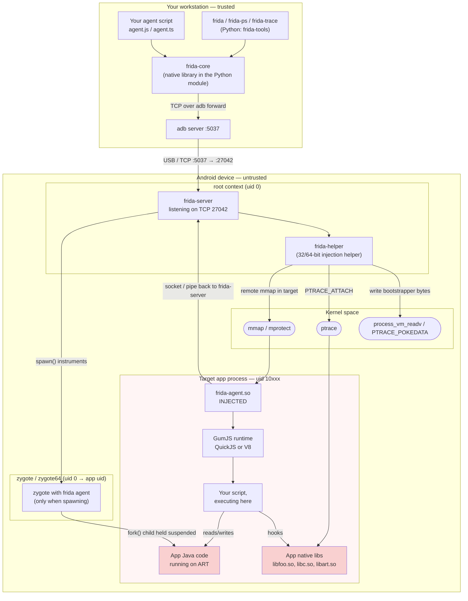

Take this apart layer by layer, because almost every problem you will ever have with Frida is a
failure at one specific arrow.

**Your workstation runs no instrumentation logic at all.** The `frida` command-line tool is a thin
Python program. It reads your `.js` file, opens a session to a device, sends the script text across,
and then sits in a loop printing messages. If you kill it, your script stops — not because the
script lived on your laptop, but because tearing down the session unloads the script from the target.

**`frida-server` is a normal Linux process running as root.** It is not a kernel module, not a
Magisk module (though it is often installed by one), and not privileged in any Android-specific way.
It is root because `ptrace`-ing an arbitrary process and writing to its memory requires either the
same UID or `CAP_SYS_PTRACE`, and because on Android each app has its own UID.

**The injected library is the whole product.** `frida-agent.so` is a self-contained shared object of
tens of megabytes containing GLib, the GumJS runtime, the JavaScript engine, the Java bridge, and the
V8/QuickJS heap. Once it is loaded into the target, the target contains a complete scripting
environment that happens to have full access to the app's memory.

**The channel back to the host is a plain socket.** This is why `adb forward` matters, and it is why
`frida-ps -U` "just works" — the Frida device manager creates the port forward for you over the adb
transport. When you use `-H`/`-R` (remote mode) you create the forward yourself.

### 2.2 The injection sequence, step by step

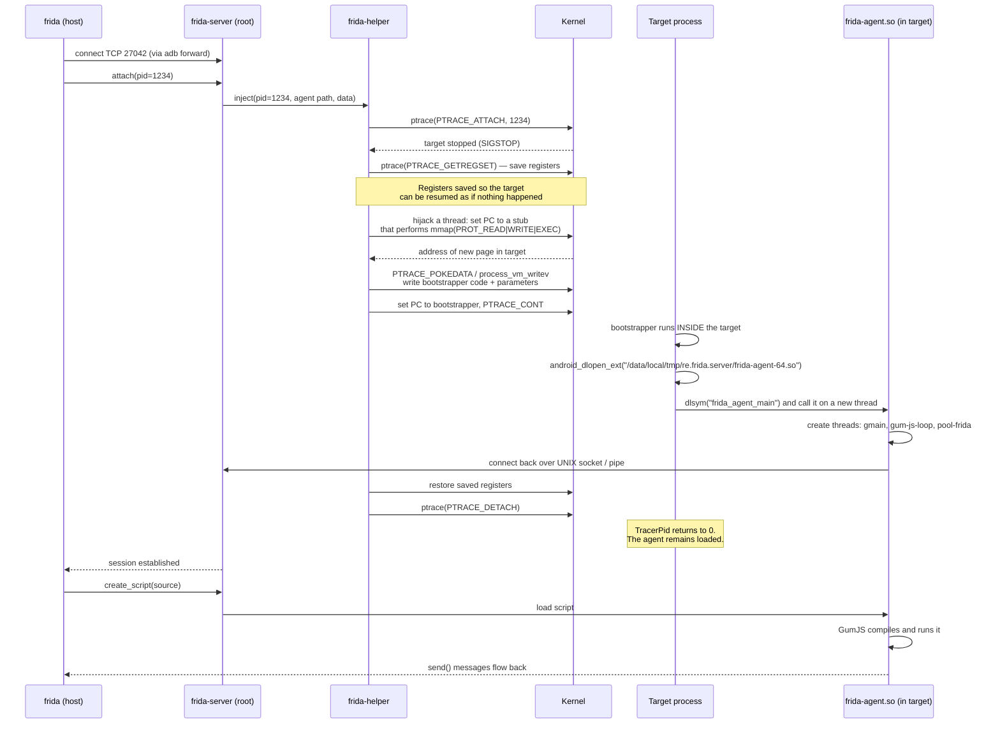

Every step of that sequence is a place where things break, and every failure has a distinct symptom.
Read the table below with the diagram beside you:

| Step | Failure symptom | Real cause |
|---|---|---|
| Connect TCP 27042 | `Failed to enumerate processes: unable to connect to remote frida-server` | `frida-server` not running, wrong ABI binary, or SELinux denied its exec |
| Version handshake | `unable to communicate with remote frida-server; please ensure that major versions match` | Host `frida` and device `frida-server` are different major versions |
| `PTRACE_ATTACH` | `Process crashed: SIGSEGV` or `unexpectedly terminated` | The app `ptrace`s itself first, so the kernel refuses a second tracer; or an anti-debug thread kills the process on `TracerPid != 0` |
| `dlopen` of the agent | Attach hangs, then times out | The app hooked `dlopen`/`android_dlopen_ext`, or the agent path is not readable by the app's UID |
| Agent connects back | Session appears, script never runs | Rare; usually a seccomp filter or an app-installed `libc` hook interfering with `socket()` |
| Script load | `ReferenceError` / `Error: unable to find export` | Your script's problem, not Frida's |

> **Under the Hood**
> The reason the target does not die when you `ptrace`-attach and rewrite its program counter
> is that the helper **saves and restores the full register set**. The hijacked thread is executing
> some ordinary function — perhaps blocked in `epoll_wait`. The helper snapshots `x0`–`x30`, `sp`,
> `pc` and `pstate` (on arm64), points `pc` at code it controls, lets it run, and then writes the
> original values back. From the application's point of view, that thread was descheduled for a few
> milliseconds and then continued exactly where it was. The only permanent change is that a new
> library is mapped and a few new threads exist.

### 2.3 Spawn versus attach

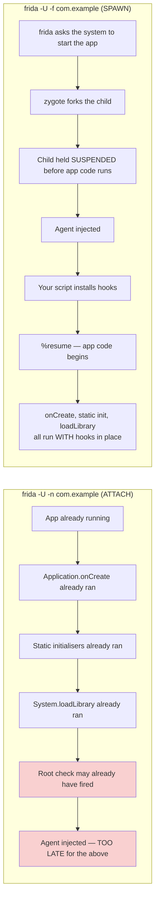

This distinction accounts for an enormous fraction of "my hook doesn't work" reports.

When you **attach** (`-n <name>` or `-p <pid>`), the app has already done everything it does at
startup. If the thing you want to hook is a root check in a `static {}` block, a certificate pin
installed in `Application.onCreate`, a native library's `JNI_OnLoad`, or a key derived once and
cached in a field, attaching is useless — the horse has left.

When you **spawn** (`-f <package>`), Frida arranges for the process to be created and then *held*
before a single line of the app's own code executes. Your script runs, installs its hooks, and only
then does the app start.

> **Pentester's Note**
> Default to `-f`. Always. There is essentially no downside except that the app restarts. If you find
> yourself using `-n` it should be a deliberate decision — for example because you want to inspect
> the state of an app you have already driven through a login flow by hand, using `Java.choose` to
> find live objects.

Frida's spawn on Android is not `fork()`+`exec()`. Android apps are forked from **zygote**, the
pre-warmed process that already has the framework classes loaded (see
[09-Android-App-Internals](../09-Android-App-Internals/README.md)). Frida therefore instruments
zygote itself so that it can catch the newly forked child in the window between `fork()` returning in
the child and the child running the app's code. The child is suspended there; the agent is injected;
your script loads; `%resume` releases it.

> **Warning**
> Because spawning touches zygote, a badly-timed abort during spawn can leave zygote instrumented and
> the device in a strange state where every newly launched app is slow or hangs. If the device starts
> behaving oddly after Frida crashes, kill `frida-server` and reboot before you spend an hour
> debugging a phantom.

### 2.4 The message channel

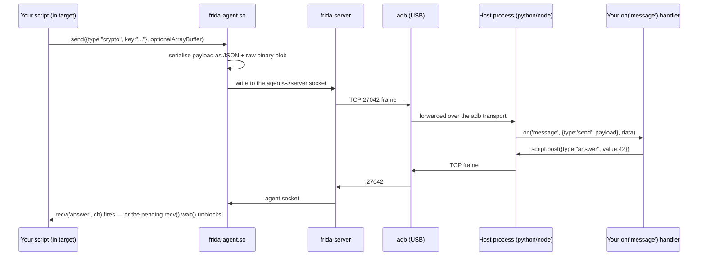

Two things about this channel are worth internalising.

**It is asynchronous and it is JSON.** `send()` does not block and does not return a value. The
payload is serialised as JSON, so it must be JSON-serialisable: no `NativePointer` objects, no Java
wrappers, no cyclic structures. Convert pointers to strings with `.toString()` before sending them.
Binary data goes in the *second* argument as an `ArrayBuffer` and travels out-of-band without
base64 bloat.

**`recv()` is how the host talks back.** `recv(type, callback)` registers a one-shot handler.
`recv(type, cb).wait()` blocks the *script's* thread until a matching message arrives — which is how
you build an interactive prompt inside a hook ("this function is about to return `false`; what should
I make it return?").

### 2.5 The no-root path: frida-gadget

```mermaid
flowchart TD
    subgraph Normal["Rooted device — frida-server model"]
        N1["frida-server as root"] -- "ptrace + dlopen" --> N2["Unmodified APK from the vendor"]
    end

    subgraph Gadget["Non-rooted device — gadget model"]
        G1["Original APK"] --> G2["apktool d"]
        G2 --> G3["Add libfrida-gadget.so to lib/&lt;abi&gt;/"]
        G3 --> G4["Insert System.loadLibrary(#quot;frida-gadget#quot;)<br/>into the Application class's static init"]
        G4 --> G5["Add libfrida-gadget.config.so (a JSON file)"]
        G5 --> G6["apktool b, zipalign, apksigner"]
        G6 --> G7["Repackaged APK — DIFFERENT SIGNATURE"]
        G7 --> G8["Gadget loads itself at app start,<br/>listens on 27042 inside the app process"]
    end

    style G7 fill:#f9d0d0
```

The gadget is the same agent code, packaged so that it loads *itself* rather than being injected.
Because the app loads it voluntarily, no `ptrace` and no root is required. The cost is that you must
repackage the APK, which:

- changes the signing certificate, breaking any signature check the app performs on itself
  ([38-TamperDetection](../38-TamperDetection/README.md));
- breaks Google Play Integrity / SafetyNet attestation, so apps that gate on it will refuse to run;
- breaks certificate-pinned communication that pins to a key derived from the app signature (rare but
  it exists);
- may break app-bundle split APKs unless you handle every split.

> **Mental Model**
> `frida-server` is a burglar with lock picks: the house is untouched, but you need the skill and the
> tools (root). The `gadget` is a burglar who convinces the homeowner to install a new front door with
> a second keyhole: no picking required, but the door is visibly different and anyone who checks the
> door will notice.

---

## 3. Deep Internal Working

This section is the core of the chapter. It is organised bottom-up: first how code gets into the
process at all, then what that code provides, then the Java layer, then the tooling around it.

### 3.1 `frida-server`: what it is and how it is deployed

`frida-server` is a statically-linked ELF executable, built per-architecture. You choose the binary
that matches the **device's** primary ABI, not your laptop's:

```bash
# adb shell — find out which binary you need
getprop ro.product.cpu.abi          # e.g. arm64-v8a
getprop ro.product.cpu.abilist      # e.g. arm64-v8a,armeabi-v7a,armeabi
```

| `ro.product.cpu.abi` | Frida server asset name |
|---|---|
| `arm64-v8a` | `frida-server-<version>-android-arm64` |
| `armeabi-v7a` | `frida-server-<version>-android-arm` |
| `x86_64` | `frida-server-<version>-android-x86_64` |
| `x86` | `frida-server-<version>-android-x86` |

Deployment:

```bash
# host — the version MUST match your `frida --version` output
frida --version                       # e.g. 16.5.9
adb push frida-server-16.5.9-android-arm64 /data/local/tmp/frida-server
adb shell chmod 755 /data/local/tmp/frida-server
adb shell "su -c '/data/local/tmp/frida-server -D'"    # -D = daemonize
frida-ps -U | head                     # verify
```

Useful `frida-server` flags:

| Flag | Effect | Why you care |
|---|---|---|
| `-l <addr>:<port>` | Listen on a different address/port | Defeats "is port 27042 open?" detection |
| `-D` | Daemonize | Survives your shell exiting |
| `-d` | Verbose debug output | Diagnosing injection failures |
| `--directory <dir>` | Where the agent `.so` files are unpacked | Defeats path-based detection |
| `-P <file>` | Write a PID file | Scripting |

> **Warning**
> A version mismatch between the host `frida` Python package and the device `frida-server` produces
> the single most common Frida error, and the message is clear but people ignore it. Pin both. In a
> team, put `frida==16.5.9` in a `requirements.txt` and check the matching server binary into your
> tooling repo. Losing an hour to this is a rite of passage; losing an hour to it twice is a process
> failure.

**SELinux.** `frida-server` runs from `/data/local/tmp`, whose SELinux label is
`shell_data_file`. Executing a `shell_data_file` binary as root and then having it `ptrace` an app is
something a stock enforcing policy is not built to allow. In practice Magisk's `su` transitions the
process into a permissive-enough domain and it works. When it does not, symptoms are `Permission
denied` on exec, or a successful start followed by every attach failing. Diagnose with:

```bash
# adb shell as root — watch for denials while you attempt an attach
dmesg -w | grep -i avc
# or
cat /proc/self/attr/current      # what context am I in?
getenforce                        # Enforcing / Permissive
```

### 3.2 Injection, in detail

This is the part almost nobody explains, so it is worth being precise. The goal is: **cause an
arbitrary shared library to be loaded into a process you do not own, and cause a function in it to
be called, without the process noticing anything permanent.**

#### Step 1 — Attach with `ptrace`

```c
/* Conceptually what frida-helper does. Real code is in frida-core's linux backend. */
ptrace(PTRACE_ATTACH, pid, 0, 0);
waitpid(pid, &status, 0);              /* target now stopped */
```

> **Definition**
> **`ptrace`** is a Linux system call that lets one process (the *tracer*) observe and control another
> (the *tracee*): read and write its memory and registers, intercept its signals, and single-step it.
> It is the mechanism behind `gdb`, `strace` and every native debugger on Linux. A process can have
> **at most one tracer at a time**.

That last sentence is why the most effective anti-Frida technique in existence is three lines long:
an app that calls `ptrace(PTRACE_TRACEME, 0, 0, 0)` on itself, or forks a child that traces the
parent, occupies the only tracer slot. Any subsequent `PTRACE_ATTACH` fails with `EPERM`. See
[38-TamperDetection](../38-TamperDetection/README.md) for the countermeasures.

The kernel also enforces `/proc/sys/kernel/yama/ptrace_scope`. On Android this is usually `0`
(classic permissive behaviour for root), but on hardened builds a non-zero value restricts tracing to
descendants.

#### Step 2 — Save the victim thread's state

```c
struct user_regs_struct saved;         /* arm64: struct user_pt_regs */
struct iovec iov = { &saved, sizeof(saved) };
ptrace(PTRACE_GETREGSET, pid, NT_PRSTATUS, &iov);
```

Everything after this point is reversible precisely because of this snapshot.

#### Step 3 — Allocate executable memory *in the target*

You cannot `mmap` into another process. `mmap` acts on the caller's address space. So the helper
makes the target call `mmap` for it, by hijacking a thread:

1. Find an address in the target that is already mapped executable — typically the entry of a libc
   function, or a page in `libc.so`'s text.
2. Write a tiny code stub there (saving the original bytes) that issues the `mmap` syscall with the
   arguments the helper wants, then executes a breakpoint / illegal instruction so the tracer regains
   control.
3. Set the thread's PC to the stub and `PTRACE_CONT`.
4. `waitpid` returns when the stub traps. Read the return value out of `x0` (arm64) — that is the
   address of freshly allocated `PROT_READ|PROT_WRITE|PROT_EXEC` memory *inside the target*.
5. Restore the original bytes.

> **Under the Hood**
> On modern arm64 Android, allocating `rwx` memory is increasingly restricted, and W^X policies
> (write XOR execute) mean a page is normally either writable or executable, not both. Frida deals
> with this by allocating `rw`, writing, then `mprotect`ing to `r-x` — the same dance every JIT
> compiler does, including ART's own. If you look at `/proc/<pid>/maps` for a Frida-instrumented
> process you will see anonymous `r-x` regions that were not there before; this is one of the
> signatures anti-Frida code looks for.

#### Step 4 — Write the bootstrapper

The helper copies a small position-independent code blob into the new page, along with a parameter
struct containing:

- the filesystem path of `frida-agent-{32,64}.so`;
- the name of the entrypoint symbol (`frida_agent_main`);
- a data string carrying the socket address / file descriptor to talk back on;
- addresses of the functions the bootstrapper needs, resolved by the helper by reading the target's
  loaded module list.

Writing is done with repeated `PTRACE_POKEDATA` (word at a time) or, much faster,
`process_vm_writev()`.

#### Step 5 — Run the bootstrapper

The bootstrapper, executing with the target's privileges inside the target's address space:

```c
/* Conceptually: */
void *handle = android_dlopen_ext(agent_path, RTLD_LAZY, &extinfo);
void (*entry)(const char *data) = dlsym(handle, "frida_agent_main");
pthread_create(&t, NULL, agent_thread_trampoline, params);
```

Two Android-specific details matter here:

- **`android_dlopen_ext` versus `dlopen`.** Since Android 7, the dynamic linker enforces a per-app
  *linker namespace*: an app process may only `dlopen` libraries from a whitelist of directories
  (its own `lib/` dir, the system lib dirs, APEX namespaces). A plain `dlopen` of
  `/data/local/tmp/frida-agent-64.so` from inside an app is refused by the namespace policy.
  `android_dlopen_ext` with an `android_dlextinfo` referencing a permitted namespace, or copying the
  agent under a path the app can load from, is how this is worked around. This is also the reason
  `frida-server` unpacks its agents into a directory it controls and chmods them world-readable.
- **The bootstrapper must not run the agent on the hijacked thread.** The hijacked thread has to be
  given back. So the bootstrapper spawns a fresh `pthread` for the agent and returns.

#### Step 6 — Restore and detach

```c
ptrace(PTRACE_SETREGSET, pid, NT_PRSTATUS, &iov);   /* saved registers back */
ptrace(PTRACE_DETACH, pid, 0, 0);
```

After `PTRACE_DETACH`, `/proc/<pid>/status`'s `TracerPid` returns to `0`. This is important: an app
that only checks `TracerPid` once, at startup, or polls it slowly, may miss the brief window. An app
that polls it every 100 ms will catch you. An app that occupies the tracer slot pre-emptively wins
outright.

#### The threads Frida leaves behind

| Thread name | Purpose | Detection relevance |
|---|---|---|
| `gmain` | GLib main loop | Common in many apps too — weak signal alone |
| `gdbus` | GLib D-Bus worker | Same |
| `gum-js-loop` | The JavaScript execution thread | **Strong signal.** Nothing else names a thread this |
| `pool-frida` | GLib thread pool worker, name derived from the process | **Strong signal** — literally contains "frida" |
| `frida-agent` (varies) | Agent bookkeeping | Strong signal |

An app enumerating `/proc/self/task/*/comm` finds these instantly. Countermeasures are in
[67-BypassingProtections](../67-BypassingProtections/README.md), and the honest summary is that you
either patch the agent's thread names in a custom build, or you hook the enumeration.

### 3.3 What lives inside the agent

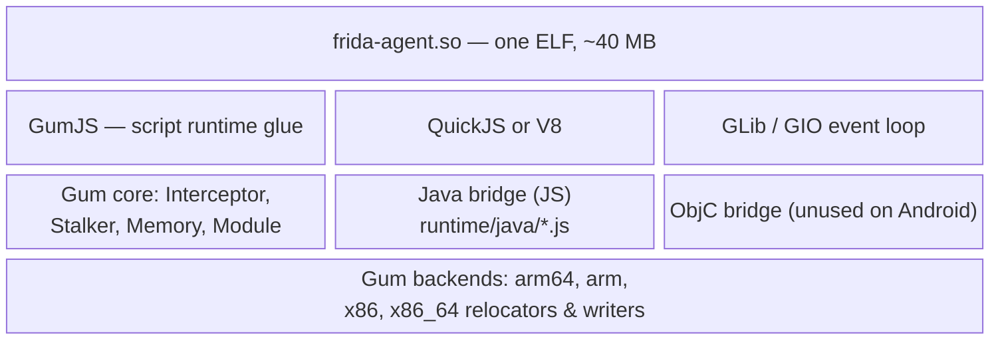

`frida-agent.so` is a single large shared object. Inside it:

- **Gum** is the C library that does the real work: reading memory, rewriting instructions, installing
  trampolines. It contains a full instruction *relocator* and *code writer* for every supported
  architecture, because installing an inline hook means moving the instructions you overwrote
  somewhere else and fixing up any PC-relative operands in them.
- **GumJS** binds Gum's C API into JavaScript objects. `Interceptor`, `Memory`, `Process`, `Module`,
  `Stalker`, `NativePointer` are all GumJS bindings over Gum.
- **The JavaScript engine** is **QuickJS** by default in modern Frida (small, fast to start, low
  memory) or **V8** if you ask for it. V8 gives you a JIT and much better performance for
  compute-heavy scripts, plus full ES2020+; QuickJS is lighter and starts faster. Select with
  `frida --runtime=v8` or, inside the script's session setup, by configuring the runtime on the host
  side.
- **The Java bridge is written in JavaScript**, not C. It sits on top of the native JNI bindings that
  GumJS exposes. This is why you can read it: it ships inside the agent and its source lives in the
  `frida-java-bridge` repository. When something in `Java.use` misbehaves, that code is readable and
  the answer is usually in it.

| Runtime | Startup | Throughput | Memory | When to choose |
|---|---|---|---|---|
| QuickJS (default) | Fast | Interpreted; slow for tight loops | Low | Everyday hooking, most agents |
| V8 | Slower | JIT-compiled; far faster in hot code | High | Stalker post-processing, heavy string/crypto work in JS |

> **Under the Hood**
> Your script does **not** run on the app's threads by default. It runs on `gum-js-loop`. But when a
> hook fires, the `onEnter`/`onLeave` callback executes **synchronously on the app's thread**, inside
> the JS engine, with the JS lock held. That is why a slow `onEnter` slows the app, why blocking in a
> hook can deadlock, and why you must not call `Java.perform` from inside a native hook on an
> unattached thread without care.

### 3.4 Spawn on Android, precisely

`frida -U -f com.example.app` performs roughly this sequence:

1. The host asks `frida-server` to `spawn("com.example.app")`.
2. `frida-server` prepares to intercept process creation. On Android this means instrumenting the
   `zygote` (and `zygote64`) process so that the moment a child is forked for the new app, the child
   can be held.
3. `frida-server` triggers the launch through the framework — equivalent to
   `am start -n com.example.app/<launcher activity>` — or, for a pure process spawn, through the
   `ActivityManager`.
4. The forked child is stopped before `ActivityThread.main()` gets to the app's own code.
5. The agent is injected into the suspended child.
6. Your script's top-level code runs. **This is your window.** Every hook you install here is in place
   before the app has executed a single instruction of its own.
7. `resume(pid)` is called — by `%resume` in the REPL, automatically by `frida ... --no-pause`, or by
   `device.resume(pid)` in a Python script.

> **Pentester's Note**
> `frida -U -f com.example --pause` (older syntax) or not passing `--no-pause` leaves the app
> suspended so that you can type into the REPL before it runs. Use this when you want to explore
> before deciding what to hook. Combine with `Java.perform` — but at the earliest spawn
> point, very few app classes are loaded yet, so `Java.use("com.example.Foo")` will throw
> `ClassNotFoundException`. Hook something that runs later (see §3.9's classloader section) rather
> than trying to resolve app classes at time zero.

**Child gating** handles apps that spawn their own processes (`android:process=":push"`, WebView's
sandboxed renderer, and so on). In the Python API:

```python
# host — follow every child process the target creates
device.on("child-added", lambda child: handle(child))
device.enable_child_gating()
pid = device.spawn(["com.example.app"])
```

With child gating enabled, each new child is created **suspended** and delivered to your callback, so
you can inject into it before it runs. Without it, children start unobserved and your hooks are
absent from them. This is one of the most common reasons a hook "randomly" does not fire: the code
you are hooking runs in `com.example.app:remote`, not `com.example.app`.

### 3.5 frida-gadget: configuration and embedding

The gadget is `libfrida-gadget.so`. It reads its configuration from a file **next to itself** named
after itself, so if the library is `libfrida-gadget.so` the config is `libfrida-gadget.config.so` —
the `.so` extension is a lie told to the APK packaging tools so that the file is extracted to the
native library directory rather than being left compressed in the APK.

```json
// libfrida-gadget.config.so — "listen" mode: wait for a client on port 27042
{
  "interaction": {
    "type": "listen",
    "address": "127.0.0.1",
    "port": 27042,
    "on_port_conflict": "fail",
    "on_load": "wait"
  }
}
```

```json
// libfrida-gadget.config.so — "script" mode: run an agent from disk, no host needed
{
  "interaction": {
    "type": "script",
    "path": "/data/local/tmp/agent.js",
    "on_change": "reload"
  }
}
```

| `interaction.type` | Behaviour | Use case |
|---|---|---|
| `listen` | Opens a port; waits for `frida -H`/`-R` to connect | Interactive testing on a non-rooted device |
| `connect` | Dials **out** to your host | Device behind NAT, or you want the app to find you |
| `script` | Loads a `.js` from a path at startup, no host | Fully autonomous instrumentation; CI |
| `script-directory` | Loads every `.js` in a directory | Modular agent sets |

`on_load: "wait"` makes the gadget block the app's startup until a client attaches — the gadget's
equivalent of spawn-and-pause, and the reason gadget mode can hook `Application.onCreate`.

**Embedding it by hand** (the mechanism Objection's `patchapk` automates — see
[54-Objection](../54-Objection/README.md)):

```bash
# host — full manual gadget embed
apktool d target.apk -o work/

mkdir -p work/lib/arm64-v8a
cp libfrida-gadget-16.5.9-android-arm64.so work/lib/arm64-v8a/libfrida-gadget.so
cp gadget-config.json work/lib/arm64-v8a/libfrida-gadget.config.so

# 1. Find the Application class named in the manifest
grep -o 'android:name="[^"]*"' work/AndroidManifest.xml | head

# 2. Add INTERNET permission if absent (listen mode needs it in some configurations)
#    <uses-permission android:name="android.permission.INTERNET"/>

# 3. Insert the load into that class's static initialiser (see below), then:
apktool b work/ -o patched.apk
zipalign -p -f -v 4 patched.apk aligned.apk
apksigner sign --ks ~/.android/debug.keystore --ks-pass pass:android \
  --out patched-signed.apk aligned.apk
adb install -r patched-signed.apk
```

The Smali you insert into the `Application` subclass — or into the launcher `Activity` if there is no
custom `Application`:

```smali
# work/smali/com/example/App.smali — add or extend the static constructor
.method static constructor <clinit>()V
    .locals 1

    const-string v0, "frida-gadget"
    invoke-static {v0}, Ljava/lang/System;->loadLibrary(Ljava/lang/String;)V

    return-void
.end method
```

> **Warning**
> If the class already has a `<clinit>`, you must **merge** your two instructions into the existing
> one and raise `.locals` if needed — you cannot have two static constructors. Getting this wrong
> produces a `VerifyError` at class load, which manifests as the app dying instantly with a stack
> trace in logcat that does not mention Frida at all.

Connecting to a gadget:

```bash
# host
adb forward tcp:27042 tcp:27042
frida -H 127.0.0.1:27042 -l agent.js          # or:
frida -R -n Gadget -l agent.js                # remote mode, process named "Gadget"
frida-ps -H 127.0.0.1:27042
```

Note the process is named `Gadget`, not the package name — a small detail that trips people up.

### 3.6 Frida Gum — the native instrumentation core

Everything in this subsection operates on **native** code: ELF shared libraries, machine
instructions, raw memory. The Java layer comes in §3.9. Do not skip this section because your target
is "a Java app" — the interesting parts of a hardened app are always in `libnative.so`.

#### 3.6.1 `Interceptor` — attach versus replace

`Interceptor` installs **inline hooks**. Understanding what that means physically is what separates
someone who can fix their own hook from someone who Googles the error.

> **Definition**
> An **inline hook** (also called a *detour* or *trampoline hook*) modifies the first few instructions
> of a function in memory so that they jump to your code instead. The overwritten instructions are
> copied to a separate buffer, adjusted for their new address, and followed by a jump back — so that
> the original function can still be executed.


The subtlety in the diagram is step `T5`/`T6`: the instructions that used to live at the function's
start now live somewhere else, so any of them that were PC-relative (`adrp`, `ldr literal`, `b`,
`cbz`) would compute the wrong address. Gum's **relocator** rewrites them. This is why Gum needs a
full per-architecture instruction decoder, and why hooking sometimes fails on unusual function
prologues with `unable to intercept function at 0x...; please file a bug`.

**`Interceptor.attach`** — observe, and optionally modify arguments and return value, while the
original still runs:

```javascript
// Frida REPL / agent — observe every SSL_read on the native side
const SSL_read = Module.findExportByName("libssl.so", "SSL_read");

const listener = Interceptor.attach(SSL_read, {
  // Called with the original arguments, before the function body executes.
  onEnter(args) {
    // args[N] is a NativePointer holding the Nth integer/pointer argument,
    // per the platform calling convention (arm64: x0..x7).
    this.ssl = args[0];
    this.buf = args[1];          // stash on `this` — shared with onLeave
    this.len = args[2].toInt32();
  },
  // Called just before the function returns. retval is a NativePointer-like
  // object with .toInt32(), .replace(), etc.
  onLeave(retval) {
    const n = retval.toInt32();
    if (n > 0) {
      console.log(`[SSL_read] ${n} bytes`);
      console.log(hexdump(this.buf, { length: Math.min(n, 256), ansi: true }));
    }
  }
});

// later:
listener.detach();
```

**`Interceptor.replace`** — the original never runs unless you call it yourself:

```javascript
// Frida REPL / agent — make a native boolean function always return 1
const isRooted = Module.findExportByName("libguard.so", "native_is_rooted");

// Keep a callable handle to the ORIGINAL before you replace it.
const origIsRooted = new NativeFunction(isRooted, 'int', ['pointer']);

Interceptor.replace(isRooted, new NativeCallback(function (ctx) {
  const real = origIsRooted(ctx);          // optional: observe the truth
  console.log(`[native_is_rooted] real=${real}, returning 0`);
  return 0;                                 // lie
}, 'int', ['pointer']));

// undo:
// Interceptor.revert(isRooted);
```

| | `Interceptor.attach` | `Interceptor.replace` |
|---|---|---|
| Original body runs | Yes | Only if you call it |
| Can read arguments | Yes (`onEnter`) | Yes (as JS function parameters) |
| Can modify arguments | Yes (assign to `args[n]`) | Yes |
| Can change return value | Yes (`retval.replace(x)`) | Yes (`return x`) |
| Needs exact signature | No | **Yes** — wrong types = crash |
| Overhead | Higher (two JS transitions) | Lower (one) |
| Multiple hooks on one function | Yes, they stack | No, one replacement |
| Undo | `listener.detach()` / `Interceptor.detachAll()` | `Interceptor.revert(addr)` |

> **Warning**
> `Interceptor.replace` with a wrong signature is a segfault, not an exception. If the real function
> is `int f(const char*, size_t)` and you declare `['pointer']`, the second argument register holds
> garbage from your perspective and the stack may be misaligned on return. Verify the signature from
> headers, from a disassembler ([57-Ghidra](../57-Ghidra/README.md)), or by observing with `attach`
> first.

`Interceptor.attach` also accepts a bare function as shorthand for `{ onEnter }`, and supports the
`ObjC`-style `Interceptor.attach(addr, { onEnter, onLeave }, data)`. Two more members matter:

- **`Interceptor.flush()`** — Gum batches its code patches for efficiency. If you install a hook and
  then immediately call the hooked function from JS in the same tick, `flush()` guarantees the patch
  is live.
- **`Interceptor.detachAll()`** — remove every listener this script installed. Put it in a
  `dispose()` RPC export so unloading your script cleanly restores the app.

#### 3.6.2 `InvocationContext` — what `this` is inside a hook

Inside `onEnter` and `onLeave`, `this` is an **`InvocationContext`**. It is far richer than most
scripts use:

| Property | Type | Meaning |
|---|---|---|
| `this.returnAddress` | `NativePointer` | Where the function will return to — i.e. **who called it** |
| `this.context` | object | The full CPU register set at the hook point |
| `this.threadId` | number | OS thread id — essential when several threads call the same function |
| `this.depth` | number | Nesting depth of this call within intercepted functions |
| `this.errno` | number | POSIX `errno` (read/write) |
| `this.lastError` | number | Windows `GetLastError()` — irrelevant on Android |
| `this.<anything>` | any | **Your own state**, preserved from `onEnter` to `onLeave` for this call |

The last row is the one that makes hooks usable. `onEnter` and `onLeave` are separate callbacks; the
only sanctioned way to carry the argument you saw in `onEnter` into `onLeave` is to stash it on
`this`. Frida creates a fresh `InvocationContext` per call per thread, so this is re-entrancy-safe.

**Register access via `this.context`.** On arm64 the members are `x0`–`x28`, `fp` (x29), `lr` (x30),
`sp`, `pc`, `nzcv`. On arm: `r0`–`r12`, `sp`, `lr`, `pc`, `cpsr`. On x86_64: `rax`, `rbx`, `rcx`,
`rdx`, `rsi`, `rdi`, `rbp`, `rsp`, `r8`–`r15`, `rip`.

```javascript
// Frida REPL — hook a function at a MID-FUNCTION offset, where `args` is meaningless
// because you are not at the prologue. Registers are the only truth.
const base = Module.findBaseAddress("libcrypto_impl.so");
const site = base.add(0x4A1C);          // a `bl` site found in Ghidra

Interceptor.attach(site, function () {
  // At this point in the function, the disassembly shows the key pointer in x19
  // and the key length in w20.
  const keyPtr = this.context.x19;
  const keyLen = this.context.x20.toInt32();
  console.log("key @ " + keyPtr + " len " + keyLen);
  console.log(hexdump(keyPtr, { length: keyLen }));

  // Registers are writable: force the length to 16.
  this.context.x20 = ptr(16);
});
```

> **Under the Hood**
> `args[0]` is a convenience that reads the first argument register for you *assuming you attached at
> the function entry* and *assuming the standard AAPCS64 calling convention with integer/pointer
> arguments*. It is wrong for floating-point arguments (those are in `v0`–`v7`), wrong for large
> structs passed by value, and wrong at any address that is not the prologue. When `args` gives you
> nonsense, drop to `this.context` and read the disassembly.

#### 3.6.3 `NativePointer` — the workhorse type

Every address in Frida is a `NativePointer`. It exists because JavaScript numbers are IEEE-754
doubles and cannot represent all 64-bit integers exactly.

```javascript
// Frida REPL — construction
const p  = ptr("0x7f8a2c1000");        // from string
const p2 = ptr(4096);                   // from number
const nul = NULL;                       // ptr(0)

// Arithmetic (all return new NativePointers)
p.add(0x20); p.sub(8); p.and(0xfff); p.or(1); p.xor(0xff); p.shr(12); p.shl(4);
p.not();

// Comparison
p.equals(p2); p.compare(p2);            // -1 / 0 / 1
p.isNull();

// Conversion
p.toInt32(); p.toUInt32(); p.toString(); p.toString(10); p.toMatchPattern();
```

Reading and writing through a pointer:

| Read | Write | Notes |
|---|---|---|
| `readPointer()` | `writePointer(v)` | Size follows `Process.pointerSize` |
| `readS8/U8/S16/U16/S32/U32/S64/U64()` | `writeS8/U8/...()` | 64-bit variants return `Int64`/`UInt64` objects |
| `readFloat()` / `readDouble()` | `writeFloat/Double()` | |
| `readByteArray(n)` | `writeByteArray(arr)` | Returns/accepts `ArrayBuffer` |
| `readCString(n?)` | `writeUtf8String(s)` | NUL-terminated, ASCII/latin |
| `readUtf8String(n?)` | `writeUtf8String(s)` | Throws on invalid UTF-8 |
| `readUtf16String(n?)` | `writeUtf16String(s)` | For Java `String` internals and Windows |
| `readAnsiString(n?)` | `writeAnsiString(s)` | Windows only |

```javascript
// Frida REPL — walk a linked list in the target
let node = ptr("0x7f9000abc0");
while (!node.isNull()) {
  const name = node.add(0x00).readPointer().readUtf8String();
  const flags = node.add(0x08).readU32();
  console.log(`${name}  flags=0x${flags.toString(16)}`);
  node = node.add(0x10).readPointer();     // next
}
```

> **Warning**
> Reading an unmapped address throws a JavaScript exception (`Error: access violation accessing
> 0x...`) rather than crashing — Frida installs a memory-access trap for this. **Writing** to a
> read-only page throws too. But calling a `NativeFunction` with a bad pointer executes real code in
> the target with a bad pointer, and *that* is a genuine crash. The safety net covers your direct
> memory access, not the app's.

#### 3.6.4 `NativeFunction` and `NativeCallback`

`NativeFunction` lets your JavaScript **call** a native function in the target. `NativeCallback`
lets native code **call** your JavaScript.

```javascript
// Frida REPL — call libc functions directly
const open  = new NativeFunction(Module.findExportByName(null, "open"),
                                 'int', ['pointer', 'int']);
const read  = new NativeFunction(Module.findExportByName(null, "read"),
                                 'int', ['int', 'pointer', 'int']);
const close = new NativeFunction(Module.findExportByName(null, "close"),
                                 'int', ['int']);

const path = Memory.allocUtf8String("/proc/self/maps");
const fd = open(path, 0 /* O_RDONLY */);
if (fd >= 0) {
  const buf = Memory.alloc(65536);
  const n = read(fd, buf, 65536);
  console.log(buf.readUtf8String(n));
  close(fd);
}
```

Type strings accepted by `NativeFunction`/`NativeCallback`:

| Type string | C type |
|---|---|
| `'void'` | `void` |
| `'pointer'` | any pointer |
| `'int'`, `'uint'` | `int`, `unsigned int` |
| `'long'`, `'ulong'` | `long`, `unsigned long` |
| `'char'`, `'uchar'` | `char`, `unsigned char` |
| `'size_t'`, `'ssize_t'` | `size_t`, `ssize_t` |
| `'float'`, `'double'` | as named |
| `'int8'`…`'int64'`, `'uint8'`…`'uint64'` | fixed-width |
| `'bool'` | C99 `_Bool` |
| `['int','pointer']` (array) | a struct passed by value |

Options (third/fourth argument):

```javascript
new NativeFunction(addr, 'int', ['pointer'], {
  abi: 'default',            // 'default' | 'sysv' | 'stdcall' | 'thiscall' | ...
  scheduling: 'cooperative', // 'cooperative' releases the JS lock during the call
                             // 'exclusive' holds it (faster, but blocks other hooks)
  exceptions: 'steal',       // 'steal' converts a native crash into a JS exception
                             // 'propagate' lets it crash the app
  traps: 'default'           // 'all' enables Stalker to follow into this call
});
```

> **Pentester's Note**
> `exceptions: 'steal'` is the difference between "my script threw an error" and "the app died and I
> lost my session". When you are probing a function whose signature you are unsure of, set it. When
> you have verified the signature and want maximum speed, unset it.

`NativeCallback` is the inverse — it allocates a real function pointer in the target that, when
called, enters your JS:

```javascript
// Frida REPL — install a JS function as a C callback, e.g. an OpenSSL verify callback
const myVerify = new NativeCallback(function (preverifyOk, x509StoreCtx) {
  console.log(`[verify_cb] preverify=${preverifyOk} — forcing success`);
  return 1;
}, 'int', ['int', 'pointer']);

const SSL_CTX_set_verify = new NativeFunction(
  Module.findExportByName("libssl.so", "SSL_CTX_set_verify"),
  'void', ['pointer', 'int', 'pointer']);

// SSL_VERIFY_PEER = 1
SSL_CTX_set_verify(sslCtx, 1, myVerify);
```

> **Warning**
> A `NativeCallback` is garbage-collected like any JS object. If the only reference to it is a local
> variable that goes out of scope, and the native side still holds the pointer, you get a crash later
> at a completely unrelated point. **Always keep a module-level reference** to every `NativeCallback`
> you hand to native code. This is the single most confusing crash class in Frida scripting.

#### 3.6.5 `Memory` — allocate, protect, scan, patch

```javascript
// Allocation — lives as long as a JS reference to it exists
const buf  = Memory.alloc(1024);                 // page-aligned if size >= pageSize
const cstr = Memory.allocUtf8String("hello");
const wstr = Memory.allocUtf16String("hello");
const ansi = Memory.allocAnsiString("hello");    // Windows only

// Protection
Memory.protect(addr, 4096, 'rwx');               // returns bool
Memory.protect(addr, 4096, 'r--');

// Copy / duplicate
Memory.copy(dst, src, n);                        // memcpy inside the target
const clone = Memory.dup(src, n);                // alloc + copy

// Safe code patching (handles W^X and instruction-cache flush for you)
Memory.patchCode(funcAddr, 8, code => {
  const w = new Arm64Writer(code, { pc: funcAddr });
  w.putRetInstruction();                          // make the function `ret` immediately
  w.flush();
});
```

**`Memory.scan` — finding things in the heap.** This is how you find secrets that were never written
to disk.

```javascript
// Frida REPL — find a known plaintext anywhere in writable memory
// Pattern syntax: hex bytes, `??` for wildcards. "41 42 ?? 44"
const pattern = "73 65 63 72 65 74";          // "secret" in ASCII

Process.enumerateRanges('rw-').forEach(range => {
  Memory.scan(range.base, range.size, pattern, {
    onMatch(address, size) {
      console.log("hit @ " + address);
      console.log(hexdump(address.sub(32), { length: 128 }));
    },
    onError(reason) { /* range disappeared mid-scan; ignore */ },
    onComplete() {}
  });
});
```

`Memory.scanSync(base, size, pattern)` returns an array instead of using callbacks — simpler, but it
blocks and it throws on inaccessible ranges, so wrap it in `try/catch`.

Helper for building a pattern from a string:

```javascript
function strToPattern(s) {
  return Array.from(s, c => c.charCodeAt(0).toString(16).padStart(2, '0')).join(' ');
}
```

#### 3.6.6 `Module` — the loaded-library view

> **Definition**
> A **module** in Frida is a loaded ELF object: a `.so` file mapped into the process, or the main
> executable itself. Each has a base address, a size, a filesystem path, and export/import/symbol
> tables.

```javascript
// Classic API (Frida 16.x and earlier; still the most widely seen in scripts)
Module.findExportByName("libc.so", "open");        // null if not found
Module.getExportByName("libc.so", "open");         // throws if not found
Module.findExportByName(null, "open");             // search ALL modules
Module.findBaseAddress("libfoo.so");
Module.enumerateExports("libfoo.so");              // [{type,name,address}]
Module.enumerateImports("libfoo.so");
Module.enumerateSymbols("libfoo.so");              // includes non-exported, if not stripped
Module.enumerateRanges("libfoo.so", 'r-x');
Module.load("/data/local/tmp/mylib.so");           // force-load a library into the target
Module.ensureInitialized("libfoo.so");
```

```javascript
// Newer API (Frida 17.x): modules are objects with instance methods.
const m = Process.getModuleByName("libfoo.so");
m.base; m.size; m.path; m.name;
m.getExportByName("Java_com_example_Native_check");
m.findExportByName("maybe_missing");
m.enumerateExports();
m.enumerateSymbols();
Module.getGlobalExportByName("open");              // replaces Module.findExportByName(null, ...)
```

> **Warning**
> Frida 17 reorganised this API. Scripts written for 16.x that call
> `Module.findExportByName(null, "open")` may fail on 17.x with a deprecation error or a missing
> function. This is the **second** most common "it worked yesterday" problem after version mismatch.
> When you publish scripts, state the Frida version they were written for, and when you download
> someone's script and it fails on a `Module.*` call, check the version before you debug the logic.

**Exports versus symbols.** `enumerateExports` lists the dynamic symbol table (`.dynsym`) — what the
linker can resolve, i.e. what other libraries can call. `enumerateSymbols` also covers `.symtab`,
which contains internal function names — but release builds are usually stripped, so `.symtab` is
empty and you are left with exports plus whatever you name yourself from a disassembler.

```javascript
// Frida REPL — find every JNI entry point in an app's native libraries
Process.enumerateModules()
  .filter(m => m.path.includes("/data/app/"))
  .forEach(m => {
    console.log("=== " + m.name + " @ " + m.base);
    Module.enumerateExports(m.name)
      .filter(e => e.name.startsWith("Java_") || e.name === "JNI_OnLoad")
      .forEach(e => console.log("  " + e.address + "  " + e.name));
  });
```

That snippet alone is worth the price of admission: it converts "there is a native library, somehow"
into "here are the exact Java methods that cross into it", which you can then correlate with the
decompiled Java in [56-JADX](../56-JADX/README.md).

#### 3.6.7 `Process` — the process-wide view

| Member | Type | Meaning |
|---|---|---|
| `Process.id` | number | PID |
| `Process.arch` | string | `'ia32'`, `'x64'`, `'arm'`, `'arm64'` |
| `Process.platform` | string | `'linux'` on Android |
| `Process.pageSize` | number | Usually 4096; 16384 on newer 16 KB-page devices |
| `Process.pointerSize` | number | 4 or 8 — **check this, do not assume** |
| `Process.codeSigningPolicy` | string | `'optional'` on Android |
| `Process.isDebuggerAttached()` | bool | |
| `Process.getCurrentThreadId()` | number | |
| `Process.enumerateModules()` | array | Loaded `.so` files |
| `Process.enumerateRanges(prot)` | array | Memory map, filterable by protection |
| `Process.enumerateMallocRanges()` | array | Heap chunks (glibc-style allocators) |
| `Process.enumerateThreads()` | array | `{id, name, state, context}` |
| `Process.findModuleByAddress(a)` | Module | Which library is this address in? |
| `Process.findRangeByAddress(a)` | Range | Which mapping is this address in? |
| `Process.setExceptionHandler(fn)` | | Catch native faults in JS |

```javascript
// Frida REPL — a quick memory-map triage, equivalent to /proc/pid/maps but richer
Process.enumerateRanges('---').forEach(r => {
  console.log(`${r.base}-${r.base.add(r.size)}  ${r.protection}  ` +
              `${r.file ? r.file.path : '[anon]'}`);
});
```

```javascript
// Frida REPL — which library does this mystery pointer belong to?
function whereIs(p) {
  const m = Process.findModuleByAddress(ptr(p));
  if (m) return `${m.name}!0x${ptr(p).sub(m.base).toString(16)}`;
  const r = Process.findRangeByAddress(ptr(p));
  return r ? `[anon ${r.protection} @ ${r.base}]` : "[unmapped]";
}
console.log(whereIs("0x7f8a2c1000"));
```

`Process.enumerateThreads()` gives you each thread's saved register context, which lets you take a
whole-process snapshot:

```javascript
// Frida REPL — what is every thread doing right now?
Process.enumerateThreads().forEach(t => {
  console.log(`--- tid ${t.id} (${t.name}) state=${t.state}`);
  Thread.backtrace(t.context, Backtracer.ACCURATE)
    .map(DebugSymbol.fromAddress)
    .forEach(s => console.log("    " + s));
});
```

#### 3.6.8 `Thread.backtrace`, `Backtracer` and `DebugSymbol`

Answering "who called this?" is most of reverse engineering.

```javascript
// Frida REPL — print a native backtrace from inside a hook
Interceptor.attach(Module.findExportByName("libc.so", "open"), {
  onEnter(args) {
    const path = args[0].readUtf8String();
    if (path && path.includes("su")) {
      console.log("open(" + path + ") from:");
      console.log(Thread.backtrace(this.context, Backtracer.ACCURATE)
        .map(DebugSymbol.fromAddress).join("\n  "));
    }
  }
});
```

| Backtracer | Method | Accuracy | Speed | When it works |
|---|---|---|---|---|
| `Backtracer.ACCURATE` | Follows frame pointers / unwind info | High — no false frames | Slower | Code compiled with frame pointers or with `.eh_frame` present |
| `Backtracer.FUZZY` | Scans the stack for values that *look like* return addresses | Noisy — includes stale frames | Faster | Optimised/stripped code where ACCURATE returns one frame or nothing |

> **Pentester's Note**
> If `Backtracer.ACCURATE` returns a single frame, do not conclude the function was called from
> nowhere. Release Android native code is routinely built with `-fomit-frame-pointer`. Switch to
> `FUZZY`, accept that some entries are garbage, and correlate the plausible ones against the module
> list. The combination of a fuzzy backtrace plus `Process.findModuleByAddress` on each frame is
> usually enough to identify the calling library even when it cannot identify the calling function.

`DebugSymbol` resolves an address to a name:

```javascript
DebugSymbol.fromAddress(ptr("0x7f8a2c1234"));   // {address, name, moduleName, fileName, lineNumber}
DebugSymbol.fromName("SSL_read");
DebugSymbol.getFunctionByName("SSL_read");       // throws if ambiguous/missing
DebugSymbol.findFunctionsNamed("SSL_read");
DebugSymbol.findFunctionsMatching("SSL_*");
DebugSymbol.load("/data/local/tmp/libfoo.so.debug");   // load external symbols
```

#### 3.6.9 `hexdump`

```javascript
console.log(hexdump(ptr("0x7f8a2c1000"), {
  offset: 0,        // start offset within the region
  length: 256,      // bytes
  header: true,     // column header row
  ansi: true        // colourise (nice in a terminal, noise in a log file)
}));
```

It accepts a `NativePointer` **or** an `ArrayBuffer`, which means you can hexdump data you received
from a Java `byte[]` after converting it, and you can hexdump the second argument of a `send()` on
the host side.

### 3.7 `Stalker` — instruction-level tracing

> **Definition**
> **`Stalker`** is Frida's dynamic recompiler. When you "follow" a thread, Stalker takes each basic
> block that thread is about to execute, copies it into a scratch buffer, optionally instruments it,
> and runs the copy instead of the original. Because it controls every block transition, it can
> observe **every instruction, call, and return** the thread executes.

That is a fundamentally different capability from `Interceptor`. `Interceptor` needs you to know
*where* to hook. `Stalker` tells you where the code goes without you knowing anything.

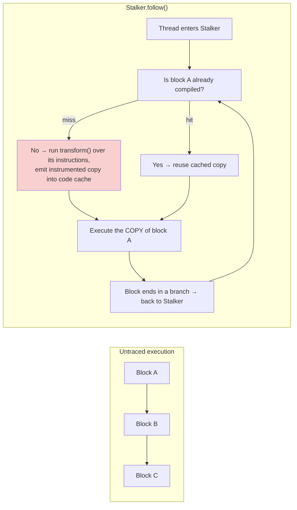

#### Event-based tracing

```javascript
// Frida REPL — record every call made by the current thread for 100 ms
Stalker.follow(Process.getCurrentThreadId(), {
  events: {
    call: true,      // function calls
    ret: false,      // returns
    exec: false,     // EVERY instruction — enormous volume, use with care
    block: false,    // each basic block executed
    compile: false   // each basic block compiled (once per block)
  },
  onReceive(events) {
    // events is a raw binary blob; Stalker.parse turns it into JS objects
    Stalker.parse(events).forEach(e => {
      // e = ['call', from, to, depth]
      console.log(`${e[0]}  ${DebugSymbol.fromAddress(e[1])} -> ` +
                  `${DebugSymbol.fromAddress(e[2])}`);
    });
  }
});

setTimeout(() => {
  Stalker.unfollow(Process.getCurrentThreadId());
  Stalker.garbageCollect();
}, 100);
```

#### Transform-based instrumentation

`transform` gives you the instruction stream before it is compiled, so you can insert your own code:

```javascript
// Frida REPL — count how many times each instruction in libtarget.so executes
const mod = Process.getModuleByName("libtarget.so");
const lo = mod.base, hi = mod.base.add(mod.size);
const counts = new Map();

Stalker.follow(Process.getCurrentThreadId(), {
  transform(iterator) {
    let insn = iterator.next();
    do {
      // Only instrument instructions inside our module of interest.
      if (insn.address.compare(lo) >= 0 && insn.address.compare(hi) < 0) {
        iterator.putCallout(ctx => {
          const k = ctx.pc.toString();
          counts.set(k, (counts.get(k) || 0) + 1);
        });
      }
      iterator.keep();                  // emit the original instruction
    } while ((insn = iterator.next()) !== null);
  }
});
```

`iterator.keep()` emits the current instruction into the compiled block. If you never call it, the
instruction is **deleted** — which is how you can neuter a specific check without patching the file.
`iterator.putCallout(fn)` inserts a call into JS. There are also architecture-specific writers
(`iterator.putBytes`, and the full `Arm64Writer` API) for emitting raw instructions.

#### The cost, stated honestly

| Configuration | Approximate slowdown | Practical use |
|---|---|---|
| Untraced | 1× | |
| `Stalker` with `block: true` | 5–20× | Coverage of a specific action |
| `Stalker` with `call: true` | 10–50× | Call-graph discovery |
| `Stalker` with `exec: true` | 100–1000× | A few thousand instructions only |
| `transform` with `putCallout` on every instruction | 1000×+ | Micro-analysis of one function |

Two techniques make this manageable:

```javascript
// 1. Exclude the noise. Do not trace libc, libart, or the JIT.
["libc.so", "libart.so", "libandroid_runtime.so", "libc++.so"].forEach(n => {
  const m = Process.findModuleByName(n);
  if (m) Stalker.exclude({ base: m.base, size: m.size });
});

// 2. Follow only for the exact window that matters.
Interceptor.attach(interestingFn, {
  onEnter() { Stalker.follow(this.threadId, cfg); },
  onLeave() { Stalker.unfollow(this.threadId); }
});
```

Tunables:

| Property | Default | Meaning |
|---|---|---|
| `Stalker.queueCapacity` | 16384 | Events buffered before `onReceive` |
| `Stalker.queueDrainInterval` | 250 (ms) | How often the buffer is flushed |
| `Stalker.trustThreshold` | 1 | How many times a block must be seen unchanged before its compiled form is trusted and reused. Set to `-1` to never trust (needed for self-modifying code), `0` to always trust |

> **Pentester's Note**
> The killer application of Stalker in mobile work is **finding the check you cannot find**. Take a
> coverage trace while the app succeeds, take another while it fails (root detected, pin mismatch,
> licence invalid), and diff the sets of executed basic blocks. The blocks present in exactly one run
> are your candidate set, and it is usually a handful of addresses. This is differential coverage
> analysis and it works against obfuscation that defeats every static approach, because obfuscated
> code still has to execute.

### 3.8 The runtime environment your script sees

Global objects available in every Frida script:

| Global | Purpose |
|---|---|
| `Process`, `Module`, `Memory`, `Thread`, `Interceptor`, `Stalker` | Gum core (above) |
| `Java` | The Android/ART bridge (§3.9) |
| `ObjC` | iOS only; `ObjC.available` is `false` on Android |
| `NativePointer`, `NativeFunction`, `NativeCallback`, `Int64`, `UInt64` | Types |
| `ptr(x)`, `NULL`, `int64()`, `uint64()` | Constructors |
| `send(payload, data?)`, `recv(type?, cb)` | Messaging |
| `rpc.exports` | RPC surface (§3.10) |
| `console.log/warn/error` | Routed to the host as `log` messages |
| `hexdump(target, opts)` | Formatting |
| `setTimeout/setInterval/clearTimeout/clearInterval/setImmediate` | Timers on `gum-js-loop` |
| `Script.runtime`, `Script.pin()`, `Script.unpin()`, `Script.bindWeak()` | Script lifecycle |
| `Script.nextTick(fn)` | Defer to the next event-loop turn |
| `File`, `SocketListener`, `Socket`, `SqliteDatabase` | I/O from inside the target |
| `Kernel` | Kernel memory access — Linux-only, requires special support; rarely usable on Android |
| `CModule` | Compile C source **inside the target** at runtime |
| `ApiResolver` | Search for functions by pattern across modules |

Two of these deserve their own note.

**`CModule`** compiles a C fragment with TinyCC inside the target process and gives you function
pointers into it. When a hook is on such a hot path that the JS transition dominates, you write the
hook in C instead:

```javascript
// Frida REPL — a hot-path hook with no JS transition per call
const cm = new CModule(`
#include <gum/guminterceptor.h>
#include <stdio.h>

extern void on_message (const char * msg);

void onEnter (GumInvocationContext * ic) {
  const char * path = (const char *) gum_invocation_context_get_nth_argument (ic, 0);
  if (path != NULL && path[0] == '/' && path[1] == 's')
    on_message (path);
}
`, {
  on_message: new NativeCallback(msgPtr => {
    console.log("open: " + msgPtr.readUtf8String());
  }, 'void', ['pointer'])
});

Interceptor.attach(Module.getExportByName(null, "open"), cm);
```

**`ApiResolver`** finds functions without knowing which module they are in:

```javascript
// Frida REPL — every exported symbol matching a pattern, across all modules
const r = new ApiResolver('module');
r.enumerateMatches('exports:*!*SSL_read*').forEach(m => {
  console.log(m.address + "  " + m.name);
});

// There is no Java resolver here — for Java methods use
// Java.enumerateLoadedClasses / Java.enumerateMethods (see §3.9).
```

### 3.9 The Java bridge — and how it relates to `ArtMethod`

Everything so far works on any Linux process. This subsection is what makes Frida an *Android* tool.

#### 3.9.1 What the bridge actually is

The `Java` global is implemented in JavaScript (the `frida-java-bridge` module, shipped inside
`frida-agent.so`) sitting on top of GumJS's native bindings. It does three things:

1. **Obtains a `JNIEnv`.** Every JNI operation needs a `JNIEnv*` valid for the calling thread. The
   bridge finds the `JavaVM*` by calling `JNI_GetCreatedJavaVMs` in `libart.so`, then
   `AttachCurrentThread`s when it needs to run Java code from a non-Java thread.
2. **Reflects.** `Java.use("com.example.Foo")` performs `FindClass`, then walks the class's declared
   methods and fields **through the Java reflection API** (`Class.getDeclaredMethods()` etc.,
   invoked over JNI) and builds a JavaScript object with a property per member.
3. **Replaces method implementations** by manipulating ART's method metadata.

Point 3 is where [13-ART](../13-ART/README.md) pays off.

#### 3.9.2 How a Java hook is installed, at the ART level

> **Definition**
> **`ArtMethod`** is the C++ struct ART uses to represent a single Java method. It holds the declaring
> class, the method index, the access flags, and — critically — two entry points: the *interpreter*
> entry point and the *quick compiled code* entry point. Calling a Java method ultimately means
> jumping to whatever address is in one of those fields.

The bridge's replacement technique, in outline:

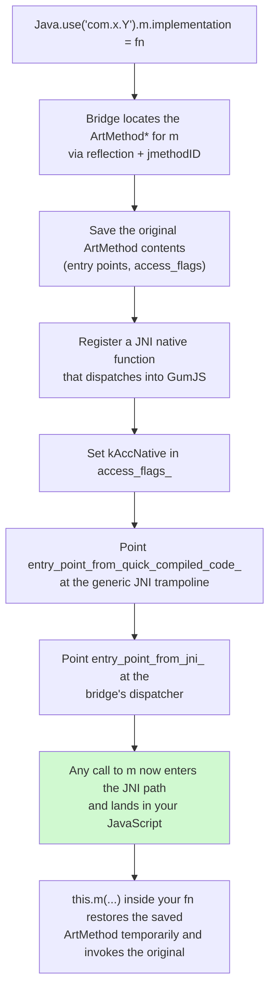

In plain English: **the bridge converts the Java method into a native method whose native
implementation is Frida.** ART then calls it through the JNI calling convention, and the bridge's
dispatcher marshals the arguments into JavaScript values, runs your function, and marshals the result
back.

Consequences you can predict from that mechanism, which is exactly the point of understanding it:

| Consequence | Why |
|---|---|
| Hooking a method that ART has **inlined** into its caller does nothing | The inlined copy is machine code in the caller; the `ArtMethod` is never consulted at that call site |
| `Java.deoptimizeEverything()` fixes some of those cases | It forces ART back to the interpreter, which always dispatches through the `ArtMethod` |
| Hooking an `abstract` or `interface` method does nothing useful | There is no body; hook the concrete implementation |
| Two scripts hooking the same method fight | Both save "the original", but the second saves the first's replacement |
| Hooks survive across `Java.perform` calls | The change is in the runtime's metadata, not in your JS scope |
| A hook installed before the class is loaded is impossible | There is no `ArtMethod` yet to modify |

> **Under the Hood**
> ART's inline caches and its JIT complicate this further. A method that has been JIT-compiled has a
> quick entry point pointing into the JIT code cache. The bridge handles the common cases, but if you
> hook a method that is extremely hot, you may see the hook fire for a while and then stop, or fire
> only on some threads. `Java.deoptimizeEverything()` is the blunt fix; it is very slow but it is
> deterministic. On Android 9+ there is also `Java.deoptimizeBootImage()` for methods that live in
> the AOT-compiled boot image, where the code is `PROT_READ|PROT_EXEC` in a shared mapping and
> patching it would affect every app on the device.

#### 3.9.3 `Java.perform` and `Java.performNow`

```javascript
// Every Java operation must happen inside one of these.
Java.perform(function () {
  // Runs on a thread attached to the VM, after the classloader is ready.
});

Java.performNow(function () {
  // Runs IMMEDIATELY on the current thread. Use when you are already on a
  // Java thread — e.g. inside a native hook that you know was called from Java.
});
```

| | `Java.perform` | `Java.performNow` |
|---|---|---|
| Scheduling | May defer until the VM/classloader is ready | Runs synchronously, right now |
| Thread | Attaches the current thread if needed | Requires an attached thread |
| Use at script top level | **Yes — this is the normal case** | Only if you know the VM is ready |
| Use inside `Interceptor.onEnter` | Risky — deferral can outlive the call | **Yes** — this is what it is for |

> **Warning**
> Calling `Java.perform` at the very top of a spawn-time script is correct and normal, but the
> callback may run before your target app classes exist. Wrapping `Java.use("com.example.Foo")` in
> `Java.perform` does **not** guarantee `Foo` is loaded — it guarantees the *VM* is usable. See
> §3.9.10 for the classloader problem.

#### 3.9.4 `Java.use` — the class wrapper

```javascript
Java.perform(function () {
  const Log = Java.use("android.util.Log");
  const String = Java.use("java.lang.String");

  // --- Static method: call it directly on the wrapper
  Log.d("MyTag", "hello from Frida");

  // --- Instantiate: $new calls the constructor
  const s = String.$new("hello");
  console.log(s.length());              // 5
  console.log(s.toUpperCase());         // HELLO

  // --- Class name of a wrapper or instance
  console.log(s.$className);            // java.lang.String

  // --- Explicitly release the JNI reference (rarely needed; GC handles it)
  s.$dispose();
});
```

Special members on every wrapper and instance:

| Member | Meaning |
|---|---|
| `$new(...)` | Allocate **and** construct a new instance |
| `$alloc()` | Allocate without running a constructor (rare, dangerous) |
| `$init` | The **constructor itself**, so you can hook it: `Foo.$init.implementation = ...` |
| `$dispose()` | Drop the JNI reference held by this wrapper |
| `$className` | Fully-qualified class name as a string |
| `$class` | The `java.lang.Class` wrapper |
| `$super` | Access the superclass implementation of a member |
| `$ownMembers` | Array of member names declared by this class (not inherited) |
| `$h` | The underlying JNI handle (a `NativePointer`) |
| `$isSameObject(other)` | JNI `IsSameObject` |

#### 3.9.5 Hooking: instance methods, static methods, constructors

```javascript
Java.perform(function () {
  const Crypto = Java.use("com.example.app.CryptoHelper");

  // --- Instance method. `this` is the receiver.
  Crypto.encrypt.implementation = function (plaintext) {
    console.log("[encrypt] in : " + plaintext);
    const out = this.encrypt(plaintext);       // call the ORIGINAL
    console.log("[encrypt] out: " + out);
    return out;
  };

  // --- Static method. Identical syntax; `this` is the class wrapper.
  Crypto.generateKey.implementation = function (len) {
    const k = this.generateKey(len);
    console.log("[generateKey] " + len + " -> " + k);
    return k;
  };

  // --- Constructor. Hook $init, and call this.$init(...) to run the original.
  Crypto.$init.implementation = function (seed) {
    console.log("[ctor] seed=" + seed);
    this.$init(seed);
  };

  // --- Remove a hook: assign null
  // Crypto.encrypt.implementation = null;
});
```

> **Warning**
> Inside `implementation`, calling `this.encrypt(...)` invokes the **original** method — the bridge
> temporarily restores the saved `ArtMethod` around the call. Calling `Crypto.encrypt(...)` on the
> class wrapper from an instance context, or calling the method on another instance you obtained
> elsewhere, will re-enter your hook and recurse until the stack overflows. Recursion in a Frida hook
> is nearly always this mistake.

#### 3.9.6 Overloads — and why `.overload()` is so often required

Java allows several methods with the same name and different parameter lists. JavaScript does not.
When a name is ambiguous, the bridge refuses to guess:

```
Error: encrypt(): has more than one overload, use .overload(<signature>) to choose from:
	.overload('java.lang.String')
	.overload('[B')
	.overload('java.lang.String', 'int')
```

That error message is a gift: it lists every valid signature. Use it verbatim.

```javascript
Java.perform(function () {
  const C = Java.use("com.example.app.CryptoHelper");

  // Pick one overload
  C.encrypt.overload('java.lang.String').implementation = function (s) {
    console.log("[encrypt:String] " + s);
    return this.encrypt(s);
  };

  // Byte-array overload. JNI type signature for byte[] is '[B'
  C.encrypt.overload('[B').implementation = function (b) {
    console.log("[encrypt:byte[]] " + b.length + " bytes");
    return this.encrypt(b);
  };

  // Hook EVERY overload programmatically — the pattern you actually want
  C.encrypt.overloads.forEach(function (ov) {
    ov.implementation = function () {
      console.log("[encrypt] " + JSON.stringify(Array.prototype.slice.call(arguments)));
      return ov.apply(this, arguments);
    };
  });
});
```

Type strings for `.overload()`:

| Java type | Overload string |
|---|---|
| `int` | `'int'` |
| `long` | `'long'` |
| `boolean` | `'boolean'` |
| `byte` | `'byte'` |
| `char` | `'char'` |
| `float`, `double`, `short` | as named |
| `java.lang.String` | `'java.lang.String'` |
| `byte[]` | `'[B'` |
| `int[]` | `'[I'` |
| `String[]` | `'[Ljava.lang.String;'` |
| `Object[]` | `'[Ljava.lang.Object;'` |
| Any class | fully-qualified dotted name |
| Nested class `Outer.Inner` | `'com.example.Outer$Inner'` |

> **Pentester's Note**
> Array signatures use JVM descriptor syntax with **dots**, not slashes: `'[Ljava.lang.String;'`,
> not `'[Ljava/lang/String;'`. That single detail costs people twenty minutes regularly. The
> semicolon at the end is required.

#### 3.9.7 Fields, including private ones

Field access always goes through `.value`:

```javascript
Java.perform(function () {
  const Session = Java.use("com.example.app.Session");

  Session.login.implementation = function (u, p) {
    const r = this.login(u, p);

    // Read a private instance field
    console.log("token = " + this.authToken.value);

    // Write it
    this.authToken.value = "attacker-controlled";

    // Static field on the class wrapper
    console.log("DEBUG = " + Session.DEBUG.value);
    Session.DEBUG.value = true;

    return r;
  };
});
```

**The name-collision rule.** If a class has both a field `name` and a method `name()`, one of them
must be renamed on the wrapper — the bridge adds an underscore to disambiguate. Rather than guessing
which one got renamed, enumerate:

```javascript
// Frida REPL — discover the real accessor names on a wrapper
Java.perform(function () {
  const W = Java.use("com.example.app.Session");
  console.log(JSON.stringify(W.$ownMembers, null, 2));

  // Or go around the bridge entirely and use reflection:
  const cls = Java.use("java.lang.Class");
  Java.cast(W.class, cls).getDeclaredFields().forEach(f => console.log("F " + f.toString()));
  Java.cast(W.class, cls).getDeclaredMethods().forEach(m => console.log("M " + m.toString()));
});
```

> **Mental Model**
> When the bridge frustrates you, remember that it is just a convenience layer over reflection. Any
> field or method you cannot reach through `Java.use` you can reach through
> `Field.setAccessible(true)` and `Field.get(obj)`, driven from Frida. The bridge is a shortcut, not
> a limit.

```javascript
// Frida REPL — brute-force reflection fallback for an awkward field
Java.perform(function () {
  const obj = /* some instance wrapper */ null;
  const Field = Java.use("java.lang.reflect.Field");
  const klass = obj.getClass();
  klass.getDeclaredFields().forEach(function (f) {
    const jf = Java.cast(f, Field);
    jf.setAccessible(true);
    console.log(jf.getName() + " = " + jf.get(obj));
  });
});
```

#### 3.9.8 `Java.choose` — find live objects on the heap

`Java.use` gives you the class. `Java.choose` gives you **instances that already exist**, which is how
you get at state the app built before you arrived.

```javascript
// Frida REPL — find every live OkHttpClient and inspect it
Java.perform(function () {
  Java.choose("okhttp3.OkHttpClient", {
    onMatch(instance) {
      console.log("found " + instance);
      console.log("  interceptors: " + instance.interceptors());
      // return 'stop' to end the search early
    },
    onComplete() { console.log("done"); }
  });
});
```

> **Under the Hood**
> `Java.choose` walks the ART heap. On modern ART this uses the heap-walking support in `libart.so`
> and requires suspending the world briefly. It is slow on a large heap and it only finds objects
> that are **currently reachable and of exactly that class or a subclass**. It will not find an object
> that has already been collected, and it will not find an object stored only in a native structure.

#### 3.9.9 `Java.cast`, `Java.array`, `Java.registerClass`, `Java.vm`

```javascript
Java.perform(function () {
  // --- Cast: reinterpret a handle as another type
  const File = Java.use("java.io.File");
  const someObj = /* an Object wrapper from a hook argument */ null;
  const asFile = Java.cast(someObj, File);
  console.log(asFile.getAbsolutePath());

  // --- Build a Java array from JS
  const bytes = Java.array('byte', [0x41, 0x42, 0x43]);
  const ints  = Java.array('int',  [1, 2, 3]);
  const strs  = Java.array('java.lang.String', ["a", "b"]);

  // --- Define a whole new Java class at runtime
  const X509TrustManager = Java.use("javax.net.ssl.X509TrustManager");
  const TrustAll = Java.registerClass({
    name: "com.frida.TrustAll",
    implements: [X509TrustManager],
    fields: { callCount: "int" },
    methods: {
      checkClientTrusted(chain, authType) { },
      checkServerTrusted(chain, authType) {
        this.callCount.value = this.callCount.value + 1;
        console.log("[TrustAll] allowing chain of " + chain.length);
      },
      getAcceptedIssuers() {
        return Java.array("java.security.cert.X509Certificate", []);
      }
    }
  });
  const tm = TrustAll.$new();
});
```

`Java.registerClass` is not a curiosity — it is how every serious SSL-pinning bypass works. You
cannot pass a JavaScript function where the Android API demands an `X509TrustManager`; you must give
it a real Java object implementing that interface. `registerClass` generates the DEX for it at
runtime and defines it in a classloader.

`Java.vm` exposes the raw JNI layer:

```javascript
const env = Java.vm.getEnv();          // JNIEnv wrapper, throws if not attached
const env2 = Java.vm.tryGetEnv();      // null if not attached
Java.vm.attachCurrentThread();
Java.vm.perform(fn);                   // like Java.perform but lower-level

// From JNIEnv you get the raw JNI functions
env.getVersion();
env.findClass("java/lang/String");     // note: SLASHES here, this is raw JNI
```

`Java.scheduleOnMainThread(fn)` posts work to the UI thread — mandatory for anything touching Views:

```javascript
// Frida REPL — pop a Toast from an arbitrary hook
Java.perform(function () {
  const ActivityThread = Java.use("android.app.ActivityThread");
  const Toast = Java.use("android.widget.Toast");
  const ctx = ActivityThread.currentApplication().getApplicationContext();

  Java.scheduleOnMainThread(function () {
    Toast.makeText(ctx, Java.use("java.lang.String").$new("hooked"), 0).show();
  });
});
```

#### 3.9.10 Enumeration — and the classloader problem

```javascript
// Frida REPL — every loaded class matching a term
Java.perform(function () {
  Java.enumerateLoadedClasses({
    onMatch(name, handle) {
      if (name.toLowerCase().includes("crypt")) console.log(name);
    },
    onComplete() {}
  });
});

// Synchronous variants exist for all of these
const all = Java.enumerateLoadedClassesSync();
```

Now the problem that generates more "Frida is broken" messages than any other:

```
Error: java.lang.ClassNotFoundException: Didn't find class "com.example.Secret"
on path: DexPathList[[zip file "/data/app/.../base.apk"], ...]
```

The class exists in the APK. JADX shows it. And `Java.use` cannot find it. Why?

> **Definition**
> A **`ClassLoader`** is the object responsible for finding and defining classes. An Android app has a
> hierarchy: the boot classloader (framework classes), the app's `PathClassLoader` (classes from
> `base.apk`), and possibly extra loaders created at runtime — `DexClassLoader` for downloaded or
> packed DEX, `InMemoryDexClassLoader` for DEX decrypted in memory, and one per split APK or per
> dynamic feature module.

`Java.use` searches the classloader that the bridge currently has selected. If the class lives in a
loader the bridge does not know about — very common with packed/protected apps, dynamic feature
modules, and plugin frameworks — the lookup fails.

The fix is to enumerate the loaders and select the right one:

```javascript
// Frida REPL — find the classloader that owns a class, and switch to it
function useAnywhere(className) {
  let wrapper = null;
  Java.enumerateClassLoaders({
    onMatch(loader) {
      try {
        loader.loadClass(className);          // throws if this loader can't see it
        Java.classFactory.loader = loader;    // point the bridge at it
        wrapper = Java.use(className);
      } catch (e) { /* not this one */ }
    },
    onComplete() {}
  });
  if (wrapper === null) throw new Error("class not found in any loader: " + className);
  return wrapper;
}

Java.perform(function () {
  const Secret = useAnywhere("com.example.Secret");
  Secret.check.implementation = function () { return true; };
});
```

If the class does not exist *yet* — because the app decrypts and loads its real DEX later — you must
wait for it. Hook the loading itself:

```javascript
// Frida REPL — fire a callback the moment a class becomes available
Java.perform(function () {
  const ClassLoader = Java.use("java.lang.ClassLoader");
  ClassLoader.loadClass.overload('java.lang.String', 'boolean')
    .implementation = function (name, resolve) {
      const c = this.loadClass(name, resolve);
      if (name === "com.example.Secret") {
        console.log("[+] target class just loaded by " + this.$className);
        Java.classFactory.loader = this;
        installMyHooks();
      }
      return c;
    };
});
```

For packers that build a loader from a decrypted byte buffer, hook the loader constructors
themselves:

```javascript
Java.perform(function () {
  ["dalvik.system.DexClassLoader",
   "dalvik.system.InMemoryDexClassLoader",
   "dalvik.system.PathClassLoader"].forEach(function (n) {
    const L = Java.use(n);
    L.$init.overloads.forEach(function (ov) {
      ov.implementation = function () {
        console.log("[classloader] " + n + " created with " +
                    JSON.stringify(Array.prototype.slice.call(arguments)));
        return ov.apply(this, arguments);
      };
    });
  });
});
```

> **Pentester's Note**
> `Java.enumerateClassLoaders` also tells you *how many* loaders exist. A stock app has two or three.
> An app with eight or twelve loaders, several of them `InMemoryDexClassLoader`, is telling you it
> unpacks code at runtime — which means static analysis of `base.apk` will not show you the real
> logic, and you should be dumping DEX from memory instead. See
> [40-Obfuscation](../40-Obfuscation/README.md).

#### 3.9.11 Getting a `Context` when you have none

Half of the useful Android APIs need a `Context`. From a Frida hook you often have none:

```javascript
// Frida REPL — three reliable ways to obtain the application Context
Java.perform(function () {
  // 1. ActivityThread (works in any app process, any time after startup)
  const ctx = Java.use("android.app.ActivityThread")
                  .currentApplication().getApplicationContext();
  console.log(ctx.getPackageName());
  console.log(ctx.getFilesDir().getAbsolutePath());

  // 2. From a live Activity instance
  Java.choose("android.app.Activity", {
    onMatch(a) { console.log("activity ctx: " + a); return 'stop'; },
    onComplete() {}
  });

  // 3. AppGlobals (framework internal, works even earlier)
  const app = Java.use("android.app.AppGlobals").getInitialApplication();
  console.log(app);
});
```

### 3.10 Building a real agent: `rpc.exports`, `frida-compile`, TypeScript

A one-off REPL snippet is fine for exploration. Anything you will run twice should be an agent.

#### 3.10.1 `rpc.exports`

```javascript
// agent.js — expose functions to the host
rpc.exports = {
  // Called automatically when the script loads. `stage` is 'early' or 'late'.
  init(stage, parameters) {
    console.log("[agent] init stage=" + stage);
  },
  // Called automatically when the script is unloaded — clean up here.
  dispose() {
    Interceptor.detachAll();
  },
  // Your own API. Return values are sent back to the host. Return a Promise
  // for async work — the host awaits it.
  listClasses(filter) {
    return new Promise(resolve => {
      Java.perform(() => {
        const out = [];
        Java.enumerateLoadedClasses({
          onMatch(n) { if (n.includes(filter)) out.push(n); },
          onComplete() { resolve(out); }
        });
      });
    });
  },
  readMemory(addressString, length) {
    // ArrayBuffer return values are transferred as binary, not JSON.
    return ptr(addressString).readByteArray(length);
  }
};
```

```python
# host — driver.py
import frida, sys

def on_message(message, data):
    if message["type"] == "send":
        print("[send]", message["payload"])
    elif message["type"] == "error":
        print("[error]", message["stack"])

device = frida.get_usb_device(timeout=10)
pid = device.spawn(["com.example.app"])
session = device.attach(pid)
script = session.create_script(open("agent.js").read())
script.on("message", on_message)
script.load()
device.resume(pid)

# Note the naming: JS `listClasses` becomes Python `list_classes`.
# frida 16+ exposes both exports_sync (blocking) and exports_async (awaitable).
print(script.exports_sync.list_classes("crypto"))

sys.stdin.read()
```

> **Warning**
> Frida renames RPC exports between conventions: JavaScript `listClasses` is Python `list_classes`.
> Also, older code uses `script.exports.list_classes(...)`; Frida 16 introduced
> `script.exports_sync` and `script.exports_async` and deprecated the bare `exports`. If your
> `script.exports` call raises `DeprecationWarning` or `AttributeError`, that is why.

#### 3.10.2 TypeScript agents and `frida-compile`

Once an agent grows past two hundred lines, you want modules, types and a build step.

```bash
# host — scaffold a TypeScript agent project
npm init -y
npm install --save-dev frida-compile @types/frida-gum @types/node typescript
mkdir -p agent
```

```json
// package.json (excerpt)
{
  "scripts": {
    "build": "frida-compile agent/index.ts -o _agent.js -c",
    "watch": "frida-compile agent/index.ts -o _agent.js -w"
  }
}
```

```typescript
// agent/index.ts
import { hookCrypto } from "./crypto.js";
import { hookNetwork } from "./network.js";
import { log } from "./log.js";

rpc.exports = {
  init(stage: string) {
    log(`agent starting, stage=${stage}, frida runtime=${Script.runtime}`);
    Java.perform(() => {
      hookCrypto();
      hookNetwork();
    });
  },
  dispose() {
    Interceptor.detachAll();
  }
};
```

```typescript
// agent/log.ts
export function log(msg: string): void {
  send({ kind: "log", msg });
}

export function hexPreview(bytes: number[] | Int8Array, max = 64): string {
  const n = Math.min(bytes.length, max);
  let s = "";
  for (let i = 0; i < n; i++) {
    s += ((bytes[i] as number) & 0xff).toString(16).padStart(2, "0");
  }
  return s + (bytes.length > max ? "…" : "");
}
```

```typescript
// agent/crypto.ts — a real, useful module
import { log, hexPreview } from "./log.js";

export function hookCrypto(): void {
  const Cipher = Java.use("javax.crypto.Cipher");
  const SecretKeySpec = Java.use("javax.crypto.spec.SecretKeySpec");

  SecretKeySpec.$init.overload("[B", "java.lang.String").implementation =
    function (keyBytes: any, algo: string) {
      log(`SecretKeySpec(${algo}) key=${hexPreview(keyBytes)}`);
      return this.$init(keyBytes, algo);
    };

  Cipher.doFinal.overload("[B").implementation = function (input: any) {
    const out = this.doFinal(input);
    log(`Cipher.doFinal alg=${this.getAlgorithm()} ` +
        `in=${hexPreview(input)} out=${hexPreview(out)}`);
    return out;
  };
}
```

```bash
# host — build and run
npm run build
frida -U -f com.example.app -l _agent.js --no-pause
```

`frida-compile` bundles every import into a single `_agent.js`, applies source maps so that a runtime
error reports a `.ts` line number, and with `-c` minifies. `-w` watches and rebuilds on save, which
combined with Frida's script reloading gives you a very fast edit-test loop.

> **Mental Model**
> Treat your agents as a **library**, not as a pile of gists. A mature Android tester has one repo
> with modules for crypto logging, network logging, pinning bypass, root bypass, storage tracing and
> an intent logger, each independently switchable through `rpc.exports`, all compiled into one agent.
> That library is a career asset. The `scripts/` folder in this chapter is a starting skeleton for it.

#### 3.10.3 Messaging in depth

```javascript
// agent — send structured data plus a binary blob
const buf = ptr("0x7f00001000").readByteArray(256);
send({ kind: "memdump", address: "0x7f00001000", size: 256 }, buf);

// agent — block until the host answers
function askHost(question) {
  let answer = null;
  recv("answer", function (msg) { answer = msg.value; }).wait();
  return answer;
}

// agent — non-blocking, repeated
function listen() {
  recv("config", function (msg) {
    applyConfig(msg.payload);
    listen();                    // re-arm; recv handlers are ONE-SHOT
  });
}
listen();
```

```python
# host
def on_message(message, data):
    if message["type"] == "send":
        p = message["payload"]
        if p.get("kind") == "memdump":
            open("dump.bin", "wb").write(data)     # `data` is the raw bytes
        elif p.get("kind") == "question":
            script.post({"type": "answer", "value": 42})
    elif message["type"] == "error":
        print(message["description"], message.get("stack"))

script.on("message", on_message)
```

| Message field | Present when | Meaning |
|---|---|---|
| `type: "send"` | `send()` called | `payload` holds your JSON |
| `type: "error"` | Uncaught JS exception | `description`, `stack`, `fileName`, `lineNumber` |
| `data` (2nd param) | `send(payload, arrayBuffer)` | Raw bytes, out of band |

> **Warning**
> `recv(...).wait()` blocks the JavaScript thread. If you call it from inside an `Interceptor.onEnter`
> that fires on the app's main thread, you have frozen the UI until the host replies. That is
> sometimes exactly what you want (an interactive "allow/deny" prompt), and sometimes an ANR. Know
> which one you are doing.

### 3.11 The command-line tools

| Tool | Purpose | Example |
|---|---|---|
| `frida` | REPL / script runner | `frida -U -f com.x -l a.js --no-pause` |
| `frida-ps` | List processes/apps | `frida-ps -Uai` |
| `frida-ls-devices` | List reachable devices | `frida-ls-devices` |
| `frida-kill` | Kill a process on the device | `frida-kill -U com.x` |
| `frida-trace` | Auto-generate and run handlers for matching functions | `frida-trace -U -f com.x -i "SSL_*"` |
| `frida-discover` | Find functions worth tracing by sampling execution | `frida-discover -U -n com.x` |
| `frida-join` | Attach to a portal | rarely needed in app testing |
| `frida-apk` | Mark an APK debuggable without full repackaging | `frida-apk --debuggable app.apk` |
| `frida-create` | Scaffold an agent project | `frida-create agent` |

Key `frida` flags:

| Flag | Meaning |
|---|---|
| `-U` | USB device |
| `-R` / `-H host:port` | Remote / specific host — for gadget and network frida-server |
| `-D <id>` | Specific device id from `frida-ls-devices` |
| `-f <package>` | **Spawn** |
| `-n <name>` / `-p <pid>` | Attach by process name / pid |
| `-l <file>` | Load a script (repeatable) |
| `--no-pause` | Resume immediately after spawn |
| `-o <file>` | Log session output to a file |
| `-q` | Quiet — script only, no REPL banner. Good for piping |
| `--runtime=qjs\|v8` | Choose the JS engine |
| `-e <code>` | Evaluate a one-liner |
| `--debug` | Enable the V8 inspector on port 9229 |
| `-P '{"key":"value"}'` | Parameters passed to `rpc.exports.init` |

**Inside the REPL**, the meta-commands are:

| Command | Effect |
|---|---|
| `%resume` | Resume a spawned-and-paused process |
| `%reload` | Re-read and re-load the `-l` script — your fast iteration loop |
| `%load <file>` | Load an extra script |
| `%unload <n>` | Unload one |
| `%exec <file>` | Run a file once |
| `.` + Tab | Autocomplete on Frida objects |
| `Ctrl-D` / `exit` | Detach and quit |

#### `frida-trace` and its generated handlers

`frida-trace` is the fastest way to discover behaviour when you do not know what to hook.

```bash
# host — trace every native function whose name starts with SSL_
frida-trace -U -f com.example.app -i "SSL_*"

# trace by module
frida-trace -U -n com.example.app -I "libnative.so"

# exclude noise
frida-trace -U -f com.example.app -i "*" -x "malloc" -x "free"

# trace an unexported function by module + offset
frida-trace -U -f com.example.app -a "libnative.so!0x4a1c"

# trace JAVA methods
frida-trace -U -f com.example.app -j "com.example.crypto.*!*"
frida-trace -U -f com.example.app -j "*!*decrypt*"
```

On first run it creates a directory tree:

```
__handlers__/
  libssl.so/
    SSL_read.js
    SSL_write.js
  com.example.crypto.CryptoHelper/
    encrypt.js
```

Each file is a **normal Frida script fragment that you can edit while tracing**, and changes take
effect immediately:

```javascript
// __handlers__/libssl.so/SSL_read.js — generated, then edited by you
defineHandler({
  onEnter(log, args, state) {
    this.buf = args[1];
    log(`SSL_read(ssl=${args[0]}, buf=${args[1]}, num=${args[2].toInt32()})`);
  },
  onLeave(log, retval, state) {
    const n = retval.toInt32();
    if (n > 0) {
      log(hexdump(this.buf, { length: Math.min(n, 256) }));
    }
  }
});
```

> **Pentester's Note**
> The workflow that pays off: run `frida-trace -i "*" -I "libtarget.so"` for five seconds while you
> press the button of interest, note which handlers fired, `Ctrl-C`, then delete every handler
> directory except the interesting ones and re-run. You have gone from "a stripped library with 800
> functions" to "these six functions run when I tap Login" in under two minutes, without opening a
> disassembler.

### 3.12 Driving Frida from Python

The `frida` Python module is the same API the CLI tools use. Writing your own driver is how you build
repeatable engagement tooling.

```python
#!/usr/bin/env python3
# host — a complete miniature "frida" CLI with child gating and RPC
import frida, sys, threading, time

AGENT = r"""
rpc.exports = {
  init(stage, params) { send({kind:"ready", stage: stage}); },
  ping() { return "pong"; }
};
Java.perform(function () {
  var Act = Java.use("android.app.Activity");
  Act.onResume.implementation = function () {
    send({kind:"resume", cls: this.$className});
    return this.onResume();
  };
});
"""

sessions = {}

def on_message(message, data):
    if message["type"] == "send":
        print("[*]", message["payload"])
    else:
        print("[!]", message.get("description"), message.get("stack"))

def instrument(device, pid, label):
    session = device.attach(pid)
    session.on("detached", lambda reason: print(f"[-] {label} detached: {reason}"))
    script = session.create_script(AGENT)
    script.on("message", on_message)
    script.load()
    sessions[pid] = (session, script)
    return script

def on_child_added(device, child):
    print(f"[+] child pid={child.pid} identifier={child.identifier}")
    instrument(device, child.pid, child.identifier or str(child.pid))
    device.resume(child.pid)

def main(package):
    device = frida.get_usb_device(timeout=10)
    device.on("child-added", lambda c: on_child_added(device, c))
    device.enable_child_gating()

    pid = device.spawn([package])
    script = instrument(device, pid, package)
    device.resume(pid)

    print("[*] rpc ping ->", script.exports_sync.ping())
    try:
        while True:
            time.sleep(1)
    except KeyboardInterrupt:
        for s, _ in sessions.values():
            s.detach()

if __name__ == "__main__":
    main(sys.argv[1] if len(sys.argv) > 1 else "com.example.app")
```

Useful device/session API surface:

| Call | Purpose |
|---|---|
| `frida.get_usb_device(timeout=)` | The connected Android device |
| `frida.get_device_manager().enumerate_devices()` | All devices |
| `frida.get_remote_device()` / `frida.get_device_matching(...)` | Network frida-server / gadget |
| `device.enumerate_processes()` / `enumerate_applications()` | `frida-ps` equivalents |
| `device.spawn([pkg])`, `device.resume(pid)`, `device.kill(pid)` | Lifecycle |
| `device.attach(pid_or_name)` | Create a session |
| `device.enable_child_gating()` / `disable_child_gating()` | Follow child processes |
| `session.create_script(src, name=)` | Load an agent |
| `session.enable_debugger(port=)` | Attach Chrome DevTools to a V8 script |
| `script.post(dict, data=bytes)` | Send to the agent |
| `script.exports_sync` / `script.exports_async` | RPC |
| `script.unload()` / `session.detach()` | Teardown |

### 3.13 Failure modes and their real causes

This is the table to keep beside you. Every row is a real, frequent problem with a real cause, not
"try restarting".

| Symptom | Real cause | Fix |
|---|---|---|
| `Failed to enumerate processes: unable to connect to remote frida-server` | Server not running, wrong ABI, or SELinux blocked exec | Check `adb shell ps -A \| grep frida`; verify ABI; check `dmesg \| grep avc` |
| `unable to communicate with remote frida-server; please ensure that major versions match` | Host/device version mismatch | Match them exactly |
| `Process crashed: SIGSEGV` immediately on attach | Anti-debug: the app occupies the tracer slot or kills itself on `TracerPid` | Spawn with `-f` and hook the check first; or use gadget; or patch the check statically |
| Attach hangs then times out | `dlopen`/`android_dlopen_ext` hooked by the app; or linker namespace refusal | Try gadget mode; or `frida-server --directory` under a path the app can load |
| `Java.use` throws `ClassNotFoundException` for a class you can see in JADX | Class is in a different `ClassLoader`, or not loaded yet | `Java.enumerateClassLoaders` + `Java.classFactory.loader`; or hook `ClassLoader.loadClass` |
| Hook installs without error but never fires | Method inlined by ART or removed/inlined by R8; or the code runs in another process | `Java.deoptimizeEverything()`; hook the caller; check `frida-ps -Ua` for `:remote` processes |
| Hook fires at first, then stops | ART JIT-compiled the method with the hook bypassed, or another script re-hooked it | `Java.deoptimizeEverything()`; make sure only one script hooks the method |
| `Error: expected a pointer` | You passed a JS number or string where a `NativePointer` was required | `ptr(x)` |
| Random crash minutes after installing a `NativeCallback` | The callback was garbage-collected while native code still held the pointer | Keep a module-scope reference |
| Stack overflow inside a Java hook | You called the method on the wrapper instead of `this` | Use `this.method(...)` |
| `Module.findExportByName is not a function` | Frida 17 API reorganisation | Use `Process.getModuleByName(...).getExportByName(...)` or `Module.getGlobalExportByName(...)` |
| Script works with `-f`, not with `-n` | The code ran before you attached | Always use `-f` |
| Everything works on the emulator, nothing on the phone | Emulator detection changed the app's code path, or ABI mismatch | Test on hardware; see [39-EmulatorDetection](../39-EmulatorDetection/README.md) |
| `frida-server` dies seconds after starting | Killed by a low-memory killer, an app's watchdog, or a Magisk module conflict | Run with `-D`, check `logcat`, check `dmesg` |
| `CANNOT LINK EXECUTABLE … empty/missing DT_HASH/DT_GNU_HASH … (new hash type from the future?)`, after several hundred `unused DT entry` linker warnings | The `frida-server` binary was built with a toolchain **newer than the image's dynamic linker**. Not a root problem — `su 0 id` still returns uid 0. Measured on `sdk_gphone16k_x86_64`, Android 15 / API 35, x86_64 | Match the server build to the image, or use [frida-gadget](#25-the-no-root-path-frida-gadget). **`frida-ps -U` still lists processes when this is happening** — see [the callout at the top of this chapter](#read-this-before-you-install-anything-frida-server-does-not-run-on-every-image) |
| Hooks work but the app's network still bypasses your proxy | Native TLS stack (Flutter, Cronet, BoringSSL statically linked) | Hook `SSL_CTX_set_custom_verify` / `SSL_read`/`SSL_write` natively; see [36](../36-CertificatePinning/README.md) |

> **Under the Hood**
> The "hook installed but never fires" case deserves one more paragraph because two completely
> different mechanisms produce it. **R8 inlining** ([42-R8](../42-R8/README.md)) happens at build
> time: the method you are hooking no longer exists in the DEX; its body was copied into every caller.
> No runtime trick recovers it — you must hook the callers. **ART inlining** happens at run time: the
> method exists in the DEX and has an `ArtMethod`, but the JIT or AOT compiler embedded its body into
> a compiled caller. `Java.deoptimizeEverything()` recovers this case by forcing interpretation. If
> you cannot tell which one you have, look at the DEX in JADX: if the method is there, it is ART; if
> it is gone, it is R8.

---

## 4. Source Code Walkthrough (AOSP)

Frida is not part of AOSP, so this section has two halves: the AOSP code Frida manipulates, and the
Frida code that manipulates it. Both are open source and both are worth reading.

### 4.1 The AOSP side — what Frida is reaching into

| AOSP path | What it defines | Why Frida cares |
|---|---|---|
| `art/runtime/art_method.h` | The `ArtMethod` class: `declaring_class_`, `access_flags_`, `dex_method_index_`, and the entry-point fields | This is the struct the Java bridge rewrites to install a hook |
| `art/runtime/art_method.cc` | `ArtMethod::Invoke`, entry-point management | The dispatch path a hook must intercept |
| `art/runtime/modifiers.h` | `kAccNative`, `kAccFastNative`, `kAccCompileDontBother`, and the rest of the access-flag bits | Setting `kAccNative` is how a Java method becomes a JNI method |
| `art/runtime/jni/jni_internal.cc` | The implementation of every `JNIEnv` function | Everything the bridge does goes through here |
| `art/runtime/java_vm_ext.cc` | `JavaVMExt`, `JNI_GetCreatedJavaVMs`, thread attach/detach | How the bridge finds the VM from a native thread |
| `art/runtime/instrumentation.cc` | ART's own instrumentation framework, deoptimisation | `Java.deoptimizeEverything()` drives this machinery |
| `art/runtime/class_linker.cc` | Class loading and definition | Why a class may not be visible to `Java.use` yet |
| `libcore/dalvik/src/main/java/dalvik/system/BaseDexClassLoader.java` | `PathClassLoader`, `DexClassLoader`, `DexPathList` | The classloader hierarchy you enumerate |
| `libcore/dalvik/src/main/java/dalvik/system/InMemoryDexClassLoader.java` | Loading DEX from a `ByteBuffer` | The packer's favourite tool |
| `bionic/linker/linker.cpp`, `linker_namespaces.cpp` | The dynamic linker and namespace enforcement | Why `dlopen("/data/local/tmp/x.so")` from an app fails |
| `bionic/libc/bionic/android_dlopen_ext.cpp` | `android_dlopen_ext` | The call the bootstrapper makes |
| `frameworks/base/core/java/com/android/internal/os/ZygoteInit.java` | Zygote startup and forking | The process Frida instruments to implement spawn |
| `frameworks/base/core/java/android/app/ActivityThread.java` | `main()`, `handleBindApplication()` | The earliest app-side code; the boundary spawn holds before |

Read `art_method.h` once, properly. It is short and it makes the Java bridge stop being magic.

### 4.2 Tracing one Java hook from JavaScript to ART

Take this one line:

```javascript
Java.use("com.example.Foo").bar.implementation = function (x) { return this.bar(x + 1); };
```

The path is:

1. **`Java.use`** — the bridge calls JNI `FindClass("com/example/Foo")` on the currently selected
   classloader (`Java.classFactory.loader`). If that throws, you get the `ClassNotFoundException`
   from §3.9.10.
2. The bridge calls `Class.getDeclaredMethods()` **through JNI** and builds a JS object with a
   property `bar` whose value is a *method dispatcher* holding one entry per overload.
3. **Assigning `.implementation`** triggers `ClassFactory.makeMethodMangler(...)`'s replacement path.
   The bridge resolves the `jmethodID` for the target overload. On ART a `jmethodID` **is** an
   `ArtMethod*`, which is why this technique is possible at all.
4. The bridge reads the `ArtMethod` fields by offset. Those offsets differ between Android versions,
   so the bridge contains a **runtime offset-discovery routine**: it constructs a known method,
   inspects memory around the `ArtMethod`, and finds the offsets empirically. This is why Frida
   generally survives an Android version bump without a new release, and also why a brand-new Android
   preview sometimes breaks it.
5. It saves a copy of the original `ArtMethod` contents.
6. It builds a JNI native function (a `NativeCallback` under the hood) whose signature matches the
   Java method's, then:
   - sets `kAccNative` in `access_flags_`;
   - points `entry_point_from_jni_` at that native function;
   - points `entry_point_from_quick_compiled_code_` at ART's generic JNI trampoline
     (`art_quick_generic_jni_trampoline`).
7. Now any call to `com.example.Foo.bar` — from interpreted code, from compiled code, or through
   reflection — arrives at ART's JNI dispatch, which calls Frida's native function, which enters
   GumJS and runs your JavaScript.
8. When your code calls `this.bar(x + 1)`, the bridge restores the saved `ArtMethod` state, invokes
   the method normally via `CallNonvirtual<Type>Method`, and re-applies the replacement.

> **Under the Hood**
> Step 8 is not free and it is not perfectly re-entrant. If two threads are inside the same hooked
> method at the same time and both call the original, the save/restore dance must be serialised. This
> is one of the sources of the rare "hook works, then intermittently doesn't" behaviour on heavily
> concurrent methods. If you hit it, prefer observing (`console.log` and return `this.method(...)`
> once) over complex control flow inside the hook.

### 4.3 The Frida side — repositories worth knowing

| Repository | Contents |
|---|---|
| `frida/frida` | Umbrella / build system |
| `frida/frida-core` | Device/session/script management, the injectors, `frida-server`, `frida-helper`, `frida-gadget` |
| `frida/frida-gum` | The instrumentation engine: `Interceptor`, `Stalker`, relocators, code writers, `Memory`, `Module`, `Process` |
| `frida/frida-java-bridge` | The entire `Java` API, in JavaScript. **Readable.** Read `lib/class-factory.js` and `lib/android.js` |
| `frida/frida-python`, `frida/frida-node` | Language bindings |
| `frida/frida-tools` | `frida`, `frida-ps`, `frida-trace`, `frida-discover` and the REPL |
| `frida/frida-compile` | The agent bundler |

Two files repay reading directly:

- **`frida-java-bridge/lib/android.js`** contains the ART-specific offsets, the entry-point
  manipulation, the deoptimisation support, and the `ClassLinker` interaction. If you ever wonder
  "how does Frida know where `access_flags_` is on Android 14", the answer is in this file.
- **`frida-gum/gum/gumstalker-arm64.c`** is the arm64 Stalker. It is dense, but skimming it makes the
  cost model of Stalker intuitive: you can literally see the code that copies and rewrites each block.

### 4.4 Writing a miniature Frida

The claim in this chapter's opening is that after reading it you could write your own. Here is the
skeleton, so that the claim is concrete. This is a **teaching** implementation: it does the injection
step for a single case, on a rooted device, with no error recovery.

```c
/* mini-inject.c — teaching-quality library injector for Linux/Android arm64.
 *
 * Build:  aarch64-linux-android31-clang mini-inject.c -o mini-inject
 * Usage:  ./mini-inject <pid> </path/to/lib.so>
 *
 * Demonstrates the same five steps frida-helper performs:
 *   1. PTRACE_ATTACH
 *   2. save registers
 *   3. call mmap in the target by hijacking a thread
 *   4. write a bootstrapper that calls dlopen
 *   5. restore registers and detach
 *
 * NOT production code. No W^X handling, no 32/64 bridging, no namespace handling.
 */
#include <stdio.h>
#include <stdlib.h>
#include <string.h>
#include <sys/ptrace.h>
#include <sys/wait.h>
#include <sys/uio.h>
#include <elf.h>
#include <linux/uio.h>

/* Read the target's /proc/<pid>/maps to find where libc.so is loaded, then
 * compute the runtime address of a symbol by adding our own local offset.
 * This works because the same libc is mapped in both processes. */
static unsigned long module_base(int pid, const char *name) {
    char path[64], line[512];
    snprintf(path, sizeof path, "/proc/%d/maps", pid);
    FILE *f = fopen(path, "r");
    unsigned long base = 0;
    while (fgets(line, sizeof line, f)) {
        if (strstr(line, name)) { base = strtoul(line, NULL, 16); break; }
    }
    fclose(f);
    return base;
}

static void write_mem(int pid, unsigned long dst, const void *src, size_t len) {
    struct iovec local  = { (void *)src, len };
    struct iovec remote = { (void *)dst, len };
    process_vm_writev(pid, &local, 1, &remote, 1, 0);
}

int main(int argc, char **argv) {
    if (argc != 3) { fprintf(stderr, "usage: %s <pid> <lib.so>\n", argv[0]); return 1; }
    int pid = atoi(argv[1]);
    const char *lib = argv[2];

    /* --- 1. attach ------------------------------------------------------ */
    if (ptrace(PTRACE_ATTACH, pid, 0, 0) < 0) { perror("PTRACE_ATTACH"); return 1; }
    waitpid(pid, NULL, 0);

    /* --- 2. save registers ---------------------------------------------- */
    struct user_pt_regs saved, work;
    struct iovec iov = { &saved, sizeof saved };
    ptrace(PTRACE_GETREGSET, pid, NT_PRSTATUS, &iov);
    work = saved;

    /* --- 3. resolve remote mmap and dlopen ------------------------------ */
    unsigned long libc_remote  = module_base(pid, "/libc.so");
    unsigned long libc_local   = module_base(getpid(), "/libc.so");
    unsigned long mmap_remote  = (unsigned long)mmap  - libc_local + libc_remote;
    /* On Android, dlopen lives in libdl / the linker; resolve it the same way. */
    unsigned long dl_remote    = module_base(pid, "/libdl.so");
    unsigned long dl_local     = module_base(getpid(), "/libdl.so");
    unsigned long dlopen_remote = (unsigned long)dlopen - dl_local + dl_remote;

    /* Call mmap(NULL, 4096, PROT_READ|WRITE, MAP_PRIVATE|ANON, -1, 0) in the target
     * by setting x0..x5, pointing pc at mmap, and setting lr to an address that
     * will fault so we regain control. */
    work.regs[0] = 0; work.regs[1] = 4096; work.regs[2] = 3 /*RW*/;
    work.regs[3] = 0x22 /*PRIVATE|ANON*/; work.regs[4] = (unsigned long)-1; work.regs[5] = 0;
    work.pc = mmap_remote;
    work.regs[30] = 0;                    /* lr = 0 -> SIGSEGV on return, we catch it */
    iov.iov_base = &work; iov.iov_len = sizeof work;
    ptrace(PTRACE_SETREGSET, pid, NT_PRSTATUS, &iov);
    ptrace(PTRACE_CONT, pid, 0, 0);
    waitpid(pid, NULL, 0);                /* stops with SIGSEGV at pc=0 */
    iov.iov_base = &work;
    ptrace(PTRACE_GETREGSET, pid, NT_PRSTATUS, &iov);
    unsigned long scratch = work.regs[0]; /* return value of mmap */
    printf("[+] allocated %p in target\n", (void *)scratch);

    /* --- 4. write the library path and call dlopen ---------------------- */
    write_mem(pid, scratch, lib, strlen(lib) + 1);
    work.regs[0] = scratch;               /* filename  */
    work.regs[1] = 2;                     /* RTLD_NOW  */
    work.pc = dlopen_remote;
    work.regs[30] = 0;
    iov.iov_base = &work; iov.iov_len = sizeof work;
    ptrace(PTRACE_SETREGSET, pid, NT_PRSTATUS, &iov);
    ptrace(PTRACE_CONT, pid, 0, 0);
    waitpid(pid, NULL, 0);
    iov.iov_base = &work;
    ptrace(PTRACE_GETREGSET, pid, NT_PRSTATUS, &iov);
    printf("[+] dlopen returned %p\n", (void *)work.regs[0]);

    /* --- 5. restore and detach ------------------------------------------ */
    iov.iov_base = &saved; iov.iov_len = sizeof saved;
    ptrace(PTRACE_SETREGSET, pid, NT_PRSTATUS, &iov);
    ptrace(PTRACE_DETACH, pid, 0, 0);
    printf("[+] detached; target continues unaware\n");
    return 0;
}
```

> **Warning**
> This will not work unmodified against a real Android app on a recent device: the linker namespace
> will refuse to load a library from `/data/local/tmp`, `dlopen` is not directly in `libdl.so` on all
> versions, and ASLR plus different libc builds between your process and the target break the
> "same offset" assumption if the target is 32-bit and you are 64-bit. Those complications are exactly
> what `frida-helper` exists to handle. The point of the listing is that the *shape* of the solution is
> six system calls, not sorcery. See `scripts/` for a runnable exercise built around this idea.

---

## 5. Security Perspective

### 5.1 How attackers abuse runtime instrumentation

Frida is a research tool, but the technique is the technique. Real-world abuse patterns:

- **Client-side control bypass at scale.** Games, streaming apps, banking apps and loyalty apps
  routinely enforce rules in client code. A Frida script that flips one boolean can unlock paid
  features, defeat rate limiting, or grant in-app currency. Where the server does not re-verify, the
  bypass is permanent and shareable as a five-line gist.
- **Credential and token harvesting on compromised devices.** Malware with root can inject into a
  banking app, hook the login method, and exfiltrate the plaintext credentials before they are
  encrypted. This is not theoretical; commodity Android banking trojans use accessibility services
  and overlay attacks for the same goal with less privilege, and instrumentation frameworks when they
  have root.
- **Licence and DRM circumvention.** Hooking the response of a licence-verification call.
- **Automated fraud.** Instrumented emulator farms that drive an app's internal APIs directly by
  calling its own signing methods through `rpc.exports`, avoiding the need to reimplement the
  signature algorithm. This is the single highest-value offensive use of Frida in the fraud world:
  you do not break the crypto, you *borrow* it.

> **Pentester's Note**
> That last pattern is also the most persuasive thing you can put in a report. Do not write "the
> request signing algorithm can be reversed". Write: "using the app's own signing routine, invoked
> through instrumentation, we generated valid signed requests for arbitrary account identifiers
> without reimplementing any cryptography — see `scripts/sign-oracle.js`." A demonstration that the
> attacker never has to understand the algorithm reframes the risk correctly.

### 5.2 How developers create the exposure

| Developer decision | Why it is a problem | Correct approach |
|---|---|---|
| Enforcing authorisation in the client | Any client check is a suggestion; instrumentation removes it | Enforce server-side; the client's check is UX only |
| Deriving a key on-device from device-local material | The key exists in memory at some point; `Memory.scan` finds it | Keys that matter live in the server or in hardware-backed KeyStore with per-use auth ([49](../49-KeyStore/README.md)) |
| Root/Frida detection as the security boundary | Detection is an arms race the client always loses eventually | Detection is a **signal for risk scoring server-side**, not a gate |
| Pinning implemented in Java only | A single hook defeats it | Pin natively, ideally inside a statically-linked TLS stack, and still assume it can be defeated |
| Storing a long-lived bearer token in a field | `Java.choose` + field read extracts it in seconds | Short-lived tokens, bound to device attestation, refreshed server-side |
| Assuming obfuscated names slow an attacker down | Runtime tracing does not read names | Obfuscation raises cost; it is not a control |

### 5.3 Detection and its limits

An app can look for Frida in these ways. Each is listed with what actually defeats it, because you
will meet all of them.

| Detection | Mechanism | Typical bypass |
|---|---|---|
| `TracerPid` in `/proc/self/status` | Non-zero while `ptrace`d | Frida detaches after injection; hook the file read; use gadget |
| Thread names in `/proc/self/task/*/comm` | `gum-js-loop`, `pool-frida` | Hook `open`/`readdir`; build a patched agent with renamed threads |
| `/proc/self/maps` scan for `frida`, `gum`, `gadget`, `/data/local/tmp` | The agent is a mapped file | Hook `open`/`read` on `maps`; use a renamed agent and custom `--directory` |
| TCP port 27042 open | Default `frida-server` port | `frida-server -l 127.0.0.1:1337` |
| Frida's D-Bus handshake string on the port | Connect and look for `AUTH` response | Custom-built server, or gadget in `script` mode (no listener) |
| Named pipes / files under `/data/local/tmp/re.frida.server` | Default agent unpack path | `--directory` |
| Self-`ptrace` (`PTRACE_TRACEME`) | Occupies the only tracer slot | Spawn with `-f` and hook `ptrace` before the app calls it; or patch the call |
| Inline-hook detection: checksum the first bytes of critical functions | Interceptor overwrote them | Hook the checker; or use `Stalker` (no in-place patch on the original) |
| `dlopen`/`dlsym` hooking to see what libraries load | Sees `frida-agent.so` | Rename; use gadget loaded as a legitimate-looking library |
| JNI `RegisterNatives` monitoring | Frida's Java hooks change entry points | Hardest case; often needs a custom Frida build |
| Timing checks around sensitive functions | Hooks add microseconds | Minimise work in hooks; use `CModule`; hook the clock |

> **Warning**
> Do not treat this table as a checklist to defeat during a client engagement without discussing it.
> Bypassing every anti-instrumentation control and then reporting "the app is trivially instrumented"
> is technically true and professionally useless. The finding is *what you could do once inside* —
> extract keys, forge requests, bypass authorisation — and the resilience controls are a separate,
> lower-severity discussion under MASVS-RESILIENCE. Report them as two different things.

### 5.4 OWASP MASVS / MASTG mapping

| Frida capability | MASVS control group | Typical MASTG test |
|---|---|---|
| Hooking crypto APIs to dump keys and IVs | MASVS-CRYPTO | Testing key management, testing random number generation |
| Bypassing certificate pinning | MASVS-NETWORK | Testing endpoint identity verification |
| Reading tokens from memory and fields | MASVS-STORAGE, MASVS-AUTH | Testing for sensitive data in memory |
| Bypassing root/emulator/debugger detection | MASVS-RESILIENCE | Testing root detection, anti-debugging, file integrity |
| Enumerating classes and tracing methods | MASVS-CODE | Reverse engineering resilience |
| Calling internal signing routines to forge requests | MASVS-AUTH | Testing that authentication is enforced on the server |
| Dumping decrypted DEX from `InMemoryDexClassLoader` | MASVS-RESILIENCE | Testing obfuscation |

### 5.5 Vulnerability classes Frida finds fastest

These are the findings that dynamic instrumentation produces reliably and that static analysis
misses or cannot confirm:

1. **Hardcoded or derivable cryptographic keys** — hook `SecretKeySpec.$init` and every key in the app
   prints itself.
2. **Weak crypto in practice** — hook `Cipher.getInstance` and you learn the *actual* transformation
   string, including `AES/ECB/PKCS5Padding` hidden behind a config value.
3. **Sensitive data written to logs or files** — hook `Log.*` and `FileOutputStream.write`.
4. **Authorisation enforced only client-side** — flip the return of `isAdmin()`/`isPremium()` and see
   whether the server notices.
5. **Insecure WebView configuration reachable at runtime** — hook `WebSettings.setJavaScriptEnabled`
   and `addJavascriptInterface` to see what is *actually* configured, not what the code suggests
   ([43-WebView](../43-WebView/README.md)).
6. **Tokens with excessive lifetime or scope** — read them out of memory and decode.
7. **Broken certificate validation** — hook `X509TrustManager.checkServerTrusted` and see whether it
   is a no-op.
8. **Secrets surviving in memory after logout** — `Memory.scan` for the known password after the app
   claims to have cleared it.

### 5.6 Forensic and defensive perspective

An incident responder uses the same tool with the opposite goal. If a device is suspected of running
a malicious instrumentation payload, the artefacts to look for are the same ones §5.3 lists: unusual
mapped libraries in `/proc/<pid>/maps`, threads named `gum-js-loop`, listening sockets on unusual
ports owned by root, and executables in `/data/local/tmp`.

On the defensive engineering side, the correct posture is:

- **Assume the client is hostile.** Nothing enforced on the device is enforced.
- **Instrument detection as telemetry, not as a gate.** Report the signals to the server, score the
  session, and take risk-based action (step-up auth, transaction limits) rather than a hard block that
  merely tells the attacker which check to defeat next.
- **Use hardware-backed keys with per-use authentication** so that even a fully instrumented process
  cannot export the key material ([50-HardwareBackedSecurity](../50-HardwareBackedSecurity/README.md)).
- **Keep the interesting logic on the server.**

---

## 6. Reverse Engineering Perspective

### 6.1 Recognising instrumentation targets in decompiled code

When you open an app in [56-JADX](../56-JADX/README.md), certain shapes should immediately generate a
Frida hook in your head.

**A native method declaration** is a doorway:

```java
public class Signer {
    static { System.loadLibrary("signer"); }
    public native byte[] sign(byte[] payload, String key);
}
```

That maps to an exported symbol `Java_com_example_Signer_sign` (or a dynamically-registered function
found via `RegisterNatives`). You can hook it on the Java side to see arguments and results, and on
the native side to see what it does internally:

```javascript
// Frida REPL — the two-sided view of a native method
Java.perform(function () {
  Java.use("com.example.Signer").sign.implementation = function (payload, key) {
    console.log("[java] sign(" + payload.length + " bytes, key=" + key + ")");
    const out = this.sign(payload, key);
    console.log("[java] -> " + out.length + " bytes");
    return out;
  };
});

const sym = Module.findExportByName("libsigner.so", "Java_com_example_Signer_sign");
if (sym !== null) {
  Interceptor.attach(sym, {
    onEnter(args) {
      // JNI convention: args[0]=JNIEnv*, args[1]=jobject/jclass, then the real args
      console.log("[native] JNIEnv=" + args[0] + " this=" + args[1] +
                  " payload=" + args[2] + " key=" + args[3]);
    }
  });
}
```

> **Under the Hood**
> If `Module.findExportByName` returns `null` for a `Java_*` symbol that must exist, the app used
> `RegisterNatives` in `JNI_OnLoad` instead of relying on name-based lookup. That is deliberate: it
> hides the mapping from `nm`/`readelf`. Hook `RegisterNatives` itself to recover it — the script for
> that is in `scripts/native-tracer.js`.

### 6.2 Smali-level recognition of anti-Frida code

A `TracerPid` check in Smali looks like this:

```smali
# reading /proc/self/status and searching for TracerPid
new-instance v0, Ljava/io/BufferedReader;
new-instance v1, Ljava/io/FileReader;
const-string v2, "/proc/self/status"
invoke-direct {v1, v2}, Ljava/io/FileReader;-><init>(Ljava/lang/String;)V
invoke-direct {v0, v1}, Ljava/io/BufferedReader;-><init>(Ljava/io/Reader;)V

:loop
invoke-virtual {v0}, Ljava/io/BufferedReader;->readLine()Ljava/lang/String;
move-result-object v3
if-eqz v3, :done
const-string v4, "TracerPid:"
invoke-virtual {v3, v4}, Ljava/lang/String;->startsWith(Ljava/lang/String;)Z
move-result v5
if-eqz v5, :loop
```

A port-27042 check:

```smali
new-instance v0, Ljava/net/Socket;
invoke-direct {v0}, Ljava/net/Socket;-><init>()V
new-instance v1, Ljava/net/InetSocketAddress;
const-string v2, "127.0.0.1"
const/16 v3, 0x69a2          # 27042
invoke-direct {v1, v2, v3}, Ljava/net/InetSocketAddress;-><init>(Ljava/lang/String;I)V
const/16 v4, 0xc8
invoke-virtual {v0, v1, v4}, Ljava/net/Socket;->connect(Ljava/net/SocketAddress;I)V
```

The string constants are the tell. A `strings` sweep for `TracerPid`, `27042`, `frida`, `gum-js-loop`,
`gadget`, `/proc/self/maps`, `LIBFRIDA` finds most Java-level detection in seconds:

```bash
# host — find anti-Frida strings in a decoded APK
grep -rn -E "TracerPid|27042|frida|gum-js|gadget|/proc/self/(maps|status|task)" work/smali* | head -50

# and in native libraries
for so in work/lib/*/*.so; do
  echo "== $so"
  strings -a -n 5 "$so" | grep -E "frida|gum|gadget|27042|TracerPid|ptrace" | head
done
```

### 6.3 What obfuscation does to your workflow

| Obfuscation | Effect on Frida | Counter |
|---|---|---|
| Name obfuscation (R8) | `Java.use("a.b.c")` still works; you just cannot guess names | Trace by behaviour: `frida-trace -j`, hook framework APIs (`Cipher`, `OkHttp`), then backtrace to app code |
| String encryption | Constants are not greppable | Hook the decryption routine once; it decrypts everything for you |
| Control-flow flattening | Static reading is painful | Irrelevant to Frida — hook the entry and exit |
| Class encryption / packing | Classes are absent from `base.apk` | Hook classloader creation, dump DEX from memory |
| Native-side logic (JNI) | Java hooks see only opaque byte arrays | Hook the native function, use `Stalker` and `hexdump` |
| Anti-hook integrity checks | Interceptor's byte patches are detected | Hook the checker, or use Stalker which does not patch the original |
| R8 method inlining | Your target method does not exist | Hook callers |

> **Mental Model**
> Obfuscation is a tax on *reading*. Instrumentation is a way of *watching*. Any obfuscation strong
> enough to stop you watching would also stop the CPU executing. This is why the standard workflow
> against a heavily obfuscated app is not "decompile harder" — it is "hook the framework boundary".
> The app can rename its own classes but it cannot rename `javax.crypto.Cipher`.

### 6.4 The framework-boundary technique, in full

Because it is the single most valuable habit in this chapter, here it is stated explicitly.

The app's own code is obfuscated. The **platform's** code is not, and every interesting operation
eventually crosses into it. Hook the platform:

| What you want to know | Platform class to hook |
|---|---|
| What is encrypted, with what algorithm and key | `javax.crypto.Cipher`, `javax.crypto.spec.SecretKeySpec`, `javax.crypto.Mac`, `java.security.MessageDigest` |
| What HTTP requests are made | `okhttp3.OkHttpClient`, `java.net.URL.openConnection`, `okhttp3.Request$Builder` |
| What TLS validation happens | `javax.net.ssl.X509TrustManager`, `okhttp3.CertificatePinner`, `javax.net.ssl.HostnameVerifier` |
| What is written to storage | `java.io.FileOutputStream`, `android.content.SharedPreferences$Editor`, `android.database.sqlite.SQLiteDatabase` |
| What is logged | `android.util.Log` |
| What intents are sent | `android.app.Activity.startActivity`, `android.content.ContextWrapper.sendBroadcast` |
| What is in the KeyStore | `java.security.KeyStore`, `android.security.keystore.KeyGenParameterSpec$Builder` |
| What WebViews are configured | `android.webkit.WebSettings`, `android.webkit.WebView.addJavascriptInterface` |
| What reflection is used | `java.lang.reflect.Method.invoke`, `java.lang.Class.forName` |
| What native libraries load | `java.lang.System.loadLibrary`, `java.lang.Runtime.loadLibrary0` |
| What processes are executed | `java.lang.Runtime.exec`, `java.lang.ProcessBuilder.start` |

Every one of these has a script in this chapter's `scripts/` directory.

---

## 7. Dynamic Analysis

Section 3 explained the mechanism. This section is the **procedure**: what you actually type, in what
order, on a real engagement, and what to do when it does not work. If Section 3 was the physics,
Section 7 is the flight manual.

### 7.1 Before you hook anything: the setup that prevents 80% of problems

Four things must be true before instrumentation can work at all. Verify them in this order, because
each one makes the next one meaningful.

#### 7.1.1 Version matching between host and device

This is the single most common first-day failure, and the error message tells you exactly what is
wrong if you read it.

> **Warning**
> The `frida` Python package on your workstation and the `frida-server` binary on the device implement
> two ends of one wire protocol. That protocol changes between **major** versions. If the host is
> 17.x and the device is 16.x, every command fails with `unable to communicate with remote
> frida-server; please ensure that major versions match`. Frida does not negotiate down. There is no
> compatibility mode.

```bash
# host — establish the exact host version FIRST, then fetch the matching server
frida --version
# 17.2.11

python3 -m pip show frida frida-tools | grep -E "^(Name|Version)"
```

```bash
# host — download the server binary for that exact version and the device's ABI
VER=$(frida --version)
ABI=$(adb shell getprop ro.product.cpu.abi | tr -d '\r')   # arm64-v8a, armeabi-v7a, x86_64

case "$ABI" in
  arm64-v8a)   FA=arm64 ;;
  armeabi-v7a) FA=arm   ;;
  x86_64)      FA=x86_64;;
  x86)         FA=x86   ;;
esac

curl -L -o fs.xz \
  "https://github.com/frida/frida/releases/download/${VER}/frida-server-${VER}-android-${FA}.xz"
unxz fs.xz
```

```bash
# host — deploy. /data/local/tmp is chosen because it is one of the few paths
# where an adb shell may both write and execute.
adb push fs /data/local/tmp/frida-server
adb shell "su -c 'chmod 755 /data/local/tmp/frida-server'"
adb shell "su -c '/data/local/tmp/frida-server -D'"     # -D = daemonize
```

```bash
# host — sanity check. NOT sufficient on its own: see the warning below.
frida-ps -U | head
frida-ps -Uai | head          # -a installed apps, -i include not-running
```

> **Warning — `frida-ps -U` is not a proof that Frida works.** Run the server in the foreground
> once, before you daemonise it, and read what it prints:
>
> ```bash
> # host — run it attached, so a link failure is visible instead of silent
> adb shell "su 0 /data/local/tmp/frida-server --version"
> ```
>
> On the AVD this repository was written against (`sdk_gphone16k_x86_64`, **Android 15 / API 35,
> x86_64**) that command fails with
> `CANNOT LINK EXECUTABLE … empty/missing DT_HASH/DT_GNU_HASH … (new hash type from the future?)` —
> a `frida-server` built with a toolchain newer than the image's linker — **and `frida-ps -U` on the
> same device still enumerates processes.** The failure surfaces only on attach. The full disclosure,
> including what still works and where to go instead, is
> [at the top of this chapter](#read-this-before-you-install-anything-frida-server-does-not-run-on-every-image).
>
> On a Magisk device the `su -c '…'` form above is correct; on the AVD, `su` takes `su 0 <cmd>` and
> rejects `-c`. Both forms appear in this chapter deliberately.

The ABI matters as much as the version. A 64-bit `frida-server` cannot inject into a 32-bit process
and vice versa. On a 64-bit device that still runs some apps in 32-bit mode (an app whose native
libraries only ship `armeabi-v7a`), you may need **both** servers running on different ports:

```bash
# adb shell as root — one server per ABI, distinct ports
/data/local/tmp/frida-server-arm64 -l 127.0.0.1:27042 -D
/data/local/tmp/frida-server-arm   -l 127.0.0.1:27043 -D
```

```bash
# host — reach the 32-bit one through an adb forward
adb forward tcp:27043 tcp:27043
frida -H 127.0.0.1:27043 -f com.example.legacyapp -l agent.js
```

```bash
# host — determine which ABI a target actually runs in
adb shell "su -c 'cat /proc/$(adb shell pidof -s com.example.app)/maps'" | grep -m1 linker
# /system/bin/linker64  → 64-bit process
# /system/bin/linker    → 32-bit process
```

#### 7.1.2 Compilation state of the target

Before you write a single hook, put the app into a state where hooks are reliable. This is the lesson
of [13-ART §3.17](../13-ART/README.md#317-method-entrypoint-patching-the-mechanism-behind-all-java-hooking),
and it belongs in your muscle memory:

```bash
# adb shell — force every method of the target back into the interpreter
cmd package compile -m verify -f com.example.app
am force-stop com.example.app
```

```bash
# adb shell — confirm the filter actually changed
dumpsys package dexopt | grep -A3 com.example.app
# [com.example.app]
#   path: /data/app/~~.../base.apk
#     arm64: [status=verify] [reason=cmdline]
```

You do this *before* debugging a hook, not after. Doing it afterwards means you spent an hour on a
problem that a single command would have removed.

#### 7.1.3 SELinux and the execute permission

If `frida-server` refuses to start, or starts and immediately dies, check the kernel's audit log
before assuming Frida is broken.

```bash
# adb shell as root — watch for denials while you attempt to start the server
dmesg -w | grep -i avc &
/data/local/tmp/frida-server -D
```

```bash
# adb shell as root — a denial on execute from /data/local/tmp looks like:
# avc: denied { execute } for pid=... name="frida-server"
#   scontext=u:r:shell:s0 tcontext=u:object_r:shell_data_file:s0 tclass=file
```

The usual causes and their fixes are enumerated below.`setenforce 0` is listed last on
purpose: it changes the device's behaviour globally and can itself change what the app under test
does, which contaminates your findings.

| Symptom | Cause | Preferred fix |
|---|---|---|
| `Permission denied` on exec | File not `chmod 755`, or wrong owner | `chmod 755`, run under `su` |
| `avc: denied { execute }` | SELinux label on `/data/local/tmp` | Run from a Magisk service script so it inherits a permissive context; see [62-Magisk](../62-Magisk/README.md) |
| Server starts, dies in seconds | Killed by lmkd, a watchdog, or a conflicting Magisk module | Check `logcat -b all \| grep -i frida`, `dmesg` |
| Works as root, fails as shell | `frida-server` needs `ptrace` on other UIDs | Always run the server as root |
| Everything fails after an OTA | New kernel with stricter `ptrace_scope` | `sysctl kernel.yama.ptrace_scope` should be `0` |

#### 7.1.4 The three-second smoke test

Never begin real work without proving the pipe is clean. This costs three seconds and saves hours of
misattributed failure.

```bash
# host — if this prints the package name, injection works end to end
frida -U -f com.example.app -q --no-pause -e \
 'Java.perform(function(){ console.log("[+] alive in " + Java.use("android.app.ActivityThread").currentPackageName()); })'
```

If that fails, the problem is your environment. If it succeeds and your real script fails, the problem
is your script or the app. Knowing which side of that line you are on is most of debugging.

### 7.2 The engagement workflow

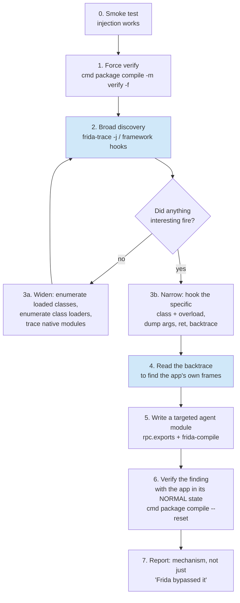

The diagram encodes a discipline that separates competent testers from people who paste scripts. Read
it as a loop with two distinct phases and one non-negotiable ending.

**Discovery (steps 2–3a)** is deliberately broad and deliberately dumb. You do not yet know which of
the app's ten thousand methods matters, so you do not guess — you instrument a boundary the app cannot
avoid (the platform's own classes, or every exported function in one native library), exercise the
feature by hand, and read what fired. This is cheap and it is nearly always faster than reasoning about
decompiled code.

**Narrowing (steps 3b–5)** starts the moment something interesting fires. Now you know a class name,
so you hook that class specifically, print arguments, return values and a Java stack trace, and use
the stack trace to walk *back up* into the app's own obfuscated code. The backtrace is the bridge from
"a platform API was called" to "this app class called it".

**Step 6 is the step people skip and it is the one that makes a report credible.** You forced the app
into `verify` mode to make hooking reliable. That is an artefact of your instrumentation, not of the
app. Before writing the finding up, run `cmd package compile --reset com.example.app`, restart the
app, and confirm the vulnerability still exists in the app's normal compilation state. A finding that
only reproduces under a modified runtime configuration will be — correctly — rejected by a developer.

> **Pentester's Note**
> Write the mechanism in the report, not the tool. "The PIN is validated client-side in
> `com.example.auth.PinValidator.check(String)`, whose boolean return governs the transition to the
> authenticated activity; because the check is entirely local, any code executing in the app's process
> can force it true" is a finding. "I bypassed the PIN with Frida" is a tool anecdote. The first gets
> fixed. The second gets closed as "requires root".

### 7.3 Building an agent library, not a pile of gists

Section [3.10](#310-building-a-real-agent-rpcexports-frida-compile-typescript) introduced
`rpc.exports`, `frida-compile` and TypeScript agents as mechanisms. Here is how to organise them into
something you will still be using in three years.

#### 7.3.1 The project layout

```
frida-lib/
├── package.json
├── tsconfig.json
├── agent/
│   ├── index.ts          # the control plane: rpc.exports and the module registry
│   ├── core/
│   │   ├── log.ts        # structured send() wrappers — never use console.log in a library
│   │   ├── sym.ts        # guarded symbol resolution across Frida 16/17
│   │   └── java.ts       # classloader helpers, safe Java.use, overload helpers
│   └── modules/
│       ├── crypto.ts
│       ├── network.ts
│       ├── pinning.ts
│       ├── root.ts
│       ├── storage.ts
│       └── nativeTrace.ts
└── host/
    └── driver.py         # the Python side: spawn, gate children, route messages
```

The key architectural decision is that **every module is independently switchable at runtime**. You
never edit the agent to turn a feature off; you call an RPC method. That is what makes the library
reusable across engagements.

#### 7.3.2 The control plane

```typescript
// agent/index.ts — the control plane. Compile with:
//   frida-compile agent/index.ts -o _agent.js
import { log, setLevel } from "./core/log.js";
import * as crypto from "./modules/crypto.js";
import * as network from "./modules/network.js";
import * as pinning from "./modules/pinning.js";
import * as root from "./modules/root.js";

interface Mod { name: string; enable(): void; disable(): void; }

const REGISTRY: Mod[] = [crypto.mod, network.mod, pinning.mod, root.mod];
const enabled = new Set<string>();

rpc.exports = {
  // `init` is invoked automatically on script load. `stage` is "early" when the
  // process was spawned and is still suspended, "late" when we attached to a
  // running process. Anything that must run before app code MUST happen here.
  init(stage: string, params: any) {
    setLevel(params?.level ?? "info");
    log("info", `agent up: stage=${stage} runtime=${Script.runtime} ` +
                `pid=${Process.id} arch=${Process.arch}`);
    // Auto-enable whatever the host asked for on the command line.
    (params?.modules ?? []).forEach((m: string) => this.enable(m));
  },

  // Called automatically on unload. Undo everything, or the app is left in a
  // half-hooked state that will confuse the next session.
  dispose() {
    enabled.forEach(n => REGISTRY.find(m => m.name === n)?.disable());
    Interceptor.detachAll();
  },

  list(): string[] { return REGISTRY.map(m => m.name); },

  enable(name: string): boolean {
    const m = REGISTRY.find(x => x.name === name);
    if (m === undefined) { log("warn", `no such module: ${name}`); return false; }
    if (enabled.has(name)) return true;
    Java.perform(() => m.enable());
    enabled.add(name);
    log("info", `enabled ${name}`);
    return true;
  },

  disable(name: string): boolean {
    const m = REGISTRY.find(x => x.name === name);
    if (m === undefined) return false;
    Java.perform(() => m.disable());
    enabled.delete(name);
    return true;
  }
};
```

#### 7.3.3 Guarded symbol resolution — the `sym.ts` pattern

Every symbol lookup in a library must be guarded, because a missing symbol is normal, not
exceptional: the module may not be loaded yet, the symbol may be stripped, or the API may have moved
between Frida versions.

```typescript
// agent/core/sym.ts — the compatibility and safety layer every agent needs.
//
// Frida 17 reorganised the module API: Module.findExportByName(null, name) became
// Module.getGlobalExportByName(name), and per-module lookup moved to
// Process.getModuleByName(mod).findExportByName(name). Library code must work on
// both, because you do not control which Frida the operator has installed.

export function globalExport(name: string): NativePointer | null {
  const M: any = Module;
  try {
    if (typeof M.getGlobalExportByName === "function") {
      return M.getGlobalExportByName(name);       // Frida 17+
    }
  } catch (_) { /* not found — fall through */ }
  try {
    if (typeof M.findExportByName === "function") {
      return M.findExportByName(null, name);      // Frida 16 and earlier
    }
  } catch (_) { /* ignore */ }
  return null;
}

export function moduleExport(mod: string, name: string): NativePointer | null {
  const P: any = Process;
  try {
    if (typeof P.findModuleByName === "function") {
      const m = P.findModuleByName(mod);
      if (m !== null && typeof m.findExportByName === "function") {
        return m.findExportByName(name);
      }
    }
  } catch (_) { /* ignore */ }
  try {
    return (Module as any).findExportByName(mod, name);
  } catch (_) { /* ignore */ }
  return null;
}

// Resolve the first symbol that exists from a list of candidates. Use this
// wherever a function has been renamed across Android versions or C++ mangling
// differs between NDK releases.
export function firstOf(mod: string | null,
                        names: string[]): { name: string; addr: NativePointer } | null {
  for (const n of names) {
    const a = mod === null ? globalExport(n) : moduleExport(mod, n);
    if (a !== null && !a.isNull()) return { name: n, addr: a };
  }
  return null;
}

// Wait for a module that is dlopen()'d later — the common case for a packed app
// whose real native library only appears after the first Activity starts.
export function onModuleLoad(pattern: RegExp, cb: (m: Module) => void): void {
  const existing = Process.enumerateModules().filter(m => pattern.test(m.name));
  if (existing.length > 0) { existing.forEach(cb); return; }

  const dlopen = firstOf(null, ["android_dlopen_ext", "dlopen", "__dl_dlopen"]);
  if (dlopen === null) { console.warn("[sym] no dlopen symbol; cannot wait for module"); return; }

  Interceptor.attach(dlopen.addr, {
    onEnter(args) { this.path = args[0].isNull() ? "" : args[0].readCString(); },
    onLeave() {
      if (typeof this.path !== "string") return;
      const base = this.path.split("/").pop() as string;
      if (!pattern.test(base)) return;
      const m = Process.findModuleByName(base);
      if (m !== null) cb(m);
    }
  });
}
```

> **Mental Model**
> Treat `null` from a symbol lookup the way you treat `null` from a database query: an expected
> result that your code handles, not an error. The difference between a script that works on your
> phone and a script that works on the client's phone is almost entirely made of these guards.

#### 7.3.4 Structured logging over `console.log`

`console.log` in an agent produces text that only a human can read. `send()` produces JSON that a
host-side program can filter, store and correlate. In a library, always use `send()`.

```typescript
// agent/core/log.ts
type Level = "debug" | "info" | "warn" | "error";
const ORDER: Level[] = ["debug", "info", "warn", "error"];
let threshold = 1;                                // default: info

export function setLevel(l: Level): void {
  const i = ORDER.indexOf(l);
  if (i >= 0) threshold = i;
}

export function log(level: Level, msg: string, extra?: object): void {
  if (ORDER.indexOf(level) < threshold) return;
  send({ kind: "log", level, ts: Date.now(), tid: Process.getCurrentThreadId(), msg, ...extra });
}

// Binary payloads travel out of band, not as JSON. This is dramatically faster
// and does not corrupt non-UTF8 bytes.
export function blob(tag: string, address: NativePointer, size: number): void {
  send({ kind: "blob", tag, address: address.toString(), size },
       address.readByteArray(size));
}
```

#### 7.3.5 The host driver

```python
#!/usr/bin/env python3
# host/driver.py — the host side of the library.
#
#   python3 driver.py com.example.app pinning root crypto
#
# Spawns the target, loads the compiled agent, enables the requested modules,
# routes structured messages to stdout and binary blobs to ./loot/.
import frida, sys, os, json, time, threading

AGENT = os.path.join(os.path.dirname(__file__), "..", "_agent.js")
LOOT = os.path.join(os.path.dirname(__file__), "..", "loot")
os.makedirs(LOOT, exist_ok=True)

stop = threading.Event()

def on_message(message, data):
    if message["type"] == "error":
        # A JS exception. `stack` carries .ts line numbers thanks to frida-compile
        # source maps, which is the whole reason to build with a source map.
        print(f"[!] {message['description']}\n{message.get('stack','')}")
        return

    payload = message.get("payload")
    if not isinstance(payload, dict):
        print("[*]", payload)
        return

    kind = payload.get("kind")
    if kind == "log":
        print(f"[{payload['level'][0].upper()}][tid {payload['tid']}] {payload['msg']}")
    elif kind == "blob" and data is not None:
        path = os.path.join(LOOT, f"{payload['tag']}-{int(time.time()*1000)}.bin")
        with open(path, "wb") as fh:
            fh.write(data)
        print(f"[+] wrote {len(data)} bytes -> {path}")
    else:
        print("[*]", json.dumps(payload))

def main():
    package = sys.argv[1]
    modules = sys.argv[2:]

    device = frida.get_usb_device(timeout=10)

    # Child gating catches processes the app forks — :remote services, WebView
    # renderers, and the separate-process Activities that so often hold the
    # interesting code. Without this you instrument the main process only.
    device.enable_child_gating()

    def on_child(child):
        print(f"[+] child pid={child.pid} id={child.identifier}")
        attach(device, child.pid, modules)
        device.resume(child.pid)

    device.on("child-added", on_child)

    pid = device.spawn([package])
    script = attach(device, pid, modules)
    device.resume(pid)                       # app code starts running only now

    print("[*] modules available:", script.exports_sync.list())
    try:
        while not stop.is_set():
            time.sleep(0.5)
    except KeyboardInterrupt:
        pass

def attach(device, pid, modules):
    session = device.attach(pid)
    session.on("detached", lambda reason, *a: print(f"[-] detached: {reason}"))
    with open(AGENT, "r", encoding="utf-8") as fh:
        source = fh.read()
    script = session.create_script(source)
    script.on("message", on_message)
    script.load()
    # `init` is invoked by Frida with these parameters BEFORE load() returns,
    # so by this point the requested modules are already hooked — early enough
    # to catch Application.attachBaseContext.
    return script

if __name__ == "__main__":
    main()
```

Note where `device.resume(pid)` sits: **after** `script.load()`. Everything the agent installs in
`init` is in place before a single line of app code executes. That ordering is the entire value of
spawning, and Section 7.4.4 explains what you lose when you get it wrong.

### 7.4 The four failure modes, exhaustively

Almost every "Frida doesn't work" message on the internet is one of four problems. Learn to
distinguish them by symptom and you will never again spend an afternoon on this.

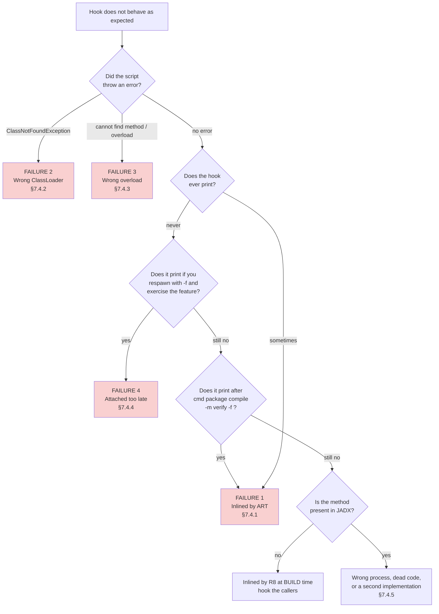

Work the tree top-down and never skip a node. The reason people misdiagnose these is that they jump
straight to "the app must be detecting Frida" — which is the rarest cause by a wide margin, and which
you should only conclude after the four boxes above are excluded. The tree distinguishes the four
cases using observable evidence: whether an exception was raised, whether the hook fired at all,
whether respawning changes the answer, and whether forcing interpretation changes the answer.

#### 7.4.1 Failure 1 — the method was inlined

**Symptom.** `Java.use(...).method.implementation = ...` runs without error. The app still executes
the logic — the login succeeds, the signature is computed — but your `console.log` never appears.
Sometimes it appears for the first few calls and then stops.

**Mechanism.** Recall from [13-ART §3.15–§3.17](../13-ART/README.md#315-artmethod--the-most-important-structure-in-android-security)
that hooking a Java method means rewriting `ArtMethod::entry_point_from_quick_compiled_code_`. That
field is only consulted when the runtime performs a **call** to the method. If the optimizing compiler
copied the method's body into its caller — inlining — there is no call instruction and no consultation
of the entry point. Your hook is correctly installed on a structure nothing reads.

There are two distinct inliners and they need different responses:

| Inliner | When it runs | Evidence | Recovery |
|---|---|---|---|
| **R8 / ProGuard** | Build time, before the APK is signed | The method **does not exist** in JADX/`baksmali` output | None at runtime. Hook the callers, or hook the method it delegates to |
| **ART optimizing compiler** | `dex2oat` at install / background dexopt, or the JIT while running | The method **does exist** in JADX; `dumpsys package dexopt` shows `speed` or `speed-profile` | Force interpretation, then re-hook |

**The diagnosis, step by step.**

```bash
# host — step 1: does the method exist in the DEX at all?
jadx-gui base.apk        # or:
baksmali d classes.dex -o smali_out
grep -rn "isValid" smali_out/com/example/auth/
# If nothing: R8 inlined or removed it. Stop here and hook callers.
```

```bash
# adb shell — step 2: what compilation state is the app in?
dumpsys package dexopt | grep -A3 com.example.app
#   arm64: [status=speed] [reason=bg-dexopt]     ← inlining is live
```

```bash
# adb shell — step 3: the fix
cmd package compile -m verify -f com.example.app
am force-stop com.example.app
```

```bash
# host — step 4: re-run and confirm
frida -U -f com.example.app -l agent.js --no-pause
```

**Confirming it from inside Frida.** Rather than guessing, read the method's entry point and classify
it. This is exactly what [`../13-ART/scripts/artmethod-inspect.js`](../13-ART/scripts/artmethod-inspect.js)
does; the condensed form is:

```javascript
// Frida REPL — is this method interpreted or compiled right now?
Java.perform(function () {
  var m = Java.use("com.example.auth.PinValidator").check.overload("java.lang.String");
  var handle = ptr(m.handle);          // this is the ArtMethod*
  console.log("ArtMethod* = " + handle);
  console.log(hexdump(handle, { length: 48 }));
  // Compare the trailing pointer against art_quick_to_interpreter_bridge:
  var bridge = Module.findExportByName("libart.so", "art_quick_to_interpreter_bridge");
  console.log("interpreter bridge = " + bridge);
});
```

If the last pointer-sized field equals `art_quick_to_interpreter_bridge`, the method runs interpreted
and a hook on it is reliable. If it points into an ELF module, the method is AOT-compiled and inlining
is possible.

**The runtime-only fix, and its cost.**

```javascript
// Frida REPL — force the entire runtime into interpreted mode.
// This is a large hammer: the app becomes several times slower and any timing
// check inside it may fire. Prefer `cmd package compile -m verify -f`, which
// achieves the same effect without the runtime penalty of deopt-everything.
Java.perform(function () {
  Java.deoptimizeEverything();
  console.log("[+] deoptimizeEverything() done");
});
```

```javascript
// Frida 16+ — the surgical version: deoptimise only what a specific method needs.
Java.perform(function () {
  var M = Java.use("com.example.auth.PinValidator").check.overload("java.lang.String");
  if (typeof Java.deoptimizeMethod === "function") {
    Java.deoptimizeMethod(M);          // available in recent Frida builds
    console.log("[+] deoptimised one method — no global slowdown");
  } else {
    Java.deoptimizeEverything();
  }
});
```

**When only the callers remain.** If R8 inlined the method, the code still exists — it was copied into
every caller. Find the callers and hook those instead:

```bash
# host — find every call site of the vanished method in Smali
grep -rn "PinValidator;->check" smali_out/ | head -20
```

```javascript
// Frida REPL — hook the caller and inspect the decision after the fact
Java.perform(function () {
  var Login = Java.use("com.example.ui.LoginActivity");
  Login.onSubmit.implementation = function (pin) {
    console.log("[caller] onSubmit(" + pin + ")");
    var r = this.onSubmit(pin);
    console.log("[caller] -> " + r);
    return r;
  };
});
```

> **Under the Hood**
> `cmd package compile -m verify -f` is preferable to `Java.deoptimizeEverything()` for one
> non-obvious reason: it changes the state of the app **on disk before the process starts**, so the
> app is interpreted from its very first instruction, including everything in `<clinit>` and
> `attachBaseContext`. `deoptimizeEverything()` runs after your script loads, which on an attach is
> already too late for early code, and it leaves ART's instrumentation framework visibly active —
> `art_quick_instrumentation_entry` in every entry point — which a sufficiently paranoid app can
> detect by timing. The disk-level fix is both earlier and quieter.

#### 7.4.2 Failure 2 — `ClassNotFoundException` and the ClassLoader problem

**Symptom.** `Java.use("com.example.secret.Engine")` throws
`Error: java.lang.ClassNotFoundException: Didn't find class "com.example.secret.Engine" on path: DexPathList[[],nativeLibraryDirectories=[...]]`,
even though you are looking at that exact class in JADX.

**Mechanism.** `Java.use` resolves names through `Java.classFactory.loader`, which defaults to the
first application-ish loader the bridge found. Android apps routinely have several loaders:

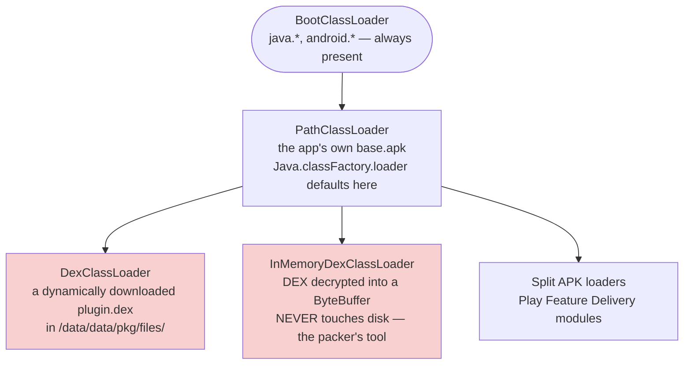

The diagram shows *delegation parents*, which is how Java class loading works: a loader asks its
parent first, and only searches its own path if the parent fails. The consequence for you is
directional. A child loader can see everything its parent can, but a **parent cannot see its
children's classes**. `Java.classFactory.loader` points at the `PathClassLoader` for `base.apk`; a
class that arrived in a downloaded `plugin.dex` or was decrypted into an `InMemoryDexClassLoader` lives
in a *child*, and is therefore invisible from where `Java.use` is standing. The two red boxes are the
ones that produce this failure in practice, and both are hallmarks of packers and of dynamic feature
delivery — see [40-Obfuscation](../40-Obfuscation/README.md).

**The diagnosis.**

```javascript
// Frida REPL — enumerate every loader and show what each one is
Java.perform(function () {
  Java.enumerateClassLoaders({
    onMatch: function (loader) {
      console.log("[loader] " + loader);
    },
    onComplete: function () { console.log("[*] done"); }
  });
});
```

Typical output on a packed app:

```
[loader] java.lang.BootClassLoader@1a2b3c4
[loader] dalvik.system.PathClassLoader[DexPathList[[zip file "/data/app/~~x/com.example-y/base.apk"],...]]
[loader] dalvik.system.InMemoryDexClassLoader[DexPathList[[dex file "InMemoryDexFile[cookie=...]"],...]]
```

That third line is where your class lives.

**The fix — search every loader, then switch to the right one.**

```javascript
// Frida REPL — find the loader that owns a class, then make Java.use work
function useAnywhere(className) {
  var found = null;
  Java.enumerateClassLoaders({
    onMatch: function (loader) {
      if (found !== null) return;
      try {
        loader.loadClass(className);      // throws if this loader cannot see it
        found = loader;
      } catch (e) { /* not this one */ }
    },
    onComplete: function () {}
  });

  if (found === null) {
    throw new Error("class not in ANY currently loaded loader: " + className);
  }

  // Swapping classFactory.loader changes the resolution root for every
  // subsequent Java.use in this script. Save and restore it if you need to
  // touch classes in more than one loader.
  var previous = Java.classFactory.loader;
  Java.classFactory.loader = found;
  var klass = Java.use(className);
  Java.classFactory.loader = previous;
  return klass;
}

Java.perform(function () {
  var Engine = useAnywhere("com.example.secret.Engine");
  Engine.decrypt.implementation = function (blob) {
    var out = this.decrypt(blob);
    console.log("[+] decrypt -> " + out);
    return out;
  };
});
```

**The cleaner Frida 16+ idiom** uses per-loader class factories, which avoids the save/restore dance
and lets you hold wrappers from several loaders at once:

```javascript
// Frida REPL — Java.enumerateClassLoaders + Java.ClassFactory.get()
Java.perform(function () {
  Java.enumerateClassLoaders({
    onMatch: function (loader) {
      try {
        loader.loadClass("com.example.secret.Engine");
      } catch (e) { return; }

      var factory = Java.ClassFactory.get(loader);   // a factory bound to THIS loader
      var Engine = factory.use("com.example.secret.Engine");
      Engine.decrypt.implementation = function (b) {
        var r = this.decrypt(b);
        console.log("[engine] decrypt(" + b + ") -> " + r);
        return r;
      };
      console.log("[+] hooked via " + loader);
    },
    onComplete: function () {}
  });
});
```

**The harder case: the class does not exist yet.** `Java.enumerateClassLoaders` can only report loaders
that have been *created*. If the app decrypts and loads its real DEX two seconds after launch, an
enumeration at `init` time finds nothing. The answer is to hook class loading itself and act the
moment your target appears:

```javascript
// Frida REPL — wait for a class to be defined, then hook it.
// Hooking loadClass is cheap and catches both PathClassLoader and any child.
Java.perform(function () {
  var TARGET = "com.example.secret.Engine";
  var hooked = false;

  var CL = Java.use("java.lang.ClassLoader");
  CL.loadClass.overload("java.lang.String", "boolean").implementation =
    function (name, resolve) {
      var cls = this.loadClass(name, resolve);
      if (!hooked && name === TARGET) {
        hooked = true;
        console.log("[+] " + TARGET + " defined by " + this);
        var factory = Java.ClassFactory.get(this);
        var Engine = factory.use(TARGET);
        Engine.decrypt.implementation = function (b) {
          var r = this.decrypt(b);
          console.log("[engine] " + b + " -> " + r);
          return r;
        };
      }
      return cls;
    };
});
```

Full, hardened versions of both patterns are in
[`scripts/class-enumerator.js`](scripts/class-enumerator.js).

> **Warning**
> Do not leave `Java.classFactory.loader` permanently reassigned. Every subsequent `Java.use` in your
> script — including inside modules you did not write — resolves through it. A pinning-bypass module
> that suddenly cannot find `javax.net.ssl.SSLContext` is almost always the victim of another module
> that changed the loader and never restored it.

#### 7.4.3 Failure 3 — the wrong overload

**Symptom.** One of:
`Error: check(): has more than one overload, use .overload(<signature>) to choose from: ...`, or —
worse, because it is silent — the hook installs on `check(String)` while the app actually calls
`check(String, boolean)` and nothing ever fires.

**Mechanism.** Java permits several methods with the same name and different parameter lists. Frida's
`Java.use` returns a wrapper whose `.overloads` array holds one entry per signature. Assigning
`.implementation` on the *group* is only legal when the group has exactly one member.

**The diagnosis — always list the overloads before hooking.**

```javascript
// Frida REPL — print every overload with its exact argument types
Java.perform(function () {
  var C = Java.use("com.example.auth.PinValidator");
  C.check.overloads.forEach(function (ov, i) {
    var args = ov.argumentTypes.map(function (t) { return t.className; });
    console.log("[" + i + "] check(" + args.join(", ") + ") : " + ov.returnType.className);
  });
});
```

```
[0] check(java.lang.String) : boolean
[1] check(java.lang.String, boolean) : boolean
[2] check([B, int, int) : boolean
```

**The type-name rules** trip up everyone once. The string you pass to `.overload()` must be the Java
*binary* name as Frida reports it, not the source-level name and not the JVM descriptor:

| Java source type | String to pass to `.overload()` |
|---|---|
| `int`, `boolean`, `long`, `char`, `byte`, `short`, `float`, `double` | `"int"`, `"boolean"`, `"long"`, `"char"`, `"byte"`, `"short"`, `"float"`, `"double"` |
| `String` | `"java.lang.String"` |
| `byte[]` | `"[B"` |
| `int[]` | `"[I"` |
| `String[]` | `"[Ljava.lang.String;"` |
| `byte[][]` | `"[[B"` |
| Inner class `Outer.Inner` | `"com.example.Outer$Inner"` |
| Varargs `f(String...)` | `"[Ljava.lang.String;"` — varargs *are* arrays |
| Constructor | use `.$init` as the member name |
| Generic `List<String>` | `"java.util.List"` — generics are erased |

**The blunt but reliable answer: hook every overload.** When you do not care which one runs, or you
want to find out empirically, iterate:

```javascript
// Frida REPL — hook every overload of a method and report which one fires
Java.perform(function () {
  var C = Java.use("com.example.auth.PinValidator");

  C.check.overloads.forEach(function (ov) {
    var sig = ov.argumentTypes.map(function (t) { return t.className; }).join(", ");
    ov.implementation = function () {
      // `arguments` is a real JS arguments object; convert for logging.
      var passed = [].slice.call(arguments).map(function (a) {
        return (a === null) ? "null" : String(a);
      });
      console.log("[hit] check(" + sig + ")  args=[" + passed.join(", ") + "]");

      // apply() forwards the exact argument list to the ORIGINAL implementation.
      // Note `this.check` — calling C.check here would recurse into the hook.
      var ret = ov.apply(this, arguments);
      console.log("[hit] -> " + ret);
      return ret;
    };
  });
});
```

> **Warning**
> Inside an overload's `implementation`, call the original as `ov.apply(this, arguments)` or
> `this.check.apply(this, arguments)`. Writing `C.check(...)` — using the class wrapper rather than
> `this` — re-enters your own hook and produces a stack overflow that looks, confusingly, like a crash
> in the app. This is the second most common self-inflicted Frida bug after forgetting `Java.perform`.

**The related trap: hooking the interface or the superclass.** If `PinValidator` is an interface and
the app calls a concrete `PinValidatorImpl`, hooking the interface method does nothing — virtual
dispatch resolves to the implementation's `ArtMethod`, not the interface's. Find the concrete types:

```javascript
// Frida REPL — find every loaded class that implements an interface
Java.perform(function () {
  var target = "com.example.auth.PinValidator";
  Java.enumerateLoadedClasses({
    onMatch: function (name) {
      if (name.indexOf("com.example") !== 0) return;      // keep it cheap
      try {
        var k = Java.use(name);
        var ifaces = k.class.getInterfaces();
        for (var i = 0; i < ifaces.length; i++) {
          if (ifaces[i].getName() === target) {
            console.log("[impl] " + name);
          }
        }
        var sup = k.class.getSuperclass();
        if (sup !== null && sup.getName() === target) console.log("[subclass] " + name);
      } catch (e) { /* unloadable / synthetic */ }
    },
    onComplete: function () { console.log("[*] scan complete"); }
  });
});
```

Alternatively, use `Java.choose` to find live instances and read their real runtime class:

```javascript
// Frida REPL — what concrete type is actually on the heap?
Java.perform(function () {
  Java.choose("com.example.auth.PinValidator", {
    onMatch: function (inst) { console.log("[live] " + inst.$className); },
    onComplete: function () {}
  });
});
```

#### 7.4.4 Failure 4 — attaching instead of spawning

**Symptom.** Your script works perfectly when you re-run it and press a button, but everything that
happens at app startup — the root check, the pinning setup, the key derivation, the DEX decryption —
happens without you seeing it. Or: you attach with `-n` and the app has already decided you are a
threat and exited.

**Mechanism.** `frida -U -n com.example.app` (or `-p <pid>`) attaches to a process that is **already
running**. By the time the attach completes, the app has executed, in order:

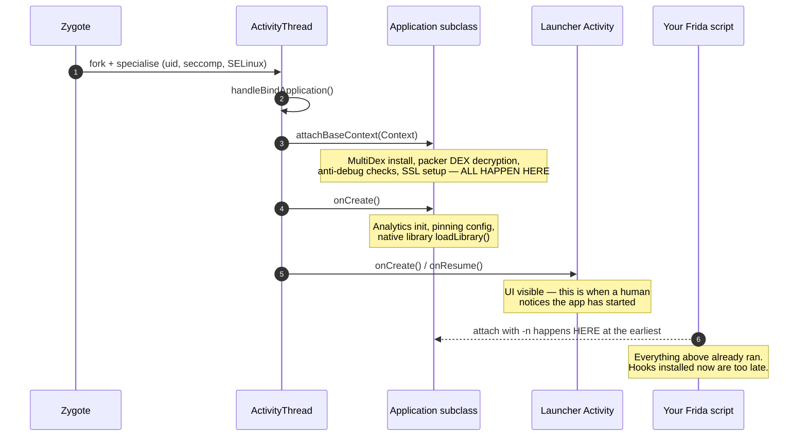

The sequence makes the loss concrete. `Application.attachBaseContext` is the **first** app-authored
code to run in the process, before `onCreate`, before any Activity, before the UI exists. Packers
decrypt their real DEX there. Anti-debug checks run there specifically because it is early. By the
time a human sees the app on screen and types `frida -U -n`, that code executed seconds ago. Attaching
does not rewind it.

**The fix is one character.**

```bash
# host — WRONG: attaches to a running process, misses all startup code
frida -U -n com.example.app -l agent.js

# host — RIGHT: spawns the process suspended, loads the agent, then resumes
frida -U -f com.example.app -l agent.js --no-pause
```

What `-f` does internally is covered in [§2.3](#23-spawn-versus-attach) and
[§3.4](#34-spawn-on-android-precisely): Frida asks `frida-server` to have Zygote fork the process and
then holds it before it runs any app code, injects the agent, and only releases it when you resume.
`--no-pause` means "resume automatically as soon as my script has loaded" — the script still loads
first.

**Verifying that you really are early:**

```javascript
// agent.js — prove your hooks are installed before app code runs
Java.perform(function () {
  var App = Java.use("android.app.Application");
  App.attachBaseContext.overload("android.content.Context").implementation = function (ctx) {
    console.log("[+] attachBaseContext reached — we are EARLY");
    return this.attachBaseContext(ctx);
  };
  var AT = Java.use("android.app.ActivityThread");
  AT.handleBindApplication.implementation = function (data) {
    console.log("[+] handleBindApplication for " + data.processName.value);
    return this.handleBindApplication(data);
  };
});
```

If `[+] attachBaseContext reached` prints, you are early enough for anything. If it does not print,
you attached late, full stop.

**The startup-only edge cases** that `-f` alone does not solve:

| Situation | Why `-f` is not enough | What to do |
|---|---|---|
| Logic runs in a `:remote` process | You spawned and instrumented the main process only | `device.enable_child_gating()` in Python, or `frida -U -f pkg --runtime=v8 -l a.js` plus a second session on the child; list with `frida-ps -Ua` |
| Code runs in a `ContentProvider` | Providers are created **before** `Application.onCreate` | Hook in `init`, not in a `Java.perform` scheduled later |
| Static initialiser of a class loaded by the packer | `<clinit>` runs at first use, which may precede your enumeration | Hook `ClassLoader.loadClass` / `DexFile` loading, as in §7.4.2 |
| Native constructor (`__attribute__((constructor))`) in a `.so` | Runs inside `dlopen`, before `JNI_OnLoad` | Hook `android_dlopen_ext` and instrument in `onLeave` |
| App is launched by a deep link or a push, not by you | You never got to spawn it | `am start` it yourself under `-f`, or use gadget mode (§7.9) |

```bash
# host — find the extra processes an app runs
frida-ps -Ua | grep example
# 12043  Example        com.example.app
# 12110  Example        com.example.app:remote
# 12184  Example        com.example.app:webview
```

```bash
# adb shell — the manifest tells you in advance
# look for android:process=":something" on any component
```

#### 7.4.5 When it is none of the four

Only after excluding all four should you consider the remaining causes, roughly in order of frequency:

| Cause | How to confirm |
|---|---|
| The code runs in a **different process** | `frida-ps -Ua`; check `android:process` in the manifest |
| The method is genuinely **never called** on your path | Hook a method you *know* runs (e.g. `Activity.onResume`) to prove the agent is live |
| A **second implementation** exists (product flavour, A/B flag, feature toggle) | Search the DEX for other classes with the same method name |
| The logic is in **native code**, and the Java method is a thin wrapper | `nm -D --defined-only libfoo.so`; hook the native side (§7.7) |
| The app **is** detecting Frida | See [§5.3](#53-detection-and-its-limits); look for the process dying, not for the hook silently failing |
| Two scripts are hooking the same method and one overwrote the other | Load one script at a time |

> **Pentester's Note**
> "The app detects Frida" is the conclusion you reach *last*, not first, and the evidence for it is
> qualitatively different: the process dies, exits, shows a dialog, or silently changes behaviour.
> Detection does not usually produce a hook that installs cleanly and never fires — that is inlining.
> Conflating the two sends you down an anti-anti-debug rabbit hole to solve a compiler problem.

### 7.5 `Interceptor.attach` versus `Interceptor.replace`

Both operate on native code. They are not interchangeable, and choosing wrongly produces bugs that
look like the target being broken.

| | `Interceptor.attach` | `Interceptor.replace` |
|---|---|---|
| Original still runs | **Yes**, always | **No**, unless you call it yourself |
| Callbacks | `onEnter(args)`, `onLeave(retval)` | One `NativeCallback` that *is* the function |
| Can modify arguments | Yes, `args[n] = ptr(...)` in `onEnter` | Yes, they are your parameters |
| Can modify return | Yes, `retval.replace(x)` in `onLeave` | Yes, `return` whatever you want |
| Can skip the original | No | Yes — that is the point |
| Per-call state | `this` is shared between `onEnter`/`onLeave` | Manage it yourself |
| Typical use | Observation, logging, light tampering | Neutralising a check, stubbing a function |
| Detectability | Patches a few instructions at the prologue | Patches the prologue too |
| Reentrancy risk | Low | **High** — calling the original from inside re-enters your replacement unless you use the saved `NativeFunction` |

```javascript
// Frida REPL — attach: watch a function without changing what it does
const openPtr = Module.findExportByName("libc.so", "open");
if (openPtr !== null) {
  Interceptor.attach(openPtr, {
    onEnter(args) {
      // `this` persists from onEnter to onLeave for THIS invocation only.
      this.path = args[0].isNull() ? "<null>" : args[0].readCString();
    },
    onLeave(retval) {
      const fd = retval.toInt32();
      if (this.path && this.path.indexOf("/data/") === 0) {
        console.log(`[open] ${this.path} -> fd ${fd}`);
      }
    }
  });
} else {
  console.log("[-] libc.so!open not found — unusual; check the module list");
}
```

```javascript
// Frida REPL — replace: make a native root check always return 0 (not rooted)
const check = Module.findExportByName("libguard.so", "is_device_rooted");
if (check !== null) {
  // Keep a reference to the ORIGINAL as a NativeFunction before replacing,
  // so you can still call it if you want to compare answers.
  const original = new NativeFunction(check, "int", []);

  Interceptor.replace(check, new NativeCallback(function () {
    const real = original();          // safe: NativeFunction bypasses the patch
    console.log(`[guard] is_device_rooted real=${real}, returning 0`);
    return 0;
  }, "int", []));
} else {
  console.log("[-] is_device_rooted not exported — try RegisterNatives recovery");
}
```

> **Warning**
> The `NativeCallback` object must stay reachable from JavaScript for as long as native code may call
> it. If you write `Interceptor.replace(addr, new NativeCallback(...))` inside a function and the only
> reference goes out of scope, the JS garbage collector may free the trampoline while the app still
> holds its address. The result is a `SIGSEGV` minutes later, in a place that has nothing to do with
> your script. Always store callbacks in a module-scope array:
> `const KEEP = []; KEEP.push(cb);`

**Modifying arguments and return values with `attach`:**

```javascript
// Frida REPL — rewrite an argument on the way in and the result on the way out
const strcmpPtr = Module.findExportByName("libc.so", "strcmp");
if (strcmpPtr !== null) {
  Interceptor.attach(strcmpPtr, {
    onEnter(args) {
      this.a = args[0].readCString();
      this.b = args[1].readCString();
      // Argument replacement must be a NativePointer of the right type.
      // Memory.allocUtf8String returns memory owned by the JS runtime; it stays
      // alive as long as the returned pointer is referenced.
      if (this.a === "expected-license") {
        this.buf = Memory.allocUtf8String("expected-license");
        args[1] = this.buf;
      }
    },
    onLeave(retval) {
      if (this.a === "expected-license") {
        console.log(`[strcmp] forcing equal for ${this.a} vs ${this.b}`);
        retval.replace(0);            // 0 means "equal"
      }
    }
  });
}
```

**Detaching cleanly** matters in a library, because leaving hooks installed across a `%reload` gives
you two layers of instrumentation:

```javascript
// Frida REPL — keep listener handles so you can undo precisely
const listeners = [];
listeners.push(Interceptor.attach(target, { onEnter(a) { /* ... */ } }));

// later
listeners.forEach(l => l.detach());
listeners.length = 0;

// or, the blunt version used in rpc.exports.dispose():
Interceptor.detachAll();
```

**Batching for performance.** Every `Interceptor.attach` call flushes the instruction cache. When
installing hundreds of hooks, wrap them:

```javascript
// Frida REPL — install many hooks with a single cache flush
Interceptor.flush();                       // apply anything pending first
const exports_ = Process.getModuleByName("libnative.so").enumerateExports();
exports_.filter(e => e.type === "function").forEach(e => {
  Interceptor.attach(e.address, {
    onEnter() { console.log("[call] " + e.name); }
  });
});
Interceptor.flush();                       // one flush for all of them
```

### 7.6 Finding things in memory: `Memory.scan` and `Process.enumerateRanges`

When the secret is not in a variable you can name — because it is derived, decrypted, or held by a
native library you have not reversed — you search the address space for it.

#### 7.6.1 Enumerating ranges

```javascript
// Frida REPL — what memory does this process have, and where?
const ranges = Process.enumerateRanges("r--");   // at least readable
console.log("total readable ranges: " + ranges.length);

// Summarise by kind — this orientation step is worth doing once per target.
const summary = {};
ranges.forEach(r => {
  const kind = r.file ? r.file.path.split("/").pop() : "<anonymous " + r.protection + ">";
  summary[kind] = (summary[kind] || 0) + r.size;
});
Object.keys(summary)
  .sort((a, b) => summary[b] - summary[a])
  .slice(0, 20)
  .forEach(k => console.log(("      " + (summary[k] / 1024 | 0)).slice(-8) + " KiB  " + k));
```

The protection string uses the same letters as `/proc/<pid>/maps` (see
[19-Memory](../19-Memory/README.md)). The ones you care about:

| Selector | Meaning | Why you would scan it |
|---|---|---|
| `"r--"` | Anything readable | Broadest sweep; slowest |
| `"rw-"` | Readable and writable, not executable | **Where runtime secrets live** — heap, stack, BSS, JNI buffers |
| `"r-x"` | Readable and executable | Code. Scan here for byte patterns to find an unexported function |
| `"rwx"` | All three | Rare and suspicious — JIT code cache, some packers, injected shellcode |
| `"---"` | Guard pages | Never scan |

```javascript
// Frida REPL — anonymous rw- regions only: the highest-yield target for secrets
const candidates = Process.enumerateRanges("rw-").filter(r => r.file === null);
console.log(`${candidates.length} anonymous rw- ranges, ` +
            `${candidates.reduce((s, r) => s + r.size, 0) / 1048576 | 0} MiB total`);
```

#### 7.6.2 Scanning

```javascript
// Frida REPL — synchronous scan of one range for an ASCII string
const needle = "Bearer ey";                       // JWTs start like this
const pattern = needle.split("")
  .map(c => c.charCodeAt(0).toString(16).padStart(2, "0"))
  .join(" ");

Process.enumerateRanges("rw-").forEach(range => {
  Memory.scan(range.base, range.size, pattern, {
    onMatch(address, size) {
      // Read a generous window around the hit; the token continues past `needle`.
      const text = address.readCString(512);
      console.log(`[hit] ${address}  ${text}`);
    },
    onError(reason) {
      // Ranges can be unmapped between enumeration and scanning. This is normal.
    },
    onComplete() {}
  });
});
```

**Pattern syntax** is the part people get wrong:

| Pattern | Matches |
|---|---|
| `"41 42 43"` | The exact bytes `ABC` |
| `"41 ?? 43"` | `A`, any byte, `C` |
| `"41 4? 43"` | `A`, any byte whose high nibble is 4, `C` |
| `"/Bearer ey[A-Za-z0-9]/"` | A regular expression over the raw bytes (Frida 15+) |

```javascript
// Frida REPL — the async form: does not block the JS thread, returns a Promise
const range = Process.enumerateRanges("rw-")[0];
Memory.scan(range.base, range.size, "50 4b 03 04", {   // "PK\x03\x04" — a ZIP header
  onMatch(address) { console.log("[zip] " + address); },
  onComplete() { console.log("[*] done"); }
});

// Or, collect all matches at once:
Memory.scanSync(range.base, range.size, "50 4b 03 04")
  .forEach(m => console.log(`${m.address} size=${m.size}`));
```

> **Warning**
> `Memory.scanSync` over the whole address space of a modern app will scan hundreds of megabytes on
> the JavaScript thread and will trigger an ANR. Always filter the range list first — anonymous `rw-`
> only, and skip ranges larger than, say, 64 MiB unless you have a reason. The async `Memory.scan`
> yields between chunks and is the correct choice for a broad sweep.

**Why this beats hooking, sometimes.** A key that is `SecretKeySpec`-wrapped is easy to hook. A key
that a native library derives, uses through a statically linked BoringSSL, and zeroes afterwards may
never cross a hookable boundary. But between derivation and zeroing it exists as bytes in a `rw-`
page, and if you can trigger the operation while scanning, you can find it. The full implementation,
with entropy scoring and known-format detectors, is
[`scripts/memory-secret-scanner.js`](scripts/memory-secret-scanner.js).

**Writing to memory** — for patching a check that you have located by pattern:

```javascript
// Frida REPL — patch two bytes of code in an executable range
const addr = Module.findBaseAddress("libguard.so").add(0x4a1c);

// Memory.patchCode handles the page-protection dance and the i-cache flush for
// you. Writing with Memory.protect + writeByteArray also works but is fiddlier.
Memory.patchCode(addr, 8, code => {
  const w = new Arm64Writer(code, { pc: addr });
  w.putMovRegU64("x0", 0);      // return 0
  w.putRet();
  w.flush();
});
console.log("[+] patched " + addr);
```

### 7.7 Backtraces: `ACCURATE` versus `FUZZY`

A backtrace answers the question that turns an observation into a finding: *who called this?*

```javascript
// Frida REPL — native backtrace from inside a hook
Interceptor.attach(Module.findExportByName("libc.so", "open"), {
  onEnter(args) {
    const path = args[0].readCString();
    if (path && path.indexOf("secret") !== -1) {
      console.log("[open] " + path);
      console.log(
        Thread.backtrace(this.context, Backtracer.ACCURATE)
          .map(DebugSymbol.fromAddress)
          .join("\n"));
    }
  }
});
```

| Backtracer | How it works | Works when | Fails when |
|---|---|---|---|
| `Backtracer.ACCURATE` | Follows frame pointers / unwind tables (`.eh_frame`, ARM EHABI) | The target was built with frame pointers or has unwind info | Frame-pointer-omitted release builds, hand-written assembly, obfuscated/packed code |
| `Backtracer.FUZZY` | Scans the stack for values that *look like* return addresses into known modules | Almost always produces something | Produces **false frames** — stale return addresses from earlier calls left on the stack |

> **Mental Model**
> `ACCURATE` is a witness statement: correct, or absent. `FUZZY` is a search of the wastebasket: you
> find real receipts mixed with old ones, and you must judge which are current. Start with `ACCURATE`.
> If it returns one frame or none, switch to `FUZZY` and treat the result as a list of *candidates* to
> verify, not as ground truth.

```javascript
// Frida REPL — try accurate, fall back to fuzzy, and label which you got
function backtrace(context) {
  let frames = Thread.backtrace(context, Backtracer.ACCURATE);
  let kind = "ACCURATE";
  if (frames.length <= 1) {
    frames = Thread.backtrace(context, Backtracer.FUZZY);
    kind = "FUZZY (verify these)";
  }
  return `[${kind}]\n` + frames.map(f => {
    const s = DebugSymbol.fromAddress(f);
    if (s.name) return `  ${f} ${s.moduleName}!${s.name}`;
    // A frame with no symbol is still useful: module+offset feeds straight
    // into Ghidra, once you add the image base (see ../57-Ghidra/ §7.1).
    const m = Process.findModuleByAddress(f);
    return m !== null
      ? `  ${f} ${m.name}+0x${f.sub(m.base).toString(16)}`
      : `  ${f} <unmapped>`;
  }).join("\n");
}
```

**The Java backtrace** is a different mechanism entirely and is usually the more valuable one on
Android, because it names the app's own classes:

```javascript
// Frida REPL — a Java stack trace from inside a Java hook.
// This constructs a throwable purely to read its stack; it is never thrown.
function javaStack() {
  return Java.use("android.util.Log")
    .getStackTraceString(Java.use("java.lang.Exception").$new());
}

Java.perform(function () {
  const Cipher = Java.use("javax.crypto.Cipher");
  Cipher.doFinal.overload("[B").implementation = function (input) {
    const out = this.doFinal(input);
    console.log("[Cipher.doFinal] alg=" + this.getAlgorithm());
    console.log(javaStack());          // ← the line that finds the app's own class
    return out;
  };
});
```

This is the core of the framework-boundary technique from [§6.4](#64-the-framework-boundary-technique-in-full):
hook a platform class you know the name of, read the stack, and the frames below yours are the app's
obfuscated classes — which you now know the names of.

```javascript
// Frida REPL — combine both, and filter the Java stack down to app frames only
function appFrames(prefix) {
  const st = Java.use("java.lang.Thread").currentThread().getStackTrace();
  const out = [];
  for (let i = 0; i < st.length; i++) {
    const cls = st[i].getClassName();
    if (cls.indexOf(prefix) === 0) {
      out.push(`${cls}.${st[i].getMethodName()}:${st[i].getLineNumber()}`);
    }
  }
  return out;
}
// appFrames("com.example")  →  ["com.example.a.b.c.sign:0", ...]
```

### 7.8 `NativeFunction` and `NativeCallback`: calling into and out of the target

Hooking observes. `NativeFunction` lets you **invoke** the target's own code with arguments of your
choosing — which is how you turn a discovered signing routine into an oracle.

```javascript
// Frida REPL — call a native function the app exports
const sign = Module.findExportByName("libcrypto_helper.so", "sign_payload");
if (sign !== null) {
  // Signature: int sign_payload(const uint8_t* in, size_t inLen, uint8_t* out)
  const fn = new NativeFunction(sign, "int", ["pointer", "size_t", "pointer"]);

  const input = Memory.allocUtf8String("hello");
  const output = Memory.alloc(64);
  const n = fn(input, 5, output);

  console.log("[sign] returned " + n);
  console.log(hexdump(output, { length: Math.min(n, 64) }));
}
```

**Type strings** must match the C ABI exactly. Getting this wrong is a segfault, not an exception:

| C type | Frida type string |
|---|---|
| `void` | `"void"` |
| `char`, `int8_t` | `"char"` / `"int8"` |
| `int`, `int32_t` | `"int"` / `"int32"` |
| `long`, `int64_t` | `"long"` / `"int64"` |
| `size_t` | `"size_t"` |
| `float`, `double` | `"float"`, `"double"`  |
| any pointer, including `char*` | `"pointer"` |
| `bool` | `"bool"` |
| struct **by value** | `["int", "pointer"]` — an array describing the members |

```javascript
// Frida REPL — options that matter on Android
const fn = new NativeFunction(addr, "int", ["pointer"], {
  // 'exceptions: "propagate"' lets a native crash surface as a JS exception
  // instead of killing the process. Invaluable while you are guessing signatures.
  exceptions: "propagate",
  // 'traps: "all"' makes the call visible to Stalker if you are tracing.
  traps: "default"
});

try {
  fn(ptr(0));            // deliberately bad pointer
} catch (e) {
  console.log("[caught] " + e.message);     // does not take the app down
}
```

**Calling Java from anywhere** — the equivalent on the managed side:

```javascript
// Frida REPL — invoke an app method directly, as an oracle
Java.perform(function () {
  const Signer = Java.use("com.example.crypto.Signer");

  // A static method can be called on the class wrapper directly.
  console.log("[static] " + Signer.hmac("payload", "key"));

  // An instance method needs an instance. Either construct one...
  const s = Signer.$new();
  console.log("[new] " + s.sign("payload"));

  // ...or borrow a live one off the heap, which matters when the object holds
  // state (a derived key, an initialised context) you cannot recreate.
  Java.choose("com.example.crypto.Signer", {
    onMatch(inst) {
      console.log("[live] " + inst.sign("payload"));
      return "stop";                 // stop after the first
    },
    onComplete() {}
  });
});
```

> **Warning**
> Every call into Java must happen on a thread attached to the VM, inside `Java.perform`. Calling
> `Signer.hmac(...)` from an `Interceptor.onEnter` on an arbitrary native thread without
> `Java.perform` will abort the process with `JNI DETECTED ERROR IN APPLICATION: a thread is
> making JNI calls without being attached`. If you must bridge from a native hook into Java, use
> `Java.perform(() => { ... })` inside the callback, and be aware that it may block.

**`NativeCallback` — giving native code a function pointer you control:**

```javascript
// Frida REPL — install a JS function as a C callback.
// Common use: replace a certificate-verification callback with one that says yes.
const KEEP = [];                                   // GC anchor — see the warning in §7.5

const verifyCb = new NativeCallback(function (preverifyOk, x509StoreCtx) {
  console.log(`[verify_callback] preverify=${preverifyOk} -> forcing 1`);
  return 1;                                        // 1 = accept
}, "int", ["int", "pointer"]);
KEEP.push(verifyCb);

const setVerify = Module.findExportByName("libssl.so", "SSL_CTX_set_verify");
if (setVerify !== null) {
  const fn = new NativeFunction(setVerify, "void", ["pointer", "int", "pointer"]);
  Interceptor.replace(setVerify, new NativeCallback(function (ctx, mode, cb) {
    console.log("[SSL_CTX_set_verify] mode=" + mode + " -> SSL_VERIFY_NONE + our callback");
    fn(ctx, 0 /* SSL_VERIFY_NONE */, verifyCb);
  }, "void", ["pointer", "int", "pointer"]));
}
```

### 7.9 `Stalker` in practice: when instruction-level tracing is worth it

[§3.7](#37-stalker--instruction-level-tracing) explained what Stalker is: a dynamic recompiler that
copies basic blocks into a private buffer and instruments them, giving you every branch, call and
optionally every instruction a thread executes. Here is when to actually reach for it.

| Use Stalker when | Use `Interceptor` instead when |
|---|---|
| The function you need is **not exported** and you cannot find it statically | You know the symbol |
| Control flow is **flattened or virtualised** and static reading is hopeless | The code is readable |
| You need to know **which of 900 basic blocks** ran for input A but not input B | You already know the function |
| You are looking for the **exact instruction** where a comparison decides | You only need arguments and return values |
| The target detects Interceptor's **prologue patches** | Detection is not an issue |
| You want a **coverage trace** to feed a differential/`drcov` workflow | You want a log line |

The last two rows are the ones that justify the cost. Stalker does not modify the original code at
all — it relocates and instruments a *copy* — so an integrity check that hashes `.text` sees nothing
wrong.

```javascript
// Frida REPL — minimal, honest Stalker usage: trace calls made by ONE thread
// while you press ONE button, then stop.
//
// Cost: 10x-100x slowdown on the followed thread. Never follow all threads on
// a UI app unless you enjoy ANRs.
const targetModule = Process.getModuleByName("libnative.so");
const lo = targetModule.base;
const hi = targetModule.base.add(targetModule.size);

const seen = new Set();

Stalker.follow(Process.getCurrentThreadId(), {
  events: {
    call: true,        // every CALL/BL
    ret: false,
    exec: false,       // per-instruction — enormously expensive, off by default
    block: false,
    compile: false
  },
  onReceive(events) {
    Stalker.parse(events, { annotate: true, stringify: false })
      .forEach(e => {
        // e = ["call", from, to, depth]
        const to = e[2];
        if (to.compare(lo) >= 0 && to.compare(hi) < 0) {
          const off = to.sub(lo);
          const key = off.toString();
          if (!seen.has(key)) {
            seen.add(key);
            const sym = DebugSymbol.fromAddress(to);
            console.log(`[call] libnative.so+0x${off.toString(16)} ` +
                        `${sym.name ?? ""}`);
          }
        }
      });
  }
});

// Always stop. A forgotten Stalker.follow leaves the thread recompiled forever.
setTimeout(() => {
  Stalker.unfollow(Process.getCurrentThreadId());
  Stalker.garbageCollect();
  console.log(`[*] stopped. ${seen.size} distinct callees inside libnative.so`);
}, 10000);
```

**The transform callback** is where Stalker becomes genuinely powerful: you rewrite the instruction
stream as it is compiled, once per basic block, and the instrumentation you insert costs nothing
extra on subsequent executions of that block.

```javascript
// Frida REPL — transform: log only CMP instructions inside one function.
// This is how you find "the comparison that decides" in an obfuscated routine
// without reading a single line of disassembly.
const fnBase = Module.findBaseAddress("libnative.so").add(0x12340);
const fnEnd  = fnBase.add(0x800);

Stalker.follow(Process.getCurrentThreadId(), {
  transform(iterator) {
    let insn = iterator.next();
    do {
      const inRange = insn.address.compare(fnBase) >= 0 &&
                      insn.address.compare(fnEnd) < 0;

      if (inRange && (insn.mnemonic === "cmp" || insn.mnemonic === "subs")) {
        // putCallout injects a call to a JS function at THIS point in the
        // instrumented copy. It runs with the real register state.
        iterator.putCallout(function (context) {
          console.log(`[cmp] pc=${context.pc} ` +
                      `x0=${context.x0} x1=${context.x1}`);
        });
      }

      iterator.keep();          // emit the original instruction — mandatory
      insn = iterator.next();
    } while (insn !== null);
  }
});
```

> **Warning**
> `iterator.keep()` must be called for every instruction you do not deliberately remove. Forget it and
> the instruction vanishes from the recompiled block, which changes the program's behaviour in ways
> that are extremely hard to debug. Also: never call `console.log` from a callout on a hot path — the
> message queue will back up and the app will hang. Accumulate into a `Set` or a typed array and dump
> it after `unfollow`.

**Coverage collection**, the highest-value Stalker workflow, records which blocks ran so you can diff
two executions:

```javascript
// Frida REPL — block-coverage collection suitable for diffing two runs
const mod = Process.getModuleByName("libnative.so");
const blocks = new Set();

Stalker.follow(Process.getCurrentThreadId(), {
  events: { compile: true },        // fires ONCE per basic block, first time it runs
  onReceive(events) {
    Stalker.parse(events).forEach(e => {
      if (e[0] !== "compile") return;
      const start = e[1];
      if (start.compare(mod.base) >= 0 &&
          start.compare(mod.base.add(mod.size)) < 0) {
        blocks.add(start.sub(mod.base).toString(16));
      }
    });
  }
});

rpc.exports = {
  snapshot() { const a = Array.from(blocks); blocks.clear(); return a; },
  stop() { Stalker.unfollow(); Stalker.garbageCollect(); }
};
```

Run it with a correct PIN and with a wrong PIN, diff the two block sets, and the handful of offsets
that appear in only one run is the validation logic. Feed those offsets to
[57-Ghidra](../57-Ghidra/README.md) and you have gone from a stripped binary to the exact function in
minutes.

**Tuning knobs:**

| Setting | Effect |
|---|---|
| `Stalker.trustThreshold = -1` | Never re-instrument a block; fastest, but self-modifying code breaks |
| `Stalker.trustThreshold = 0` | Re-instrument every execution; needed for self-modifying/packed code |
| `Stalker.queueCapacity` / `queueDrainInterval` | Buffer size and flush period for `onReceive` |
| `Stalker.exclude(range)` | Do not instrument this range — **use it to exclude `libc` and `libart`**, which is usually a 10x speedup |
| `Stalker.garbageCollect()` | Free instrumented copies after `unfollow` |

```javascript
// Frida REPL — exclude the noise before following
["libc.so", "libart.so", "libandroid_runtime.so", "libm.so"].forEach(name => {
  const m = Process.findModuleByName(name);
  if (m !== null) Stalker.exclude(m);
});
```

### 7.10 The no-root path: `frida-gadget`

When you cannot root the device — a client-issued phone, a device with a locked bootloader, a build
where root breaks the app's attestation — you embed Frida into the app instead of injecting into it.
[§3.5](#35-frida-gadget-configuration-and-embedding) gave the mechanism; this is the working
procedure.

```mermaid
flowchart LR
    A["Original signed APK"] --> B["apktool d<br/>decode"]
    B --> C["Add libgadget.so<br/>to lib/&lt;abi&gt;/"]
    C --> D["Add libgadget.config.so<br/>JSON config"]
    D --> E["Patch smali:<br/>System.loadLibrary('gadget')<br/>in Application &lt;clinit&gt;"]
    E --> F["apktool b<br/>rebuild"]
    F --> G["zipalign -p 4"]
    G --> H["apksigner sign<br/>with YOUR key"]
    H --> I["adb install"]
    I --> J["frida -U -n Gadget -l agent.js"]

    style H fill:#f9d0d0
    style A fill:#d0e8f9
```

The red box is the cost of this path and it is unavoidable: the APK is re-signed with your key, so its
signature no longer matches the vendor's. Any check that compares the signing certificate against a
pinned value — Play Integrity, an in-app `PackageManager.getPackageInfo(..., GET_SIGNATURES)`
comparison, a server-side attestation — will now fail. See
[38-TamperDetection](../38-TamperDetection/README.md). You are trading "needs root" for "changes the
signature". There is no third option that avoids both.

```bash
# host — full gadget embed, step by step
PKG=com.example.app
ABI=arm64          # must match the device: arm64, arm, x86_64, x86
VER=$(frida --version)

# 1. Get the gadget matching your host frida version
curl -L -o gadget.so.xz \
  "https://github.com/frida/frida/releases/download/${VER}/frida-gadget-${VER}-android-${ABI}.so.xz"
unxz gadget.so.xz

# 2. Decode the APK
apktool d -o work base.apk

# 3. Drop the gadget in as a native library. The name MUST start with "lib"
#    and end in ".so" or the packaging tools will not extract it.
mkdir -p work/lib/arm64-v8a
cp gadget.so work/lib/arm64-v8a/libgadget.so
```

```json
// work/lib/arm64-v8a/libgadget.config.so — yes, a JSON file with a .so extension.
// The name must be the gadget's filename with .config inserted before .so.
{
  "interaction": {
    "type": "listen",
    "address": "127.0.0.1",
    "port": 27042,
    "on_port_conflict": "fail",
    "on_load": "wait"
  }
}
```

`"on_load": "wait"` is the setting that makes gadget mode worth using: the gadget **blocks the
process** until you connect, which gives you the same "before any app code" position that `-f` gives
you with `frida-server`. Without it, the app runs on while you are still typing.

The alternative `script` mode needs no host connection at all, which is what you want for an
unattended device or a CI job:

```json
// work/lib/arm64-v8a/libgadget.config.so — fully autonomous
{
  "interaction": {
    "type": "script",
    "path": "/data/local/tmp/agent.js",
    "on_change": "reload"
  }
}
```

```smali
# work/smali/com/example/app/App.smali — load the gadget as early as possible.
# If the class already has a <clinit>, ADD the two lines to it; do not add a
# second one. If it has none, add this whole method.
.method static constructor <clinit>()V
    .locals 1

    const-string v0, "gadget"
    invoke-static {v0}, Ljava/lang/System;->loadLibrary(Ljava/lang/String;)V

    return-void
.end method
```

```bash
# host — find the right class to patch: the android:name of <application>
grep -o 'android:name="[^"]*"' work/AndroidManifest.xml | head
# If <application> has no android:name, the app uses android.app.Application
# directly. In that case, patch the launcher Activity's <clinit> instead — it is
# slightly later but still before any UI.
```

```bash
# host — rebuild, align, sign, install
apktool b work -o patched.apk

zipalign -p -f 4 patched.apk aligned.apk

keytool -genkey -v -keystore test.keystore -alias test -keyalg RSA \
        -keysize 2048 -validity 10000 -storepass password -keypass password \
        -dname "CN=Test, OU=Test, O=Test, L=Test, S=Test, C=US"

apksigner sign --ks test.keystore --ks-pass pass:password \
               --out signed.apk aligned.apk

adb uninstall $PKG            # signature changed — the old one must go first
adb install signed.apk
```

```bash
# host — connect. In listen mode the process appears as "Gadget".
adb forward tcp:27042 tcp:27042
frida-ps -U                      # look for "Gadget"
frida -U -n Gadget -l agent.js
```

**A much faster path** exists when you only need the app to be debuggable rather than gadget-loaded:

```bash
# host — frida-apk flips android:debuggable and re-signs in one step.
# A debuggable app can be attached to by frida-server WITHOUT root on many
# devices, because `run-as` grants you the app's UID.
frida-apk --debuggable base.apk           # produces base.debuggable.apk
adb install base.debuggable.apk
```

| Approach | Needs root | Changes signature | Catches startup code | Effort |
|---|---|---|---|---|
| `frida-server` + `-f` | **Yes** | No | Yes | Lowest |
| `frida-gadget`, `on_load: wait` | No | **Yes** | Yes | Highest |
| `frida-gadget`, `script` mode | No | **Yes** | Yes | High, but unattended |
| `frida-apk --debuggable` | No | **Yes** | Partially | Low |
| Magisk module running `frida-server` | Yes (Magisk) | No | Yes | Low, persistent |

> **Pentester's Note**
> On a real engagement, do the gadget build **once**, early, and keep it. The moment you need it you
> will be under time pressure, and `apktool` will have failed on some resource in the app you cannot
> immediately fix. Discovering that on day four is painful; discovering it on day one is a scheduling
> note.

### 7.11 Working with the rest of the toolchain

Frida is not used alone. These are the combinations that matter.

| Tool | Combination with Frida | Command |
|---|---|---|
| [54-Objection](../54-Objection/README.md) | Objection *is* a Frida agent with a REPL. Use it for reconnaissance, then write a real script | `objection -g com.example.app explore` |
| [60-ADB](../60-ADB/README.md) | Force compilation state, drive the UI, pull artefacts | `adb shell cmd package compile -m verify -f pkg` |
| Burp Suite | Frida disables pinning; Burp sees the traffic | `frida -U -f pkg -l scripts/ssl-pinning-bypass.js` + `adb shell settings put global http_proxy 10.0.2.2:8080` |
| Logcat | Correlate your `send()` timestamps with the app's own logs | `adb logcat -v time \| grep -i example` |
| `strace` | Syscall-level view when you suspect Frida is being detected via syscalls | `adb shell "su -c 'strace -f -p $(pidof pkg)'"` |
| [56-JADX](../56-JADX/README.md) | Read the class, write the hook, verify at runtime | `jadx-gui base.apk` |
| [57-Ghidra](../57-Ghidra/README.md) | Stalker coverage gives offsets; Ghidra explains them | See [57 §12](../57-Ghidra/README.md#12-hands-on-labs) |
| [55-MobSF](../55-MobSF/README.md) | MobSF's dynamic analyser drives Frida for you | Useful for triage, not for depth |

```bash
# host — the everyday pinning-bypass loop, start to finish
adb shell cmd package compile -m verify -f com.example.app
adb shell am force-stop com.example.app
adb shell settings put global http_proxy 192.168.1.10:8080
frida -U -f com.example.app -l scripts/ssl-pinning-bypass.js --no-pause
# ... exercise the app, watch Burp ...
adb shell settings put global http_proxy :0            # always clean up
```

### 7.12 The scripts shipped with this chapter

Every script in [`scripts/`](scripts/) follows the same rules: a header comment stating purpose and
usage, guarded symbol lookups, no hard-coded structure offsets, and graceful degradation when a
feature is unavailable on the target's ART version.

| Script | Purpose |
|---|---|
| [`ssl-pinning-bypass.js`](scripts/ssl-pinning-bypass.js) | Universal TLS-validation bypass: `TrustManager`, OkHttp `CertificatePinner`, `HostnameVerifier`, Conscrypt, network-security-config, and native BoringSSL `SSL_CTX_set_custom_verify` |
| [`root-detection-bypass.js`](scripts/root-detection-bypass.js) | Neutralises file-existence checks, `Runtime.exec("su")`, package queries, `getprop`, native `stat`/`access`/`fopen`, and SafetyNet-style helper classes |
| [`java-method-tracer.js`](scripts/java-method-tracer.js) | Traces Java methods by class/method wildcard, printing arguments, return values, timing and a filtered Java backtrace |
| [`native-tracer.js`](scripts/native-tracer.js) | Traces native exports and `JNI_OnLoad`, and recovers dynamically registered JNI methods by hooking `RegisterNatives` |
| [`memory-secret-scanner.js`](scripts/memory-secret-scanner.js) | Scans anonymous `rw-` memory for keys, tokens, PEM blocks and high-entropy blobs, with format detectors |
| [`class-enumerator.js`](scripts/class-enumerator.js) | Enumerates class loaders and loaded classes, finds a class in any loader, and dumps a class's members with signatures |

```bash
# host — run any of them
frida -U -f com.example.app -l scripts/ssl-pinning-bypass.js --no-pause

# host — combine: -l is repeatable, and later scripts see earlier ones' globals
frida -U -f com.example.app \
      -l scripts/ssl-pinning-bypass.js \
      -l scripts/root-detection-bypass.js \
      -l scripts/java-method-tracer.js --no-pause
```

---

## 8. Static Analysis

Frida is a dynamic tool, so this section answers the two static questions that surround it: **where do
I aim it**, and **has something already been aimed at this app**.

### 8.1 Building a hook plan before you start the app

The most efficient Frida sessions begin with twenty minutes of static work. You arrive with a list of
class names, method signatures and native symbols, and the session becomes verification rather than
exploration.

```bash
# host — decode once, then work from the decoded tree
apktool d -o work base.apk          # smali + resources + readable manifest
unzip -o -d raw base.apk            # raw entries: lib/, assets/, classes*.dex
jadx -d jadx_out base.apk           # Java-ish source; -d, not --deobf, on first pass
```

#### 8.1.1 Native methods — every one is a hook target

```bash
# host — every `native` method declaration in the app's Java
grep -rn "native " jadx_out/sources --include=*.java | grep -v "//" | head -40

# host — the same from Smali, which is authoritative
grep -rn "\.method.*native" work/smali*/ | head -40
```

Each hit gives you a Java-side hook (`Java.use(cls).method.implementation`) and, usually, a native
symbol name. The mapping rule from a Java `native` method to its exported C symbol is mechanical:

| Java declaration | Expected C symbol |
|---|---|
| `package com.example; class Signer { native byte[] sign(byte[]); }` | `Java_com_example_Signer_sign` |
| Same, but overloaded | `Java_com_example_Signer_sign___3B` (the mangled descriptor is appended) |
| `_` in a package or class name | Encoded as `_1` |
| `.` separators | Become `_` |

```bash
# host — check whether the expected symbol is actually exported
for so in raw/lib/*/*.so; do
  echo "== $so"
  nm -D --defined-only "$so" 2>/dev/null | grep -E " (T|t) Java_" | head
done
```

> **Pentester's Note**
> If `nm` shows **no** `Java_*` symbols but the app declares `native` methods, the app used
> `RegisterNatives` in `JNI_OnLoad` to bind them at runtime. That is a deliberate obfuscation choice
> and it means the mapping from Java method to native function exists only in memory. Recover it with
> [`scripts/native-tracer.js`](scripts/native-tracer.js), which hooks `RegisterNatives` and prints the
> table. The same problem, from Ghidra's side, is
> [57-Ghidra §10](../57-Ghidra/README.md#10-common-interview-questions).

#### 8.1.2 The crypto and network surface

```bash
# host — which platform APIs does the app touch? Each is a framework-boundary hook.
grep -rnoE "javax/crypto/[A-Za-z]+|java/security/[A-Za-z]+" work/smali*/ \
  | awk -F: '{print $NF}' | sort | uniq -c | sort -rn | head -20

grep -rn "okhttp3/CertificatePinner\|X509TrustManager\|HostnameVerifier" work/smali*/ | head
```

```bash
# host — hard-coded keys, IVs and base64 blobs worth checking at runtime
grep -rnoE 'const-string [vp][0-9]+, "[A-Za-z0-9+/]{32,}={0,2}"' work/smali*/ | head -20
```

#### 8.1.3 Manifest facts that change your Frida invocation

```bash
# host — the four manifest facts that determine HOW you launch Frida
grep -oE 'android:name="[^"]*"'          work/AndroidManifest.xml | head -3   # Application class
grep -oE 'android:process="[^"]*"'       work/AndroidManifest.xml | sort -u   # extra processes
grep -oE 'android:debuggable="[^"]*"'    work/AndroidManifest.xml            # already debuggable?
grep -oE 'android:extractNativeLibs="[^"]*"' work/AndroidManifest.xml        # .so on disk or not?
grep -oE 'android:networkSecurityConfig="[^"]*"' work/AndroidManifest.xml    # pinning by config
```

| Manifest fact | Consequence for your session |
|---|---|
| `android:name=".App"` | This is the class whose `<clinit>` / `attachBaseContext` you must beat. Spawn with `-f` |
| `android:process=":remote"` on any component | You need child gating; a single session will miss that code |
| `android:debuggable="true"` | You may not need root at all — attach directly |
| `android:extractNativeLibs="false"` | The `.so` is **not** unpacked to `/data/app/.../lib/`; it is mapped straight out of the APK. `Process.enumerateModules()` shows a path inside `base.apk!/lib/...`. See [57-Ghidra §11](../57-Ghidra/README.md#11-common-mistakes) |
| `networkSecurityConfig` present | Read `res/xml/*.xml` for `<pin-set>`; a config-based pin needs a different bypass from an OkHttp one |

```bash
# host — read the network security config, since it dictates the pinning bypass
cat work/res/xml/network_security_config.xml
```

### 8.2 Finding anti-Frida code before it finds you

Ten minutes of grepping tells you whether to expect a fight.

```bash
# host — the string constants that give away runtime detection, in Smali
grep -rnE "TracerPid|/proc/self/(status|maps|task)|27042|27043|frida|gum-js|gmain|linjector|re\.frida\.server" \
  work/smali*/ | head -40
```

```bash
# host — the same sweep across every native library
for so in raw/lib/*/*.so; do
  echo "===== $so"
  strings -a -n 5 "$so" | grep -inE "frida|gum-js|gmain|gdbus|linjector|27042|TracerPid|ptrace|/proc/self/maps" | head -15
done
```

```bash
# host — anti-debug syscalls and library functions actually imported
for so in raw/lib/*/*.so; do
  echo "===== $so"
  nm -D --undefined-only "$so" 2>/dev/null \
    | grep -E "ptrace|fork|kill|syscall|inotify|readlink|pthread_create|dl_iterate_phdr" | head
done
```

| Indicator found | What the app is probably doing | Countermeasure |
|---|---|---|
| `"TracerPid"` | Reading `/proc/self/status` to see if it is being traced | Hook the file read, or the `String.contains` on the line |
| `"27042"` / `"27043"` | Connecting to the default `frida-server` port | Run `frida-server -l 127.0.0.1:PORT` on a random port |
| `"frida"`, `"gum-js-loop"`, `"gmain"` | Enumerating thread names in `/proc/self/task/*/comm` | Rename threads, or hook the enumeration |
| `"/proc/self/maps"` | Looking for `frida-agent.so` in the module list | Hook `open`/`fopen`, or use gadget which has a different name |
| `ptrace` imported | Self-`ptrace` to occupy the tracer slot, or `PTRACE_TRACEME` | Spawn with `-f` and hook `ptrace` before it runs |
| `dl_iterate_phdr` | Walking loaded modules from native code, bypassing `/proc` | Hook `dl_iterate_phdr` itself |
| `inotify_*` | Watching its own files for modification | Irrelevant to Frida; targets file patching |

> **Warning**
> A clean grep does **not** prove the app has no detection. String encryption ([40-Obfuscation](../40-Obfuscation/README.md))
> hides all of the constants above, and native detection compiled with inlined string literals may not
> produce a greppable `strings` hit either. Absence of evidence here is weak evidence of absence. What
> the grep gives you is a *positive* signal worth acting on, cheaply.

### 8.3 Detecting that an APK has already been instrumented

This is the malware-analysis and app-store-triage direction: given an APK, has someone embedded Frida
in it? [69-MalwareAnalysis](../69-MalwareAnalysis/README.md) covers the broader question; these are the
Frida-specific artefacts.

```bash
# host — the gadget's own fingerprints
unzip -l suspect.apk | grep -iE "gadget|frida|\.config\.so"

for so in raw/lib/*/*.so; do
  if strings -a "$so" | grep -qi "frida-gadget\|FridaGadget\|gum-js-loop"; then
    echo "[!] $so contains gadget strings"
  fi
done
```

```bash
# host — a loadLibrary call for a library that is not the app's own
grep -rn "loadLibrary" work/smali*/ | grep -viE "$(basename raw/lib/*/*.so .so | tr '\n' '|')"
```

```bash
# host — signature mismatch is the loudest signal: a repackaged APK is signed
# with a self-made key, and the certificate subject usually says so.
apksigner verify --print-certs suspect.apk
# Signer #1 certificate DN: CN=Test, OU=Test, O=Test, L=Test, ST=Test, C=US
# ...a genuine vendor's DN names the vendor.
```

| Artefact | Meaning |
|---|---|
| `lib/*/libgadget.so` + `libgadget.config.so` | Textbook gadget embed |
| A `.so` whose `strings` contain `frida-gadget`, `gum-js-loop`, `re.frida.server` | Gadget renamed to hide it |
| `System.loadLibrary` in `<clinit>` for a library with no matching `native` methods | The load exists only to start an agent |
| `android:debuggable="true"` in a production-looking app | `frida-apk --debuggable` or a manual patch |
| Self-signed certificate with a generic DN | Repackaged by someone who is not the vendor |
| `assets/` containing a `.js` file with `Java.perform` | A `script`-mode gadget agent shipped inside the APK |

### 8.4 Auditing your own agent code statically

Your agent is code that runs inside a hostile process. Review it the way you would review anything
else.

| Check | Why |
|---|---|
| Every `Module.findExportByName` result tested against `null` | A `null` dereference in a hook aborts the process, losing the session |
| Every `NativeCallback` stored in a module-scope variable | Otherwise it is GC'd while native code holds the pointer (§7.5) |
| No `console.log` inside a hot `Interceptor.onEnter` or Stalker callout | Message-queue backpressure hangs the app |
| No `recv().wait()` on the app's main thread | ANR |
| `dispose()` implemented and actually undoing hooks | Prevents doubled instrumentation after `%reload` |
| No hard-coded structure offsets | Breaks across ART Mainline versions — see [13-ART §3.26](../13-ART/README.md#326-the-art-mainline-module-odrefresh-and-odsign) |
| `try/catch` around every `Java.use` of an app class | Classes may not be loaded yet; an exception in `init` kills the whole agent |

```bash
# host — a crude but effective self-audit of a script directory
grep -rn "findExportByName" scripts/ | grep -v "null" | head
grep -rn "new NativeCallback" scripts/ | head
grep -rn "console.log" scripts/ | wc -l
```

---

## 9. Examples

Five worked examples of increasing scope. Every one is real code that runs; none is pseudocode.
Runnable copies are in [`examples/`](examples/).

### 9.1 Simple — see a method's arguments and return value

**Goal.** An app has a class `com.example.auth.PinValidator` with a method `check(String)` that
returns `boolean`. Find out what it is called with, and what it answers.

```javascript
// examples/01-observe-method.js
// Run: frida -U -f com.example.app -l examples/01-observe-method.js --no-pause
Java.perform(function () {
  var Validator = Java.use("com.example.auth.PinValidator");

  // Listing the overloads first is a habit worth forming; it costs one line and
  // it is the difference between a hook that fires and one that does not (§7.4.3).
  Validator.check.overloads.forEach(function (ov, i) {
    console.log("[" + i + "] check(" +
      ov.argumentTypes.map(function (t) { return t.className; }).join(", ") + ")");
  });

  Validator.check.overload("java.lang.String").implementation = function (pin) {
    console.log("[>] check(\"" + pin + "\")");
    var result = this.check(pin);          // `this.` — never `Validator.` (§7.4.3)
    console.log("[<] -> " + result);
    return result;
  };

  console.log("[+] hook installed");
});
```

```
[0] check(java.lang.String)
[+] hook installed
[>] check("1234")
[<] -> false
```

The output is already a finding in embryo: the PIN is available in cleartext inside the process and
the verdict is a local boolean. The next example turns that into a bypass.

### 9.2 Intermediate — force a decision and prove the consequence

**Goal.** Make `check` return `true` regardless of input, and confirm the app actually honours it
rather than re-validating server-side.

```javascript
// examples/02-force-decision.js
// Run: frida -U -f com.example.app -l examples/02-force-decision.js --no-pause
Java.perform(function () {
  var Validator = Java.use("com.example.auth.PinValidator");

  Validator.check.overload("java.lang.String").implementation = function (pin) {
    var real = this.check(pin);

    // Calling the original first, and logging both values, is what turns a
    // "bypass" into evidence: you can show the real answer was false and the
    // app still proceeded.
    console.log("[force] check(\"" + pin + "\") real=" + real + " forced=true");
    return true;
  };

  // Prove the consequence: log the screen the app navigates to afterwards.
  var Activity = Java.use("android.app.Activity");
  Activity.onResume.implementation = function () {
    console.log("[nav] " + this.$className);
    return this.onResume();
  };
});
```

```
[force] check("0000") real=false forced=true
[nav] com.example.ui.DashboardActivity
```

`DashboardActivity` resumed after a `false` verdict. That single pair of lines is the whole finding:
the authorisation decision is client-side and authoritative. If instead the app had shown the
dashboard and then blanked it after a server round-trip, you would have learned the opposite, which is
equally worth knowing.

### 9.3 Advanced — recover a signing key from native code

**Goal.** The app signs requests in a native library. There is no `Java_*` symbol, the library is
stripped, and the key is derived at runtime. Recover the key and the algorithm.

```javascript
// examples/03-native-key-recovery.js
// Run: frida -U -f com.example.app -l examples/03-native-key-recovery.js --no-pause
//
// Strategy, in order of cost:
//   1. Recover the dynamic JNI registration table (cheap, high yield).
//   2. Hook the registered function and dump arguments.
//   3. If the key is derived internally, hook the crypto primitives the library
//      calls into (HMAC/EVP) — those are exported even when app code is not.

'use strict';

/* ---- 1. Recover RegisterNatives ------------------------------------------ */

function resolve(mod, name) {
  try {
    if (typeof Module.getGlobalExportByName === 'function' && mod === null) {
      return Module.getGlobalExportByName(name);
    }
  } catch (e) { /* fall through */ }
  try { return Module.findExportByName(mod, name); } catch (e) { return null; }
}

var envPtr = null;

// art::JNI<false>::RegisterNatives is the C++ implementation behind the
// JNIEnv->RegisterNatives function pointer. The mangled name differs across
// Android versions, so try several and report which one matched.
var CANDIDATES = [
  '_ZN3art3JNIILb0EE15RegisterNativesEP7_JNIEnvP7_jclassPK15JNINativeMethodi',
  '_ZN3art3JNIILb1EE15RegisterNativesEP7_JNIEnvP7_jclassPK15JNINativeMethodi',
  '_ZN3art8JNIEnvExt15RegisterNativesEP7_jclassPK15JNINativeMethodi'
];

var rn = null;
for (var i = 0; i < CANDIDATES.length; i++) {
  var a = resolve('libart.so', CANDIDATES[i]);
  if (a !== null) { rn = a; console.log('[+] RegisterNatives via ' + CANDIDATES[i]); break; }
}

if (rn === null) {
  console.log('[-] No RegisterNatives symbol on this ART build.');
  console.log('    Fall back to hooking JNI_OnLoad and reading the table manually,');
  console.log('    or use scripts/native-tracer.js which implements both paths.');
} else {
  Interceptor.attach(rn, {
    onEnter: function (args) {
      // Signature (JNI<false> form): (JNIEnv*, jclass, const JNINativeMethod*, jint)
      var methods = args[2];
      var count   = args[3].toInt32();
      if (methods.isNull() || count <= 0 || count > 4096) return;

      var ps = Process.pointerSize;
      for (var k = 0; k < count; k++) {
        // struct JNINativeMethod { const char* name; const char* signature; void* fnPtr; }
        var entry = methods.add(k * ps * 3);
        var name, sig, fn;
        try {
          name = entry.readPointer().readCString();
          sig  = entry.add(ps).readPointer().readCString();
          fn   = entry.add(ps * 2).readPointer();
        } catch (e) { continue; }

        var mod = Process.findModuleByAddress(fn);
        var where = mod ? (mod.name + '+0x' + fn.sub(mod.base).toString(16)) : String(fn);
        console.log('[jni] ' + name + sig + '  ->  ' + where);

        if (name === 'sign' || name === 'nativeSign') {
          hookSigner(fn, name);
        }
      }
    }
  });
}

/* ---- 2. Hook the recovered function -------------------------------------- */

function hookSigner(addr, label) {
  Interceptor.attach(addr, {
    onEnter: function (args) {
      // JNI calling convention: args[0]=JNIEnv*, args[1]=jobject/jclass,
      // then the declared parameters.
      this.env = args[0];
      this.jba = args[2];                 // assume jbyteArray payload
      console.log('[' + label + '] enter env=' + args[0] + ' payload=' + args[2]);
    },
    onLeave: function (retval) {
      console.log('[' + label + '] leave -> ' + retval);
    }
  });
}

/* ---- 3. Hook the crypto primitives the library must call ----------------- */
//
// Even a fully stripped library links against BoringSSL for HMAC. Those symbols
// are exported by libcrypto.so, so they are reachable regardless of how well the
// app's own code is hidden. This is the framework-boundary technique (§6.4)
// applied at the native level.

['libcrypto.so', 'libssl.so'].forEach(function (lib) {
  var m = Process.findModuleByName(lib);
  if (m === null) { console.log('[-] ' + lib + ' not loaded'); return; }

  var hmacInit = resolve(lib, 'HMAC_Init_ex');
  if (hmacInit !== null) {
    Interceptor.attach(hmacInit, {
      onEnter: function (args) {
        // int HMAC_Init_ex(HMAC_CTX*, const void* key, size_t len, const EVP_MD*, ENGINE*)
        var keyPtr = args[1];
        var keyLen = args[2].toInt32();
        if (keyPtr.isNull() || keyLen <= 0 || keyLen > 512) return;
        console.log('[HMAC_Init_ex] key len=' + keyLen);
        console.log(hexdump(keyPtr, { length: keyLen, ansi: false }));
        console.log('[HMAC_Init_ex] as ascii: ' +
                    (keyPtr.readCString(keyLen) || '<binary>'));
      }
    });
    console.log('[+] hooked ' + lib + '!HMAC_Init_ex');
  }

  var digestInit = resolve(lib, 'EVP_DigestInit_ex');
  if (digestInit !== null) {
    Interceptor.attach(digestInit, {
      onEnter: function (args) {
        // Naming the digest tells you the algorithm without reading any code.
        var mdName = resolve(lib, 'EVP_MD_get0_name') || resolve(lib, 'EVP_MD_name');
        if (mdName !== null && !args[1].isNull()) {
          var f = new NativeFunction(mdName, 'pointer', ['pointer']);
          var n = f(args[1]);
          console.log('[EVP_DigestInit_ex] md=' + (n.isNull() ? '?' : n.readCString()));
        }
      }
    });
  }
});
```

```
[+] RegisterNatives via _ZN3art3JNIILb0EE15RegisterNativesEP7_JNIEnvP7_jclassPK15JNINativeMethodi
[jni] nativeSign([BLjava/lang/String;)[B  ->  libsigner.so+0x00003e40
[+] hooked libcrypto.so!HMAC_Init_ex
[nativeSign] enter env=0x7b2c0a1000 payload=0x7b3f001a20
[HMAC_Init_ex] key len=32
           0  1  2  3  4  5  6  7  8  9  A  B  C  D  E  F  0123456789ABCDEF
00000000  73 65 63 72 65 74 2d 68 6d 61 63 2d 6b 65 79 2d  secret-hmac-key-
00000010  76 32 2d 32 30 32 34 2d 72 6f 74 61 74 69 6f 6e  v2-2024-rotation
[EVP_DigestInit_ex] md=SHA256
[nativeSign] leave -> 0x7b3f001b40
```

Three facts fell out without disassembling a single instruction: the JNI method was dynamically
registered at `libsigner.so+0x3e40`, the algorithm is HMAC-SHA256, and the key is a 32-byte ASCII
string embedded in or derived by the library. The offset `0x3e40` is exactly what you feed to
[57-Ghidra](../57-Ghidra/README.md) if you now want to understand *how* the key is derived.

### 9.4 Real application — a complete pinning-and-root bypass session

**Goal.** A banking-style app that refuses to run on a rooted device and pins its TLS certificates.
Get its traffic into Burp.

```javascript
// examples/04-banking-session.js
// Run: frida -U -f com.example.bank -l examples/04-banking-session.js --no-pause
//
// Order matters. Root detection runs in attachBaseContext, so its hooks must be
// installed at script-load time, not inside a later callback. Pinning is
// configured when the HTTP client is built, which is later, so it can be hooked
// lazily.

'use strict';

/* ---------- Stage 1: root detection, installed immediately ---------------- */

Java.perform(function () {
  var ROOT_PATHS = [
    '/system/bin/su', '/system/xbin/su', '/sbin/su', '/su/bin/su',
    '/system/app/Superuser.apk', '/data/local/tmp/su', '/magisk'
  ];

  // 1a. java.io.File.exists — the most common check.
  var File = Java.use('java.io.File');
  File.exists.implementation = function () {
    var path = this.getAbsolutePath();
    for (var i = 0; i < ROOT_PATHS.length; i++) {
      if (path.indexOf(ROOT_PATHS[i]) !== -1 || path.indexOf('magisk') !== -1) {
        console.log('[root] File.exists(' + path + ') -> false (forced)');
        return false;
      }
    }
    return this.exists();
  };

  // 1b. Runtime.exec("su") and ProcessBuilder — the second most common.
  var Runtime = Java.use('java.lang.Runtime');
  Runtime.exec.overload('java.lang.String').implementation = function (cmd) {
    if (cmd.indexOf('su') === 0 || cmd.indexOf('which') === 0 || cmd.indexOf('magisk') !== -1) {
      console.log('[root] Runtime.exec(' + cmd + ') -> IOException (forced)');
      throw Java.use('java.io.IOException').$new('error=2, No such file or directory');
    }
    return this.exec(cmd);
  };

  // 1c. PackageManager queries for known root apps.
  var PM = Java.use('android.app.ApplicationPackageManager');
  PM.getPackageInfo.overload('java.lang.String', 'int').implementation = function (pkg, flags) {
    if (/supersu|magisk|superuser|busybox|xposed/i.test(pkg)) {
      console.log('[root] getPackageInfo(' + pkg + ') -> NameNotFound (forced)');
      throw Java.use('android.content.pm.PackageManager$NameNotFoundException').$new(pkg);
    }
    return this.getPackageInfo(pkg, flags);
  };

  console.log('[+] root-detection hooks installed');
});

/* ---------- Stage 2: TLS validation, all the layers ---------------------- */

Java.perform(function () {
  // 2a. Replace the platform TrustManager. This covers HttpsURLConnection and
  //     anything else built on SSLContext.
  try {
    var X509TrustManager = Java.use('javax.net.ssl.X509TrustManager');
    var SSLContext = Java.use('javax.net.ssl.SSLContext');

    var TrustAll = Java.registerClass({
      name: 'com.frida.TrustAll',
      implements: [X509TrustManager],
      methods: {
        checkClientTrusted: function (chain, authType) {},
        checkServerTrusted: function (chain, authType) {
          console.log('[tls] checkServerTrusted bypassed (' + authType + ')');
        },
        getAcceptedIssuers: function () { return []; }
      }
    });

    var managers = [TrustAll.$new()];
    SSLContext.init.overload(
      '[Ljavax.net.ssl.KeyManager;',
      '[Ljavax.net.ssl.TrustManager;',
      'java.security.SecureRandom'
    ).implementation = function (km, tm, sr) {
      console.log('[tls] SSLContext.init -> injecting permissive TrustManager');
      this.init(km, managers, sr);
    };
    console.log('[+] SSLContext hook installed');
  } catch (e) {
    console.log('[-] SSLContext hook failed: ' + e.message);
  }

  // 2b. OkHttp CertificatePinner — the pin check happens here, AFTER the
  //     TrustManager has already accepted, so 2a alone is not enough.
  try {
    var CP = Java.use('okhttp3.CertificatePinner');
    CP.check.overload('java.lang.String', 'java.util.List').implementation =
      function (host, peerCerts) {
        console.log('[tls] CertificatePinner.check(' + host + ') bypassed');
        return;                                  // void — returning is accepting
      };
    console.log('[+] OkHttp CertificatePinner hook installed');
  } catch (e) {
    console.log('[-] OkHttp not present (or renamed by R8): ' + e.message);
  }

  // 2c. Conscrypt / platform TrustManagerImpl — used by newer OkHttp versions
  //     which call it directly rather than through SSLContext.
  ['com.android.org.conscrypt.TrustManagerImpl',
   'org.conscrypt.TrustManagerImpl'].forEach(function (cls) {
    try {
      var TMI = Java.use(cls);
      TMI.checkTrustedRecursive.implementation = function () {
        console.log('[tls] ' + cls + '.checkTrustedRecursive bypassed');
        return Java.use('java.util.ArrayList').$new();
      };
      console.log('[+] ' + cls + ' hook installed');
    } catch (e) { /* not on this device */ }
  });
});

/* ---------- Stage 3: observe what we unlocked ---------------------------- */

Java.perform(function () {
  try {
    var URL = Java.use('java.net.URL');
    URL.openConnection.overload().implementation = function () {
      console.log('[net] ' + this.toString());
      return this.openConnection();
    };
  } catch (e) { /* ignore */ }
});
```

```bash
# host — the full sequence
adb shell cmd package compile -m verify -f com.example.bank
adb shell am force-stop com.example.bank
adb shell settings put global http_proxy 192.168.1.10:8080
frida -U -f com.example.bank -l examples/04-banking-session.js --no-pause
```

```
[+] root-detection hooks installed
[+] SSLContext hook installed
[+] OkHttp CertificatePinner hook installed
[+] com.android.org.conscrypt.TrustManagerImpl hook installed
[root] File.exists(/system/xbin/su) -> false (forced)
[root] Runtime.exec(which su) -> IOException (forced)
[tls] SSLContext.init -> injecting permissive TrustManager
[tls] CertificatePinner.check(api.example-bank.com) bypassed
[net] https://api.example-bank.com/v3/session
```

Note the layering. Three independent TLS mechanisms had to be defeated, and defeating only the first
would have produced the classic symptom of "Burp shows the handshake, then the app reports a network
error". This is why the shipped [`scripts/ssl-pinning-bypass.js`](scripts/ssl-pinning-bypass.js)
addresses six layers rather than one.

### 9.5 Enterprise — a reproducible, auditable instrumentation harness

**Goal.** Run the same instrumentation across twenty builds of an app in CI, produce machine-readable
output, and be able to prove months later exactly what was executed against which build.

```python
#!/usr/bin/env python3
# examples/05-harness.py
# A reproducible Frida harness. Records the environment, runs a fixed agent
# against a fixed APK, captures every message as JSON Lines, and writes a
# manifest that makes the run auditable.
#
#   python3 05-harness.py --apk app-release.apk --agent _agent.js \
#                         --package com.example.app --duration 120 \
#                         --modules pinning,crypto,network --out runs/
import argparse, hashlib, json, os, platform, subprocess, sys, time
import frida

def sha256(path):
    h = hashlib.sha256()
    with open(path, "rb") as fh:
        for chunk in iter(lambda: fh.read(1 << 20), b""):
            h.update(chunk)
    return h.hexdigest()

def adb(*args):
    return subprocess.run(["adb", *args], capture_output=True, text=True).stdout.strip()

def environment():
    """Everything needed to explain a result to someone six months from now."""
    return {
        "host_os": platform.platform(),
        "frida_python": frida.__version__,
        "device_serial": adb("get-serialno"),
        "android_release": adb("shell", "getprop", "ro.build.version.release"),
        "android_sdk": adb("shell", "getprop", "ro.build.version.sdk"),
        "build_fingerprint": adb("shell", "getprop", "ro.build.fingerprint"),
        "cpu_abi": adb("shell", "getprop", "ro.product.cpu.abi"),
        # ART is a Mainline module: two devices on the same release can differ.
        "art_module": adb("shell", "cmd", "package", "list", "packages",
                          "--show-versioncode", "com.google.android.art"),
        "selinux": adb("shell", "getenforce"),
    }

def main():
    ap = argparse.ArgumentParser()
    ap.add_argument("--apk", required=True)
    ap.add_argument("--agent", required=True)
    ap.add_argument("--package", required=True)
    ap.add_argument("--duration", type=int, default=60)
    ap.add_argument("--modules", default="")
    ap.add_argument("--out", default="runs")
    ap.add_argument("--compile-filter", default="verify",
                    help="verify makes hooks reliable; use 'reset' to test normal state")
    args = ap.parse_args()

    run_id = time.strftime("%Y%m%dT%H%M%SZ", time.gmtime())
    run_dir = os.path.join(args.out, run_id)
    os.makedirs(run_dir, exist_ok=True)

    # 1. Put the device in a known compilation state and RECORD that we did.
    if args.compile_filter == "reset":
        adb("shell", "cmd", "package", "compile", "--reset", args.package)
    else:
        adb("shell", "cmd", "package", "compile", "-m", args.compile_filter, "-f", args.package)
    adb("shell", "am", "force-stop", args.package)
    dexopt = adb("shell", "dumpsys", "package", "dexopt")

    manifest = {
        "run_id": run_id,
        "apk": {"path": os.path.abspath(args.apk), "sha256": sha256(args.apk)},
        "agent": {"path": os.path.abspath(args.agent), "sha256": sha256(args.agent)},
        "package": args.package,
        "modules": [m for m in args.modules.split(",") if m],
        "compile_filter": args.compile_filter,
        "environment": environment(),
        "started_utc": run_id,
    }

    events_path = os.path.join(run_dir, "events.jsonl")
    events = open(events_path, "w", encoding="utf-8")
    counts = {"log": 0, "blob": 0, "error": 0, "other": 0}

    def on_message(message, data):
        record = {"t": time.time(), "raw": message}
        if message["type"] == "error":
            counts["error"] += 1
        else:
            p = message.get("payload")
            kind = p.get("kind") if isinstance(p, dict) else None
            counts[kind if kind in counts else "other"] += 1
            if kind == "blob" and data is not None:
                blob_path = os.path.join(run_dir, f"blob-{counts['blob']:05d}.bin")
                with open(blob_path, "wb") as fh:
                    fh.write(data)
                record["blob_file"] = os.path.basename(blob_path)
        events.write(json.dumps(record) + "\n")
        events.flush()

    device = frida.get_usb_device(timeout=10)
    device.enable_child_gating()

    children = []
    def on_child(child):
        children.append({"pid": child.pid, "identifier": child.identifier})
        try:
            s = device.attach(child.pid)
            sc = s.create_script(open(args.agent, encoding="utf-8").read())
            sc.on("message", on_message)
            sc.load()
        finally:
            device.resume(child.pid)
    device.on("child-added", on_child)

    pid = device.spawn([args.package])
    session = device.attach(pid)
    script = session.create_script(open(args.agent, encoding="utf-8").read())
    script.on("message", on_message)
    script.load()
    device.resume(pid)

    for m in manifest["modules"]:
        script.exports_sync.enable(m)

    deadline = time.time() + args.duration
    try:
        while time.time() < deadline:
            time.sleep(0.5)
    except KeyboardInterrupt:
        pass
    finally:
        try:
            script.unload()          # triggers rpc.exports.dispose()
            session.detach()
        except frida.InvalidOperationError:
            pass
        events.close()

    manifest["finished_utc"] = time.strftime("%Y%m%dT%H%M%SZ", time.gmtime())
    manifest["children"] = children
    manifest["counts"] = counts
    manifest["dexopt_state"] = dexopt
    with open(os.path.join(run_dir, "manifest.json"), "w", encoding="utf-8") as fh:
        json.dump(manifest, fh, indent=2)

    print(f"[+] run {run_id} complete: {counts}")
    print(f"    {run_dir}/manifest.json")
    print(f"    {events_path}")
    # Non-zero exit if the agent itself errored — CI should notice.
    sys.exit(1 if counts["error"] else 0)

if __name__ == "__main__":
    main()
```

```
runs/20250805T101200Z/
├── manifest.json      ← APK hash, agent hash, device fingerprint, ART version,
│                        compiler filter, module list, counts
├── events.jsonl       ← one JSON object per message, timestamped
├── blob-00001.bin     ← binary payloads, referenced from events.jsonl
└── blob-00002.bin
```

> **Mental Model**
> The difference between a test and an experiment is the manifest. A test tells you what happened
> once. An experiment records the conditions precisely enough that someone else — or you, after the
> app has shipped three more versions — can reproduce it or explain why it no longer reproduces. On
> Android specifically, the compiler filter and the ART Mainline version belong in that record, because
> both change whether a hook fires at all ([13-ART §3.26](../13-ART/README.md#326-the-art-mainline-module-odrefresh-and-odsign)).

---

## 10. Common Interview Questions

Model answers, not just questions. An answer that recites commands scores badly; an answer that
explains the mechanism and then names the command scores well.

### Beginner

**Q: What is Frida, in one sentence, and what is it not?**
Frida is a dynamic binary instrumentation toolkit that injects a JavaScript engine into a running
process and gives that engine bindings to read and write the process's memory and intercept its
functions. It is not a debugger, not a decompiler, and not an Android-specific tool — the Java bridge
is one binding among many, built on the general capability of running your code inside someone else's
process.

**Q: What is the difference between `frida -U -f com.example.app` and `frida -U -n com.example.app`?**
`-f` **spawns** the app: Frida has the system start the process and holds it suspended before any
application code runs, injects the agent, and only then resumes. `-n` **attaches** to a process that
is already running, which means everything in `Application.attachBaseContext`, `Application.onCreate`,
static initialisers and native constructors has already executed. Anything you wanted to hook in
startup code is unreachable. Use `-f` by default.

**Q: Why does most Frida Java code sit inside `Java.perform`?**
Calling into ART through JNI requires the calling thread to be attached to the Java VM and to hold a
valid JNI environment. `Java.perform` attaches the current thread if necessary, sets up the class
factory, runs your callback, and detaches cleanly afterwards. Calling `Java.use` outside it aborts the
process with a JNI check failure.

**Q: What does `Interceptor.attach` do that `Interceptor.replace` does not?**
`attach` leaves the original function in place and runs your `onEnter`/`onLeave` callbacks around it,
so the program still works. `replace` substitutes your function for the original entirely; the original
only runs if you call it yourself through a saved `NativeFunction`. Use `attach` to observe and lightly
modify, `replace` to neutralise.

**Q: Why must `frida-server` on the device match the `frida` version on your host?**
They are two ends of one wire protocol which changes between major versions, and Frida does not
negotiate. A mismatch produces `unable to communicate with remote frida-server; please ensure that
major versions match`. Pin both to the same version in your tooling.

**Q: Do you need root to use Frida on Android?**
For the standard `frida-server` workflow, yes, because injection requires `ptrace` on a process owned
by another UID. The alternatives are `frida-gadget` embedded in a repackaged APK, or making the app
debuggable — both of which avoid root but change the APK's signature, which trips integrity checks.
There is no configuration that avoids both root and re-signing.

### Intermediate

**Q: Your hook installs without error and never fires. Walk me through your diagnosis.**
First, prove the agent is alive by hooking something I know runs, such as `Activity.onResume`. Then
work the four causes in order. Was the app spawned with `-f` or attached with `-n`? If attached, the
code may already have run. Is the class in a different `ClassLoader`? That would have thrown
`ClassNotFoundException`, so if there was no exception it is not that. Is there more than one overload,
and did I hook the one the app calls? Finally — and this is the most common cause with no error
message — was the method **inlined**. I check the compilation state with `dumpsys package dexopt`, run
`cmd package compile -m verify -f <pkg>`, force-stop, and re-run. If it fires now, it was ART inlining.
If the method is absent from JADX output, it was R8 inlining at build time and I hook the callers
instead. Only after all four are excluded do I consider anti-Frida detection, and the evidence for
that looks different: the process dies rather than the hook silently missing.

**Q: Explain the `ClassLoader` problem and how you solve it.**
`Java.use` resolves class names through `Java.classFactory.loader`, which points at the app's
`PathClassLoader` for `base.apk`. Java class loading delegates *upward*, so a loader can see its
parents' classes but not its children's. A class delivered in a downloaded `plugin.dex`
(`DexClassLoader`) or decrypted into memory (`InMemoryDexClassLoader`) lives in a child and is
invisible from the default loader. The fix is to enumerate loaders with `Java.enumerateClassLoaders`,
find the one whose `loadClass` succeeds for the target, and either set `Java.classFactory.loader` to it
or — better — obtain a per-loader factory with `Java.ClassFactory.get(loader)` and call `factory.use`.
If the loader does not exist yet, hook `ClassLoader.loadClass` and install the real hook the moment the
class appears.

**Q: What exactly does `Java.deoptimizeEverything()` do, and when is it the wrong tool?**
It drives ART's own instrumentation framework to abandon compiled code and force every method back to
interpreted execution, which restores entry-point consultation at every call site and therefore makes
hooks on previously inlined methods fire. It is the wrong tool when you could instead run
`cmd package compile -m verify -f <pkg>` before launching, because that changes the app's state on
disk *before* the process starts — so even startup code is interpreted — and it does not leave ART's
instrumentation machinery visibly active, which a timing-sensitive app can detect.

**Q: Why does the same script work on your emulator and fail on the client's phone?**
Several independent reasons compound: the ABI differs (a 64-bit `frida-server` cannot inject into a
32-bit process); the ART Mainline module version differs, so any hard-coded structure offset is wrong;
the compilation state differs, because a Play-installed app has a cloud profile and a sideloaded one
does not, so methods that were interpreted on your emulator are AOT-compiled and inlined on the phone;
and the app may take a different code path because it detected the emulator. Diagnose in that order.

**Q: What is `rpc.exports` for, and why would you use it over `console.log`?**
`rpc.exports` turns an agent into a callable API: the host can invoke agent functions by name, pass
arguments and receive return values — including `ArrayBuffer`s, which travel as raw binary rather than
JSON. That lets you build a library where modules are enabled and configured at runtime instead of
edited, and lets a host-side program consume structured results. `console.log` produces text only a
human can read; `send()` plus `rpc.exports` produces data a program can filter, store and correlate.

**Q: What is `frida-gadget` and what does it cost you?**
It is Frida packaged as a shared library that the target app loads itself, rather than a server that
injects from outside. You embed it in the APK, add a `System.loadLibrary("gadget")` to the earliest
class initialiser, and configure it through a JSON file to either wait for you to connect or run a
script autonomously. It removes the need for root. It costs you the APK signature: repackaging requires
re-signing with your own key, which fails signature-comparison checks and Play Integrity.

### Senior

**Q: Describe the injection sequence in as much detail as you can.**
`frida-server`, running as root, `ptrace`-attaches to the target. It saves the register state of one
thread, then rewrites the register set so the thread executes `mmap` inside its own address space,
producing a fresh RWX page in the *target's* memory. It writes a small bootstrapper into that page,
points the thread's program counter at it, and resumes. The bootstrapper calls
`android_dlopen_ext`/`dlopen` to load `frida-agent.so` into the target, which brings in the JavaScript
runtime and Gum. The agent creates its own threads — the `gum-js-loop` and `gmain` threads that
detection code looks for — and opens a channel back to the server. Frida then restores the hijacked
thread's original registers and detaches `ptrace`. From that point the agent is a normal set of threads
in the process; nothing is being traced any more, which is why `TracerPid` is only non-zero during the
attach window.

**Q: How does a Java hook work at the ART level?**
`Java.use("C")` builds a wrapper by resolving the `mirror::Class` and reading its method arrays.
Assigning `.implementation` locates the target `ArtMethod`, saves its
`entry_point_from_quick_compiled_code_`, marks the method appropriately, and rewrites that entry point
to a generated stub that transitions into the JavaScript runtime, marshals arguments, and calls your
function. Invoking `this.method(...)` from inside the hook dispatches through a saved copy of the
original `ArtMethod`, which is why calling through the class wrapper instead recurses. The mechanism is
reliable precisely because ART itself rewrites that same field constantly — when the JIT compiles a
method, when instrumentation is installed, when a class is resolved — so it is designed to be mutable.
See [13-ART §3.17](../13-ART/README.md#317-method-entrypoint-patching-the-mechanism-behind-all-java-hooking).

**Q: When would you use Stalker instead of Interceptor, and what does it cost?**
Stalker when I do not know *what* to hook: the target function is not exported, control flow is
flattened or virtualised, or I need to know which basic blocks executed for input A but not input B.
Also when the target verifies the integrity of its own `.text`, because Stalker instruments a relocated
*copy* and never patches the original, whereas Interceptor writes a few bytes at the prologue. The cost
is a ten- to hundred-fold slowdown on the followed thread, which produces ANRs on a UI thread and
breaks any timing check. Mitigations are to exclude `libc`, `libart` and other noise with
`Stalker.exclude`, to prefer `compile` events over `exec` events, never to log from a callout on a hot
path, and always to `unfollow` and `garbageCollect`.

**Q: Explain the difference between `Backtracer.ACCURATE` and `Backtracer.FUZZY` and when each lies.**
`ACCURATE` walks the stack using frame pointers or unwind tables, so every frame it reports is real;
its failure mode is returning nothing, which happens on frame-pointer-omitted release builds and
obfuscated code. `FUZZY` scans the stack for values that look like return addresses into known modules,
so it almost always produces output — but stale return addresses from earlier, already-returned calls
are still lying on the stack, so it reports frames that are not in the current call chain. The rule is:
start with `ACCURATE`, fall back to `FUZZY`, and treat `FUZZY` output as candidates to verify rather
than as fact. On Android the Java stack trace, obtained from a constructed `Exception`, is usually more
valuable than either, because it names the app's own classes.

**Q: A `NativeCallback` you installed causes a crash five minutes later, in unrelated code. Why?**
The `NativeCallback` object is a JavaScript object that owns a native trampoline. If the only
JavaScript reference to it goes out of scope, the garbage collector frees the trampoline while native
code still holds its address. The next call jumps into freed memory. The fix is to hold every
`NativeCallback` in a module-scope container for the lifetime of the script. The same class of bug
applies to `Memory.alloc` results passed to native code that stores them.

**Q: How would you find a key that never crosses a hookable API boundary?**
Search memory. The key must exist as bytes in a readable page while it is in use, even if it is derived
in native code and zeroed afterwards. I enumerate anonymous `rw-` ranges with `Process.enumerateRanges`
— anonymous because heap and JNI buffers are not file-backed — filter out anything implausibly large,
and `Memory.scan` for structural markers: PEM headers, ASN.1 prefixes, base64 alphabets, or
high-entropy runs of the right length. Then I trigger the operation repeatedly and diff the hits to
find which candidate changes with the input. In parallel I hook the primitives the code must
eventually call: `HMAC_Init_ex`, `EVP_EncryptInit_ex` and friends in `libcrypto.so` are exported even
when the app's own symbols are stripped, and the key is an argument.

### Staff Engineer

**Q: Design the anti-instrumentation strategy for a payments app, and then tell me honestly how good it is.**
The design has layers. In native code, not Java: check `/proc/self/maps` for unexpected executable
regions and for libraries whose path is not in the app's own directories; verify the prologue bytes of
security-critical functions against known hashes to catch Interceptor's inline patches; read
`/proc/self/status` for a non-zero `TracerPid`; enumerate `/proc/self/task/*/comm` for `gum-js-loop`
and `gmain`; call `ptrace(PTRACE_TRACEME)` early so an attacker's later attach fails; and use
`dl_iterate_phdr` rather than reading `/proc`, because the file read is easier to hook than the
in-process linker structure. Randomise which checks run and when, and make the response delayed and
non-obvious — degrade silently rather than showing a "device rooted" dialog, because a dialog tells the
attacker exactly which check to defeat next.

The honest assessment: every one of those checks executes inside a process the attacker fully controls,
so each is a speed bump measured in minutes to hours for a competent attacker, and the whole stack is
worth perhaps a day. It also has real costs — false positives on legitimate devices, crashes reported
by real users, and reduced supportability. The only control that survives an attacker with code
execution in the process is one evaluated **outside** it: server-side behavioural analysis, hardware
attestation whose verdict the server checks, and keeping the valuable decisions server-side. A good
answer states the ratio explicitly: client-side hardening buys time, server-side controls buy security,
and you should spend accordingly.

**Q: You need Frida instrumentation running in CI against nightly builds. Design it.**
A dedicated device farm of physical devices — not emulators, because emulator detection changes code
paths and because native behaviour differs — each rooted with a pinned Magisk configuration and a
pinned `frida-server` version installed as a Magisk service so it survives reboot. The host pins the
`frida` Python package to the same version. Agents live in a versioned repository, written in
TypeScript, compiled with `frida-compile`, and the build hash of the agent is recorded with every run.
Each run records a manifest containing the APK hash, agent hash, device fingerprint, Android release,
ART Mainline module version, SELinux mode and compiler filter, because all of those change results.
Output is JSON Lines so it can be diffed between builds. Compilation state is forced explicitly rather
than inherited. Crucially, the pipeline runs each check twice — once under `-m verify` to make hooks
reliable, and once under `--reset` to confirm the finding survives normal compilation — and reports the
second as the real result. Failures are triaged against the four failure modes automatically where
possible: an agent that reports zero hook hits and zero errors is flagged as "probably inlined" rather
than as "app secure".

**Q: When is Frida the wrong tool, and what do you use instead?**
When the target dies on injection despite mitigation, because a persistent, Zygote-level hook is more
appropriate — LSPosed injects through Zygisk into Zygote, so the hook is present before the app process
even specialises, and there is no injection event to detect (see [63-LSPosed](../63-LSPosed/README.md)).
When you need the modification to persist across reboots and across users, a patched APK or a Magisk
module is the right shape. When the question is "what does this algorithm do" rather than "what values
does it see", a disassembler answers it more cheaply and without perturbing timing —
[57-Ghidra](../57-Ghidra/README.md). When you need syscall-level ground truth about what the process
asked the kernel for, `strace` is both simpler and harder to fool. And when the target is the platform
rather than an app, you are usually better off building AOSP with your instrumentation compiled in.

### Principal Engineer

**Q: Frida requires root, which requires an unlocked bootloader, which breaks attestation. Follow that chain to its conclusion for the mobile security industry.**
The chain is real and its conclusion is uncomfortable. The devices on which security research is
*possible* are, by construction, the devices that platform attestation declares untrustworthy. That
creates a structural gap: defenders can only study attacks on devices that the defensive
infrastructure refuses to serve, while the attacks themselves target the devices it does serve. Vendors
respond by hardening attestation, which narrows the research surface further, which concentrates
capability in the small number of organisations that can afford exploit chains or vendor
relationships. The countervailing forces are Google's own developer-image programme and generally
unlockable Pixel bootloaders, security-research-specific device programmes, and the fact that
attestation verdicts are advisory signals a server chooses how to weigh, not binary gates. The mature
position is that attestation should be one input to a risk score, never a hard gate, precisely because
hard-gating it excludes both attackers and defenders while excluding a large population of legitimate
users on modified-but-benign devices. A candidate who reaches "attestation as a signal, not a gate,
and invest in server-side behavioural detection" has understood it.

**Q: Everything in this chapter rests on the premise that a process cannot defend itself against code running inside it. Is that premise absolute, and what would change it?**
It is not a law of nature; it is a consequence of a specific architecture in which the process's memory
is uniformly accessible to any code executing at the process's privilege level. The premise weakens
wherever the security-critical computation is moved to a domain the process does not control. Android
already does this in three places, and they mark the boundary of Frida's reach: Keystore keys backed by
StrongBox or the TEE, where the private key material never enters the app's address space so an
instrumented process can request signatures but cannot exfiltrate the key
([50-HardwareBackedSecurity](../50-HardwareBackedSecurity/README.md)); hardware-backed key attestation,
whose certificate chain is signed by a key the app cannot reach; and server-side evaluation, where the
decision happens on infrastructure the attacker has no code execution on. What would genuinely change
the premise for general computation is something like memory encryption with per-enclave keys, or
pointer authentication and memory tagging extended to enforce intra-process isolation — technologies
that exist in adjacent form (ARM PAC and MTE) but which today target memory-safety bugs rather than
adversarial instrumentation. Until intra-process isolation is both available and adopted, the correct
architectural conclusion stands: **do not place a security decision anywhere the adversary can execute
code, and design as though every client-side check will be defeated, because it will be.**

**Q: You have unlimited engineering budget. Would you build a better Frida, or something else?**
Something else, and the reason is where the difficulty actually is. Frida's injection and
instrumentation core is a solved problem and works well. The expensive part of any real engagement is
the analysis loop: deciding what to hook, correlating a native offset with a Java frame with a network
request, and reproducing a finding across device configurations. So the investment goes into the layer
above — a system that ingests Stalker coverage, Java call traces, network captures and static
disassembly into one addressable model of the app, so that "which code produced this HTTP header" is a
query rather than an afternoon. The second investment is determinism: record-and-replay of a process's
execution, so a finding can be re-examined without re-triggering it on a live device, which today is
the single biggest source of irreproducibility in mobile security work. Building a second Frida
optimises the part that already works.

---

## 11. Common Mistakes

### Developer mistakes

- **Putting the security decision in Java.** A single entry-point rewrite defeats any number of Java
  checks. If a check must exist client-side, it belongs in native code, and even then it only buys
  time.
- **Treating a root or Frida check as a gate rather than a signal.** Blocking the app outright
  produces support load from users with modified-but-benign devices, and tells the attacker exactly
  which check to defeat. Reporting the signal to the server, which weighs it, keeps the information and
  loses the brittleness.
- **Showing a dialog that names the detection.** "Frida detected" is a free hint. Degrade silently and
  asynchronously.
- **Shipping detection strings in the clear.** `"TracerPid"`, `"27042"` and `"/proc/self/maps"` as
  plain constants make a `strings` sweep sufficient to enumerate the entire defence in seconds.
- **Assuming `extractNativeLibs="false"` hides the library.** It changes where the `.so` lives, not
  whether it can be read; it is still in the APK and still mapped into memory.
- **Believing obfuscation stops instrumentation.** Obfuscation taxes *reading*. Frida *watches*. The
  app can rename its own classes but not `javax.crypto.Cipher`.
- **Leaving `android:debuggable="true"` in a release build.** It removes the root requirement entirely
  for an attacker.
- **Implementing pinning in exactly one place.** Apps commonly pin in OkHttp and forget the
  `HttpsURLConnection` path, or vice versa, so a partial bypass still yields traffic.
- **Relying on a client-side integrity hash of the APK.** It is computed by code the attacker controls
  and compared against a constant the attacker can read.

### Pentester mistakes

- **Attaching with `-n` and then concluding the app has no startup logic.** This is the single most
  common wasted afternoon. Spawn with `-f`.
- **Not checking the compiler filter before debugging a failing hook.** `cmd package compile -m verify
  -f <pkg>` should be reflex, not a last resort.
- **Concluding "the app detected Frida" when the real cause was inlining.** Detection kills the
  process; inlining produces a hook that installs cleanly and never fires. They look nothing alike once
  you know the difference.
- **Assigning `.implementation` without listing `.overloads` first.** You hook `check(String)` while
  the app calls `check(String, boolean)` and nothing happens, silently.
- **Calling the original through the class wrapper instead of `this`.** `C.check(...)` inside a hook on
  `C.check` recurses until the stack overflows, and the resulting crash looks like an app bug.
- **Letting a `NativeCallback` be garbage-collected.** The crash arrives minutes later, somewhere
  unrelated, and costs an hour to attribute.
- **Leaving `Java.classFactory.loader` reassigned**, which silently breaks every subsequent `Java.use`
  in every other module of the agent.
- **Running `Memory.scanSync` across the whole address space** on the JavaScript thread, producing an
  ANR and a report that "the app crashes under instrumentation".
- **Following all threads with Stalker on a UI app**, then reporting the resulting ANR as a
  denial-of-service finding.
- **Reporting a bypass without re-testing in the app's normal compilation state.** A finding that only
  reproduces under `-m verify` will be rejected, correctly.
- **Reporting the tool instead of the mechanism.** "Frida bypassed the PIN" is closed as "requires
  root". "The authorisation decision is a client-side boolean in `PinValidator.check`" is fixed.
- **Testing only the main process.** `android:process=":remote"` components are where a surprising
  amount of interesting code lives, and a single session never sees them.
- **Using a public pinning-bypass gist and concluding the app has no pinning when it produces no
  output.** The absence of a log line from someone else's script is not evidence.
- **Forgetting to clear the device proxy** after a session, then spending the next morning debugging
  "the network is broken".

### Reverse engineer mistakes

- **Hard-coding `ArtMethod` field offsets.** ART is a Mainline module; the layout differs between
  devices on the same Android release. Derive offsets at runtime, as
  [`../13-ART/scripts/artmethod-inspect.js`](../13-ART/scripts/artmethod-inspect.js) does.
- **Assuming a `Java_*` symbol must exist for every `native` method.** Dynamic registration through
  `RegisterNatives` is common and deliberate; recover the table instead of concluding the method is
  absent.
- **Analysing the wrong ABI's library.** An APK ships `arm64-v8a` and `armeabi-v7a`; only one is
  loaded, and which one depends on the device and on whether the process is 32- or 64-bit.
- **Trusting `Backtracer.FUZZY` output as a call chain.** Stale return addresses on the stack produce
  frames that are real code but not current callers.
- **Reading `nm` output from the APK's `.so` and assuming those are the addresses at runtime.**
  Everything is relative to the module base, which is randomised by ASLR; always work in
  `module+offset`.
- **Instrumenting a library that is never actually loaded.** An APK can contain a `.so` that no code
  path ever `dlopen`s. Check `Process.enumerateModules()` or `/proc/<pid>/maps` before spending an
  afternoon on it.
- **Ignoring the second DEX.** Packers and dynamic feature modules mean the classes you decompiled from
  `base.apk` may not be the classes that run.
- **Confusing R8 inlining with ART inlining.** The first is permanent and requires hooking callers; the
  second is undone by forcing interpretation. The test is whether the method appears in JADX.
- **Treating decompiled Java as authoritative** when the Smali disagrees. JADX guesses; `baksmali` does
  not.

---

## 12. Hands-on Labs

Full lab material lives in [`labs/`](labs/). Each lab states its objective, the setup, the steps, the
hints you may consult when stuck, and the criteria that mean you finished.

| Lab | Objective | Difficulty |
|---|---|---|
| [Lab 01 — First contact](labs/lab-01-first-contact.md) | Deploy `frida-server`, verify version and ABI, spawn versus attach, hook one Java method, and prove the difference between `-f` and `-n` empirically | Beginner |
| [Lab 02 — The four failure modes](labs/lab-02-four-failure-modes.md) | Reproduce all four causes of a non-firing hook deliberately, diagnose each from its symptom alone, and fix each | Intermediate |
| [Lab 03 — Native instrumentation](labs/lab-03-native-instrumentation.md) | Recover a dynamically registered JNI table, hook the native function, call it as an oracle with `NativeFunction`, and use Stalker coverage to locate the comparison that decides | Advanced |
| [Lab 04 — CTF: The Silent Vault](labs/lab-04-ctf-silent-vault.md) | A challenge app with a client-side secret protected by four layers, each one a different lesson from this chapter. Recover the flag three independent ways | Advanced |

### How to use these labs

Build the challenge apps yourself from the source given in each lab file. That is deliberate: an
attacker who has implemented the defence understands it better than one who has only attacked it, and
you will need to modify the challenge to test variations.

Work each lab twice. The first pass is "make it work". The second pass is "explain, in one paragraph
and without the word *somehow*, why the first attempt failed". The second pass is the one that
transfers to real targets.

> **Warning**
> Everything in these labs is to be performed against applications you have written or are explicitly
> authorised to test. Instrumenting an application you do not own may be a criminal offence in your
> jurisdiction regardless of your intent, and the fact that the technique is documented here is not
> authorisation. See [00-Introduction](../00-Introduction/README.md).

---

## 13. Summary

### Key points

- **Frida is a mechanism for running your code inside someone else's process.** The Java bridge,
  `Interceptor`, Stalker and every bypass script are consequences of that one capability, not separate
  features.
- **Injection is `ptrace` plus `mmap` plus `dlopen`.** Frida hijacks a thread, makes it allocate an RWX
  page in its own address space, writes a bootstrapper there, and has it load `frida-agent.so`. The
  `ptrace` attachment is released afterwards, which is why `TracerPid` is only non-zero during the
  attach window.
- **`-f` spawns, `-n` attaches, and the difference is everything that happens in
  `Application.attachBaseContext`.** Packers decrypt there, anti-debug runs there, keys are derived
  there. Attaching arrives after all of it.
- **A Java hook is one pointer write.** `ArtMethod::entry_point_from_quick_compiled_code_` is
  redirected to a stub. ART rewrites that same field constantly, which is why the technique is stable —
  see [13-ART §3.17](../13-ART/README.md#317-method-entrypoint-patching-the-mechanism-behind-all-java-hooking).
- **Hooks fail for four reasons, in this order of frequency: inlining, wrong `ClassLoader`, wrong
  overload, attached too late.** Detection is the *rarest* cause and looks different — the process dies
  rather than the hook silently missing.
- **`cmd package compile -m verify -f <pkg>` is the highest-value command in this chapter.** It forces
  interpretation before the process starts, which is earlier and quieter than
  `Java.deoptimizeEverything()`.
- **`Interceptor.attach` observes; `Interceptor.replace` substitutes.** Keep every `NativeCallback` in
  a module-scope reference or the GC will free a trampoline that native code still calls.
- **Stalker instruments a relocated copy and never patches the original**, which makes it the tool for
  self-verifying code and for coverage diffing — at a ten- to hundred-fold slowdown that you manage
  with `Stalker.exclude` and by preferring `compile` events over `exec` events.
- **`Backtracer.ACCURATE` is a witness; `Backtracer.FUZZY` is a wastebasket search.** On Android the
  Java stack trace from a constructed `Exception` usually beats both.
- **Obfuscation taxes reading, not watching.** Hook the framework boundary: the app can rename its own
  classes but not `javax.crypto.Cipher` or `okhttp3.CertificatePinner`.
- **Host and device Frida versions must match exactly**, and the `frida-server` ABI must match the
  target *process*, not just the device.
- **No-root means gadget or debuggable, and both re-sign the APK.** You trade the root requirement for
  a signature change. There is no third option.
- **Guard every symbol lookup and derive every offset.** A `null` from `findExportByName` is a normal
  result, not an error, and a hard-coded ART offset breaks on the next Mainline update.
- **Report the mechanism, not the tool.** "The authorisation decision is a client-side boolean" gets
  fixed; "I bypassed it with Frida" gets closed as "requires root".

### Mind map

The full chapter mind map is in [`mindmap.md`](mindmap.md). Condensed:

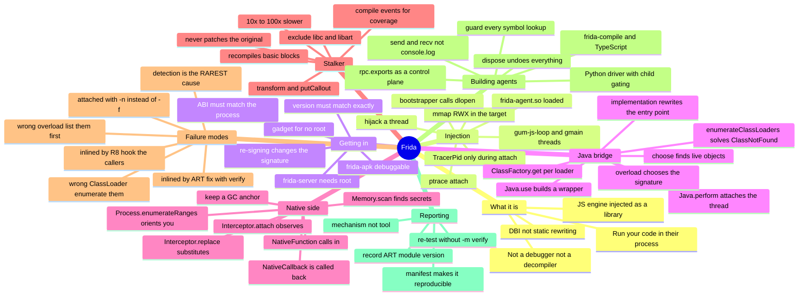

### Cheat sheet

The full printable version is [`cheatsheet.md`](cheatsheet.md). Condensed:

| Need | Command or call |
|---|---|
| Match versions | `frida --version` then fetch that exact `frida-server` |
| Start the server | `adb shell "su -c '/data/local/tmp/frida-server -D'"` |
| **Spawn** (correct) | `frida -U -f com.x -l a.js --no-pause` |
| Attach (misses startup) | `frida -U -n com.x -l a.js` |
| **Make hooks reliable** | `adb shell cmd package compile -m verify -f com.x` |
| Restore normal state | `adb shell cmd package compile --reset com.x` |
| List apps / processes | `frida-ps -Uai` / `frida-ps -Ua` |
| Discover by tracing | `frida-trace -U -f com.x -j "com.x.*!*"` |
| Hook a Java method | `Java.use(C).m.overload("java.lang.String").implementation = function(a){...}` |
| List overloads | `Java.use(C).m.overloads.forEach(o => console.log(o.argumentTypes.map(t=>t.className)))` |
| Find a class anywhere | `Java.enumerateClassLoaders` + `Java.ClassFactory.get(loader).use(name)` |
| Beat inlining at runtime | `Java.deoptimizeEverything()` |
| Live instances | `Java.choose(cls, {onMatch(i){...}, onComplete(){}})` |
| Java stack trace | `Java.use("android.util.Log").getStackTraceString(Java.use("java.lang.Exception").$new())` |
| Hook a native export | `Interceptor.attach(Module.findExportByName(lib, sym), {onEnter(a){}, onLeave(r){}})` |
| Replace a native function | `Interceptor.replace(addr, new NativeCallback(fn, "int", []))` |
| Call native code | `new NativeFunction(addr, "int", ["pointer","size_t"])` |
| Scan memory | `Memory.scan(base, size, "41 ?? 43", {onMatch(a,s){}, onComplete(){}})` |
| List ranges | `Process.enumerateRanges("rw-").filter(r => r.file === null)` |
| Backtrace | `Thread.backtrace(this.context, Backtracer.ACCURATE).map(DebugSymbol.fromAddress)` |
| Coverage trace | `Stalker.follow(tid, {events:{compile:true}, onReceive(e){...}})` then `unfollow` |
| Build a TS agent | `frida-compile agent/index.ts -o _agent.js -w` |
| No root | `frida-apk --debuggable app.apk`, or embed `libgadget.so` |
| Reload in the REPL | `%reload` |

### Quick revision

- State, in one sentence each, what `ptrace`, `mmap` and `dlopen` contribute to Frida's injection.
- Why is `TracerPid` non-zero only briefly, and what does an app detect after that window closes?
- Name the four reasons a Java hook does not fire, in order of frequency, and the fix for each.
- What is the single command that makes Java hooks reliable, and why is it better than
  `Java.deoptimizeEverything()`?
- Which field of which structure does every Java hooking framework on Android modify?
- Why can a `PathClassLoader` not see a class loaded by an `InMemoryDexClassLoader`?
- Give the `.overload()` type string for `byte[]`, for `String[]`, and for a constructor.
- What breaks if you call the original method through the class wrapper instead of `this`?
- Why must a `NativeCallback` be stored in a module-scope variable?
- When is Stalker the right tool, and what two settings make it affordable?
- What does `Backtracer.FUZZY` report that is not true, and why?
- What do you give up by using `frida-gadget` instead of `frida-server`?
- Which two facts about the device must go in your report for a finding to be reproducible?
- Why is "the app detected Frida" the last conclusion you reach rather than the first?

---

## 14. References

### Frida — official

- Frida documentation — https://frida.re/docs/home/
- JavaScript API reference (`Interceptor`, `Stalker`, `Memory`, `Process`, `Module`, `Java`) — https://frida.re/docs/javascript-api/
- The Java API specifically — https://frida.re/docs/javascript-api/#java
- Frida on Android — https://frida.re/docs/android/
- `frida-gadget` configuration — https://frida.re/docs/gadget/
- Frida releases (server, gadget, per-ABI binaries) — https://github.com/frida/frida/releases
- `frida-tools` (the CLI: `frida`, `frida-ps`, `frida-trace`, `frida-apk`) — https://github.com/frida/frida-tools
- `frida-compile` — https://github.com/frida/frida-compile
- TypeScript type definitions for Gum — https://github.com/DefinitelyTyped/DefinitelyTyped/tree/master/types/frida-gum

### Frida — source worth reading

| Repository | Why you would open it |
|---|---|
| `frida/frida-core` | The injector: `linjector`, spawn/attach, the agent bootstrap, the wire protocol |
| `frida/frida-gum` | `Interceptor`, `Stalker`, the code writers (`Arm64Writer` and friends), the backtracers |
| `frida/frida-java-bridge` | The entire Java side, including the `ArtMethod` manipulation. Read `lib/android.js` |
| `frida/frida-python` | The host-side bindings the CLI tools use |
| `frida/frida-node` | The same, for JavaScript hosts |

### AOSP — what Frida reaches into

- `art/runtime/art_method.h` — the `ArtMethod` definition and the entry-point fields
- `art/runtime/art_method.cc` — `SetEntryPointFromQuickCompiledCode`, `Invoke`
- `art/runtime/modifiers.h` — `kAccNative`, `kAccCompileDontBother` and the rest
- `art/runtime/jni/jni_internal.cc` — every `JNIEnv` function, including `RegisterNatives`
- `art/runtime/java_vm_ext.cc` — `JNI_GetCreatedJavaVMs`, thread attach/detach
- `art/runtime/instrumentation.cc` — the deoptimisation machinery `Java.deoptimizeEverything()` drives
- `art/runtime/class_linker.cc` — class definition, and why a class may not be visible yet
- `libcore/dalvik/src/main/java/dalvik/system/BaseDexClassLoader.java` — the loader hierarchy you enumerate
- `libcore/dalvik/src/main/java/dalvik/system/InMemoryDexClassLoader.java` — the packer's tool
- `bionic/linker/linker.cpp`, `bionic/linker/linker_namespaces.cpp` — why an arbitrary `dlopen` fails
- `bionic/libc/bionic/android_dlopen_ext.cpp` — the call the bootstrapper makes
- `frameworks/base/core/java/android/app/ActivityThread.java` — `handleBindApplication`, the earliest app-side code
- `frameworks/base/core/java/com/android/internal/os/ZygoteInit.java` — the process spawn instruments
- Browse all of it on Android Code Search — https://cs.android.com/

### Official Android documentation

- ART and Dalvik — https://source.android.com/docs/core/runtime
- Configuring ART, including compiler filters — https://source.android.com/docs/core/runtime/configure
- JNI tips — https://developer.android.com/training/articles/perf-jni
- Network security configuration — https://developer.android.com/privacy-and-security/security-config
- Debugging with `adb` — https://developer.android.com/tools/adb
- Play Integrity API — https://developer.android.com/google/play/integrity

### OWASP MASVS / MASTG

- MASVS-RESILIENCE — anti-tampering, anti-hooking, obfuscation requirements — https://mas.owasp.org/MASVS/
- MASVS-NETWORK — TLS and certificate pinning requirements — https://mas.owasp.org/MASVS/
- MASTG — dynamic analysis and tampering techniques, including Frida-based tests — https://mas.owasp.org/MASTG/
- MASTG Android reverse engineering chapter — https://mas.owasp.org/MASTG/0x05b-Android-Security-Testing/

### Community tooling built on Frida

| Project | What it gives you |
|---|---|
| `sensepost/objection` | A ready-made agent plus REPL: pinning bypass, keystore dump, filesystem browsing. See [54-Objection](../54-Objection/README.md) |
| `frida/frida-trace` handlers | Editable, hot-reloading handler files generated per function |
| `iddoeldor/frida-snippets` | A large catalogue of short, task-specific snippets |
| `Ch0pin/medusa` | A modular Frida framework organised by capability |
| Codeshare (`frida --codeshare <user>/<script>`) | Community scripts; read them before running them, since they execute in your target |

> **Warning**
> `frida --codeshare` downloads and executes someone else's JavaScript inside the process you are
> testing, on a device you probably have root on. Read the script first. This is the same trust
> decision as `curl | sh`, and it deserves the same suspicion.

### Related chapters

- [09-Android-App-Internals](../09-Android-App-Internals/README.md) — the process lifecycle `-f` intercepts
- [11-Android-Runtime](../11-Android-Runtime/README.md) — the runtime concepts this chapter manipulates
- [13-ART](../13-ART/README.md) — `ArtMethod`, entry points, compiler filters, inlining. **Read §3.15–§3.17 before this chapter's §7.4**
- [15-Native-Code](../15-Native-Code/README.md) — ELF, symbols, the dynamic linker
- [16-JNI](../16-JNI/README.md) — the calling convention every native hook sees
- [17-Libraries](../17-Libraries/README.md) — `dlopen`, linker namespaces, module enumeration
- [18-ARM](../18-ARM/README.md) — the instruction set Stalker recompiles
- [19-Memory](../19-Memory/README.md) — page protections, `/proc/<pid>/maps`, and what `Memory.scan` searches
- [36-CertificatePinning](../36-CertificatePinning/README.md) — every layer the pinning bypass must address
- [37-RootDetection](../37-RootDetection/README.md) — the checks `root-detection-bypass.js` neutralises
- [38-TamperDetection](../38-TamperDetection/README.md) — why re-signing for gadget mode has a cost
- [40-Obfuscation](../40-Obfuscation/README.md) — packers, `InMemoryDexClassLoader`, and DEX dumping
- [42-R8](../42-R8/README.md) — build-time inlining, the failure mode no runtime trick fixes
- [51-DynamicAnalysis](../51-DynamicAnalysis/README.md) — the wider discipline this chapter serves
- [54-Objection](../54-Objection/README.md) — Frida packaged as a ready-made agent
- [56-JADX](../56-JADX/README.md) — where you find the class names you hook
- [57-Ghidra](../57-Ghidra/README.md) — where you take the offsets Stalker gives you
- [62-Magisk](../62-Magisk/README.md) — root, and running `frida-server` persistently
- [63-LSPosed](../63-LSPosed/README.md) — the same hooking mechanism, applied from Zygote
- [65-Hooking](../65-Hooking/README.md) — hooking from first principles across every layer
- [67-BypassingProtections](../67-BypassingProtections/README.md) — the adversarial back-and-forth in full


