# 53 — Frida · Mind Map

One picture of the whole chapter. Read it outward from the centre.

Frida is not a hooking framework that happens to run on Android. It is a mechanism for **executing
your code inside another process**, and everything else in this chapter — the Java bridge,
`Interceptor`, `Stalker`, every pinning bypass you have copied — is a consequence of that single
capability. The branches below correspond to the sections of
[the chapter README](README.md). Use this as a revision map before an engagement or an interview: if
you can expand any leaf into a paragraph of mechanism, you know the chapter.

```mermaid
mindmap
  root((Frida))
    1 Why it exists
      Static analysis says what code COULD do
      Instrumentation says what it DID
      Real keys real device state real server
      No repackaging so signature is unchanged
      Every self-hash check still passes
      Costs
        you are inside the process a crash is their crash
        you are observable maps threads TracerPid
        you perturb timing
        root or repackaging pick one
    2 Architecture
      Host workstation
        frida CLI and frida-tools
        frida python module
        frida-compile TypeScript agents
      Device
        frida-server as root
        or frida-gadget inside the APK
      Target process
        frida-agent.so
        QuickJS or V8
        gum-js-loop and gmain threads
        message channel back to host
    3 Injection mechanism
      ptrace attach to the target
      save the victim thread registers
      rewrite registers to call mmap
      RWX page in the TARGET address space
      write a bootstrapper into it
      point PC at it and resume
      bootstrapper calls android_dlopen_ext
      frida-agent.so is loaded
      restore registers and detach ptrace
      TracerPid is non-zero only during this window
    4 Spawn versus attach
      -f spawns held before ANY app code
      -n attaches after startup already ran
      attachBaseContext is where packers decrypt
      onCreate is where pinning is configured
      static initialisers run before both
      child gating for -remote processes
      ALWAYS -f
    5 Java bridge
      Java.perform attaches the thread to the VM
      Java.use builds a class wrapper
      implementation rewrites the ArtMethod entry point
        same field ART itself rewrites
        see 13-ART section 3.17
      this.method calls the saved original
      overload chooses the exact signature
      fields via .value
      Java.choose walks the heap for instances
      Java.registerClass builds a new class
      Java.cast reinterprets a handle
      Java.deoptimizeEverything defeats inlining
    6 Native side
      Interceptor.attach observes onEnter onLeave
      Interceptor.replace substitutes entirely
      NativeFunction calls their code as an oracle
      NativeCallback gives them your function
        MUST keep a module-scope reference
      Module and Process enumerate the address space
      Memory alloc protect scan patchCode
      hexdump for eyes on bytes
      DebugSymbol turns an address into a name
    7 Stalker
      dynamic recompiler of basic blocks
      instruments a COPY never patches the original
      survives self-integrity checks
      events call ret exec block compile
      transform with putCallout and keep
      compile events give coverage for diffing
      exclude libc and libart first
      10x to 100x slower on the followed thread
      always unfollow and garbageCollect
    8 The four failure modes
      1 ART inlining
        hook installs never fires
        cmd package compile -m verify -f
        method IS present in JADX
      1b R8 inlining
        method ABSENT from JADX
        no runtime fix hook the callers
      2 wrong ClassLoader
        ClassNotFoundException
        loaders delegate UPWARD
        parent cannot see child classes
        DexClassLoader and InMemoryDexClassLoader
        Java.enumerateClassLoaders
        Java.ClassFactory.get per loader
        hook ClassLoader.loadClass to wait
      3 wrong overload
        list .overloads BEFORE hooking
        ["byte array is B not byte[]"]
        interface versus concrete implementation
        this not the class wrapper or stack overflow
      4 attached instead of spawned
        -n misses attachBaseContext
        the fix is one character
      LAST detection process DIES not silent
    9 Building agents
      rpc.exports as a control plane
      init runs before load returns
      dispose undoes everything
      send for JSON recv is ONE-SHOT
      binary travels out of band
      frida-compile bundles TypeScript
      source maps give .ts line numbers
      guarded symbol lookup for Frida 16 and 17
      never hard-code ART offsets
      Python driver spawn attach resume
      resume AFTER script.load
    10 No root
      frida-gadget embedded in the APK
      on_load wait gives the -f position
      script mode runs unattended
      frida-apk --debuggable
      Magisk module for persistence
      ALL non-server paths re-sign the APK
      re-signing breaks integrity and attestation
    11 Finding things
      framework boundary technique
        app renames its classes not javax.crypto.Cipher
      frida-trace -j to discover
      Java stack trace names the app class
      Backtracer ACCURATE is a witness
      Backtracer FUZZY is a wastebasket search
      Memory.scan anonymous rw- ranges
      entropy scan for raw key material
      diff snapshots to attribute a secret
    12 Detection and its limits
      TracerPid in proc self status
      port 27042 and thread names
      libraries in proc self maps
      prologue byte verification
      every check runs where the attacker executes
      buys hours not security
      only server-side and TEE survive
    13 Reporting
      re-test with compile --reset
      state the MECHANISM not the tool
      record ART Mainline version and filter
      manifest makes it reproducible
```

---

## The one-sentence version of each branch

| Branch | The sentence |
|---|---|
| Why it exists | Reading code tells you what it could do; watching it tells you what it did, with the real keys. |
| Architecture | A JavaScript engine, injected as a shared library, running at the target's privilege level. |
| Injection | `ptrace` to hijack a thread, `mmap` to get executable memory, `dlopen` to load the agent, then detach. |
| Spawn vs attach | `-f` holds the process before any app code; `-n` arrives after startup already happened. |
| Java bridge | One pointer write to `ArtMethod::entry_point_from_quick_compiled_code_`. |
| Native side | `attach` to observe, `replace` to substitute, `NativeFunction` to call in, `NativeCallback` to be called back. |
| Stalker | Instrument a relocated copy of the code, so nothing about the original changes. |
| Four failure modes | Inlining, wrong loader, wrong overload, attached too late — in that order of frequency. |
| Building agents | `rpc.exports` is a control plane; guarded lookups and derived offsets are what make a script portable. |
| No root | You trade the root requirement for a signature change; there is no option that avoids both. |
| Finding things | Hook the platform boundary, then read the stack trace to find the app's own class. |
| Detection | Every check executes where the attacker has code execution, so each one buys time, not security. |
| Reporting | The finding is the mechanism, not the tool that demonstrated it. |
