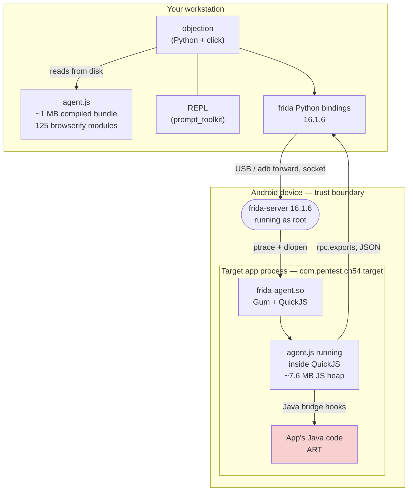
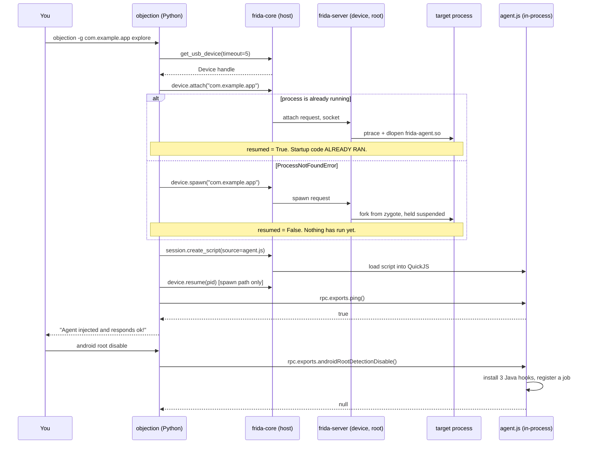
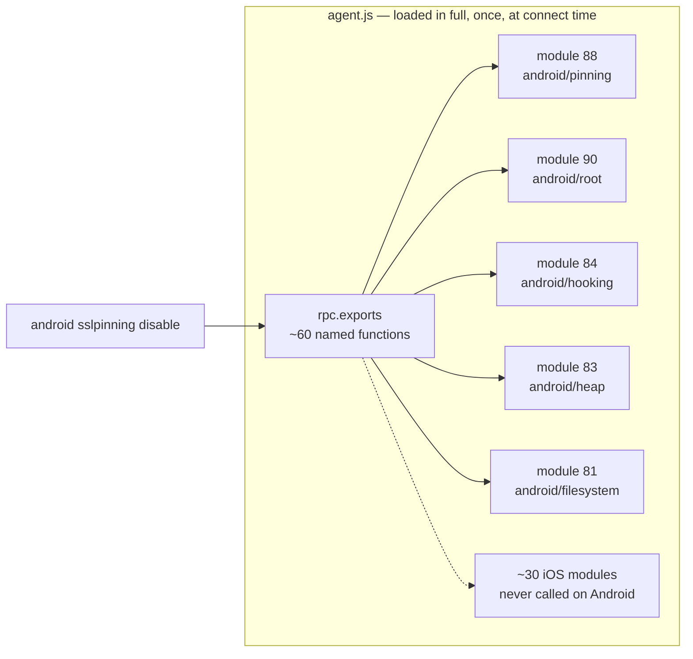
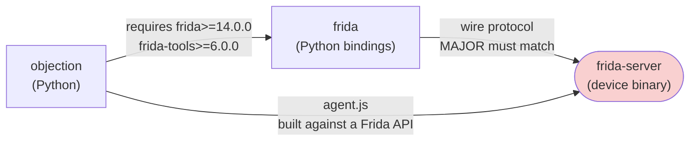
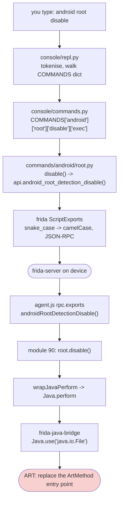
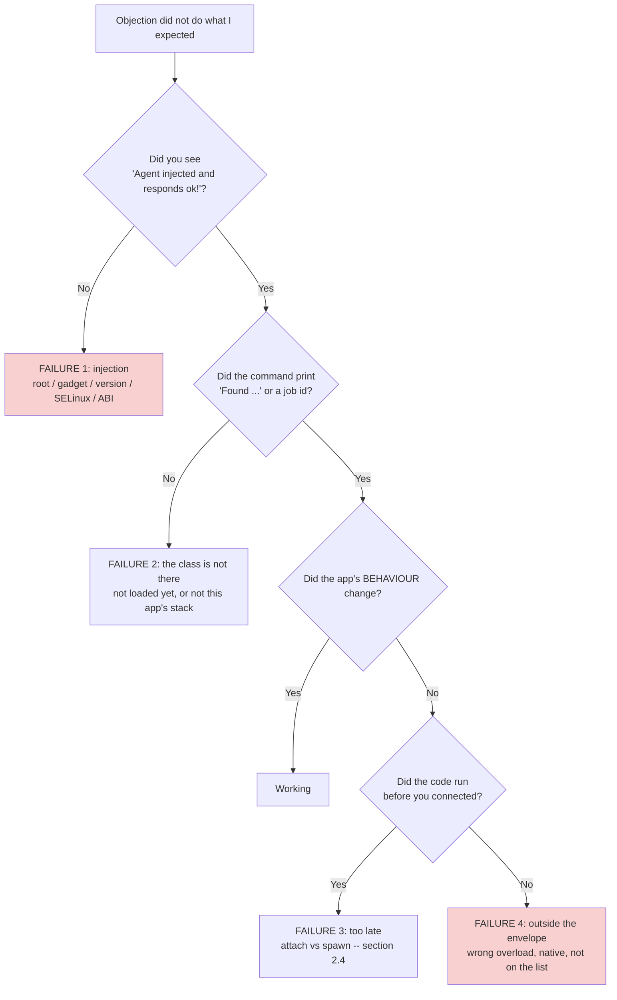
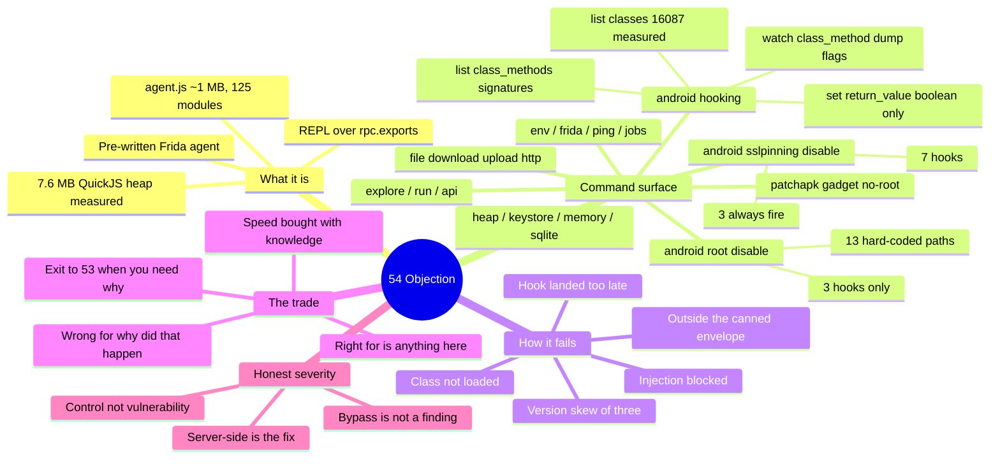

# 54 — Objection

> After this chapter you will be able to drive Objection's entire Android command surface, name the exact Frida hooks each canned command installs, diagnose the four ways it fails, and recognise the precise moment when continuing to use it costs you more than writing your own script would.

**Prerequisites:** [51-DynamicAnalysis](../51-DynamicAnalysis/README.md) (the method), [53-Frida](../53-Frida/README.md) (the runtime this wraps — including [its opening callout](../53-Frida/README.md) on images where `frida-server` will not link, because objection inherits that failure exactly), and — **out of numeric order, so read it first** — [60-ADB](../60-ADB/README.md) (getting to the device). 60 is a genuine forward dependency and depends on nothing after it, so reading 60 first costs you nothing.
**Applies to:** objection **1.11.0** (the version measured throughout), Frida 16.x host and server, Android 5+ (API 21+). Behaviour differences across objection versions are called out where they bite.

---

## Table of Contents

1. [Introduction](#1-introduction)
2. [High-Level Architecture](#2-high-level-architecture)
3. [Deep Internal Working](#3-deep-internal-working)
4. [Source Code Walkthrough (AOSP)](#4-source-code-walkthrough-aosp)
5. [Security Perspective](#5-security-perspective)
6. [Reverse Engineering Perspective](#6-reverse-engineering-perspective)
7. [Dynamic Analysis](#7-dynamic-analysis)
8. [Static Analysis](#8-static-analysis)
9. [Examples](#9-examples)
10. [Common Interview Questions](#10-common-interview-questions)
11. [Common Mistakes](#11-common-mistakes)
12. [Hands-on Labs](#12-hands-on-labs)
13. [Summary](#13-summary)
14. [References](#14-references)

---

## 1. Introduction

### 1.1 The problem that existed before Objection

Imagine you are a locksmith. Every house you are called to has a different lock, but after
your first hundred jobs you notice something: about twelve situations come up over and over.
The letterbox is the easiest way in. The bathroom window is never locked. The back door's
strike plate is always the weak point. You could, in principle, work each house out from
first principles every time. But you would be re-deriving the same twelve insights on every
call-out, and you would be slower than the locksmith who carries twelve pre-made tools in a
roll and reaches for the right one in ten seconds.

That is exactly the situation a mobile tester is in after their first dozen Android
engagements. Chapter [53-Frida](../53-Frida/README.md) teaches you the machinery to reach
inside a running application and change any decision it makes. It is completely general — you
can express anything with it. But generality has a cost, and the cost is that you write the
same script again and again:

- List every class the app has loaded, so you can find the one with `Security` in its name.
- List the methods on that class, with their exact overload signatures, so you can hook one.
- Print the arguments and the return value of a method every time it is called.
- Force one boolean method to return `true`.
- Neutralise the handful of root checks that nearly every app copies from the same Stack
  Overflow answer.
- Neutralise the handful of TLS-pinning implementations that nearly every app copies from
  the same OkHttp documentation page.
- Download a file out of the app's private directory.
- Find live instances of a class on the heap and read their fields.

None of these is hard. All of them are *the same every time*. Writing them out by hand on
each engagement is not craftsmanship; it is retyping.

> **Definition — Objection**
> Objection is a Python command-line program that injects one large, pre-written Frida agent
> into a target process and then gives you an interactive prompt (a REPL — a Read-Eval-Print
> Loop, a prompt that reads a line you type, does what it says, prints the result, and asks
> again) whose commands call functions inside that agent. It ships those twelve scripts,
> already written, behind short commands. It is a product of SensePost and its source is at
> `sensepost/objection`.

### 1.2 What would break if Objection did not exist

Nothing, technically. Every single thing Objection does can be done with a Frida script, and
this repository ships those scripts — [`53-Frida/scripts/`](../53-Frida/scripts/) contains
larger and better versions of Objection's pinning bypass, root bypass, class enumerator and
method tracer. Objection is not a capability. It is an **ergonomics layer**.

What would break is the first ten minutes of every engagement. Reconnaissance — finding out
what an app *is* before deciding what to do to it — is the phase where you least want to be
writing code, because you do not yet know what code to write. That is Objection's genuine
contribution, and it is a real one.

### 1.3 The trade this chapter is about

Here is the sentence this chapter exists to justify, taken from
[20-Security-Architecture §7.3](../20-Security-Architecture/README.md):

> `android root disable` applies a set of stock root-detection bypasses. Use it to *save
> time*, never to *understand* — if it works you still do not know what the app checked,
> which means you cannot write a useful finding.

Read that again, because it is the whole chapter compressed into two clauses. Objection
trades **knowledge for speed**. That is not a criticism; it is a description. Every tool that
provides a default is making that trade on your behalf, and most of the time the trade is
correct — you do not want to understand your compiler's register allocator to
compile a program.

The trade goes wrong in exactly one situation, and it is a situation testers find themselves
in constantly: **when the thing you are being paid to produce is the knowledge.** A finding
that says "root detection can be bypassed with Objection" is worth nothing to the developer
who has to fix it. A finding that says "your root check is a single `File.exists()` call on
thirteen hard-coded paths in `SecurityUtil.isRooted()`, it runs entirely in Java, and here is
the four-line Frida script that defeats it" is worth something, because it tells them what to
change.

> **Mental Model**
> Objection is a multi-tool with the blades already open. It is the right thing to reach for
> when you do not yet know which blade you need, and the wrong thing to still be holding when
> you have found out. The moment your question changes from *"is there anything here?"* to
> *"why did that happen?"*, you are no longer using a multi-tool — you are using the wrong
> screwdriver because it was already in your hand.

### 1.4 The single most important fact about Objection

**Every Objection command is a pre-written Frida script.** Not "like" a script, not "similar
to" — it *is* one. There is a file on your disk called `agent.js`, it is about one megabyte
of compiled JavaScript, and every command you type in the Objection REPL calls a function
inside it.

This is not trivia. It is the fact from which every one of Objection's failure modes follows
deductively:

| Because Objection is… | …it fails when… |
|---|---|
| a Frida agent | Frida cannot inject at all — no root, no gadget, wrong version, SELinux |
| a *pre-written* agent | the app's implementation is not one the author anticipated |
| a *fixed list* of hooks | the check you care about is not on the list |
| loaded when you connect | the code you wanted to hook already ran |
| built against a Frida API | that API changed between Frida major versions |

Every complaint anyone has ever had about Objection is in that table. If you internalise
§1.4 you can diagnose an Objection failure without reading anything else in this chapter.

### 1.5 What this chapter is not

This chapter is scoped narrowly and deliberately, because four other chapters own the
subjects Objection touches:

| Subject | Owner | What 54 does with it |
|---|---|---|
| Frida — the runtime, injection, the API, writing agents | [53-Frida](../53-Frida/README.md) | cites. This chapter re-teaches none of it |
| Certificate pinning and its layered bypass | [36-CertificatePinning](../36-CertificatePinning/README.md) | documents what Objection's canned pinning script hooks; the *subject* stays in 36 |
| Root detection and its taxonomy | [37-RootDetection](../37-RootDetection/README.md) | maps Objection's three hooks onto 37's taxonomy; the *subject* stays in 37 |
| The general bypass method | [67-BypassingProtections](../67-BypassingProtections/README.md) | cites |
| The dynamic-analysis method | [51-DynamicAnalysis](../51-DynamicAnalysis/README.md) | Objection is one instrument at one stage of 51's pipeline |

If you are here to learn how Frida injects a `.so` into a process, you are in the wrong
chapter, and [53 §3.2](../53-Frida/README.md) is the right one.

### 1.6 What was measured, and on what

Everything in this chapter that is presented as a result was produced by running the tool.
The measurements were taken against an application **built for this chapter** —
[`examples/target-app/`](examples/target-app/) — never against a third-party application.

| Item | Value |
|---|---|
| objection | **1.11.0** (a newer 1.12.5 exists; the version banner says so on every run) |
| frida (host Python package) | **16.1.6** |
| frida-tools | **12.3.0** |
| frida-server (device) | **16.1.6** — exact match with the host |
| Device | Redmi **`M2101K6P`** (`sweetin`), MIUI 12.5, **Android 11 / API 30**, arm64-v8a, rooted (Magisk), SELinux Enforcing |
| Target | `com.pentest.ch54.target`, built by [`examples/build.sh`](examples/build.sh), installed via the root path after `INSTALL_FAILED_USER_RESTRICTED` |

> **Warning — how these sessions were driven, and why it matters to you**
> On this Windows host, `objection ... explore` **cannot run without a real terminal**. The
> REPL is constructed *before* any command executes, and `prompt_toolkit` aborts when standard
> input is not a console. Every session below was therefore driven through Objection's own
> **headless API mode** (`objection ... api`, then HTTP calls to `/rpc/invoke/<method>`),
> which loads the *same* `agent.js` and calls the *same* RPC exports the REPL calls. The agent
> output quoted in this chapter is verbatim; the *framing* is API mode rather than REPL mode.
> Where a listing shows a REPL prompt, it is a transcription of the equivalent command and is
> labelled as such. Nothing in this chapter is invented output. See [§7.6](#76-what-was-and-was-not-run)
> for the complete list of what did and did not run.

---

## 2. High-Level Architecture

### 2.1 The whole system in one picture



Read that diagram from the left. Your workstation runs **no instrumentation logic at all**.
It runs a Python program whose job is to (a) find a device, (b) read one JavaScript file off
your disk, (c) hand it to Frida to be loaded into the target, and (d) offer you a prompt whose
commands are remote function calls into that JavaScript. The pink box is the app's own code,
which is the only untrusted thing in the picture.

Two details in that diagram are worth pausing on because they are measured facts, not
sketches:

- **`agent.js` is one file, about one megabyte.** On the reference install it is exactly
  **1,045,437 bytes** and contains **125** browserify-numbered modules. It is not assembled
  per command. The whole thing is loaded, once, when you connect — including every iOS
  command you will never use on an Android target.
- **The agent occupies about 7.6 MB of JavaScript heap inside the target process.** Measured:
  Objection's own `env` command reports `heap: 7644640` on the reference device. That is
  memory the app did not allocate, in a runtime the app does not know exists.

> **Under the Hood**
> The `runtime` field of that same measurement reads `QJS` — **QuickJS**, not V8. Frida
> defaults to QuickJS on Android because it is far smaller and starts faster. It is also
> slower for heavy loops, which is why a `memory search` over a large process in Objection is
> not fast. This is a Frida-level property, explained in [53 §3.3](../53-Frida/README.md);
> it is repeated here only because it is the reason for a performance characteristic you will
> notice while using Objection.

### 2.2 What happens when you type the command



The sequence above is not a guess; it is `objection/utils/agent.py` transcribed. The
`alt`/`else` block is the single most consequential thing in the diagram, and §2.4 is about
nothing else.

The success line — `Agent injected and responds ok!` — is printed only after a round trip:
Objection calls `ping()` on the agent and requires a truthy answer. If you see that line, the
whole chain from your keyboard to the app's process is verified working. If you never see it,
nothing you type afterwards can possibly work, and you should stop and fix the connection
rather than trying commands.

### 2.3 One agent, not one script per command

This is where Objection differs most sharply from how people imagine it works. Testers often
assume that typing `android sslpinning disable` causes Objection to load a pinning-bypass
script. It does not. The pinning bypass was already in the process the moment you connected;
the command merely *calls a function that was already there.*



The practical consequences are worth stating plainly because each one surprises somebody:

1. **Connecting is expensive; commands are cheap.** The one-megabyte parse happens at
   connect. Individual commands are a JSON round trip.
2. **You cannot load "just the pinning part".** There is no such option. The iOS keychain
   code is inside your Android target's process whether you like it or not.
3. **Your footprint is fixed and large.** Anything measuring how much of the process changed
   — an integrity check, an anti-tamper routine, a memory-scanning defence — sees the whole
   agent, not the one command you ran. This is why
   [53's references](../53-Frida/references/README.md)Objection "changes more of
   the process than a targeted script".
4. **A bug anywhere in the bundle can break your session**, including in code paths for a
   platform you are not testing.

### 2.4 Attach or spawn — Objection decides, and does not tell you

Read this fragment of `objection/utils/agent.py` carefully. It is fourteen lines and it
governs whether half your commands will work:

```python
# objection/utils/agent.py -- get_session(), abridged but not altered in substance
try:
    self.session = self.device.attach(state_connection.gadget_name)
    self.resumed = True            # nothing to resume: we joined a live process
    return self.session
except frida.ProcessNotFoundError:
    pass                           # fall through to spawn

self.spawned_pid = self.device.spawn(state_connection.gadget_name)
self.session = self.device.attach(self.spawned_pid)
# resumed stays False; the process is resumed AFTER the script is loaded
```

In English: **Objection attaches to the app if it is already running, and spawns it if it is
not.** There is no flag to force one or the other. The behaviour flips depending on whether
you happened to have the app open.

That is a genuinely dangerous default, and it is dangerous in a quiet way. Consider two
sessions, five minutes apart, with the identical command typed in both:

| | App was open | App was closed |
|---|---|---|
| Objection's action | `attach` | `spawn`, load agent, then `resume` |
| `Application.attachBaseContext` | already ran | runs **after** your hooks are installed |
| `Application.onCreate` | already ran | runs **after** your hooks are installed |
| Static initialisers of loaded classes | already ran | not yet run |
| A root check in `onCreate` | **invisible to you** | catchable |
| Your conclusion | "Objection didn't work" | "Objection worked" |

Both sessions ran the same command against the same app on the same device and produced
opposite results. Nothing in Objection's output distinguishes the two cases.

> **Pentester's Note**
> Before every Objection session that involves hooks — as opposed to pure filesystem
> browsing — run `adb shell am force-stop <package>` first. It costs one second and it
> converts an ambiguous default into a known one: Objection will spawn, and your hooks will
> be in place before a line of the app's own code runs. Every measured session in this
> chapter was preceded by a `force-stop` for exactly this reason. [53 §2.3](../53-Frida/README.md)
> makes the same argument for Frida's `-f`, and states the rule as "Default to `-f`. Always."
> Objection has no `-f`; `force-stop` is how you get the equivalent.

The one situation where attaching is what you want is when you have driven the app by hand
into an interesting state — logged in, a particular screen open — and you want to inspect
live objects with `android heap search instances`. Then the fact that startup already
happened is a feature, not a defect.

---

## 3. Deep Internal Working

This section answers, for each part of Objection: **what** it is, **why** it exists, **when**
it runs, **where** its code lives, and **how** it works. The centrepieces are §3.5 and §3.6,
where the two most-used commands are taken apart hook by hook.

### 3.1 Where everything lives on your disk

You cannot reason about a canned script you have never seen. Find yours:

```bash
# host -- locate the installed package
python -c "import objection, os; print(os.path.dirname(objection.__file__))"
# C:\Users\...\site-packages\objection      (Windows)
# /usr/lib/python3/dist-packages/objection  (Linux, distro package)
# ~/.local/lib/python3.11/site-packages/objection
```

The layout you will find, with the parts that matter:

| Path | What it is |
|---|---|
| `agent.js` | **The whole product.** One compiled bundle, ~1 MB, 125 modules |
| `console/cli.py` | The `click` command group: `explore`, `run`, `api`, `patchapk`, `patchipa`, `signapk`, `version`, `device-type` |
| `console/commands.py` | The **command tree** — a nested Python dict mapping typed words to functions |
| `console/repl.py` | The prompt, completion, and history (`~/.objection/objection_history`) |
| `utils/agent.py` | Injection lifecycle: device → session → script → `ping()` → cleanup |
| `commands/android/*.py` | Thin Python wrappers; each one mostly formats a table around one RPC call |
| `commands/mobile_packages.py`, `utils/patchers/android.py` | `patchapk` — the gadget-embedding path |
| `api/rpc.py` | The headless HTTP bridge, `POST|GET /rpc/invoke/<method>` |
| `state/*.py` | Connection, device, job and filesystem state singletons |

> **Pentester's Note**
> `commands/android/` is **small**. Measured on 1.11.0: `hooking.py` is 358 lines,
> `heap.py` 167, `keystore.py` 46, `pinning.py` **26**, `root.py` **25**. The Python side is
> nearly empty because it does nothing except call one function and tabulate the answer. All
> the intelligence is in `agent.js`. If you go looking for what `android root disable` does
> and you read `root.py`, you will find a twenty-five-line file that tells you nothing. That
> is the commonest wrong turn in trying to understand this tool.

Here is `commands/android/root.py` in its entirety, so you can see how little there is:

```python
# objection/commands/android/root.py -- the complete file, 1.11.0
from objection.state.connection import state_connection


def disable(args: list = None) -> None:
    """ Disable Android root detection. """
    api = state_connection.get_api()
    api.android_root_detection_disable()


def simulate(args: list = None) -> None:
    """ Simulate a rooted Android environment. """
    api = state_connection.get_api()
    api.android_root_detection_enable()
```

That is the whole thing. Note the naming mismatch, which matters if you ever drive the API
directly: the *command* is `root disable` / `root simulate`, but the *RPC export* is
`androidRootDetectionDisable` / `androidRootDetection**Enable**`. "Simulate a rooted device"
and "enable root detection" are the same function. Calling `/rpc/invoke/androidRootSimulate`
returns `Failed to call method: unable to find method 'androidRootSimulate'` — measured.

### 3.2 Reading the compiled agent

`agent.js` is a browserify bundle: a single file in which each module is wrapped as
`],<N>:[function(require,module,exports){ ... }]` with a numeric id. It is compiled from
TypeScript, and the compiler preserves comments and identifier names, so it is genuinely
readable — far more readable than most compiled JavaScript.

You can split it into its modules with a few lines of Python. This is the single highest-value
thing you can do to stop being surprised by this tool:

```python
#!/usr/bin/env python3
# Split objection's agent.js into its browserify modules.
# Full, documented version: scripts/split-agent.py
import re, os, sys, objection

src = os.path.join(os.path.dirname(objection.__file__), 'agent.js')
out = sys.argv[1] if len(sys.argv) > 1 else 'agent-modules'
os.makedirs(out, exist_ok=True)

s = open(src, encoding='utf-8', errors='replace').read()
marks = [(m.start(), int(m.group(1)))
         for m in re.finditer(r'\],(\d+):\[function\(require,module,exports\)\{', s)]
for i, (pos, num) in enumerate(marks):
    end = marks[i + 1][0] if i + 1 < len(marks) else len(s)
    open(os.path.join(out, f'mod{num}.js'), 'w', encoding='utf-8').write(s[pos:end])
print(f'{len(marks)} modules -> {out}/')
```

The Android modules on 1.11.0, with their measured sizes:

| Module | Source path | Bytes | What it holds |
|---|---|---|---|
| 81 | `android/filesystem` | 5,584 | `ls`, `cd`, `download`, `upload`, readable/writable probes |
| 82 | `android/general` | 444 | `deoptimize` |
| 83 | `android/heap` | 4,538 | live-instance search, field/method printing, handle execution |
| 84 | `android/hooking` | 14,921 | class/method enumeration, `watch`, `set return_value` |
| 85 | `android/intent` | 2,630 | `launch_activity`, `launch_service` |
| 86 | `android/keystore` | 5,507 | KeyStore list, clear, watch |
| 87 | `android/lib/libjava` | 1,459 | `wrapJavaPerform` — the helper every Android hook goes through |
| **88** | **`android/pinning`** | **14,556** | **the seven pinning hooks — §3.6** |
| 89 | `android/proxy` | 1,071 | `proxy set` |
| **90** | **`android/root`** | **4,750** | **the three root hooks — §3.5** |
| 92 | `android/userinterface` | 3,885 | `screenshot`, `FLAG_SECURE` |

The ratio is worth noticing: root detection — the thing testers reach for most — is the
**second-smallest** Android module in the bundle, at 4,750 bytes including comments. That is
about a hundred lines of logic. Set your expectations accordingly.

### 3.3 `wrapJavaPerform` — the one helper everything uses

Every Android hook in the agent is wrapped in module 87's `wrapJavaPerform`. It exists
because Frida's `Java.perform` is callback-based and Objection's command layer needs
promises. Knowing it exists explains a class of error message:

```javascript
// android/lib/libjava, in substance
export const wrapJavaPerform = (fn) => new Promise((resolve, reject) => {
    Java.perform(() => {
        try { resolve(fn()); } catch (e) { reject(e); }
    });
});
```

When a hook fails, the rejection propagates back through `rpc.exports` to Python, which
prints it. This is why an Objection error frequently arrives as a bare JavaScript exception
string with no context about which command produced it: the command layer discarded that
context two frames earlier.

### 3.4 The job manager — the one piece of genuine state

Objection's hooks are not fire-and-forget. Each command that installs a *persistent* hook
registers a **job**: an identifier, a type string, and the list of Frida hook handles it
created.

```
# objection REPL
jobs list
jobs kill <identifier>
```

Measured, over the API, after running the watch and set-return commands against the target
app:

```json
[
  {"identifier": "902292",
   "implementations": [null, null],
   "type": "watch-method for: com.pentest.ch54.target.MainActivity$AuthGate.checkPin"},
  {"identifier": "156258",
   "implementations": [null, null],
   "type": "set-return for: com.pentest.ch54.target.MainActivity$AuthGate.checkPin"}
]
```

Three things are visible in that output and all three are useful:

- **`implementations` has two entries for one command.** `checkPin` has two overloads —
  `(int)` and `(java.lang.String)` — and because no overload filter was supplied, Objection
  hooked *both*. This is the correct behaviour and it is also how you accidentally hook far
  more than you meant to.
- **The job type string carries the target.** `jobs list` is therefore a record of what you
  have done to the process, which is exactly what [51 §7.8](../51-DynamicAnalysis/README.md)'s
  runbook means by "Record every mutation".
- **Two jobs are simultaneously hooking the same method.** Objection will happily let you
  stack a `watch` and a `set return_value` on one method. They compose in the order they were
  installed, and nothing warns you.

For the root and pinning commands the same structure appears with three and seven
implementations respectively:

```json
[{"identifier": "370560", "implementations": [{}, {}, {}], "type": "root-detection-enable"}]
```

**Three** implementations. That number is the subject of the next section, and it is smaller
than almost anyone expects.

> **Warning**
> `jobs kill` unloads the hooks, but it cannot undo side effects. If a job wrote a file,
> changed a proxy setting, or cleared the KeyStore, killing it changes nothing about that.
> `android keystore clear` in particular is irreversible and there is no confirmation prompt.

### 3.5 `android root disable`, hook by hook

This is the command the repository has told you about in six other chapters. Here is what it
actually is.

`android root disable` installs **exactly three** Java hooks. Not "a set of common checks",
not "a comprehensive bypass" — three. Here is the complete list of paths and methods, taken
verbatim from module 90:

```javascript
// objection/agent.js, module 90 -- android/root, the complete path list
const commonPaths = [
    "/data/local/bin/su",
    "/data/local/su",
    "/data/local/xbin/su",
    "/dev/com.koushikdutta.superuser.daemon/",
    "/sbin/su",
    "/system/app/Superuser.apk",
    "/system/bin/failsafe/su",
    "/system/bin/su",
    "/system/etc/init.d/99SuperSUDaemon",
    "/system/sd/xbin/su",
    "/system/xbin/busybox",
    "/system/xbin/daemonsu",
    "/system/xbin/su",
];
```

Thirteen strings. And the three hooks that use them:

| # | Hooked method | Condition | Effect under `disable` |
|---|---|---|---|
| 1 | `java.lang.String.contains(String)` | argument is exactly `"test-keys"` | returns `false` |
| 2 | `java.lang.Runtime.exec(String)` | command `endsWith("su")` | throws `IOException("objection anti-root")` |
| 3 | `java.io.File.exists()` | absolute path is **exactly** one of the 13 strings above | returns `false` |

That is the entirety of `android root disable` in objection 1.11.0. Now map it onto the
taxonomy that [37-RootDetection §2.2](../37-RootDetection/README.md) defines:

| 37's detection family | Covered by `android root disable`? |
|---|---|
| Filesystem probes (`su`, busybox, Magisk paths) | **Partially** — only the 13 exact paths, only via `File.exists()` |
| Process execution (`which su`, `su -c id`) | **Partially** — only `Runtime.exec(String)`, only when the string ends in `su` |
| System properties (`ro.build.tags`, `ro.debuggable`) | **Partially** — only via `String.contains("test-keys")` |
| `PackageManager` queries for root-manager apps | **No** |
| procfs — `/proc/self/mounts`, `/proc/self/maps` | **No** |
| SELinux state | **No** |
| `Settings.Global` — `adb_enabled`, developer options | **No** |
| Filesystem writability tests | **No** |
| Magisk-specific artefacts, DenyList, Zygisk | **No** |
| Native `stat()` / `access()` | **No** — a Java hook cannot see a native syscall |
| RootBeer's native helper library | **No** |
| Play Integrity / hardware attestation | **No, and nothing client-side ever will be** |

Three partial coverages and nine misses. This is not a criticism of Objection — the tool
never claimed otherwise, and its command help says "**Attempt** to disable root detection".
It is a correction to the folklore, which treats the command as a full bypass.

#### 3.5.1 Four specific gaps you will hit this month

The table above is abstract. These four are concrete, and each one is a real app's real
check that this command does not touch:

**Gap 1 — any path not in the list of thirteen.** `/sbin/magisk`, `/data/adb/magisk`,
`/system/bin/magisk`, `/data/adb/modules`, `/sbin/.magisk`, `/system/xbin/which` — none of
them appear. The hook compares with `commonPaths.indexOf(filename) >= 0`, an **exact string
match**. A check for `/data/adb/magisk` falls straight through to the real `File.exists()`.

**Gap 2 — the other `exec` overload.** The hook is installed on
`Runtime.exec.overload("java.lang.String")`. `java.lang.Runtime` has six `exec` overloads.
`exec(String[])` — the array form, which is what you get when a developer writes
`exec(new String[]{"which", "su"})` — is untouched. A Frida hook is per-signature, exactly as
Java dispatch is per-signature; hooking one overload does nothing to the others. This is
[53 §7.4.3](../53-Frida/README.md)'s "wrong overload" failure mode showing up inside somebody
else's script instead of your own.

**Gap 3 — `ProcessBuilder`.** `new ProcessBuilder("which", "su").start()` does not go through
`Runtime.exec` at all. Not hooked.

**Gap 4 — anything native.** [37 §2.3](../37-RootDetection/README.md) puts it best: "The
single most common wasted afternoon in this area is hooking `java.io.File.exists` for forty
minutes on an app whose check is a native `access("/system/bin/su", F_OK)` that never touches
the Java layer at all." `android root disable` *is* that forty minutes, packaged.

#### 3.5.2 Measured: how many of five checks the canned script could influence

Abstract coverage tables are easy to write and easy to disbelieve. So this chapter ships a
measuring instrument — [`examples/target-app/`](examples/target-app/) — containing five root
checks chosen so that three sit inside Objection's envelope and two sit outside it.

Baseline, on the rooted reference device, with no instrumentation:

```
# host -- adb logcat -s CH54, after: adb shell am start -n com.pentest.ch54.target/.MainActivity
I CH54: A su-known-path        rooted=false
I CH54: B magisk-unknown-path  rooted=false
I CH54: C exec-string threw: Cannot run program "/system/bin/su": error=2, No such file or directory
I CH54: C exec-su-String       rooted=false
I CH54: D which-su-String[]    rooted=false
I CH54: E build-tags           rooted=false (TAGS=release-keys)
I CH54: VERDICT score=0/5 rooted=false
```

**Zero of five, on a device that is definitely rooted** — `adb shell "su -c id"` returns
`uid=0(root)` on this phone. Magisk's DenyList has hidden every artefact from the app's view.
That is a finding in its own right and it belongs to [37 §3.14](../37-RootDetection/README.md),
but it has an immediate consequence for this chapter:

> **Warning — the no-op that looks exactly like a success**
> On this device, running `android root disable` changes the verdict from 0/5 to 0/5. The
> command prints a job identifier and reports success. **You cannot tell "the bypass worked"
> from "there was nothing to bypass".** Objection gives you no way to distinguish them, and
> this is the purest possible illustration of what "speed at the cost of knowledge" costs.
> A tester who ran only that command would report a defeated root check that never fired.

To measure the envelope, the experiment must be run in the other direction — with
`android root simulate`, which is the same three hooks configured to answer *true* instead of
*false*. Now every check that Objection can influence flips, and every check it cannot stays
put:

```
# host -- with objection's root-detection-enable job active, gate re-run via GateActivity
I CH54: GateActivity re-running the gate
I CH54: A su-known-path        rooted=true      <-- FLIPPED. /system/xbin/su is in commonPaths
I CH54: B magisk-unknown-path  rooted=false     <-- NOT COVERED. /sbin/magisk is not in the list
I CH54: C exec-string threw: Attempt to invoke virtual method
        'void java.lang.Process.destroy()' on a null object reference
I CH54: C exec-su-String       rooted=false     <-- HOOKED, BUT DID NOT FLIP. See below
I CH54: D which-su-String[]    rooted=false     <-- NOT COVERED. exec(String[]) is not hooked
I CH54: E build-tags           rooted=false     <-- HOOKED, BUT DID NOT FLIP. See below
I CH54: VERDICT score=1/5 rooted=true
```

and the agent's own commentary, verbatim from the same session:

```
(agent) Registering job 370560. Type: root-detection-enable
(agent) [370560] File existence check for /system/xbin/su detected, marking as true.
(agent) [370560] Check for 'su' using command exec detected, allowing.
```

**One of five.** Read the three unexpected results, because each teaches something different:

**Check B and Check D behaved exactly as the source predicted.** `/sbin/magisk` is not one of
the thirteen strings, and `exec(String[])` is not the hooked overload. Two misses, both
predictable from reading a hundred lines of JavaScript, and both invisible to anyone who did
not read it.

**Check C is a bug in Objection itself**, and it is worth showing:

```javascript
// objection/agent.js, module 90 -- android/root, execSuCheck()
JavaRuntime.exec.overload("java.lang.String").implementation = function (command) {
    if (command.endsWith("su")) {
        if (success) {
            send(`Check for 'su' using command exec detected, allowing.`);
            return this.apply(this, arguments);          // <-- here
        }
        ...
```

`this` is a Frida Java **instance wrapper**, not a function; calling `.apply()` on it does not
re-enter the original method. The agent logs "allowing", returns something that is not a
`Process`, and the app crashes on the next line with a `NullPointerException` on
`Process.destroy()`. The hook fired, announced success, and produced a *different* failure
than the one it replaced. Note what the app's log shows: the exception message changed from
`Cannot run program "/system/bin/su"` to `... on a null object reference`. If you were
grepping logcat for "No such file", your detector just went quiet for the wrong reason.

**Check E is the most instructive of the three.** `String.contains` **is** hooked, the
argument **is** exactly `"test-keys"`, and the agent's own log line for that hook — *"Marking
'test-keys' check as successful"* — **never appeared**. The hook installed and had no effect.
This is the phenomenon [53](../53-Frida/README.md) records as "A perfectly-installed hook can
change nothing".

And in this case the cause was pinned down, because the *same hook on the same method fired
perfectly* in a later experiment. [`scripts/root-disable-equivalent.js`](scripts/root-disable-equivalent.js)
installs an identical `String.contains` hook and reported
`"test-keys" tested against "release-keys" -> FORCED false` — see [§9.3](#93-advanced--the-same-task-twice-and-the-difference-between-the-answers).
The difference between the two runs is **ordering**, not the hook:

| | Objection session (§3.5.2) | `frida -U -f` session (§9.3) |
|---|---|---|
| Process state when the hook was installed | already running; `checkE_buildTags` had run once | spawned and suspended; no app code had run |
| `String.contains` hook fired? | **No** | **Yes** |

`java.lang.String.contains` is a core-library method that ART may intrinsify and inline into
its caller once that caller has been compiled. Install the hook before the caller first
executes and it is reached; install it afterwards and it may not be. That is the same
attach-versus-spawn hazard as §2.4, showing up not as "the check already happened" but as "the
hook is now unreachable" — and it is why `adb shell am force-stop` before connecting is the
single cheapest reliability improvement available to an Objection user.

> **Pentester's Note**
> Take the shape of this result rather than its exact numbers. The numbers are specific to
> one device, one Android version and one deliberately-constructed app. The *shape* — some
> checks flip, some are outside the envelope, some are inside the envelope and still do not
> flip, and the tool reports success for all of them identically — is what you will meet on
> every real target. The command's own output cannot distinguish those four outcomes. Only
> the application's behaviour can, which is why you instrument the app's *decision*, not the
> tool's *report*.

#### 3.5.3 So when should you run it?

Having spent two pages on its limits, here is the honest case *for* the command, because it
is a good one:

**Run `android root disable` when your question is "is this app's root detection worth my
afternoon?"** It costs about four seconds. If the app stops complaining, you have learned
something genuinely useful — that its protection is entirely Java-layer and sits inside a
well-known envelope — and you can move on to a more interesting part of the assessment. If it
does not stop complaining, you have learned that the check is outside that envelope, which is
also useful, and which tells you to go and run [37's tracer](../37-RootDetection/README.md)
to find out which check fires.

What you must not do is *report* either outcome. A success is not a finding; it is a hint.
[37's own FAQ](../37-RootDetection/faq.md) puts the rule in one line: "Use it as a
thirty-second probe. If it works,the app's protection is Java-only and move on. If
it does not, run the tracer."

### 3.6 `android sslpinning disable`, hook by hook

The pinning command is bigger — module 88 is 14,556 bytes against root's 4,750 — and it is
built the same way: a fixed list of implementations, each attempted in a `try` block, each
failure swallowed.

`android sslpinning disable` installs **seven** hooks:

| # | Class | Method hooked | What the replacement does |
|---|---|---|---|
| 1 | `javax.net.ssl.SSLContext` | `init(KeyManager[], TrustManager[], SecureRandom)` | substitutes an empty `X509TrustManager` registered as `com.sensepost.test.TrustManager` |
| 2 | `okhttp3.CertificatePinner` | `check(String, List)` | returns without throwing |
| 3 | `okhttp3.CertificatePinner` | `check$okhttp(String, u15)` | returns without throwing |
| 4 | `appcelerator.https.PinningTrustManager` | `checkServerTrusted` | returns without throwing |
| 5 | `com.android.org.conscrypt.TrustManagerImpl` | `verifyChain(...)` | returns the untrusted chain unchanged |
| 6 | `com.android.org.conscrypt.TrustManagerImpl` | `checkTrustedRecursive(...)` | returns an empty `ArrayList` |
| 7 | `nl.xservices.plugins.SSLCertificateChecker` | `execute(...)` | calls back `"CONNECTION_SECURE"` |

Hooks 5 and 6 are the important ones on any modern Android: they are the platform's own
Conscrypt trust manager, which is what actually validates a chain when an app uses the
default machinery. Hook 1 covers the "trust everything" `SSLContext` idiom. Hooks 2 and 3
cover OkHttp. Hooks 4 and 7 cover two specific cross-platform frameworks (Appcelerator
Titanium and a Cordova/PhoneGap plugin) and will never fire on a native app.

> **Warning — hook 3 is a time bomb, and it is worth understanding why**
> Look at the overload signature Objection asks for:
> `certificatePinner.check$okhttp.overload("java.lang.String", "u15")`.
> `u15` is not a type. It is an **R8-obfuscated class name** from one particular build of one
> particular application. Objection hard-codes it. On an app whose OkHttp was minified with a
> different seed — which is nearly every app — the class is called something else, the
> overload lookup throws, and hook 3 silently does not install. This is the single most
> brittle line in the agent, and it is a perfect illustration of §1.4: a *pre-written* script
> encodes assumptions about the app it was written against.

#### 3.6.1 What the command's output actually tells you — measured

Here is the experiment that matters. `android sslpinning disable` was run against the chapter's
target app. That app has **no networking whatsoever**: no `INTERNET` permission, no OkHttp, no
HTTP client, no TLS, no pinning, not one line of network code. Verbatim agent output:

```
(agent) Custom TrustManager ready, overriding SSLContext.init()
(agent) Found com.android.org.conscrypt.TrustManagerImpl, overriding TrustManagerImpl.verifyChain()
(agent) Found com.android.org.conscrypt.TrustManagerImpl, overriding TrustManagerImpl.checkTrustedRecursive()
(agent) Registering job 255269. Type: android-sslpinning-disable
```

Three confident "Found …, overriding …" lines and a registered job, against an app that
cannot make a network connection at all.

That output is not a lie — those classes genuinely are present, because
`com.android.org.conscrypt.TrustManagerImpl` is part of the **platform** and is loaded into
every process, and `SSLContext` likewise. The hooks really did install. But the output says
nothing whatever about whether the app pins, whether it makes TLS connections, or whether
anything was bypassed.

> **Pentester's Note — the three-line rule**
> Those three lines will appear for essentially **every** Android application you ever run
> this command against, pinned or not, networked or not. Treat them as confirmation that the
> agent is alive, and as nothing else. The lines that carry real information are the ones
> naming **third-party** classes — `Found okhttp3.CertificatePinner`, or an Appcelerator or
> Cordova hit — because those tell you which HTTP stack the app actually uses. And the lines
> that carry the *most* information are the ones printed at request time, when a hook is
> actually *called*: `Called OkHTTP 3.x CertificatePinner.check(), not throwing an exception.`
> **A hook that installs proves the class exists. A hook that fires proves the code path
> runs.** Those are different claims and the tool prints them in the same colour.

Note the corollary for `--quiet`. [36 §7.4](../36-CertificatePinning/README.md#74-objection)
already warns about this and it is worth repeating with the mechanism attached:
`android sslpinning disable --quiet` suppresses exactly the per-invocation messages — the
`Called ...` lines — which is the only output that distinguishes a hook that ran from a hook
that merely loaded. Use `--quiet` when you want traffic to flow and do not care why; never use
it while you are still working out what the app does.

#### 3.6.2 What it does not cover

Deliberately brief, because [36](../36-CertificatePinning/README.md) owns this subject and
enumerates the layers properly. Objection's seven hooks do not address:

- **Native pinning** — BoringSSL/OpenSSL verification inside a `.so`, which is what Flutter,
  Cronet and most game engines do. No Java hook can see it.
- **`network_security_config` `<pin-set>`** — the platform's declarative pinning, checked in a
  different place. See [44-NetworkSecurityConfig](../44-NetworkSecurityConfig/README.md).
- **`HostnameVerifier`** implementations.
- **WebView** — which has its own network stack entirely.
  [43-WebView](../43-WebView/README.md) states the consequence bluntly: Objection's pinning
  bypass is *inert* against a WebView, and "claiming a bypass of something that was never
  there costs you the rest of the report."
- **Certificate Transparency enforcement** (Appmattus and similar), **TrustKit**, **Volley**'s
  own socket factory, **Xamarin**, and mutual TLS.

[53-Frida's `ssl-pinning-bypass.js`](../53-Frida/scripts/ssl-pinning-bypass.js) addresses six
independent layers and every item in that list except the ones that are structurally
impossible. That is the escalation path when the canned command is not enough.

#### 3.6.3 One detail that shows the author was thinking about detection

Buried in the pinning module is this:

```javascript
// objection/agent.js, module 88 -- android/pinning, sslContextEmptyTrustManager()
// Some 'anti-frida' detections will scan /proc/<pid>/maps.
// Rename the tempFileNaming prefix as this could end up in maps.
if (Java.classFactory.tempFileNaming.prefix == 'frida') {
    Java.classFactory.tempFileNaming.prefix = 'onetwothree';
}
```

`Java.registerClass` writes a temporary DEX to disk, and Frida's default names it with a
`frida` prefix, which then appears in `/proc/self/maps` — a string an anti-instrumentation
routine can grep for. Objection renames it. It is a small, thoughtful piece of evasion, and it
is worth knowing for two reasons: it tells you the class Objection registers is called
`com.sensepost.test.TrustManager` (a searchable indicator of its own), and it tells you the
agent is not naive about detection even though it is very large and therefore very detectable.

### 3.7 The `android hooking` family

This is the part of Objection that is unambiguously worth its weight, because it is
reconnaissance rather than modification, and reconnaissance is where canned defaults are
genuinely correct.

| Command | RPC export | What it returns |
|---|---|---|
| `android hooking list classes` | `androidHookingGetClasses` | every **currently loaded** class name |
| `android hooking search classes <t>` | client-side filter over the above | matching class names |
| `android hooking list class_methods <c>` | `androidHookingGetClassMethods` | full method signatures for one class |
| `android hooking search methods <t>` | walks classes, then methods | matching methods — **slow** |
| `android hooking list class_loaders` | `androidHookingGetClassLoaders` | registered `ClassLoader`s |
| `android hooking list activities` | `androidHookingListActivities` | Activities from the package manager |
| `android hooking list services` | `androidHookingListServices` | Services |
| `android hooking list receivers` | `androidHookingListBroadcastReceivers` | manifest-declared receivers |
| `android hooking get current_activity` | `androidHookingGetCurrentActivity` | the foreground Activity and fragment |
| `android hooking watch class <c>` | `androidHookingWatchClass` | hooks **every method** of a class |
| `android hooking watch class_method <m>` | `androidHookingWatchMethod` | hooks one method, with dump flags |
| `android hooking set return_value <m> <v>` | `androidHookingSetMethodReturn` | forces a **boolean** return |
| `android hooking generate simple <c>` | client-side | prints Frida hook source for a class |

Measured against the reference target:

```
# class enumeration
loaded classes: 16087
sample: ['com.pentest.ch54.target.MainActivity',
         'com.pentest.ch54.target.MainActivity$AuthGate',
         'com.pentest.ch54.target.SecurityGate']

# android hooking list class_methods com.pentest.ch54.target.MainActivity$AuthGate
["public boolean com.pentest.ch54.target.MainActivity$AuthGate.checkPin(int)",
 "public boolean com.pentest.ch54.target.MainActivity$AuthGate.checkPin(java.lang.String)"]
```

**16,087 loaded classes** in a trivial application with three of its own. That ratio — three
application classes against sixteen thousand framework and support-library classes — is why
`android hooking search classes` exists and why `android hooking list classes` on its own is
almost useless. Always filter.

The method listing is the genuinely valuable output: it gives you **exact overload
signatures**, in the form you need to write `.overload("java.lang.String")` in a real Frida
script. That is Objection at its best — it is doing the tedious part of the job that precedes
writing your own code.

> **Warning — `list classes` means *loaded*, not *present***
> These commands read the runtime's class table. A class that the app has not touched yet is
> not there. If you connect, enumerate, and conclude that a class does not exist, you may
> have looked before the app loaded it. This is [53 §7.4.2](../53-Frida/README.md)'s
> ClassLoader problem, and Objection inherits it completely. Drive the app to the screen you
> care about *first*, then enumerate. Cross-check against a static class list from
> [56-JADX](../56-JADX/README.md) — 56 explicitly names Objection's enumerator as the useful
> runtime sanity check on its own output.

#### 3.7.1 `watch class_method` — the one command to learn first

[77-UsefulCommands](../77-UsefulCommands/README.md) calls this "the single most useful
Objection command", and that is right:

```
# objection REPL
android hooking watch class_method com.example.app.Auth.login --dump-args --dump-backtrace --dump-return
```

Measured, hooking the target app's `checkPin` with all three flags:

```
(agent) Attempting to watch class com.pentest.ch54.target.MainActivity$AuthGate and method checkPin.
(agent) Hooking com.pentest.ch54.target.MainActivity$AuthGate.checkPin(int)
(agent) Hooking com.pentest.ch54.target.MainActivity$AuthGate.checkPin(java.lang.String)
(agent) Registering job 902292. Type: watch-method for: ...AuthGate.checkPin
```

Note again: **no overload filter given, so both overloads were hooked.** Objection tells you
which ones it took, which is more than most tools do.

`--dump-backtrace` deserves special mention because it answers a question nothing else answers
cheaply. [27-ContentProviders](../27-ContentProviders/references/README.md) makes the point
precisely: the backtrace "is what tells you whether a `query` came from the app's own UI or
from a Binder thread serving an external caller." A method's arguments tell you *what*; the
backtrace tells you *who*. For any question about reachability — and reachability is the
difference between a finding and a curiosity — the backtrace is the evidence.

#### 3.7.2 `set return_value` — and the trap in reading its result

```
# objection REPL
android hooking set return_value com.pentest.ch54.target.MainActivity$AuthGate.checkPin true
```

Measured. The app logs its own verdict inside `checkPin`, and the caller logs what it
received:

```
I CH54: AuthGate.checkPin(0000) -> false          <-- the method's OWN log line
I CH54: startup pin probe accepted=true           <-- what the CALLER received
```

Two log lines, one call, and they disagree. That disagreement is the whole mechanism made
visible: `set return_value` does **not** stop the method running. The body executed, computed
`false`, and logged `false`; the replacement then handed `true` to the caller.

The consequences are practical and people get them wrong constantly:

- **Side effects still happen.** If the real method incremented a failed-attempt counter,
  wrote to a database, or fired an analytics event, it still did all of that.
- **The app's internal state may now be inconsistent** with the decision the caller made.
- **Booleans only.** `androidHookingSetMethodReturn` supports boolean returns and nothing
  else. To fake a `String` or an object you are writing a Frida script; there is no command.
- **The pair of values is the evidence.** [53's `02-force-decision.js`](../53-Frida/examples/02-force-decision.js)
  makes exactly this argument: a report built on the pair — what the method decided and what
  the caller then did — gets fixed, one built on the anecdote gets closed.

### 3.8 Filesystem, heap, KeyStore, memory and SQLite

The rest of the command surface, in one pass. These are the commands where Objection is
*convenient* — there is little to misunderstand, and the time saved is real.

**Filesystem.** `ls`, `cd`, `pwd`, `file cat`, `file download`, `file upload`, `rm`. Objection
starts you in the app's private directory and every operation runs **as the app's UID**, from
inside the app's process. That is the important property: you are not `adb shell` and you are
not `run-as`. You can read files that the shell user cannot, without root, because you are
the app.

```
# objection REPL
cd /data/data/com.example.app/shared_prefs
ls
file download secrets.xml
```

`file download` pulls to your working directory on the host. For a whole directory you are
better off with the on-device HTTP server (`file http start`), which serves the current
directory over a port you can `adb forward` to.

**Heap.** `android heap search instances <class>` uses `Java.choose` to find **live objects**
of a class and returns handles; `android heap print fields <handle>` reads their instance
fields; `android heap execute <handle> <method>` calls a method on one. This is the command
family with no easy `adb` equivalent at all, and it is where Objection earns its place on a
long engagement: it lets you read the object graph of a running app — a decrypted token in a
session object, a `Cipher` holding a key — without writing anything.

Its limit is `Java.choose`'s limit: it scans the heap for instances of an **exact** class, it
is expensive on a large process, and it finds nothing for a class that has no live instances
at the moment you ask.

**KeyStore.** `android keystore list` enumerates the app's `AndroidKeyStore` aliases;
`android keystore watch` reports usage; `android keystore clear` **deletes every entry, with
no confirmation and no undo.** [49-KeyStore §7.8](../49-KeyStore/README.md) covers what these
aliases mean and — critically — why listing an alias tells you nothing about whether the key
material is extractable. On a device with hardware-backed keys it is not.

> **Warning**
> `android keystore clear` on a real user's device destroys data that may be unrecoverable —
> encrypted database keys, credentials, device-bound tokens. There is no prompt. On a shared
> or personal device this is a destructive action with no undo. Do not type it to see what
> happens.

**Memory.** `memory list modules` (measured: **309** loaded modules in the trivial target app),
`memory list exports <module>`, `memory search <pattern> --string`, `memory dump all`,
`memory dump from_base <addr> <len>`, `memory write`. [57-Ghidra](../57-Ghidra/README.md)
names this family specifically as the bridge from a running process to a static tool: dump the
module list, find the base address, dump the region, load it in Ghidra.

`memory dump all` writes the entire readable address space to a file. It is large, it is slow
under QuickJS, and it is the right tool exactly once — when you need a haystack to grep rather
than a specific answer.

**SQLite.** `sqlite connect <file>` downloads the database, opens a `litecli` prompt against the
**local copy**, and can sync changes back with `--sync`. Understand the "local copy" part: you
are querying a snapshot, and by default your writes go nowhere.

> **Pentester's Note**
> [33-Storage](../33-Storage/README.md) measured that deleted rows survive in the SQLite
> **write-ahead log**: a logout that deleted two rows left all four secrets readable in a
> 61,832-byte `-wal` file while SQL reported them gone. `sqlite connect` queries the database
> and will therefore miss exactly that. When storage is the question, `file download` the
> `.db`, the `-wal` **and** the `-shm`, and read the files — do not query them.

### 3.9 `objection patchapk` — the no-root path

Everything above assumes `frida-server`, which assumes root. Objection's answer for an
unrooted device is to rebuild the application around Frida's **gadget** — a `.so` that the app
itself loads, turning the app into its own instrumentation server.

[53 §2.5 and §3.5](../53-Frida/README.md) teach this mechanism in full, and §3.5 explicitly
names `patchapk` as the thing that automates it. This section therefore covers only what
Objection adds and where it differs.

```bash
# host
objection patchapk --source app.apk

# useful flags
objection patchapk -s app.apk -a arm64-v8a       # force the ABI rather than detecting it
objection patchapk -s app.apk -V 16.1.6          # pin the gadget version
objection patchapk -s app.apk -d                 # also set android:debuggable="true"
objection patchapk -s app.apk -N                 # inject a network_security_config trusting user CAs
objection patchapk -s app.apk -t com.example.App # patch a specific class
objection patchapk -s app.apk -c config.json -l hook.js   # gadget script mode
objection patchapk -s app.apk -D -n              # skip resource decoding (faster, more fragile)
objection signapk out.apk                        # zipalign + sign with objection's key
```

What Objection does that a hand-built gadget embed does not:

1. **Resolves and fetches the gadget** for the right ABI and version, caching it locally.
2. **Chooses the class to patch.** It reads `android:name` on `<application>`, falls back to
   the launcher Activity if there is none, and injects `System.loadLibrary` into that class's
   `<clinit>` — **merging** into an existing static constructor rather than replacing it. That
   merge is the step people get wrong by hand, and getting it wrong yields a `VerifyError`
   that does not mention Frida anywhere.
3. **Handles `extractNativeLibs`**, which must be true for the gadget to be unpacked to disk.
4. **Signs it** with a throwaway key.

What it costs you — and these are not Objection's fault, they are the gadget's:

| Cost | Consequence |
|---|---|
| The signature changes | Any self-signature check fires. See [38-TamperDetection](../38-TamperDetection/README.md) |
| Play Integrity / SafetyNet fails | Anything gated on attestation stops working |
| Signature-derived pinning breaks | Apps pinning to their own signing cert cannot connect |
| App bundles / splits | You must handle every split, or the app crashes on a missing library |
| The process is named `Gadget` | You connect with `-g Gadget`, **not** the package name |

> **Warning — `patchapk` depends on `apktool`, and that is where it fails**
> `patchapk` shells out to `apktool` to decode and rebuild resources. The overwhelming
> majority of `patchapk` failures are apktool failures on some resource in a large modern
> app, reported in apktool's vocabulary rather than Objection's, and they have nothing to do
> with Frida. `--skip-resources` (`-D`, which also requires `-n`) avoids resource decoding
> entirely and often gets a build through — at the cost of `--enable-debug` and
> `--network-security-config`, which both need decoded resources and are rejected in
> combination with it. `patchapk` was **not** run for this chapter; see [§7.6](#76-what-was-and-was-not-run).

### 3.10 Headless mode: the API server

Two ways to run Objection without a REPL, both under-used:

```bash
# host -- run one command and exit
objection -g com.example.app run android hooking list activities

# host -- run a scripted sequence, then drop into the REPL
objection -g com.example.app explore -c commands.txt

# host -- run a startup command before the prompt appears
objection -g com.example.app explore -s "android root disable"

# host -- no REPL at all: a local HTTP bridge to the agent's RPC exports
objection -g com.example.app api
```

The API server is the one that solves a real problem. It exposes `agent.js`'s exports over
HTTP:

```bash
# host -- no-argument methods take GET
curl -s http://127.0.0.1:8888/rpc/invoke/envFrida
# {"arch":"arm64","debugger":false,"heap":7644640,"platform":"linux",
#  "runtime":"QJS","version":"16.1.6"}

# host -- methods with arguments take POST; the JSON *values* are passed positionally
curl -s -X POST -H 'Content-Type: application/json' \
     -d '{"c":"com.example.app.Auth"}' \
     http://127.0.0.1:8888/rpc/invoke/androidHookingGetClassMethods
```

Three sharp edges, all measured while writing this chapter:

- **The endpoint name is the RPC export, not the command.** `android root simulate` is
  `androidRootDetectionEnable`. Guessing from the command name returns
  `Failed to call method: unable to find method 'androidRootSimulate'`.
- **`GET` for no-argument methods.** A `POST` with an empty body `{}` is rejected with
  `POST request without a valid body received`, because the handler tests the parsed body for
  truthiness and `{}` is falsy.
- **Arguments are passed by position, not by name.** The handler does
  `getattr(rpc, method)(*post_data.values())`, so your JSON *keys are ignored* and only the
  order of the values matters. `{"c": "..."}` and `{"anything": "..."}` behave identically.

> **Pentester's Note**
> API mode is how you make Objection reproducible. A REPL session is a story you tell about
> what you did; a shell script full of `curl` calls is an experiment somebody else can re-run.
> [51 §7.8](../51-DynamicAnalysis/README.md)'s runbook asks you to record every mutation you
> made to the target — API mode records them for you, in a file, in order. It is also the only
> way to drive Objection where no TTY exists: CI, a container, or a Windows shell with
> redirected input, which is exactly the constraint this chapter ran into.

### 3.11 Version skew — the commonest real-world blocker

More Objection sessions die here than anywhere else, and the reason it is confusing is that
**three** versions must agree and only two of them are Objection's business.



The three relationships, and what breaks each one:

| Relationship | Enforced how | Symptom when wrong |
|---|---|---|
| objection → frida Python package | pip dependency, `frida>=14.0.0` | pip refuses to install, or an `ImportError` / `AttributeError` at start-up |
| frida Python package → frida-server | **wire protocol, major versions must match** | `unable to communicate with remote frida-server; please ensure that major versions match` |
| `agent.js` → the Frida JS API in the server | nothing at all — it fails at run time | commands fail individually with JavaScript exceptions while `env` and `ping` work fine |

The third row is the one that produces the confusing sessions, and it is worth stating
explicitly: **`Agent injected and responds ok!` does not mean your versions are compatible.**
It means the socket works and `ping()` returned. An old `agent.js` against a new
`frida-server` will connect happily and then fail on the first command that touches an API
that changed.

A practical compatibility table. The exact rows are specific to the pairings in common use at
the time of writing; the *rule* in the last column is what generalises:

| objection | frida (host) | frida-server | Outcome | Why |
|---|---|---|---|---|
| 1.11.0 | 16.1.6 | 16.1.6 | **Works — measured** | Exact match on all three |
| 1.11.0 | 16.1.6 | 16.6.6 | Expected to work | Same Frida major (16); wire protocol stable within a major |
| 1.11.0 | 16.x | 17.x | **Fails at connect** | Frida major mismatch — the protocol changed |
| 1.11.0 | 17.x | 17.x | **Fails per command** | objection 1.11's agent predates Frida 17's Java-bridge changes |
| 1.12.x | 17.x | 17.x | Works | The pairing 1.12 was built for |
| any | 16.x | 16.x, different ABI | Fails at inject | 64-bit server cannot inject a 32-bit process |

> **Warning — the rule that actually saves you the afternoon**
> **Pin all three, and derive the server version from the host, never the other way round.**
> `frida --version` on your workstation is the authority; download the `frida-server` binary
> whose version string equals it exactly, for the ABI of the *process* you are attacking (not
> merely of the device — see [53 §7.1.1](../53-Frida/README.md)). Then pin `objection` in the
> same `requirements.txt`. Upgrading one of the three because pip suggested it is how a
> working setup becomes a broken one overnight — and confirm that Objection *actively* suggests
> this on every single run, printing "A newer version of objection is available!" before it
> does anything else. Resist it mid-engagement.

The chapter ships [`scripts/objection-doctor.py`](scripts/objection-doctor.py), which reports
all three versions plus the device ABI and adjudicates the pairing, so you can answer this in
one command instead of four.

---

## 4. Source Code Walkthrough (AOSP)

Objection is not AOSP code, so this section does two things: it traces one command from your
keystroke to the ART method it modifies, and then it goes down into AOSP to show what the
hook is actually sitting on top of.

### 4.1 One command, end to end

Follow `android root disable` through every layer.



**Step 1 — `console/repl.py`.** The typed line is tokenised with `shlex`, then walked through
the nested `COMMANDS` dictionary word by word. `android` selects a sub-dict, `root` another,
`disable` finds a leaf with an `exec` key. Anything left over becomes the argument list.
There is no parser and no grammar; command dispatch is dictionary traversal, which is why
adding a command to Objection means adding a dict entry.

**Step 2 — `console/commands.py`.** The leaf:

```python
'root': {
    'meta': 'Commands to work with Android root detection',
    'commands': {
        'disable':  {'meta': 'Attempt to disable root detection', 'exec': root.disable},
        'simulate': {'meta': 'Attempt to simulate a rooted environment', 'exec': root.simulate},
    }
},
```

Note `'meta'`. That string is both the help text and the tab-completion hint, which is why
`android root disable`'s self-description is the honest, hedged "**Attempt** to disable root
detection".

**Step 3 — `commands/android/root.py`.** Reproduced in full in §3.1. It calls
`api.android_root_detection_disable()` and returns. It does not check the result, because
there is not one.

**Step 4 — the frida Python bindings.** `state_connection.get_api()` returns
`script.exports`, a `ScriptExports` object. Frida maps Python `snake_case` onto the agent's
JavaScript `camelCase`, so `android_root_detection_disable` reaches
`androidRootDetectionDisable`. The call is serialised as JSON-RPC over the socket.

**Step 5 — the agent's export table.** Verbatim from `agent.js`:

```javascript
// android root detection
androidRootDetectionDisable: () => root_1.root.disable(),
androidRootDetectionEnable: () => root_1.root.enable(),
```

**Step 6 — module 90.** `root.disable()` builds a job object, calls the three check-installers
with `success = false`, and registers the job:

```javascript
root.disable = () => {
    const job = {
        identifier: jobs_1.jobs.identifier(),
        implementations: [],
        type: "root-detection-disable",
    };
    job.implementations.push(testKeysCheck(false, job.identifier));
    job.implementations.push(execSuCheck(false, job.identifier));
    job.implementations.push(fileExistsCheck(false, job.identifier));
    jobs_1.jobs.add(job);
};
```

Three pushes. That is the code behind every "Objection's root bypass" claim in every blog post
you have read.

**Step 7 — the Java bridge.** `Java.use("java.io.File")` then assigning to
`.exists.implementation` is `frida-java-bridge` territory, taught in
[53 §3.9](../53-Frida/README.md). In one sentence: the bridge locates the `ArtMethod` struct
for the target method and rewrites its entry point so that invoking it enters Frida's
trampoline, which calls your JavaScript and optionally the original.

### 4.2 What AOSP code the hooks are actually sitting on

Three of Objection's hooks land on platform classes. Knowing which file they live in tells you
what the hook can and cannot see.

**`java.io.File.exists()`** — `libcore/ojluni/src/main/java/java/io/File.java`. The method is
thin:

```java
// libcore/ojluni/src/main/java/java/io/File.java  (shape, not a verbatim quote)
public boolean exists() {
    SecurityManager security = System.getSecurityManager();
    if (security != null) { security.checkRead(path); }
    if (isInvalid()) { return false; }
    return ((fs.getBooleanAttributes(this) & FileSystem.BA_EXISTS) != 0);
}
```

The real work happens in `fs.getBooleanAttributes`, which is `UnixFileSystem`, which is JNI,
which is `stat64`. **Objection hooks the top of that stack.** Anything that enters lower down
— a native `access()` from a `.so`, or `Os.stat()` via `libcore.io.Libcore` — bypasses the
hook entirely, because it never calls `File.exists()`. That is the mechanical reason for
Gap 4 in §3.5.1, and it is why [37 §3.12](../37-RootDetection/README.md) exists as its own
section.

**`java.lang.Runtime.exec(String)`** — `libcore/ojluni/src/main/java/java/lang/Runtime.java`.
The `String` overload tokenises with `StringTokenizer` and delegates to the `String[]`
overload, which delegates to `ProcessBuilder`. So the call chain is:

```
Runtime.exec(String)  ->  Runtime.exec(String[], String[], File)  ->  ProcessBuilder.start()
       ^ Objection hooks HERE                                              ^ and everything
                                                                             below is naked
```

Hooking the top of a delegation chain catches only callers who enter at the top. This is not a
subtlety of Frida; it is how method dispatch works. A developer who writes
`exec(new String[]{...})` skips the hooked frame — measured as Check D in §3.5.2 — and one who
uses `ProcessBuilder` directly skips two.

**`com.android.org.conscrypt.TrustManagerImpl`** — the platform's repackaged Conscrypt, from
`external/conscrypt/`. `verifyChain` and `checkTrustedRecursive` are the two methods that
actually decide whether a certificate chain is acceptable, which is why hooking them is
effective and why they are the two hooks that fire on essentially every app. The class is
`com.android.org.conscrypt.*` (the platform's shaded copy) rather than `org.conscrypt.*` (the
Play-Services-updatable copy) — an app bundling its own Conscrypt is not covered by these two
hooks at all.

> **Under the Hood**
> `TrustManagerImpl` moved between Android versions and Objection's own comments record the
> archaeology: the `verifyChain` hook cites NCC Group's 2017 network-security-config research
> and SenseP­ost's 2018 follow-up, and `checkTrustedRecursive` cites a 2018 Mediaservice post.
> The canned bypass is a fossil record of the Android TLS-stack changes that broke earlier
> bypasses. That is exactly why a canned bypass ages: each entry was added because a previous
> version stopped working.

### 4.3 Reading `agent.js` for yourself — the skill this chapter is really teaching

Everything in §3.5 and §3.6 was obtained by reading the shipped bundle. You can repeat it in
about five minutes, and you should, because your version will differ from this chapter's.

```bash
# host -- 1. where is it, and how big
python -c "import objection,os;p=os.path.dirname(objection.__file__);\
import os.path as q;print(q.join(p,'agent.js'), os.path.getsize(q.join(p,'agent.js')))"

# host -- 2. which module numbers map to which source paths
grep -o '"\.\./android/[a-z]*":[0-9]*' agent.js | sort -u

# host -- 3. what does the root module hard-code?
python3 -B scripts/split-agent.py /tmp/agent-modules
grep -n '"/' /tmp/agent-modules/mod90.js

# host -- 4. which classes does the pinning module look for?
grep -oE 'Java\.use\("[^"]+"\)' /tmp/agent-modules/mod88.js | sort -u

# host -- 5. the full list of things you can call
grep -oE '^\s+android[A-Za-z]+:' /tmp/agent-modules/mod121.js
```

Step 4 is the one to run before every engagement where pinning matters. It gives you, in one
command, the exact list of libraries the canned bypass knows about — and therefore the exact
list of libraries whose *absence* from your target means the command will not help you.

---

## 5. Security Perspective

### 5.1 Honest severity, command by command

This is the section that determines whether your report survives contact with a developer.
The rule the whole repository applies — every vulnerability gets an honest severity — applies
to tool *output* too, and Objection's output is unusually easy to over-claim from.

| What you observed | Is it a finding? | What it actually is |
|---|---|---|
| `android root disable` and the app stopped complaining | **No** | Evidence the app's root check is Java-layer and inside a known envelope. A hint about where to look next |
| `android sslpinning disable` and traffic appeared in your proxy | **No** | Evidence that the app's TLS validation is defeatable by an attacker who already has root on the device |
| `android hooking set return_value ... true` and you got into the app | **No, by itself** | Evidence that an authorisation decision is made client-side. Whether that is a finding depends entirely on whether the **server** re-checks it |
| `file download` retrieved a token from `shared_prefs` | **Maybe** | Depends on reachability: who else can read it? See [33-Storage](../33-Storage/README.md) |
| `android keystore list` showed key aliases | **No** | Aliases are not key material. Hardware-backed keys remain non-extractable |
| `memory search` found a credential in the heap | **Maybe** | Secrets in memory are normal. The question is lifetime and whether they are scrubbed |
| The app crashed when you injected | **No** | You broke it. That is anti-instrumentation working, or your agent being incompatible |

The unifying principle, and it is [51 §2.1](../51-DynamicAnalysis/README.md)'s: **there is no
arrow from OBSERVE straight to REPORT.** An Objection command that succeeds is an observation.
It still owes you correlation and validation before it is a finding.

### 5.2 What a successful `sslpinning disable` actually proves

Deserves its own subsection because it is the single most over-claimed result in mobile
testing, and §3.6.1 measured why: the command reports three confident successes against an app
with no network code at all.

[36-CertificatePinning](../36-CertificatePinning/README.md) owns the severity framing and it
is unambiguous. Three quotations, each doing different work:

- **§1.5:** "An app with no certificate pinning does not, by that fact, have a vulnerability."
- **§5.6, on bug bounty submissions:** the report *"Pinning can be bypassed with Frida on a
  rooted device"* is **"Rejected. That is the expected property, not a finding"** — because
  "the payout is for a control that fails without attacker privilege on the device. A bypass
  that requires root is not that."
- **§5.5:** "There is no CVE for 'app does not pin', and there should not be."

So what *is* the reportable observation? This:

> The application's TLS validation was defeated by an unmodified, publicly available tool
> using its default configuration, in under a minute, on a rooted device. The specific
> mechanism was hook (5) of `objection android sslpinning disable`: a replacement of
> `com.android.org.conscrypt.TrustManagerImpl.verifyChain()`. **This is not a vulnerability in
> itself** — pinning is a control, and any control on a device the attacker owns can be
> removed. It is recorded because it establishes the precondition for every other finding in
> this report that depends on observing or modifying network traffic, and because it tells you
> that the control offers no resistance beyond the stock case.

That paragraph is defensible, it is accurate, and it does not claim a severity it cannot
support. Contrast it with the finding [36 §5.2](../36-CertificatePinning/README.md) calls the
one to never write: "The application does not implement certificate pinning. **Severity:
Medium.**"

There is one genuine escalation available, and it is worth looking for. If
`android sslpinning disable` succeeds and you then observe that the **server** accepts
requests it should not — no re-validation of the session, a token that works from a different
device, an API that trusts a client-supplied identifier — *that* is a finding, and it is a
server-side one. The pinning bypass was the instrument, not the result.

### 5.3 How much of the process Objection changes

This matters for two audiences at once: testers who need to know whether they are triggering
defences, and defenders who need to know what to look for.

Measured on the reference target:

| Property | Value |
|---|---|
| Agent size on disk | 1,045,437 bytes |
| Modules in the bundle | 125 |
| JavaScript heap in the target | **7,644,640 bytes** (`env` → `heap`) |
| Script runtime | QuickJS (`QJS`) |
| Threads added | Frida's, not Objection's: `gum-js-loop`, `gmain`, `gdbus`, `pool-frida` |
| Classes registered into the app | `com.sensepost.test.TrustManager`, if `sslpinning disable` was run |
| Temp DEX prefix | `onetwothree` (renamed from `frida` — see §3.6.3) |

Compare that against a targeted Frida script of a few hundred lines and a few hundred
kilobytes of heap. **Objection is roughly an order of magnitude more process footprint for a
task that usually needs one hook.** [53's references](../53-Frida/references/README.md) make
exactly this point.

The detection consequences follow directly:

- Everything that detects **Frida** detects Objection, because Objection *is* Frida. All of
  [37 §3.9](../37-RootDetection/README.md)'s `/proc/self/maps` scanning and
  [53 §5.3](../53-Frida/README.md)'s thread-name and port checks apply unchanged.
- A few things detect **Objection specifically**: the registered class name
  `com.sensepost.test.TrustManager` is a literal string an app could look for with
  `Class.forName`, and it appears only if you ran the pinning command.
- **Memory-footprint heuristics** — an app that measures its own JS-adjacent heap or scans for
  large anonymous RW regions has a much easier time with a 7.6 MB agent than with a 200 KB one.

> **Pentester's Note**
> If an app behaves normally under a small hand-written Frida script and dies under Objection,
> do not conclude the app has "anti-Objection" logic. The far likelier explanation is that
> something in the megabyte of agent you did not need — an iOS module, an unrelated hook —
> touched something the app cares about, or that the memory pressure tripped a heuristic. That
> is the clearest possible signal to stop using the wrapper and write the hook.

### 5.4 OWASP MASVS / MASTG mapping

Objection is a *testing instrument*, so it maps to MASTG test procedures rather than to MASVS
requirements directly. The controls it is used to evaluate:

| MASVS control | What Objection contributes | The chapter that owns it |
|---|---|---|
| MASVS-STORAGE-1/2 | `file download`, `sqlite connect`, `android keystore list` | [33](../33-Storage/README.md), [49](../49-KeyStore/README.md) |
| MASVS-CRYPTO-1 | `android hooking watch class javax.crypto.Cipher` | [34](../34-Cryptography/README.md) |
| MASVS-AUTH-1/2 | `watch class_method` on the auth path, `set return_value` | [47](../47-Authentication/), [48](../48-Biometrics/) |
| MASVS-NETWORK-1/2 | `android sslpinning disable`, `android proxy set` | [35](../35-SSL/README.md), [36](../36-CertificatePinning/README.md) |
| MASVS-PLATFORM-1 | `android hooking list activities/services/receivers`, `android intent launch_activity` | [26](../26-Intent/README.md), [32](../32-Manifest/README.md) |
| MASVS-RESILIENCE-1/2/3/4 | `android root disable` — and its limits are the point | [37](../37-RootDetection/README.md), [38](../38-TamperDetection/README.md) |
| MASVS-PRIVACY-1 | `android clipboard monitor`, `android ui screenshot` | [33](../33-Storage/README.md) |

> **Warning**
> MASVS-RESILIENCE is the row where tool-driven testing produces the worst reports. The
> control is not "the app cannot be instrumented" — no app can achieve that against a
> determined attacker with root. The control is about *raising cost*. A report that says
> "MASVS-RESILIENCE-1 fails because Objection worked" has measured nothing;
> [37 §1.4](../37-RootDetection/README.md) — "this cannot be won on the client" — is the
> framing that makes the section writable.

### 5.5 How attackers and malware use it

Objection lowers the skill floor for runtime attacks on Android applications to roughly zero,
and that is a genuine change in the threat model even though it introduces no new capability.

- **Game and subscription cracking.** `android hooking set return_value ...isPremium true` is
  a complete attack against any client-side entitlement check. It requires no reverse
  engineering.
- **Credential and token harvesting** on a device the attacker controls: `file download` of
  `shared_prefs`, `memory search` for bearer tokens, `android heap search instances` for
  session objects.
- **Traffic interception** for building an unauthorised client against a private API.
- **Malware analysis by malware authors** — using it to check whether *their* app's protections
  hold.

What Objection is **not** is a remote exploitation tool. Every one of those requires physical
or ADB access to a rooted device, or a repackaged APK the victim installs. That distinction is
what keeps "bypassable with Objection" out of the vulnerability category, and it is the same
argument [36 §5.6](../36-CertificatePinning/README.md) makes about bounty submissions.

For defenders, the practical consequence is a prioritisation rule: **any security decision
your app makes locally is available to anyone with a rooted phone and a four-word command.**
The remediation is never "detect Objection". It is to move the decision server-side, and to
treat the client as a hostile witness.

### 5.6 Forensics

If you are examining a device and want to know whether this tool was used:

| Artefact | Where |
|---|---|
| Command history | `~/.objection/objection_history` on the **tester's host**, not the device — every command ever typed, across all sessions |
| `frida-server` binary | typically `/data/local/tmp/`, often with a renamed filename |
| Listening port | 27042/tcp by default on the device, or an `adb forward` on the host |
| Gadget-patched APK | `libfrida-gadget.so` or `libgadget.so` in `lib/<abi>/`, a `libfrida-gadget.config.so`, a changed signing certificate, `System.loadLibrary` in a class `<clinit>` |
| Registered class | `com.sensepost.test.TrustManager` present in a running process |
| Process name | a gadget-patched app appears to Frida as `Gadget` |

`~/.objection/objection_history` is worth a second look from the *tester's* side: it is a
plain-text, ever-growing log of every command you have run against every client. Treat it as
engagement data.

---

## 6. Reverse Engineering Perspective

### 6.1 Objection against an obfuscated build

This is where Objection is genuinely, structurally strong, and the reason is worth
understanding rather than memorising.

[42-R8](../42-R8/README.md) measured it: "Objection's class listing and heap search work on an
R8 build exactly as on any other, because they operate on the runtime's own class table…
**obfuscation taxes reading, not running.**"

R8 renames `com.example.auth.LoginValidator` to `a.b.c`. Every static tool now shows you
`a.b.c`. But the *runtime* must still load the class, register it, and dispatch methods on it,
so `android hooking list classes` returns `a.b.c` and `android hooking list class_methods
a.b.c` returns its real signatures. You lose the name; you keep the structure.

The workflow that exploits this:

```
# objection REPL -- find the class by BEHAVIOUR when you cannot find it by NAME
android hooking get current_activity          # what is on screen right now?
android hooking list classes                  # 16,000 entries -- do not read them
android hooking search classes com.example    # the app's own package survives renaming
android hooking watch class a.b.c             # watch everything; drive the app; read the log
```

`android hooking search classes <your.package>` is the key move. R8 renames classes but by
default keeps them inside the application's package structure, so the package prefix is a
reliable filter even when every leaf name is a single letter. From there,
`watch class` on a suspicious class plus driving the UI tells you what it does — behaviourally,
without decompiling anything.

Two caveats, both from [40-Obfuscation](../40-Obfuscation/README.md) and
[42-R8](../42-R8/README.md):

- **Repackaging** (`-repackageclasses`) flattens everything into a single top-level package,
  destroying the prefix filter. Then you fall back to `watch class` on classes found via
  `get current_activity`.
- **Kotlin property names survive** R8 as a structural consequence, so
  `android hooking list class_methods` on a Kotlin class often hands you real getter and setter
  names even when the class name is gone.

### 6.2 Recognising an Objection-patched APK

You will meet these in the wild — testers leave them on devices, and they turn up in malware
analysis when someone repackaged a legitimate app.

```bash
# host -- the gadget library
unzip -l app.apk | grep -iE 'gadget|frida'
# lib/arm64-v8a/libfrida-gadget.so
# lib/arm64-v8a/libfrida-gadget.config.so

# host -- the loader call, injected into a class's static constructor
apktool d -f -o work app.apk
grep -rn "libfrida-gadget\|loadLibrary" work/smali*/ | head

# host -- the signature changed; compare against the vendor's published cert
apksigner verify --print-certs app.apk | grep -i 'SHA-256'
```

In Smali, the injected loader is unmistakable — it sits at the top of `<clinit>`:

```smali
# work/smali/com/example/App.smali
.method static constructor <clinit>()V
    .locals 1

    const-string v0, "frida-gadget"

    invoke-static {v0}, Ljava/lang/System;->loadLibrary(Ljava/lang/String;)V

    # ... the class's original static initialisation follows, MERGED not replaced
    return-void
.end method
```

Three corroborating signals, in order of reliability: the `.so` in `lib/`, the
`loadLibrary` in a `<clinit>` that has no business loading a native library, and the changed
signing certificate. [53 §8.3](../53-Frida/README.md) covers detecting an already-instrumented
APK in more depth; [38-TamperDetection](../38-TamperDetection/README.md) owns the signature
side, and measured the fact that matters here: re-signing changes the signature digest while
leaving `classes.dex`'s CRC identical, so a DEX-integrity check does **not** catch a
gadget-patched APK — but a signature check does.

### 6.3 Anti-Objection code, and why it is nearly always anti-Frida code

Apps that fight instrumentation almost never target Objection by name. They target Frida,
because Objection is Frida. In JADX you will see:

```java
// The three families, all of which fire on an Objection session too
private boolean checkMaps() {
    // reads /proc/self/maps looking for "frida", "gum-js-loop", "gadget"
}
private boolean checkPorts() {
    // connects to 127.0.0.1:27042 and reads the D-Bus-ish banner
}
private boolean checkThreads() {
    // enumerates /proc/self/task/*/comm for gum-js-loop, pool-frida
}
```

The one genuinely Objection-specific check that exists in the wild is a lookup for the class
Objection registers:

```java
try {
    Class.forName("com.sensepost.test.TrustManager");
    // objection's SSL pinning bypass has run in this process
} catch (ClassNotFoundException ignored) { }
```

That check only fires if you ran `android sslpinning disable`, which is a good argument for
not running it reflexively on an app you have not yet characterised.

### 6.4 The recon-to-script handoff

Objection's `android hooking generate simple <class>` prints Frida hook source for every method
of a class. It is a genuinely useful bridge — it is Objection helping you stop using Objection.
The generated code is verbose and unconditional (it hooks everything, prints everything), so
treat it as a scaffold rather than a script: take the overload signatures it got right, delete
the ninety per cent you do not need, and add the logic that made you want a script in the first
place.

---

## 7. Dynamic Analysis

### 7.1 Setup, and the smoke test that prevents most problems

```bash
# host -- 1. establish the three versions BEFORE anything else
python3 -B scripts/objection-doctor.py

# host -- 2. is the device there, and which one is it?
adb devices -l
adb shell getprop ro.product.model
adb shell getprop ro.build.version.sdk
adb shell getprop ro.product.cpu.abi

# adb shell as root -- 3. is frida-server running, and is it the right version?
adb shell "su -c '/data/local/tmp/frida-server --version'"

# host -- 4. the wire test. If this prints processes, injection is possible.
frida-ps -U | head

# host -- 5. force a known starting state, then connect
adb shell am force-stop com.example.app
objection -g com.example.app explore
```

Step 5's `force-stop` is not optional hygiene; §2.4 explains why it changes results.

If step 4 works but step 5 does not, read the error after the colon rather than the words
before it. Objection prints the *same* headline for three different exception types:

```python
# objection/console/cli.py -- explore()
except (frida.ServerNotRunningError, frida.NotSupportedError, frida.ProtocolError) as e:
    click.secho('Unable to connect to the frida server: {error}'.format(error=str(e)), fg='red')
```

So "Unable to connect to the frida server" may mean the server is not running, or that the
operation is not supported, or that the protocol handshake failed. Measured on an **unrooted**
Android 13 device with no `frida-server` at all:

```
# host
$ objection -g com.pentest.ch54.nonexistent explore
Using USB device `i9000S`
Unable to connect to the frida server: need Gadget to attach on jailed Android;
its default location is: C:\Users\...\INetCache\frida\gadget-android-arm64.so
```

The headline is misleading and the text after the colon is exact: on a *jailed* (unrooted)
device Frida wants a gadget, and it even tells you the path it expects to find one at. The
lesson generalises — **in Objection, the diagnosis is always after the colon.**

### 7.2 The first ten minutes

This is the workflow Objection is actually for. It is reconnaissance, it is read-mostly, and
it slots into [51's pipeline](../51-DynamicAnalysis/README.md#21-the-pipeline) at Stage 3.

```
# objection REPL -- orientation, in the order that works
env                                        # package name, paths, versions
frida                                      # agent runtime, arch, heap
android hooking list activities            # the app's declared entry points
android hooking list services
android hooking list receivers
android hooking get current_activity       # where am I right now?
android hooking search classes com.example # the app's own classes, surviving R8
ls                                         # start in the app's private directory
```

Nine commands, about ninety seconds, and at the end you know what the app is made of. None of
them modifies anything. That is Objection at its best and it is why the tool has a place in
this repository at all.

Then, and only then, the decision:

```
# objection REPL -- the four-second question: is this protection worth my time?
android root disable
```

Relaunch the app's gate and look at the **app's** behaviour, not Objection's output.

### 7.3 The four failure modes, and how to tell them apart

Every Objection failure is one of four things. The symptoms overlap; the diagnostics do not.



**Failure 1 — injection never happened.** You never saw the success line. Nothing else matters
until this is fixed. Diagnose with `frida-ps -U`: if that fails too, it is Frida, and
[53 §3.13](../53-Frida/README.md) has the fifteen-row table. If `frida-ps` works and Objection
does not, it is version skew between `agent.js` and the server — §3.11.

**Failure 2 — the class is not in the process.** `android hooking list class_methods
com.example.Foo` returns an error, or `sslpinning disable` never prints the OkHttp line.
Either the class has not been loaded yet (drive the app further and retry — §3.7's warning), or
the app genuinely does not use that library. Distinguish them by checking statically:
`jadx` or `dexdump` will tell you whether the class is in the APK at all.

**Failure 3 — your hook landed after the code ran.** The commonest one, and the one Objection
hides from you by choosing attach or spawn silently. Symptom: the command reports success and
absolutely nothing happens. Test: `adb shell am force-stop <pkg>` and reconnect. If it now
works, that was it.

**Failure 4 — the check is outside the canned envelope.** Everything reported success, the
process was spawned fresh, and the app still knows it is rooted. This is §3.5's coverage table
in the flesh. There is no Objection-level fix. **This is the exit.**

> **Pentester's Note**
> Failures 3 and 4 look *identical* from Objection's output — both are "it said it worked and
> nothing happened". `force-stop` and reconnect is the one-minute experiment that separates
> them, and it should be the first thing you try, every time, before you start theorising
> about native hooks.

### 7.4 When to stop — the exit criteria, stated as rules

Objection is the right tool until one of these becomes true. Then it is the wrong one:

1. **You need to know *why*.** The moment the deliverable is an explanation rather than an
   effect, a canned script cannot help, because it deliberately hides which of its hooks
   mattered.
2. **You need a hook Objection does not have.** Anything native, any non-boolean return value,
   any conditional logic, anything stateful across calls.
3. **You need the *right* overload**, or a specific classloader, or a hook installed at a
   specific moment.
4. **You need it to be reproducible.** A REPL session is not an artefact. A script is.
   (API mode — §3.10 — is the middle ground.)
5. **The app fights back.** If anti-instrumentation is live, you need the smallest possible
   footprint, and Objection is the largest.

The handoff is not dramatic. In practice it is: run Objection's `android hooking list
class_methods` to get exact signatures, run `android hooking generate simple` to get a
scaffold, then open an editor. [53 §7.3](../53-Frida/README.md) covers building an agent
library so this handoff gets cheaper every time you make it.

> **Mental Model**
> Objection answers *"is there anything here?"*. Frida answers *"what exactly is here, and
> why?"*. Both questions are worth asking, and they are worth asking in that order — running
> Objection first is efficient, not lazy. Reaching for a hand-written script before you know
> whether the app has any protection at all is its own kind of waste.

### 7.5 A complete worked session

The task: determine whether an app's root detection is worth the afternoon, and if not, say
exactly what it is. This is the whole method in eleven commands.

```bash
# host -- known starting state, and a clean log
adb shell am force-stop com.pentest.ch54.target
adb logcat -c

# host -- baseline FIRST. What does the app do when nobody is touching it?
adb shell am start -n com.pentest.ch54.target/.MainActivity
sleep 3 && adb logcat -d -s CH54
# I CH54: VERDICT score=0/5 rooted=false        <- record this. It is your control.

adb shell am force-stop com.pentest.ch54.target
objection -g com.pentest.ch54.target explore
```

```
# objection REPL
env
android hooking search classes com.pentest.ch54
# com.pentest.ch54.target.SecurityGate    <- a name worth reading

android hooking list class_methods com.pentest.ch54.target.SecurityGate
# public static boolean ...checkA_suBinaryKnownPath()
# public static boolean ...checkB_magiskUnknownPath()
# ...                                     <- FIVE separate checks. Now you know the shape.

android hooking watch class com.pentest.ch54.target.SecurityGate
android root disable
android intent launch_activity com.pentest.ch54.target.GateActivity
```

Then read **the app's** log, not Objection's:

```bash
# host -- the only output that answers the question
adb logcat -d -s CH54 | tail -8
```

Notice the shape of that session. The three commands that produced knowledge were `search
classes`, `list class_methods` and `watch class` — all reconnaissance. `android root disable`
produced an *effect*, and by itself it would have told you nothing at all: the baseline was
already 0/5, so "success" and "no-op" are indistinguishable. **The control run is what makes
the result readable**, which is [51 §3.2](../51-DynamicAnalysis/README.md)'s entire argument.

### 7.6 What was and was not run

Recorded explicitly, in the form [41-ProGuard](../41-ProGuard/README.md) established, so that
no reader mistakes a documented workflow for a measured one.

**Ran, on the rooted Redmi `M2101K6P` (Android 11 / API 30, arm64), against
`com.pentest.ch54.target` built by [`examples/build.sh`](examples/build.sh):**

| Command / export | Evidence in this chapter |
|---|---|
| Agent injection (`Agent injected and responds ok!`) | §2.2, §7.1 |
| `env` / `envAndroid`, `frida` / `envFrida` | §2.1, §3.10, §5.3 |
| `android root simulate` (`androidRootDetectionEnable`) | §3.5.2 — the five-check result |
| `android sslpinning disable` (`androidSslPinningDisable`) | §3.6.1 — three hooks on a network-free app |
| `android hooking list classes` | §3.7 — 16,087 classes |
| `android hooking list class_methods` | §3.7 — both `checkPin` overloads |
| `android hooking watch class_method` with all three dump flags | §3.7.1 |
| `android hooking set return_value` | §3.7.2 — the disagreeing log lines |
| `memory list modules` | §3.8 — 309 modules |
| `jobs list` (`jobsGet`) | §3.4 |
| Objection failing on an **unrooted** API 33 device | §7.1 — the "jailed Android" error |

**Not run, and therefore documented rather than measured:**

| Not run | Why | How it is presented |
|---|---|---|
| `objection patchapk` | No suitable APK of our own to repack, and `apktool` behaviour on a large real app is the interesting part | §3.9 — flags and mechanism from the source; **no output shown** |
| The interactive REPL itself | `prompt_toolkit` requires a console; this host had none. Sessions ran through **API mode**, same agent, same RPC | REPL listings are labelled transcriptions of the equivalent commands |
| `android root disable` producing an observable change | Baseline was 0/5 — Magisk hides the artefacts, so there was nothing to suppress | Stated as the finding it is, in §3.5.2's warning |
| `android keystore clear`, `memory write`, `memory dump all` | Destructive or heavy; not run on a daily-driver device | Described from source |
| Anything against a third-party application | Out of scope by rule: only apps we build are instrumented | — |
| The frida 17.x rows of §3.11's table | Only 16.1.6 was installed | Marked "expected", not measured |

**Device state was restored.** The lab application was uninstalled, no `frida-server` was
added or left behind on either device, and the temporary binary pushed during an unsuccessful
emulator attempt was removed.

---

## 8. Static Analysis

Objection is a dynamic tool, so this section is about the static work that goes *around* it:
what to read before you inject, and how to read the tool itself.

### 8.1 Deciding, statically, whether the canned commands can possibly work

Ten minutes with the APK tells you whether `sslpinning disable` and `root disable` have any
chance, and saves you an hour of instrumenting an app they cannot touch.

```bash
# host -- does the app even use a stack objection's pinning hooks know about?
unzip -o app.apk -d ext >/dev/null
grep -a -c "okhttp3/CertificatePinner" ext/classes*.dex || echo "no OkHttp pinner"

# host -- properly, with a decompiler
jadx -d out app.apk 2>/dev/null
grep -rl "CertificatePinner\|X509TrustManager\|checkServerTrusted" out/sources | head

# host -- is pinning DECLARATIVE instead? objection does not touch this at all
unzip -p app.apk res/xml/network_security_config.xml 2>/dev/null | head
grep -rn "networkSecurityConfig" out/resources/AndroidManifest.xml

# host -- is validation NATIVE? then no java hook will help
for so in ext/lib/*/*.so; do
  strings "$so" | grep -qiE 'SSL_CTX_set_custom_verify|X509_verify_cert|boringssl' \
    && echo "native TLS in $so"
done

# host -- root checks: which family, and are they java or native?
grep -rn "/system/xbin/su\|/sbin/magisk\|test-keys\|RootBeer" out/sources | head -20
for so in ext/lib/*/*.so; do strings "$so" | grep -q "/system/bin/su" && echo "native su check in $so"; done
```

The decision table this produces:

| What you found | Will `sslpinning disable` help? | Will `root disable` help? |
|---|---|---|
| `okhttp3.CertificatePinner` in the DEX | **Yes**, hooks 2/3 target it (subject to the `u15` caveat) | — |
| Only platform `SSLContext`/`TrustManager` use | Yes, hooks 1/5/6 | — |
| `network_security_config` with a `<pin-set>` | **No** | — |
| Native TLS strings in a `.so` (Flutter, Cronet) | **No** | — |
| A WebView doing the networking | **No** — inert, see [43](../43-WebView/README.md) | — |
| `File.exists()` on paths from the list of 13 | — | **Yes** |
| `/sbin/magisk`, `/data/adb/*`, RootBeer, `ProcessBuilder` | — | **No** |
| Native `su` strings in a `.so` | — | **No** |

Running that ten-minute pass first is exactly what
[35-SSL's references](../35-SSL/references/README.md) mean by "`android sslpinning disable` is
a bypass, not a measurement. Use it after you have assessed, never before."

### 8.2 Static analysis of Objection itself

Covered mechanically in §4.3; the point to hold on to is that **`agent.js` is a static
artefact on your own disk and it is the authoritative answer to every "what does this command
do" question.** Not the wiki, not a blog post, not this chapter — your installed copy, whose
version is probably not the one measured here. `grep -oE 'Java\.use\("[^"]+"\)'` over the
extracted pinning and root modules gives you the complete list of classes your version knows
about, in one command.

### 8.3 Finding Objection's fingerprints in an APK

Covered in §6.2. The three-signal rule: a gadget `.so` in `lib/`, a `System.loadLibrary` in a
`<clinit>` that should not have one, and a signing certificate that does not match the
vendor's.

---

## 9. Examples

Five graded examples, simple to enterprise. Each is a complete task, not a fragment.

### 9.1 Simple — establish the environment and prove the wire works

The task nobody writes down and everybody needs: confirm that what you are about to measure
is measurable.

```bash
# host
adb shell am force-stop com.pentest.ch54.target
objection -g com.pentest.ch54.target explore
```

```
# objection REPL
env
frida
ping
jobs list
```

Measured output of `frida` (via the equivalent `envFrida` export):

```json
{"arch": "arm64", "debugger": false, "heap": 7644640,
 "platform": "linux", "runtime": "QJS", "version": "16.1.6"}
```

and of `env` (`envAndroid`):

```json
{"application_name": "com.pentest.ch54.target", "board": "sweetin",
 "brand": "Redmi", "device": "sweetin", "model": "M2101K6P",
 "product": "sweetin", "version": "11"}
```

What you have proved: the agent is loaded, it is running on QuickJS at Frida 16.1.6 inside an
arm64 process, `jobs list` is empty so nothing is hooked yet, and the package you are attached
to is the one you meant. Four commands, and every later result is now attributable.

**Why this is example one:** [51 §7.9](../51-DynamicAnalysis/README.md) records that its most
valuable result was a failure — a session where every channel went silent and "the report
looked exactly like a well-behaved app doing nothing wrong". `ping` and `jobs list` are the
liveness check that stops you reporting a void run.

### 9.2 Intermediate — find the interesting class in an app you know nothing about

You have an app, no source, and R8 has renamed everything.

```
# objection REPL
android hooking get current_activity
# {"activity": "com.example.a.b.MainActivity", "fragment": null}

android hooking search classes com.example
# ... 340 results. Better than 16,087, still too many.

android hooking search classes com.example.a
android hooking list class_methods com.example.a.c
# public boolean com.example.a.c.a(java.lang.String)
# public boolean com.example.a.c.b()
# public void com.example.a.c.a(android.content.Context)
```

Now watch it and drive the app by hand:

```
# objection REPL
android hooking watch class com.example.a.c --dump-args --dump-return
```

Tap the login button. Read what comes back. A method that takes the string you just typed and
returns a boolean is your authentication check, whatever R8 decided to call it.

**The lesson:** you found a renamed method by its *behaviour*, using only the runtime's own
class table. §6.1 explains why this works — obfuscation taxes reading, not running. Cross-check
the result against [56-JADX](../56-JADX/README.md), which explicitly names this as the runtime
sanity check on its own decompilation.

### 9.3 Advanced — the same task twice, and the difference between the answers

This is the example that makes the chapter's argument concrete. The task: **determine which
root check fires.**

**With Objection:**

```
# objection REPL
android root disable
```

Result on the reference target: the app's verdict goes from 0/5 to 0/5. The command printed a
job identifier. You now know **nothing** — not which check ran, not whether any check ran, not
whether the bypass did anything. If the app had complained and now does not, you would know
that *something* in a three-hook envelope mattered, but not which.

**With a hand-written script** — [`scripts/root-disable-equivalent.js`](scripts/root-disable-equivalent.js),
which installs the *same three hooks* Objection installs but reports every call rather than
only the ones it intends to suppress:

```bash
# host
frida -U -f com.pentest.ch54.target -l scripts/root-disable-equivalent.js
```

Measured output, abridged only by dropping ten uninteresting `File.exists()` lines:

```
[+] hook 1/3 installed: java.lang.String.contains(String)
[+] hook 2/3 installed: java.lang.Runtime.exec(java.lang.String)
[+] hook 3/3 installed: java.io.File.exists()
[+] observer installed: java.lang.Runtime.exec(String[])  (reports only)
[+] observer installed: java.lang.ProcessBuilder.start()  (reports only)

[File.exists    ] /data/user/0/com.pentest.ch54.target       -> real: true    (not a root path)
[File.exists    ] /system/xbin/su                            -> FORCED false  (was false)  (COVERED)
[File.exists    ] /sbin/magisk         -> real: false   *** NOT IN OBJECTION'S 13-PATH LIST ***
[File.exists    ] /data/adb/magisk     -> real: false   *** NOT IN OBJECTION'S 13-PATH LIST ***
[Runtime.exec   ] "/system/bin/su"  -> IOException forced   (objection envelope: COVERED)
[exec(String[]) ] "/system/bin/which su"  *** OUTSIDE OBJECTION'S ENVELOPE -- not hooked ***
[String.contains ] "test-keys" tested against "release-keys" -> FORCED false   (was false)

==============================================================
 COVERAGE SUMMARY -- objection android root disable equivalent
==============================================================
 INSIDE the canned envelope:
   File.exists()      calls seen : 12
     on objection's 13-path list : 1
   Runtime.exec(String) calls    : 1   (ending in "su": 1)
   String.contains("test-keys")  : 1
 OUTSIDE the canned envelope -- no configuration of
 `android root disable` can influence any of these:
   File.exists() on known-uncovered root paths : 2
   Runtime.exec(String[]) calls                : 1   (su-like: 1)
   ProcessBuilder.start() calls                : 1   (su-like: 0)
   uncovered paths the app actually probed:
     /sbin/magisk        x1
     /data/adb/magisk    x1
 READ THIS BEFORE CONCLUDING ANYTHING
   This app probes root artefacts that `android root disable`
   structurally cannot reach. If the canned command "worked",
   it worked by coincidence. Write the specific hook.
==============================================================
```

Same three hooks. Same effect on the app. **Completely different information.** The script
tells you which checks the app performed, which of them the canned envelope covers, and which
ones it structurally cannot reach — as counts, not opinions.

Two details in that output are worth more than the summary itself:

**`ProcessBuilder.start()` fired once, from an `exec` the app never asked for.** The app makes
one `exec(String[])` call; the observer caught one `ProcessBuilder.start()` immediately after.
That is §4.2's delegation chain, measured: `Runtime.exec(String[])` really does bottom out in
`ProcessBuilder`. It is also the reason hooking the top of that chain covers so little.

**`String.contains("test-keys")` fired here — and did *not* fire under Objection.** Section
3.5.2 recorded that same hook installing and never being called. The difference is ordering.
Here, `frida -U -f` spawned the process and installed the hook before a single line of app
code ran. In the Objection session, the process was already running and had executed
`checkE_buildTags` once before the command was issued. Same hook, same method, same device;
it fires in one ordering and not the other. **That is §2.4's attach-versus-spawn problem
producing a visible, reproducible difference in result** — and it is the strongest argument in
this chapter for `force-stop`-ing before you connect.

That is the trade in one example. Objection took four seconds and produced an effect. The
script took twenty minutes to write once and produces a finding you can hand to a developer,
every time you use it thereafter. [`labs/lab-02`](labs/lab-02-objection-versus-a-script.md)
walks this through end to end.

### 9.4 Real application — the ten-minute triage, written as a runnable resource file

On a real engagement you will do the same opening sequence on every app. Write it down once:

```
# triage.txt -- objection -g <pkg> explore -c triage.txt
env
android hooking list activities
android hooking list services
android hooking list receivers
android hooking list class_loaders
android hooking get current_activity
ls
```

```bash
# host
adb shell am force-stop $PKG
objection -g $PKG explore -c triage.txt
```

Better still, in API mode, which produces an artefact rather than a scrollback:

```bash
# host -- reproducible triage; see scripts/objection-doctor.py for the version gate first
objection -g "$PKG" api &
sleep 8
for m in envAndroid envFrida androidHookingListActivities \
         androidHookingListServices androidHookingGetClassLoaders; do
    echo "== $m"
    curl -s "http://127.0.0.1:8888/rpc/invoke/$m"
    echo
done > "triage-$PKG.json"
```

That file is evidence. A scrollback is a memory.

> **Warning**
> `android hooking list activities` reads the **package manager's** view. It sees
> manifest-declared components only. [29-BroadcastReceivers](../29-BroadcastReceivers/README.md)
> measured that **299 of 431** distinct broadcast actions registered by third-party processes
> have no manifest-declared receiver anywhere on the device — 69% of the surface is invisible
> to any manifest-based enumeration, including this one. Objection's `list receivers` inherits
> that blind spot completely.

### 9.5 Enterprise — a hardened app, and knowing when you have lost

A banking-class application with native root detection, native TLS, and anti-Frida logic.
Here is the honest sequence and the honest outcome.

```bash
# host
adb shell am force-stop com.example.bank
objection -g com.example.bank explore
```

```
# objection REPL
env                                     # works
android hooking list activities         # works -- 40 activities
android root disable                    # reports success
```

Relaunch. The app still shows "This device is not secure."

```
# objection REPL
android hooking search classes com.example.bank.security
# (empty -- the security package is native or the classes are not loaded)
```

At this point you have hit §7.3's Failure 4, and every additional Objection command is wasted
time. The evidence that it is Failure 4 and not Failure 3: you force-stopped first, so
Objection spawned, so your hooks were in place before the app ran.

**What you do now is leave.** The workflow continues in three other chapters:

1. [37 §7.3](../37-RootDetection/README.md) — run the tracer to find which check fires.
2. [53](../53-Frida/README.md) — hook the native `access()`/`stat()` and the JNI boundary.
3. [67-BypassingProtections](../67-BypassingProtections/README.md) — the general method when
   protections are layered.

And what you write in the report is not "root detection could not be bypassed with Objection",
which is a statement about your tooling. It is: "root detection is implemented outside the
Java layer and is not defeated by stock instrumentation tooling; defeating it required
*<whatever it required>*", which is a statement about the app.

> **Pentester's Note**
> Some apps crash the instant Objection injects, while a 40-line Frida script attaches
> cleanly. That is usually not a targeted anti-Objection defence — it is a megabyte of agent
> and 7.6 MB of heap tripping a heuristic that a small script does not. Reaching for the
> smaller tool is the fix, and it is another instance of the same rule: the wrapper's cost is
> its size.

---

## 10. Common Interview Questions

### Beginner

**Q. What is Objection, in one sentence?**
A pre-written Frida agent plus a REPL, which packages the dozen instrumentation tasks that
recur on every Android engagement behind short commands.

**Q. Does Objection require root?**
Not necessarily, but it requires *Frida*, and Frida on Android requires either root (to run
`frida-server`) or a repackaged application carrying `frida-gadget` (which
`objection patchapk` produces). There is no third option: you either have privilege on the
device or you change the app.

**Q. What does `objection -g` mean?**
The process or package to connect to. Confusingly it is short for "gadget", because the flag
predates the tool's use against `frida-server`. Its default value is literally `Gadget`, which
is the process name a gadget-patched app presents.

**Q. What is the difference between `android root disable` and `android root simulate`?**
They install the same three hooks with the boolean inverted. `disable` makes the checks answer
"not rooted"; `simulate` makes them answer "rooted". Internally they are
`androidRootDetectionDisable` and `androidRootDetectionEnable`.

### Intermediate

**Q. Objection reported that it disabled SSL pinning, but your proxy still shows nothing. Give
four possible reasons.**
(1) The app pins somewhere Objection does not hook — native TLS, `network_security_config`
`<pin-set>`, a WebView, or a bundled Conscrypt. (2) The proxy is not actually configured, or
the app ignores the system proxy. (3) The connection was already established before you
hooked. (4) There is no TLS traffic on the path you exercised at all.Objection's
output cannot distinguish any of these, which is the point.

**Q. Why does `android hooking list classes` return classes that are not in the APK, and miss
classes that are?**
It reads the runtime's loaded-class table. It therefore includes every framework and
support-library class the process has loaded (16,087 in a trivial app, measured), and excludes
any of the app's own classes that have not been loaded yet.

**Q. You run a command and the app is unaffected. How do you distinguish "hook landed too
late" from "hook does not cover this check"?**
`adb shell am force-stop <pkg>`, reconnect so Objection spawns rather than attaches, and
retry. If it now works it was timing. If it still does not, it is coverage, and you should
read the relevant `agent.js` module to find out what the envelope actually is.

**Q. What is the difference between a hook that *installs* and a hook that *fires*?**
Installing proves the class is present in the process. Firing proves the code path executes.
Objection prints both in the same style — "Found …, overriding …" for the former, "Called …"
for the latter — and `--quiet` suppresses exactly the second kind, which is the informative one.

### Senior

**Q. Explain precisely why `android root disable` fails against a check that calls
`Runtime.getRuntime().exec(new String[]{"which","su"})`.**
Objection hooks `Runtime.exec.overload("java.lang.String")` only. Java dispatch and Frida
hooks are both per-signature. `exec(String[])` is a different method with a different
`ArtMethod`, so it is untouched — and since `exec(String)` internally *delegates down* to the
array overload, hooking the top of the chain catches only callers who enter at the top.

**Q. Objection connects and `env` works, but every hooking command throws a JavaScript
exception. Diagnose.**
Version skew of the third kind (§3.11): the `agent.js` shipped with your Objection was built
against a different Frida JavaScript API than the `frida-server` you are talking to. The
socket and `ping()` work, so injection succeeds; the Java-bridge calls fail. Fix by aligning
objection, the frida Python package and frida-server — typically by upgrading or downgrading
Objection to the release built for that Frida major.

**Q. A client asks you to remove "certificate pinning can be bypassed with Objection" from
your report. Are they right?**
Largely yes. It is not a vulnerability: pinning is a control, the bypass requires root on the
device, and by [36 §5.6](../36-CertificatePinning/README.md) that is the expected property
rather than a weakness. The defensible form keeps the observation as *methodology* — it
establishes the precondition for the traffic-based findings that follow — and drops the
severity rating.

**Q. What is Objection's process footprint, and why does it matter operationally?**
About a megabyte of agent producing roughly 7.6 MB of QuickJS heap inside the target
(measured), plus Frida's own threads and the registered class
`com.sensepost.test.TrustManager` if the pinning command ran. It matters because
anti-instrumentation heuristics scale with footprint: an app that tolerates a small script may
kill an Objection session, and the correct response is a smaller tool rather than a search for
"anti-Objection" code.

### Staff Engineer

**Q. Design a decision procedure for when a team should use Objection and when it should use a
custom agent. Make it something a junior can follow.**
Gate on the deliverable, not on the tool. If the output is a *decision* — "is this worth
further effort?" — use Objection, because its cost is seconds and a false negative is cheap.
If the output is an *explanation* — anything that will appear in a report as a mechanism, a
remediation, or a root cause — use a script, because the canned command structurally cannot
tell you which of its hooks mattered. Operationally: Objection for stages 1–3 of
[51's pipeline](../51-DynamicAnalysis/README.md#21-the-pipeline), custom agents from stage 6
onward. Add one hard rule: never paste Objection output into a findings table.

**Q. How would you make Objection results reproducible across a team?**
Three things. Pin all three versions (objection, frida, frida-server) in a checked-in
`requirements.txt`, with the matching server binary in the tooling repo. Drive it through API
mode or `-c` resource files rather than interactively, so a session is a file. And record the
device posture — model, API, ABI, root method, whether the CA store is modified — alongside
the output, because a device swap invalidates a version-gated claim silently. This repository had
two phones exchanged mid-session and went on repeating an API 33 figure against an API 30 device
until a direct `getprop` caught it.

**Q. Your team's Objection sessions started failing after a routine `pip install --upgrade`.
Walk through the triage.**
Establish the triple first (`scripts/objection-doctor.py`). Almost certainly the frida Python
package crossed a major version and no longer speaks to the deployed `frida-server`; the
symptom is a connect-time failure naming major versions. If instead connect succeeds and
commands fail, Objection's agent is now mismatched with the server's JS API. Either way the
fix is to move all three together, and the process fix is to pin them so `--upgrade` cannot
move one alone.Objection prints an upgrade advertisement on **every** run, which
is what causes this.

### Principal Engineer

**Q. Objection makes runtime attacks on Android apps accessible to people with no reverse
engineering skill. Is that good or bad, and what follows from it?**
It is good, and it is good for the same reason `nmap` is. The capability existed already; what
Objection changed is who can exercise it. That accelerates defenders — a developer can now see
their own client-side check fall over in four seconds — and it removes an illusion that was
never load-bearing. What follows is an architectural claim rather than a tooling one: any
security decision made on a device the attacker controls is advisory. The correct response to
"Objection defeats our root check" is not a better root check; it is to identify what the root
check was protecting and to re-establish that property server-side, with the client treated as
a hostile witness. Client-side controls retain value only as cost-raisers against
non-targeted, scaled abuse, and should be budgeted as such.

**Q. Critique the design decision to ship one monolithic agent rather than loading per-command
scripts.**
It buys latency and simplicity — one parse, one RPC surface, no script lifecycle to manage —
and it costs footprint, blast radius and auditability. Every target carries every command,
including a full iOS implementation, which is dead weight in the process and additional
surface for detection heuristics. The auditability cost is the one that matters most for this
chapter's thesis: a user cannot see what a command will do without decompiling a bundle, which
is precisely why the tool's limits are folklore rather than common knowledge. A per-command
loader with a printable source view would trade a little latency for a large gain in the
user's ability to understand what they just ran — and would make "use it to save time, never
to understand" a choice rather than a constraint.

**Q. What would you need to see before you accepted "the app cannot be instrumented" as a
conclusion?**
The claim is not falsifiable as stated, so I would not accept it in that form. I would accept
a scoped version: which specific attempts were made (server versus gadget, spawn versus
attach, Java versus native hooks), what each produced, and what the app did in response.
[67-BypassingProtections](../67-BypassingProtections/README.md) frames this as seams; a
conclusion that names the seams tried and the ones not tried is useful, and one that reports a
tool's failure is not.

---

## 11. Common Mistakes

### 11.1 Developer mistakes

- **Treating "we detect Frida" as a security control.** It raises cost against untargeted
  abuse and nothing else. [37 §1.4](../37-RootDetection/README.md) states the honest position.
- **Copying the thirteen paths.** The reason Objection's list works at all is that developers
  copy the same Stack Overflow answer that the list was derived from. A check nobody has seen
  before is, ironically, the one canned tooling misses.
- **Putting an authorisation decision in a boolean method on the client.** `set return_value
  true` is a four-word attack. If the server does not re-check, it is a real finding — and it
  is a *server-side* one.
- **Blocking the app when instrumentation is detected, with a message that names the reason.**
  That message is a free oracle telling the attacker which check fired.
- **Assuming an obfuscated build resists runtime inspection.** [42-R8](../42-R8/README.md)
  measured that it does not: the runtime class table is unobfuscated by construction.

### 11.2 Pentester mistakes

- **Running `android root disable` before understanding the app.** The mistake this chapter
  exists to name. [20-Security-Architecture](../20-Security-Architecture/README.md) lists it
  explicitly: "You then cannot describe what the app checked, which makes the finding
  unwritable and the remediation advice generic."
- **Reading Objection's output instead of the app's behaviour.** "Found … overriding …" is a
  statement about class presence. The app's log, UI or traffic is the evidence.
- **Not force-stopping first**, and then attributing an attach-timing failure to a missing
  hook. §7.3's Failures 3 and 4 look identical from the tool's side.
- **Using `--quiet` while still investigating.** It suppresses precisely the per-call output
  that distinguishes a hook that ran from one that merely loaded.
- **Reporting a pinning bypass as a finding.** [36 §5.6](../36-CertificatePinning/README.md)
  will get it rejected, and rightly.
- **Claiming a WebView pinning bypass.** [43-WebView](../43-WebView/README.md): the command is
  inert there, and "claiming a bypass of something that was never there costs you the rest of
  the report."
- **Running `android keystore clear` on a real device.** Irreversible, unprompted, and it can
  destroy user data.
- **Upgrading mid-engagement** because the tool nagged you on start-up.
- **Treating a scrollback as evidence.** Use `-c` resource files or API mode.

### 11.3 Reverse engineer mistakes

- **Believing `list classes` is a complete class list.** It is the *loaded* set at one instant.
- **Enumerating before driving the app**, then concluding a class does not exist.
- **Forgetting that `set return_value` still runs the method body**, and then being confused by
  side effects — a counter that incremented, an analytics event that fired.
- **Hooking one overload and assuming the others are covered.** Objection makes this mistake
  itself, in `execSuCheck`.
- **Trusting `sqlite connect` for a storage assessment.** It queries the database and misses
  the WAL, where [33-Storage](../33-Storage/README.md) measured deleted secrets surviving.
- **Not reading `agent.js`.** Everything in §3.5 and §3.6 took five minutes to extract and is
  the difference between using this tool and being used by it.

---

## 12. Hands-on Labs

Four labs, increasing in difficulty, ending in a CTF. All of them use
[`examples/target-app/`](examples/target-app/), built with
[`examples/build.sh`](examples/build.sh), so nothing here requires you to instrument software
you do not own.

| Lab | Objective | Difficulty | Time |
|---|---|---|---|
| [lab-01](labs/lab-01-first-session.md) | Get a session, survive the four failure modes, read the agent | Beginner | 60–90 min |
| [lab-02](labs/lab-02-objection-versus-a-script.md) | Solve one task with Objection, then with a hand-written script, and compare what you learned | Intermediate | 2–3 h |
| [lab-03](labs/lab-03-mapping-the-envelope.md) | Determine, empirically, the exact coverage boundary of two canned commands | Advanced | 3–4 h |
| [lab-04](labs/lab-04-ctf-the-confident-tool.md) | **CTF.** An app where every Objection command reports success and nothing works | Advanced | 4–8 h |

Lab 02 is the one to do if you only do one. It is the chapter's thesis as an exercise: the same
task, twice, and a written comparison of what each approach told you.

---

## 13. Summary

### 13.1 Key points

- **Objection is a pre-written Frida agent plus a REPL.** Not a new capability — an ergonomics
  layer over [53-Frida](../53-Frida/README.md).
- **One bundle, loaded whole.** ~1 MB, 125 modules, ~7.6 MB of QuickJS heap in the target
  (measured). Every command is a function that was already in the process.
- **`android root disable` is three hooks**: `String.contains("test-keys")`,
  `Runtime.exec(String)` ending in `su`, and `File.exists()` against **13 hard-coded paths**.
  Nine of the twelve detection families in [37](../37-RootDetection/README.md) are untouched.
- **`android sslpinning disable` is seven hooks**, three of which fire on essentially every
  app because they target platform classes — measured firing on an app with **no network code
  at all**. A "Found … overriding …" line proves a class exists, nothing more.
- **Objection attaches if the app is running and spawns if it is not**, silently. `force-stop`
  before every session that involves hooks.
- **Four failure modes**: injection, class not present, hook too late, outside the envelope.
  The last two look identical from the tool's output; `force-stop` and reconnect separates
  them.
- **Version skew is the commonest real blocker**, and three versions must agree. `Agent
  injected and responds ok!` does **not** mean they do.
- **Honest severity:** a successful bypass is an observation, not a finding. It establishes a
  precondition for other findings and it tells you the control offers no resistance beyond the
  stock case.
- **Stop the moment you need to know *why*.** That is not a failure of the tool; it is the tool
  working exactly as designed and you having a different question.

### 13.2 Mind map



### 13.3 Condensed cheat sheet

| Task | Command |
|---|---|
| Connect (force a known state first) | `adb shell am force-stop $PKG && objection -g $PKG explore` |
| Environment | `env` · `frida` · `ping` |
| What is hooked right now | `jobs list` · `jobs kill <id>` |
| Entry points | `android hooking list activities` / `services` / `receivers` |
| Find a class | `android hooking search classes <pkg>` |
| Exact overload signatures | `android hooking list class_methods <fqcn>` |
| The most useful command | `android hooking watch class_method <m> --dump-args --dump-backtrace --dump-return` |
| Force a boolean | `android hooking set return_value <m> true` |
| Root probe (30 seconds, no more) | `android root disable` |
| Pinning (after you have assessed) | `android sslpinning disable` |
| Files, as the app's UID | `ls` · `file cat` · `file download` · `file http start` |
| Live objects | `android heap search instances <fqcn>` → `android heap print fields <h>` |
| Native modules | `memory list modules` · `memory list exports <mod>` |
| Scripted / reproducible | `objection -g $PKG explore -c cmds.txt` · `objection -g $PKG api` |
| No root | `objection patchapk -s app.apk` then `objection -g Gadget explore` |

### 13.4 Quick revision

- How many hooks does `android root disable` install? — **Three.**
- How many hard-coded paths? — **Thirteen**, matched by exact string.
- Which `exec` overload is hooked? — `exec(String)` only. `exec(String[])` and `ProcessBuilder`
  are not.
- How many hooks does `android sslpinning disable` install? — **Seven.** Three fire on
  everything.
- Does "Found `TrustManagerImpl`, overriding…" mean the app pins? — **No.** It means the app is
  an Android app.
- Attach or spawn? — Attach if running, spawn if not, silently. `force-stop` first.
- What does `Agent injected and responds ok!` prove? — The wire works and `ping()` returned.
  Not that your versions are compatible.
- Which two failure modes look identical? — Too late, and outside the envelope.
- Is a successful pinning bypass a finding? — **No.** It is a precondition and a methodology
  note.
- When do you stop using Objection? — The moment the question becomes *why*.

---

## 14. References

### Objection itself

- **`sensepost/objection`** — https://github.com/sensepost/objection — the tool. The
  repository is the authority for the command surface of *your* version.
- **The agent source** — https://github.com/sensepost/objection/tree/master/agent/src —
  the TypeScript that compiles to the `agent.js` on your disk. `agent/src/android/root.ts`
  and `.../android/pinning.ts` are the two files behind §3.5 and §3.6.
- **The wiki** — https://github.com/sensepost/objection/wiki — installation, the
  gadget/`patchapk` workflow, and the update policy the start-up banner points at.
- **Your own installed copy** — `python -c "import objection,os;print(os.path.dirname(objection.__file__))"`.
  The most authoritative reference in this list, because it is the version you are running.

### Frida

- **Frida documentation** — https://frida.re/docs/ — and specifically
  https://frida.re/docs/gadget/ for the gadget configuration `patchapk` writes for you.
- **`frida/frida-java-bridge`** — https://github.com/frida/frida-java-bridge — the Java hooking
  layer every Objection Android command ultimately calls.
- **Frida releases** — https://github.com/frida/frida/releases — where the `frida-server` and
  `frida-gadget` binaries come from. Match the version to your host `frida --version` exactly.

### AOSP source

Paths, not line numbers — the files are stable, the line numbers are not.

- `libcore/ojluni/src/main/java/java/io/File.java` — `exists()`, hook 3 of `root disable`.
- `libcore/ojluni/src/main/java/java/lang/Runtime.java` — the `exec` overload chain, hook 2.
- `libcore/ojluni/src/main/java/java/lang/String.java` — `contains()`, hook 1.
- `external/conscrypt/` — `TrustManagerImpl`, hooks 5 and 6 of `sslpinning disable`.
- `libcore/ojluni/src/main/java/javax/net/ssl/SSLContext.java` — `init()`, hook 1.

### OWASP

- **MASVS** — https://mas.owasp.org/MASVS/ — the requirements Objection helps you evaluate.
  MASVS-RESILIENCE is the one most often mis-reported from tool output; see §5.4.
- **MASTG** — https://mas.owasp.org/MASTG/ — test procedures, several of which name Objection
  directly.

### Background reading behind the canned hooks

Objection's own source comments cite these, and they are the archaeology of why each hook
exists:

- NCC Group, "Bypassing Android's Network Security Configuration" (2017) — the research behind
  the `TrustManagerImpl.verifyChain` hook.
- SensePost, "Tip-toeing past Android 7's Network Security Configuration" (2018) — the
  follow-up the agent links from the same function.
- Mediaservice.net, "Universal Android SSL Pinning Bypass 2" (2018) — the basis of the
  `checkTrustedRecursive` hook.

### Related chapters

| Chapter | Why you go there from here |
|---|---|
| [51-DynamicAnalysis](../51-DynamicAnalysis/README.md) | The method Objection serves. It sits at Stage 3, Instrument, and nowhere else |
| [53-Frida](../53-Frida/README.md) | The runtime this wraps. Every Objection failure is ultimately diagnosed here |
| [36-CertificatePinning](../36-CertificatePinning/README.md) | Owns pinning, its seven layers, and the severity framing for a bypass |
| [37-RootDetection](../37-RootDetection/README.md) | Owns root detection and the taxonomy §3.5 maps the three hooks onto |
| [67-BypassingProtections](../67-BypassingProtections/README.md) | The general bypass method when the canned envelope is not enough |
| [20-Security-Architecture](../20-Security-Architecture/README.md) | Where "save time, never understand" is stated, and the altitude vocabulary |
| [56-JADX](../56-JADX/README.md) | The static counterpart; Objection's enumerator is its runtime cross-check |
| [42-R8](../42-R8/README.md) | Why Objection's enumeration survives obfuscation |
| [43-WebView](../43-WebView/README.md) | Where the pinning command is inert, and why claiming otherwise is expensive |
| [44-NetworkSecurityConfig](../44-NetworkSecurityConfig/README.md) | Declarative pinning, which Objection does not touch |
| [49-KeyStore](../49-KeyStore/README.md) | What the keystore commands mean, and why an alias is not key material |
| [33-Storage](../33-Storage/README.md) | Why `sqlite connect` is the wrong tool for a storage assessment |
| [38-TamperDetection](../38-TamperDetection/README.md) | What `patchapk`'s changed signature sets off |
| [57-Ghidra](../57-Ghidra/README.md) | Where `memory dump` output goes next |
| [60-ADB](../60-ADB/README.md) | Getting to the device in the first place |
| [77-UsefulCommands](../77-UsefulCommands/README.md) | The command inventory Objection wraps |

55-MobSF also drives Frida for its dynamic analysis and reaches many of the same conclusions
through a web interface rather than a REPL; it is referenced here as a topic because its
chapter is being written separately.

