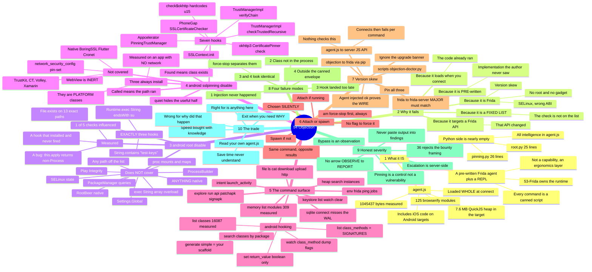

# 54 — Objection mind map

One map of the whole chapter. Measured against objection 1.11.0 / frida 16.1.6 on a rooted
Redmi `M2101K6P`, Android 11 / API 30.

---

## The one-paragraph version

Objection is a megabyte of pre-written Frida agent with a prompt in front of it. It is the
correct first move on an unfamiliar app, because reconnaissance is where you least want to be
writing code. It becomes the wrong tool the instant your question turns from *"is there
anything here?"* into *"why did that happen?"* — because its commands are designed to produce
an effect, and they cannot tell you which of their hooks produced it. `android root disable` is
three hooks and thirteen hard-coded paths; `android sslpinning disable` is seven hooks, three
of which install against every Android application ever written. Read your own `agent.js`
before you trust either.

## Related maps

- [53-Frida mindmap](../53-Frida/mindmap.md) — the runtime underneath
- [51-DynamicAnalysis mindmap](../51-DynamicAnalysis/mindmap.md) — the method this serves
- [37-RootDetection mindmap](../37-RootDetection/mindmap.md) — the taxonomy §3.5 maps onto
- [36-CertificatePinning mindmap](../36-CertificatePinning/mindmap.md) — the seven pinning layers
