# 55 — MobSF: the whole chapter as one map

```mermaid
mindmap
  root((55 MobSF<br/>the scanner<br/>and its limits))

    (1. What it is)
      An automated census not an assessment
      Static analysis
        upload hash and cache by hash
        unzip and inventory the container
        decompile once with one decompiler
        parse the manifest
        analyse the certificate
        match code patterns
        read ELF hardening flags
        extract urls domains trackers secrets
        compute a score from rule metadata
      Optional dynamic analysis
        needs an instrumented Android
        effectively needs root
        traffic logcat filesystem screenshots
        Frida instrumentation
      A web UI and a REST API
      Open source and extensible rules

    (2. Where it sits)
      52 StaticAnalysis pipeline
        stage 1 acquire yes
        stage 2 unpack yes
        stage 3 decompile yes one tool
        stage 4 enumerate yes excellently
        stage 5 sweep yes
        stage 6 triage half
        stage 7 validate NO
        stage 8 report NO
        stage 0 blind spots NO
      Rated five for breadth
      Widest and shallowest tool in the box

    (3. Its real strengths)
      Breadth in ninety seconds
      Component inventory is a fact
      Permission list is a fact
      Deep link map is excellent
      Certificate analysis is trustworthy
      File and library inventory
      Corpus work through the API
      A shared vocabulary with the client
      Consistency on the day you are tired

    (4. How its numbers are built)
      Severity is written into the rule
      CVSS is a per rule constant
      Same number for every matching app
      Security score counts rule matches
      Average cvss averages constants
      Scorecard restates other sections
      None of it knows the asset

    (5. False positives)
      Class 1 the code is a library's
        androidx kotlin okhttp vendored SDKs
        four of nine leads rejected on this alone
      Class 2 the value is not what the rule thinks
        SPKI pin is a public key hash
        sixty four hex is a digest
        base64 is ciphertext or encoding
      Class 3 real but nothing reaches it
        Compose preview fixtures shipped
        three of fifteen HIGH leads were these
        say no static path found not unreachable
      Class 4 the rule fires on a number
        minSdk vulnerable version
        names no CVE and no weakness
      Class 5 severity inverted
        provider protected by a normal permission
        rated info actually Medium
      Class 6 restatement
        eleven of thirty nine items were scorecard

    (6. False negatives the dangerous half)
      Name based rules die under R8
        okhttp3 CertificatePinner becomes m dot e
        measured on two builds of one app
        detector correct on v1.0 backwards on v1.2
      Values survive obfuscation
        string literals resource values
        manifest attributes ZIP structure
        framework API names
      Packed apps report the stub only
      Splits report a fraction
      A shrinking report is not improvement

    (7. Blind spots with numbers)
      Runtime registered receivers
        299 of 431 actions sixty nine percent
        corroborated at sixty seven percent on API 33
      RegisterNatives bindings
        JNI_OnLoad present zero Java_ exports
      Reflection creates no textual edge
      Dynamically loaded DEX
      Server side and remote config
      Splits you were not given
        one app in eighteen had zero controls in base

    (8. The join it cannot make)
      Analysers are one pass and independent
      Exported activity lives in manifest section
      JavaScript bridge lives in code section
      Unvalidated URL extra lives in no section
      Together they are a High
      Joining is the analyst's work

    (9. What you owe it)
      Validate every item against the artefact
      Classify every secret before naming it
      Resolve every protection level
      Check every negative claim by hand
      Merge halves into one finding
      Name the asset then assign severity
      Publish the ledger of rejections
      Write the limits section with numbers
      Mark observed versus static

    (10. Measured here)
      39 report items normalised
      17 corroborated forty three percent
      63 percent excluding the scorecard
      2 refuted 3 over rated 1 under rated
      8 findings after adjudication
      15 rejected with written reasons
      2 findings the scan never mentioned
      Triage ranked 82 versus 58
      MobSF scored 38 versus 34 inverted

    (11. Repo measurements this rests on)
      36 twelve of fourteen surfaces four pins
      52 fifteen of seventeen HIGH rejected
      33 one hundred thirty two of one hundred thirty two
      38 eighteen of eighteen became thirteen of eighteen
      Confidence ranking is not severity ranking

    (12. Operations)
      Never upload a client artefact to a shared instance
      Bind to localhost not every interface
      One instance per engagement then destroy it
      One static API key no scopes
      It parses hostile input for a living
      delete_scan is hygiene not housekeeping

    (13. CI where it shines)
      Gate on deltas not absolutes
      Gate on facts not judgements
      debuggable debug cert backup new export new cleartext
      Never gate on the score
      Ask what the suppression list contains

    (14. Tooling)
      mobsf triage ranks a corpus
        every weight printed with a rationale
        capped per signal
        a penalty for a configured pin
        three next steps per app
      mobsf validate gathers evidence
        corroborated refuted unsupported
        under rated over rated restates
        no FINDING verdict exists
        blind spot block on every run
        two blank ledger columns on purpose
      Specialists it defers to
        32 manifest audit
        36 pinning surface
        17 lib inventory and fingerprint
        52 static sweep and validate lead
        04 dump strings
```

---

## How to use this map

Read it in three passes.

**Pass 1 — branches 1 to 4.** What the tool is and how its numbers are constructed. If you take one
thing from this chapter it is branch 4: **every severity and CVSS in a MobSF report is a property of
the rule, not of your application.**

**Pass 2 — branches 5 to 8.** The failure modes, in both directions. Branch 6 is the one people miss:
a scanner's *negative* claims degrade silently under obfuscation, and nobody audits a reassurance.
Branch 8 is why a scanner cannot write your report even in principle.

**Pass 3 — branches 9 to 14.** The work. Branch 9 is the method, branch 10 is what it produced here,
and branch 14 is what ships in this chapter to make it repeatable.

The single sentence the whole map serves:

> **A sweep produces leads, not findings — and confidence ranking is not severity ranking.**
