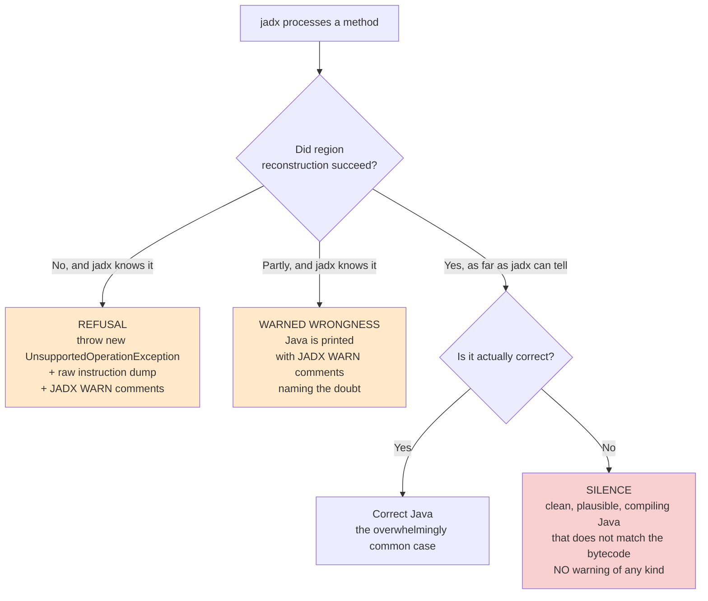
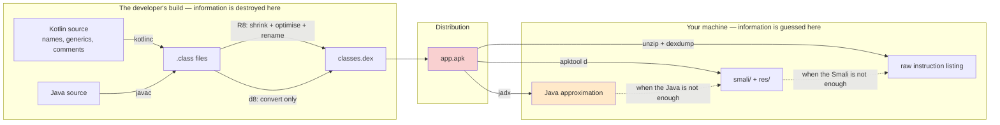
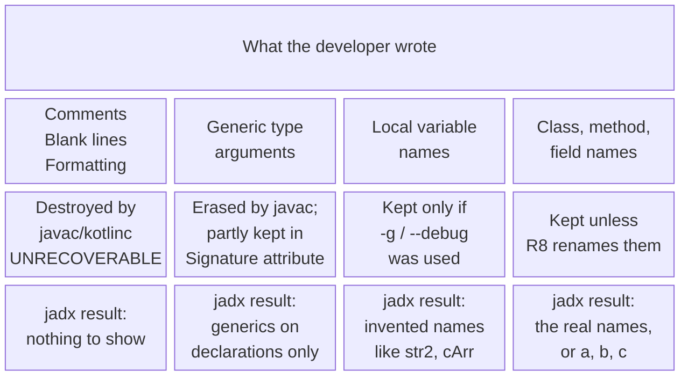
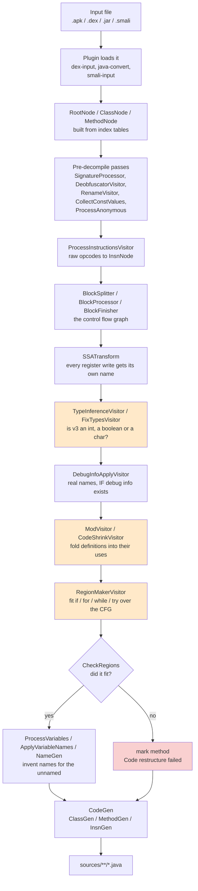
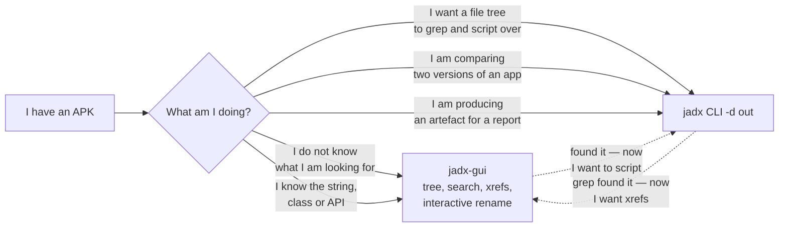
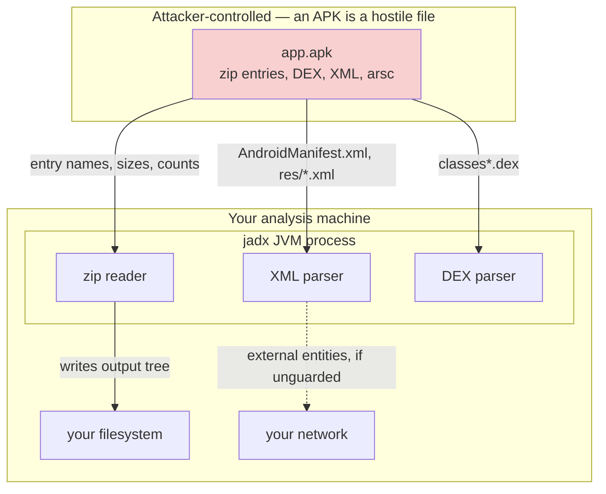
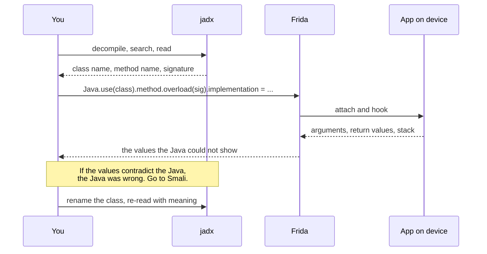
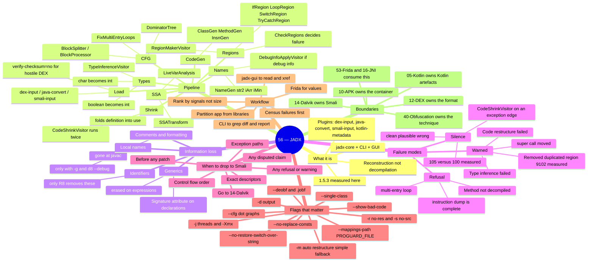

# 56 — JADX

> After this chapter you will be able to turn any APK into readable Java in under a minute, name the
> exact compiler and decompiler passes responsible for every strange thing in that Java, recognise the
> three distinct ways jadx fails — loud refusal, printed warning, and complete silence — and know, for
> any specific claim you want to make about an app, whether decompiled Java is sufficient evidence or
> whether you must drop to Smali before you write it down.

**Prerequisites:** [04 Java](../04-Java/README.md) · [05 Kotlin](../05-Kotlin/README.md) ·
[10 APK Internals](../10-APK-Internals/README.md) ·
[12 DEX Internals](../12-DEX-Internals/README.md) · [14 Dalvik](../14-Dalvik/README.md)

**Applies to:** jadx **1.5.3** (the version measured throughout this chapter, released 2025-09-08) on
any DEX from API 1 to API 36. Where behaviour changed between jadx versions it is called out. The
device references are the Redmi `M2101K6P`, **Android 11 / API 30**, rooted.

---

## The one thing to understand before you start

**jadx does not decompile. jadx reconstructs.**

Those are not synonyms, and the difference is the whole chapter.

A *decompiler* in the naive sense would be an inverse function: feed it the output of the compiler and
get the input back. No such function exists for DEX, because the compiler is not injective. `javac`
and `d8` between them throw away generic type arguments, local variable names, the difference between
`char` and `int`, the difference between `boolean` and `int`, blank lines, comments, the order you
wrote your methods in, the difference between a `for` and a `while`, and — depending on build flags —
every parameter name in the program. Once information is gone it is gone. There is nothing to invert.

What jadx does instead is *synthesis*: it reads the instruction stream, builds a control-flow graph,
runs a type inference, tries to fit structured Java statements over the graph's shape, invents
plausible names for everything it had to invent names for, and prints a Java program that — if all
went well — **compiles to bytecode that behaves the same way**. That program is a hypothesis. It is
usually a very good hypothesis. It is not the source code, and on some inputs it is wrong.

> **Mental Model.** A courtroom sketch artist. Nobody is allowed to photograph the defendant, so an
> artist watches and draws. A good sketch is genuinely useful: you can pick the person out of a crowd
> afterwards. But the tie in the sketch may be a different tie, the room's proportions are the
> artist's, and if you are asked in a deposition to swear to the colour of the defendant's shoes, the
> sketch is not what you cite. jadx output is the sketch. Smali is the photograph.

Three consequences follow immediately, and everything else in this chapter is detail on them.

| Consequence | What it means at the keyboard |
|---|---|
| **The Java you read contains code nobody wrote** | Synthetic classes, `$default` bridges, desugared lambdas, an extra `str.hashCode()` before a `switch`, `access$000` accessors. You must be able to tell compiler output from author intent |
| **jadx's confidence is not calibrated** | It prints a loud warning for some failures and nothing at all for others. The silent ones are the dangerous ones |
| **A finding needs the right evidence** | "The app logs the session token" is a claim about what the program *does*. Decompiled Java points you at it. Smali, or a runtime observation, proves it |

**Scope boundary.** Four neighbouring chapters own adjacent territory, and this chapter does not
restage any of them.

| Chapter | Owns | This chapter's relationship |
|---|---|---|
| [14 — Dalvik](../14-Dalvik/README.md) | **Smali and the instruction set.** Every opcode, register semantics, the `.smali` file format, `baksmali`/`smali` round trips | 14 is **the destination when jadx fails**. This chapter tells you *when* to go there and *what question to ask when you arrive*. It does not teach you the instruction set — 14 does that, thoroughly |
| [12 — DEX Internals](../12-DEX-Internals/README.md) | The **DEX file format at byte level**: `header_item`, `code_item`, `debug_info_item`, LEB128, MUTF-8 | 12 explains the container jadx reads. When this chapter says "the parameter names were never in the file", 12 is where you go to confirm it byte by byte |
| [10 — APK Internals](../10-APK-Internals/README.md) | The **APK container**: the zip, the signature blocks, `resources.arsc`, multi-DEX, split APKs | 10 gets you the input. This chapter starts once you have a `.apk` or `.dex` in hand |
| [40 — Obfuscation](../40-Obfuscation/README.md) | **Obfuscation itself**: renaming, string encryption, control-flow flattening, packers | 40 owns the technique. This chapter owns **reading its output in jadx** and knowing when the tool has been beaten |
| [05 — Kotlin](../05-Kotlin/README.md) | **Kotlin's decompilation artefacts**: `Intrinsics`, `$default`, `Companion`, coroutine state machines | 05 has the master fingerprint table. This chapter points at it and adds only what is specific to *jadx's* handling of Kotlin |

`52-StaticAnalysis` owns the general static-analysis method. This chapter owns one tool within it.

---

## Table of Contents

- [1. Introduction](#1-introduction)
  - [1.1 The problem: you are handed a program with no source](#11-the-problem-you-are-handed-a-program-with-no-source)
  - [1.2 What would break if no decompiler existed](#12-what-would-break-if-no-decompiler-existed)
  - [1.3 What jadx is, precisely](#13-what-jadx-is-precisely)
  - [1.4 The three ways jadx fails](#14-the-three-ways-jadx-fails)
  - [1.5 jadx compared with everything else](#15-jadx-compared-with-everything-else)
  - [1.6 What you will be able to do](#16-what-you-will-be-able-to-do)
- [2. High-Level Architecture](#2-high-level-architecture)
  - [2.1 Where jadx sits between the build and you](#21-where-jadx-sits-between-the-build-and-you)
  - [2.2 The information-loss ladder](#22-the-information-loss-ladder)
  - [2.3 The jadx internal pipeline](#23-the-jadx-internal-pipeline)
  - [2.4 GUI or CLI: a decision, not a preference](#24-gui-or-cli-a-decision-not-a-preference)
  - [2.5 Trust boundary: jadx runs attacker-supplied input](#25-trust-boundary-jadx-runs-attacker-supplied-input)
- [3. Deep Internal Working](#3-deep-internal-working)
  - [3.1 What jadx accepts as input](#31-what-jadx-accepts-as-input)
  - [3.2 Stage 1 — loading, and the plugin that does it](#32-stage-1--loading-and-the-plugin-that-does-it)
  - [3.3 Stage 2 — instructions to blocks](#33-stage-2--instructions-to-blocks)
  - [3.4 Stage 3 — SSA and type inference](#34-stage-3--ssa-and-type-inference)
  - [3.5 Stage 4 — region reconstruction](#35-stage-4--region-reconstruction)
  - [3.6 Stage 5 — shrinking, naming and code generation](#36-stage-5--shrinking-naming-and-code-generation)
  - [3.7 The decompilation-mode ladder](#37-the-decompilation-mode-ladder)
  - [3.8 `--show-bad-code`, and why it can make things worse](#38---show-bad-code-and-why-it-can-make-things-worse)
  - [3.9 `--deobf` does not deobfuscate](#39---deobf-does-not-deobfuscate)
  - [3.10 Mappings: making your renames survive](#310-mappings-making-your-renames-survive)
  - [3.11 Debug info: the single biggest variable in output quality](#311-debug-info-the-single-biggest-variable-in-output-quality)
  - [3.12 Resources, the manifest, and `-r`](#312-resources-the-manifest-and--r)
  - [3.13 Kotlin support](#313-kotlin-support)
  - [3.14 Reading jadx's own comments](#314-reading-jadxs-own-comments)
  - [3.15 Threads, memory, and why large apps die](#315-threads-memory-and-why-large-apps-die)
  - [3.16 The complete flag reference](#316-the-complete-flag-reference)
  - [3.17 Version matrix](#317-version-matrix)
- [4. Source Code Walkthrough (jadx and AOSP)](#4-source-code-walkthrough-jadx-and-aosp)
  - [4.1 Decompiling jadx with jadx](#41-decompiling-jadx-with-jadx)
  - [4.2 The repository layout](#42-the-repository-layout)
  - [4.3 The pass list, in order, for all three modes](#43-the-pass-list-in-order-for-all-three-modes)
  - [4.4 Tracing one artefact to the pass that caused it](#44-tracing-one-artefact-to-the-pass-that-caused-it)
  - [4.5 The AOSP side: what jadx is modelling](#45-the-aosp-side-what-jadx-is-modelling)
  - [4.6 The API: embedding jadx in your own tool](#46-the-api-embedding-jadx-in-your-own-tool)
- [5. Security Perspective](#5-security-perspective)
  - [5.1 What a decompiler does to the threat model](#51-what-a-decompiler-does-to-the-threat-model)
  - [5.2 What pentesters actually find](#52-what-pentesters-actually-find)
  - [5.3 How developers misuse the existence of decompilers](#53-how-developers-misuse-the-existence-of-decompilers)
  - [5.4 The evidence standard](#54-the-evidence-standard)
  - [5.5 Anti-decompilation defences and what they cost](#55-anti-decompilation-defences-and-what-they-cost)
  - [5.6 jadx itself as attack surface](#56-jadx-itself-as-attack-surface)
  - [5.7 OWASP MASVS and MASTG mapping](#57-owasp-masvs-and-mastg-mapping)
  - [5.8 Malware analysis and forensics](#58-malware-analysis-and-forensics)
  - [5.9 Can the developer tell you decompiled it?](#59-can-the-developer-tell-you-decompiled-it)
- [6. Reverse Engineering Perspective](#6-reverse-engineering-perspective)
  - [6.1 The artefact table: what it really was](#61-the-artefact-table-what-it-really-was)
  - [6.2 A source-to-Java round trip, walked line by line](#62-a-source-to-java-round-trip-walked-line-by-line)
  - [6.3 Decompiler limitations and when to drop to Smali](#63-decompiler-limitations-and-when-to-drop-to-smali)
  - [6.4 Failure mode one: refusal](#64-failure-mode-one-refusal)
  - [6.5 Failure mode two: warned wrongness](#65-failure-mode-two-warned-wrongness)
  - [6.6 Failure mode three: silence](#66-failure-mode-three-silence)
  - [6.7 Obfuscated input](#67-obfuscated-input)
  - [6.8 Kotlin input](#68-kotlin-input)
  - [6.9 Native declarations: the handoff to 16 and 57](#69-native-declarations-the-handoff-to-16-and-57)
  - [6.10 What jadx cannot show you at all](#610-what-jadx-cannot-show-you-at-all)
- [7. Dynamic Analysis](#7-dynamic-analysis)
  - [7.1 The read-hook-verify loop](#71-the-read-hook-verify-loop)
  - [7.2 From a jadx signature to a Frida hook](#72-from-a-jadx-signature-to-a-frida-hook)
  - [7.3 Confirming a method jadx refused](#73-confirming-a-method-jadx-refused)
  - [7.4 Resolving an overload from the jadx listing](#74-resolving-an-overload-from-the-jadx-listing)
  - [7.5 Getting the APK off the device](#75-getting-the-apk-off-the-device)
  - [7.6 Objection, MobSF and the cross-check](#76-objection-mobsf-and-the-cross-check)
- [8. Static Analysis](#8-static-analysis)
  - [8.1 The first ten commands](#81-the-first-ten-commands)
  - [8.2 Searching, properly](#82-searching-properly)
  - [8.3 The grep catalogue](#83-the-grep-catalogue)
  - [8.4 Ranking classes worth reading first](#84-ranking-classes-worth-reading-first)
  - [8.5 Finding every place jadx failed](#85-finding-every-place-jadx-failed)
  - [8.6 Cross-checking jadx against other tools](#86-cross-checking-jadx-against-other-tools)
  - [8.7 Scripting jadx](#87-scripting-jadx)
- [9. Examples](#9-examples)
  - [9.1 Simple — one class, before and after](#91-simple--one-class-before-and-after)
  - [9.2 Intermediate — the orphan `hashCode()`](#92-intermediate--the-orphan-hashcode)
  - [9.3 Advanced — the value jadx dropped](#93-advanced--the-value-jadx-dropped)
  - [9.4 Real application — triaging a shipped APK](#94-real-application--triaging-a-shipped-apk)
  - [9.5 Enterprise — a decompilation audit with failure accounting](#95-enterprise--a-decompilation-audit-with-failure-accounting)
- [10. Common Interview Questions](#10-common-interview-questions)
- [11. Common Mistakes](#11-common-mistakes)
- [12. Hands-on Labs](#12-hands-on-labs)
- [13. Summary](#13-summary)
- [14. References](#14-references)

---

## 1. Introduction

### 1.1 The problem: you are handed a program with no source

Imagine being handed a printed novel that has been translated into a language you do not read, then
had every proper noun replaced with a single letter, all the chapter titles deleted, and the
paragraphs reflowed by a machine that did not care where sentences ended. You are asked to answer one
question about it: does the protagonist give away the safe combination?

That is an APK.

An Android application ships to your phone as a zip file. Inside it, the part that actually *does*
anything is one or more `classes.dex` files. A DEX file is not text. It is a compact binary format
holding an instruction stream for a register machine, a set of index tables, and just enough metadata
for a runtime to load classes out of it. The names of classes, methods and fields are in there,
because the runtime needs them to resolve references. Almost nothing else that a human wrote is.

The developer had a directory full of `.kt` and `.java` files with comments, meaningful variable
names, whitespace, and a mental model. None of that shipped. What shipped is the machine's residue.

> **Definition — decompiler.** A program that takes compiled machine or virtual-machine code and
> produces source code in a high-level language which, when recompiled, behaves the same way. It is
> distinct from a **disassembler**, which produces a one-to-one textual rendering of the instructions
> themselves and invents nothing. `baksmali` is a disassembler. jadx is a decompiler.

This distinction is the whole reason both tools exist and the whole reason you need both. A
disassembler cannot be wrong about structure, because it asserts no structure. A decompiler asserts
structure — "these forty instructions are a `for` loop" — and an assertion can be false.

### 1.2 What would break if no decompiler existed

Suppose the only tool you had was `baksmali`. Android security work would still be possible; it would
just be perhaps ten times slower, and here is specifically why.

A mid-sized commercial Android app in 2026 contains somewhere between forty thousand and four hundred
thousand methods. As Smali, that is several million lines across tens of thousands of files. Your
actual task on an engagement is almost always to find the handful of methods that matter: the one
that builds the authentication header, the one that decides whether the device is rooted, the four
that touch the key store. Finding those in a few million lines of assembly, by reading, is not a
tractable use of a week.

Decompiled Java collapses the search space by roughly an order of magnitude in volume and by rather
more than that in cognitive load. A method that is ninety lines of Smali is nine lines of Java, and
those nine lines can be skimmed. You skim ten thousand of them in an afternoon and find the four that
matter. *Then* you look at those four in Smali.

So the honest statement of jadx's value is not "it shows you the source". It is:

> **jadx is a search accelerator with a comprehension bonus.** It reduces the region you must read
> carefully from the whole program to a few methods, and it makes the shape of those methods obvious
> at a glance. Both of those are enormous. Neither of them is "it gives you the source code".

There is a second thing that would break without it, and it is less obvious. Modern apps are enormous
because of their dependencies. A typical app is 80–95% third-party library code: OkHttp, Retrofit,
Firebase, an ad SDK, an analytics SDK, a payments SDK, AndroidX. jadx makes that library code
*recognisable* — you see `okhttp3.OkHttpClient`, you know what it is, you skip it. In Smali the
library code and the app's own code look exactly alike, and separating them is a job in itself.

### 1.3 What jadx is, precisely

jadx is an open-source, Java-implemented decompiler for Dalvik bytecode, written and maintained by
Skylot (Skylot's GitHub project `skylot/jadx`). It ships as two front ends over one core:

| Component | What it is |
|---|---|
| **`jadx`** (CLI) | A command-line driver. Takes files in, writes a `sources/` and `resources/` tree out. This is what you script |
| **`jadx-gui`** | A Swing desktop application with a class tree, a searchable code view, cross-references, and interactive renaming. This is what you *read* in |
| **`jadx-core`** | The decompiler proper. Both front ends are thin shells over it |
| **`jadx-plugins`** | Input format handlers: `dex-input`, `java-convert` (`.class`/`.jar`/`.aar` via `dx`/`d8`), `smali-input`, `kotlin-metadata`, `rename-mappings`, and others |

The version measured throughout this chapter:

```bash
# host
$ jadx --version
1.5.3
```

> **Warning — a Windows installation trap this chapter hit.** On this machine jadx was installed
> from the Windows `jadx-gui` bundle, which ships `C:\Program Files\jadx\jadx.exe` and
> `lib\jadx-gui-1.5.3-all.jar` and **nothing else**. That `jadx.exe` answers `--version` and `--help`
> from the command line, which makes it look like the CLI — but give it real arguments and it opens
> the GUI window and blocks forever. The CLI entry point is inside the same jar and is reachable
> directly:
>
> ```bash
> # host — the CLI, on a gui-only installation
> java -cp "C:\Program Files\jadx\lib\jadx-gui-1.5.3-all.jar" jadx.cli.JadxCLI -d out app.apk
> ```
>
> Every CLI invocation in this chapter was run that way. If your install has `bin/jadx` or `jadx.bat`
> alongside `jadx-gui`, use that instead — it is the same code with a nicer name. The scripts in
> [`scripts/`](scripts/) auto-detect both layouts.

### 1.4 The three ways jadx fails

This is the section to remember, and section 6 is its long form.



The diagram splits jadx's behaviour by *what jadx knows about its own output*. Two of the three
branches are announced. jadx tells you, in comments in the file, that something went wrong — and
those cases, however ugly, are safe, because you have been warned and you will go and read the Smali.

The third branch is the one that matters. In that branch jadx produces Java that is clean, idiomatic,
plausible, and **wrong**, with no marker of any kind. There is no flag that turns a warning on for
it, because if jadx knew, it would have warned. Section 6.6 contains a measured example: a method
whose bytecode returns `105` and whose jadx output returns `100`, both verified by execution.

> **Pentester's Note.** Calibrate on this and you will be ahead of most people who use this tool
> daily: **jadx's warnings are a floor on its error rate, not a ceiling.** A file with no `JADX WARN`
> comments is not a file that decompiled correctly; it is a file where jadx had no doubts. Those are
> different statements.

### 1.5 jadx compared with everything else

| Tool | Input | Output | Reach for it when |
|---|---|---|---|
| **jadx** | APK, DEX, JAR, class, AAR, AAB, smali | Java approximation, decoded resources | You are **reading**. This is the default first move on any APK |
| **`apktool`** | APK | Smali, decoded `AndroidManifest.xml`, `res/`, and everything needed to rebuild | You are **patching**. See [14](../14-Dalvik/README.md) |
| **`baksmali`** | DEX | Smali only | You have a bare `.dex` — dumped from memory, extracted from a packer — and want disassembly with fine control |
| **`dexdump`** | DEX | Annotated instruction listing with file offsets | You need *bytes* and offsets. See [12](../12-DEX-Internals/README.md) |
| **Ghidra / IDA** | ELF `.so` | C-like pseudocode for native code | The logic left the Java layer. See [57](../57-Ghidra/README.md) |
| **Frida** | Running process | Live values | The static answer is "it depends on runtime state". See [53](../53-Frida/README.md) |
| **MobSF** | APK | A report, with jadx-family output inside | You want automated triage and a checklist. See [55-MobSF](../55-MobSF/README.md) |

The pairing that matters most is the first two. jadx and apktool are not competitors and the question
"jadx or apktool?" has a clean answer: **jadx to understand, apktool to change.** jadx output does not
recompile into a working app and is not intended to. apktool output is not readable at speed and is
not intended to be. On a real engagement you run both, on the same APK, into two directories, and
keep both open.

### 1.6 What you will be able to do

By the end of this chapter you should be able to sit down in front of an unfamiliar APK and:

- Produce a full decompilation, with resources, in one command, and know how long it should take.
- Look at any line of the output and say whether a human wrote it, `javac` wrote it, `d8` wrote it,
  R8 wrote it, or jadx wrote it.
- Recognise all three failure modes on sight, and know which one you are in.
- Decide, for a specific claim, whether the Java is sufficient evidence — and if not, extract the
  exact Smali method that is, and hand off to [14](../14-Dalvik/README.md).
- Search a decompiled tree in a way that finds things, rather than in a way that returns four
  thousand hits in the ad SDK.
- Rank a hundred thousand classes so that the twenty worth reading are at the top.
- Write the class name, method name and full signature of a hook into a Frida script, from the jadx
  listing, without guessing.
- Explain to a developer why "we obfuscated it" did not make their hardcoded key safe, and what would
  have.

---

## 2. High-Level Architecture

### 2.1 Where jadx sits between the build and you



Read the diagram left to right and notice that **every arrow in the Build subgraph is lossy**, and
that jadx's job is to undo three of them at once with no record of what they did.

`kotlinc` and `javac` erase generic type arguments (type erasure), erase local variable names unless
asked to keep them, turn `for`/`while`/`do` into the same jumps, turn string concatenation into
`StringBuilder` calls or an `invokedynamic`, desugar lambdas into classes or call sites, and expand
`try`-with-resources into explicit `finally` machinery.

`d8` converts a stack machine's bytecode into a register machine's, which means it must allocate
registers, and register allocation destroys the correspondence between "a variable in the source" and
"a storage location in the code". Two source variables with disjoint lifetimes become one register.
One source variable can become several.

`R8`, if enabled — and it is enabled in every release build produced by a modern Gradle template —
additionally renames every identifier it is allowed to rename, inlines small methods into their
callers, merges classes, removes unused code, and rewrites control flow for size. See
chapter 42 (R8).

The dotted arrows on the right are the escalation path this chapter teaches. You start at the top.
You go down only when the level above cannot answer your question, and you go down *for one method*,
not for the whole app.

### 2.2 The information-loss ladder

It is worth being precise about exactly what is lost and where, because the single most common
beginner error is attributing a loss to the wrong stage and therefore reaching for the wrong fix.



The four columns are four independent questions, and confusing them wastes time.

**Comments and formatting** are gone at the first step and no tool will ever bring them back. If
someone tells you a decompiler recovered comments, they are describing the `SourceFile` attribute or
a `@Metadata` annotation, not comments.

**Generic type arguments** are erased at compile time by design — `List<String>` and `List<Integer>`
are the same type at runtime. But `javac` also emits a `Signature` attribute recording the generic
form for reflection's benefit, and `d8` carries it into DEX as an annotation. jadx reads it. That is
why in section 6.2 you will see `private final Map<String, List<String>> rolesByAccount` (declaration,
signature preserved) sitting next to `= new HashMap()` (allocation, raw, signature never existed for
a `new` expression). It is not jadx being inconsistent. It is jadx faithfully reporting that the
information exists in one place and not the other.

**Local variable names** are the big one, and the one people most often blame on obfuscation when it
is nothing of the kind. See §3.11 — it is a build flag, and the difference in output quality is
dramatic.

**Class, method and field names** are the only ones that obfuscation touches. See
[40](../40-Obfuscation/README.md).

### 2.3 The jadx internal pipeline



Every box in that diagram is a real class in jadx 1.5.3, and §4.3 prints the pass list in order,
decompiled out of the jar this chapter actually ran. Three boxes are shaded because they are where
almost every artefact you will ever see comes from:

- **Type inference** (`TypeInferenceVisitor`) is why a `char` comparison becomes `i != 10`. DEX does
  not distinguish `boolean`, `byte`, `char`, `short` and `int` in most instructions — they are all
  just 32-bit registers. jadx must *infer* which one you meant from how the value is used, and when
  the use is ambiguous it picks `int`.
- **Code shrinking** (`CodeShrinkVisitor`) is why a variable you wrote disappears into the expression
  that used it. This makes output far more readable and is right almost always. §6.6 shows the case
  where it is wrong.
- **Region reconstruction** (`RegionMakerVisitor`) is where all three failure modes are decided.

### 2.4 GUI or CLI: a decision, not a preference



The two front ends are not alternatives; they are used in alternation, and the reason is that each
has exactly one capability the other lacks.

**jadx-gui has cross-references.** Right-click any method, field or class and ask "who uses this".
That is the single most valuable operation in static analysis and no amount of `grep` reproduces it,
because `grep` cannot tell the difference between the `a()` you care about and the four hundred other
methods called `a()`. jadx-gui also decompiles *lazily* — it opens a hundred-megabyte APK in seconds
because it only decompiles the class you clicked.

**The CLI produces files.** Files can be `grep`-ed, diffed between two versions of an app, fed to
`semgrep`, counted, ranked, committed to a case directory, and attached to a report. The GUI can
export the same tree ("Save all"), which is exactly the CLI's job done slowly.

> **Mental Model.** jadx-gui is the reading room; the CLI is the photocopier. You read in the
> reading room. You take copies away for everything that happens afterwards.

### 2.5 Trust boundary: jadx runs attacker-supplied input



You are pointing a large Java program at a file that a hostile party constructed. That is a threat
model, and jadx treats it as one — its environment variables are the evidence:

| Variable | Default | What it guards |
|---|---|---|
| `JADX_DISABLE_ZIP_SECURITY` | unset (checks on) | Zip entry-name traversal (`../../`), decompression bombs, absurd entry counts |
| `JADX_ZIP_MAX_ENTRIES_COUNT` | `100000` | The entry-count cap specifically |
| `JADX_DISABLE_XML_SECURITY` | unset (checks on) | XML external entity resolution in the resource and manifest parsers |

The existence of a switch to *disable* these tells you they were added for a reason. Malware
absolutely does ship APKs designed to break analysis tooling — [40 §3.8](../40-Obfuscation/README.md)
covers anti-tool tricks as a defensive technique.

> **Warning.** Do not set `JADX_DISABLE_ZIP_SECURITY=true` because a sample "won't load". That is
> precisely the sample for which the check exists. If you must, do it in a throwaway VM or container
> with no credentials and no network, and never in your normal working directory. The failure mode of
> zip traversal is files written outside your output directory, and you will not notice.

---

## 3. Deep Internal Working

### 3.1 What jadx accepts as input

From `jadx --help` on 1.5.3, verbatim:

```
usage: jadx [command] [options] <input files>
  (.apk, .dex, .jar, .class, .smali, .zip, .aar, .arsc, .aab, .xapk, .apkm, .jadx.kts)
```

| Extension | What jadx does with it | Why you would use it |
|---|---|---|
| `.apk` | Unzips, finds every `classes*.dex`, decodes `resources.arsc` and binary XML | The normal case |
| `.dex` | Parses directly | A DEX dumped from memory, extracted from a packer, or pulled out of a VDEX |
| `.jar`, `.class`, `.aar` | Converts to DEX first with `dx` or `d8` (`java-convert` plugin), then decompiles | Reading a library, or — see §4.1 — reading jadx itself |
| `.smali` | **Assembles** the Smali into DEX, then decompiles | Testing decompiler behaviour on a specific instruction shape; reading a hand-patched method |
| `.zip` | Treated as a container; scans for anything it recognises | Firmware dumps, backup archives |
| `.aab` | Android App Bundle — reads the base and feature modules | Pre-publication artefacts |
| `.xapk`, `.apkm` | Third-party split-APK bundle formats | Apps downloaded from mirror sites |
| `.arsc` | Resource table only | Confirming a resource ID's value without the code |
| `.jadx.kts` | A jadx *script* — a Kotlin script that configures the run | Repeatable project setup |

The `.smali` input path deserves a callout because it is not widely known and it is the single most
useful capability in this chapter for *understanding* the decompiler:

> **Under the Hood.** `jadx` bundles a Smali **assembler**, not just the ability to read Smali as
> text. Give it a `.smali` file and it produces a DEX in memory and decompiles that. This means you
> can write six lines of Smali expressing an exact instruction shape and see immediately what jadx
> makes of it. Every failure demonstration in §6 was produced this way, and
> [`examples/02-when-jadx-is-wrong/`](examples/02-when-jadx-is-wrong/) ships the inputs so you can
> reproduce them with a single command and no other tooling.
>
> The same capability has a caveat that §6.6 states in full: when the *only* path a construct took
> into jadx was jadx's own assembler, you have not fully isolated whether the decompiler or the
> assembler is responsible for a divergence. Say so when you report one.

### 3.2 Stage 1 — loading, and the plugin that does it

Input handling in jadx is pluggable. `jadx --help` lists the plugins and their options:

| Plugin id | Handles | Notable option |
|---|---|---|
| `dex-input` | `.dex`, `.apk` | `-Pdex-input.verify-checksum=no` — **the flag that loads a corrupted DEX** |
| `java-convert` | `.class`, `.jar`, `.aar` | `-Pjava-convert.mode=d8\|dx\|both`, `-Pjava-convert.d8-desugar=yes` |
| `smali-input` | `.smali` | `-Psmali-input.api-level=27` (default) |
| `kotlin-metadata` | The `kotlin.Metadata` annotation | Eight sub-options, all on by default — see §3.13 |
| `kotlin-smap` | `kotlin.SourceDebugExtension` | `class-alias-source-dbg`, off by default |
| `rename-mappings` | Deobfuscation mapping files | `format`, `invert` |

`-Pdex-input.verify-checksum=no` earns its own paragraph. A DEX header carries an Adler-32 checksum
and a SHA-1 signature over the rest of the file. Some packers, and some deliberately hostile samples,
ship a DEX whose checksum is wrong — either because they patched it at runtime, or specifically to
make tools refuse it. ART itself is more forgiving than the spec suggests. If jadx refuses to load a
DEX you know is real, this is the flag.

```bash
# host — load a DEX whose header checksum does not match its body
jadx -Pdex-input.verify-checksum=no -d out weird.dex
```

> **Pentester's Note.** A checksum mismatch is itself a finding, not just an obstacle. Note it,
> then get [12 — DEX Internals](../12-DEX-Internals/README.md) out and work out *which* bytes
> disagree with the header. A file whose body was modified after the header was written is a file
> someone modified on purpose.

### 3.3 Stage 2 — instructions to blocks

Once the DEX is parsed, each method's `code_item` is a flat array of instructions. jadx turns that
into a **control-flow graph**.

> **Definition — basic block.** A maximal run of instructions with exactly one entry point (the
> first instruction) and exactly one exit point (the last). No instruction in the middle is a branch
> target and no instruction in the middle is a branch. Once you enter, you execute all of it.

> **Definition — control-flow graph (CFG).** A directed graph whose nodes are basic blocks and
> whose edges are the possible transfers of control between them. A `goto` is one edge. An `if` is
> two. A `packed-switch` is one per case plus a default. A `try` region adds an edge from *every*
> instruction inside it to the handler, because any of them might throw.

That last sentence is the source of a large fraction of jadx's difficulty, and it is worth dwelling
on. In a `try` block of twenty instructions, the CFG has twenty extra edges leaving that block, one
per instruction, all going to the same handler. Which means the handler's entry state must be
consistent with the register state after *any prefix* of the try block. Java's `try`/`catch` syntax
can express that. Many other things a compiler might emit cannot be expressed at all.

The passes are `BlockSplitter` (cut the instruction array at branch targets and branches),
`BlockProcessor` (build edges, compute dominators via `DominatorTree` and `PostDominatorTree`,
identify loops), and `BlockFinisher`. A dedicated pass, `FixMultiEntryLoops`, exists to handle loops
with more than one entry point — and §6.4 shows exactly what it prints when it cannot.

### 3.4 Stage 3 — SSA and type inference

> **Definition — SSA (static single assignment).** A representation in which every variable is
> assigned exactly once. Where control flow merges and a variable could have come from either branch,
> a notional *phi function* records that fact. SSA makes it trivial to ask "where did this value come
> from", which is what every subsequent analysis needs.

`SSATransform` rewrites the register machine's `v0` — which may be written forty times in a method —
into forty distinct SSA variables. This is the step that undoes `d8`'s register allocation and it is
why jadx can print two separate locals where the bytecode has one register.

Then comes the hard part. Consider this Dalvik instruction:

```smali
# smali — from 14-Dalvik's instruction reference
const/4 v0, 0x1
```

What type is `v0`? It could be `int` `1`, `boolean` `true`, `char` `'\u0001'`, `byte` `1`,
`short` `1`, or `float`... no, not `float`, floats have their own literal encoding. But the first five
are genuinely indistinguishable in the instruction. Dalvik has one 32-bit register class and does not
tag it.

jadx resolves this by **constraint propagation**. `TypeInferenceVisitor` collects bounds from every
use of the value:

| The value is... | Bound it contributes |
|---|---|
| passed to `foo(boolean)` | must be assignable to `boolean` |
| stored into a `char[]` | must be `char` |
| returned from a method declared `int` | must be `int` |
| compared with `if-eqz` | no information — works on any 32-bit type |
| an argument to `add-int` | must be a numeric 32-bit type |

Then it searches for an assignment of concrete types to all the SSA variables that satisfies every
constraint (`TypeSearch`, `TypeCompare`, `FixTypesVisitor`, `FinishTypeInference`). When the
constraints do not pin the type down, it picks the widest safe default — which is `int`.

This is why, in the measured example of §6.2, the source line

```java
while ((b = in.read()) != -1 && b != '\n') {
```

comes back as

```java
if (i == -1 || i == 10) {
```

`'\n'` is `char` 10. The bytecode holds `const/16 v?, 0xa` and compares it with the `int` returned by
`InputStream.read()`. The comparison forces `int`. There is no surviving evidence anywhere in the
file that the author wrote a character literal. jadx prints `10` because `10` is the truth of the
bytecode; `'\n'` was a fact about the source text.

> **Mental Model.** Type inference is jadx reading a shopping list that says "2, 3, 1" and having
> to work out from context which are kilograms, which are litres and which are "packets of". It gets
> it right most of the time because the rest of the list constrains it. When nothing constrains it,
> it writes "2" and moves on.

### 3.5 Stage 4 — region reconstruction

This is where a decompiler earns its name, and where it fails.

The CFG is a graph. Java source is a **tree** of nested statements. `RegionMakerVisitor` must find a
tree that generates the graph.

> **Definition — reducible control flow.** A CFG is *reducible* if every loop in it has exactly one
> entry point. Equivalently: it can be built up from single blocks by repeatedly nesting sequences,
> if-then-elses and single-entry loops. Every CFG that `javac` or `kotlinc` can produce from
> structured Java or Kotlin source is reducible — because those languages have no `goto`.

That last sentence is the load-bearing one for this whole chapter. jadx's region reconstruction is
built on the assumption that the graph is reducible, because for source-derived code it always is. Its
region types are exactly the statements Java has:

| jadx region class | Java it prints |
|---|---|
| `Region` | a `{ ... }` block, a sequence |
| `IfRegion` (via `IfRegionVisitor`) | `if` / `else` |
| `LoopRegion` (via `LoopRegionVisitor`) | `for`, `while`, `do-while` |
| `SwitchRegion` | `switch` |
| `TryCatchRegion` (via `ProcessTryCatchRegions`) | `try` / `catch` / `finally` |
| `SynchronizedRegion` | `synchronized` |

If the graph does not decompose into those, there is no Java to print. Not "jadx isn't clever enough"
— there is genuinely no Java program with that control flow, because Java lacks `goto`. Bytecode has
`goto`. The set of programs expressible in DEX is strictly larger than the set expressible in Java.

**This is the fundamental limitation of every Java decompiler and it is not going away.** Everything
in §6.3 follows from it.

`CheckRegions` runs afterwards and verifies that the reconstructed region tree actually covers every
block. If it does not, the method is marked and you get the refusal of §6.4.

### 3.6 Stage 5 — shrinking, naming and code generation

Three things happen at the end that account for most of the "why does it look like that" questions.

**`CodeShrinkVisitor` folds definitions into uses.** If a value is computed and used exactly once, its
temporary disappears into the expression. The bytecode

```smali
invoke-virtual {p0}, Ljava/lang/String;->length()I
move-result v1
add-int/2addr v0, v1
```

becomes `x += s.length()` rather than `int t = s.length(); x += t;`. This runs *twice* in the standard
pass list. It is the single biggest contributor to readability, and §6.6 is about the one situation
where it changes meaning.

**`NameGen` and `ApplyVariableNames` invent names.** When there is no debug info, jadx names locals
from their types and origins. The rules, visible in the measured output of §6.2:

| jadx name | Rule |
|---|---|
| `str`, `str2`, `str3` | a `String`, numbered by order of appearance |
| `i`, `i2`, `i3` | an `int` |
| `z`, `z2` | a `boolean` (`z` from the `Z` type descriptor for boolean — see [12](../12-DEX-Internals/README.md)) |
| `cArr`, `bArr`, `iArr` | an array; the letter is the element type descriptor, `Arr` appended |
| `sb` | a `StringBuilder` — an abbreviation of the class name |
| `arrayList`, `byteArrayInputStream` | the class name, lower-camel-cased |
| `iMin`, `iMax` | an `int` **named from the method that produced it**: `Math.min` gives `iMin` |
| `unused` | a caught exception that is never referenced |
| `e`, `e2` | a caught exception that is referenced |
| `th`, `th2` | a `Throwable` |

That `iMin` rule surprises people. jadx really does look at the invocation that produced a value and
build a name from the method name. It is genuinely helpful and it is also entirely invented — there
was no variable called `iMin` in the source, and in §6.2's original the variable was called `limit`.

**`ClassGen` / `MethodGen` / `InsnGen` print the text.** This is also where the `/* loaded from: */`
header comment, the `// from class:` markers on anonymous classes, and the `/* renamed from: */`
comments come from.

### 3.7 The decompilation-mode ladder

`-m` / `--decompilation-mode` takes four values, and they form an escalation ladder that mirrors §2.1's
dotted arrows. Understanding the ladder is what lets you get *something* out of a method that refuses
to decompile without leaving jadx.

| Mode | What it does | Output for a hostile method |
|---|---|---|
| `auto` (default) | Try `restructure`; fall back per-method if it fails | Refusal comment + instruction dump + `throw new UnsupportedOperationException` |
| `restructure` | Full region reconstruction, no fallback | Same, but jadx does not soften it |
| `simple` | Skip region reconstruction. Emit linear statements with labels and explicit `goto`s | **Always produces something.** Ugly, correct in shape, no `if`/`for` nesting |
| `fallback` | Almost nothing: attach try/catch info, render raw instructions as pseudo-Java | A one-to-one instruction listing in Java-ish syntax |

Here is `fallback` mode on a real method, produced by this chapter's run:

```java
// jadx -m fallback -d out variants/V4.smali
public static int f(int[] r2) {
        r0 = 0
        r0 = r2[r0]     // Catch: java.lang.Exception -> L8
        r1 = 1
        r2 = r2[r1]     // Catch: java.lang.Exception -> L8
        int r0 = r0 + r2
        goto La
    L8:
        int r0 = r0 + 100
    La:
        return r0
}
```

That is not Java and does not pretend to be. It is a register-level listing with the try/catch ranges
annotated inline, and it is **the most trustworthy thing jadx can give you** — because at that level
it has asserted almost nothing. Registers are named `r0`, `r1`, `r2` rather than `v0`, `v1`, `p0`,
and the offsets are labels rather than hex, but otherwise you are looking at the instruction stream.

> **Pentester's Note.** `-m fallback` is the fastest way to answer "what does this method actually
> do" without leaving jadx and setting up apktool. It is not a substitute for Smali — it drops the
> opcode names, so you cannot tell `add-int` from `add-int/2addr`, and for a patch you need the real
> thing. But for *reading*, on one method, it is thirty seconds of work and it cannot lie to you about
> control flow.

`simple` mode sits between. Here it is on the method that the default mode **refuses** outright
(§6.4) — the multi-entry loop:

```java
// jadx -m simple -d out examples/02-when-jadx-is-wrong/Irreducible.smali
/* JADX WARN: Unsupported multi-entry loop pattern (BACK_EDGE: B:8:0x000a -> B:4:0x0003). */
public static int irreducible(int r4, int r5) {
    int r0 = 0;
    if (r4 == 0) goto L7;
L4:
    r0 = r0 + 1;
    if (r0 < r5) goto L7;
L10:
    return r0;
L7:
    r0 = r0 + 2;
    if (r0 >= r5) goto L10;
    goto L10
}
```

Registers keep their numbers, labels are explicit, `goto` appears as a keyword Java does not have —
and jadx produced *something* for a method it otherwise declines. Note from §4.3 that
`getSimpleModePasses` ends with a pass named `ForceGenerateAll` which removes the `DONT_GENERATE` flag
from every method; that is the mechanical reason simple mode never refuses.

It also keeps the `JADX WARN` comment, so you are still told the input was irreducible. And it is
still an interpretation: compare the trailing `if (r0 >= r5) goto L10; goto L10` here with the
fallback dump above, where the corresponding instructions branch to two different labels. **Simple
mode is more trustworthy than restructured mode and less trustworthy than fallback.** That ordering is
the whole reason there are four modes.

### 3.8 `--show-bad-code`, and why it can make things worse

Everyone learns this flag as "the one that makes jadx show you the broken methods". That description
is wrong in a way that matters.

By default, when region reconstruction fails, jadx replaces the method body with a `throw new
UnsupportedOperationException("Method not decompiled: ...")` and puts the raw instruction dump in a
comment above it. The comment is honest and complete.

With `--show-bad-code`, jadx instead prints its **partially-reconstructed, known-incorrect** Java.

Here is the measured comparison, both from
[`examples/02-when-jadx-is-wrong/Irreducible.smali`](examples/02-when-jadx-is-wrong/Irreducible.smali)
in this chapter:

**Default:**

```java
/* JADX WARN: Unsupported multi-entry loop pattern (BACK_EDGE: B:8:0x000a -> B:4:0x0003).
   Please report as a decompilation issue!!! */
/*
    Code decompiled incorrectly, please refer to instructions dump.
    To view partially-correct add '--show-bad-code' argument
*/
public static int irreducible(int r4, int r5) {
    /*
        r0 = 0
        if (r4 == 0) goto L8
    L3:
        int r0 = r0 + 1
        if (r0 >= r5) goto Ld
        goto L8
    L8:
        int r0 = r0 + 2
        if (r0 >= r5) goto Ld
        goto L3
    Ld:
        return r0
    */
    throw new UnsupportedOperationException("Method not decompiled: com.pentest.ch56.Irr.irreducible(int, int):int");
}
```

**With `--show-bad-code`:**

```java
/* ... the same JADX WARN comments ... */
/*
    Code decompiled incorrectly, please refer to instructions dump.
*/
public static int irreducible(int i, int i2) {
    int i3 = 0;
}
```

Read those two carefully. The default gives you a **complete instruction dump** — you can work out
exactly what the method does. `--show-bad-code` gives you a method body that assigns zero to an unused
local and then **falls off the end without returning**. If you skim past the comment block, that reads
as "this method does nothing".

> **Warning.** `--show-bad-code` does not show you *more* truth. It shows you jadx's best guess
> *instead of* the instruction dump, and on hard methods the guess is worse than the dump. Use it when
> you want a rough shape for a large method that mostly worked. Never use it as your reading mode for
> a method you intend to make a claim about. The default is the safer default for a reason.

The flag's real value is different from its reputation: it is useful for methods where reconstruction
failed on *one branch* of an otherwise-fine method, so the partial output is 90% right and the dump
would be 400 lines. Judge per method.

### 3.9 `--deobf` does not deobfuscate

This is the most misunderstood flag in the tool and the source of an entire FAQ entry.

Here is a minimal obfuscated class — a class `a` in package `a.b`, with a field `a`, a method `a` and
a `native` method `b` — and what jadx does with and without `--deobf`. Both outputs are measured, from
[`examples/02-when-jadx-is-wrong/Obfuscated.smali`](examples/02-when-jadx-is-wrong/Obfuscated.smali):

**Without `--deobf`:**

```java
package a.b;

public class a {

    /* renamed from: a, reason: collision with root package name */
    private static String f0a;

    public static String a(String str) {
        return str;
    }

    public native int b();
}
```

**With `--deobf`:**

```java
package p000a.p001b;

/* renamed from: a.b.a */
public class C0000a {

    /* renamed from: a */
    private static String f0a;

    /* renamed from: a */
    public static String m0a(String str) {
        return str;
    }

    /* renamed from: b */
    public native int m1b();
}
```

The second is **harder** to read. Nothing was recovered. The class is still meaningless, and now it
has a worse name.

Note also what happened in the *first* listing, without any flag at all: the field `a` was renamed to
`f0a` with the reason `collision with root package name`. That is `--rename-flags`, which is on by
default and which jadx must apply for the output to be self-consistent Java at all. **jadx renames
things even when you did not ask it to**, and it always says so in a comment. Read the comments.

So what does the flag do? It makes every identifier **unique, valid, and greppable**:

| Problem with raw obfuscated names | What `--deobf` fixes |
|---|---|
| A class named `a` and a package named `a` collide on a case-insensitive filesystem, or in Java's namespace | `C0000a` in package `p000b` — no collision |
| Three hundred methods called `a` across the app; `grep -w a` is useless | `m0a`, `m1a`, `m2a`… — every one unique app-wide |
| A field and a method both called `a` in the same class | `f0a` and `m0a` — disambiguated by kind |
| Names that are not valid Java identifiers at all (obfuscators emit Unicode, reserved words, names starting with digits) | Renamed to something that compiles |
| The same class gets different names on different runs, so diffs between app versions are noise | `--deobf-cfg-file` persists the mapping in a `.jobf` file so names are stable |

> **Definition — the `.jobf` file.** jadx writes its generated aliases to a file next to the input
> with a `.jobf` extension, and reads it back on the next run. That is what makes `--deobf` names
> stable across runs and therefore usable for diffing app versions. Control it with
> `--deobf-cfg-file` and `--deobf-cfg-file-mode` (`read`, `read-or-save`, `overwrite`, `ignore`).

Related options worth knowing:

| Flag | Effect |
|---|---|
| `--deobf-min N` | Rename identifiers **shorter** than N characters. Default 3, so `a`, `ab` get renamed, `abc` does not |
| `--deobf-max N` | Rename identifiers **longer** than N. Default 64 — catches obfuscators that emit 200-character names |
| `--deobf-whitelist` | Space-separated classes/packages to leave alone. Defaults cover `android.support.*` |
| `--use-source-name-as-class-name-alias always\|if-better\|never` | If a `SourceFile` attribute survived, use it to name the class. **This one genuinely recovers information** |
| `--deobf-res-name-source auto\|resources\|code` | Where to get better names for obfuscated resources |
| `--rename-flags case,valid,printable` | The always-on subset: fix case collisions, make identifiers valid, strip non-printables. `none` disables all renaming |

`--use-source-name-as-class-name-alias` is the one that occasionally produces magic. R8 renames the
class but by default keeps a `SourceFile` attribute; if the developer did not set
`-renamesourcefileattribute`, that attribute still says `LoginPresenter.java`. jadx will then call the
class `LoginPresenter` even though its DEX name is `a.b.c`. Always try it.

> **Pentester's Note.** The correct mental model: `--deobf` is a *hygiene* flag, not a *recovery*
> flag. Turn it on for scripted extraction (you need unique filenames and stable diffs). Leave it off
> when reading in the GUI (the raw names are shorter and the GUI already handles collisions). Recovery
> comes from `--use-source-name-as-class-name-alias`, from a leaked `mapping.txt`
> (see §3.10), and from you renaming things by hand as you understand them.

### 3.10 Mappings: making your renames survive

Understanding an obfuscated app is a process of *renaming*: you work out that `a.b.c` is the token
store, you rename it, and now every call site reads better. That work is worth hours. jadx can persist
it.

| Flag | Purpose |
|---|---|
| `--mappings-path FILE` | Load a mapping file. Formats: Tiny, Tiny v2 (`.tiny`), Enigma (`.mapping`), Enigma directory |
| `--mappings-mode read` | Load, do not save automatically (default) |
| `--mappings-mode read-and-autosave-every-change` | Save after every rename in the GUI |
| `--mappings-mode read-and-autosave-before-closing` | Save on exit |
| `-Prename-mappings.format=PROGUARD_FILE` | Read a **ProGuard/R8 `mapping.txt`** |
| `-Prename-mappings.invert=yes` | Invert the mapping direction |

The `PROGUARD_FILE` format is the important one. When R8 obfuscates an app it emits a `mapping.txt`
recording every original-to-obfuscated name. That file is a build artefact and is not supposed to
ship — but it does ship, more often than anyone would like, in three ways:

1. Left inside the APK's `assets/` by an incorrectly-configured build.
2. Uploaded to a crash-reporting service and readable from an over-permissive dashboard.
3. Published in a public artefact repository or a source map on the company's CDN.

If you find one, feeding it to jadx un-obfuscates the entire application in one step. That is not a
decompiler feature so much as a finding: **the shipped mapping file defeats the app's own
obfuscation** and belongs in the report at a severity proportional to what the obfuscation was
protecting.

```bash
# host — full de-obfuscation using a recovered R8 mapping file
jadx -Prename-mappings.format=PROGUARD_FILE \
     --mappings-path mapping.txt \
     -d out-mapped app.apk
```

> **Warning.** Verify a mapping file before you trust it. A `mapping.txt` from version 4.2 of an
> app applied to version 4.9 will silently mislabel classes, because R8's name assignment is not
> stable across builds. Spot-check: pick three classes the mapping names, and confirm their contents
> match the name. If `LoginPresenter` contains image-loading code, your mapping is from a different
> build.

### 3.11 Debug info: the single biggest variable in output quality

Everything else in this section is detail. This is the headline, and it is measured.

The same source file, compiled two ways, decompiled by the same jadx:

**Built with `d8 --release` (what ships):**

```java
public boolean unlock(char[] cArr) {
    if (this.failedAttempts >= MAX_ATTEMPTS) {
        return false;
    }
    int length = cArr.length;
    char[] cArr2 = this.masterKey;
    boolean z = length == cArr2.length;
    int iMin = Math.min(cArr.length, cArr2.length);
    for (int i = 0; i < iMin; i++) {
        if (cArr[i] != this.masterKey[i]) {
            z = false;
        }
    }
    if (!z) {
        this.failedAttempts++;
    }
    return z;
}
```

**Built with `javac -g` and `d8 --debug`:**

```java
public boolean unlock(char[] candidate) {
    if (this.failedAttempts >= MAX_ATTEMPTS) {
        return false;
    }
    boolean equal = candidate.length == this.masterKey.length;
    int limit = Math.min(candidate.length, this.masterKey.length);
    for (int i = 0; i < limit; i++) {
        if (candidate[i] != this.masterKey[i]) {
            equal = false;
        }
    }
    if (!equal) {
        this.failedAttempts++;
    }
    return equal;
}
```

The second is **character-for-character the original source** apart from `this.` qualification. The
first is the same program with every name invented.

The difference is one thing: a `debug_info_item` in the DEX carrying a `DBG_START_LOCAL` entry for
each local. Verified directly — the identifier `candidate` appears in the debug build's string pool
and does not appear in the release build's at all:

```bash
# host
$ for d in dex-release dex-debug; do
>   printf "%-12s candidate=%s equal=%s limit=%s\n" "$d" \
>     "$(strings -a $d/classes.dex | grep -c candidate)" \
>     "$(strings -a $d/classes.dex | grep -cx equal)" \
>     "$(strings -a $d/classes.dex | grep -cx limit)"
> done
dex-release  candidate=0 equal=0 limit=0
dex-debug    candidate=1 equal=1 limit=1
```

String-pool sizes tell the same story: **121** entries in the release DEX, **142** in the debug DEX,
for identical source — 5,568 bytes against 6,104. Twenty-one strings and 536 bytes are the entire
difference between reading `boolean z` and reading `boolean equal`.

On the jadx side this is `DebugInfoAttachVisitor` (early, reads the table) and
`DebugInfoApplyVisitor` (after type inference, applies names). Both are gated on `args.isDebugInfo()`,
which `--no-debug-info` turns off.

| Situation | Local names in output |
|---|---|
| Release build from Google Play | Invented (`str`, `i2`, `cArr`) |
| Debug build pulled off a developer's device or an internal test track | **Original** |
| An app built by a CI pipeline that forgot to strip debug info | **Original** |
| Any build, but you passed `--no-debug-info` | Invented |
| A library shipped as a debug `.aar` inside a release app | **Original, for that library only** |

> **Pentester's Note.** Before you spend a day reading invented names, spend thirty seconds checking
> whether you have to. Decompile, then `grep` the output for a local name that is not a jadx-invented
> pattern. A quicker check: `dexdump -d classes.dex | grep -c "^ *[0-9a-f]*: *local:"` — if the count
> is non-zero on a production APK, note it. Shipping debug info is not a critical finding on its own,
> but it is a real one (it aids reverse engineering and it is trivially fixable), and it changes how
> long the rest of your engagement takes.

There is a second-order effect worth knowing: **debug info also changes member ordering.** With
debug info, jadx has line numbers and emits members in source order. Without it, members come out in
DEX order, which `d8` sorts. In the measured example the release build listed
`auditor, describe, readHeader, rolesFor, tierFromPlanName, tokenOf, unlock` — alphabetical — while
the debug build listed them in the order they were written. So a decompiled release class tells you
nothing about how the author organised the file, and two classes that look "reordered" between app
versions may be identical.

### 3.12 Resources, the manifest, and `-r`

jadx does more than DEX. Given an APK it also:

- Decodes `AndroidManifest.xml` from binary XML back to text.
- Decodes `resources.arsc` into a `res/values/*.xml` tree.
- Decodes every binary XML in `res/` (layouts, network security config, preferences).
- Rewrites integer resource IDs in the decompiled Java into `R.string.foo` references where it can.

That last point is genuinely valuable and often overlooked: a method that reads
`getString(2131689512)` is opaque; jadx turns it into `getString(R.string.api_base_url)`, and now you
know what it fetched.

| Flag | Effect | Use when |
|---|---|---|
| *(default)* | Decode everything | The normal case |
| `-r`, `--no-res` | Skip resources entirely | You only want code, and you want it fast. On a large APK this is a large saving |
| `-s`, `--no-src` | Skip code entirely | You want the manifest and resources only — much faster than a full run |
| `-dr DIR` | Resources to a separate directory | Scripted pipelines |
| `-ds DIR` | Sources to a separate directory | Scripted pipelines |
| `--no-xml-pretty-print` | Emit XML as one line | Diffing, or feeding to a parser |
| `--use-headers-for-detect-resource-extensions` | Sniff file types by magic bytes when resource names are obfuscated | Resource-obfuscated apps — see [40 §3.9](../40-Obfuscation/README.md) |

> **Pentester's Note.** `jadx -s -d out app.apk` is the fastest complete manifest-and-resources
> decode there is, and it is often the very first command you should run — before the full
> decompilation, which you can start in another terminal. The manifest tells you the attack surface
> ([32-Manifest](../32-Manifest/README.md)) and the network security config tells you whether
> intercepting traffic will work at all
> ([44-NetworkSecurityConfig](../44-NetworkSecurityConfig/README.md)). You can be reading both while
> the DEX is still being processed.

### 3.13 Kotlin support

[05-Kotlin §6.1](../05-Kotlin/README.md#61-the-master-fingerprint-table) has the master fingerprint
table for reading Kotlin in decompiled form: `Intrinsics.checkNotNullParameter`, the `$default`
bridges, `Companion`, `WhenMappings`, `ContinuationImpl` state machines, `L$0`/`label` fields, and
the rest. **Read that table; this section does not restage it.** What belongs here is only what is
specific to *jadx's* handling.

jadx ships a `kotlin-metadata` plugin that reads the `@kotlin.Metadata` annotation the Kotlin compiler
attaches to every Kotlin class. That annotation contains the original signatures in an encoded form —
which means for Kotlin code, jadx can recover names that are genuinely gone from the DEX itself.

| Sub-option (all default `yes`) | What it recovers |
|---|---|
| `kotlin-metadata.class-alias` | The original class name |
| `kotlin-metadata.method-args` | **Original parameter names** |
| `kotlin-metadata.fields` | Original field names |
| `kotlin-metadata.companion` | The companion object's declared name |
| `kotlin-metadata.data-class` | Marks data classes as such |
| `kotlin-metadata.to-string` | Field names extracted from the generated `toString()` |
| `kotlin-metadata.getters` | Renames trivial getters back to the property name |

Two further options sit alongside:

- `--use-kotlin-methods-for-var-names disable|apply|apply-and-hide` (default `apply`). jadx uses the
  string argument of `Intrinsics.checkNotNullParameter(x, "accountId")` to name the parameter
  `accountId`. `apply-and-hide` additionally removes the `Intrinsics` call from the output.
- `kotlin-smap.class-alias-source-dbg` (default `no`) — use the `SourceDebugExtension` annotation to
  name classes.

> **Warning — `apply-and-hide` hides evidence.** The `Intrinsics.checkNotNullParameter` calls are
> not noise; they are a **behavioural fact**. They throw `NullPointerException` on a null argument,
> which is a real control-flow path and occasionally the whole reason a crash happens. Hiding them
> makes the output prettier and makes you blind to it. Keep the default `apply` unless you have a
> specific reason.

> **Pentester's Note.** The `@Metadata` annotation is a de-obfuscation oracle that R8 does not
> remove by default. On a Kotlin app with default R8 rules, class names may be `a.b.c` in the DEX
> while `@Metadata` still carries the original names, and jadx will show you both. If an app is
> obfuscated and you can still read sensible Kotlin names, that is why — and it is worth telling the
> developer, because they think they obfuscated it.

### 3.14 Reading jadx's own comments

jadx annotates its output. The `--comments-level` flag (`error`, `warn`, `info`, `debug`,
`user-only`, `none`; default `info`) controls how much. Learn to read them — they are the tool telling
you exactly where it is unsure.

| Comment | Severity | What it means |
|---|---|---|
| `/* loaded from: classes3.dex */` | info | Which DEX in a multi-DEX APK this class came from. Useful: a class in a late DEX is often dynamically loaded or a late-added SDK |
| `/* renamed from: a.b.c */` | info | `--deobf` or a mapping renamed this. The original DEX name follows |
| `/* JADX INFO: Access modifiers changed from: private */` | info | jadx widened a modifier so the output is self-consistent. The real one was narrower |
| `/* JADX INFO: Thrown type has an unknown type hierarchy: X */` | info | The exception class is not in the input, so jadx could not resolve its supertypes |
| `// from class: com.example.Foo.1` | info | An anonymous inner class, inlined into its use site |
| `/* synthetic */` | info | The `ACC_SYNTHETIC` flag was set: the **compiler** generated this member, not the author |
| `/* bridge */` | info | A bridge method, generated by generics erasure or covariant returns |
| `/* JADX WARN: Type inference failed for: r5v0 */` | warn | jadx could not pin a type. The declared type in the output is a guess |
| `/* JADX WARN: Multi-variable type inference failed */` | warn | Same, across several variables at once |
| `/* JADX WARN: Removed duplicated region for block: ... */` | warn | The region tree needed a block in two places; jadx dropped one. **Control flow in the output is incomplete** |
| `/* JADX WARN: Code restructure failed: missing block: B:n:0xNN, code lost: ... */` | warn | Named blocks did not fit the region tree. The comment prints the lost code |
| `/* JADX WARN: Unsupported multi-entry loop pattern ... Please report as a decompilation issue!!! */` | warn | Irreducible control flow. §6.4 |
| `/* JADX WARN: Failed to find 'out' block for switch in ... */` | warn | A `switch` whose join point jadx could not identify |
| `Code decompiled incorrectly, please refer to instructions dump.` | error | The method body below is **known wrong**. Read the dump instead |
| `throw new UnsupportedOperationException("Method not decompiled: ...")` | error | Total refusal. §6.4 |

> **Pentester's Note — this is a grep target, not decoration.** Before you read a single line of an
> app, count them:
>
> ```bash
> # host — the failure census, run it first
> grep -rc "Method not decompiled" out/sources | grep -v ":0$" | wc -l
> grep -rho "JADX WARN: [A-Za-z ]*" out/sources | sort | uniq -c | sort -rn
> ```
>
> A normal commercial app produces a handful. An app with dozens of refusals concentrated in one
> package has either a control-flow obfuscator or a packer, and you should stop reading Java and go to
> [40-Obfuscation](../40-Obfuscation/README.md). The distribution of failures is a fingerprint of the
> protection in use. [`scripts/jadx-triage.py`](scripts/jadx-triage.py) automates exactly this.

### 3.15 Threads, memory, and why large apps die

jadx is a JVM application decompiling tens of thousands of classes, and on large inputs it runs out of
heap. The symptoms are an `OutOfMemoryError`, or — more confusingly — a run that "completes" with far
fewer output files than expected, because jadx caught the error per-class and moved on.

| Control | Default | When to change it |
|---|---|---|
| `-j`, `--threads-count` | number of CPUs (8 on this machine) | **Lower it** to reduce peak memory. `-j 1` on a machine that is dying |
| JVM `-Xmx` | JVM default (a quarter of RAM) | Raise it: `java -Xmx8g -cp ... jadx.cli.JadxCLI` |
| `-r` / `--no-res` | off | Skip resource decoding — big saving on resource-heavy apps |
| `--no-imports` | off | Slightly less work, much worse output. Rarely worth it |

```bash
# host — the "this APK is enormous" invocation
java -Xmx8g -cp "C:\Program Files\jadx\lib\jadx-gui-1.5.3-all.jar" jadx.cli.JadxCLI \
     -j 4 --no-res --log-level error -d out huge.apk
```

For jadx-gui, edit the launcher's JVM options or set `JAVA_OPTS`. The GUI decompiles lazily, so it
survives inputs the CLI cannot — one more reason to keep both in the workflow.

> **Warning — the silent partial run.** A jadx run that printed errors and still exited zero has
> not necessarily decompiled everything. Always compare the class count you got against the class
> count in the DEX before you conclude a class is absent:
>
> ```bash
> # host
> unzip -p app.apk classes.dex | dexdump - | grep -c "Class descriptor"
> find out/sources -name '*.java' | wc -l
> ```
>
> These will not match exactly — inner classes share a file, and jadx merges some — but an order of
> magnitude gap means the run failed. "The class isn't there" and "jadx died before it got to that
> class" look identical from the output tree.

### 3.16 The complete flag reference

The flags you will actually type, grouped by what you are trying to do. Full list in
[`cheatsheet.md`](cheatsheet.md).

**Output control**

| Flag | Effect |
|---|---|
| `-d DIR` | Output directory (both sources and resources) |
| `-ds DIR` / `-dr DIR` | Sources / resources to separate directories |
| `-r`, `--no-res` | Do not decode resources |
| `-s`, `--no-src` | Do not decompile code |
| `--output-format java\|json` | JSON output for machine consumption |
| `-e`, `--export-gradle` | Emit a Gradle project skeleton |
| `--single-class NAME` | Decompile exactly one class |
| `--single-class-output PATH` | Where that one class goes |

**Decompilation behaviour**

| Flag | Effect |
|---|---|
| `-m auto\|restructure\|simple\|fallback` | The mode ladder (§3.7) |
| `--show-bad-code` | Print known-incorrect reconstructions (§3.8) |
| `--no-debug-info` | Ignore debug info even when present (§3.11) |
| `--add-debug-lines` | Emit `// line N` comments from the line-number table |
| `--no-inline-anonymous` | Keep anonymous classes as separate declarations |
| `--no-inline-methods` | Do not inline small methods into callers |
| `--no-move-inner-classes` | Keep inner classes as separate top-level files |
| `--no-inline-kotlin-lambda` | Keep Kotlin lambdas as classes |
| `--no-finally` | Do not attempt `finally` extraction |
| `--no-restore-switch-over-string` | Leave the hash-based switch as the compiler emitted it (§9.2) |
| `--no-replace-consts` | Do not substitute constant field names for literal values (§6.1) |
| `--respect-bytecode-access-modifiers` | Do not widen modifiers for self-consistency |
| `--integer-format auto\|decimal\|hexadecimal` | How integer literals print. `hexadecimal` is often better for flags and masks |
| `--escape-unicode` | Write non-Latin string characters as `\uXXXX` |

**Naming**

| Flag | Effect |
|---|---|
| `--deobf` and friends | §3.9 |
| `--mappings-path`, `--mappings-mode` | §3.10 |
| `--use-source-name-as-class-name-alias always\|if-better\|never` | Recover class names from `SourceFile` |
| `--source-name-repeat-limit N` | Do not use a `SourceFile` name that appears more than N times (default 10) |
| `--rename-flags case,valid,printable\|all\|none` | Identifier legalisation |
| `--use-kotlin-methods-for-var-names disable\|apply\|apply-and-hide` | §3.13 |
| `--fs-case-sensitive` | Treat the output filesystem as case-sensitive. **Set this on Linux; leave it off on Windows and macOS** |

**Diagnostics**

| Flag | Effect |
|---|---|
| `--comments-level error\|warn\|info\|debug\|user-only\|none` | §3.14 |
| `--log-level quiet\|progress\|error\|warn\|info\|debug` | Console verbosity |
| `-v` / `-q` | Shorthand for debug / quiet |
| `--cfg` / `--raw-cfg` | Dump per-method control-flow graphs as Graphviz `.dot` files |

`--cfg` deserves a mention: for a method with mangled control flow, rendering the graph is often
faster than reading either the Java or the Smali.

```bash
# host — dump control-flow graphs, then render one
jadx --cfg --single-class com.example.Flattened -d out app.apk
dot -Tpng out/**/Flattened_dispatch.dot -o dispatch.png
```

### 3.17 Version matrix

| jadx version | Change that affects you |
|---|---|
| 1.4.x | `--deobf` output format and `.jobf` handling settled into the form described here |
| 1.5.0 | Plugin system reworked; input handlers became named plugins with `-P` options. Kotlin metadata handling substantially improved |
| 1.5.x | `--decompilation-mode` replaced the older `-f`/`--fallback` flag, which remains as a deprecated alias |
| **1.5.3** | **The version measured throughout this chapter** |

Because jadx is a heuristic tool, **its output changes between versions for the same input**. That has
a practical consequence people forget: if you are diffing two versions of an *app*, use the same
version of *jadx* for both, or you will be reading jadx's changelog rather than the app's.

> **Pentester's Note.** Record the jadx version in your notes alongside every extract you quote. A
> year later, when someone asks why they cannot reproduce your listing, "jadx 1.5.3" is the answer. A
> report that quotes decompiled code without naming the tool version is quoting an unreproducible
> artefact.

---
## 4. Source Code Walkthrough (jadx and AOSP)

Every other chapter in this repository walks AOSP source. This one has two trees to walk, because the
subject is not a platform component: it is a third-party tool that *models* a platform component. So
this section covers both — the jadx source that does the work, and the AOSP definitions that determine
what "correct" means.

### 4.1 Decompiling jadx with jadx

There is a pleasing way to read jadx's source without cloning it, and it is also a genuine
demonstration of the `java-convert` plugin from §3.2: **point jadx at its own jar.**

```bash
# host — extract one class from the jadx jar and decompile it with jadx
unzip -o -q "C:\Program Files\jadx\lib\jadx-gui-1.5.3-all.jar" "jadx/core/Jadx.class" -d cls
java -cp "C:\Program Files\jadx\lib\jadx-gui-1.5.3-all.jar" jadx.cli.JadxCLI -q -d out cls/jadx/core/Jadx.class
cat out/sources/jadx/core/Jadx.java
```

That works because `.class` input goes through `java-convert`, which runs `d8` over the class file to
produce DEX, which jadx then decompiles. Every listing in §4.3 was produced exactly this way, from the
same jar every other measurement in this chapter used.

It also produces, immediately, a first-class artefact for §6.1. Here is the real opening of the
decompiled `getPassesList`:

```java
/* JADX INFO: Thrown type has an unknown type hierarchy: jadx.core.utils.exceptions.JadxRuntimeException */
public static List<IDexTreeVisitor> getPassesList(JadxArgs args) throws JadxRuntimeException {
    switch (1.$SwitchMap$jadx$api$DecompilationMode[args.getDecompilationMode().ordinal()]) {
```

Look at `1.$SwitchMap$jadx$api$DecompilationMode`. That is a reference to a static field on the
synthetic class `Jadx$1` — the anonymous holder class `javac` generates for a `switch` over an `enum`.
jadx has stripped the outer class prefix and left `1.`, which **is not a valid Java expression**; you
cannot start an identifier with a digit. The code will not compile. It is still completely readable:
you can see it is a switch over `DecompilationMode`.

That single line is the chapter in miniature. The output is *useful* and *not source*.

> **Under the Hood.** The `$SwitchMap` pattern is worth recognising on sight because it appears in
> every Java or Kotlin program that switches on an enum. The compiler cannot switch on an enum
> directly — `switch` needs an integer — so it generates a synthetic class holding an `int[]` that maps
> each enum's `ordinal()` to a dense case index, and switches on that. [05-Kotlin](../05-Kotlin/README.md)
> lists the Kotlin form, `WhenMappings.$EnumSwitchMapping$0`, in its fingerprint table. Same mechanism.

### 4.2 The repository layout

The upstream project is `skylot/jadx` on GitHub. Its modules:

| Path | Contains |
|---|---|
| `jadx-core/` | The decompiler. Everything in §3 lives here |
| `jadx-cli/` | `jadx.cli.JadxCLI`, `JadxCLIArgs` — argument parsing and the batch driver |
| `jadx-gui/` | `jadx.gui.JadxGUI` and the Swing UI, search, xrefs, rename support |
| `jadx-plugins/` | `jadx-dex-input`, `jadx-java-convert`, `jadx-smali-input`, `jadx-kotlin-metadata`, `jadx-rename-mappings`, and the plugin API |
| `jadx-plugins-tools/` | Plugin management (`jadx plugins`) |

Inside `jadx-core/src/main/java/jadx/`, the packages that matter:

| Package | Role |
|---|---|
| `api/` | The public embedding API: `JadxDecompiler`, `JadxArgs`, `JavaClass`, `JavaMethod`, `DecompilationMode`, `CommentsLevel` |
| `core/dex/nodes/` | The object model: `RootNode`, `ClassNode`, `MethodNode`, `FieldNode`, `BlockNode`, `InsnNode` |
| `core/dex/instructions/` | Instruction representations after decoding |
| `core/dex/visitors/` | **The passes.** Every stage of §3 is a class here |
| `core/dex/visitors/blocks/` | `BlockSplitter`, `BlockProcessor`, `DominatorTree`, `PostDominatorTree`, `FixMultiEntryLoops`, `BlockExceptionHandler` |
| `core/dex/visitors/ssa/` | `SSATransform`, `LiveVarAnalysis`, `RenameState` |
| `core/dex/visitors/typeinference/` | `TypeInferenceVisitor`, `FixTypesVisitor`, `FinishTypeInference`, `TypeSearch`, `TypeCompare`, and the `TypeBound*` constraint classes |
| `core/dex/visitors/regions/` | `RegionMakerVisitor`, `IfRegionVisitor`, `LoopRegionVisitor`, `SwitchOverStringVisitor`, `ProcessTryCatchRegions`, `CheckRegions`, `CleanRegions` |
| `core/dex/visitors/shrink/` | `CodeShrinkVisitor` — §6.6's protagonist |
| `core/dex/visitors/finaly/` | `MarkFinallyVisitor` — `finally`-block extraction |
| `core/dex/visitors/debuginfo/` | `DebugInfoAttachVisitor`, `DebugInfoApplyVisitor` — §3.11 |
| `core/dex/visitors/kotlin/` | `ProcessKotlinInternals` — §3.13 |
| `core/dex/visitors/rename/` | `RenameVisitor`, `CodeRenameVisitor`, `SourceFileRename`, `UserRenames` |
| `core/deobf/` | `DeobfuscatorVisitor`, `SaveDeobfMapping` — §3.9 |
| `core/dex/regions/` | The region types: `Region`, `SwitchRegion`, `TryCatchRegion`, `SynchronizedRegion` |
| `core/codegen/` | `CodeGen`, `ClassGen`, `MethodGen`, `InsnGen`, `RegionGen`, `ConditionGen`, `NameGen`, `TypeGen`, `AnnotationGen`, `SimpleModeHelper` |

Every class name in that table was read out of `jadx-gui-1.5.3-all.jar` on this machine, not from
memory.

### 4.3 The pass list, in order, for all three modes

`jadx.core.Jadx` holds the pass lists. Here they are, decompiled from the shipped jar. This is the
most useful single artefact in this section: it is the definitive answer to "in what order does jadx
do things", and every artefact in §6.1 can be traced to a line in it.

**Pre-decompile passes** — run once over the whole tree before any method is decompiled:

```java
// jadx.core.Jadx.getPreDecompilePassesList(), jadx 1.5.3, decompiled by jadx
public static List<IDexTreeVisitor> getPreDecompilePassesList() {
    List<IDexTreeVisitor> passes = new ArrayList<>();
    passes.add(new SignatureProcessor());      // read the generic Signature attribute
    passes.add(new OverrideMethodVisitor());   // link overrides so @Override can be emitted
    passes.add(new AddAndroidConstants());     // know that 0x0001 is FLAG_ACTIVITY_... etc
    passes.add(new DeobfuscatorVisitor());     // --deobf alias assignment
    passes.add(new SourceFileRename());        // --use-source-name-as-class-name-alias
    passes.add(new RenameVisitor());           // --rename-flags legalisation, mappings
    passes.add(new SaveDeobfMapping());        // write the .jobf file
    passes.add(new UsageInfoVisitor());        // build the cross-reference index the GUI uses
    passes.add(new CollectConstValues());      // gather static final fields for --replace-consts
    passes.add(new ProcessAnonymous());        // identify anonymous inner classes
    passes.add(new ProcessMethodsForInline());
    return passes;
}
```

Two of those are worth pausing on. `AddAndroidConstants` is why jadx prints `Intent.FLAG_ACTIVITY_NEW_TASK`
instead of `268435456` — it knows the framework's constants. `CollectConstValues` is why a literal `3`
in your bytecode can come out as `MAX_ATTEMPTS`; see §6.1 for why that is a double-edged gift.

**Regions mode** (`auto` and `restructure`) — the real pipeline, in order:

```java
// jadx.core.Jadx.getRegionsModePasses(JadxArgs), jadx 1.5.3, decompiled by jadx
passes.add(new CheckCode());
if (args.isDebugInfo())            passes.add(new DebugInfoAttachVisitor());
passes.add(new AttachTryCatchVisitor());
if (args.getCommentsLevel() != CommentsLevel.NONE) passes.add(new AttachCommentsVisitor());
passes.add(new AttachMethodDetails());
passes.add(new ProcessInstructionsVisitor());
passes.add(new BlockSplitter());
passes.add(new BlockProcessor());
passes.add(new BlockFinisher());
if (args.isRawCFGOutput())         passes.add(DotGraphVisitor.dumpRaw());
passes.add(new SSATransform());
passes.add(new MoveInlineVisitor());
passes.add(new ConstructorVisitor());
passes.add(new InitCodeVariables());
if (args.isExtractFinally())       passes.add(new MarkFinallyVisitor());
passes.add(new ConstInlineVisitor());
passes.add(new TypeInferenceVisitor());
if (args.isDebugInfo())            passes.add(new DebugInfoApplyVisitor());
passes.add(new FixTypesVisitor());
passes.add(new FinishTypeInference());
if (args.getUseKotlinMethodsForVarNames() != DISABLE) passes.add(new ProcessKotlinInternals());
passes.add(new CodeRenameVisitor());
if (args.isInlineMethods())        passes.add(new InlineMethods());
passes.add(new GenericTypesVisitor());
passes.add(new ShadowFieldVisitor());
passes.add(new DeboxingVisitor());
passes.add(new AnonymousClassVisitor());
passes.add(new ModVisitor());
passes.add(new CodeShrinkVisitor());          // <-- first shrink
passes.add(new ReplaceNewArray());
if (args.isCfgOutput())            passes.add(DotGraphVisitor.dump());
passes.add(new RegionMakerVisitor());         // <-- structure is decided here
passes.add(new IfRegionVisitor());
if (args.isRestoreSwitchOverString()) passes.add(new SwitchOverStringVisitor());
passes.add(new ReturnVisitor());
passes.add(new CleanRegions());
passes.add(new MethodThrowsVisitor());
passes.add(new CodeShrinkVisitor());          // <-- second shrink
passes.add(new MethodInvokeVisitor());
passes.add(new SimplifyVisitor());
passes.add(new CheckRegions());               // <-- did it fit?
passes.add(new EnumVisitor());
passes.add(new FixSwitchOverEnum());
passes.add(new NonFinalResIdsVisitor());
passes.add(new ExtractFieldInit());
passes.add(new FixAccessModifiers());
passes.add(new ClassModifier());
passes.add(new LoopRegionVisitor());
if (args.isInlineMethods())        passes.add(new MarkMethodsForInline());
passes.add(new ProcessVariables());
passes.add(new ApplyVariableNames());
passes.add(new PrepareForCodeGen());
```

Several things fall out of reading that list that are hard to learn any other way:

- **`DebugInfoApplyVisitor` runs *after* `TypeInferenceVisitor`.** Debug info does not merely supply
  names; it supplies *declared types*, and it gets to correct the inference. This is why a debug build
  produces `char c` where a release build produces `int i` for the same value.
- **`CodeShrinkVisitor` runs twice**, once before region making and once after. Both passes fold
  definitions into uses. §6.6's divergence happens at one of them.
- **`ConstInlineVisitor` runs before type inference**, which is why constant substitution can commit to
  a name before jadx knows the value's type.
- **`CheckRegions` runs near the end**, after a dozen region-rewriting passes. A method can pass region
  making and fail the check afterwards, which is why the failure comments sometimes describe a
  *specific block* rather than the whole method.
- **`AnonymousClassVisitor` runs before `RegionMakerVisitor`.** Anonymous class inlining is decided
  before control flow is structured, which is why `--no-inline-anonymous` sometimes fixes a method
  that otherwise fails.

**Simple mode** — the same front half, then a deliberate refusal to structure:

```java
// jadx.core.Jadx.getSimpleModePasses(JadxArgs) — abridged; the tail is the point
passes.add(new MethodVisitor("DisableBlockLock", mth -> mth.add(AFlag.DISABLE_BLOCKS_LOCK)));
// ... BlockProcessor, SSATransform, type inference, DeboxingVisitor, ModVisitor,
//     CodeShrinkVisitor, ReplaceNewArray, SimplifyVisitor ...
passes.add(new MethodVisitor("ForceGenerateAll", mth2 -> mth2.remove(AFlag.DONT_GENERATE)));
```

`ForceGenerateAll` removes the `DONT_GENERATE` flag from every method. **That is the mechanical reason
`-m simple` never refuses a method** — the flag that suppresses output is stripped unconditionally.
Note also that `RegionMakerVisitor` is absent entirely: simple mode does not attempt structure, so it
cannot get structure wrong.

**Fallback mode** — four passes:

```java
// jadx.core.Jadx.getFallbackPassesList()
passes.add(new AttachTryCatchVisitor());
passes.add(new AttachCommentsVisitor());
passes.add(new ProcessInstructionsVisitor());
passes.add(new FallbackModeVisitor());
```

No SSA, no type inference, no shrinking, no regions. Instructions in, instructions out, with try/catch
ranges annotated. **This is why fallback output can be trusted about control flow**: there is no pass
in that list capable of restructuring anything.

### 4.4 Tracing one artefact to the pass that caused it

Being able to name the pass turns "jadx is weird" into a diagnosis, and a diagnosis tells you which
flag fixes it.

| Artefact you see | Pass responsible | Flag that changes it |
|---|---|---|
| A two-stage string switch folded into one `switch (str)` | `SwitchOverStringVisitor` | `--no-restore-switch-over-string` |
| `str.hashCode();` on its own line before it | **No pass — `javac` emitted it.** §6.2 | none; it is in the bytecode |
| A literal replaced by a constant field name | `ConstInlineVisitor` + `CollectConstValues` | `--no-replace-consts` |
| `268435456` printed as `Intent.FLAG_ACTIVITY_NEW_TASK` | `AddAndroidConstants` | — (always on) |
| An anonymous class written inline at its use site | `AnonymousClassVisitor` / `ProcessAnonymous` | `--no-inline-anonymous` |
| A small method's body appearing in its caller | `InlineMethods` / `MarkMethodsForInline` | `--no-inline-methods` |
| A local variable vanishing into an expression | `CodeShrinkVisitor` | — (not switchable) |
| `Integer.valueOf(x)` disappearing into plain `x` | `DeboxingVisitor` | — |
| A `finally` block reconstructed from duplicated code | `MarkFinallyVisitor` | `--no-finally` |
| `WhenMappings.$EnumSwitchMapping$0` resolved into a readable enum switch | `EnumVisitor` / `FixSwitchOverEnum` | — |
| `int` where the source had `char` or `boolean` | `TypeInferenceVisitor` / `FixTypesVisitor` | build with debug info |
| Parameter named from an `Intrinsics` string | `ProcessKotlinInternals` | `--use-kotlin-methods-for-var-names disable` |
| `cArr`, `iMin`, `str2` | `NameGen` / `ApplyVariableNames` | build with debug info |
| Inner class merged into its outer file | (code generation) | `--no-move-inner-classes` |
| `/* renamed from: a.b.c */` | `DeobfuscatorVisitor` / `RenameVisitor` | `--deobf`, `--rename-flags` |
| `throw new UnsupportedOperationException("Method not decompiled")` | `CheckRegions` + code generation | `-m simple`, `-m fallback` |

> **Pentester's Note.** When output looks wrong, the productive question is never "is jadx broken".
> It is **"which pass produced this, and what happens if I turn it off?"** Re-running one class with
> `--no-inline-methods --no-inline-anonymous --no-replace-consts --no-restore-switch-over-string` gives
> you a maximally-literal rendering that is uglier and closer to the bytecode.
> [`scripts/jadx-vs-smali.sh`](scripts/jadx-vs-smali.sh) has this combination built in as its
> `--literal` mode.

### 4.5 The AOSP side: what jadx is modelling

jadx is not AOSP code, but everything it does is constrained by AOSP definitions. When you need to
settle an argument about what an instruction *means* — as opposed to what jadx thinks it means — these
are the files.

| AOSP path | What it defines |
|---|---|
| `dalvik/docs/dalvik-bytecode.html` | The normative opcode reference: every mnemonic, its semantics, its constraints |
| `dalvik/docs/instruction-formats.html` | The encoding formats (`21c`, `35c`, `3rc`, `51l`…) that say how each instruction is laid out in bytes |
| `art/libdexfile/dex/dex_instruction_list.h` | The runtime's own opcode table — the ground truth ART executes against |
| `art/libdexfile/dex/dex_instruction.h` | Instruction decoding as the runtime does it |
| `art/libdexfile/dex/dex_file.h` | The DEX structures: `Header`, `ClassDef`, `CodeItem`, `TryItem` |
| `art/libdexfile/dex/dex_file_verifier.cc` | What the runtime will *accept*. A DEX jadx reads happily may still be rejected here |
| `art/runtime/verifier/method_verifier.cc` | The bytecode verifier: the register-type checking that runs at class load |
| `libcore/dalvik/src/main/java/dalvik/system/DexFile.java` | The Java-visible entry point to DEX loading |

[14 — Dalvik](../14-Dalvik/README.md) walks the instruction set from these; [12 — DEX
Internals](../12-DEX-Internals/README.md) walks the file format. This chapter's only claim on them is
the escalation path: when jadx's Java and your reading of the Smali disagree, the arbiter is
`dalvik-bytecode.html` plus the actual bytes.

The other half of the model is the **compiler**, because jadx's heuristics are tuned to what `d8` and
`R8` emit. Those live in AOSP under `external/r8/` and upstream at `r8` in the Android Open Source
Project's Git hosting. This matters more than it sounds: a decompiler is only as good as its model of
the compiler that produced the input, which is exactly why §6.6's hand-written bytecode — produced by
no compiler at all — is where the wheels come off.

> **Warning — do not cite line numbers.** AOSP file *paths* are stable across releases and safe to
> cite. Line numbers are not; they move every release. If you need to point at a specific function,
> name the function.

### 4.6 The API: embedding jadx in your own tool

For anything more than shell scripting, jadx is a library. The public API in `jadx.api`:

```java
// A minimal embedding — this is the shape every jadx-based tool has
JadxArgs args = new JadxArgs();
args.getInputFiles().add(new File("app.apk"));
args.setOutDir(new File("out"));
args.setSkipResources(true);
args.setDecompilationMode(DecompilationMode.RESTRUCTURE);
args.setShowInconsistentCode(false);
args.setCommentsLevel(CommentsLevel.WARN);

try (JadxDecompiler jadx = new JadxDecompiler(args)) {
    jadx.load();
    for (JavaClass cls : jadx.getClasses()) {
        String code = cls.getCode();          // decompiles lazily, on demand
        if (code.contains("Method not decompiled")) {
            System.out.println("FAILED: " + cls.getFullName());
        }
    }
}
```

The important property is **laziness**: `getClasses()` returns handles, and `getCode()` decompiles that
one class when you ask. That is how jadx-gui opens a hundred-megabyte APK instantly, and it is how you
should write any tool that only cares about a subset of classes.

Useful API surface:

| Type / method | Use |
|---|---|
| `JadxDecompiler.load()` | Parse inputs, run pre-decompile passes |
| `JadxDecompiler.getClasses()` | All classes, as `JavaClass` handles |
| `JavaClass.getCode()` | Decompile this class now |
| `JavaClass.getMethods()`, `JavaMethod` | Per-method access |
| `JadxDecompiler.getRoot()` | Drop to `RootNode` and the internal model |
| `JadxArgs.setThreadsCount(int)` | Same as `-j` |
| `DecompilationMode` | `AUTO`, `RESTRUCTURE`, `SIMPLE`, `FALLBACK` |
| `CommentsLevel` | `ERROR`, `WARN`, `INFO`, `DEBUG`, `USER_ONLY`, `NONE` |

For scripting without Java, the `--output-format json` flag gives you machine-readable output from the
CLI, and that is what [`scripts/jadx-triage.py`](scripts/jadx-triage.py) consumes when it is available
— falling back to parsing the Java tree when it is not.

---

## 5. Security Perspective

### 5.1 What a decompiler does to the threat model

Start from the fact that makes everything else follow: **the app is on the attacker's machine.**

An Android app is not a service you talk to. It is a program that is copied, in its entirety, onto
hardware controlled by whoever wants to look at it. Every byte of it is available. Every instruction it
executes can be observed. Every branch it takes can be changed. This has been true since 2008 and it is
not a defect anybody can fix.

What a good decompiler changes is not *whether* the app can be understood but *how long it takes*. And
because attacker effort is the only currency client-side protection trades in, that is a real change:

| Without a decompiler | With jadx |
|---|---|
| Finding the login flow in a shipped app: hours of Smali reading | Ninety seconds of `grep` over decompiled Java |
| Understanding a custom crypto routine: a day | Twenty minutes |
| Auditing an SDK for a supply-chain concern: a week | An afternoon |
| Confirming a suspected hardcoded credential: substantial | `grep -rn "AKIA" out/sources` |

The security consequence is a design principle, not a mitigation:

> **Warning — the rule every mobile security finding traces back to.** Anything the app can compute
> without contacting a server, an attacker can compute without the app. Anything the app knows, an
> attacker knows. The only secrets that survive the client are the ones that are never on it.

### 5.2 What pentesters actually find

The list below is ordered by how often it appears, not by severity, and every item is something you
find by *reading decompiled Java*.

**Hardcoded credentials and keys.** Still first, after fifteen years. API keys, cloud storage
credentials, third-party service tokens, symmetric encryption keys, and the occasional private key in
a `String` constant. jadx makes these trivially greppable — §8.3 has the patterns. See
[34-Cryptography](../34-Cryptography/README.md) for what to do with a recovered key and
[49-KeyStore](../49-KeyStore/README.md) for where it should have been.

**Endpoints and hidden functionality.** Every URL the app can reach is in the DEX or the resources.
That includes staging hosts, admin endpoints, debug endpoints, and feature-flagged functionality that
is not visible in the UI. The URL list is often the single most valuable output of a first pass.

**Client-side authorisation.** `if (user.isAdmin()) { showAdminPanel(); }` where `isAdmin` reads a
field from a server response the user can modify. The decompiled code shows the check; the finding is
that the check is on the wrong side of the trust boundary. See [30-Activities](../30-Activities/README.md)
and [27-ContentProviders](../27-ContentProviders/README.md) for how these get reached.

**Weak or misused cryptography.** ECB mode, a hardcoded IV, `SecureRandom` seeded with a constant,
`MD5` for a password, a key derived from the package name. All immediately visible as decompiled Java,
all invisible from outside the app.

**Root, tamper and emulator detection you are about to bypass.** Reading these in jadx is the first
step of every bypass: you find the method, then you hook it. See
[37-RootDetection](../37-RootDetection/README.md),
[38-TamperDetection](../38-TamperDetection/README.md) and
[39-EmulatorDetection](../39-EmulatorDetection/README.md).

**Exported components and their handlers.** The manifest says a component is exported; the decompiled
Java says what it does with the Intent it receives. You need both. See
[32-Manifest](../32-Manifest/README.md) and [26-Intent](../26-Intent/README.md).

**Logging of sensitive data.** `Log.d(TAG, "token=" + token)` left in a release build. Trivially found,
genuinely exploitable on older Android versions and still a data-hygiene finding on new ones. See
[33-Storage](../33-Storage/README.md).

**WebView configuration.** `setJavaScriptEnabled(true)` plus `addJavascriptInterface` plus a URL from
an Intent is a remote code execution chain, and all three parts are readable in jadx. See
[43-WebView](../43-WebView/README.md).

**Certificate pinning implementations, and their gaps.** Reading the pinning code tells you which layer
it is at and therefore which bypass works. See
[36-CertificatePinning](../36-CertificatePinning/README.md).

### 5.3 How developers misuse the existence of decompilers

Three beliefs, all wrong, all common enough to be worth naming in a report.

**"It's compiled, so it's not readable."** This is the belief that produces the hardcoded key. The
remediation is not "obfuscate it" — it is "do not put it there".

**"We enabled ProGuard, so it's obfuscated."** Default R8 configuration renames identifiers and does
nothing else. It does not encrypt strings, does not hide control flow, and does not remove the
`@Metadata` annotation that carries Kotlin's original names (§3.13). An app with default R8 is fully
readable; it just takes longer, and §3.9 and §3.10 shorten even that. See
chapters 41 (ProGuard) and 42 (R8), neither yet written.

**"The key is split into four parts, so it can't be extracted."** Any construction the app performs at
runtime, an attacker performs at runtime. If the four parts are concatenated in `getKey()`, the
correct attack is not to read the four parts — it is to hook `getKey()` and print the return value.
See [53-Frida §5](../53-Frida/README.md).

The pattern behind all three is the same error: **treating obscurity as a boundary.** Obscurity buys
time. Boundaries — a server, a TEE, the platform key store with user authentication bound to it —
enforce. See [50-HardwareBackedSecurity](../50-HardwareBackedSecurity/README.md).

### 5.4 The evidence standard

This is the section that separates a professional report from a screenshot of some Java.

You are going to write sentences like "the application transmits the device identifier to a
third-party analytics endpoint without consent". That is a claim about program behaviour. Somebody —
a developer, a client, occasionally a lawyer — is going to challenge it. What is your evidence?

| Evidence | Strength | Appropriate for |
|---|---|---|
| Decompiled Java from jadx | **Indicative.** A reconstruction, tool-version dependent | Locating behaviour; illustrating a finding in a report |
| The Smali for the specific method | **Strong.** A faithful rendering of the instructions | Any claim about control flow, order of operations, or exception behaviour |
| The `dexdump` listing with offsets | **Definitive** at the static level | Disputes about what the file contains |
| A runtime observation — Frida output, a captured request, a logcat line | **Definitive** about behaviour | "The app does X" claims, always the strongest |
| Two independent tools agreeing | **Strong** | Cheap corroboration; do it by default |

The working rule this chapter recommends:

> **Pentester's Note — the evidence rule.** *Find it in Java. Confirm it in Smali. Prove it at
> runtime.* Cost: about ten minutes per finding. Benefit: your findings survive being argued with. For
> a finding that will be disputed — anything about crypto, anything about an exception path, anything a
> vendor has a commercial reason to deny — the Smali is not optional.

Two failure modes this rule prevents, both of which have made it into real reports:

1. **Reporting jadx's reconstruction as the app's logic when the reconstruction was wrong.** §6.6 is a
   measured instance: a method whose bytecode returns `105` where jadx's Java returns `100`. A finding
   about that method, written from the Java, would have been wrong about a value.
2. **Reporting the absence of something.** "The app does not validate the certificate" based on not
   finding validation code in the decompiled output is a claim that jadx decompiled everything, that
   nothing was refused, that no code is loaded dynamically, and that the check is not in native code.
   Each of those is checkable, and if you have not checked them you have not established absence.
   §3.15 and §6.10 are about exactly this.

### 5.5 Anti-decompilation defences and what they cost

From the defender's side, the question is what to do about the fact that jadx exists.
[40-Obfuscation](../40-Obfuscation/README.md) owns this subject; here is only the part that is about
the decompiler.

| Defence | Effect on jadx | Effect on the attacker | Honest verdict |
|---|---|---|---|
| R8 renaming | Names become `a`, `b`, `c` | Slows reading; strings and structure remain | Worth enabling. Not a control |
| Strip `SourceFile` (`-renamesourcefileattribute`) | Removes the `--use-source-name-as-class-name-alias` recovery path | Small, real | Free. Do it |
| String encryption | Literals become `byte[]` and decryptor calls | Defeats `grep`; defeated by hooking the decryptor | Buys hours, costs a runtime hook |
| Control-flow flattening | jadx prints `while(true) switch(i)`, sometimes fails | Reading becomes very expensive | The most effective single measure against static reading |
| Deliberately irreducible control flow | jadx **refuses** the method (§6.4) | Forces Smali | Effective, and it is also a fingerprint that you are protecting something |
| Native migration (JNI) | The logic is not in the Java at all | Forces Ghidra | Effective; expensive to build and maintain |
| Packing | jadx sees a stub | Forces a runtime DEX dump | Effective until the first dump, which is a known technique |
| Removing debug info | Local names are invented | Moderate and free | **Do this.** It is a build flag |

> **Warning — anti-decompilation is not a vulnerability fix, and saying so in a report matters.**
> If an app hardcodes an API key and the developer's response is "we'll obfuscate it", the finding is
> not remediated. The key is still extractable; it now takes an afternoon instead of a minute. Write
> the remediation as *move the secret server-side*, and record obfuscation as defence in depth if you
> record it at all.

### 5.6 jadx itself as attack surface

Covered structurally in §2.5; the security consequences in full:

**Zip handling.** An APK is a zip and zip parsers have a long history of entry-name traversal
(`../../../etc/...`), decompression bombs, and entry-count exhaustion. jadx's `JADX_DISABLE_ZIP_SECURITY`
and `JADX_ZIP_MAX_ENTRIES_COUNT` exist because those are real. This is the same defect class as the
`ZipEntry` path traversal issues that have affected many Android and Java ecosystem tools — describe it
as **zip-slip** rather than attaching a CVE identifier to the wrong project.

**XML handling.** The manifest and resource decoders parse XML. XML parsers that resolve external
entities can be made to read local files or make network requests — the **XXE** class.
`JADX_DISABLE_XML_SECURITY` exists to turn the guard *off*, which tells you the guard is normally on.

**Resource exhaustion.** A crafted DEX with a pathological control-flow graph can make region
reconstruction take an unbounded amount of time or memory. In practice this shows up as jadx hanging on
one class. It is a denial of service against your workstation, which matters mostly because it wastes a
morning.

**Code execution via `.jadx.kts` scripts.** jadx supports Kotlin scripts as input. A script is code.
Do not run a `.jadx.kts` file that came with a sample.

Practical hygiene, and none of it is paranoid:

```bash
# host — analyse hostile samples in a container with no network and no credentials
docker run --rm --network none \
  -v "$PWD/sample:/in:ro" -v "$PWD/out:/out" \
  eclipse-temurin:21-jre \
  java -jar /opt/jadx.jar -d /out /in/suspect.apk
```

- Never analyse malware in a directory that also contains your engagement notes.
- Never set `JADX_DISABLE_*` outside a disposable environment.
- Treat the *output* as untrusted too: filenames come from the input, and a class named with a path
  separator was not an accident.

### 5.7 OWASP MASVS and MASTG mapping

| Identifier | Relationship to this chapter |
|---|---|
| **MASVS-RESILIENCE-1** — impede comprehension (obfuscation) | jadx output *is* the measurement of how well this was done. §5.5 |
| **MASVS-RESILIENCE-2** — impede dynamic analysis | Not a jadx topic, but you find the checks in jadx before you bypass them |
| **MASVS-CODE-4** — no debugging symbols or code in release builds | §3.11. Debug info in a release DEX is exactly this control failing |
| **MASVS-STORAGE-1 / -2** — sensitive data in storage and logs | Found by reading decompiled Java. §5.2 |
| **MASVS-CRYPTO-1 / -2** — key management and proven primitives | Found by reading decompiled crypto. §5.2 |
| **MASVS-AUTH-2** — no client-side authorisation | §5.2, the client-side authorisation pattern |
| **MASVS-PLATFORM-1 / -2** — IPC and WebView | Manifest plus decompiled handlers |
| **MASTG-TEST-0038** (and the static-analysis tests generally) | Every MASTG static test whose procedure begins "decompile the app" |

The MASTG's own methodology names jadx directly in its static analysis procedures. When you cite a
MASTG test in a report, cite the tool version alongside it (§3.17).

### 5.8 Malware analysis and forensics

**Malware analysis.** jadx is usually the first tool pointed at an Android sample, and the *shape* of
its output is itself the first result:

| jadx observation | What it suggests |
|---|---|
| Fewer than ~30 classes, one `Application` subclass calling `System.loadLibrary` | A packer. The real DEX is loaded at runtime. See [40 §3.7](../40-Obfuscation/README.md) |
| Dozens of refusals concentrated in one package | Control-flow obfuscation applied selectively — to the part that matters |
| `DexClassLoader` / `InMemoryDexClassLoader` construction | Dynamic loading. Dump the loaded DEX at runtime and decompile *that* |
| Every string is a `byte[]` plus a decryptor call | String encryption. Hook the decryptor |
| Reflection clusters (`Class.forName` + `getMethod` + `invoke`) | Hidden API use, or an attempt to defeat static call-graph analysis |
| A large `assets/` file with high entropy | An encrypted payload |

The methodology is triage-by-failure: **where jadx fails is where the author spent money.**

**Forensics.** The decompiled tree is an artefact, and artefacts need provenance. Record: the SHA-256
of the input APK, the jadx version, the exact command line, and the timestamp. Store them with the
output. A decompilation whose provenance you cannot state is not evidence — it is a directory of Java
files, and the defence will say so. `apksigner verify --print-certs` and
[10-APK-Internals](../10-APK-Internals/README.md) cover establishing what the APK itself is.

### 5.9 Can the developer tell you decompiled it?

No, and this deserves a direct answer because it is one of the most common questions from people new
to the field.

Decompilation is an entirely local, read-only operation on a file you already have. jadx opens the
APK, reads bytes, and writes files on your disk. It contacts nothing. There is no telemetry to the app
vendor, no "phone home", no marker written back into the APK, and no way for anyone to observe it.

What *can* be observed is everything around it:

| Activity | Observable by the vendor? |
|---|---|
| Running jadx on an APK | **No** |
| Downloading the APK from Google Play | Yes, by Google — as an ordinary install |
| Downloading it from a mirror site | By that site |
| Running the app with Frida attached | **Often yes** — anti-instrumentation checks. See [53](../53-Frida/README.md) |
| Installing a re-signed, patched APK | Yes if the app checks its signature. See chapter 38 (TamperDetection) |
| Sending modified requests to the vendor's API | **Yes.** This is where you actually get noticed |
| Making thousands of requests while fuzzing an endpoint | Yes, loudly |

> **Warning — the legal question is separate from the technical one, and it is the one that
> matters.** "Undetectable" is not "permitted". Decompiling an application may be restricted by its
> licence, by contract, or by law depending on your jurisdiction and purpose. Interoperability and
> security research carve-outs exist in some places and not others. Do this work under a scope
> agreement, a bug bounty programme's terms, or on software you own. Nothing in this chapter is legal
> advice, and "nobody could tell" has never been a defence.

---
## 6. Reverse Engineering Perspective

This is the chapter's centre of gravity. Everything before it was setup.

### 6.1 The artefact table: what it really was

The core skill is looking at a line of decompiled Java and saying **who wrote it**: the author, the
language compiler, `d8`, R8, or jadx. Get this wrong and you will spend an hour understanding a
`$default` bridge that no human ever thought about.

**Names and identifiers**

| What you see | What it really was | Introduced by |
|---|---|---|
| `str`, `str2`, `i`, `i2`, `z`, `cArr`, `bArr` | Local variables whose names were never in the file | jadx `NameGen` |
| `iMin`, `iMax`, `substring`, `string` | A local named after the method that produced it | jadx `NameGen` |
| `unused` as a catch parameter | A caught exception the code never references | jadx `NameGen` |
| `a`, `b`, `c`, `p001a.b.c` | Identifiers renamed by R8 | R8 |
| `C0000a`, `f0a`, `m0a` | R8's names, made unique by jadx | jadx `--deobf` |
| `p000b`, `p001a` | A package name jadx had to legalise or disambiguate | jadx `--rename-flags` |
| `this$0` | The synthetic outer-instance field of an inner class | `javac`/`kotlinc` |
| `val$tags`, `val$x` | A synthetic field capturing a local into an anonymous class | `javac` |
| `access$000`, `access$100` | A synthetic accessor letting an inner class touch a private outer member | `javac` |
| `$r8$lambda$...`, `$$ExternalSyntheticLambda0` | A lambda desugared into a class | `d8`/R8 |
| `lambda$onCreate$0` | The body of a lambda, lifted into a synthetic method | `javac` |
| Name ending `$app_release` | A Kotlin `internal` declaration, name-mangled | `kotlinc` |

**Types and expressions**

| What you see | What it really was | Introduced by |
|---|---|---|
| `new HashMap()` with no type argument | `new HashMap<String, List<String>>()` | `javac` erasure — the allocation never carried a signature |
| `Map<String, List<String>> m` on the declaration | Genuinely recovered, from the `Signature` attribute | preserved |
| `i != 10` where the source said `!= '\n'` | A `char` literal that type inference resolved to `int` | jadx `TypeInferenceVisitor` |
| `z = length == cArr2.length` | `boolean equal = ...` | jadx naming + inference |
| `(char) i` casts appearing from nowhere | The bytecode's `int-to-char`; the source had no cast | `javac` |
| `Integer.valueOf(x)` absent where you expected boxing | jadx removed the boxing for readability | jadx `DeboxingVisitor` |
| `MAX_ATTEMPTS` where the bytecode holds a literal `3` | jadx **matched the value** to a `static final` field with that value | jadx `ConstInlineVisitor` |
| `Intent.FLAG_ACTIVITY_NEW_TASK` instead of `268435456` | jadx recognised a framework constant | jadx `AddAndroidConstants` |
| `"https://api.example/v3?acct=" + str` where the source used a named constant | `javac` inlined the compile-time constant `String` at the use site | `javac` |
| `1.$SwitchMap$...` — starts with a digit, will not compile | A reference to the synthetic `Outer$1` enum-switch-map class | `javac` + jadx |

That `MAX_ATTEMPTS` row is more interesting than it looks and it is a genuine trap:

> **Warning — constant substitution is a guess.** `ConstInlineVisitor` sees the literal `3` in the
> bytecode, notices the class has `static final int MAX_ATTEMPTS = 3`, and prints `MAX_ATTEMPTS`. It
> has no way to know whether the author wrote `MAX_ATTEMPTS` or wrote a bare `3` that happens to equal
> it. In the measured example of §6.2 both `MAX_ATTEMPTS` occurrences were genuine — but a `0`, a `1`
> or a `-1` matching some unrelated constant is common, and jadx will happily print the unrelated
> name. If a constant's identity matters to your finding, re-run that class with `--no-replace-consts`
> and see what the literal actually is.

**Control flow and structure**

| What you see | What it really was | Introduced by |
|---|---|---|
| `str.hashCode();` alone on a line before `switch (str)` | **Really in the bytecode.** `javac`'s implicit null check for `switch` on a `String` — the result is discarded. See §6.2 | `javac` |
| `switch (str) { case "b": ... case "a": ... }` folded from a two-stage switch | The compiler's hash-then-`equals` string switch, reconstructed | `javac` + jadx `SwitchOverStringVisitor` |
| `char c = 65535;` as a switch selector | A synthesised `-1` index that type inference decided was a `char` | `javac` + jadx `TypeInferenceVisitor` |
| `switch` cases in an order the author would never write | The order is by `hashCode`, not by source | `javac` |
| A `try`/`catch (Throwable th)` with `addSuppressed` you never wrote | `try`-with-resources, desugared | `javac` |
| `while (true) { ... if (x) break; }` where the source had a `for` | Loop shape inferred from jumps; `for`/`while`/`do` are indistinguishable in bytecode | `javac` + jadx |
| `while (true) { switch (i) { ... } }` with a state variable | **Control-flow flattening.** See [40 §3.3](../40-Obfuscation/README.md) | An obfuscator |
| A `finally` body appearing twice, or not at all | `javac` duplicates `finally` down every exit path; jadx tries to re-merge them | `javac` + jadx `MarkFinallyVisitor` |
| `if (condition) { } else { realWork(); }` — an empty `then` | jadx inverted a branch it could not express directly | jadx `IfRegionVisitor` |
| `synchronized (this) { ... }` around code that was a synchronized *method* | `monitor-enter`/`monitor-exit` reconstructed | `javac`/jadx |

**Structure and synthetic members**

| What you see | What it really was | Introduced by |
|---|---|---|
| `/* synthetic */` on a member | `ACC_SYNTHETIC` — the compiler generated it | compiler |
| `/* bridge */` on a method | A bridge method from generics erasure or a covariant return | `javac` |
| `new Runnable(this) { final /* synthetic */ Outer this$0; { this.this$0 = this; } ... }` | An anonymous class, with its synthetic outer reference exposed. **Will not compile** | `javac` + jadx |
| Members in alphabetical order | No debug info, so no line numbers, so DEX order (§3.11) | `d8` + jadx |
| A class with only static methods and a name ending `Kt` | A Kotlin file's top-level declarations | `kotlinc` |
| `static { }` blocks holding field initialisers | Field initialisers hoisted into `<clinit>`; jadx moves most back | `javac` + jadx `ExtractFieldInit` |
| A `values()`/`valueOf()` pair and a `$VALUES` array | An `enum` | `javac` |

**Kotlin** — see [05-Kotlin §6.1](../05-Kotlin/README.md#61-the-master-fingerprint-table) for the full
table. Do not learn it twice.

### 6.2 A source-to-Java round trip, walked line by line

Everything below was produced on this machine with the toolchain in
[`examples/01-source-to-java/build.sh`](examples/01-source-to-java/build.sh):
`javac --release 8` → `d8 --release --min-api 30` → `jadx 1.5.3`. The full source is
[`AccountVault.java`](examples/01-source-to-java/AccountVault.java) and the full captured output is
[`decompiled-release.java`](examples/01-source-to-java/decompiled-release.java).

**Fields and generics.** Source:

```java
private static final String ENDPOINT = "https://api.example.invalid/v3/session";
private static final int MAX_ATTEMPTS = 3;
private final Map<String, List<String>> rolesByAccount = new HashMap<String, List<String>>();
private final char[] masterKey;
private int failedAttempts;
```

Output:

```java
private static final String ENDPOINT = "https://api.example.invalid/v3/session";
private static final int MAX_ATTEMPTS = 3;
private final char[] masterKey;
private final Map<String, List<String>> rolesByAccount = new HashMap();
private int failedAttempts = 0;
```

Three observations. The **declared** generic type survived — that is the `Signature` attribute. The
**allocation's** type argument did not: `new HashMap()` is raw, because a `new` expression never
carried a signature to begin with. And `failedAttempts` acquired an explicit `= 0` that the source did
not have, because the constructor's `this.failedAttempts = 0;` was recognised as a field initialiser
and moved (`ExtractFieldInit`). All three are faithful; none is the source.

**Generic iteration.** Source:

```java
List<String> roles = rolesByAccount.get(accountId);
if (roles == null) { return new ArrayList<String>(); }
List<String> visible = new ArrayList<String>();
for (String role : roles) {
    if (!role.startsWith("_internal")) { visible.add(role); }
}
return visible;
```

Output:

```java
List<String> list = this.rolesByAccount.get(str);
if (list == null) {
    return new ArrayList();
}
ArrayList arrayList = new ArrayList();
for (String str2 : list) {
    if (!str2.startsWith("_internal")) {
        arrayList.add(str2);
    }
}
return arrayList;
```

The enhanced `for` came back perfectly — it is a recognisable iterator idiom. Every *name* is
invented: `roles`→`list`, `visible`→`arrayList`, `role`→`str2`, `accountId`→`str`. And note
`ArrayList arrayList` is declared raw while the method still returns `List<String>`: the local's type
was inferred, the return type was declared.

**Switch over String** — the most instructive one. Source:

```java
switch (planName) {
    case "free":       return Tier.FREE;
    case "plus":       return Tier.PLUS;
    case "enterprise": return Tier.ENTERPRISE;
    default: throw new IllegalArgumentException("unknown plan: " + planName);
}
```

Output:

```java
public Tier tierFromPlanName(String str) {
    str.hashCode();
    switch (str) {
        case "enterprise": return Tier.ENTERPRISE;
        case "free":       return Tier.FREE;
        case "plus":       return Tier.PLUS;
        default:
            throw new IllegalArgumentException("unknown plan: " + str);
    }
}
```

Two artefacts, both important — and the first one is a trap that this chapter walked into and had to
climb out of, which is why it is written up in full.

**The orphan `str.hashCode();`** is a statement whose value is discarded. No human writes that. The
obvious explanation is that jadx left it behind: Java cannot `switch` on a `String`, so `javac`
generates *two* switches — first on `planName.hashCode()` to narrow to a candidate, then `equals()`
to confirm, then a second `switch` on a synthesised dense index to run the case body — and
`SwitchOverStringVisitor` folds that back into one `switch`. Surely the stray `hashCode()` is the
residue.

It is not. Here is the actual bytecode:

```
# host — dexdump -d dex-release/classes.dex
0000: invoke-virtual {v3}, Ljava/lang/String;.hashCode:()I     # result DISCARDED
0003: invoke-virtual {v3}, Ljava/lang/String;.hashCode:()I
0006: move-result v2
0007: const/4 v0, #int -1
0008: sparse-switch v2, 0000004c
```

**Two `hashCode()` calls, and the first one really does throw its result away.** `javac` emitted it,
not jadx. The reason is a language rule: `switch` on a `null` String must throw
`NullPointerException`, so the compiler needs an unconditional dereference of the selector before the
lookup, and calling `hashCode()` and discarding the answer is the cheapest one available.

jadx printed it because it is there. The line that looked most like a decompiler artefact was the
most faithful line in the method.

> **Pentester's Note.** Take the general lesson rather than the specific fact. An unexplained
> statement in decompiled Java has three possible authors — the developer, the compiler, or the
> decompiler — and *guessing* between them is exactly how confident wrong statements get written down.
> One `dexdump` invocation settles it in ten seconds. [`scripts/jadx-vs-smali.sh`](scripts/jadx-vs-smali.sh)
> exists to make that ten seconds into one command.

**The case order changed.** The source order was free, plus, enterprise. The output order is
enterprise, free, plus — the order of their hash codes in the compiler's lookup switch. **You cannot
infer authorial intent from case ordering in decompiled Java.** If you have ever thought "the
developer checked the enterprise case first, so it is the common path", that was the compiler talking.

Run the same class with `--no-restore-switch-over-string` and the raw two-stage form appears, which is
what the bytecode actually contains:

```java
// jadx --no-restore-switch-over-string
public Tier tierFromPlanName(String str) {
    str.hashCode();                     // still here -- because javac emitted it
    char c = 65535;
    switch (str.hashCode()) {
        case -802737311: if (str.equals("enterprise")) { c = 0; break; } break;
        case 3151468:    if (str.equals("free"))       { c = 1; break; } break;
        case 3444122:    if (str.equals("plus"))       { c = 2; break; } break;
    }
    switch (c) {
        case 0: return Tier.ENTERPRISE;
        case 1: return Tier.FREE;
        case 2: return Tier.PLUS;
        default: throw new IllegalArgumentException("unknown plan: " + str);
    }
}
```

Note `char c = 65535;` — the synthesised index register held `-1`, and jadx's type inference decided
it was a `char` (§3.4). `-1` as a `char` is `65535`. Nothing in the source was ever a `char`.

**try-with-resources.** Source:

```java
try (InputStream in = new ByteArrayInputStream(payload)) {
    StringBuilder sb = new StringBuilder();
    int b;
    while ((b = in.read()) != -1 && b != '\n') { sb.append((char) b); }
    return sb.toString();
}
```

Output:

```java
ByteArrayInputStream byteArrayInputStream = new ByteArrayInputStream(bArr);
try {
    StringBuilder sb = new StringBuilder();
    while (true) {
        int i = byteArrayInputStream.read();
        if (i == -1 || i == 10) { break; }
        sb.append((char) i);
    }
    String string = sb.toString();
    byteArrayInputStream.close();
    return string;
} catch (Throwable th) {
    try {
        byteArrayInputStream.close();
    } catch (Throwable th2) {
        th.addSuppressed(th2);
    }
    throw th;
}
```

The `try`-with-resources syntax is gone and the machinery it stands for is visible: close on the
success path, close-inside-catch with `addSuppressed` on the failure path. That machinery is real —
it is in the bytecode — and `javac` wrote all of it. The source had one line.

Also here: `b != '\n'` became `i != 10` (§3.4), the `while` with a side-effecting condition became
`while (true)` plus a `break`, and `sb.toString()` acquired a temporary called `string` because the
value had to be held across the `close()` call.

**Compile-time constant inlining.** Source:

```java
String out = ENDPOINT + "?acct=" + accountId + "&lane=" + label;
```

Output:

```java
String str2 = "https://api.example.invalid/v3/session?acct=" + str + "&lane=" + (tier == Tier.ENTERPRISE ? "priority" : "standard");
```

`ENDPOINT` is `static final String` initialised with a literal, so it is a **compile-time constant**
and `javac` substitutes its *value* at every use site. The name never reaches the DEX at that point.
Meanwhile `MAX_ATTEMPTS` — also a compile-time constant — came back *as a name*, because jadx matched
the literal `3` to the field (§6.1). The same language feature produced opposite-looking results, and
neither is jadx being inconsistent.

> **Pentester's Note.** This is why `grep` for a URL finds the *use sites*, not the constant
> declaration, and why an endpoint can appear forty times across the tree with no single definition.
> It is also why "the API base URL is defined in one place" is never a safe assumption when you are
> patching.

**The anonymous class — code that will not compile.** Source:

```java
public Runnable auditor(final String... tags) {
    return new Runnable() {
        @Override public void run() {
            for (String tag : tags) { System.out.println("audit:" + tag); }
        }
    };
}
```

Output:

```java
public Runnable auditor(final String... strArr) {
    return new Runnable(this) { // from class: com.pentest.ch56.AccountVault.1
        final /* synthetic */ AccountVault this$0;

        {
            this.this$0 = this;
        }

        @Override // java.lang.Runnable
        public void run() {
            for (String str : strArr) {
                System.out.println("audit:" + str);
            }
        }
    };
}
```

Read `new Runnable(this)`. `Runnable` is an interface; it has no constructor, and certainly not one
taking an `AccountVault`. **This does not compile.** What jadx is showing you is the *reality* of the
generated class `AccountVault$1`, which does have a constructor taking the outer instance and does
store it in a synthetic `this$0` field. jadx has chosen to show the truth of the bytecode at the cost
of syntactic validity, and marked its work with `/* synthetic */` and `// from class:`.

Meanwhile the captured `tags` array is referenced as `strArr` directly inside `run()`, even though in
the bytecode it is a synthetic field `val$tags` on the anonymous class. jadx has un-done that capture
for readability. So in one construct you have jadx being maximally literal about one synthetic member
and maximally helpful about another.

> **Mental Model.** jadx is not aiming for compilable Java. It is aiming for *readable and
> accurate*, and where those conflict it usually picks accurate. Any workflow that assumes "decompile,
> edit, recompile" is built on a false premise. For editing, go to [14](../14-Dalvik/README.md) and
> use Smali.

### 6.3 Decompiler limitations and when to drop to Smali

**This is the most important section in the chapter.**

The rule is short, and the rest of the section is its justification and its detail:

> **Pentester's Note — the escalation rule.** Read Java to *find*. Read Smali to *be certain*. Write
> Smali to *change*. Go to [14 — Dalvik](../14-Dalvik/README.md) the moment your question is about
> exactness rather than location.

**The five hard limits, and why they are structural rather than fixable**

| # | Limit | Why it cannot be fixed |
|---|---|---|
| 1 | **DEX can express control flow Java cannot** | Bytecode has `goto`; Java does not. Irreducible loops, jumps into loop bodies, overlapping handlers — no Java program has that shape. §6.4 |
| 2 | **Information that was destroyed is destroyed** | Comments, formatting, most local names, generic type arguments on expressions. No amount of cleverness recovers what is not in the file. §2.2 |
| 3 | **Type inference is a guess when uses do not constrain it** | Dalvik has one 32-bit register class. `boolean`/`byte`/`char`/`short`/`int` are indistinguishable at rest. §3.4 |
| 4 | **Readability transformations can change meaning** | Folding a definition into its use is right unless an exception edge observes the intermediate value. §6.6 |
| 5 | **jadx models `d8`/R8 output, not arbitrary bytecode** | Its heuristics are tuned on compiler output. Hand-written, obfuscator-written, or packer-written bytecode is outside the tuned envelope. §6.6, §6.7 |

**The concrete triggers — when to stop reading Java, by symptom**

| Symptom in the Java | Go to Smali because |
|---|---|
| `throw new UnsupportedOperationException("Method not decompiled")` | There *is* no Java. Not optional |
| `Code decompiled incorrectly, please refer to instructions dump` | jadx has told you the body is wrong |
| Any `JADX WARN: Code restructure failed` / `missing block` / `code lost` | Named code is missing from the output |
| `JADX WARN: Removed duplicated region for block` | A block the region tree needed twice was dropped. Control flow is incomplete |
| `JADX WARN: Unsupported multi-entry loop pattern` | Irreducible control flow. §6.4 |
| `while (true) { switch (i) { ... } }` with a state variable | Flattening. The Java is *correct and useless*; you need the graph, not the text |
| `JADX WARN: Type inference failed` | A declared type in the output is a guess |
| Any `synchronized` / `finally` / nested-`try` interaction you must be exact about | These are the reconstructions most likely to be subtly restructured |
| Exception *ordering* matters to your claim | §6.6 — this is the silent failure's home |
| You are about to patch anything | jadx output does not recompile. Ever |

**The triggers that are about you, not about the output**

| Situation | Why the Java is not enough |
|---|---|
| The claim will be disputed | §5.4 — indicative evidence is not proof |
| You need an exact method signature for a hook | Overload resolution needs the descriptor. §7.4 |
| Two tools disagree | Only the instruction stream arbitrates |
| The code involves reflection and you need the exact string | jadx's constant folding may have moved it |
| Timing, ordering, or partial-state behaviour matters | Expression folding erases intermediate states |
| The app is packed or heavily obfuscated | You are outside jadx's modelling envelope. §6.7 |

**How to hand off cleanly**

Do not disassemble the whole app. Extract the one method, and bring the question with you.

```bash
# host — extract one class's Smali, for exactly one method
apktool d -o work app.apk
sed -n '/\.method .*unlock(\[C)Z/,/\.end method/p' \
    work/smali/com/pentest/ch56/AccountVault.smali
```

Or, if you have a bare DEX and no apktool:

```bash
# host — baksmali one class
baksmali d classes.dex -o smali_out
sed -n '/\.method .*unlock/,/\.end method/p' smali_out/com/pentest/ch56/AccountVault.smali
```

Or, with nothing but jadx and the SDK:

```bash
# host — jadx's own fallback rendering (§3.7), plus dexdump for byte-exact offsets
jadx -m fallback --single-class com.pentest.ch56.AccountVault -d fb app.apk
dexdump -d classes.dex | sed -n '/AccountVault.unlock/,/^ *catches/p'
```

[`scripts/jadx-vs-smali.sh`](scripts/jadx-vs-smali.sh) does this for you: give it an APK and a method
and it prints the decompiled Java and the corresponding Smali side by side, so the comparison is one
command rather than four.

**And what to ask when you arrive.** Arriving in Smali without a specific question is how people lose
afternoons. The four questions that cover almost every real escalation:

1. **Which registers hold what, at the point I care about?** ([14 §3.2](../14-Dalvik/README.md))
2. **Where exactly do the `try` ranges start and end, and what is live at the handler?**
   ([14 §3.12](../14-Dalvik/README.md))
3. **What is the exact order of the `invoke` instructions?** (Expression folding reorders nothing but
   makes order invisible.)
4. **What is the true method descriptor?** ([14 §3.7](../14-Dalvik/README.md))

Chapter 14 teaches you to answer all four. This chapter's job was to tell you that you need to.

### 6.4 Failure mode one: refusal

The loud failure. jadx says, in the file, that it could not do it.

The reproducer ships as
[`examples/02-when-jadx-is-wrong/Irreducible.smali`](examples/02-when-jadx-is-wrong/Irreducible.smali):
a loop with **two entry points**.

```smali
# smali — a loop entered at two different places. javac cannot emit this.
.method public static irreducible(II)I
    .registers 6
    const/4 v0, 0x0
    if-eqz p0, :entry_b        # entry point 1

:entry_a
    add-int/lit8 v0, v0, 0x1
    if-ge v0, p1, :done
    goto :entry_b

:entry_b                        # entry point 2
    add-int/lit8 v0, v0, 0x2
    if-ge v0, p1, :done
    goto :entry_a

:done
    return v0
.end method
```

jadx 1.5.3, default settings, produced exactly this:

```java
/* JADX WARN: Code restructure failed: missing block: B:10:0x000d, code lost:

    return r0;
 */
/* JADX WARN: Code restructure failed: missing block: B:4:0x0003, code lost:

    r0 = r0 + 1;
 */
/* JADX WARN: Path cross not found for [B:4:0x0003, B:7:0x0008], limit reached: 9 */
/* JADX WARN: Unsupported multi-entry loop pattern (BACK_EDGE: B:8:0x000a -> B:4:0x0003).
   Please report as a decompilation issue!!! */
/*
    Code decompiled incorrectly, please refer to instructions dump.
    To view partially-correct add '--show-bad-code' argument
*/
public static int irreducible(int r4, int r5) {
    /*
        r0 = 0
        if (r4 == 0) goto L8
    L3:
        int r0 = r0 + 1
        if (r0 >= r5) goto Ld
        goto L8
    L8:
        int r0 = r0 + 2
        if (r0 >= r5) goto Ld
        goto L3
    Ld:
        return r0
    */
    throw new UnsupportedOperationException("Method not decompiled: com.pentest.ch56.Irr.irreducible(int, int):int");
}
```

Everything about that output is good behaviour. It names the pass's finding ("Unsupported multi-entry
loop pattern"), names the specific back edge, prints the code it lost, gives you a complete
instruction dump, and replaces the body with something that cannot be mistaken for working code.

**Why it happened** is §3.5: Java has no `goto`, so there is no Java program with two entry points into
one loop. `FixMultiEntryLoops` exists to rewrite some of these into a form Java *can* express — by
duplicating blocks — and when the duplication does not terminate or does not cover the graph, this is
the result.

**What to do:**

1. Read the instruction dump. It is complete; often that is enough.
2. `-m simple` for a linear rendering with labels and `goto`s that jadx will always produce.
3. `-m fallback` for the closest thing to a disassembly jadx offers.
4. Real Smali via `apktool`/`baksmali` if you need to be exact or to patch. → [14](../14-Dalvik/README.md)

**What it means about the app.** In a normal app, refusals cluster in libraries with generated code
(protobuf, Moshi/Gson adapters, Kotlin's own reflection internals) and in Kotlin constructors with very
large parameter lists. That is background noise. A refusal in *the app's own* security-relevant package
is a signal — either an obfuscator ran there, or a human hand-edited the bytecode. Both are worth a
sentence in the report.

### 6.5 Failure mode two: warned wrongness

The middle case: jadx prints Java *and* prints a warning saying it is incomplete. This is by far the
most common failure on real apps, and the most commonly ignored.

Measured on `com.vendor.hrapp` (17.5 MB, 20,091 decompiled files) — the warning histogram:

| Count | Warning |
|---|---|
| 9,102 | `Removed duplicated region for block` |
| 3,303 | `Type inference failed for` |
| 2,160 | `'super' call moved to the top of the method` |
| 1,539 | `Code restructure failed` |
| 1,197 | `Multi-variable type inference failed` |
| 990 | `Can't rename method to resolve collision` |
| 479 | `Failed to restore enum class` |
| 465 | `Unknown enum class pattern` |
| 148 | `Illegal instructions before constructor call` |
| 112 | `Unsupported multi-entry loop pattern` |
| 81 | `Can't fix incorrect switch cases order` |
| 65 | `Failed to restore switch over string` |
| 62 | `'this' call moved to the top of the method` |
| 14 | `Finally extract failed` |

The top entry is the one to internalise. **`Removed duplicated region for block` appeared nine
thousand times in one ordinary commercial app.** It means the region tree needed a basic block in two
places, and jadx emitted it in one. The Java below that comment is missing a path. Not mangled —
*missing*. And it is printed as normal, syntactically fine Java with no other marker.

Three warnings deserve individual attention because they change what you can conclude:

**`'super' call moved to the top of the method`** (2,160 occurrences). In real bytecode a constructor
may do work — evaluate arguments, check conditions — *before* calling `super(...)`. Java requires the
`super()` call to be the first statement. jadx moves it, which **reorders the code**. If you care
about what ran before the superclass constructor — and in a security review of an initialisation path,
you sometimes do — the Java is lying about order and you need the Smali. `Illegal instructions before
constructor call` (148) is the same situation stated more bluntly.

**`Type inference failed for: rNvM`** (3,303). The declared type in the output is jadx's fallback
choice. If your finding depends on a value being a `boolean` rather than an `int`, or a `char` rather
than a `short`, this warning says jadx did not know either.

**`Failed to restore enum class` / `Unknown enum class pattern`** (944 combined). The class is an enum
that jadx could not render as one, so you get the underlying `$VALUES` array and static initialiser.
Readable, but you must translate it yourself.

> **Pentester's Note.** Make this mechanical. Before reading any class, `grep` it for `JADX WARN`.
> If the method you are about to base a finding on has one, that method goes to Smali. Thirty seconds
> per finding, and it converts your report's weakest claims into its strongest.
> [`scripts/jadx-triage.py`](scripts/jadx-triage.py) produces this census for a whole app in one pass
> and ranks classes by it.

### 6.6 Failure mode three: silence

The dangerous one. No warning, no comment, clean idiomatic Java — and it does not match the bytecode.

Everything below was measured. The Smali input is
[`examples/02-when-jadx-is-wrong/Accumulate.smali`](examples/02-when-jadx-is-wrong/Accumulate.smali)
and the divergence is proved by execution in
[`examples/02-when-jadx-is-wrong/Proof.java`](examples/02-when-jadx-is-wrong/Proof.java).

**The bytecode.** An accumulator, two array reads inside a `try`, and a handler that adds 100:

```smali
# smali — acc starts at 0; each aget may throw; the handler adds 100 to whatever acc holds
.method public static accumulate([I)I
    .registers 6
    const/4 v0, 0x0          # acc = 0

:try_start
    const/4 v1, 0x0
    aget v1, p0, v1          # xs[0]  -- may throw
    add-int/2addr v0, v1     # acc += xs[0]
    const/4 v2, 0x1
    aget v2, p0, v2          # xs[1]  -- may throw
    add-int/2addr v0, v2     # acc += xs[1]
:try_end
    goto :out

:handler
    move-exception v3
    add-int/lit8 v0, v0, 0x64   # acc += 100

:out
    return v0

    .catch Ljava/lang/Exception; {:try_start .. :try_end} :handler
.end method
```

Trace it for `xs = {5}`. `xs[0]` succeeds, so `acc = 5`. `xs[1]` throws
`ArrayIndexOutOfBoundsException`. The handler runs with `acc` already holding `5`, adds 100, and the
method returns **105**.

**What jadx 1.5.3 printed**, with no warning of any kind:

```java
public class Acc {
    public static int accumulate(int[] iArr) {
        try {
            return 0 + iArr[0] + iArr[1];
        } catch (Exception e) {
            return 0 + 100;
        }
    }
}
```

That returns **100**.

The accumulator has been folded into a single expression — which is correct on the success path and
loses the partial state that was live on the exception edge. The `catch` branch now returns a constant.

**Proof by execution.** Both readings written as Java and run on the JVM:

```java
// examples/02-when-jadx-is-wrong/Proof.java — compile with javac, run with java
static int original(int[] xs) {          // what the Smali does
    int acc = 0;
    try { acc += xs[0]; acc += xs[1]; }
    catch (Exception e) { acc += 100; }
    return acc;
}
static int jadxVersion(int[] iArr) {     // exactly what jadx printed
    try { return 0 + iArr[0] + iArr[1]; }
    catch (Exception e) { return 0 + 100; }
}
```

```
$ javac -d . Proof.java && java -cp . Proof
original(new int[]{5})    = 105
jadx output(new int[]{5}) = 100
original(new int[]{5,7})    = 12
jadx output(new int[]{5,7}) = 12
```

Identical on the happy path. Different by 5 on the exception path. **This is what a silent
decompilation failure looks like: not garbage, not a warning — a five.**

**The mechanism.** From §4.3, `CodeShrinkVisitor` folds a value's definition into its single use, and
it runs twice. Folding `acc += xs[0]` into the return expression is sound *if* nothing observes `acc`
between the definition and the use. An exception edge observes it. The evidence strongly implicates
this pass; the honest statement of confidence follows.

**What this chapter did not establish, stated plainly.** Compiling the *same source program* with
`javac --release 8` and `d8 --release`, and decompiling that, jadx gets it **right**:

```java
// jadx on the javac + d8 build of the same program -- correct
static int original(int[] iArr) {
    int i = 0;
    try {
        i = iArr[0];
        return i + iArr[1];
    } catch (Exception unused) {
        return i + 100;
    }
}
```

Meanwhile `jadx -m fallback` prints an **identical instruction listing** for both inputs — same
registers, same catch range, same branch targets. So two inputs that render identically at the
instruction level decompile differently, and the difference lives somewhere the fallback dump does not
show. This chapter narrowed it across four hand-written variants (differing in `2addr` versus
three-address form, in whether `move-exception` is present, and in register allocation) and **all four
hand-written variants were wrong while the compiler-produced one was right**. The precise trigger was
not isolated.

Two honest caveats follow from that, and both are more useful than a confident claim would be:

1. The hand-written variants reached jadx through jadx's own `smali-input` assembler. A difference
   introduced by the assembler rather than the decompiler has not been ruled out. When you find
   something like this, say so.
2. The correct response to a reproducible divergence is a **minimal reproducer filed on the project's
   issue tracker** (see [`references/README.md`](references/README.md)), not a blog post asserting the
   tool is broken. The maintainer can see the internal state; you cannot.

**What you should take from it regardless of the cause**, because this part is not in doubt:

> **Warning — the load-bearing conclusion of this chapter.** jadx's correctness is a property of the
> **shape of the bytecode**, not of the semantics of the program. Bytecode that `d8` emits is inside
> the envelope jadx is tuned for. Bytecode that anything else emits — an obfuscator, a packer, a
> hand-patched method, a different compiler, a bytecode-rewriting SDK — is outside it. **And you cannot
> tell which case you are in by looking at the Java**, because the failure prints no warning.
>
> This is precisely why "read Java to find, read Smali to be certain" is a rule and not a preference,
> and it is precisely why [14 — Dalvik](../14-Dalvik/README.md) is a chapter you have to work through
> rather than a reference you can skim.

**Where you are most likely to meet it for real.** The exception-edge case above is the cleanest
demonstration, but the general pattern — a readability transformation erasing an intermediate state —
shows up in the wild in:

- Retry loops with a counter mutated inside a `try`.
- Crypto routines where a buffer is partially filled before an exception.
- Any `finally` that reads a variable the `try` was in the middle of updating.
- Resource cleanup where "how far did we get" determines what gets cleaned.

All four are places where a security-relevant claim depends on partial state, which is exactly where
you were going to be careful anyway.

### 6.7 Obfuscated input

[40-Obfuscation](../40-Obfuscation/README.md) owns obfuscation. [40 §6.2](../40-Obfuscation/README.md)
already has the technique-to-jadx-symptom table. What belongs here is the *operational* side: what to
do with jadx when the input has been protected.

| You observe | jadx move |
|---|---|
| Names are `a`, `b`, `c` | `--deobf` for uniqueness (§3.9); `--use-source-name-as-class-name-alias always` in case `SourceFile` survived; hunt for a `mapping.txt` (§3.10) |
| Strings are `byte[]` plus a decryptor call | jadx cannot help. Hook the decryptor — [40 §6.1 Phase 4](../40-Obfuscation/README.md), [53](../53-Frida/README.md) |
| `while (true) { switch (i) }` | The Java is correct and unreadable. Use `--cfg` to dump the graph and read the picture instead |
| Many refusals in one package | Use `-m simple` for that package; go to Smali for anything you will report |
| Ten classes and a `System.loadLibrary` | Packed. Dump the real DEX at runtime, then run jadx on *that* — [40 §3.7](../40-Obfuscation/README.md) |
| Non-ASCII or reserved-word identifiers | `--rename-flags all` (the default) already legalises them; `--escape-unicode` for strings |
| jadx hangs on one class | Skip it: `--single-class` for the rest, or `-j 1` and let it finish |

Two jadx-specific points that are easy to miss:

**Obfuscation does not hide overrides.** A class that extends `ContentProvider` still has methods named
`query`, `insert`, `openFile` and `call` with exactly the framework's signatures, because the runtime
resolves them by name. The same is true of `Activity.onCreate`, `WebViewClient.shouldOverrideUrlLoading`,
`X509TrustManager.checkServerTrusted`, and every other framework contract. **The entire framework
surface of the app is un-obfuscatable and jadx shows it to you plainly.** This is the single most
reliable foothold in an obfuscated app — see [27-ContentProviders](../27-ContentProviders/README.md)
for the provider case worked through in decompiled form.

**Obfuscation does not hide the manifest.** Component names in `AndroidManifest.xml` must match the
class names the OS will instantiate. jadx decodes the manifest for free. Start there, always.

### 6.8 Kotlin input

The fingerprints are [05-Kotlin §6.1](../05-Kotlin/README.md#61-the-master-fingerprint-table). What is
jadx-specific:

**jadx renders Kotlin as Java, and that is a translation on top of a reconstruction.** A `suspend`
function is a Java method with a trailing `Continuation` parameter and an `Object` return, plus a
nested `ContinuationImpl` subclass holding a `label` field and `L$0`, `L$1` locals. jadx shows you all
of that faithfully. It does not show you `suspend fun`. Reading it requires 05's table; there is no
flag that turns it back into Kotlin.

**The `@Metadata` annotation is a recovery channel** (§3.13) and it is on by default. This is why an
R8-obfuscated Kotlin app often still shows sensible parameter and property names.

**A measured surprise worth knowing.** On the `com.vendor.hrapp` release build — a thoroughly Kotlin app,
with 827 files containing `DefaultConstructorMarker` — the string
`Intrinsics.checkNotNullParameter` appears **three times in 1.8 million lines**. In a debug build it
would appear in nearly every public function. R8's optimiser removes the null checks in release builds.

> **Warning.** Do not use "no `Intrinsics` calls" as evidence that an app is not Kotlin. On a
> release build that fingerprint is largely gone. Use `kotlin/` package presence, `@Metadata`,
> `DefaultConstructorMarker`, `Companion` fields, and class names ending in `Kt` instead — all of
> which survived on the same app.

**Where jadx fails on Kotlin, concretely.** From the same measured run, the refusal list is dominated
by one shape: Kotlin's synthetic `<init>` bridge for constructors with default arguments. For example:

```
com.vendor.hrapp.api.responses.PoliciesItemEntity.<init>(boolean, String, boolean, boolean, int, List,
  boolean, ... , int, int, kotlin.jvm.internal.DefaultConstructorMarker):void
```

That is a real refused method: a data class with roughly forty parameters plus two `int` bitmasks and
the `DefaultConstructorMarker`. The generated body is a chain of forty bit tests choosing between the
supplied argument and the default, and jadx frequently cannot structure it. These refusals are
**benign** — the semantics are entirely mechanical and you can read the primary constructor instead —
but they inflate your refusal count and, if you do not recognise them, they look alarming.

### 6.9 Native declarations: the handoff to 16 and 57

When the logic you are looking for is not in the Java, jadx still tells you where it went. A `native`
method decompiles to a declaration with no body:

```java
public native int b();
```

That single line is the boundary marker between this chapter and
[16-JNI](../16-JNI/README.md) / [57-Ghidra](../57-Ghidra/README.md). Everything you need to cross it is
in the Java layer, and jadx shows all of it:

| What jadx shows you | Why the native side needs it |
|---|---|
| `System.loadLibrary("foo")` | The library is `lib/<abi>/libfoo.so` inside the APK |
| `System.load("/data/.../libbar.so")` | A library loaded from a path — often extracted from `assets/` at runtime |
| The `native` method's **class name and method name** | For a statically-registered symbol, the export is `Java_com_example_Foo_bar` |
| The `native` method's **full signature** | Overloaded natives mangle the descriptor into the symbol name |
| Whether it is `static` | Decides whether the second JNI argument is a `jclass` or a `jobject` |
| Calls near it in the Java | Tell you what the native function is *for* |

The census that starts every native investigation:

```bash
# host — every native declaration and every library load, from the decompiled tree
grep -rn "native " out/sources --include=*.java | grep -v "//" | sort > natives.txt
grep -rn "System.loadLibrary\|System.load(" out/sources --include=*.java
unzip -l app.apk | grep "\.so$"
```

> **Warning — the absent-symbol trap.** If a `native` method's expected `Java_...` symbol is not in
> the `.so`'s export table, the method was registered dynamically with `RegisterNatives` in
> `JNI_OnLoad`. That is extremely common and it is often deliberate, because it defeats symbol-name
> search. [16-JNI](../16-JNI/README.md) covers `RegisterNatives`;
> [57-Ghidra lab 02](../57-Ghidra/labs/lab-02-dynamic-jni-recovery.md) recovers the mapping from the
> binary. jadx's contribution is the definitive list of what *should* be there — which is exactly what
> makes the absence detectable.

### 6.10 What jadx cannot show you at all

A list to keep in mind before you write "the app does not…".

| Not visible in jadx output | Where it lives | Go to |
|---|---|---|
| The target of `Class.forName(computeName())` | Computed at runtime | [53-Frida](../53-Frida/README.md) |
| Anything in a dynamically-loaded DEX | Downloaded, decrypted, or in `assets/` | [40 §3.5](../40-Obfuscation/README.md), [11-Android-Runtime](../11-Android-Runtime/README.md) |
| Anything in native code | `lib/*/*.so` | [15](../15-Native-Code/README.md), [57](../57-Ghidra/README.md) |
| Server-side logic | Not on the device at all | Proxy the traffic |
| Actual values of anything | Runtime state | [53-Frida](../53-Frida/README.md) |
| The contents of encrypted assets | `assets/`, encrypted | Hook the decryptor |
| Which code paths actually execute | Requires running it | chapter 51 (DynamicAnalysis) |
| Code stripped by R8 as unreachable | It is not in the APK | chapter 42 (R8) |
| Behaviour of a `hiddenapi`-restricted reflective call | Depends on the platform's enforcement | [23-Permissions](../23-Permissions/README.md) |
| Anything in a split APK you did not download | A different file | [10-APK-Internals](../10-APK-Internals/README.md) |

> **Pentester's Note.** "I grepped the decompiled output and found nothing" is a statement about
> your grep, not about the app. Before it becomes a finding of absence it needs: a successful full
> decompilation (§3.15), a refusal census (§3.14), a check for dynamic loading, a check for native
> code, and a check that you have all the split APKs. Five commands. Do them.

---
## 7. Dynamic Analysis

jadx is a static tool. This section is about the seam between it and everything that runs.

### 7.1 The read-hook-verify loop



The loop matters because each tool answers a question the other cannot.

jadx answers **"where"** — which class, which method, which line. It cannot answer "what value" because
values do not exist until the program runs.

Frida answers **"what"** — the actual arguments, the actual return, the actual stack. It cannot answer
"where should I look" because it needs a class name to hook, and you get that from jadx.

And the loop closes: the values Frida returns often make a class's *purpose* obvious, at which point
you go back and rename it in jadx-gui (§3.10), and the next read is easier.

> **Mental Model.** jadx gives you the map; Frida gives you the GPS trace. A map with no trace tells
> you every road that exists. A trace with no map tells you where the car went but not what the roads
> are called. Investigations need both.

### 7.2 From a jadx signature to a Frida hook

The mechanical translation, which you will do dozens of times a day. Given this in jadx:

```java
package com.example.auth;

public class TokenManager {
    private String buildAuthHeader(String userId, byte[] nonce, boolean refresh) { ... }
}
```

The Frida hook is:

```javascript
// frida -U -f com.example.app -l scripts/hook-from-jadx.js --no-pause
Java.perform(function () {
    var TokenManager = Java.use('com.example.auth.TokenManager');

    TokenManager.buildAuthHeader.overload('java.lang.String', '[B', 'boolean')
        .implementation = function (userId, nonce, refresh) {
            var out = this.buildAuthHeader(userId, nonce, refresh);
            console.log('[buildAuthHeader] userId=' + userId +
                        ' refresh=' + refresh +
                        ' nonce=' + Java.use('android.util.Base64')
                                        .encodeToString(nonce, 2) +
                        '\n  -> ' + out);
            return out;
        };
});
```

The translation rules, which are the ones people get wrong:

| jadx shows | Frida overload string |
|---|---|
| `String` | `'java.lang.String'` — **fully qualified**, jadx's imports are not part of the type |
| `byte[]` | `'[B'` |
| `String[]` | `'[Ljava.lang.String;'` |
| `int`, `boolean`, `long`, `char` | `'int'`, `'boolean'`, `'long'`, `'char'` |
| `Map<String, String>` | `'java.util.Map'` — **generics are erased**, never include them |
| An inner class `Outer.Inner` | `'com.example.Outer$Inner'` — dollar, not dot |
| A `private` method | Hookable exactly the same. Access modifiers do not constrain Frida |
| A `native` method | Hookable at the Java boundary, but see [16-JNI](../16-JNI/README.md) for the native side |

Two traps specific to reading from jadx:

**Access modifiers may have been changed by jadx** (§3.14, `JADX INFO: Access modifiers changed
from: private`). This does not affect hooking, but it does mean "the jadx output says it is public"
is not evidence about the real flags.

**The class name may be a jadx alias.** If you ran with `--deobf`, `C0000a` is a jadx invention;
`Java.use('C0000a')` will throw `ClassNotFoundException`. The real name is in the
`/* renamed from: */` comment. Use that.

### 7.3 Confirming a method jadx refused

When jadx refuses a method (§6.4), you can still learn what it does at runtime, and often that is
faster than reading the instruction dump. The technique is to hook it blind: you do not need to
understand a method to log its arguments and return.

```javascript
// frida -U -f com.example.app -l scripts/jadx-blindspot.js --no-pause
//
// Hook every method of a class jadx could not decompile, without knowing
// anything about them, and log arguments and returns.
Java.perform(function () {
    var TARGET = 'com.example.obf.a';
    var cls = Java.use(TARGET);

    cls.class.getDeclaredMethods().forEach(function (m) {
        var name = m.getName();
        if (!cls[name]) { return; }
        cls[name].overloads.forEach(function (ov) {
            ov.implementation = function () {
                var args = Array.prototype.slice.call(arguments);
                var rv;
                try {
                    rv = ov.apply(this, args);
                } catch (e) {
                    console.log('[' + name + '] threw ' + e);
                    throw e;
                }
                console.log('[' + name + '](' + args.map(String).join(', ') + ') -> ' + rv);
                return rv;
            };
        });
    });
});
```

That script is shipped as [`scripts/jadx-blindspot.js`](scripts/jadx-blindspot.js) with a fuller
version that handles byte arrays, suppresses noisy getters, and prints a stack on first call.

> **Pentester's Note.** This inverts the usual order and it is genuinely the right move sometimes.
> A method with obfuscated control flow may take an hour to read and thirty seconds to observe. Read
> the Smali when you need to *be certain*; hook it when you need to *know what it does*. They are
> different goals and the second one is often the one you actually have.

### 7.4 Resolving an overload from the jadx listing

Overloads are where reading jadx pays for itself, because Frida cannot guess.

```java
// as shown by jadx
public class Crypto {
    public byte[] encrypt(byte[] data) { ... }
    public byte[] encrypt(byte[] data, byte[] iv) { ... }
    public String encrypt(String data) { ... }
}
```

```javascript
// Frida REPL
Java.use('com.example.Crypto').encrypt.overloads.forEach(function (o) {
    console.log(o.argumentTypes.map(function (t) { return t.className; }).join(', '));
});
// [B
// [B, [B
// java.lang.String
```

Then pick. The general habit worth forming: **when Frida says `has more than one overload`, go back to
jadx and read the class**, rather than guessing. The listing is right there and it takes ten seconds.

For a method whose descriptor you must be exact about — a hook that has to hit *one* overload, or a
Smali patch — get the descriptor from the bytecode, not from jadx's rendering:

```bash
# host — the true descriptors, straight from the DEX
dexdump -d classes.dex | grep -A2 "name          : 'encrypt'"
```

[14 §3.7](../14-Dalvik/README.md) covers descriptor syntax in full.

### 7.5 Getting the APK off the device

Before any of this you need the APK. On the reference device (`M2101K6P`, Android 11 / API 30, rooted):

```bash
# host
adb shell pm list packages | grep -i sage
adb shell pm path com.vendor.hrapp
# package:/data/app/~~xxxx==/com.vendor.hrapp-yyyy==/base.apk
# package:/data/app/~~xxxx==/com.vendor.hrapp-yyyy==/split_config.arm64_v8a.apk
```

```bash
# host — pull every split, not just base.apk
for p in $(adb shell pm path com.vendor.hrapp | sed 's/package://' | tr -d '\r'); do
    adb pull "$p" .
done
```

> **Warning — the split-APK trap, and it costs people hours.** Modern apps ship as a base APK plus
> configuration splits (per-ABI, per-density, per-language) and sometimes feature modules. **Code can
> live in a split.** If you pull only `base.apk` and then conclude a class does not exist, you may be
> wrong. Pull them all, and give jadx all of them at once:
>
> ```bash
> # host — decompile base and splits together so cross-references resolve
> jadx -d out base.apk split_config.arm64_v8a.apk split_feature_x.apk
> ```

For a device where `pm path` is restricted, or an app installed to a protected location, root helps:

```bash
# host — with root, when pm path is not enough
adb shell "su -c 'ls -l /data/app/*/com.vendor.hrapp*/'"
adb shell "su -c 'cat /data/app/*/com.vendor.hrapp*/base.apk'" > base.apk
```

Note the reference device's install gate: it refuses `adb install` with
`INSTALL_FAILED_USER_RESTRICTED` under MIUI's "Install via USB" policy and needs the rooted
`pm install` path instead — see chapter 60's [FAQ](../60-ADB/faq.md) §14. That does not affect
*pulling*, which is what this chapter needs. **Do not install or modify anything on this device
casually** — it is a daily driver.

### 7.6 Objection, MobSF and the cross-check

**Objection** ([chapter 54](../54-Objection/README.md)) gives you a class and method enumerator
that is a useful sanity check on jadx's output:

```
# objection -g com.example.app explore
android hooking list classes
android hooking search classes token
android hooking list class_methods com.example.auth.TokenManager
```

If Objection lists a method that jadx did not show you, jadx failed on that class — go back and check
§3.15 (a partial run) and §3.14 (a refusal). If jadx shows a class Objection cannot find, the class is
in a DEX that has not been loaded yet, which is itself informative.

**MobSF** ([chapter 55](../55-MobSF/README.md)) runs a decompiler internally and produces a report. Its value
here is as an independent second opinion, and its limitation is that it will not tell you when its
decompilation failed. Treat a MobSF finding as a lead and confirm it in jadx.

**The cross-check habit.** For any finding that matters, three tools should agree:

```bash
# host — the same claim, checked three ways
grep -rn "AKIA" out/sources/                       # jadx
grep -rn "AKIA" work/smali/                        # apktool
strings -a classes.dex | grep "AKIA"               # the raw DEX string pool
```

If the raw string pool has it and jadx does not show it, jadx failed to decompile the class that uses
it — which is a much more interesting result than the string itself.

---

## 8. Static Analysis

### 8.1 The first ten commands

In order, on a fresh APK. Steps 1–3 finish in seconds and tell you whether step 4 is worth waiting
for.

```bash
# host — 1. what is this file, and is it one APK or a bundle?
file app.apk && unzip -l app.apk | head -30
sha256sum app.apk | tee provenance.txt

# 2. manifest and resources only -- fast, and the highest information density in the APK
jadx -s -d out-res app.apk
cat out-res/resources/AndroidManifest.xml

# 3. the DEX inventory, and native libraries
unzip -l app.apk | grep -E "classes.*\.dex|\.so$"

# 4. the full decompilation -- start it and go read the manifest
jadx --no-res -j 4 --log-level error -d out app.apk

# 5. did it work? compare against the class count in the DEX
find out/sources -name '*.java' | wc -l

# 6. the failure census -- BEFORE reading anything
grep -rho "Method not decompiled" out/sources | wc -l
grep -rho "JADX WARN: [A-Za-z' ]*" out/sources | sed 's/ *$//' | sort | uniq -c | sort -rn

# 7. whose code is this? app versus libraries
find out/sources -name '*.java' | sed 's|out/sources/||; s|/[^/]*$||' \
    | cut -d/ -f1-3 | sort | uniq -c | sort -rn | head -20

# 8. the entry points, from the manifest
grep -E "<activity|<service|<receiver|<provider" out-res/resources/AndroidManifest.xml \
    | grep -i "exported=\"true\"" 

# 9. native boundary
grep -rn "System.loadLibrary\|native " out/sources --include=*.java | head

# 10. the string sweep
grep -rnE "https?://[a-zA-Z0-9._/-]+" out/sources --include=*.java \
    | grep -v "schemas.android.com\|w3.org" | sort -u | head -50
```

Steps 6 and 7 are the two most people skip and the two that most change how you spend the next day.
Step 6 tells you how much of the app you can actually read. Step 7 tells you which 10% of the tree is
the app and which 90% is somebody else's SDK — on the measured `com.vendor.hrapp` run, the app's own
package was **2,211 files out of 20,091**, and the largest single package was Google's at 4,555.

### 8.2 Searching, properly

Naive `grep` over a decompiled tree returns thousands of hits in library code. Three techniques fix
that.

**Scope by package first.** Almost every search should be restricted to the app's own package before
it is run app-wide:

```bash
# host — search the app, not its dependencies
APP=out/sources/com/vendor/hrapp
grep -rn "SharedPreferences" "$APP" --include=*.java
```

**Search for behaviour, not names.** Obfuscation removes names; it does not remove API calls,
strings, or the framework contract. A search for `getSharedPreferences` works on an obfuscated app; a
search for `TokenStore` does not.

**Use jadx-gui's search for what `grep` cannot do.** The GUI search dialog (Ctrl+Shift+F) searches
across four independent axes, and the last one is the one `grep` cannot reproduce:

| Search type | What it covers |
|---|---|
| Class | Class names, including aliases |
| Method | Method names and signatures |
| Field | Field names |
| Code | Full decompiled text |
| **Usage / xref** (right-click → Find Usage) | **Who calls this**, resolved by reference, not by text |

Cross-references are the killer feature. In an obfuscated app where four hundred methods are called
`a`, "who calls *this* `a`" is a question only the tool can answer, and it is usually the question you
have.

**GUI shortcuts worth memorising:**

| Key | Action |
|---|---|
| Ctrl+Shift+F | Global search |
| Ctrl+N | Search classes by name |
| Ctrl+Shift+N | Search by resource/file name |
| Ctrl+F | Search inside the open class |
| Ctrl+Click / F4 | Jump to declaration |
| Alt+Left / Alt+Right | Navigate back / forward |
| Ctrl+Alt+F7 or right-click → Find Usage | **Cross-references** |
| F2 | Rename (persisted with `--mappings-mode`, §3.10) |
| Ctrl+Shift+E | Show the class's Smali (jadx's own rendering) |

That last one is worth calling out: **jadx-gui can show you the bytecode for the class you are
reading**, side by side, without leaving the tool. It is not a substitute for `baksmali` output for
patching, but for the "is jadx lying to me here" question it is one keystroke.

### 8.3 The grep catalogue

Run these against `out/sources`. Scope to the app package first (§8.2), then widen.

**Secrets and credentials**

```bash
grep -rnE "(?i)(api[_-]?key|secret|password|passwd|token|bearer|credential)\s*=\s*\"" out/sources --include=*.java
grep -rnE "AKIA[0-9A-Z]{16}" out/sources                       # AWS access key id
grep -rnE "AIza[0-9A-Za-z_-]{35}" out/sources                   # Google API key
grep -rnE "sk_(live|test)_[0-9a-zA-Z]{24,}" out/sources         # Stripe
grep -rnE "gh[pousr]_[0-9A-Za-z]{36}" out/sources               # GitHub token
grep -rnE "-----BEGIN [A-Z ]*PRIVATE KEY-----" out/sources
grep -rnE "\"[A-Za-z0-9+/]{40,}={0,2}\"" out/sources --include=*.java | head   # long base64
```

**Network**

```bash
grep -rnE "https?://[^\"'<> ]+" out/sources --include=*.java | sort -u
grep -rn "OkHttpClient\|Retrofit\|HttpURLConnection\|WebSocket" out/sources --include=*.java
grep -rn "setHostnameVerifier\|ALLOW_ALL_HOSTNAME_VERIFIER\|checkServerTrusted" out/sources
grep -rn "CertificatePinner\|sslSocketFactory\|TrustManager" out/sources
grep -rn "usesCleartextTraffic\|networkSecurityConfig" out-res/resources/AndroidManifest.xml
```

Cross-reference the last two with [36-CertificatePinning](../36-CertificatePinning/README.md) and
[44-NetworkSecurityConfig](../44-NetworkSecurityConfig/README.md).

**Cryptography**

```bash
grep -rn "Cipher.getInstance" out/sources --include=*.java
grep -rnE "\"(AES|DES|DESede|RSA|Blowfish)/[A-Z]+/[A-Za-z0-9]+\"" out/sources
grep -rn "MessageDigest.getInstance" out/sources --include=*.java
grep -rn "new SecretKeySpec\|new IvParameterSpec\|SecureRandom(" out/sources
grep -rn "KeyStore.getInstance\|AndroidKeyStore" out/sources
```

`Cipher.getInstance("AES")` with no mode is ECB, and finding it is a one-line grep. See
[34-Cryptography](../34-Cryptography/README.md).

**Storage and logging**

```bash
grep -rn "getSharedPreferences\|MODE_WORLD_READABLE\|MODE_WORLD_WRITEABLE" out/sources
grep -rn "getExternalStorage\|getExternalFilesDir" out/sources
grep -rnE "Log\.[vdiwe]\(" out/sources --include=*.java | wc -l
grep -rnE "Log\.[vdiwe]\(.*(token|password|key|secret|pin)" out/sources --include=*.java
grep -rn "openOrCreateDatabase\|SQLiteDatabase\|Room" out/sources
```

**WebView**

```bash
grep -rn "setJavaScriptEnabled(true)" out/sources
grep -rn "addJavascriptInterface" out/sources
grep -rn "setAllowFileAccess\|setAllowUniversalAccessFromFileURLs" out/sources
grep -rn "shouldOverrideUrlLoading\|onReceivedSslError" out/sources
```

`onReceivedSslError` followed by `handler.proceed()` is a complete TLS bypass in three lines and jadx
shows it plainly. See [43-WebView](../43-WebView/README.md).

**IPC and components**

```bash
grep -rn "extends ContentProvider\|public Cursor query\|public ParcelFileDescriptor openFile" out/sources
grep -rn "extends BroadcastReceiver\|onReceive(" out/sources
grep -rn "getIntent()\|getStringExtra\|getParcelableExtra" out/sources --include=*.java
grep -rn "PendingIntent.getActivity\|FLAG_MUTABLE" out/sources
grep -rn "registerReceiver\|sendBroadcast" out/sources
```

See [27-ContentProviders](../27-ContentProviders/README.md), [26-Intent](../26-Intent/README.md),
[29-BroadcastReceivers](../29-BroadcastReceivers/README.md).

**Anti-analysis**

```bash
grep -rn "isDebuggerConnected\|FLAG_DEBUGGABLE" out/sources
grep -rn "/system/xbin/su\|/system/bin/su\|Superuser.apk\|magisk" out/sources
grep -rn "Build.FINGERPRINT\|Build.TAGS\|test-keys\|goldfish\|ranchu" out/sources
grep -rn "getPackageInfo.*GET_SIGNATURES\|GET_SIGNING_CERTIFICATES" out/sources
grep -rn "frida\|gum-js-loop\|gadget" out/sources
```

See [37 — RootDetection](../37-RootDetection/README.md),
[38 — TamperDetection](../38-TamperDetection/README.md) and
[39 — EmulatorDetection](../39-EmulatorDetection/README.md).

**Dynamic loading and reflection**

```bash
grep -rn "DexClassLoader\|PathClassLoader\|InMemoryDexClassLoader" out/sources
grep -rn "Class.forName\|getDeclaredMethod\|setAccessible(true)" out/sources
grep -rn "getAssets().open\|openRawResource" out/sources
```

A cluster of all three in one class is a packer stub or a hidden-API shim. See
[40 §3.4–3.5](../40-Obfuscation/README.md).

### 8.4 Ranking classes worth reading first

Twenty thousand files, an afternoon, and no idea where to start. The way out is to score classes and
sort. The scoring that works in practice:

| Signal | Weight | Why |
|---|---|---|
| Class is in the app's own package, not a library | high | It is the code you were hired to look at |
| Contains a URL or an endpoint-shaped string | high | Strings are semantics after renaming |
| Contains a `Cipher`, `KeyStore` or `MessageDigest` call | high | Crypto is where findings live |
| Names a framework security contract (`checkServerTrusted`, `onReceivedSslError`) | high | Direct finding candidates |
| Is an exported component named in the manifest | high | Attack surface |
| Declares a `native` method | medium | Marks the native boundary |
| Contains `Log.` with an interesting argument | medium | Cheap finding |
| Has a high `JADX WARN` or refusal count | medium | Either obfuscated (interesting) or generated (noise) — inspect |
| Is large | low | Size correlates weakly with importance |
| Is in `androidx/`, `com/google/`, `kotlin/`, `okhttp3/` | negative | Almost always noise |

[`scripts/jadx-triage.py`](scripts/jadx-triage.py) implements exactly this: it runs the jadx CLI over
an APK, censuses the failures, scores every class, and prints a ranked list with the matched signals.
Its header states honestly what it will *not* tell you — chiefly that a high score is a suggestion,
and that no static ranking can see a class whose code is loaded at runtime.

### 8.5 Finding every place jadx failed

Restating §3.14 as a procedure, because it belongs in the static-analysis workflow, not just the
reference.

```bash
# host — the complete failure census
OUT=out/sources

echo "== total classes =="
find "$OUT" -name '*.java' | wc -l

echo "== refused methods =="
grep -rho "Method not decompiled" "$OUT" | wc -l

echo "== files containing at least one refusal =="
grep -rl "Method not decompiled" "$OUT" | wc -l

echo "== refusals by package =="
grep -rl "Method not decompiled" "$OUT" \
  | sed "s|$OUT/||; s|/[^/]*$||" | cut -d/ -f1-3 | sort | uniq -c | sort -rn | head -20

echo "== warning histogram =="
grep -rho "JADX WARN: [A-Za-z' ]*" "$OUT" | sed 's/ *$//' | sort | uniq -c | sort -rn

echo "== the incomplete-control-flow warning specifically =="
grep -rl "Removed duplicated region" "$OUT" | wc -l
```

**How to interpret the result.** From the measured `com.vendor.hrapp` run:

| Measurement | Value | Reading |
|---|---|---|
| Decompiled files | 20,091 | A normal mid-size commercial app |
| Total lines of Java | 1,829,607 | You are not reading this by hand |
| Refused methods | **2,104** | 0.5–1% of methods, entirely normal |
| Files with at least one refusal | **1,424** (7.1%) | Also normal |
| jadx's own console error count | **61** | **Not the same number.** See the warning below |
| Refusals in the app's own package | 95 | Low. No control-flow obfuscation on the app itself |
| Refusals in `io/vendorchat/android` | 180 | The largest cluster, and it is a third-party SDK |

> **Warning — jadx's console error count is not its failure count.** The run above ended with
> `finished with errors, count: 61`, and there are **2,104** refused methods in the output tree. The
> console count reports methods that threw during processing; refusals that jadx handled gracefully are
> recorded in the output files and never mentioned on the console. **If you are judging decompilation
> quality from the console summary, you are under-counting by a factor of thirty.** Census the tree.

The distribution is the diagnosis:

- **Refusals spread thinly across many library packages** — normal. Generated code, Kotlin
  constructors with default arguments, reflection internals.
- **Refusals concentrated in the app's own security-relevant package** — a control-flow obfuscator ran
  there. Go to [40](../40-Obfuscation/README.md).
- **Almost no classes at all, plus a `System.loadLibrary`** — a packer. The real code is not in this
  DEX.
- **A single class with hundreds of warnings** — usually a giant generated dispatcher (dependency
  injection, serialisation). Worth thirty seconds to confirm, then skip.

### 8.6 Cross-checking jadx against other tools

| Question | jadx | Cross-check with |
|---|---|---|
| Does this string exist in the app? | `grep out/sources` | `strings -a classes.dex`, `apktool` output |
| Does this method exist? | Read the class | `dexdump -d`, Objection's method list |
| What is the exact control flow? | `-m fallback` | `baksmali` |
| What are the manifest's real attributes? | `out/resources/AndroidManifest.xml` | `aapt2 dump xmltree app.apk --file AndroidManifest.xml` |
| What is this resource's value? | `out/resources/res/values/` | `aapt2 dump resources app.apk` |
| Is the class actually loaded at runtime? | Cannot tell | Frida, Objection |

The `aapt2 dump xmltree` cross-check on the manifest deserves emphasis: jadx and `apktool` both
*decode* binary XML, which means both apply an interpretation, and crafted manifests exist
specifically to make the two disagree with each other and with the platform's own parser.
[32-Manifest](../32-Manifest/README.md) and [10-APK-Internals](../10-APK-Internals/README.md) cover
that attack class. If a manifest matters, read it with more than one tool.

### 8.7 Scripting jadx

Three patterns cover almost all scripted use.

**One class, quickly** — for a targeted question, do not decompile the world:

```bash
# host
jadx --single-class com.example.auth.TokenManager \
     --single-class-output TokenManager.java app.apk
```

**Machine-readable output** — for feeding another tool:

```bash
# host
jadx --output-format json --no-res -d out-json app.apk
```

**Comparing two versions of an app** — the highest-value scripted use there is:

```bash
# host — same jadx version, same flags, deterministic names
for v in 4.2 4.3; do
    jadx --no-res --deobf --deobf-cfg-file "names.jobf" --deobf-cfg-file-mode read-or-save \
         -d "out-$v" "app-$v.apk"
done
diff -ru out-4.2/sources out-4.3/sources > changes.diff
grep -c "^+++" changes.diff
```

The `--deobf-cfg-file` sharing is what makes this work: without a shared `.jobf`, jadx assigns
different aliases in each run and the diff is entirely noise. With it, an obfuscated app's *changes*
between versions become visible — which is how you find the security fix in a patch release, and how
you find the feature that shipped disabled.

> **Warning.** Even with a shared `.jobf`, R8 may assign different obfuscated names to the same
> class in two builds, in which case the classes will not line up. Cross-check with class *content*
> (method count, string constants) before concluding a class was added or removed.

---
## 9. Examples

Five graded examples. The first three were built and measured on this machine; the build script is
[`examples/01-source-to-java/build.sh`](examples/01-source-to-java/build.sh) and every listing is
reproducible.

### 9.1 Simple — one class, before and after

**The question:** what does a decompiler actually give me?

**Source** (excerpt from [`AccountVault.java`](examples/01-source-to-java/AccountVault.java)):

```java
/** The security-relevant one. Constant-time-ish comparison over a char[]. */
public boolean unlock(char[] candidate) {
    if (failedAttempts >= MAX_ATTEMPTS) {
        return false;
    }
    boolean equal = candidate.length == masterKey.length;
    int limit = Math.min(candidate.length, masterKey.length);
    for (int i = 0; i < limit; i++) {
        if (candidate[i] != masterKey[i]) {
            equal = false;
        }
    }
    if (!equal) {
        failedAttempts++;
    }
    return equal;
}
```

**Build and decompile:**

```bash
# host
javac --release 8 -g:none -d cls src/com/pentest/ch56/AccountVault.java
d8 --release --min-api 30 --lib "$ANDROID_HOME/platforms/android-35/android.jar" \
   --output dex cls/com/pentest/ch56/*.class
jadx -q -d out dex/classes.dex
```

**Output:**

```java
public boolean unlock(char[] cArr) {
    if (this.failedAttempts >= MAX_ATTEMPTS) {
        return false;
    }
    int length = cArr.length;
    char[] cArr2 = this.masterKey;
    boolean z = length == cArr2.length;
    int iMin = Math.min(cArr.length, cArr2.length);
    for (int i = 0; i < iMin; i++) {
        if (cArr[i] != this.masterKey[i]) {
            z = false;
        }
    }
    if (!z) {
        this.failedAttempts++;
    }
    return z;
}
```

**What to notice.** The logic is perfectly preserved: the early return, the length comparison, the
loop that keeps going after a mismatch (the "constant-time-ish" property), the failure counter. The
comment is gone. Every name is invented (`candidate`→`cArr`, `equal`→`z`, `limit`→`iMin`). A
temporary `length` appeared, and `masterKey` was hoisted into `cArr2` — both artefacts of the field
access pattern in the bytecode. `MAX_ATTEMPTS` came back by constant matching (§6.1).

**The finding you could write from this** is entirely legitimate: the comparison does not exit early
on mismatch but it *does* compare `candidate.length` first and short-circuits nothing after — and
`failedAttempts` is a plain field with no persistence, so restarting the process resets the lockout.
Both readable from the Java. Both worth confirming in Smali before writing them down, because both are
claims about control flow.

### 9.2 Intermediate — the orphan `hashCode()`

**The question:** something in the output looks like code nobody would write. What is it?

**Output:**

```java
public Tier tierFromPlanName(String str) {
    str.hashCode();
    switch (str) {
        case "enterprise": return Tier.ENTERPRISE;
        case "free":       return Tier.FREE;
        case "plus":       return Tier.PLUS;
        default:
            throw new IllegalArgumentException("unknown plan: " + str);
    }
}
```

**The investigation.** Two things are odd: a `hashCode()` whose result is discarded, and case labels
in an order no human chooses.

Step one is to disable the pass that looks responsible (§4.4):

```bash
# host
jadx --no-restore-switch-over-string -q -d out-raw dex/classes.dex
```

The compiler's real two-stage structure appears — a `switch` on the hash producing an index,
`equals()` confirmations, and a second `switch` on the index. `SwitchOverStringVisitor` folds those
back into one statement.

**But the orphan `hashCode()` is still there.** Which means the hypothesis was wrong, and step two is
to look at the bytecode:

```
# host
0000: invoke-virtual {v3}, Ljava/lang/String;.hashCode:()I     # result DISCARDED
0003: invoke-virtual {v3}, Ljava/lang/String;.hashCode:()I
0006: move-result v2
```

`javac` emitted two calls. The first is the implicit null check that makes `switch (null)` throw
`NullPointerException`. jadx printed exactly what was there.

**The lesson generalises, and it is not the one you expect.** Whenever decompiled Java contains a
statement with no effect, the honest question is "which of the three possible authors — developer,
compiler, decompiler — wrote this?" And the honest procedure is *check*, not *guess*: this chapter's
first draft attributed that line to jadx, and the bytecode said otherwise.

A second consequence, worth stating because it does get into reports: **case order in decompiled Java
carries no information about the source.** It is hash order.

**The security angle.** This pattern matters when you are looking at a dispatcher — a command handler,
a deep-link router, a JavaScript bridge. `switch (command)` over strings is exactly how those are
written, and the decompiled case list is a complete enumeration of the commands the app accepts,
including the ones the UI never sends. That list is often the most valuable single artefact in a
WebView or deep-link assessment.

### 9.3 Advanced — the value jadx dropped

**The question:** how do I know the Java in front of me is right?

This is §6.6, restated as a worked example because it is the chapter's spine.

**Given:** a class whose method jadx renders as

```java
public static int accumulate(int[] iArr) {
    try {
        return 0 + iArr[0] + iArr[1];
    } catch (Exception e) {
        return 0 + 100;
    }
}
```

**Step 1 — notice the tell.** `return 0 + iArr[0] + iArr[1]` and `return 0 + 100`. A human writing
this would write `return iArr[0] + iArr[1]` and `return 100`. The leading `0 +` is a decompiler
artefact: it is the initial value of an accumulator that jadx folded into the expressions. **A folded
accumulator inside a `try` is the shape to be suspicious of**, because an exception can be raised
part-way through the fold.

**Step 2 — get the Smali.**

```bash
# host
jadx -m fallback --single-class com.pentest.ch56.Acc -d fb app.apk
# or, for real Smali:
apktool d -o work app.apk
sed -n '/\.method .*accumulate/,/\.end method/p' work/smali/com/pentest/ch56/Acc.smali
```

The bytecode (§6.6) shows `add-int/2addr v0, v1` *inside* the try range, before the second `aget`
that can throw, and a handler that adds `100` to whatever `v0` holds.

**Step 3 — state the divergence precisely.** For `xs = {5}`: the bytecode returns `105`; jadx's Java
returns `100`.

**Step 4 — prove it.** Write both readings as Java and run them
([`examples/02-when-jadx-is-wrong/Proof.java`](examples/02-when-jadx-is-wrong/Proof.java)):

```
original(new int[]{5})    = 105
jadx output(new int[]{5}) = 100
```

**Step 5 — report it correctly.** Two separate things happened and they go to different places. If the
divergence affects a finding, the finding is written from the Smali and the Smali is quoted. And
separately, the divergence itself is a **minimal reproducer for the jadx issue tracker** — with the
caveat of §6.6 that the input reached jadx through jadx's own Smali assembler, which you say out loud
rather than glossing over.

**Why it is worth the twenty minutes.** Not because this exact shape is common — it is not. Because
the *habit* is what protects you: when a folded expression sits inside a `try`, or a `finally` reads a
variable the `try` was updating, or a `super()` call has been moved (§6.5), you check. Everywhere else
you read the Java and get on with it.

### 9.4 Real application — triaging a shipped APK

**The target:** `com.vendor.hrapp`, a 17.5 MB commercial HR application, pulled and decompiled on this
machine. Every number below is measured, not estimated.

> **The package names are pseudonyms; the counts are not.** This is the same application
> [52-StaticAnalysis](../52-StaticAnalysis/examples/README.md) sweeps, under the same pseudonym, and
> the two bundled third-party SDKs that dominate its tree are written `io/vendorchat/android` and
> `io/vendorrealtime/lib`. That substitution is not cosmetic: **an SDK inventory is a fingerprint.**
> A 17.5 MB HR app with these particular SDKs at these particular class counts identifies the vendor
> as surely as the package name would, which is why chapter 52 writes its bundled SDK names `<sdk>`
> and why this chapter now matches it. Platform, AndroidX and Kotlin packages keep their real names —
> they are in every app and fingerprint nothing. See
> [72-RealWorldFindings §4](../72-RealWorldFindings/references/README.md).

**The run:**

```bash
# host
java -Xmx4g -cp "C:\Program Files\jadx\lib\jadx-gui-1.5.3-all.jar" jadx.cli.JadxCLI \
     --no-res --log-level error -d out com.vendor.hrapp.apk
```

**The numbers:**

| Measurement | Value |
|---|---|
| Wall-clock time, 8 threads, `--no-res` | **148 seconds** |
| Java files produced | **20,091** |
| Total lines of Java | **1,829,607** |
| Methods refused (`Method not decompiled`) | **2,104** |
| Files containing at least one refusal | **1,424** (7.1%) |
| jadx's console error count | **61** |
| `JADX WARN` comments, all kinds | **~19,000** |

**Step 1 — whose code is this?**

| Files | Package |
|---|---|
| 4,555 | `com/google/android` |
| **2,211** | **`com/vendor/hrapp` — the application itself** |
| 1,530 | `io/vendorchat/android` |
| 305 | `androidx/compose/foundation` |
| 274 | `ri` (obfuscated) |
| 238 | `androidx/compose/ui` |
| 211 | `i1` (obfuscated) |
| 172 | `kotlin/reflect/jvm` |
| 170 | `com/google/firebase` |
| 169 | `io/vendorrealtime/lib` |

The app is **11% of its own tree**. Nine files in ten are somebody else's. That single fact is the
justification for §8.2's "scope by package first" and it is the difference between a productive
afternoon and a wasted one.

Note also the obfuscated packages (`ri`, `i1`): R8 was on, and it repackaged some dependencies into
short names while leaving `com/vendor/hrapp` readable. That is the signature of a build that applies
obfuscation to libraries via default rules but keeps the app's own classes named — extremely common,
and it means the app's own logic is the *readable* part.

**Step 2 — where did jadx fail?**

| Refusals | Package |
|---|---|
| 180 | `io/vendorchat/android` |
| 127 | `com/google/android` |
| **95** | **`com/vendor/hrapp`** |
| 76 | `androidx/compose/foundation` |
| 42 | `androidx/compose/ui` |
| 33 | `ri` |
| 30 | `kotlin/reflect/jvm` |

95 refusals in 2,211 app files is 4.3% — **background noise, not obfuscation**. Inspecting the refused
signatures confirms it: the list is dominated by Kotlin's synthetic default-argument constructors
(§6.8), e.g.

```
com.vendor.hrapp.api.responses.PoliciesItemEntity.<init>(boolean, java.lang.String, boolean, ... ,
  int, int, kotlin.jvm.internal.DefaultConstructorMarker):void
```

and by generated JSON adapters (`BankAccountJsonAdapter.fromJson`). Both are benign. Had those 95 been
concentrated in a `com/vendor/hrapp/security/` package instead, the read would be the opposite.

The `Unsupported multi-entry loop pattern` refusals (112 app-wide) cluster in `androidx/collection`
iterator classes — Kotlin-generated iterators whose control flow genuinely is irreducible. Real
irreducible control flow, produced by a mainstream compiler, in a Google library. It is not always
an obfuscator.

**Step 3 — what is readable?** `Intrinsics.checkNotNullParameter` appears **three times** in 1.8
million lines, while 827 files contain `DefaultConstructorMarker`. R8's optimiser stripped the null
checks. This is the §6.8 warning in the field: the most-cited Kotlin fingerprint is almost absent from
a release build, and using its absence as evidence would have been wrong.

**Step 4 — where would you actually start?** Scope to `out/sources/com/vendor/hrapp`, run the §8.3 grep
catalogue, and read the ranked output of
[`scripts/jadx-triage.py`](scripts/jadx-triage.py). 2,211 files is a readable number. 20,091 is not.

**What this example is not.** It is a decompilation triage, not a security assessment. No finding
about this application is claimed, asserted or implied here; the app was used as a realistically-sized
input to measure tool behaviour, which is the only thing the numbers above describe.

### 9.5 Enterprise — a decompilation audit with failure accounting

**The scenario:** you are the security engineer who owns mobile at a company with four Android apps,
twelve releases a year each, and an obligation to produce evidence for an auditor. You want the
decompilation step to be reproducible, versioned, and honest about its own coverage.

**The deliverable is not "the decompiled source". It is a record with four properties:** it is
reproducible, it states its coverage, it is diffable against the previous release, and it survives
being challenged.

**The pipeline:**

```bash
#!/usr/bin/env bash
# ci/decompile-audit.sh — run per release, artefacts retained for the audit period
set -euo pipefail

APK="$1"
REL="$2"                       # e.g. 4.7.1
OUT="artefacts/$REL"
JADX_JAR="${JADX_JAR:?set JADX_JAR}"
mkdir -p "$OUT"

# 1. Provenance. Without this the rest is not evidence.
{
  echo "release:      $REL"
  echo "apk_sha256:   $(sha256sum "$APK" | cut -d' ' -f1)"
  echo "jadx_version: $(java -cp "$JADX_JAR" jadx.cli.JadxCLI --version)"
  echo "date_utc:     $(date -u +%FT%TZ)"
  echo "host:         $(uname -srm)"
} > "$OUT/provenance.txt"

# 2. Deterministic decompilation. Shared .jobf so names are stable across releases.
java -Xmx8g -cp "$JADX_JAR" jadx.cli.JadxCLI \
     --no-res -j 4 --log-level error \
     --deobf --deobf-cfg-file "artefacts/names.jobf" --deobf-cfg-file-mode read-or-save \
     --comments-level warn \
     -d "$OUT/src" "$APK" 2> "$OUT/jadx-stderr.txt" || true

# 3. Coverage accounting. This is the part auditors and reviewers actually need.
{
  echo "classes_in_dex:   $(unzip -p "$APK" classes.dex | dexdump - | grep -c 'Class descriptor')"
  echo "java_files:       $(find "$OUT/src/sources" -name '*.java' | wc -l)"
  echo "refused_methods:  $(grep -rho 'Method not decompiled' "$OUT/src/sources" | wc -l)"
  echo "refused_files:    $(grep -rl 'Method not decompiled' "$OUT/src/sources" | wc -l)"
  echo "warn_comments:    $(grep -rho 'JADX WARN' "$OUT/src/sources" | wc -l)"
} > "$OUT/coverage.txt"

grep -rho "JADX WARN: [A-Za-z' ]*" "$OUT/src/sources" \
  | sed 's/ *$//' | sort | uniq -c | sort -rn > "$OUT/warn-histogram.txt"

# 4. Diff against the previous release. This is where regressions are actually found.
PREV="$(ls -1 artefacts | grep -v "^$REL$" | sort -V | tail -1 || true)"
if [ -n "$PREV" ] && [ -d "artefacts/$PREV/src/sources" ]; then
    diff -ru "artefacts/$PREV/src/sources" "$OUT/src/sources" > "$OUT/vs-$PREV.diff" || true
    echo "changed_files: $(grep -c '^diff ' "$OUT/vs-$PREV.diff" || echo 0)" >> "$OUT/coverage.txt"
fi

# 5. Gates. Fail the build on a material regression, not on absolute numbers.
python3 tools/gate.py "$OUT/coverage.txt" "artefacts/${PREV:-$REL}/coverage.txt"
```

**What the gates should check**, and — more importantly — what they should not:

| Gate | Threshold | Rationale |
|---|---|---|
| Debug info present in release DEX | **fail** | A build-configuration regression, MASVS-CODE-4 |
| `mapping.txt` present inside the APK | **fail** | §3.10 — the app ships its own de-obfuscation key |
| Refused-method count | **warn on a large jump** | An absolute threshold is meaningless; a 10x jump means the build changed |
| New URLs not on the allowlist | **warn** | Catches a debug endpoint shipping to production |
| New `native` declarations | **warn** | The trust boundary moved |
| Total class count dropping sharply | **fail** | Either R8 config changed or the decompilation failed |

**What to tell the auditor**, in the report's methodology section, in these words or better:

> Static review was performed on decompiled Java produced by jadx 1.5.3 from the release APK whose
> SHA-256 is recorded in `provenance.txt`. Decompilation coverage is recorded in `coverage.txt`:
> N methods of M could not be reconstructed and were reviewed as Dalvik bytecode instead. Findings
> concerning control flow, exception handling or cryptographic operation ordering were confirmed
> against the bytecode; findings concerning the presence of literal values were confirmed against the
> DEX string table.

That paragraph is the entire point of the section. It states the tool, the version, the input, the
coverage, and the evidence standard — which is what makes the work defensible a year later when
nobody remembers it.

> **Pentester's Note.** The single highest-value line in that pipeline is the coverage accounting.
> Almost nobody does it, and it converts "we reviewed the app" into "we reviewed 99.4% of the app's
> methods as Java and the remaining 0.6% as bytecode". The first is a claim. The second is a
> measurement.

---

## 10. Common Interview Questions

### Beginner

**Q. What does jadx do?**
It converts Android's compiled Dalvik bytecode (DEX) back into readable Java source. It also decodes
the APK's binary `AndroidManifest.xml` and its resource table. Both a GUI and a CLI ship over the same
core.

**Q. Is the Java jadx produces the original source code?**
No. It is a reconstruction that behaves the same way, not the file the developer wrote. Comments,
formatting, most local variable names, and generic type arguments on expressions are gone before jadx
ever sees the file. jadx invents replacements for the names and infers the structure.

**Q. What is the difference between jadx and apktool?**
jadx produces Java for reading; its output does not recompile into a working app. apktool produces
Smali plus decoded resources and can rebuild an installable APK. Use jadx to understand, apktool to
change.

**Q. Why are all the class names `a`, `b`, `c`?**
The build ran R8 (or ProGuard) with obfuscation enabled, which renames every identifier it is allowed
to rename. That is a build-time transformation; jadx is faithfully showing the names that are in the
file.

**Q. Can the app's developer tell that I decompiled their APK?**
No. Decompilation is a local, read-only operation on a file. Nothing is sent anywhere. What *is*
observable is running the app with instrumentation attached, installing a re-signed build, or sending
modified requests to their servers — and the legal question is entirely separate from the technical
one.

### Intermediate

**Q. jadx says "Method not decompiled". What now?**
Read the instruction dump jadx prints in the comment above it — it is complete. If that is not enough,
escalate through the mode ladder: `-m simple` always produces linear Java with labels and `goto`s;
`-m fallback` produces a near-disassembly. For certainty or for patching, get real Smali with
`baksmali` or `apktool` and read it per chapter 14.

**Q. What does `--show-bad-code` do, and when should you use it?**
It makes jadx print its partially-reconstructed, known-incorrect Java *instead of* the instruction
dump. On a badly-failed method that is strictly worse: the measured example in §3.8 produces a method
body that assigns zero to an unused local and falls off the end without returning. Use it for large
methods that mostly succeeded and failed on one branch; never as your default reading mode.

**Q. Does `--deobf` undo obfuscation?**
No. It makes identifiers unique, valid and greppable — `a` becomes `C0000a`, a field `a` becomes `f0a`,
a method `a` becomes `m0a` — and records the original in a `/* renamed from: */` comment. It recovers
nothing. Actual recovery comes from `--use-source-name-as-class-name-alias` (if `SourceFile` survived),
from a recovered R8 `mapping.txt`, from Kotlin's `@Metadata`, and from you renaming as you understand.

**Q. Why do some apps decompile to almost-original code and others to `str2` and `iArr`?**
Debug information. If `javac -g` and `d8 --debug` were used, the DEX contains a `debug_info_item` with
the original local names and jadx applies them. Release builds strip it. The difference in output is
dramatic and it is a build flag, not obfuscation.

**Q. You find a hardcoded API key in decompiled Java. Is that the finding?**
The key is the evidence; the finding is that a secret that must be kept is present on a device the
attacker controls. Before writing it: confirm the string exists in the DEX string table (in case
constant folding moved it), check whether it is actually used or is dead code, determine what it
authorises, and write the remediation as "move it server-side" rather than "obfuscate it".

**Q. What does `Removed duplicated region for block` mean?**
The region tree needed one basic block in two places and jadx emitted it in one. The Java below that
comment is **missing a control-flow path**. It appeared 9,102 times in the ordinary commercial app
measured in §6.5, so it is not exotic — and it is printed as ordinary Java with no other marker.

### Senior

**Q. Explain why a decompiler can fail on control flow that a disassembler handles fine.**
A disassembler asserts nothing about structure — it prints instructions. A decompiler must find a tree
of Java statements that generates the control-flow graph. Java has no `goto`, so every CFG expressible
in Java is *reducible*: every loop has exactly one entry. Bytecode has `goto` and can express
irreducible graphs. For those there is no Java program at all, so the decompiler must duplicate blocks
(sometimes non-terminating) or give up. The set of programs expressible in DEX is strictly larger than
the set expressible in Java.

**Q. When is decompiled Java insufficient evidence for a finding?**
Whenever the claim is about exactness rather than location: control-flow order, exception paths,
whether a value is `boolean` or `int`, what happens on a partial failure, or anything a vendor has a
commercial reason to dispute. Also whenever jadx has warned — `Code restructure failed`,
`Removed duplicated region`, `Type inference failed`, or a refusal. And always before patching,
because jadx output does not recompile.

**Q. Give a concrete example of jadx producing wrong code with no warning.**
§6.6: a method whose bytecode accumulates into a register inside a `try` and whose handler adds 100 to
the partial value. jadx folds the accumulation into a single return expression, so the `catch` branch
returns a constant. For input `{5}` the bytecode returns 105 and jadx's Java returns 100, verified by
executing both. The responsible pass is almost certainly `CodeShrinkVisitor`, which folds a
definition into its single use — sound unless an exception edge observes the intermediate value.

**Q. Why does jadx handle compiler output better than hand-written or obfuscated bytecode?**
Its heuristics are tuned against what `d8` and R8 emit, and validated against that corpus. Anything
outside that envelope — an obfuscator, a packer, a hand-patched method, a bytecode-rewriting SDK — is
untested territory. In §6.6 the same program compiled by `javac`+`d8` decompiled correctly while four
hand-written variants of the same instruction sequence did not.

**Q. How do you decide, on a 20,000-class app, what to read?**
Census failures first (§8.5), then partition by package to separate the app from its dependencies —
on a measured real app the app was 11% of its own tree. Then score classes by signals that survive
obfuscation: URL-shaped strings, crypto API calls, framework security contracts, exported components
from the manifest, `native` declarations. Read the top of that ranking. Framework overrides are
un-obfuscatable and are the reliable foothold.

**Q. Two versions of an app, and you want the diff. What breaks naively?**
R8 assigns different obfuscated names per build, and jadx assigns different aliases per run, so a
naive `diff` is entirely noise. Fix the second with a shared `--deobf-cfg-file`, use identical jadx
versions and flags for both, and cross-check by class *content* rather than name before concluding a
class was added or removed.

### Staff Engineer

**Q. Design a CI gate around decompilation. What do you check, and what do you deliberately not check?**
Check for regressions in build configuration that decompilation exposes: debug info present in a
release DEX, a `mapping.txt` shipped inside the APK, a sharp drop in class count, new `native`
declarations, new endpoints outside an allowlist. Do **not** gate on absolute counts of refused
methods or warnings — those are properties of jadx's version and of your dependency mix, and they will
break the build for reasons unrelated to your code. Gate on *deltas*, pin the jadx version, and record
coverage as an artefact rather than as a pass/fail. §9.5.

**Q. A developer says "we obfuscate, so the hardcoded key is fine". Answer them.**
Obfuscation renames identifiers. It does not remove the string, and the key is a string. Recovering it
takes one `grep`. Even with string encryption the app must decrypt the key to use it, so hooking the
decryptor recovers it at runtime regardless. Obfuscation converts a one-minute extraction into an
afternoon's; it does not convert an extractable secret into a non-extractable one. The remediation is
architectural: the operation the key authorises moves server-side, or the key material moves into
hardware-backed storage with authentication bound to it and never leaves.

**Q. You need to make a claim about an app's crypto that will be argued with in writing. What is your
evidence chain?**
Locate it in decompiled Java. Extract the specific method's Smali and quote the instruction sequence —
particularly the `Cipher.getInstance` argument, the mode, the IV construction and the ordering.
Confirm the literal in the DEX string table with `dexdump` or `strings`. Then prove behaviour at
runtime with a Frida hook printing the actual `Cipher` transformation and key bytes. Record the jadx
version, the APK's SHA-256, and the exact commands. Four artefacts, roughly thirty minutes, and the
finding stops being arguable.

**Q. How would you decide whether to invest in a custom jadx-based tool versus scripting the CLI?**
Script the CLI when your unit of work is a whole app and the output is files: triage, diffing,
grepping, reporting. Embed the API (`JadxDecompiler`, §4.6) when you need per-class laziness (you care
about 50 classes of 20,000), when you need the internal model rather than the text (cross-references,
the region tree), or when you are running continuously and the process startup cost matters. The
crossover is roughly: if you find yourself parsing jadx's Java output with regular expressions to
recover structure jadx already had, embed it.

### Principal Engineer

**Q. What is the theoretical limit here? Could a sufficiently good decompiler always succeed?**
No, for two independent reasons. First, expressiveness: DEX's control flow is strictly more general
than structured Java's, so for some inputs no Java program exists — a decompiler must either duplicate
code (changing the program's size, sometimes exponentially) or emit something that is not Java.
Second, information: type erasure, name stripping and constant folding are lossy in the
information-theoretic sense, and no analysis recovers data that is not present. What a better
decompiler can do is *widen the envelope* — recognise more idioms, handle more irreducible cases by
smarter duplication, infer types more precisely — but "always correct and always structured" is not
achievable.

**Q. How should the industry think about decompiler correctness? What would a trustworthy decompiler
look like?**
It would report calibrated confidence per construct, not per method — "this `try` region was
restructured and the intermediate state of `v0` on the exception edge was not preserved" rather than a
generic warning or nothing. It would offer a verification mode that recompiles its output and compares
the resulting instruction stream to the input, flagging divergence automatically. It would be
differentially tested against a corpus of compiler outputs *and* obfuscator outputs, with the failure
distribution published. None of that is science fiction; the recompile-and-diff check in particular is
mechanical, and its absence is the reason §6.6's failure was silent rather than detected. Until then,
the professional adaptation is the evidence rule in §5.4.

**Q. Argue the counter-position: why is spending time on Smali literacy a poor investment for most
engineers?**
Honestly: for most engineers it is. If your job is shipping features, decompiler output plus a runtime
debugger answers essentially every question you will have, and the hours spent learning an instruction
set would be better spent elsewhere. The investment pays off for a specific population — people who
make written claims about other people's binaries and are accountable for them, people who patch
binaries, and people who work on obfuscated or hostile inputs where the tool is outside its envelope.
The correct framing is not "everyone should learn Smali" but "know which population you are in", and
the cost of getting that wrong is asymmetric: an unnecessary hour of Smali costs an hour, while a
wrong finding in a published report costs credibility that does not come back.

**Q. Your team standardises on one decompiler. What are the second-order consequences?**
Your blind spots become correlated. Every analyst is wrong about the same methods, and a construct
your tool mishandles becomes systematically invisible across every engagement — which is exactly the
property an adversary would target if they knew your toolchain, and toolchains are guessable. The
mitigations are cheap: keep a second decompiler available for spot checks, keep bytecode literacy in
the team so at least someone can arbitrate, pin and record versions so a tool-version change is
visible as such, and treat "our tool failed here" as a finding to record rather than an inconvenience
to route around. The failure distribution across your engagements is itself data worth keeping.

---

## 11. Common Mistakes

### Developer mistakes

**Believing compiled means unreadable.** The direct cause of most hardcoded-secret findings. An APK is
on the attacker's machine and can be read completely. Design as if the client is fully visible,
because it is.

**Treating R8 as a security control.** Default R8 renames identifiers. It does not encrypt strings,
does not obscure control flow, does not remove Kotlin's `@Metadata`, and does not stop `grep`. It is
worth enabling; it is not a control you can point at in a threat model.

**Shipping debug information in release builds.** §3.11 — it hands attackers the original local
variable names for free and it is one build flag. Frequently a CI misconfiguration rather than a
decision, which is why §9.5 gates on it.

**Shipping `mapping.txt` inside the APK.** §3.10 — it is the de-obfuscation key for your own
obfuscation, and jadx consumes it directly. Check `assets/` in the built artefact.

**Leaving `SourceFile` attributes on.** Free information: R8 renames the class to `a` but the attribute
still says `LoginPresenter.java`, and jadx will use it. `-renamesourcefileattribute` costs nothing.

**Splitting a secret into pieces.** Whatever the app assembles at runtime, an attacker reads at
runtime. The assembly function is the target, not the pieces.

**Client-side authorisation.** `if (isAdmin)` on the client is a UI decision, not a security boundary,
and the decompiled code makes the boundary's absence obvious.

**Logging sensitive values in release builds.** Trivially found by `grep` over decompiled output, and
the code that does it is usually a debugging aid nobody removed.

### Pentester mistakes

**Reporting decompiled Java as if it were source.** The reconstruction is version-dependent and
sometimes wrong. §5.4's evidence rule exists for exactly this.

**Reading past a `JADX WARN`.** The warning names the doubt. Basing a finding on a method jadx warned
about, without going to Smali, is the single most common way a mobile finding turns out to be wrong.

**Reporting absence.** "The app does not validate certificates" from a `grep` that found nothing
requires that decompilation succeeded completely, that nothing was refused, that no code is loaded
dynamically, that nothing is native, and that you have every split APK. Five checks, and without them
you have established nothing.

**Only pulling `base.apk`.** Code lives in splits (§7.5). This costs people hours and produces
confident, wrong conclusions.

**Trusting the console error count.** jadx reported 61 errors on an app with 2,104 refused methods
(§8.5). Census the output tree, not the console.

**`--show-bad-code` as the default reading mode.** §3.8 — on a badly-failed method it replaces a
complete instruction dump with a body that may look like it does nothing.

**Expecting `--deobf` to recover names.** §3.9 — it makes names unique, not meaningful, and it makes
the output harder to read.

**Reading library code for hours.** Nine files in ten belong to somebody else (§9.4). Partition first.

**Grepping for names in an obfuscated app.** Names are gone. Grep for API calls, strings, and
framework contracts, all of which survive.

**Not recording the jadx version.** A year later nobody can reproduce your listing, including you.

### Reverse engineer mistakes

**Inferring intent from ordering.** Case order in a `switch` over strings is hash order (§9.2). Member
order in a release build is DEX order (§3.11). Neither tells you anything about the author.

**Treating synthetic members as authored code.** `this$0`, `access$000`, `val$x`, `$default`,
`$$ExternalSyntheticLambda0`, `$SwitchMap` — all compiler output. Time spent understanding them as
design decisions is wasted.

**Assuming a constant name is real.** `MAX_ATTEMPTS` in the output may be jadx matching a bare literal
to an unrelated field (§6.1). `--no-replace-consts` settles it.

**Assuming missing `Intrinsics` calls mean the app is not Kotlin.** R8 strips them in release builds —
three occurrences in 1.8 million lines on the measured app (§9.4).

**Treating every refusal as a sign of protection.** Kotlin default-argument constructors, generated
JSON adapters, and Google's own collection iterators refuse routinely (§6.8, §9.4). The *distribution*
is the signal, not the count.

**Trying to recompile jadx output.** It is not designed to compile and frequently does not — §6.2's
anonymous class and §4.1's `1.$SwitchMap` are both syntactically invalid. Patch in Smali.

**Escalating to Smali without a question.** Chapter 14 gives you the literacy; arriving with "let me
read this method" instead of one of §6.3's four specific questions is how afternoons disappear.

**Never escalating.** The opposite failure, and the more expensive one. If you have never once opened
the Smali for a method you reported on, you do not know how often the Java was wrong.

---
## 12. Hands-on Labs

Four labs, increasing in difficulty, the last a CTF. All lab material lives in
[`labs/`](labs/); the examples they build on are in [`examples/`](examples/) and the tooling in
[`scripts/`](scripts/).

| Lab | Difficulty | Time | What you will have done |
|---|---|---|---|
| [Lab 01 — Your first decompilation, and what it costs](labs/lab-01-first-decompilation.md) | Beginner | 1–2 h | Built a DEX from source with the SDK, decompiled it, and identified every difference between what you wrote and what came back — by name and by cause |
| [Lab 02 — The method jadx gets wrong](labs/lab-02-the-method-jadx-gets-wrong.md) | **Intermediate/Advanced** | 3–5 h | Found a method jadx refuses and a method jadx silently mis-decompiles, resolved both in Smali, and proved the divergence by execution. **This is the chapter's central exercise** |
| [Lab 03 — Triage a real application](labs/lab-03-triage-a-real-app.md) | Intermediate | 3–4 h | Decompiled a real shipped APK, censused its failures, separated the app from its dependencies, ranked its classes, and produced a written coverage statement |
| [Lab 04 — CTF: The Honest Decompiler](labs/lab-04-ctf-honest-decompiler.md) | **CTF** | 4–8 h | Recovered a flag that is only obtainable by disbelieving the decompiled Java and reading the bytecode |

**Prerequisites for all labs.** jadx 1.5.x, a JDK, and the Android SDK build-tools (`d8`, `dexdump`).
Labs 02 and 04 additionally need `apktool` or `baksmali` for the Smali comparison, though both provide
a jadx-only fallback path using `-m fallback`. Lab 03 needs an APK; any app you are permitted to
analyse will do, and the lab does not depend on which one.

**A note on Lab 02.** It is the reason this chapter exists. Every other lab teaches you to use the
tool; Lab 02 teaches you where the tool stops being trustworthy and hands you off to
[14 — Dalvik](../14-Dalvik/README.md). If you do only one, do that one.

---

## 13. Summary

### Key points

- **jadx reconstructs; it does not decompile.** Its output is a plausible program with the same
  semantics, not the source. Comments, formatting, most local names and generic type arguments were
  destroyed by the build and cannot be recovered.
- **The build destroys information in four independent ways**, and confusing them wastes time:
  compilation (comments, formatting), erasure (generics on expressions), the debug-info flag (local
  names), and obfuscation (class, method and field names). Only the last is R8's doing.
- **Debug info is the single biggest variable in output quality.** A `d8 --debug` build decompiles to
  near-original source; a `--release` build decompiles to `str2` and `cArr`. Measured in §3.11.
- **jadx fails three ways: refusal, warned wrongness, and silence.** The first two are announced in
  comments. The third produces clean, plausible, wrong Java with no marker at all.
- **The reason failure is structural**: DEX has `goto` and Java does not, so bytecode can express
  control flow no Java program has. Region reconstruction must then duplicate blocks or give up.
- **jadx's correctness is a property of the bytecode's shape, not the program's semantics.** Compiler
  output is inside its tuned envelope; obfuscator, packer and hand-written bytecode are not — and the
  Java gives you no way to tell which you are looking at.
- **The evidence rule: find it in Java, confirm it in Smali, prove it at runtime.** Ten minutes per
  finding, and it is the difference between a claim and a measurement.
- **Escalate to [14 — Dalvik](../14-Dalvik/README.md) with a specific question**: which registers hold
  what, where the try ranges are, what order the invokes are in, what the true descriptor is.
- **`--deobf` does not deobfuscate.** It makes names unique and greppable and makes reading harder.
  Real recovery comes from `SourceFile` attributes, a recovered `mapping.txt`, and Kotlin `@Metadata`.
- **`--show-bad-code` can make things worse**, replacing a complete instruction dump with a body that
  may look like it does nothing.
- **Census failures before you read anything.** On a measured real app: 20,091 files, 2,104 refused
  methods, and a console error count of 61 that under-reported by a factor of thirty.
- **Nine files in ten belong to somebody else.** Partition the tree before you search it.
- **Framework contracts are un-obfuscatable.** `onCreate`, `query`, `checkServerTrusted`,
  `shouldOverrideUrlLoading` — the names must match for the runtime to find them. That is your
  foothold in any obfuscated app.
- **jadx cannot see runtime values, dynamically-loaded DEX, native code, or server logic.** "I grepped
  and found nothing" is a statement about your grep.

### Mind map



### Cheat sheet

| Task | Command |
|---|---|
| Version | `jadx --version` |
| CLI from a gui-only install | `java -cp jadx-gui-all.jar jadx.cli.JadxCLI ...` |
| Full decompile | `jadx -d out app.apk` |
| Code only, fast | `jadx --no-res -j 4 --log-level error -d out app.apk` |
| Manifest and resources only | `jadx -s -d out-res app.apk` |
| One class | `jadx --single-class com.x.Y --single-class-output Y.java app.apk` |
| Method jadx refused | `jadx -m simple -d out app.apk`, then `-m fallback` |
| Near-disassembly | `jadx -m fallback -d out app.apk` |
| Unique greppable names | `jadx --deobf --deobf-cfg-file n.jobf --deobf-cfg-file-mode read-or-save -d out app.apk` |
| Recover class names from `SourceFile` | `jadx --use-source-name-as-class-name-alias always -d out app.apk` |
| Apply a recovered R8 mapping | `jadx -Prename-mappings.format=PROGUARD_FILE --mappings-path mapping.txt -d out app.apk` |
| Maximally literal output | `jadx --no-inline-methods --no-inline-anonymous --no-replace-consts --no-restore-switch-over-string -d out app.apk` |
| Load a bad-checksum DEX | `jadx -Pdex-input.verify-checksum=no -d out weird.dex` |
| Control-flow graphs | `jadx --cfg --single-class com.x.Y -d out app.apk` |
| Big app | `java -Xmx8g -cp jadx.jar jadx.cli.JadxCLI -j 4 --no-res -d out huge.apk` |
| Refusal census | `grep -rho "Method not decompiled" out/sources \| wc -l` |
| Warning histogram | `grep -rho "JADX WARN: [A-Za-z' ]*" out/sources \| sort \| uniq -c \| sort -rn` |
| App versus libraries | `find out/sources -name '*.java' \| sed 's\|out/sources/\|\|; s\|/[^/]*$\|\|' \| cut -d/ -f1-3 \| sort \| uniq -c \| sort -rn` |
| Native boundary | `grep -rn "native \|System.loadLibrary" out/sources --include=*.java` |
| Endpoints | `grep -rnE "https?://[^\"'<> ]+" out/sources --include=*.java \| sort -u` |

| Artefact | It really was |
|---|---|
| `str2`, `i2`, `z`, `cArr`, `iMin` | Names jadx invented |
| `a`, `b`, `c` | Names R8 assigned |
| `C0000a`, `f0a`, `m0a` | R8's names, made unique by `--deobf` |
| `new HashMap()` raw | Generic type argument erased on the allocation |
| `i != 10` | `!= '\n'` — a `char` inferred as `int` |
| `str.hashCode();` orphan | `javac`'s implicit null check for `switch` on a String — really in the bytecode |
| Case labels in odd order | Hash order, not source order |
| `char c = 65535;` as a switch selector | A synthesised `-1` index, typed as `char` by inference |
| `try`/`catch (Throwable th)` + `addSuppressed` | `try`-with-resources, desugared |
| `this$0`, `val$x`, `access$000` | Compiler-generated inner-class plumbing |
| `$$ExternalSyntheticLambda0`, `$r8$lambda$` | A lambda desugared by `d8`/R8 |
| `1.$SwitchMap$Foo` | A synthetic enum-switch-map class; invalid Java |
| `while (true) { switch (i) }` | Control-flow flattening — [40](../40-Obfuscation/README.md) |
| `MAX_ATTEMPTS` where the bytecode has `3` | jadx matched a literal to a constant field — a guess |
| Members alphabetical | No debug info, so DEX order |

### Quick revision

One line each. If you cannot answer one, the section is named.

- What is the difference between a decompilation and a reconstruction? (§1)
- Name the three ways jadx fails and say which is dangerous. (§1.4, §6.4–6.6)
- Why can a decompiler fail where a disassembler cannot? (§3.5)
- What single build flag most changes jadx's output quality? (§3.11)
- What does `--deobf` actually do? (§3.9)
- When is `--show-bad-code` worse than the default? (§3.8)
- What does an orphan `str.hashCode()` before a `switch` mean? (§6.2)
- Why is `new HashMap()` raw while the field's type is generic? (§2.2, §6.2)
- Which pass folds a variable into an expression, and when is that wrong? (§4.3, §6.6)
- What does `Removed duplicated region for block` mean for your finding? (§6.5)
- Give the evidence rule in seven words. (§5.4)
- Name four questions worth asking when you arrive in Smali. (§6.3)
- Why is jadx's console error count not its failure count? (§8.5)
- What fraction of a real app's decompiled tree is the app? (§9.4)
- Which parts of an app can obfuscation never rename? (§6.7)
- Name four things jadx cannot show you at all. (§6.10)
- Can the developer detect that you decompiled their app? (§5.9)
- How do you translate a jadx signature into a Frida overload? (§7.2)
- Why does a naive diff of two app versions produce noise? (§8.7)
- What belongs in a report's methodology section about decompilation coverage? (§9.5)

---

## 14. References

### The tool

| Link | Why you would open it |
|---|---|
| https://github.com/skylot/jadx | The project. Releases, README, and the source for everything in §4 |
| https://github.com/skylot/jadx/releases | Where you get a real CLI distribution, not just the GUI bundle (§1.3) |
| https://github.com/skylot/jadx/issues | **The known-limitations database.** Search here before concluding jadx is broken, and file here when it is (§6.6) |
| https://github.com/skylot/jadx/wiki | Usage notes, plugin documentation, the scripts API |
| https://github.com/skylot/jadx/blob/master/jadx-core/src/main/java/jadx/core/Jadx.java | The pass lists of §4.3, at source |

### Normative specification — what "correct" means

| Link / path | Contains |
|---|---|
| https://source.android.com/docs/core/runtime/dalvik-bytecode | The Dalvik bytecode reference: every opcode's semantics |
| https://source.android.com/docs/core/runtime/instruction-formats | The instruction encoding formats |
| https://source.android.com/docs/core/runtime/dex-format | The DEX file format, including `debug_info_item` (§3.11) |
| `art/libdexfile/dex/dex_instruction_list.h` | The runtime's opcode table |
| `art/libdexfile/dex/dex_file.h` | `Header`, `ClassDef`, `CodeItem`, `TryItem` |
| `art/libdexfile/dex/dex_file_verifier.cc` | What the runtime will accept |
| `art/runtime/verifier/method_verifier.cc` | Class-load-time bytecode verification |
| `dalvik/docs/dalvik-bytecode.html` | The historical normative document, still cited everywhere |

### Adjacent tooling

| Link | Why |
|---|---|
| https://github.com/iBotPeaches/Apktool | Smali plus decoded resources; the tool you patch with |
| https://github.com/google/smali | The `smali`/`baksmali` assembler and disassembler |
| https://developer.android.com/tools/d8 | `d8` — the compiler whose output jadx models |
| https://developer.android.com/tools/r8 | R8 — shrinking, optimisation and the renaming you are reading around |
| https://developer.android.com/tools/dexdump | `dexdump` — instruction listings with file offsets |
| https://github.com/pxb1988/dex2jar | The other DEX-to-Java route: DEX to JAR, then a Java decompiler |
| https://github.com/Konloch/bytecode-viewer | Runs several decompilers at once — useful precisely for §10's "correlated blind spots" |
| https://ghidra-sre.org/ | Where you go when the logic left the Java layer |

### Standards

| Identifier | Relevance |
|---|---|
| OWASP MASVS-RESILIENCE-1 | Impede comprehension; jadx output measures how well |
| OWASP MASVS-CODE-4 | No debugging symbols in release builds — §3.11 |
| OWASP MASVS-CRYPTO-1 / -2, MASVS-STORAGE-1 / -2, MASVS-AUTH-2 | The finding classes §5.2 lists |
| OWASP MASTG | The static-analysis test procedures that begin "decompile the app" |
| https://mas.owasp.org/MASTG/ | The testing guide itself |

### Background reading

| Source | Why |
|---|---|
| Cifuentes, *Reverse Compilation Techniques* (1994) | The doctoral thesis that defined structuring algorithms for decompilers. §3.5's problem, stated formally |
| Hex-Rays' published notes on decompiler structuring | The commercial state of the art on the same problem for native code |
| The Krakatau, CFR, Procyon and Fernflower projects | Independent Java decompilers; comparing their output on the same class is the cheapest way to see reconstruction as a *choice* |

### Related chapters

| Chapter | Why |
|---|---|
| [04 — Java](../04-Java/README.md) | The language jadx prints, and the compiler behaviours §6.1 attributes |
| [05 — Kotlin](../05-Kotlin/README.md) | **The Kotlin artefact table.** Do not learn it twice — §6.8 |
| [10 — APK Internals](../10-APK-Internals/README.md) | The container jadx opens; splits, signing, multi-DEX |
| [12 — DEX Internals](../12-DEX-Internals/README.md) | The format jadx parses; `debug_info_item`, the string pool |
| [14 — Dalvik](../14-Dalvik/README.md) | **The destination when jadx fails.** Smali and the instruction set |
| [40 — Obfuscation](../40-Obfuscation/README.md) | The technique; this chapter reads its output |
| [41 — ProGuard](../41-ProGuard/README.md) · [42 — R8](../42-R8/README.md) | Where the renaming and the inlining came from |
| [16 — JNI](../16-JNI/README.md) | Where the `native` declarations of §6.9 lead |
| [57 — Ghidra](../57-Ghidra/README.md) | The other half of §6.9 |
| [53 — Frida](../53-Frida/README.md) | Where you take the class names and signatures — §7 |
| [54 — Objection](../54-Objection/README.md) · [55 — MobSF](../55-MobSF/README.md) | The cross-checks of §7.6 |
| [27 — ContentProviders](../27-ContentProviders/README.md) | Provider implementations read in decompiled form |
| [32 — Manifest](../32-Manifest/README.md) | The manifest jadx decodes, and the parser-divergence attacks of §8.6 |
| [34 — Cryptography](../34-Cryptography/README.md) · [49 — KeyStore](../49-KeyStore/README.md) | What to do with what you find |
| [36 — CertificatePinning](../36-CertificatePinning/README.md) · [44 — NetworkSecurityConfig](../44-NetworkSecurityConfig/README.md) | Two of §8.3's highest-yield greps |
| [37 — RootDetection](../37-RootDetection/README.md) · [38 — TamperDetection](../38-TamperDetection/README.md) · [39 — EmulatorDetection](../39-EmulatorDetection/README.md) | The checks you find here and bypass elsewhere |
| [43 — WebView](../43-WebView/README.md) | The three-line RCE chain of §5.2 |
| [51 — DynamicAnalysis](../51-DynamicAnalysis/README.md) · [52 — StaticAnalysis](../52-StaticAnalysis/README.md) | The disciplines this tool serves |
| [71 — OWASP Mobile](../71-OWASP-Mobile/README.md) | The standards mapping of §5.7 |

### Chapter files

| File | Contents |
|---|---|
| [`cheatsheet.md`](cheatsheet.md) | Flags, search syntax, and the artefact translation table, printable |
| [`mindmap.md`](mindmap.md) | The chapter as one Mermaid mind map |
| [`faq.md`](faq.md) | The questions people actually ask, including the ones they are embarrassed to |
| [`references/README.md`](references/README.md) | Annotated links and the related-chapters table |
| [`examples/01-source-to-java/`](examples/01-source-to-java/) | Source, build script, and captured jadx output for the §6.2 round trip |
| [`examples/02-when-jadx-is-wrong/`](examples/02-when-jadx-is-wrong/) | The refusal and the silent divergence, with a one-command reproducer |
| [`scripts/jadx-triage.py`](scripts/jadx-triage.py) | Batch decompile, failure census, and class ranking |
| [`scripts/jadx-vs-smali.sh`](scripts/jadx-vs-smali.sh) | One method's Java next to its Smali |
| [`scripts/jadx-blindspot.js`](scripts/jadx-blindspot.js) | Frida: observe a class jadx could not decompile |
| [`labs/`](labs/) | Four labs; lab 02 is the chapter's central exercise |

