# 56 — JADX · Mind Map

One map for the whole chapter. Read it top-down when you are orienting, or use it as a recall check:
cover a branch and try to reconstruct it.

Chapter: [README.md](README.md) · Cheat sheet: [cheatsheet.md](cheatsheet.md) · [faq.md](faq.md)

```mermaid
mindmap
  root((56 — JADX<br/>reconstruction<br/>not decompilation))
    1. What it is
      A search accelerator with a comprehension bonus
      Output is a hypothesis with the same semantics
      Not the source. Not compilable. Not an oracle
      jadx-core plus CLI plus GUI
      Version measured here 1.5.3
      Windows gui-only install
        jadx.exe answers --version then opens the GUI
        java -cp jadx-gui-all.jar jadx.cli.JadxCLI
    2. Why information is missing
      javac and kotlinc
        Comments and formatting gone forever
        Generics erased on expressions
        Signature attribute keeps them on declarations
        try-with-resources desugared
        Compile-time constants inlined at use sites
        String switch becomes hashCode plus equals plus index
      d8
        Register allocation destroys variable identity
        --release drops debug_info_item
        --debug keeps original local names
      R8
        Renames identifiers
        Inlines and merges
        Strips Intrinsics null checks
        Keeps SourceFile unless told otherwise
      jadx itself
        Invents names
        Infers types
        Asserts structure
    3. The pipeline
      Load
        dex-input java-convert smali-input
        verify-checksum=no for hostile DEX
        smali input assembles then decompiles
      CFG
        BlockSplitter BlockProcessor BlockFinisher
        DominatorTree PostDominatorTree
        FixMultiEntryLoops
        A try region adds an edge from every instruction
      SSA
        SSATransform LiveVarAnalysis
        Undoes d8 register allocation
      Type inference
        Dalvik has one 32-bit register class
        boolean byte char short int indistinguishable
        Constraint propagation then widest safe default
        char literal becomes int
      Shrink
        CodeShrinkVisitor runs TWICE
        Folds a definition into its single use
        Sound unless an exception edge observes it
      Regions
        RegionMakerVisitor
        IfRegion LoopRegion SwitchRegion TryCatchRegion SynchronizedRegion
        Java has no goto so the graph must be reducible
        CheckRegions decides failure
      Names and codegen
        NameGen ApplyVariableNames
        DebugInfoApplyVisitor runs AFTER type inference
        ClassGen MethodGen InsnGen
    4. Three failure modes
      Refusal
        UnsupportedOperationException
        Complete instruction dump in a comment
        Unsupported multi-entry loop pattern
        Safe because you were told
      Warned wrongness
        Removed duplicated region 9102 on one real app
        Code restructure failed
        Type inference failed
        super call moved to the top
        Common and commonly ignored
      Silence
        Clean idiomatic compiling Java
        No warning of any kind
        Measured 105 in bytecode vs 100 in Java
        The one that reaches your report
      Calibration
        Warnings are a FLOOR on the error rate
        Not a ceiling
    5. When to drop to Smali
      Any refusal or warning
      Control flow order
      Exception paths and partial state
      boolean vs int certainty
      Exact method descriptors
      Before any patch ever
      Any claim that will be disputed
      Destination 14-Dalvik
      Arrive with a question
        Which registers hold what
        Where do try ranges start and end
        What order are the invokes in
        What is the true descriptor
    6. Flags that matter
      -d and -r and -s
      -m auto restructure simple fallback
        simple never refuses ForceGenerateAll
        fallback asserts almost nothing
      --show-bad-code
        Replaces the dump with a guess
        Can look like a method that does nothing
      --deobf
        Unique valid greppable
        Recovers NOTHING
        .jobf makes names stable for diffs
      --use-source-name-as-class-name-alias
        This one really does recover
      --mappings-path with PROGUARD_FILE
        A shipped mapping.txt is a finding
      --no-replace-consts
      --no-restore-switch-over-string
      --single-class and --cfg
      -j and -Xmx for big apps
    7. Workflow
      jadx-gui to read
        Cross-references are the killer feature
        Lazy decompilation opens huge APKs instantly
        F2 rename plus mappings-mode to persist
      CLI to grep diff report
      Census failures BEFORE reading
        Console error count is NOT the failure count
        61 reported vs 2104 in the tree
      Partition app from libraries
        App was 11 percent of its own tree
      Rank by signals not size
      Framework contracts cannot be renamed
      Pull every split APK
    8. Evidence
      Find it in Java
      Confirm it in Smali
      Prove it at runtime
      Record jadx version and APK hash
      Coverage statement in the methodology
      Absence needs five checks not one grep
    9. What jadx cannot see
      Runtime values
      Dynamically loaded DEX
      Native code in .so
      Server-side logic
      Encrypted assets
      Which paths actually execute
      Code R8 removed
    10. Boundaries
      14-Dalvik owns Smali and the instruction set
      12-DEX owns the file format
      10-APK owns the container
      40-Obfuscation owns the technique
      05-Kotlin owns Kotlin artefacts
      52-StaticAnalysis owns the method
      53-Frida and 16-JNI consume this chapter
```

---

## The chapter in one paragraph

jadx turns DEX into Java by guessing: it infers types the bytecode does not record, invents names the
build discarded, and fits structured Java statements over a control-flow graph that may not have a
Java shape at all. Most of the time the guess is right and it saves you a week. When it is wrong it
tells you twice out of three times, and the third time it prints clean, plausible, compiling Java that
does not match the bytecode. So you read Java to find things and Smali to be certain of them — and
the boundary between "find" and "be certain" is exactly the boundary between this chapter and
[14 — Dalvik](../14-Dalvik/README.md).

## Recall prompts

Cover the map and answer these. Section numbers in [README.md](README.md).

| Prompt | § |
|---|---|
| Why is "decompilation" the wrong word for what jadx does? | 1 |
| Name the three failure modes and rank them by danger | 1.4, 6.4–6.6 |
| Why can a decompiler fail where a disassembler cannot? | 3.5 |
| Which build flag most changes output quality — and when does it make things worse? | 3.11 |
| What does `--deobf` actually do? | 3.9 |
| When is `--show-bad-code` worse than the default? | 3.8 |
| Which pass folds a variable into an expression, and when is that wrong? | 4.3, 6.6 |
| What does `Removed duplicated region for block` mean for your finding? | 6.5 |
| Give the evidence rule in seven words | 5.4 |
| Why is jadx's console error count not its failure count? | 8.5 |
| What fraction of a real app's tree is the app? | 9.4 |
| Which parts of an app can obfuscation never rename? | 6.7 |
| Name four things jadx cannot show you at all | 6.10 |
| Can a developer detect that you decompiled their app? | 5.9 |
| How do you turn a jadx signature into a Frida overload? | 7.2 |
