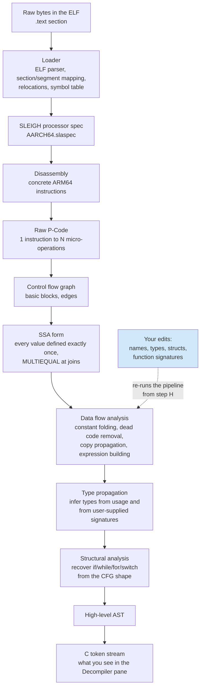
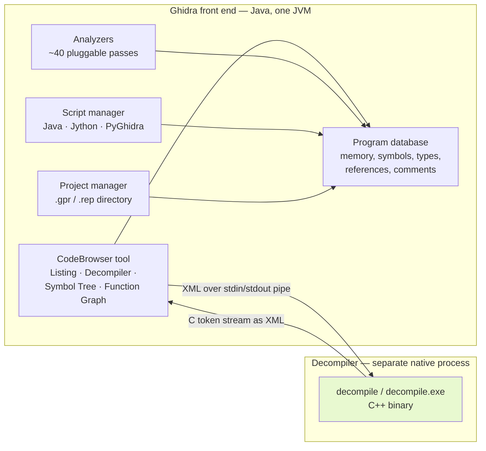
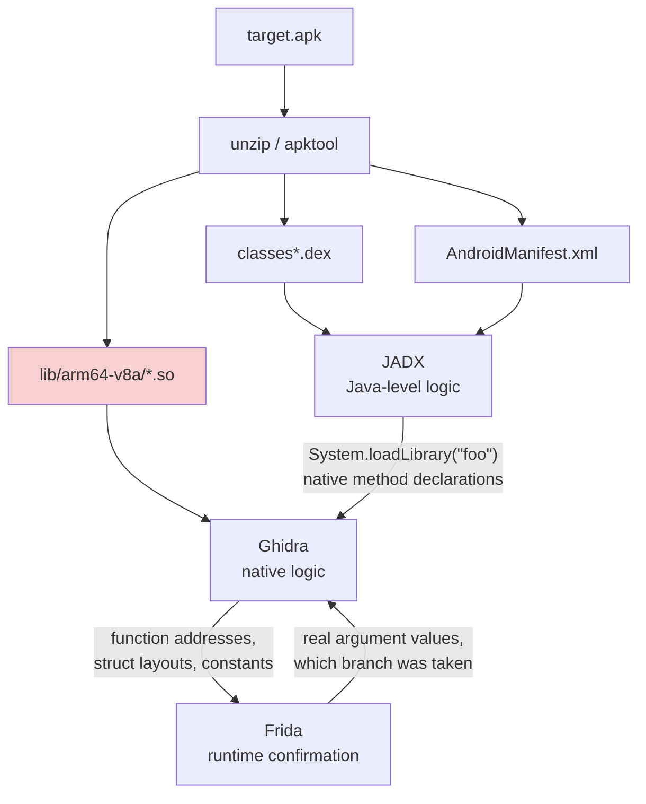
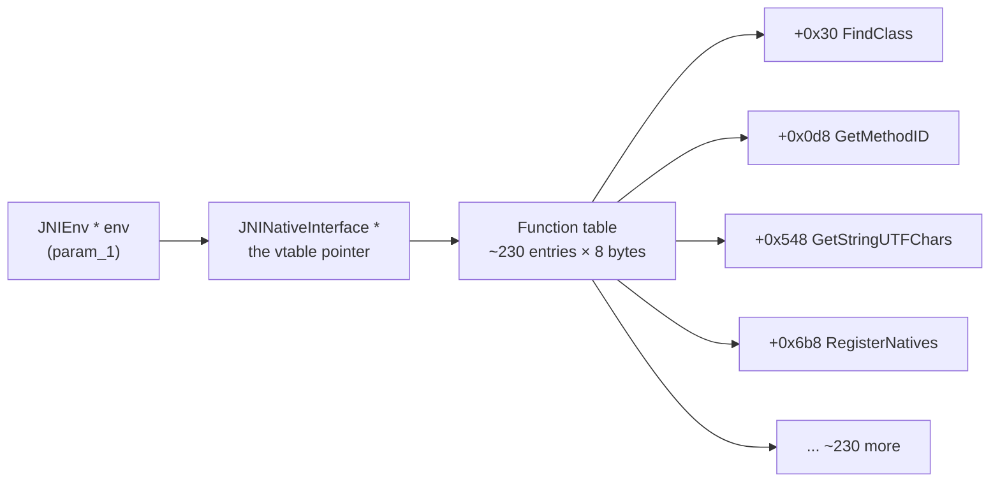
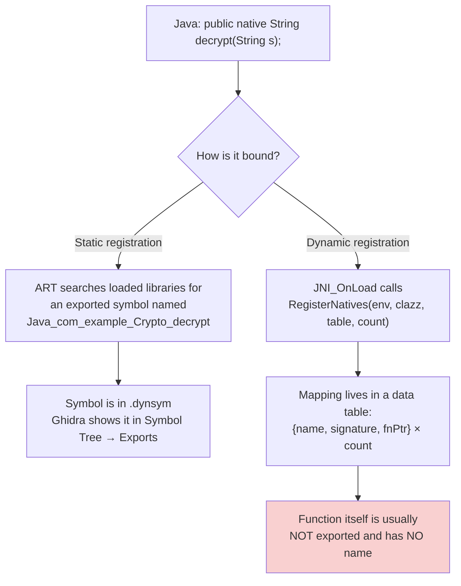
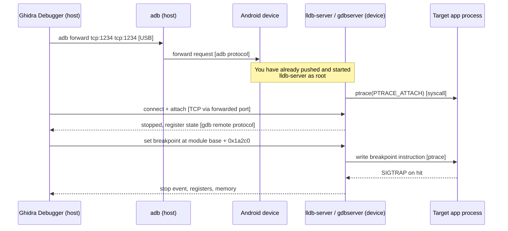
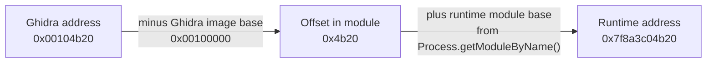
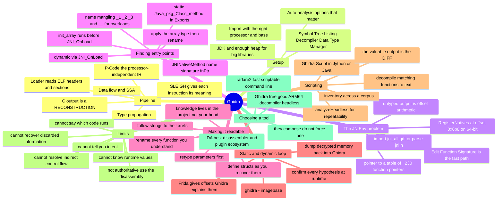

# 57 — Ghidra

> After this chapter you will be able to open an Android `.so` file in Ghidra, understand what the
> decompiler is actually doing to produce the C it shows you, recover both statically and dynamically
> registered JNI entry points, turn unreadable pseudo-C into readable code by fixing types, and
> automate all of it with headless scripting.

**Prerequisites:** [15-Native-Code](../15-Native-Code/README.md), [16-JNI](../16-JNI/README.md), [17-Libraries](../17-Libraries/README.md), [18-ARM](../18-ARM/README.md), [19-Memory](../19-Memory/README.md), [68-ReverseEngineering](../68-ReverseEngineering/README.md)
**Applies to:** Ghidra 10.x–12.x (measured on **12.1.2 PUBLIC**); target binaries from Android 5–16 (API 21–36), `arm64-v8a` primarily, `armeabi-v7a` and `x86_64` where noted

---

## Read this before you read anything else: what is measured here and what is not

This repository's rule is that claims are measured, not recited. This chapter mixes two kinds of
material, and it says which is which up front — because a constructed listing that *reads* like a
recovered one is the most damaging thing a reverse-engineering chapter can contain.

**Ghidra is installed on the machine this chapter was written on, and it was run.** That was checked,
not assumed — Ghidra **12.1.2 PUBLIC** (build 20260605) on **Java 24.0.2**, driven headless:

```
support/analyzeHeadless <project> ch57 -import libreference.so -postScript <dump script>
INFO  Using Language/Compiler: AARCH64:LE:64:v8A:default (ProgramLoader)
INFO  REPORT: Analysis succeeded for file: .../libreference.so (HeadlessAnalyzer)
```

So the split in this chapter is **not** "tool present / tool absent". It is **"real sample / teaching
sample"**, and that distinction is marked throughout:

| Marker | Meaning |
|---|---|
| **Measured** | Produced by running a named tool here: Ghidra 12.1.2 headless, or the NDK 25.2.9519653 toolchain (`aarch64-linux-android21-clang++`, `llvm-objdump`, `llvm-readelf`, `llvm-nm`). The tool, the input binary and the output are named. |
| **Illustrative** | A **constructed teaching example**. The target library, its addresses, its byte strings and its listings were written to demonstrate a method. They were **not** recovered from a real sample, and re-running the steps will not reproduce them. The *method* is real; the *sample* is invented. |

**What is measured.** Everything about this chapter's own target:
[`examples/01-reference-jni-lib.cpp`](examples/01-reference-jni-lib.cpp), built by
[`examples/build.sh`](examples/build.sh) into `libreference.so` (stripped) and
`libreference-unstripped.so` (the answer key). Its symbol counts, section layout, `.init_array`
relocation, JNI function-table offsets and the Ghidra decompiler output shown for it are all
**Measured**, and each such claim names how it was obtained. That target is real, it builds from
source with one command, and a reader with Ghidra can reproduce every figure quoted for it.

**What is illustrative.** The five worked examples in [section 9](#9-examples) are staged on
libraries that **do not exist**: `libcrypto_helper.so`, `libsecure.so` and `libapi.so` ship with no
APK, are present in no corpus, and were analysed by nobody. Their addresses, decompiler listings,
Listing-pane dumps and byte strings are written to be *typical*, not *recovered*. The same is true of
the short before/after decompiler fragments used as illustrations in §3.4, §3.11 and §6.4, each of
which carries its own marker. In particular, **the 32 bytes printed in §9.1 are not a key extracted
from anything** — see the note there.

> **Warning**
> Chapters [58-IDA](../58-IDA/README.md) and [59-radare2](../59-radare2/README.md) carry a similar
> pre-ToC block, but they are marking a *different* gap: those tools are not installed here, so their
> **commands** are marked `Unverified`. Here the tool *is* installed, so nothing is unverified for
> want of a tool — what is marked instead is the **sample**. Same two-tier discipline, different axis.
> If a step below behaves differently in your Ghidra than what is written, **the tool is right and
> this chapter is wrong.** Fix it here.

---

## Table of Contents

1. [Introduction](#1-introduction)
2. [High-Level Architecture](#2-high-level-architecture)
3. [Deep Internal Working](#3-deep-internal-working)
4. [Source Code Walkthrough (AOSP)](#4-source-code-walkthrough-aosp)
5. [Security Perspective](#5-security-perspective)
6. [Reverse Engineering Perspective](#6-reverse-engineering-perspective)
7. [Dynamic Analysis](#7-dynamic-analysis)
8. [Static Analysis](#8-static-analysis)
9. [Examples](#9-examples)
10. [Common Interview Questions](#10-common-interview-questions)
11. [Common Mistakes](#11-common-mistakes)
12. [Hands-on Labs](#12-hands-on-labs)
13. [Summary](#13-summary)
14. [References](#14-references)

---

## 1. Introduction

### The problem that existed before decompilers

A compiler is a machine that destroys information. You write this:

```c
// A developer's source — this is what existed before compilation
int check_license(const char *key) {
    int checksum = 0;
    for (int i = 0; i < 16; i++) {
        checksum += key[i] * (i + 1);
    }
    return checksum == 0x4d2;
}
```

The compiler reads it, and emits a sequence of numbers. The variable name `checksum` is gone. The
type `int` is gone. The `for` loop is gone — it has become a backwards conditional branch. The
constant `0x4d2` might have been split across two instructions because ARM64 cannot encode arbitrary
32-bit immediates in one instruction. The function name `check_license` survives only if the binary
was not stripped, and on a shipped Android library it usually was.

What is left on disk is this, and only this:

```
1f 20 03 d5 fd 7b bf a9 fd 03 00 91 ...
```

> **Definition**
> **Machine code** is the raw byte sequence a CPU executes directly. It contains no names, no types,
> no comments, and no structure beyond what the instruction encoding itself implies. Every piece of
> information a human needs to understand a program — names, types, control structures, intent — was
> present in the source and was deliberately discarded by the compiler because the CPU does not need
> it.

Reverse engineering a native library is therefore an act of **reconstruction**. You are not reading
the program. You are rebuilding a plausible source program that would have compiled to these bytes.
Two tools help you do that, and it is essential that you understand they are different tools solving
different problems.

### What a disassembler does

> **Definition**
> A **disassembler** converts machine code bytes back into assembly instructions. It is, in
> principle, a lookup: the byte pattern `1f 20 03 d5` in ARM64 means `nop`, always, unambiguously.
> A disassembler makes no guesses about meaning; it only decodes encoding.

Disassembly is close to lossless for a fixed-width instruction set like ARM64, where every
instruction is exactly four bytes and instruction boundaries are unambiguous once you know where
code starts. It is much harder for a variable-width instruction set like x86, where starting to
decode one byte later produces a completely different and equally valid-looking instruction stream.

Disassembly does not solve your problem, though. Two hundred lines of ARM64 assembly implementing a
loop with a multiply-accumulate is *correct* but it is not *readable*. A human can hold perhaps
twenty instructions in working memory. A single mid-sized function in a real Android library is a
thousand.

### What a decompiler does

> **Definition**
> A **decompiler** converts machine code into a high-level language — in Ghidra's case, a C-like
> pseudo-language. Unlike disassembly, this is a genuine *inference* problem: the decompiler must
> guess which registers and stack slots correspond to which source variables, guess their types,
> recognise that a particular arrangement of branches was originally a `while` loop, and decide
> which values are function arguments and which are scratch.

Every one of those is a guess. The decompiler is frequently wrong, and it is wrong in ways that
matter. Understanding *how* it guesses is what separates someone who stares at broken output and
gives up from someone who supplies the two missing facts that make the whole function snap into
focus. That is the central skill this chapter teaches, and it is why this chapter spends more time
on P-Code and type propagation than on which menu contains which button.

> **Mental Model**
> Think of the decompiler as a translator working from a language it half-knows, with no dictionary.
> Given `mov x0, #0; add x0, x0, x1`, it must decide: is `x0` an integer counter, a pointer being
> advanced, or a length accumulating? All three compile to the same instruction. The decompiler picks
> one based on how the value is *used later*. When you tell Ghidra "this parameter is a
> `MyStruct *`", you are not decorating the output — you are feeding the inference engine a fact it
> could not derive, and it will propagate that fact through every expression that touches the value.

### Why Ghidra specifically

Ghidra is a software reverse engineering framework developed by the United States National Security
Agency and released publicly as open source in March 2019. For Android security work it matters for
five concrete reasons.

| Reason | Why it matters for Android |
|---|---|
| It is free and open source (Apache 2.0) | You can put it on every machine, in CI, on a client's air-gapped host, without a licence server. Compare this with [IDA Pro](../58-IDA/README.md). |
| Its decompiler supports ARM64 (AArch64) well | The overwhelming majority of shipping Android native code is `arm64-v8a`. A decompiler that only does x86 is useless here. |
| It is scriptable in Java and Python, and has a real headless mode | You will need to analyse hundreds of `.so` files across dozens of APKs. Clicking is not a strategy. |
| Its type system is exposed and editable | Defining `JNIEnv` correctly transforms JNI-heavy code from unreadable to readable. This is the single highest-value action in Android native RE. |
| It handles whole-program projects, not single files | An APK often ships several interdependent libraries. Ghidra projects hold them together with shared type archives. |

### What would break without it

Without a decompiler you can still do Android native RE — people did for years. But three specific
tasks become impractical:

1. **Understanding a large obfuscated crypto routine.** A white-box AES implementation is 8,000
   instructions of table lookups. Decompiled, the table structure becomes visible.
2. **Finding a dynamically registered JNI method's implementation.** The mapping from Java method
   name to native function pointer lives in a data structure built at runtime. Reading it out of
   assembly is possible; reading it out of a decompiled `RegisterNatives` call is thirty seconds.
3. **Auditing for memory-safety bugs.** Buffer arithmetic is invisible in assembly and obvious in C.
   `memcpy(dest, src, user_controlled_len)` where `dest` is a 64-byte stack array is a finding you
   can see at a glance in decompiled output and would grind through for an hour in assembly.

> **Pentester's Note**
> On a typical Android engagement you will not read every native function. You will read three: the
> one that implements the root check, the one that derives the encryption key, and the one that signs
> the API request. Everything in this chapter is in service of finding those three functions fast and
> reading them accurately. If you find yourself decompiling the whole library, you have lost the
> plot — go back to [51-DynamicAnalysis](../51-DynamicAnalysis/README.md) and let the running app
> tell you which functions matter.

---

## 2. High-Level Architecture

### The decompilation pipeline

This is the diagram to internalise. Everything else in the chapter is a detail hanging off one of
these boxes.



Read that from the top. The **loader** is the part that knows what an ELF file is: it reads the
section headers, works out which bytes are code and which are data, applies relocations, and imports
whatever symbols the file still has. If the loader gets the base address or the architecture wrong,
everything downstream is garbage — which is why the import dialogue's language selection matters.

**SLEIGH** is Ghidra's processor specification language. It is a text file that describes, formally,
what every ARM64 instruction encoding means in terms of a small set of primitive operations. This is
why Ghidra supports so many architectures: adding one means writing a SLEIGH file, not writing a
decompiler.

**P-Code** is the pivot of the whole design, and section 3 covers it properly. In one sentence: it
is a tiny, architecture-independent instruction set that every real instruction is translated into,
so that all the hard analysis is written once instead of once per CPU.

The three analysis stages — **data flow**, **type propagation**, **structural analysis** — are where
the reconstruction happens, and they are where your edits take effect. Notice the dashed feedback
arrow. When you rename a variable, nothing re-runs; renaming is cosmetic. When you *retype* a
variable or change a function signature, Ghidra re-runs the decompiler from the data-flow stage with
your fact included, and the output can change completely. That difference is worth remembering.

### Ghidra's process architecture



The point of this diagram is the box on the right. **Ghidra's decompiler is not written in Java and
does not run inside the Ghidra JVM.** It is a separate C++ executable (`decompile` on Linux and
macOS, `decompile.exe` on Windows) living under `Ghidra/Features/Decompiler/os/<platform>/`. The
Java front end serialises the function's P-Code and the relevant type information to XML, writes it
to the child process's standard input, and reads back an XML representation of the C token stream.

Three practical consequences follow directly from that architecture:

1. **"Decompilation timed out" is a real, tunable condition.** The Java side gives the native process
   a fixed budget (30 seconds by default). A heavily obfuscated function with thousands of basic
   blocks will exceed it. Raise it under *Edit → Tool Options → Decompiler → Analysis →
   Decompiler Timeout*.
2. **The decompiler can crash without taking Ghidra down.** You will occasionally see
   "Low-level Error: ..." in the Decompiler pane. That is the child process failing on a malformed
   or hostile construct — sometimes a deliberate anti-decompilation trick.
3. **Headless scripting can talk to it directly** through `DecompInterface`, which is exactly what
   the batch scripts later in this chapter do.

### Where Ghidra sits in the Android RE workflow



Ghidra never works alone on Android. The Java side of the app tells you *which* library is loaded
and *which* methods are native — that is JADX's job, covered in
[56-JADX](../56-JADX/README.md). Ghidra tells you what the native code does. Frida
([53-Frida](../53-Frida/README.md)) tells you what actually happened at runtime, which resolves the
questions static analysis cannot answer: what the real key material was, which branch executed, what
the server returned.

The loop between Ghidra and Frida is the productive part. You find an interesting function at
offset `0x1a2c0` in Ghidra; you hook `module.base.add(0x1a2c0)` in Frida and print its arguments; the
real arguments tell you what the parameter types are; you set those types in Ghidra and the
decompilation becomes readable; the readable code tells you what to hook next.

---

## 3. Deep Internal Working

### 3.1 SLEIGH — how Ghidra knows what an instruction means

> **Definition**
> **SLEIGH** is a domain-specific language for describing processor instruction sets. A SLEIGH
> specification defines the register set, the address spaces, how instruction bytes decode into
> mnemonics and operands, and — critically — the **semantics**: what each instruction does, expressed
> as a sequence of P-Code operations.

For AArch64 the specification lives in `Ghidra/Processors/AARCH64/data/languages/`, principally
`AARCH64.slaspec` with supporting `.sinc` include files and the `AARCH64.ldefs` language-definition
file that lists the variants (little-endian, big-endian, v8A, with or without specific extensions).

A simplified SLEIGH constructor looks conceptually like this:

```
# Conceptual illustration of SLEIGH semantics, not a literal excerpt
:add Rd, Rn, Rm  is  ... {
    Rd = Rn + Rm;
}
```

The body between the braces is P-Code. The `+` there is not "the C plus operator"; it is the P-Code
operation `INT_ADD` applied to two varnodes.

Why does this matter to you as a tester? Because it explains a class of failure. When Ghidra
disassembles a modern ARM64 binary and shows you `.byte` data or an unknown instruction, the cause is
almost always that the instruction belongs to an architecture extension the loaded SLEIGH variant
does not model — pointer authentication (`PAC`), the Scalable Vector Extension (`SVE`), or memory
tagging (`MTE`). The fix is to select a language variant that includes the extension at import time,
or to accept the gap and read those instructions manually.

> **Under the Hood**
> Pointer authentication instructions (`PACIA`, `AUTIA`, `PACIASP`, `RETAA`) appear in libraries built
> for ARMv8.3-A and above, which includes plenty of shipping Android code on recent Pixel and Samsung
> hardware. On CPUs that do not implement PAC, these encode into the NOP space and execute as no-ops,
> which is how the same binary runs everywhere. In Ghidra you will see them decoded as `hint` or
> similar depending on the variant. They are not obfuscation; ignore them unless you are attacking
> control-flow integrity.

### 3.2 P-Code — the intermediate representation

This is the concept that most people skip and should not.

> **Definition**
> **P-Code** is Ghidra's intermediate representation (IR): a small, register-transfer-level,
> architecture-neutral instruction set. Every real machine instruction is translated into one or more
> P-Code operations. All of Ghidra's analysis — data flow, type inference, decompilation — operates on
> P-Code, never on ARM64 or x86 directly.

> **Definition**
> A **varnode** is P-Code's only operand type. It is a triple of *(address space, offset, size in
> bytes)*. A CPU register is a varnode in the `register` space. A stack slot is a varnode in the
> `stack` space (or `unique` after transformation). A literal constant is a varnode in the `const`
> space, where the "offset" *is* the value. A memory location is a varnode in the `ram` space.

That single uniform operand representation is why one analysis engine can serve fifty architectures.
A register and a memory cell and a constant are all just varnodes; only the address space differs.

**Why an IR at all?** Consider what you would otherwise need. Constant propagation would have to be
written for ARM64, then again for ARM32, then again for x86, then MIPS, then RISC-V — and each
version would have to understand that architecture's flags, addressing modes and side effects. With
P-Code it is written once. The cost of an IR is one translation layer per architecture, written in
SLEIGH by someone who knows that CPU. The benefit is that every analysis is architecture-independent.

**The P-Code operation set.** There are roughly seventy operations. You do not need to memorise them,
but you should recognise the families, because when you read raw P-Code (Ghidra shows it if you
enable *Listing Fields → PCode Field*) you need to know what you are looking at.

| Family | Operations | Meaning |
|---|---|---|
| Data movement | `COPY`, `LOAD`, `STORE`, `PIECE`, `SUBPIECE` | Move a value; dereference a pointer; write through a pointer; concatenate and slice varnodes |
| Control flow | `BRANCH`, `CBRANCH`, `BRANCHIND`, `CALL`, `CALLIND`, `RETURN` | Unconditional, conditional, computed (jump table) branches; direct and indirect calls |
| Integer arithmetic | `INT_ADD`, `INT_SUB`, `INT_MULT`, `INT_DIV`, `INT_SDIV`, `INT_REM`, `INT_SREM`, `INT_2COMP`, `INT_NEGATE` | Signed and unsigned variants are distinct operations — this is how signedness reaches the type system |
| Integer comparison | `INT_EQUAL`, `INT_NOTEQUAL`, `INT_LESS`, `INT_SLESS`, `INT_LESSEQUAL`, `INT_SLESSEQUAL` | `INT_LESS` is unsigned, `INT_SLESS` is signed. Seeing `INT_SLESS` on a length check is a bug hunt starting point |
| Bit operations | `INT_AND`, `INT_OR`, `INT_XOR`, `INT_LEFT`, `INT_RIGHT`, `INT_SRIGHT`, `POPCOUNT` | `INT_RIGHT` is logical shift right, `INT_SRIGHT` is arithmetic |
| Extension | `INT_ZEXT`, `INT_SEXT` | Zero- and sign-extension — the source of a large fraction of real integer bugs |
| Carry/overflow | `INT_CARRY`, `INT_SCARRY`, `INT_SBORROW` | How condition flags are modelled without modelling a flags register per architecture |
| Boolean | `BOOL_AND`, `BOOL_OR`, `BOOL_XOR`, `BOOL_NEGATE` | One-byte boolean values, distinct from bitwise operations |
| Floating point | `FLOAT_ADD`, `FLOAT_SUB`, `FLOAT_MULT`, `FLOAT_DIV`, `FLOAT_NEG`, `FLOAT_ABS`, `FLOAT_SQRT`, `FLOAT_EQUAL`, `FLOAT_LESS`, `INT2FLOAT`, `FLOAT2FLOAT`, `TRUNC`, `CEIL`, `FLOOR`, `ROUND`, `FLOAT_NAN` | IEEE semantics |
| SSA / analysis-only | `MULTIEQUAL`, `INDIRECT`, `CAST`, `PTRADD`, `PTRSUB` | Not produced by SLEIGH; created by the decompiler during transformation. `MULTIEQUAL` is the SSA φ (phi) function |
| Escape hatch | `CALLOTHER` | "This instruction does something P-Code cannot express" — used for `svc` (syscall), cache maintenance, cryptographic accelerator instructions such as `AESE`/`AESMC` |

> **Pentester's Note**
> `CALLOTHER` in a decompiled function is a signal, not noise. If you see `CALLOTHER("AESE", ...)`
> you have found hardware-accelerated AES, and the surrounding code is a key schedule. If you see
> `CALLOTHER` on an `svc #0`, you have found a direct syscall — which frequently means the code is
> deliberately bypassing libc to defeat your `libc.so` hooks. See
> [67-BypassingProtections](../67-BypassingProtections/README.md).

**A concrete translation.** The ARM64 instruction `ldr x0, [x1, #8]` becomes approximately:

```
# Conceptual raw P-Code for: ldr x0, [x1, #8]
$U1:8 = INT_ADD x1, 8:8        # compute the effective address into a temporary varnode
x0    = LOAD ram($U1)          # dereference it, 8 bytes, into register x0
```

Note `$U1`. That is a varnode in the `unique` address space — a compiler-style temporary that exists
only within the translation of one instruction. It has no hardware counterpart.

And `cbz x0, label` — compare and branch if zero — becomes:

```
# Conceptual raw P-Code for: cbz x0, label
$U2:1 = INT_EQUAL x0, 0:8
        CBRANCH label, $U2
```

Two P-Code operations from one instruction. This *expansion* is normal: one ARM64 instruction with
a side effect on flags can produce five or six P-Code operations. Raw P-Code is verbose. The
decompiler's job is to collapse it back down.

### 3.3 Data flow analysis and SSA

Having translated to P-Code, the decompiler builds a control-flow graph and converts it to **SSA
form**.

> **Definition**
> **Static Single Assignment (SSA) form** is a representation in which every variable is assigned
> exactly once. If the original code assigns `x` three times, SSA renames them `x₁`, `x₂`, `x₃`.
> Where two control-flow paths join and could each have defined the variable, a **φ (phi) function**
> is inserted: `x₄ = φ(x₂, x₃)`. In Ghidra's P-Code the φ function is the `MULTIEQUAL` operation.

SSA matters because it makes "where did this value come from?" a pointer-chase instead of a search.
In non-SSA form, to know what `x0` holds at a given instruction you must walk backwards through every
path considering every possible assignment. In SSA form, each use points directly at its single
definition. Every subsequent optimisation becomes cheap.

With SSA in place the decompiler runs a series of simplification passes:

| Pass | What it does | What you observe in the output |
|---|---|---|
| Copy propagation | Replaces a use of a copied value with the original | Intermediate `iVar` variables disappear |
| Constant folding | Evaluates constant expressions at analysis time | ARM64's two-instruction constant materialisation (`movz`/`movk`) collapses into a single literal |
| Dead code elimination | Removes definitions never used | Flag computations vanish, because most instructions set flags nobody reads |
| Expression rebuilding | Merges chains of single-use definitions into one expression tree | `a = b + c; d = a * 2;` becomes `d = (b + c) * 2` |
| Stack frame recovery | Identifies the frame pointer and turns `[sp, #0x18]` into a named local | `local_18` appears instead of a raw stack reference |
| Calling convention application | Uses the compiler spec to decide which registers are arguments, which is the return | `FUN_00101234(param_1, param_2)` with the right arity |
| Structural analysis | Matches CFG shapes against known patterns | `if`, `while`, `for`, `do/while`, `switch` reappear |

> **Under the Hood**
> Dead code elimination is why decompiled ARM64 looks so much cleaner than the assembly. ARM64
> instructions like `subs` set the N, Z, C and V condition flags. SLEIGH faithfully models all four
> as separate P-Code assignments. In a typical function, 90% of those flag writes are never read.
> SSA makes them trivially identifiable as dead, and they disappear. If you ever wonder why the
> decompiler output is a tenth the length of the disassembly, this is most of the answer.

### 3.4 Type propagation — the part you will spend your time on

Type inference is the decompiler's weakest link and your greatest lever.

The decompiler starts with almost nothing. It knows the size of each varnode in bytes. It knows the
signedness implied by which P-Code operation touched it (`INT_SLESS` implies signed;
`INT_LESS` implies unsigned). It knows that a varnode used as the address of a `LOAD` is a pointer.
It knows the prototypes of imported functions if it can resolve them against a type archive.

From those seeds it propagates. If `param_1` is passed to `strlen`, and `strlen`'s prototype says the
first parameter is `char *`, then `param_1` is `char *`. If `param_1` is `char *` and the code does
`param_1 + 8`, that is pointer arithmetic on bytes. If `param_1` is instead `MyStruct *` and the code
does `*(int *)(param_1 + 8)`, the decompiler can render it as `param_1->field_8` — but only if you
told it about `MyStruct`.

That is the whole game. Compare:

**Before — the decompiler knows nothing:**

```c
// Illustrative — constructed to show the before/after contrast in one place.
// Ghidra output with no type information supplied
undefined8 FUN_00112a40(long param_1,long param_2,long param_3)
{
  long lVar1;
  undefined8 uVar2;
  char *pcVar3;

  lVar1 = *(long *)(param_1 + 0x548);
  pcVar3 = (char *)(**(code **)(*(long *)param_1 + 0x548))(param_1,param_3,0);
  uVar2 = FUN_00113c80(pcVar3);
  (**(code **)(*(long *)param_1 + 0x550))(param_1,param_3,pcVar3);
  return uVar2;
}
```

**After — `param_1` retyped to `JNIEnv *`, `param_3` to `jstring`:**

```c
// The same function after supplying two type facts
undefined8 Java_com_example_Crypto_decrypt(JNIEnv *env,jobject thiz,jstring input)
{
  const char *utf;
  undefined8 result;

  utf = (*env)->GetStringUTFChars(env,input,(jboolean *)0x0);
  result = do_decrypt(utf);
  (*env)->ReleaseStringUTFChars(env,input,utf);
  return result;
}
```

Those two listings are the same bytes. The difference is two facts. `0x548` was an offset into the
JNI function table; once Ghidra knows the table's layout it prints `GetStringUTFChars` instead of the
number. This is why **defining `JNIEnv` is the single highest-value action in Android native reverse
engineering**, and section 3.8 covers it in full.

**How types propagate — the rules that matter:**

| Situation | Inference the decompiler makes |
|---|---|
| Varnode is the address operand of `LOAD`/`STORE` | It is a pointer; the pointed-to size comes from the access size |
| Varnode is an argument to a function with a known prototype | It takes the parameter's declared type |
| Varnode is compared with `INT_SLESS` | Signed integer |
| Varnode is compared with `INT_LESS` | Unsigned integer |
| A `LOAD` at `base + constant` where `base` has a struct pointer type | Renders as `base->field_at_constant`, if a field exists there |
| A value flows into a `RETURN` | Constrains the function's return type |
| Two types meet at a `MULTIEQUAL` | Ghidra computes a "meet" in its type lattice; conflicting types produce `undefined` |

> **Definition**
> **`undefined`, `undefined1`, `undefined4`, `undefined8`** in Ghidra output mean "a value of this
> many bytes whose type I could not determine". They are not a C type; they are Ghidra telling you it
> gave up. `undefined8` on a 64-bit target usually means "8 bytes — could be a `long`, a pointer, or a
> `double`, and nothing in the code disambiguated it". Every `undefined` in a function you care about
> is an invitation to supply a type.

> **Warning**
> The decompiler's type inference is *unsound* by design — it prefers producing readable output to
> producing provably correct output. It will happily show you `param_1 + 1` as pointer arithmetic
> when the original code did integer arithmetic, or vice versa. **Never report a vulnerability based
> on decompiler output alone.** Confirm against the disassembly, and confirm again at runtime. This
> is the most important sentence in this chapter.

### 3.5 Installation and project setup

**Requirements.** Ghidra needs a Java Development Kit — JDK 17 or later for Ghidra 10.2 onwards, JDK
21 for recent 11.x releases. Check the `README.html` shipped in the release for the exact version;
Ghidra refuses to start on the wrong JDK with a clear error message.

```bash
# host (Linux/macOS) — install a JDK, fetch Ghidra, run it
sudo apt-get install -y openjdk-21-jdk unzip     # Debian/Ubuntu
# Download the release ZIP from https://github.com/NationalSecurityAgency/ghidra/releases
unzip ghidra_11.x.x_PUBLIC_*.zip -d ~/tools/
~/tools/ghidra_11.x.x_PUBLIC/ghidraRun
```

```powershell
# host (Windows PowerShell) — after installing a JDK and extracting the release
& "$env:USERPROFILE\tools\ghidra_11.x.x_PUBLIC\ghidraRun.bat"
```

**Memory.** The default heap is small for large libraries. A 40 MB stripped `libflutter.so` or a game
engine library will thrash. Edit `support/launch.properties` and raise the maximum heap:

```properties
# ghidra/support/launch.properties — give the JVM room for large Android libraries
VMARGS=-Xmx8G
```

**Projects.** Ghidra has two project types.

| Type | What it is | When to use it on Android work |
|---|---|---|
| Non-Shared Project | A local `.gpr` file plus a `.rep` directory on your disk | Almost always. One project per target application. |
| Shared Project | Backed by a Ghidra Server, with check-in/check-out and version history | Team engagements where two people reverse the same library, or when you want auditable history of your analysis |

> **Pentester's Note**
> Create **one project per application**, and import every `.so` from that APK into it, not one
> project per library. Cross-library references matter: an app's obfuscated `libsecure.so` frequently
> calls into a vendor SDK's `libvendor.so`, and having both in one project lets you follow the call.
> It also lets a single data type archive (with your `JNIEnv` definitions) apply to all of them.

**Importing an Android `.so`.** The import dialogue is where the most consequential decisions get
made.

| Field | Correct value for Android | Consequence of getting it wrong |
|---|---|---|
| Format | `Executable and Linking Format (ELF)` | Raw binary import gives you no sections, no symbols, no relocations |
| Language | `AARCH64:LE:64:v8A` for `arm64-v8a` | Wrong endianness or bitness produces total garbage |
| Language | `ARM:LE:32:v8` (Thumb-aware) for `armeabi-v7a` | ARM/Thumb confusion produces plausible-looking nonsense |
| Language | `x86:LE:64:default` for `x86_64` emulator builds | |
| Compiler | `default` (which selects the Linux/ELF AArch64 convention) | An incorrect compiler spec breaks calling-convention recovery, so arguments are wrong |
| Options → Apply Processor Defined Labels | On | You lose useful pre-defined symbol names |
| Options → Load External Libraries | Usually off | On, it tries to pull in dependencies you have not provided; leave off unless you have staged them |

Ghidra normally detects the language correctly from the ELF header's `e_machine` field. If it
presents you with a list to choose from, the file is either corrupt, packed, or not actually an ELF.

> **Warning**
> An APK typically ships several ABI directories. `lib/arm64-v8a/libfoo.so` and
> `lib/armeabi-v7a/libfoo.so` are **different binaries** compiled from the same source. Analyse the
> one that the device under test actually loads — check with
> `adb shell getprop ro.product.cpu.abi`, and confirm at runtime by reading `/proc/<pid>/maps`. Every
> so often the 32-bit build has debug symbols that the 64-bit build does not, which is worth checking
> before you start.

### 3.6 Auto-analysis — which options actually matter

When you open a newly imported program, Ghidra asks "Analyze now?" and presents about forty
analysers. Most people click Yes and never look. Here are the ones that matter for Android native
libraries.

| Analyser | Default | Recommendation for Android `.so` | Why |
|---|---|---|---|
| ASCII Strings | On | Keep on | Finds the string constants you will search |
| Aggressive Instruction Finder | **Off** | Turn **on** for stripped/obfuscated libraries | Recovers code the normal flow-following analyser missed because nothing referenced it. Produces false positives in data sections — a worthwhile trade on a stripped binary |
| Apply Data Archives | On | Keep on | Applies the bundled `generic_clib_64` archive so `memcpy`, `strlen`, `malloc` get real prototypes. This is a big chunk of your type propagation for free |
| Call Convention ID | On | Keep on | Determines argument passing per function |
| Decompiler Parameter ID | **Off** | Turn **on** | Runs the decompiler over every function to determine parameter counts and types. Slow — minutes on a large library — and by far the most valuable optional analyser. It is the difference between `FUN_x(void)` and `FUN_x(char*, int)` |
| Demangler GNU | On | Keep on | Turns `_ZN6Crypto7decryptEPKcj` into `Crypto::decrypt(char const*, unsigned int)`. Essential for C++ libraries |
| DWARF | On | Keep on | If debug info survived — rare in release, common in vendor SDKs and in NDK debug builds — this hands you real names and types |
| Function ID | On | Keep on, and add signature libraries | Matches known library functions by hash. See below |
| Non-Returning Functions – Discovered | On | Keep on | Stops the disassembler running past `abort`, `exit`, `__stack_chk_fail` and creating fake code |
| Stack | On | Keep on | Recovers the stack frame layout |
| Shared Return Calls | On | Keep on | Handles tail calls, which ARM64 compilers emit constantly |
| Variadic Function Signature Override | Off | Turn on if the target uses `printf`-family logging heavily | Recovers format-string arguments |
| Scalar Operand References | On | Keep on | Turns immediates that look like addresses into references |

> **Definition**
> **Function ID (FID)** is Ghidra's library-function identification mechanism. It computes a hash over
> a function's instructions (with operands masked out, so that different link addresses still match)
> and looks the hash up in a database of known library functions. When it hits, the function gets its
> real name. Ghidra ships FID databases for common Visual Studio runtimes; for Android you generally
> need to build your own from an NDK sysroot. This is Ghidra's counterpart to
> [IDA's FLIRT signatures](../58-IDA/README.md).

**Re-running analysis.** *Analysis → Auto Analyze* re-runs selected analysers. Do this after you have
manually created functions in a region the analyser missed, or after you have applied a data type
archive. Your manual edits are preserved; analysis does not clobber user-set names or types.

> **Pentester's Note**
> For an obfuscated library, the productive sequence is: run standard analysis first, look at the
> function count, then run *Aggressive Instruction Finder* and *Decompiler Parameter ID* and compare.
> If the function count jumps from 200 to 2,000, the library was doing something to hide its code
> from flow-following analysis, and that fact alone tells you what kind of target you are dealing
> with.

### 3.7 The panes you will live in

**The Listing (CodeBrowser main window).** The disassembly view, address-ordered. Every line is an
address, the raw bytes, the mnemonic, operands, and any comments or references. Fields are
configurable through the "Browser Field Formatter" (the small icon at the top right of the Listing).
Enable the **PCode** field when you need to see what the decompiler is actually reasoning about — it
is the fastest way to understand why a decompilation is wrong.

**The Decompiler pane.** The C-like output for the function containing the cursor. It is
*bidirectionally synchronised* with the Listing: clicking a line in one highlights the corresponding
location in the other. Getting into the habit of watching both is what stops you trusting bad
decompilation.

**The Symbol Tree.** A categorised tree of everything named in the program.

| Node | Contents | Android relevance |
|---|---|---|
| Imports | Symbols the library requires from elsewhere | `dlopen`, `ptrace`, `__system_property_get`, `fopen` — the root-detection shopping list |
| Exports | Symbols the library provides | Every `Java_*` JNI entry point with static registration lands here |
| Functions | All recovered functions | |
| Labels | Named addresses that are not functions | |
| Classes | Recovered C++ classes (from demangling and RTTI) | |
| Namespaces | | |

**The Data Type Manager.** The bottom-left window listing type archives. This is where `JNIEnv` will
live once you import it. Built-in archives include `generic_clib` and `generic_clib_64`. You can
open additional `.gdt` archive files here, and you can create your own.

**Function Graph.** *Window → Function Graph* shows the current function's basic blocks as a
node-and-edge diagram. Its value is pattern recognition: a normal function looks like a tree; a
function flattened by a control-flow-flattening obfuscator looks like a bicycle wheel — one central
dispatcher block with dozens of blocks radiating from it and returning. You can identify obfuscation
from across the room in this view. See [40-Obfuscation](../40-Obfuscation/README.md).

**Defined Strings.** *Window → Defined Strings* lists every string Ghidra found. Sort it, read it,
and cross-reference the interesting ones. On Android this is where you find `/system/bin/su`,
`ro.debuggable`, `magisk`, API endpoints, and hardcoded keys.

**Function Call Trees.** *Window → Function Call Trees* shows incoming and outgoing calls for the
current function as a navigable tree. Use the incoming tree to answer "who reaches this?" — for
example, working backwards from `strcmp` to find which caller compares against a hardcoded password.

### 3.8 The JNIEnv problem, and how to solve it

This section is the reason the chapter exists.

**What the problem is.** Every JNI function receives a `JNIEnv *` as its first parameter.
`JNIEnv` on the C side is a pointer to a `const struct JNINativeInterface *` — that is, a pointer to
a pointer to a table of about 230 function pointers. Every JNI operation is an indirect call through
that table at a fixed offset.



Without type information, Ghidra renders a JNI call as:

```c
// What you see with no JNIEnv definition
(**(code **)(*(long *)param_1 + 0x548))(param_1,param_3,0);
```

That is: dereference `param_1` to get the table pointer, add `0x548`, dereference again to get a
function pointer, call it. Correct, and completely unreadable. In a function that makes fifteen JNI
calls, you have fifteen of those and no idea what any of them do.

With `JNIEnv` defined, the same line is:

```c
// The same line once JNIEnv is a known type
(*env)->GetStringUTFChars(env,input,(jboolean *)0x0);
```

**How to fix it — three routes, in order of preference.**

**Route 1 — import a prepared `.gdt` archive.** The JNIAnalyzer project
(<https://github.com/Ayrx/JNIAnalyzer>) publishes a `jni_all.gdt` data type archive containing
`JNIEnv`, `JNINativeInterface`, `jobject`, `jclass`, `jstring`, `jmethodID`, `jfieldID`,
`JNINativeMethod` and the rest. This is the fastest path.

1. Download `jni_all.gdt`.
2. In the Data Type Manager pane, click the small down-arrow menu → *Open File Archive…* and select
   it.
3. Right-click the archive → *Apply Function Data Types* (optional but useful).
4. Now retype your parameters against it, as described below.

**Route 2 — parse `jni.h` yourself.** Ghidra can parse C headers directly.

1. Obtain `jni.h` from the Android NDK
   (`$ANDROID_NDK/toolchains/llvm/prebuilt/<host>/sysroot/usr/include/jni.h`).
2. *File → Parse C Source…*
3. Create a new parse profile; add `jni.h` to the source list.
4. Add include paths and, usually, a few `-D` definitions so the preprocessor is happy.
5. Parse to a new file archive, saving it as your own `.gdt` so you never do this again.

This route is more work and more likely to produce parse errors, but it produces types that match
exactly the NDK version your target was built against.

**Route 3 — declare the structs by hand.** Slow, but it is worth doing once because it teaches you
the layout. Create a structure `JNINativeInterface` with 230 pointer fields, then a typedef
`JNIEnv = JNINativeInterface *`. In practice, you only need the entries you actually meet, and you
can define a partial struct with the fields at the offsets you care about.

**Applying the type.** Once `JNIEnv` exists in your Data Type Manager:

1. Click in the Decompiler pane on `param_1`.
2. Press `Ctrl+L` (Retype Variable) — or right-click → *Retype Variable*.
3. Type `JNIEnv *` and press Enter.

The decompilation re-runs immediately and the offsets become names.

Better still, set the whole function signature at once. Right-click the function name in the
Decompiler → *Edit Function Signature*, and enter:

```c
jstring Java_com_example_Crypto_decrypt(JNIEnv *env, jobject thiz, jstring input)
```

**Useful JNI function table offsets.** The `JNINativeInterface` struct begins with four reserved
pointers, so the first real function is at index 4. On a 64-bit target, byte offset = index × 8.

| Function | Index | Byte offset (64-bit) | Why you care |
|---|---|---|---|
| `FindClass` | 6 | `0x30` | Reveals which Java classes the native code reaches into |
| `GetMethodID` | 33 | `0x108` | Paired with a name/signature string — tells you which Java method is about to be called |
| `GetStaticMethodID` | 113 | `0x388` | Same, for static methods |
| `NewStringUTF` | 167 | `0x538` | Native code producing a Java string — often the returned secret |
| `GetStringUTFChars` | 169 | `0x548` | Native code consuming a Java string — often the input to check |
| `ReleaseStringUTFChars` | 170 | `0x550` | Pairs with the above |
| `GetByteArrayElements` | 184 | `0x5c0` | Byte array in — crypto input |
| `ReleaseByteArrayElements` | 192 | `0x600` | |
| `RegisterNatives` | 215 | `0x6b8` | **The dynamic registration table — see below** |
| `UnregisterNatives` | 216 | `0x6c0` | |
| `GetJavaVM` | 219 | `0x6d8` | The library caching the VM pointer for later thread attachment |

> **Warning**
> These indices come from the standard `JNINativeInterface` layout and are stable across Android
> versions because the JNI specification fixes the order. Nevertheless, verify against the `jni.h`
> from the NDK revision you believe the target was built with before you rely on an offset in a
> report. If you have imported the type archive, you do not need to memorise any of this — Ghidra
> prints the name.

### 3.9 Finding JNI entry points

There are exactly two ways a Java `native` method gets connected to a C function, and you must handle
both. This is covered from the Java side in [16-JNI](../16-JNI/README.md); here is the Ghidra side.



**Static registration** is the easy case. The symbol name is mechanically derived from the fully
qualified Java method name:

```
Java_<package with dots replaced by underscores>_<class>_<method>
```

with an escaping scheme for awkward characters:

| Java character | Encoded as |
|---|---|
| `.` (package separator) | `_` |
| `_` | `_1` |
| `;` | `_2` |
| `[` | `_3` |
| Non-ASCII Unicode `U+XXXX` | `_0XXXX` |

If the method is overloaded, the mangled name gains `__` followed by the encoded argument signature.

Finding these in Ghidra is one search: *Search → Program Text…* → search for `Java_` in *Labels*, or
expand *Symbol Tree → Exports* and read.

```bash
# host — the same thing from the command line, before you even open Ghidra
readelf --dyn-syms lib/arm64-v8a/libnative.so | grep ' Java_'
nm -D --defined-only lib/arm64-v8a/libnative.so | grep ' T Java_'
```

**Dynamic registration** is the case that defeats beginners, and it is used by essentially every
commercial obfuscator and packer precisely because it defeats beginners.

The library exports `JNI_OnLoad`, which ART calls immediately after `System.loadLibrary()`. Inside,
the library calls `RegisterNatives` with an array of `JNINativeMethod` structures:

```c
// The structure being registered — from the NDK's jni.h
typedef struct {
    const char* name;       // "decrypt"
    const char* signature;  // "(Ljava/lang/String;)Ljava/lang/String;"
    void*       fnPtr;      // address of the implementation
} JNINativeMethod;
```

On a 64-bit target that structure is 24 bytes: three pointers.

**Recovering the table, step by step:**

1. Find `JNI_OnLoad`. It is exported, so it is in *Symbol Tree → Exports*. If the library uses
   `JNI_OnLoad_L` or has stripped it, look for the ELF's `DT_INIT_ARRAY` constructors instead.
2. Define its signature: `jint JNI_OnLoad(JavaVM *vm, void *reserved)`. If you have not imported the
   JNI archive, at minimum retype the first parameter as a pointer.
3. Follow the code. It will call `GetEnv` through the `JavaVM` table, then `FindClass` with a class
   name string, then `RegisterNatives`.
4. `RegisterNatives`' third argument is the address of the table. Navigate to it (`G` → paste the
   address).
5. In the Listing, define the `JNINativeMethod` structure type, then apply it as an **array** of
   `count` elements at that address. Right-click → *Data → Create Array…*, choose `JNINativeMethod`,
   and enter the count taken from `RegisterNatives`' fourth argument.
6. Ghidra now renders the table with the name and signature strings resolved and the function
   pointers as references. Follow each pointer and rename the target function to
   `jni_<ClassName>_<methodName>`.

> **Pentester's Note**
> Two shortcuts. First, if the library is not obfuscated, the JNI signature strings
> (`(Ljava/lang/String;)[B` and friends) are extremely distinctive — search *Defined Strings* for
> `(L` and the table will be adjacent in memory, because the compiler places the string literals and
> the table in the same object file's data sections. Navigate to a signature string, look at its
> cross-references, and you land in the middle of the table.
>
> Second, when static analysis is a fight — because the table is built at runtime, decrypted, or the
> registration happens from a packer stub — stop fighting and hook it. `RegisterNatives` is a
> function inside `libart.so` and you can hook it with Frida to dump every registration on the
> device. The script for that is in [`scripts/`](scripts/) and reproduced in section 7. Use the
> runtime answer to name the functions in Ghidra. Static and dynamic analysis are not competing
> approaches; they are two halves of one workflow.

### 3.10 Strings, cross-references and navigation

> **Definition**
> A **cross-reference** (xref) is a recorded relationship between two addresses: address A references
> address B, because A contains a call to B, a branch to B, or a data pointer to B. Ghidra maintains
> these bidirectionally, so from any address you can ask both "what does this reference?" and "what
> references this?"

Cross-references are the primary navigation mechanism in reverse engineering, and the "references to"
direction is the one that finds things.

| Task | Action in Ghidra |
|---|---|
| Find all references to the address under the cursor | `Ctrl+Shift+F` (*Show References to*) |
| Go to an address or symbol | `G` |
| Navigate back / forward | `Alt+←` / `Alt+→` |
| List every string in the binary | *Window → Defined Strings* |
| Search bytes or text across the program | *Search → Memory…* / *Search → Program Text…* |
| Find who calls the current function | *Window → Function Call Trees*, incoming pane |
| Highlight a variable everywhere in the decompiled function | Middle-click it in the Decompiler pane |

**The string-to-code workflow**, which is how most real analysis actually starts:

1. Open *Defined Strings*.
2. Filter for something you expect: `su`, `magisk`, `/proc/self/maps`, `https://`, `AES`,
   `Authorization`, `secret`.
3. Double-click the interesting string to jump to its address in the Listing.
4. Press `Ctrl+Shift+F` to see which code references it.
5. Double-click a reference to jump to the referencing instruction, then read the Decompiler pane.

You have now gone from "this app checks for root somehow" to "here is the exact function", in under a
minute, with no dynamic analysis.

> **Warning**
> Ghidra's string analyser only finds strings it recognises as strings. Obfuscated libraries commonly
> XOR-encode string constants and decode them on the stack at use time; those strings do not appear in
> *Defined Strings* at all, and `strings` on the file finds nothing. Their absence is itself
> diagnostic: a 4 MB library with 40 strings is hiding something. The counter-technique is to dump
> strings from process memory at runtime with Frida after the decoding has happened.

### 3.11 Practical retyping — the worked example

> **Illustrative** — `FUN_00104b20` is a constructed example, written to put every retyping step
> in one function. The *offsets* in it are correct and checkable against the measured table in §3.8
> (`0x5c0` `GetByteArrayElements`, `0x558` `GetArrayLength`, `0x538` `NewStringUTF`), and §9.0 shows
> the same transformation on a real binary — but this particular function was not decompiled from
> anything.

Here is the full loop on a realistic target, with the state of the decompilation at each step. Assume
we have arrived at `FUN_00104b20` because a string reference led us here.

**Step 0 — as the analyser left it.**

```c
undefined8 FUN_00104b20(long param_1,undefined8 param_2,undefined8 param_3)
{
  int iVar1;
  undefined8 uVar2;
  long lVar3;
  undefined auStack_78 [64];
  long lStack_38;

  lStack_38 = *(long *)(__stack_chk_guard);
  lVar3 = (**(code **)(*(long *)param_1 + 0x5c0))(param_1,param_3,0);
  iVar1 = (**(code **)(*(long *)param_1 + 0x558))(param_1,param_3);
  FUN_00105000(auStack_78,lVar3,iVar1);
  uVar2 = (**(code **)(*(long *)param_1 + 0x538))(param_1,auStack_78);
  if (lStack_38 != *(long *)(__stack_chk_guard)) {
    __stack_chk_fail();
  }
  return uVar2;
}
```

Nothing here is readable, but three things are already visible to a trained eye. The
`__stack_chk_guard` reads at entry and exit are the compiler's stack canary — ignore them, they are
not program logic. The repeated `(**(code **)(*(long *)param_1 + N))` pattern is JNI. And
`auStack_78 [64]` is a 64-byte stack buffer that something is being written into.

**Step 1 — retype `param_1` to `JNIEnv *`.**

Click `param_1`, `Ctrl+L`, type `JNIEnv *`.

```c
undefined8 FUN_00104b20(JNIEnv *param_1,undefined8 param_2,undefined8 param_3)
{
  ...
  lVar3 = (*param_1)->GetByteArrayElements(param_1,param_3,0);
  iVar1 = (*param_1)->GetArrayLength(param_1,param_3);
  FUN_00105000(auStack_78,lVar3,iVar1);
  uVar2 = (*param_1)->NewStringUTF(param_1,auStack_78);
  ...
}
```

One edit, and the function's shape is now obvious: it takes a Java byte array, gets a pointer to its
bytes and its length, passes both to `FUN_00105000` along with a 64-byte stack buffer, and returns
the buffer as a Java string.

**Step 2 — set the full signature.**

We know from JADX that the Java class declares
`public native String hash(byte[] data);`. Right-click the function name → *Edit Function Signature*:

```c
jstring Java_com_example_Digest_hash(JNIEnv *env, jobject thiz, jbyteArray data)
```

**Step 3 — rename locals.** With the cursor on each variable, press `L`:

- `lVar3` → `bytes`
- `iVar1` → `len`
- `auStack_78` → `hex_out`
- `uVar2` → `result`

**Step 4 — recurse into `FUN_00105000`.** Double-click it. It takes `(char *out, uint8_t *in, int
len)`. Set that signature. Inside, you find a loop over `len` with a table lookup and a
`sprintf`-shaped pattern — it is hex encoding, but of what? Follow one level further and you find a
64-byte digest being produced. `FUN_00105000` is `bytes_to_hex`; rename it.

**Step 5 — define a struct if one is present.** Suppose a function repeatedly does
`*(int *)(param_1 + 8)`, `*(long *)(param_1 + 0x10)`, `*(char *)(param_1 + 0x18)`. That is a
structure. Create it:

1. In the Data Type Manager, right-click your program's archive → *New → Structure*.
2. Name it `crypto_ctx`.
3. Add fields at the observed offsets: `int state` at 8, `uint8_t *key` at 0x10, `char mode` at 0x18.
   Use *undefined* padding for the gaps you have not identified yet.
4. Retype the parameter to `crypto_ctx *`.

The decompiled output changes from arithmetic to `param_1->state`, `param_1->key`,
`param_1->mode` — and now every other function that takes the same struct becomes readable for free,
because you set the type once in a shared archive.

> **Mental Model**
> Reverse engineering with a decompiler is a **fixed-point computation** and you are part of it. You
> supply a fact; the decompiler propagates it and reveals more structure; the new structure suggests
> the next fact. Keep going until the output stops changing. Anyone who reads decompiled output
> passively, without editing, is doing perhaps a fifth of the work the tool is capable of.

### 3.12 Following a decryption routine

A specific, extremely common Android task: the app stores a secret in encrypted form and decrypts it
in native code. Here is the method.

**Recognise the primitive first.** Before reading any logic, identify what algorithm you are looking
at. Cryptographic algorithms have fingerprints:

| Fingerprint | Algorithm | How to spot it in Ghidra |
|---|---|---|
| Constants `0x67452301`, `0xefcdab89`, `0x98badcfe`, `0x10325476` | MD5 initialisation vector | *Search → Memory…* for the hex bytes |
| Constants `0x6a09e667`, `0xbb67ae85`, `0x3c6ef372` | SHA-256 initial hash values | Same |
| A 256-byte table starting `63 7c 77 7b f2 6b 6f c5` | AES S-box | Look in `.rodata` for a 256-byte array |
| A 256-byte table starting `52 09 6a d5 30 36 a5 38` | AES inverse S-box | Indicates decryption, not just encryption |
| `CALLOTHER("AESE")` / `AESD` / `AESMC` in the P-Code | ARMv8 AES instructions | Hardware-accelerated AES — no S-box table will be present |
| Constant `0x9e3779b9` | TEA/XTEA delta, also used in hash mixers | |
| Constant `0xedb88320` or `0x04c11db7` | CRC-32 polynomial | Not encryption — do not report it as such |
| Repeated `x ^= key[i % keylen]` in a loop | XOR "encryption" | The most common thing you will actually find |

> **Warning**
> Finding a CRC-32 table and reporting "the application uses a weak custom cipher" is a real mistake
> that real people make. CRC-32 is a checksum, not a cipher. Identify the primitive before you write
> anything down. See [34-Cryptography](../34-Cryptography/README.md).

**Then trace the key.** Once you know the algorithm, the question is where the key comes from. Work
backwards from the key-schedule function using *Function Call Trees* (incoming), and classify:

| Key source | What it means | Severity |
|---|---|---|
| A byte array literal in `.rodata` | Hardcoded key. Extract it and you can decrypt everything, forever, for every user | High |
| Derived from `android_id`, IMEI, or a package name | Device binding — extractable but per-device | Medium |
| Derived from a user PIN through a KDF | Correct-ish. Check the iteration count and the salt | Depends |
| Retrieved from the AndroidKeyStore | Correct. The key material never enters the process. See [49-KeyStore](../49-KeyStore/README.md) | Low |
| Assembled at runtime from several obfuscated fragments | Obfuscation, not security. Hook the key-schedule function and read it | High, once extracted |

**Extract a hardcoded key.** If the key is a literal in `.rodata`, select the bytes in the Listing and
use *Right-click → Copy Special → Byte String* to get them as hex, or script it:

```python
# Ghidra Script (Python/Jython) — dump N bytes at an address as a C array
addr = toAddr("0x0011a2c0")
n = 32
data = getBytes(addr, n)
print(", ".join("0x%02x" % (b & 0xff) for b in data))
```

### 3.13 Scripting: Ghidra Script and headless analysis

**The script API.** Ghidra scripts extend `GhidraScript`, which extends `FlatProgramAPI`. That base
class provides a large set of convenience methods and a set of pre-bound variables.

| Variable / method | Meaning |
|---|---|
| `currentProgram` | The `Program` object — the whole database for the loaded binary |
| `currentAddress` | Where the cursor is |
| `currentSelection` | The selected address range, if any |
| `toAddr(long/String)` | Make an `Address` |
| `getFunctionAt(addr)` / `getFunctionContaining(addr)` | Function lookup |
| `getFirstFunction()` / `getFunctionAfter(f)` | Iterate functions |
| `getSymbolAt(addr)` / `getSymbols(name, ns)` | Symbol lookup |
| `getReferencesTo(addr)` | Cross-references — the workhorse |
| `getBytes(addr, len)` | Raw bytes |
| `getInt(addr)` / `getLong(addr)` | Typed reads |
| `createFunction(addr, name)` | Define a function |
| `createLabel(addr, name, makePrimary)` | Name an address |
| `disassemble(addr)` | Force disassembly |
| `println(s)` | Output to the console (or stdout in headless mode) |
| `askFile` / `askString` / `askChoice` | Interactive prompts — **avoid in headless scripts** |
| `monitor` | A `TaskMonitor` for cancellation and progress |

**Language choice.**

| Language | Availability | When to use |
|---|---|---|
| Java | Always | Best performance, full API, real IDE support via the Eclipse GhidraDev plugin |
| Jython (Python 2.7 dialect) | Bundled in Ghidra 10.x and still present in 11.x | Fast to write; but it is Python 2, so no f-strings and no `pip` packages |
| PyGhidra (CPython 3) | Ghidra 11.x | Real Python 3 with access to `pip` packages — use this when your script needs `requests`, `capstone`, `yara`, or anything else from PyPI |

> **Under the Hood**
> Jython runs *inside* the Ghidra JVM, so a Jython script manipulates the same Java objects the GUI
> does — that is why `currentProgram.getFunctionManager()` works unchanged from Java to Jython. Names
> are Java names, not Pythonic ones. PyGhidra takes the other route: it runs a real CPython
> interpreter and bridges into the JVM, so `pip install` works but the bridge crossing costs
> performance on tight loops. For a script that iterates 50,000 functions, Java or Jython wins; for a
> script that decompiles ten functions and posts the results to an API, PyGhidra wins.

**Headless analysis.** `analyzeHeadless` is Ghidra without a GUI. This is how you process a hundred
libraries.

```bash
# host — the general form
$GHIDRA_HOME/support/analyzeHeadless \
    <project_location> <project_name> \
    -import <file_or_directory> \
    -scriptPath <dir_of_scripts> \
    -postScript <ScriptName.py> [args...] \
    -deleteProject
```

| Option | Meaning |
|---|---|
| `-import <path>` | Import a file, or recursively import a directory |
| `-process [globPattern]` | Operate on files **already** in the project instead of importing |
| `-preScript <s>` | Run before auto-analysis — use to set up types or options |
| `-postScript <s>` | Run after auto-analysis — where your actual work goes |
| `-scriptPath <dirs>` | Semicolon-separated script directories |
| `-noanalysis` | Skip auto-analysis. Fast, but the decompiler will be useless |
| `-deleteProject` | Delete the project afterwards — for one-shot batch runs |
| `-readOnly` | Do not save changes |
| `-recursive` | Recurse into directories when importing |
| `-processor <lang>` | Force a language ID, e.g. `AARCH64:LE:64:v8A` |
| `-loader ElfLoader` | Force a loader |
| `-overwrite` | Replace an existing program of the same name |
| `-max-cpu <n>` | Cap analysis threads |
| `-analysisTimeoutPerFile <s>` | Give up on a pathological binary |
| `-log <file>` | Write the analysis log |

A concrete Android invocation:

```bash
# host — analyse every arm64 library in an extracted APK and dump JNI symbols
$GHIDRA_HOME/support/analyzeHeadless \
    /tmp/ghidra-projects BatchJNI \
    -import ./extracted/lib/arm64-v8a/ -recursive \
    -processor AARCH64:LE:64:v8A \
    -scriptPath ./scripts \
    -postScript FindJNI.py \
    -analysisTimeoutPerFile 600 \
    -deleteProject
```

> **Warning**
> `analyzeHeadless` is a Java program with a full analysis engine, and it will consume every core you
> give it and several gigabytes of RAM per file. Running it against a directory of a hundred large
> libraries on a laptop will take hours and may exhaust memory. Set `-max-cpu`, set
> `-analysisTimeoutPerFile`, and test on one file before you launch the batch. A single
> Ghidra project cannot be opened by two `analyzeHeadless` processes at once — use separate
> project names if you parallelise externally.

### 3.14 Version tracking and binary diffing

**Why you would diff two binaries.** Three Android scenarios:

1. **Patch analysis.** A vendor ships a security update. You have the vulnerable `libfoo.so` and the
   fixed one. The diff shows you exactly which function changed, and reading the change tells you what
   the bug was. This is the standard route from "a patch exists" to "a working exploit exists".
2. **Version drift on an engagement.** The client ships build 4.2.1 and then 4.2.2 mid-engagement. You
   need to know whether the function you spent a day understanding has changed.
3. **Malware family clustering.** Two samples share 80% of their functions; they are the same family
   with a new packer.

**Ghidra's Version Tracking tool** is a full application within Ghidra (the second icon in the project
window, next to the CodeBrowser dragon). Its model is:

| Concept | Meaning |
|---|---|
| Session | A pairing of a *source* program and a *destination* program |
| Correlator | An algorithm that proposes matches between functions in the two programs |
| Match | A proposed correspondence, with a confidence score |
| Markup | Information (names, comments, types) transferred from source to destination once a match is accepted |

The correlators you will use:

| Correlator | Matches on | Good for |
|---|---|---|
| Exact Function Bytes Match | Byte-identical function bodies | Finding the 95% that did not change |
| Exact Function Instructions Match | Identical instructions, operands allowed to differ | Same, tolerant of relocation differences |
| Exact Function Mnemonics Match | Identical mnemonic sequence | Tolerant of register allocation changes |
| Similar Symbol Name Match | Symbol names | When both binaries retain symbols |
| Data Reference Correlator | Shared data references | Propagates matches outward from anchors |
| Reference Correlator | Shared call references | Propagates matches through the call graph |
| Combined Function and Data Reference | Both of the above | The usual second pass |

The productive workflow is: run the exact correlators first and accept everything they find, then run
the reference-based correlators, which use the already-accepted matches as anchors to propose matches
for the functions that *did* change. What remains unmatched, or matched with low similarity, is the
patch.

**BSim** is the other option, added in more recent Ghidra releases. It builds a database of function
"feature vectors" derived from the decompiled representation, so it matches functions that are
*semantically* similar even when compiled with different compilers or optimisation levels. That
robustness is exactly what you need for Android, where the same open-source library is compiled by
every vendor with different NDK versions. Use BSim to answer "which known library is this stripped
function from?"

> **Pentester's Note**
> For pure patch diffing, many practitioners still prefer the standalone
> [BinDiff](https://www.zynamics.com/software.html) tool, which is now free and has a Ghidra
> export path via the BinExport plugin. Ghidra's Version Tracking is more powerful and more manual;
> BinDiff is faster to get an answer from. Use whichever gets you to the changed function; the
> analysis afterwards is identical.

### 3.15 The Ghidra debugger against an Android target

Ghidra gained an integrated debugger in version 10.0. It is not the tool most Android testers reach
for first — Frida is usually faster — but it has one decisive advantage: **the debugger's register
and memory state is displayed against your annotated, retyped listing**. When you have spent two
hours defining structures, seeing live values rendered through those structures is worth a great
deal.

**The architecture.**



**Prerequisites, and they are strict:**

| Requirement | Why | How to satisfy |
|---|---|---|
| Root on the device | `ptrace` of another app's process requires it | Magisk — see [62-Magisk](../62-Magisk/README.md) |
| A matching `lldb-server` or `gdbserver` for the device ABI | The stub must be `aarch64` | Ship `lldb-server` from the NDK's `toolchains/llvm/prebuilt/<host>/lib/clang/<ver>/lib/linux/aarch64/` |
| SELinux permitting the ptrace | Enforcing SELinux blocks debugging in many domains | Run the server from a permissive context, or set `setenforce 0` on a test device |
| The app debuggable, or root | `ro.debuggable=0` plus a non-debuggable app blocks `run-as`-style attachment | Root sidesteps it |
| Correct load base | ASLR moves the library each run | Read `/proc/<pid>/maps` and set Ghidra's image base to match, or use the debugger's module mapping |

**Steps:**

```bash
# host — push the debug stub
adb push lldb-server /data/local/tmp/
adb shell "chmod 755 /data/local/tmp/lldb-server"

# host — start it on the device, listening
adb shell "su -c '/data/local/tmp/lldb-server platform --listen \"*:1234\" --server &'"

# host — expose the device port locally
adb forward tcp:1234 tcp:1234
```

Then in Ghidra: *Debugger → Connect…*, choose the LLDB or GDB connector, point it at
`localhost:1234`, and attach to the target PID. Set breakpoints by navigating in the Listing and
pressing `K` (*Toggle Breakpoint*) or via the Breakpoints window.

> **Warning**
> Attaching a debugger sets `TracerPid` in `/proc/<pid>/status` to a non-zero value, and it is trivial
> for an app to read that. Any app with meaningful anti-tamper will detect this instantly and either
> exit or, worse, silently change behaviour so that you spend an afternoon analysing a decoy path.
> See [38-TamperDetection](../38-TamperDetection/README.md) and
> [67-BypassingProtections](../67-BypassingProtections/README.md).

> **Pentester's Note**
> In practice, the combination that works best on Android is: **Ghidra for static understanding and
> annotation, Frida for runtime**. Use Ghidra to find the offset, Frida to read the arguments, and
> Ghidra again to turn those observations into types. Reach for the Ghidra debugger when you need to
> single-step through a tight obfuscated routine and Frida's function-level granularity is too coarse.

### 3.16 Limitations — when to use something else

An honest assessment. Ghidra is excellent and it is not always the right tool.

| Limitation | Detail | Reach for |
|---|---|---|
| C++ handling | Virtual call resolution and RTTI recovery are weaker than Hex-Rays. Complex template-heavy code decompiles poorly | [IDA Pro](../58-IDA/README.md) with Hex-Rays and its class reconstruction |
| Library function identification | FID databases for Android/NDK are not shipped; you build your own | IDA's FLIRT signature ecosystem is far richer |
| Speed on very large binaries | The JVM plus the separate decompiler process is heavy; a 100 MB binary is painful | [radare2](../59-radare2/README.md) for fast triage, then Ghidra for the function that matters |
| Batch triage of hundreds of files | `analyzeHeadless` works but is slow and memory-hungry | [radare2 with r2pipe](../59-radare2/README.md) — seconds per file rather than minutes |
| Interactive on-device debugging | Works, but the setup is fragile | Frida, or IDA's `android_server` |
| DEX and Java bytecode | There is a Ghidra DEX loader but it is much worse than the dedicated tools | [JADX](../56-JADX/README.md) |
| Anti-decompilation constructs | Some obfuscators specifically target Ghidra's decompiler and crash or hang it | Fall back to the Listing and read assembly; or radare2 |
| Emulation | Ghidra has a P-Code emulator, but it is awkward for real use | Unicorn Engine, Qiling, or Frida's `Interceptor` |

> **Mental Model**
> Ghidra, IDA and radare2 are not competitors you must choose between; they are three tools with
> different centres of gravity. Ghidra's is *deep interactive analysis of one binary, for free*.
> IDA's is *the best decompiler output money can buy, plus mature on-device debugging*. radare2's is
> *scriptable, composable, fast, and automatable*. A senior researcher uses all three and knows which
> question each answers fastest.

---

## 4. Source Code Walkthrough (AOSP)

Ghidra is not part of AOSP, so this section serves two purposes: it walks the AOSP code that defines
the structures you will be typing into Ghidra, and it walks Ghidra's own source where that helps you
understand behaviour.

### 4.1 Where `JNIEnv` comes from

The type you will define in Ghidra is specified by AOSP in
`libnativehelper/include_jni/jni.h`. The relevant declarations are:

```c
// libnativehelper/include_jni/jni.h — the shape you replicate in Ghidra
struct JNINativeInterface {
    void*       reserved0;
    void*       reserved1;
    void*       reserved2;
    void*       reserved3;

    jint        (*GetVersion)(JNIEnv *);
    jclass      (*DefineClass)(JNIEnv*, const char*, jobject, const jbyte*, jsize);
    jclass      (*FindClass)(JNIEnv*, const char*);
    /* ... roughly 225 more entries, in a fixed, specification-mandated order ... */
    jint        (*RegisterNatives)(JNIEnv*, jclass, const JNINativeMethod*, jint);
    jint        (*UnregisterNatives)(JNIEnv*, jclass);
    /* ... */
};

struct _JNIEnv {
    const struct JNINativeInterface* functions;
    /* In C++, member functions wrap the table; in C, JNIEnv is a pointer to this struct. */
};
```

Two facts follow, and both matter in Ghidra:

1. **The order is fixed by the JNI specification**, not by Android. That is why an offset table
   computed once is valid across Android versions and across other JVMs. Four reserved slots at the
   front is why the first real entry is index 4.
2. **In C, `JNIEnv` is `const struct JNINativeInterface*`; in C++ it is `_JNIEnv`** with inline member
   functions. The generated machine code is identical — a load of the table pointer, an offset, an
   indirect call. So it does not matter which language the target was written in; the Ghidra type
   works either way.

The `JNINativeMethod` structure used for dynamic registration is declared in the same header:

```c
// libnativehelper/include_jni/jni.h
typedef struct {
    const char* name;
    const char* signature;
    void*       fnPtr;
} JNINativeMethod;
```

### 4.2 What `RegisterNatives` does inside ART

The runtime side lives in `art/runtime/jni/jni_internal.cc`. The implementation of `RegisterNatives`
performs, in outline:

1. Decode the `jclass` to an internal `mirror::Class*`.
2. For each of the `count` entries in the method array, read `name` and `signature`.
3. Look up the declared method on that class matching name and signature. If the method is not
   declared `native`, or does not exist, throw `NoSuchMethodError`.
4. Store `fnPtr` into the `ArtMethod`'s native entry point field.

Step 4 is the one that matters to you. Registration does not create a symbol, does not touch the ELF
symbol table, and leaves nothing on disk. **The binding exists only in ART's in-memory `ArtMethod`
structures.** That is precisely why static analysis cannot see it without recovering the table, and
why hooking `RegisterNatives` at runtime is such a productive technique.

The symbol you hook is the exported C symbol from `libart.so`. In practice you will find it in the
dynamic symbol table under a mangled C++ name in the `art::JNI<...>` namespace; the practical
approach is to hook by pattern rather than by exact name, which the Frida script in section 7 does.

### 4.3 How ART finds a statically registered method

When a `native` method is invoked and has no registered entry point, ART falls back to searching the
loaded libraries by symbol name. The logic lives in `art/runtime/java_vm_ext.cc`, in the
`JavaVMExt::FindCodeForNativeMethod` path, and the name mangling is implemented in
`art/runtime/jni/jni_internal.cc` (the short and long forms of the JNI name).

ART tries two names for each method:

| Form | Shape | When used |
|---|---|---|
| Short | `Java_pkg_Class_method` | Tried first |
| Long | `Java_pkg_Class_method__ArgSignature` | Tried if the short form is not found — required for overloaded native methods |

This is why an overloaded native method produces an exported symbol with a doubled underscore and an
encoded argument list, and why you sometimes see both forms exported.

### 4.4 The ELF structures Ghidra's loader reads

The loader's behaviour is best understood against the ELF format itself, which the Android dynamic
linker parses in `bionic/linker/linker.cpp` and `bionic/linker/linker_phdr.cpp`.

| ELF structure | Ghidra uses it to | Consequence if it is malformed |
|---|---|---|
| `e_machine` in the ELF header | Choose the language (`EM_AARCH64` = 183) | Wrong disassembly entirely |
| Program headers (`PT_LOAD`) | Decide which bytes map where in memory | Wrong addresses, broken cross-references |
| `.dynsym` / `.dynstr` | Name exported and imported functions | You lose `Java_*` names and import names |
| `.symtab` / `.strtab` | Name internal functions — usually **stripped** in release | The difference between named and `FUN_` everywhere |
| `.rela.dyn` / `.rela.plt` | Resolve which import each PLT stub calls | Calls to `strcmp` show as calls to an unnamed stub |
| `DT_INIT_ARRAY` | Identify constructors that run at load time | You miss code that executes before `JNI_OnLoad` |
| `.rodata` | Mark read-only data for string analysis | |
| `.init_array` / `.fini_array` entries | Entry points for analysis | |

> **Under the Hood**
> `DT_INIT_ARRAY` deserves attention. Functions listed there run when the linker loads the library —
> *before* `JNI_OnLoad`, and before any Java code has a chance to observe anything. Packers and
> anti-analysis code live there because it is the earliest execution opportunity. In Ghidra, look at
> *Symbol Tree → Functions* for entries Ghidra has named `_INIT_0`, `_INIT_1` and so on, or read the
> dynamic section:
>
> ```bash
> # host
> readelf -d lib/arm64-v8a/libfoo.so | grep -E 'INIT|FINI'
> objdump -s -j .init_array lib/arm64-v8a/libfoo.so
> ```

### 4.5 Ghidra's own decompiler source

If you want to know why the decompiler does something, the source is readable and well commented. The
C++ decompiler lives in the Ghidra repository under
`Ghidra/Features/Decompiler/src/decompile/cpp/`.

| File | What it contains |
|---|---|
| `funcdata.cpp` / `funcdata_op.cpp` | The `Funcdata` class — the container for one function's P-Code, SSA and analysis state |
| `heritage.cpp` | SSA construction: where `MULTIEQUAL` operations are inserted |
| `ruleaction.cpp` | The individual simplification rules, hundreds of them, each named — this is where "why did it turn my code into that?" is answered |
| `typeop.cpp` / `type.cpp` | The type system and how types meet |
| `blockaction.cpp` | Structural analysis: how the CFG becomes `if`/`while`/`switch` |
| `coreaction.cpp` | The main action list and its ordering |
| `printc.cc` | C output generation — the final token stream |
| `pcodeparse.cc`, `sleigh.cc` | P-Code and SLEIGH |

Reading `ruleaction.cpp` once is genuinely worthwhile. Each rule is a small, named transformation
(`RuleAndMask`, `RuleShiftBitops`, `RulePtrArith` and so on). When decompiled output looks strange,
it is almost always because one of these rules fired on a pattern the compiler emitted for reasons
unrelated to program logic.

---

## 5. Security Perspective

### 5.1 What you are looking for in native code

The reason to open Ghidra on an Android engagement is that some security-relevant decision was moved
into native code, usually deliberately, to make it harder for you to find. Here is the catalogue.

| Finding class | What it looks like in Ghidra | Chapter |
|---|---|---|
| Hardcoded cryptographic key | A byte array literal in `.rodata` referenced by a key-schedule function | [34-Cryptography](../34-Cryptography/README.md) |
| Hardcoded API credential | A string in `.rodata` or an XOR-decoded stack string, referenced near an HTTP call | [46-Tokens](../46-Tokens/README.md) |
| Certificate pin | A SHA-256 digest as a 32-byte array, or a full DER certificate embedded | [36-CertificatePinning](../36-CertificatePinning/README.md) |
| Native root detection | `stat`/`access`/`fopen` on `/system/xbin/su`, `/sbin/su`, `/system/app/Superuser.apk`, `magisk` | [37-RootDetection](../37-RootDetection/README.md) |
| Native debugger detection | `ptrace(PTRACE_TRACEME)`, reads of `/proc/self/status` looking for `TracerPid` | [38-TamperDetection](../38-TamperDetection/README.md) |
| Frida detection | String scans of `/proc/self/maps` for `frida`/`gum`/`gadget`, port scans of 27042, thread-name checks | [67-BypassingProtections](../67-BypassingProtections/README.md) |
| Emulator detection | `__system_property_get("ro.kernel.qemu")`, checks of `/dev/socket/qemud`, CPU feature probes | [39-EmulatorDetection](../39-EmulatorDetection/README.md) |
| Integrity self-check | The library reading its own file or `/proc/self/maps` and hashing it | [38-TamperDetection](../38-TamperDetection/README.md) |
| Request signing | An HMAC or custom hash over URL, body and timestamp, producing a header value | [47-Authentication](../47-Authentication/README.md) |
| Memory-safety bug | `memcpy`, `strcpy`, `sprintf` into a fixed stack buffer with an attacker-influenced length | [70-VulnerabilityResearch](../70-VulnerabilityResearch/README.md) |

### 5.2 How attackers use Ghidra against an application

The offensive uses are direct and worth stating plainly, because they define what a developer is
actually up against.

**Key extraction.** An attacker with a copy of the APK — which is everyone, since APKs can be pulled
from any device or downloaded from mirror sites — opens the native library, finds the key schedule,
extracts the key, and can then decrypt every user's locally stored data and forge every request the
app's server expects to be signed. No device access, no network position, no exploitation is
required. This is why "we hid the key in native code" is not a security control; it is a speed bump
measured in hours.

**Protocol reconstruction.** A custom binary protocol implemented in native code can be fully
reconstructed from the serialisation function. The attacker then writes a client that speaks the
protocol without running the app at all — which defeats every client-side control simultaneously,
including root detection, integrity checking, and rate limiting tied to app behaviour.

**Bypass construction.** An attacker reads a root check in Ghidra, notes it returns a `bool` in `w0`,
and writes a four-line Frida script or a two-instruction binary patch. Ghidra's role is to reduce the
search space from "somewhere in 4 MB of code" to "this function, this instruction".

**Exploit development.** For memory-safety bugs, the decompiler is where the bug is found and the
disassembly is where the exploit is written. Native code in an Android app runs in the app's process
with the app's permissions; a heap overflow in an image parser inside a messaging app that processes
attachments is a remote code execution primitive.

### 5.3 How developers get this wrong

| Mistake | Why it fails | What to do instead |
|---|---|---|
| "We put the key in C, so it is safe" | Native code is *more* transparent to a decompiler than obfuscated Java is to JADX, because there is no runtime reflection to hide behind | Derive keys from the AndroidKeyStore ([49](../49-KeyStore/README.md)) or from server-issued material |
| "We split the key into five pieces" | The reassembly function is right there, and a Frida hook on the point of use reads the assembled key in one line | As above |
| Root detection implemented once, in one function, returning a boolean | One function is one patch point | Multiple independent checks, results consumed inconsistently, decisions made server-side |
| Anti-debugging via `ptrace(PTRACE_TRACEME)` only | Trivially defeated by hooking `ptrace` or by attaching before the check | Defence in depth, and treat client integrity as advisory input to a server decision |
| Certificate pin as a literal in native code | It is a 32-byte constant; patching it is a one-line binary edit | Pinning still has value against casual interception, but do not treat it as unbypassable |
| Shipping a `.so` with full debug symbols or DWARF | Hands the analyst the original names and types | Strip release builds; check with `readelf -S` for `.debug_*` sections |
| Shipping an unstripped `libc++_shared.so` next to a stripped app library | Gives the analyst named references to every standard library call | Not a real problem, but be aware it is why some of your imports have nice names |

> **Pentester's Note**
> When you write the finding, the remediation must be honest. "Move the key to native code" is not a
> remediation; you just defeated that. The correct remediations are architectural: the secret should
> not be on the device at all, or it should be in hardware-backed storage where the app can *use* it
> without *reading* it, or the operation it authorises should be authorised server-side. Write that.

### 5.4 Real vulnerability classes found with Ghidra on Android

Rather than fabricate identifiers, here are the classes, each of which has produced many real, public
advisories in Android's native attack surface:

| Class | Typical location | How it appears in Ghidra |
|---|---|---|
| Heap buffer overflow in a media parser | `libstagefright`-family code, image/video decoders, in-app codecs | Allocation size computed from a file-supplied field, then a larger copy |
| Integer overflow leading to undersized allocation | Any `malloc(count * size)` | `INT_MULT` feeding a `malloc` with no overflow check; watch for `INT_LESS` versus `INT_SLESS` on the bounds check |
| Use-after-free in a native object cache | JNI-backed object wrappers | A `free` on a path that does not clear the Java-side handle |
| Format string bug | Native logging wrappers | `__android_log_print(prio, tag, user_string)` with no format argument |
| Path traversal in a native unzip/extract routine | In-app update or asset unpackers | `strcat` of an archive-supplied name onto a base path with no `..` check |
| Missing bounds check on a JNI array access | `GetByteArrayElements` then indexing | Length taken from a parameter rather than `GetArrayLength` |
| Insecure use of `dlopen` on a writable path | Plugin loaders | `dlopen` with a path built from `/data/local/tmp` or external storage |

The Android Security Bulletins (<https://source.android.com/docs/security/bulletin>) publish these
monthly with real CVE identifiers; consult them for citable examples rather than trusting any list
reproduced elsewhere, including this one.

### 5.5 OWASP MASVS / MASTG mapping

| MASVS control area | Relevance to Ghidra work | Representative MASTG activity |
|---|---|---|
| MASVS-STORAGE | Finding where native code writes files and what encryption it applies | Reviewing native file I/O paths |
| MASVS-CRYPTO | Identifying the primitive, mode, IV handling and key source in native crypto | Static analysis of cryptographic implementations |
| MASVS-AUTH | Reversing request-signing and token-derivation routines | Testing authentication mechanisms |
| MASVS-NETWORK | Locating pins and custom TLS validation implemented natively | Verifying certificate pinning |
| MASVS-PLATFORM | Auditing JNI boundary handling and native IPC | Reviewing the JNI attack surface |
| MASVS-CODE | Memory-safety review of native code; identifying vulnerable third-party libraries by version | Reviewing for memory corruption |
| MASVS-RESILIENCE | Enumerating root, debugger, emulator and integrity checks in native code | Testing anti-tampering and obfuscation |

MASVS-RESILIENCE is the one where Ghidra is the *primary* tool rather than a supporting one. A
resilience assessment is essentially: enumerate every defensive check in the binary, and for each,
demonstrate a bypass. That is a Ghidra exercise from start to finish.

### 5.6 How malware uses native code, and how you analyse it

Android malware moves logic into native code for exactly the reasons a legitimate app does, plus one
more: most automated analysis pipelines (including many commercial sandboxes) analyse DEX thoroughly
and native code shallowly.

| Malware technique | What you find in Ghidra |
|---|---|
| Packed DEX | A native library that reads an encrypted blob from assets, decrypts it in memory, and calls `DexClassLoader` or `InMemoryDexClassLoader` via JNI. The decryption key is in the library |
| Native C2 configuration | The command-and-control URL and campaign identifier as XOR-encoded strings decoded on the stack |
| Syscall-level evasion | Direct `svc #0` instructions instead of libc calls — visible as `CALLOTHER` — to defeat libc hooking |
| Anti-emulation | Checks of `ro.kernel.qemu`, CPU timing, and the presence of specific devices |
| Native persistence | `fork`/`exec` of a dropped binary, or `inotify` watches to restore deleted files |
| Root exploit payloads | Embedded exploit code targeting a specific kernel version, gated on a version check you can read |

The analysis method is unchanged: strings, cross-references, and following the decryption routine.
See [69-MalwareAnalysis](../69-MalwareAnalysis/README.md).

### 5.7 Forensic use

A forensic examiner uses Ghidra to answer specific evidentiary questions: what algorithm encrypted
this artefact, what key derivation was used, is this the same binary as a known sample, and does the
code do what the application's documentation claims. The discipline differences matter: work on a
hashed copy, record the hash in your notes, record the Ghidra version and every analysis option you
changed, and export your annotated database so a second examiner can reproduce your reasoning. A
Ghidra project directory is an artefact; treat it as one.

---

## 6. Reverse Engineering Perspective

### 6.1 Where the native library sits in the APK

```
target.apk
├── AndroidManifest.xml
├── classes.dex, classes2.dex, ...      ← JADX territory
├── resources.arsc
├── assets/
│   └── secret.dat                      ← often the encrypted payload the .so decrypts
├── lib/
│   ├── arm64-v8a/
│   │   ├── libnative.so                ← Ghidra territory
│   │   └── libc++_shared.so
│   ├── armeabi-v7a/
│   └── x86_64/
└── META-INF/
```

```bash
# host — extract and identify every native library in an APK
unzip -o target.apk -d target_extracted/
for so in target_extracted/lib/arm64-v8a/*.so; do
  echo "=== $so"
  file "$so"
  readelf -h "$so" | grep -E 'Machine|Type'
  readelf -d "$so" | grep NEEDED
  readelf -S "$so" | grep -E '\.debug|\.symtab' || echo "  (stripped)"
  echo "  exported Java_ symbols:"
  readelf --dyn-syms "$so" 2>/dev/null | grep -c ' Java_' || true
done
```

That loop tells you, before you open Ghidra: the architecture, the dependencies, whether the binary
is stripped, and whether JNI methods are statically registered. If the `Java_` count is zero but the
app declares native methods, registration is dynamic and section 3.9's recovery procedure
applies.

### 6.2 Recognising the Java–native boundary from both sides

**In JADX**, a native method looks like this:

```java
// JADX output — the Java side of the boundary
public class Crypto {
    static {
        System.loadLibrary("native");
    }
    public native String decrypt(String input);
    public native byte[] sign(byte[] payload, long timestamp);
}
```

**In Smali**, the same declarations:

```smali
# classes.dex disassembled — note the "native" access flag and the absence of a code item
.class public Lcom/example/Crypto;
.super Ljava/lang/Object;

.method static constructor <clinit>()V
    .registers 1
    const-string v0, "native"
    invoke-static {v0}, Ljava/lang/System;->loadLibrary(Ljava/lang/String;)V
    return-void
.end method

.method public native decrypt(Ljava/lang/String;)Ljava/lang/String;
.end method

.method public native sign([BJ)[B
.end method
```

The tell is that a `native` method has **no `.registers` directive and no body**. There is nothing to
disassemble because the implementation is not in the DEX. Every such method is a pointer into Ghidra
territory.

**In the `.so`'s symbol table**, if registration is static:

```
# Illustrative — constructed readelf --dyn-syms output, trimmed.
# For real `readelf`/`llvm-readelf` output on a real target, run examples/build.sh,
# which prints the exported Java_* symbols of libreference.so as it builds.
   Num:    Value          Size Type    Bind   Vis      Ndx Name
    42: 0000000000104b20   208 FUNC    GLOBAL DEFAULT   12 Java_com_example_Crypto_decrypt
    43: 0000000000104bf0   340 FUNC    GLOBAL DEFAULT   12 Java_com_example_Crypto_sign
```

**In Ghidra's Symbol Tree**, those appear under *Exports*, and clicking one takes you to the function.

### 6.3 Signature decoding — you will do this constantly

The JNI signature strings you find in the `JNINativeMethod` table are in JVM type descriptor form.
Memorise the table.

| Descriptor | Java type |
|---|---|
| `Z` | `boolean` |
| `B` | `byte` |
| `C` | `char` |
| `S` | `short` |
| `I` | `int` |
| `J` | `long` |
| `F` | `float` |
| `D` | `double` |
| `V` | `void` (return only) |
| `L<fully/qualified/Name>;` | An object of that class |
| `[<type>` | An array of that type |

So `([BJ)[B` reads as: takes a `byte[]` and a `long`, returns a `byte[]`. And
`(Ljava/lang/String;Landroid/content/Context;)Z` takes a `String` and a `Context` and returns a
`boolean`.

The C-level function receives two extra leading parameters that do not appear in the signature:

| Position | Parameter | ARM64 register |
|---|---|---|
| 1 | `JNIEnv *env` | `x0` |
| 2 | `jobject thiz` (instance methods) or `jclass clazz` (static methods) | `x1` |
| 3+ | The declared parameters, in order | `x2`, `x3`, `x4`, `x5`, `x6`, `x7`, then the stack |

> **Warning**
> Floating-point parameters do **not** consume general-purpose registers on AArch64 — they go in
> `v0`–`v7`. So a method `(FI)V` puts the `float` in `s0` and the `int` in `x2`, not `x2` and `x3`.
> Getting this wrong produces argument values that look like garbage, and it is a common cause of
> "my Frida hook prints nonsense". Set the function signature correctly in Ghidra and it applies the
> AAPCS64 rules for you.

### 6.4 Recognisable patterns in decompiled ARM64

> **Illustrative** — the snippets below are pattern sketches, not captures from one binary; each
> shows the minimum needed to recognise a shape. Two of them are confirmed on this chapter's own
> target: decompiling `Java_com_example_ref_Reference_transform` in `libreference.so` with Ghidra
> 12.1.2 produces both the paired `undefined8` load/store form of an inlined `memcpy` and the
> `__stack_chk_guard` prologue/epilogue pair described here. **Measured** — see §9.0 for the run.

**A stack canary**, present in almost every function built with `-fstack-protector`:

```c
// The prologue/epilogue pair — this is compiler scaffolding, not program logic
lVar5 = *(long *)(in_x28 + 0x28);   // or a reference to __stack_chk_guard
...
if (lVar5 != *(long *)(in_x28 + 0x28)) {
    __stack_chk_fail();
}
```

On Android/bionic the canary is stored in the thread-local storage block reachable from `x28`. When
you see reads of a fixed offset from `x28` at entry and exit, that is the canary. Mentally delete it.

**A PLT-mediated call to an imported function:**

```c
// Before Ghidra resolves the import
(*(code *)(**(long **)(&DAT_00120040)))(...)
// After — with relocations applied, which the ELF loader does automatically
strcmp(param_1,"/system/xbin/su");
```

**A `switch` implemented as a jump table:**

```c
// Ghidra recovers this from BRANCHIND plus a table of offsets
switch(uVar1) {
case 0: ... break;
case 1: ... break;
default: ...
}
```

If Ghidra fails to recover the jump table — which happens with obfuscated or unusual codegen — you
see a bare `BRANCHIND` and the function ends prematurely. The fix is to identify the table manually,
define it as an array of pointers or offsets, and use *Right-click → Fixup Jump Table* / re-run
disassembly.

**A C++ virtual call:**

```c
// vtable pointer at offset 0, method at offset 0x18
(**(code **)(*param_1 + 0x18))(param_1, param_2);
```

The shape is identical to a JNI call and for the same reason: both are calls through a function
pointer table. The difference is that the table pointer for C++ lives at offset 0 of the object,
whereas `JNIEnv` is itself the pointer to the table. Recovering C++ vtables is the same exercise as
recovering `JNIEnv`: define the structure, apply it, read names instead of numbers.

**An inlined `memcpy`:**

```c
// Small fixed-size copies get inlined into paired load/store instructions
uVar1 = *(undefined8 *)param_2;
uVar2 = *(undefined8 *)(param_2 + 8);
*(undefined8 *)param_1 = uVar1;
*(undefined8 *)(param_1 + 8) = uVar2;
```

Recognise this as a 16-byte copy. Compilers do this constantly for small structs and it is not a bug
in the decompilation.

### 6.5 What obfuscation does to the output

| Technique | What it does | What you see in Ghidra | Counter |
|---|---|---|---|
| Symbol stripping | Removes `.symtab` | Every internal function is `FUN_<addr>` | Nothing to do; work from strings and imports |
| String encryption | Constants XOR/AES-encoded, decoded at use | *Defined Strings* is nearly empty; you see loops writing bytes into a stack buffer before each use | Emulate the decoder, or hook it at runtime and dump |
| Control-flow flattening | The function becomes a `while(1) switch(state)` dispatcher | Function Graph shows a hub-and-spoke shape; the decompiled code is one giant switch | Deobfuscation scripts, symbolic execution, or just trace it dynamically |
| Opaque predicates | Always-true conditions the compiler cannot fold | Dead branches that clutter the output | Constant-folding scripts; or ignore the dead half |
| Instruction substitution | `a + b` becomes `a - (-b)` and similar | Arithmetic that looks needlessly complex | Ghidra's simplification rules undo much of it automatically |
| Bogus control flow | Unreachable blocks that look real | Inflated function size | Cross-reference analysis; unreachable code has no incoming edges |
| Anti-disassembly | Data placed in the instruction stream to derail linear sweep | Garbage instructions and a truncated function | Less effective on fixed-width ARM64 than on x86; usually just re-disassemble at the right address |
| Native packer (whole library encrypted) | The `.so` on disk decrypts itself in an `init_array` constructor | Almost no analysable code; a large encrypted blob section | Dump the library from process memory at runtime, then load the dump into Ghidra |
| VM-based obfuscation | Logic compiled to a custom bytecode interpreted by a native VM | A dispatcher loop over a byte array with dozens of handlers | The hardest case. Reverse the VM's instruction set, then write a disassembler for it |

> **Pentester's Note**
> **Dumping a packed library from memory** is the single most valuable anti-packing technique and it
> is easy with Frida. Wait until after the library is loaded and decrypted, enumerate the module,
> and write its memory range to a file. The dump is not a valid ELF (its section headers may be
> inconsistent and relocations have been applied), but Ghidra will happily load it as a raw binary at
> the right base address, and the code is now in the clear. The script is in
> [`scripts/dump-module.js`](scripts/dump-module.js).

### 6.6 Reading the disassembly when the decompiler fails

You will meet functions the decompiler cannot handle. The minimum ARM64 you must be able to read is
small — [18-ARM](../18-ARM/README.md) covers it fully; this is the survival subset.

| Instruction | Meaning |
|---|---|
| `mov x0, x1` | Copy register |
| `movz x0, #0x1234, lsl #16` / `movk` | Build a large constant in pieces |
| `ldr x0, [x1, #8]` | Load 8 bytes from `x1 + 8` |
| `ldrb w0, [x1]` | Load one byte, zero-extended |
| `str x0, [sp, #0x10]` | Store to the stack |
| `stp x29, x30, [sp, #-0x20]!` | Store pair with pre-decrement — the classic prologue |
| `ldp x29, x30, [sp], #0x20` | Load pair with post-increment — the classic epilogue |
| `bl label` | Call, return address in `x30` (`lr`) |
| `blr x8` | Indirect call through a register |
| `ret` | Return to `x30` |
| `cbz x0, label` / `cbnz` | Branch if zero / non-zero |
| `cmp x0, #1` then `b.eq label` | Compare and conditional branch |
| `adrp x0, 0x120000` then `add x0, x0, #0x40` | The standard two-instruction way of forming an address — this is how string literals are referenced |
| `csel x0, x1, x2, eq` | Conditional select — a branchless `if` |

The register conventions:

| Register | Role |
|---|---|
| `x0`–`x7` | Arguments and return values |
| `x8` | Indirect result location, and the syscall number in a raw `svc` |
| `x9`–`x15` | Caller-saved scratch |
| `x16`, `x17` | PLT/veneer scratch — an indirect call through `x16` is usually a PLT stub |
| `x18` | Reserved for the platform; on Android it is the shadow call stack pointer |
| `x19`–`x28` | Callee-saved |
| `x28` | Used by bionic for the TLS-adjacent stack guard access pattern |
| `x29` | Frame pointer |
| `x30` | Link register (return address) |
| `sp` | Stack pointer |
| `w0`–`w30` | The lower 32 bits of the corresponding `x` register |
| `v0`–`v31` | SIMD/FP registers; `s`/`d`/`q` views of the same |

> **Mental Model**
> When the decompiler output is nonsense, do not stare at it harder. Switch to the Listing, find the
> function's `bl` calls and its string references, and reconstruct the *shape* — what does it call,
> what constants does it touch, how big is its stack frame. Nine times out of ten, the shape is
> enough to decide whether the function is interesting, and you only need to read it instruction by
> instruction if it is.

---

## 7. Dynamic Analysis

Ghidra is a static tool, but Android native RE without runtime confirmation is guesswork. This
section is the bridge.

### 7.1 The address arithmetic that connects the two worlds

Everything in this section depends on one calculation, so get it right once.

Ghidra shows you an address like `0x00104b20`. That is a **file-relative address**: Ghidra's default
image base for a shared object is `0x00100000`, so the actual file offset / RVA is
`0x00104b20 - 0x00100000 = 0x4b20`. At runtime the library is mapped somewhere else entirely because
of ASLR, and the runtime address is `module_base + 0x4b20`.



```javascript
// Frida REPL — go from a Ghidra address to a live address
var GHIDRA_BASE = ptr("0x100000");         // check Ghidra: Window -> Memory Map
var GHIDRA_ADDR = ptr("0x104b20");
var m = Process.getModuleByName("libnative.so");
var target = m.base.add(GHIDRA_ADDR.sub(GHIDRA_BASE));
console.log("runtime address:", target);
```

> **Warning**
> Verify Ghidra's image base rather than assuming `0x100000`. Open *Window → Memory Map* and read the
> start address of the first `PT_LOAD` block. Ghidra sometimes uses `0x0` for position-independent
> objects, and some loaders rebase. Getting this wrong by `0x100000` produces hooks that land in the
> middle of an unrelated function and behaviour that makes no sense.

### 7.2 Dumping dynamic JNI registrations

This is the script that solves section 3.9's hard case. Run it, and every dynamically registered
native method's name, signature and address is printed with the module offset you can type straight
into Ghidra's *Go To* box.

```javascript
// frida -U -f com.example.target -l jni-registrations.js --no-pause
// Hooks RegisterNatives inside libart.so and prints every registration with the
// module-relative offset, ready to paste into Ghidra.

function describeAddress(addr) {
    var m = Process.findModuleByAddress(addr);
    if (m === null) return addr + " (unknown module)";
    return m.name + "!0x" + addr.sub(m.base).toString(16) + "  [abs " + addr + "]";
}

function jstringFrom(env, jstr) {
    // Not needed here; the names in JNINativeMethod are plain C strings.
    return null;
}

function hookRegisterNatives() {
    var libart = Process.findModuleByName("libart.so");
    if (libart === null) {
        console.log("[!] libart.so not loaded yet");
        return false;
    }

    // The registration entry point is exported from libart with a C++ mangled name.
    // Match on the distinctive substring rather than a fixed symbol.
    var candidates = libart.enumerateSymbols().filter(function (s) {
        return s.name.indexOf("RegisterNatives") !== -1 &&
               s.name.indexOf("CheckJNI") === -1;
    });

    if (candidates.length === 0) {
        console.log("[!] no RegisterNatives symbol found; the library may be stripped");
        return false;
    }

    candidates.forEach(function (sym) {
        console.log("[*] hooking " + sym.name + " @ " + sym.address);
        Interceptor.attach(sym.address, {
            onEnter: function (args) {
                // jint RegisterNatives(JNIEnv*, jclass, const JNINativeMethod*, jint)
                var table = args[2];
                var count = args[3].toInt32();
                console.log("\n=== RegisterNatives: " + count + " method(s) ===");
                for (var i = 0; i < count; i++) {
                    // sizeof(JNINativeMethod) == 3 pointers
                    var entry = table.add(i * Process.pointerSize * 3);
                    var name = entry.readPointer().readCString();
                    var sig  = entry.add(Process.pointerSize).readPointer().readCString();
                    var fn   = entry.add(Process.pointerSize * 2).readPointer();
                    console.log("  " + name + sig);
                    console.log("      -> " + describeAddress(fn));
                }
            }
        });
    });
    return true;
}

if (!hookRegisterNatives()) {
    // libart may not be mapped at spawn time on some devices; retry on dlopen.
    var dlopen = Module.findExportByName(null, "dlopen");
    if (dlopen !== null) {
        Interceptor.attach(dlopen, {
            onLeave: function () { hookRegisterNatives(); }
        });
    }
}
```

Typical output:

```
Illustrative — constructed sample output showing the script's format,
not a capture from a run. The script itself is real; see scripts/RecoverRegisterNatives.py.

=== RegisterNatives: 4 method(s) ===
  decrypt(Ljava/lang/String;)Ljava/lang/String;
      -> libnative.so!0x4b20  [abs 0x7f8a3c04b20]
  sign([BJ)[B
      -> libnative.so!0x4bf0  [abs 0x7f8a3c04bf0]
```

Now go to Ghidra, press `G`, enter `0x104b20` (offset plus image base), and rename that function
`jni_Crypto_decrypt`. Set its signature. The static and dynamic worlds are now joined.

### 7.3 Tracing a function you found in Ghidra

```javascript
// frida -U -n com.example.target -l trace-offset.js
// Traces a native function identified by module-relative offset, printing
// arguments, a native backtrace, and the return value.

var MODULE = "libnative.so";
var OFFSET = 0x4b20;   // from Ghidra: ghidra_address - image_base
var NARGS  = 4;

var m = Process.getModuleByName(MODULE);
var addr = m.base.add(OFFSET);
console.log("[*] tracing " + MODULE + "+0x" + OFFSET.toString(16) + " @ " + addr);

Interceptor.attach(addr, {
    onEnter: function (args) {
        console.log("\n>>> " + MODULE + "+0x" + OFFSET.toString(16));
        for (var i = 0; i < NARGS; i++) {
            var a = args[i];
            var line = "    arg" + i + " = " + a;
            // Heuristically render anything that looks like a readable C string.
            try {
                var s = a.readUtf8String(64);
                if (s !== null && s.length > 0) line += "  \"" + s + "\"";
            } catch (e) { /* not a string, ignore */ }
            console.log(line);
        }
        console.log("    backtrace:");
        Thread.backtrace(this.context, Backtracer.ACCURATE)
              .map(DebugSymbol.fromAddress)
              .forEach(function (f) { console.log("      " + f); });
    },
    onLeave: function (retval) {
        console.log("<<< returned " + retval);
    }
});
```

### 7.4 Dumping memory to feed back into Ghidra

When a library decrypts itself, or builds a table at runtime, the useful bytes exist only in memory.

```javascript
// frida -U -n com.example.target -l dump-module.js
// Dumps a loaded module's memory to /data/local/tmp for import into Ghidra.
// Pull with: adb pull /data/local/tmp/<name>.dump

var NAME = "libnative.so";
var m = Process.getModuleByName(NAME);
console.log("[*] " + NAME + " base=" + m.base + " size=" + m.size);

var out = new File("/data/local/tmp/" + NAME + ".dump", "wb");
var CHUNK = 0x10000;
var written = 0;
for (var off = 0; off < m.size; off += CHUNK) {
    var n = Math.min(CHUNK, m.size - off);
    try {
        out.write(m.base.add(off).readByteArray(n));
        written += n;
    } catch (e) {
        // Unreadable page (guard page, or not yet faulted in) — pad so offsets stay aligned.
        out.write(new Uint8Array(n));
    }
}
out.close();
console.log("[*] wrote " + written + " bytes; base was " + m.base);
console.log("[*] import into Ghidra as raw binary, language AARCH64:LE:64:v8A, base " + m.base);
```

Import that dump into Ghidra as a **Raw Binary**, set the language to `AARCH64:LE:64:v8A`, and set
the image base to the runtime base printed by the script. Cross-references and absolute addresses
will then line up with what you observed at runtime.

### 7.5 Confirming a hypothesis from decompiled code

The full loop, as you will actually run it:

| Step | Tool | Action |
|---|---|---|
| 1 | JADX | Find the `native` method declaration and its Java signature |
| 2 | `readelf` | Check whether the symbol is exported (static registration) |
| 3 | Frida | If not, dump `RegisterNatives` to get the address |
| 4 | Ghidra | Go to the address, set the signature, retype `JNIEnv *` |
| 5 | Ghidra | Read the function; form a hypothesis ("this HMACs the body with a key from `.rodata`") |
| 6 | Frida | Hook the function; print the arguments and return value |
| 7 | Frida | Hook the suspected key-derivation function; print the key |
| 8 | Host | Reimplement the algorithm in Python; verify it reproduces the observed output |
| 9 | Report | You now have a proof of concept that does not require the app |

Step 8 is the one that turns an observation into a finding. If you can reproduce the app's request
signature from a Python script, you have proved that the client-side control provides no security,
and no amount of arguing about obfuscation strength changes that.

### 7.6 Other dynamic tools that pair with Ghidra

| Tool | Use with Ghidra |
|---|---|
| `strace` (root) | Confirm which files and syscalls a function actually touches: `strace -f -e trace=openat,ptrace -p $(pidof -s com.example.target)` |
| `ltrace` | Library call tracing where available; usually less useful on Android than `frida-trace` |
| `frida-trace -i "…"` | Auto-generate handlers for every export matching a pattern: `frida-trace -U -f com.example.target -i "*crypt*"` |
| LLDB from the NDK | Real single-stepping; better supported on Android than GDB |
| `gcore`-style memory dumps | Whole-process dumps for offline search |
| [Objection](../54-Objection/README.md) | `memory list modules`, `memory list exports <mod>`, `memory dump all` |

---

## 8. Static Analysis

### 8.1 Before Ghidra — triage on the command line

Never open Ghidra first. Spend ninety seconds establishing what you are dealing with.

```bash
#!/usr/bin/env bash
# host — native library triage; run this before you open any GUI
set -euo pipefail
SO="${1:?usage: so-triage.sh <library.so>}"

echo "== Identity =="
sha256sum "$SO"
file "$SO"
ls -lh "$SO"

echo "== ELF header =="
readelf -h "$SO" | grep -E 'Class|Data|Type|Machine|Entry'

echo "== Stripped? =="
if readelf -S "$SO" | grep -q '\.symtab'; then echo "  has .symtab (NOT stripped)"; else echo "  stripped"; fi
if readelf -S "$SO" | grep -q '\.debug_info'; then echo "  has DWARF debug info (jackpot)"; fi

echo "== Dependencies =="
readelf -d "$SO" | grep NEEDED

echo "== Constructors (run before JNI_OnLoad) =="
readelf -d "$SO" | grep -E 'INIT|PREINIT' || echo "  none"

echo "== JNI entry points (static registration) =="
readelf --dyn-syms "$SO" | grep ' Java_' || echo "  none — registration is dynamic, or no JNI"

echo "== JNI_OnLoad present? =="
readelf --dyn-syms "$SO" | grep -E 'JNI_OnLoad' || echo "  no"

echo "== Interesting imports =="
readelf --dyn-syms "$SO" | grep -E ' UND ' | \
  grep -E 'ptrace|dlopen|dlsym|system|popen|fork|exec|__system_property_get|inotify|mmap|mprotect|syscall|prctl' \
  || echo "  none of the usual suspects"

echo "== Section sizes =="
readelf -S "$SO" | awk '/\.text|\.rodata|\.data|\.bss/ {print "  " $2, $6}'

echo "== String density (obfuscation indicator) =="
BYTES=$(stat -c%s "$SO" 2>/dev/null || stat -f%z "$SO")
NSTR=$(strings -a -n 6 "$SO" | wc -l)
echo "  $NSTR strings in $BYTES bytes"

echo "== Suspicious strings =="
strings -a -n 5 "$SO" | grep -E '^/system|^/sbin|su$|magisk|frida|gum-js|xposed|ro\.debuggable|ro\.secure|TracerPid|/proc/self/(maps|status)|https?://' | sort -u | head -40
```

The **string density** number is the most informative line in that output. A normal 2 MB native
library has thousands of strings. A 2 MB library with sixty strings has encrypted them, and you now
know before you start that you are dealing with an obfuscated target and should plan for dynamic
dumping.

### 8.2 The Ghidra static workflow, in order

| Step | Action | Purpose |
|---|---|---|
| 1 | Import with the correct language | Everything depends on this |
| 2 | Run analysis with *Decompiler Parameter ID* enabled | Get function signatures |
| 3 | Import the JNI type archive | Make every JNI call readable |
| 4 | Symbol Tree → Exports; rename and retype all `Java_*` functions | Establish the attack surface |
| 5 | If no `Java_*`, find `JNI_OnLoad` and recover the `RegisterNatives` table | Same, harder |
| 6 | Symbol Tree → Imports; note the dangerous ones | Predict what the library does |
| 7 | *Defined Strings*; read it all, cross-reference the interesting entries | Fast path to the important functions |
| 8 | Follow references from the entry points inward | Build the call graph you care about |
| 9 | Retype, rename, define structs as you go | Make it readable |
| 10 | Export your annotations | So the work survives |

### 8.3 Searching a Ghidra program effectively

| Search | How | Android use |
|---|---|---|
| Text in symbols, comments and operands | *Search → Program Text…* | Find `Java_`, find a class name |
| Byte patterns | *Search → Memory…*, with wildcards | Find an AES S-box, a known key, a certificate DER prefix `30 82` |
| Instruction patterns | *Search → For Instruction Patterns…* | Find every `svc #0` (direct syscall) |
| Scalars | *Search → For Scalars…* | Find every use of the constant `0x9e3779b9` |
| Address tables | *Search → For Address Tables…* | Recover jump tables the analyser missed |
| Direct references | *Search → For Direct References…* | Find everything pointing at a data address |
| Strings, with options | *Search → For Strings…* | Re-run string detection with a different minimum length or encoding (UTF-16 matters for some libraries) |

> **Pentester's Note**
> *Search → For Instruction Patterns…* is underused and excellent. To find every direct syscall in a
> library — which is how sophisticated code evades your libc hooks — search for the `svc` instruction
> and inspect each hit's surroundings for the syscall number loaded into `x8`. A library making raw
> `openat` syscalls to check for `/sbin/su` will defeat a Frida hook on `libc.so!open` completely,
> and this search is how you discover that is happening.

### 8.4 A complete headless script — JNI inventory

```python
# Ghidra Script (Jython) — FindJNI.py
# Inventories JNI entry points and flags interesting imports for one program.
# Headless usage:
#   $GHIDRA_HOME/support/analyzeHeadless /tmp/proj MyProj \
#       -import lib/arm64-v8a/libnative.so \
#       -scriptPath ./scripts -postScript FindJNI.py -deleteProject

from ghidra.program.model.symbol import SourceType

INTERESTING_IMPORTS = [
    "ptrace", "dlopen", "dlsym", "dladdr", "system", "popen", "fork", "execve",
    "__system_property_get", "syscall", "prctl", "mprotect", "inotify_init",
    "fopen", "open", "openat", "access", "stat", "lstat", "readlink",
    "pthread_create", "gettimeofday", "clock_gettime",
]

def banner(t):
    print("")
    print("=" * 72)
    print(t)
    print("=" * 72)

prog = currentProgram
print("Program : %s" % prog.getName())
print("Language: %s" % prog.getLanguageID())
print("ImageBase: %s" % prog.getImageBase())

banner("Statically registered JNI entry points")
fm = prog.getFunctionManager()
count = 0
f = getFirstFunction()
while f is not None:
    name = f.getName()
    if name.startswith("Java_"):
        count += 1
        print("  %-70s @ %s" % (name, f.getEntryPoint()))
    f = getFunctionAfter(f)
if count == 0:
    print("  (none) -> registration is dynamic; look at JNI_OnLoad")

banner("JNI_OnLoad and constructors")
for nm in ["JNI_OnLoad", "JNI_OnUnload"]:
    syms = getSymbols(nm, None)
    for s in syms:
        print("  %-20s @ %s" % (nm, s.getAddress()))

st = prog.getSymbolTable()
for s in st.getAllSymbols(True):
    n = s.getName()
    if n.startswith("_INIT_") or n.startswith("FUN_") is False and "init_array" in n:
        pass

banner("Interesting imported functions and their callers")
for s in st.getExternalSymbols():
    n = s.getName()
    for want in INTERESTING_IMPORTS:
        if n == want or n == want + "@plt":
            refs = getReferencesTo(s.getAddress())
            callers = set()
            for r in refs:
                fn = getFunctionContaining(r.getFromAddress())
                if fn is not None:
                    callers.add(fn.getName() + " @ " + str(fn.getEntryPoint()))
            print("  %-28s %d caller(s)" % (n, len(callers)))
            for c in sorted(callers):
                print("      %s" % c)
            break

banner("Strings of interest")
PATTERNS = ["/system/", "/sbin/", "su", "magisk", "frida", "gum", "xposed",
            "TracerPid", "/proc/self/maps", "ro.debuggable", "ro.secure",
            "http://", "https://", "AES", "HMAC", "SHA", "-----BEGIN"]
listing = prog.getListing()
di = listing.getDefinedData(True)
shown = 0
while di.hasNext() and shown < 200:
    d = di.next()
    if d.hasStringValue():
        v = str(d.getValue())
        for p in PATTERNS:
            if p in v:
                refs = getReferencesTo(d.getAddress())
                nref = 0
                for r in refs:
                    nref += 1
                print("  %-60s @ %s  (%d xref)" % (v[:58], d.getAddress(), nref))
                shown += 1
                break

banner("Done")
```

### 8.5 A headless script that decompiles specific functions

```python
# Ghidra Script (Jython) — DecompileMatching.py
# Decompiles every function whose name matches a pattern and writes the C to a file.
# Headless usage:
#   analyzeHeadless /tmp/proj P -process 'libnative.so' \
#     -scriptPath ./scripts -postScript DecompileMatching.py Java_ /tmp/out.c

import sys
from ghidra.app.decompiler import DecompInterface
from ghidra.util.task import ConsoleTaskMonitor

args = getScriptArgs()
pattern = args[0] if len(args) > 0 else "Java_"
outpath = args[1] if len(args) > 1 else "/tmp/decompiled.c"

prog = currentProgram
iface = DecompInterface()
iface.openProgram(prog)
monitor = ConsoleTaskMonitor()

out = open(outpath, "w")
out.write("/* Decompiled from %s (%s) */\n\n" % (prog.getName(), prog.getExecutableSHA256()))

n = 0
f = getFirstFunction()
while f is not None:
    if pattern in f.getName():
        res = iface.decompileFunction(f, 120, monitor)
        if res.decompileCompleted():
            out.write("/* ---- %s @ %s ---- */\n" % (f.getName(), f.getEntryPoint()))
            out.write(res.getDecompiledFunction().getC())
            out.write("\n\n")
            n += 1
        else:
            out.write("/* FAILED: %s : %s */\n\n" % (f.getName(), res.getErrorMessage()))
    f = getFunctionAfter(f)

out.close()
iface.dispose()
print("Decompiled %d function(s) matching '%s' to %s" % (n, pattern, outpath))
```

Piping the resulting C into `grep`, `semgrep`, or a language model is a legitimate and effective
triage technique across a hundred libraries.

### 8.6 Cross-referencing with the Java side

The complete static picture needs both halves.

```bash
# host — list every native method declared anywhere in the app's Java code
jadx -d out/ target.apk 2>/dev/null
grep -rn "native " out/sources/ | grep -E "^\s*(public|private|protected|static| )*.*native " | head -50

# host — and every library the app loads
grep -rn "System.loadLibrary\|System.load\|loadLibrary(" out/sources/ | head -20
```

Match the two lists. A native method declared in Java with no corresponding exported symbol means
dynamic registration. A library loaded but with no native methods declared means the library does its
work from `JNI_OnLoad` or a constructor — which is exactly what a packer does.

---

## 9. Examples

> **Illustrative — read this before the five examples below**
> The five scenarios in this section are staged on invented libraries — `libcrypto_helper.so`,
> `libsecure.so`, `libapi.so`. **No such binary exists in this repository or was ever analysed.**
> Every address, decompiler listing, Listing-pane dump and byte string below was *written* to show
> what the method looks like when it lands, not *recovered* from a sample. They are composites of
> patterns that are individually common in real Android libraries.
>
> They are still worth your time, because the thing being taught is the sequence of decisions — what
> to look at first, what to retype, when you are done — and that sequence is real. But do not quote a
> number from this section as evidence about any shipping app, and do not expect to reproduce a
> listing here by running Ghidra on anything.
>
> **The chapter's own target is the opposite case.** `libreference.so`, built by
> [`examples/build.sh`](examples/build.sh) from source you can read, is a real binary that was really
> analysed in Ghidra 12.1.2 — see the **Measured** block immediately below and §9.0.

> **Under the Hood — build the reference library first**
> [`examples/01-reference-jni-lib.cpp`](examples/01-reference-jni-lib.cpp) contains one clean
> instance of every construct the five examples below ask you to recognise. Because you wrote it,
> you can check every guess — which is the fastest way there is to build recognition.
>
> ```bash
> # host — builds a stripped and an unstripped copy, out of tree
> ./examples/build.sh
> ```
>
> [`examples/build.sh`](examples/build.sh) produces `libreference.so` (`-Wl,--strip-all`, what you
> will be handed) and `libreference-unstripped.so` (the answer key), then prints the four facts worth
> knowing before Ghidra is open: what the strip removed, which exports survived it, the `.init_array`
> relocation, and the strings the `RegisterNatives` table left behind.
>
> **Measured — the build, not the analysis.** What was verified here is that *this source
> compiles*: it builds clean under `-Wall -Wextra` with `aarch64-linux-android21-clang++` from
> **NDK 25.2.9519653** (clang 14.0.7, LLD 14.0.7), and the stripped/unstripped pair was measured with
> `llvm-readelf` — `--strip-all` takes `.symtab` from **47 symbols to 0** and leaves `.dynsym` at
> **13, unchanged**. That asymmetry is not a detail; it is why the ten `Java_*` exports survive a
> strip and the three dynamically-registered implementations do not.
>
> This statement covers the **compiler's** output only. It says nothing about any Ghidra listing
> elsewhere in this chapter, and it must not be read as extending to one — the §9 walkthroughs are
> **Illustrative** and are labelled individually. For decompiler output that *was* measured, see
> §9.0 below.
>
> `examples/02-jni-types-for-ghidra.h` also parses clean as a C translation unit under the same
> flags, which matters because its whole job is to be accepted by a C parser that is stricter and
> less forgiving than a compiler.

### 9.0 Measured — real Ghidra output on this chapter's own target

Before the staged walkthroughs, here is decompiler output that is **not** staged. This is what
Ghidra 12.1.2 PUBLIC actually printed for `libreference.so` — the stripped library
[`examples/build.sh`](examples/build.sh) produces — imported headless with no manual retyping at all:

```
support/analyzeHeadless <proj> ch57 -import libreference.so -postScript <decompile script> JNI_OnLoad
```

> **Measured** — Ghidra 12.1.2 PUBLIC (build 20260605), Java 24.0.2, language
> `AARCH64:LE:64:v8A:default`, image base `0x00100000`. Auto-analysis found **46 functions**, of
> which **7** were left as unnamed `FUN_`. `JNI_OnLoad` was located at `0x00102864`.

```c
/* Ghidra 12.1.2 decompiler, libreference.so, JNI_OnLoad @ 0x00102864.
   Verbatim: no retyping, no renaming, no manual edits. */
undefined4 JNI_OnLoad(long *param_1)

{
  int iVar1;
  long lVar2;
  long *local_28;

  local_28 = (long *)0x0;
  iVar1 = (**(code **)(*param_1 + 0x30))(param_1,&local_28,0x10006);
  if ((iVar1 == 0) &&
     (lVar2 = (**(code **)(*local_28 + 0x30))(local_28,"com/example/ref/Reference"), lVar2 != 0)) {
    DAT_00104f00 = (**(code **)(*local_28 + 0xa8))(local_28,lVar2);
    DAT_00104ef0 = (**(code **)(*local_28 + 0x108))
                             (local_28,lVar2,"onNativeEvent","(Ljava/lang/String;)V");
    if (DAT_00104ef0 == 0) {
      (**(code **)(*local_28 + 0x88))();
    }
    iVar1 = (**(code **)(*local_28 + 0x6b8))(local_28,lVar2,&PTR_s_hiddenAdd_00104ea8,3);
    if (iVar1 == 0) {
      __android_log_print(4,"REFLIB","JNI_OnLoad: registered %zu dynamic methods",3);
      return 0x10006;
    }
  }
  return 0xffffffff;
}
```

Compare this against the polished listing in §9.2. **This** is what the tool gives you before you do
any work: no `JNIEnv`, no `JavaVM`, every JNI call an offset into an untyped table. The offsets are
the whole story, and each one is measured here:

| Offset | Index | JNI function | How it appears above |
|---|---|---|---|
| `0x30` on `param_1` | 6 | `GetEnv` (on `JavaVM`) | `(**(code **)(*param_1 + 0x30))(param_1,&local_28,0x10006)` |
| `0x30` on `local_28` | 6 | `FindClass` (on `JNIEnv`) | takes the class string `com/example/ref/Reference` |
| `0xa8` | 21 | `NewGlobalRef` | result cached in `DAT_00104f00` |
| `0x108` | 33 | `GetMethodID` | takes `"onNativeEvent"` and its signature |
| `0x88` | 17 | `ExceptionClear` | called when the method ID came back null |
| `0x6b8` | 215 | `RegisterNatives` | table at `PTR_s_hiddenAdd_00104ea8`, count **3** |

`0x6b8` is `215 * 8`, and 215 is `RegisterNatives`' fixed index in the JNI specification. That is the
single most useful constant in this chapter: **any** AArch64 Android library that dynamically
registers methods contains an indirect call through offset `0x6b8`, and grepping for it is how you
find dynamic registration without running anything.

One more measured data point, because §3.11 depends on it — the same library, the statically
registered `plainMethod`, decompiled verbatim:

```c
/* Ghidra 12.1.2 decompiler, libreference.so,
   Java_com_example_ref_Reference_plainMethod @ 0x001021dc. Verbatim. */
void Java_com_example_ref_Reference_plainMethod(long *param_1)

{
  (**(code **)(*param_1 + 0x538))(param_1,"plain static registration");
  return;
}
```

> **Measured** — `NewStringUTF` is index **167**, so its offset is `167 * 8 = 0x538`.
> this is *not* `0x548`; `0x548` is index 169, `GetStringUTFChars`, which goes the other way. The two
> are one slot apart in the table and easy to confuse, and confusing them inverts the direction of
> data flow through the function.

---

### 9.1 Simple — find and read a hardcoded key

> **Illustrative** — `libcrypto_helper.so` does not exist. The symbol address, the decompiler
> listing, the `DAT_` address and the 32 bytes below are all constructed. Nothing here was recovered
> from a real application.

**Scenario.** An app encrypts a local database. The key is not in the DEX. `libcrypto_helper.so` is
in the APK.

```bash
# host
unzip -o target.apk 'lib/arm64-v8a/*' -d ext/
readelf --dyn-syms ext/lib/arm64-v8a/libcrypto_helper.so | grep Java_
# 0000000000103a10 FUNC GLOBAL DEFAULT Java_com_example_db_Crypto_getKey
```

Import into Ghidra, analyse, navigate to `Java_com_example_db_Crypto_getKey`. Retype `param_1` to
`JNIEnv *`. The result:

```c
/* Illustrative — constructed listing, not Ghidra output from a real binary.
   Compare §9.0 for what unretyped output on a real target actually looks like. */
jbyteArray Java_com_example_db_Crypto_getKey(JNIEnv *env,jobject thiz)
{
  jbyteArray arr;
  arr = (*env)->NewByteArray(env,0x20);
  (*env)->SetByteArrayRegion(env,arr,0,0x20,&DAT_00120a40);
  return arr;
}
```

Double-click `DAT_00120a40`, select 32 bytes, *Right-click → Copy Special → Byte String*. On a target
shaped like this you would get 32 bytes back. The ones written here are **not** such a recovery:

```
Illustrative — 32 arbitrary bytes, invented for this walkthrough.
NOT a key extracted from any application. Do not cite, test or report these.

8f 3a 12 e0 44 91 bc 7d 05 6e f2 33 aa 18 90 c4
21 5f 6b 08 d3 47 92 ee 1c 70 a5 39 b8 0d e7 56
```

**What is real here is the shape of the finding, not the bytes.** If `SetByteArrayRegion` is fed a
pointer into `.rodata` with a length of `0x20`, then the application ships a 256-bit constant in
every copy of the APK, and that constant is the same for every installation — recoverable statically,
with no device and no root. Severity is high, and the remediation is that the key must be derived
per-device from the AndroidKeyStore.

That inference is what you are learning to make. Making it against a real app means doing the work on
a real binary: the closest thing in this repository is `libreference.so` from §9.0, whose
`hiddenSecret` implementation hides a string behind exactly this kind of `.rodata` reference, and
which you can build and check against its own source.

### 9.2 Intermediate — recover a dynamic JNI registration table

> **Illustrative** — `libsecure.so` does not exist. The listing, the table address `0x00121000`,
> the three method names and the three function pointers below are constructed. For the **Measured**
> version of this exact task — a real `JNI_OnLoad`, really decompiled, with a real `RegisterNatives`
> call at offset `0x6b8` and a real count of 3 — see [§9.0](#90-measured--real-ghidra-output-on-this-chapters-own-target).

**Scenario.** `libsecure.so` exports `JNI_OnLoad` and nothing beginning with `Java_`.

Navigate to `JNI_OnLoad`, set the signature `jint JNI_OnLoad(JavaVM *vm, void *reserved)`, and read:

```c
// Illustrative — constructed listing showing the polished end state.
// After retyping, with the JNI archive imported
jint JNI_OnLoad(JavaVM *vm,void *reserved)
{
  JNIEnv *env;
  jclass cls;
  int r;

  env = (JNIEnv *)0x0;
  r = (*vm)->GetEnv(vm,(void **)&env,0x10006);   // JNI_VERSION_1_6
  if (r != 0) {
    return -1;
  }
  cls = (*env)->FindClass(env,"com/example/secure/Native");
  if (cls == (jclass)0x0) {
    return -1;
  }
  r = (*env)->RegisterNatives(env,cls,(JNINativeMethod *)&DAT_00121000,3);
  if (r != 0) {
    return -1;
  }
  return 0x10006;
}
```

Three methods, table at `0x00121000`. Navigate there. Create the structure if you have not already:

- Data Type Manager → *New → Structure*, name it `JNINativeMethod`.
- Three fields, each `char *` / `char *` / `void *`, total 24 bytes.

Then in the Listing at `0x00121000`: *Right-click → Data → Create Array…*, type `JNINativeMethod`,
count 3.

```
Illustrative — constructed Listing-pane dump, not a capture from a real session.

00121000  JNINativeMethod[3]
  [0] name      -> "check"
      signature -> "(Landroid/content/Context;)Z"
      fnPtr     -> 00104200
  [1] name      -> "sign"
      signature -> "([B)[B"
      fnPtr     -> 001045c0
  [2] name      -> "getEndpoint"
      signature -> "()Ljava/lang/String;"
      fnPtr     -> 00104880
```

Rename each target function and set its signature:

```c
jboolean jni_Native_check(JNIEnv *env, jobject thiz, jobject context);
jbyteArray jni_Native_sign(JNIEnv *env, jobject thiz, jbyteArray data);
jstring jni_Native_getEndpoint(JNIEnv *env, jobject thiz);
```

You have gone from three unnamed functions in a stripped binary to a fully labelled native API in
about five minutes.

### 9.3 Advanced — read a native root check and build the bypass

> **Illustrative** — continues the invented `libsecure.so` from §9.2. The listing and the
> `SU_PATHS` contents below are constructed. The *paths themselves* are real ones that real root
> detectors check (see [37-RootDetection](../37-RootDetection/README.md)); what is invented is that
> any particular binary contained this array at this address.

Navigate to `jni_Native_check` from the previous example.

```c
// Illustrative — constructed listing.
// After retyping and renaming
jboolean jni_Native_check(JNIEnv *env,jobject thiz,jobject context)
{
  int i;
  int fd;
  char buf[512];
  FILE *fp;

  for (i = 0; i < 8; i = i + 1) {
    if (access(SU_PATHS[i],0) == 0) {
      return 1;
    }
  }
  fp = fopen("/proc/self/maps","r");
  if (fp != NULL) {
    while (fgets(buf,0x200,fp) != NULL) {
      if ((strstr(buf,"frida") != NULL) || (strstr(buf,"gum-js") != NULL)) {
        fclose(fp);
        return 1;
      }
    }
    fclose(fp);
  }
  if (getppid() == 1) {
    return 1;
  }
  return 0;
}
```

Read `SU_PATHS` by defining it as an array of `char *`:

```
/system/bin/su
/system/xbin/su
/sbin/su
/su/bin/su
/system/app/Superuser.apk
/data/local/tmp/su
/system/bin/magisk
/data/adb/magisk
```

**Three bypasses, in increasing robustness:**

```javascript
// (1) Frida — replace the whole function's return value.
//     Fast, but breaks if the app checks that the function was not hooked.
var m = Process.getModuleByName("libsecure.so");
Interceptor.replace(m.base.add(0x4200), new NativeCallback(function () {
    return 0;   // JNI_FALSE
}, 'int', ['pointer', 'pointer', 'pointer']));
```

```javascript
// (2) Frida — lie at the syscall boundary instead, so the function still "runs".
//     Harder to detect, and it also covers checks you have not found yet.
Interceptor.attach(Module.getExportByName("libc.so", "access"), {
    onEnter: function (args) { this.path = args[0].readCString(); },
    onLeave: function (retval) {
        if (this.path && /\/(su|magisk)(\b|$)/.test(this.path)) {
            retval.replace(-1);          // ENOENT
        }
    }
});
```

```javascript
// (3) Frida — filter /proc/self/maps content so the frida strings never appear.
//     Needed because (2) does not cover the maps scan.
var fgets = Module.getExportByName("libc.so", "fgets");
Interceptor.attach(fgets, {
    onEnter: function (args) { this.buf = args[0]; },
    onLeave: function (retval) {
        if (retval.isNull()) return;
        var line = this.buf.readCString();
        if (line && (line.indexOf("frida") !== -1 || line.indexOf("gum-js") !== -1)) {
            this.buf.writeUtf8String("/system/lib64/libc.so\n");
        }
    }
});
```

Or patch the binary permanently, which is what you would do to produce a modified APK:

```
# Measured — both encodings assembled with the NDK 25.2.9519653 clang and
# read back with llvm-objdump -d. These two byte sequences are exact.
# The ARM64 patch — make the function return 0 immediately.
# At the function entry:
#   mov w0, #0     ->  bytes 00 00 80 52
#   ret            ->  bytes c0 03 5f d6
```

In Ghidra: navigate to the function entry, *Right-click → Patch Instruction*, type `mov w0, #0`,
then on the next instruction `ret`. Then *File → Export Program… → Original File* to write the
modified `.so`, repackage the APK, zipalign and re-sign. See
[77-UsefulCommands](../77-UsefulCommands/README.md) for the repackage cycle.

> **Warning**
> Ghidra's *Export Program → Original File* writes back the modified bytes into a copy of the input
> file. It does **not** fix up anything else, so if your patch changes instruction lengths (which it
> cannot on ARM64, where every instruction is four bytes) or adds code, you must handle relocation
> yourself. On ARM64 an in-place instruction patch is safe; on ARM32 with Thumb interworking it is
> less so.

### 9.4 Real application — reversing a request-signing routine

> **Illustrative** — "Real application" is this repository's standard heading for the
> full-workflow example in section 9; here it names a *realistic scenario*, not an audit of a
> shipping app. `libapi.so`, the offset `0x8340`, and the signing listing below are constructed. The
> HMAC-over-canonical-string design they depict is genuinely the common pattern — that part is drawn
> from published API-signing schemes, not invented — but no such binary was analysed.

**Scenario.** An app's API rejects requests without a valid `X-Signature` header. You want to call
the API directly from a script.

**Step 1 — locate the producer.** In JADX, search for `X-Signature`. It leads to
`NativeSigner.sign(String method, String path, String body, long ts)`, declared `native`.

**Step 2 — bind it.** No `Java_` export, so run the `RegisterNatives` dumper. It reports
`sign` → `libapi.so!0x8340`.

**Step 3 — read it in Ghidra.** At `0x108340` (image base `0x100000`), retype and rename:

```c
/* Illustrative — constructed listing. */
jstring jni_NativeSigner_sign(JNIEnv *env,jobject thiz,jstring method,jstring path,
                              jstring body,jlong ts)
{
  const char *m;
  const char *p;
  const char *b;
  char canonical [1024];
  uchar mac [32];
  char hex [65];
  uint maclen;

  m = (*env)->GetStringUTFChars(env,method,NULL);
  p = (*env)->GetStringUTFChars(env,path,NULL);
  b = (*env)->GetStringUTFChars(env,body,NULL);

  snprintf(canonical,0x400,"%s\n%s\n%s\n%lld",m,p,b,ts);
  HMAC(EVP_sha256(),&SIGNING_KEY,0x20,(uchar *)canonical,strlen(canonical),mac,&maclen);
  bytes_to_hex(hex,mac,0x20);

  (*env)->ReleaseStringUTFChars(env,method,m);
  (*env)->ReleaseStringUTFChars(env,path,p);
  (*env)->ReleaseStringUTFChars(env,body,b);
  return (*env)->NewStringUTF(env,hex);
}
```

The `HMAC` and `EVP_sha256` names appeared because the library links BoringSSL and those symbols are
imported, so Ghidra named them from the dynamic symbol table. This is why identifying imports early
pays.

**Step 4 — extract the key.** `SIGNING_KEY` is at a `.rodata` address. Thirty-two bytes. Copy them.

**Step 5 — confirm at runtime**, because you must never report a static conclusion unverified:

```javascript
// frida -U -n com.example.target -l confirm-hmac.js
Interceptor.attach(Module.getExportByName("libapi.so", "HMAC"), {
    onEnter: function (args) {
        console.log("HMAC key   : " + hexdump(args[1], { length: args[2].toInt32() }));
        console.log("HMAC data  : " + args[3].readUtf8String(args[4].toInt32()));
    }
});
```

**Step 6 — reimplement:**

```python
#!/usr/bin/env python3
# host — reproduce the app's request signature without the app
import hmac, hashlib, time

SIGNING_KEY = bytes.fromhex(
    "8f3a12e04491bc7d056ef233aa1890c4215f6b08d34792ee1c70a539b80de756"
)

def sign(method: str, path: str, body: str, ts_ms: int) -> str:
    canonical = f"{method}\n{path}\n{body}\n{ts_ms}"
    return hmac.new(SIGNING_KEY, canonical.encode(), hashlib.sha256).hexdigest()

if __name__ == "__main__":
    ts = int(time.time() * 1000)
    print("X-Timestamp:", ts)
    print("X-Signature:", sign("POST", "/v1/transfer", '{"amount":1}', ts))
```

If the server accepts that request, the finding is proved: the request-signing scheme provides no
protection against an attacker who has the APK, which is every attacker. The correct remediation is
per-user key material provisioned at authentication time and stored in hardware-backed keystore, or
abandoning the client-side signature as a security control and enforcing authorisation server-side.

### 9.5 Enterprise — batch analysis across an application portfolio

> **Illustrative** — the forty-application portfolio and its results are a scenario. The
> **pipeline itself is real code** you can run: it drives `analyzeHeadless`, which was executed on
> this machine (§9.0). What is unmeasured is the portfolio it is pointed at, and any throughput or
> hit-rate figure quoted for one.

**Scenario.** A security team owns forty applications. They want an inventory of every native library
across all of them, flagged for known-vulnerable versions of third-party components, dangerous
imports, and JNI attack surface — refreshed on every release.

```bash
#!/usr/bin/env bash
# host — batch Ghidra analysis across an APK corpus
# Usage: ./batch-analyse.sh <dir-of-apks> <output-dir>
set -euo pipefail

APKDIR="${1:?usage: batch-analyse.sh <apk-dir> <out-dir>}"
OUT="${2:?usage: batch-analyse.sh <apk-dir> <out-dir>}"
GHIDRA="${GHIDRA_HOME:?set GHIDRA_HOME to your Ghidra installation}"
PROJDIR="$(mktemp -d)"

mkdir -p "$OUT"
echo "apk,library,sha256,size,stripped,jni_static_count,jni_onload,dangerous_imports" \
  > "$OUT/inventory.csv"

for apk in "$APKDIR"/*.apk; do
  base="$(basename "$apk" .apk)"
  work="$(mktemp -d)"
  unzip -qo "$apk" 'lib/arm64-v8a/*' -d "$work" 2>/dev/null || { rm -rf "$work"; continue; }
  [ -d "$work/lib/arm64-v8a" ] || { rm -rf "$work"; continue; }

  for so in "$work"/lib/arm64-v8a/*.so; do
    name="$(basename "$so")"
    sha="$(sha256sum "$so" | cut -d' ' -f1)"
    size="$(stat -c%s "$so")"
    stripped="yes"; readelf -S "$so" | grep -q '\.symtab' && stripped="no"
    jnic="$(readelf --dyn-syms "$so" 2>/dev/null | grep -c ' Java_' || true)"
    onload="no"; readelf --dyn-syms "$so" 2>/dev/null | grep -q 'JNI_OnLoad' && onload="yes"
    dang="$(readelf --dyn-syms "$so" 2>/dev/null | grep ' UND ' \
            | grep -oE 'ptrace|dlopen|system|popen|execve|mprotect|syscall' \
            | sort -u | paste -sd';' -)"
    echo "$base,$name,$sha,$size,$stripped,$jnic,$onload,${dang:-none}" >> "$OUT/inventory.csv"

    # Deep pass with Ghidra only for libraries that look interesting.
    if [ "$jnic" -gt 0 ] || [ "$onload" = "yes" ]; then
      mkdir -p "$OUT/$base"
      "$GHIDRA/support/analyzeHeadless" "$PROJDIR" "batch_${base}_${name}" \
        -import "$so" \
        -processor AARCH64:LE:64:v8A \
        -scriptPath "$(pwd)/scripts" \
        -postScript FindJNI.py \
        -analysisTimeoutPerFile 900 \
        -max-cpu 4 \
        -deleteProject \
        > "$OUT/$base/${name}.ghidra.txt" 2>&1 || \
        echo "  [!] analysis failed for $base/$name" >&2
    fi
  done
  rm -rf "$work"
done

rm -rf "$PROJDIR"
echo "Inventory written to $OUT/inventory.csv"
```

The output is a CSV a security team can diff release over release. The interesting query is not
"what libraries exist" but "**what changed**": a new dangerous import, a library that became
stripped, a jump in JNI surface. Those deltas are where the review effort goes.

> **Mental Model**
> At portfolio scale, the goal is not to understand every binary. It is to reduce forty applications
> to the five libraries a human should look at this quarter. Ghidra headless is a filter, and the
> filter's output quality is what determines whether the human time is well spent.

---

## 10. Common Interview Questions

Model answers, not just questions. Reciting menu paths scores badly. Explaining what the decompiler is
doing, and what it cannot do, scores well.

### Beginner

**Q: What is the difference between a disassembler and a decompiler?**
A disassembler translates machine code into assembly mnemonics. That is a mechanical, one-to-one
mapping — every byte sequence has exactly one meaning for a given architecture, so the output is
*correct by construction*. A decompiler goes further and reconstructs a higher-level language from the
assembly: it recovers control flow (loops, conditionals), variables, types and function signatures.
That reconstruction is inference, not translation, so decompiler output is a plausible reading of the
binary rather than a fact about it. Ghidra shows you both panes side by side for exactly that reason.

**Q: What is a `.so` file and where does it live in an APK?**
A `.so` is a shared object — an ELF dynamic library containing compiled native code, produced by the
NDK. Inside the APK it lives under `lib/<abi>/`, with one directory per supported ABI: `arm64-v8a`,
`armeabi-v7a`, `x86_64`, `x86`. On installation, the loader normally extracts the directory matching
the device's ABI into the app's native library directory, though `extractNativeLibs="false"` changes
that — see §11.

**Q: What is JNI, in one sentence?**
The Java Native Interface is the specification that lets Java/Kotlin code call functions written in C
or C++ and lets that native code call back into the Java runtime, by passing every native function a
`JNIEnv *` through which all runtime operations are performed.

**Q: Why does Ghidra show `undefined4` and `undefined8` everywhere?**
Because it has not yet inferred a type for that value. `undefinedN` means "N bytes, meaning unknown".
It is Ghidra telling you honestly that it is guessing about size only. Assigning real types — starting
with the function signature — is what converts that noise into readable code, and it is the single
highest-value activity in the tool.

**Q: You opened a stripped `.so` and every function is called `FUN_00103a10`. What does that mean and
what do you do?**
The symbol table was removed at link time (`-Wl,--strip-all` or `strip`), so there are no names for
internal functions. `FUN_<address>` is Ghidra's placeholder, and the number is the function's address.
It is not a problem to solve so much as the normal state: you recover meaning from exported symbols,
from strings and their cross-references, from imported library functions, and from behaviour observed
at runtime. Then you rename functions as you understand them, so your knowledge accumulates in the
project rather than in your head.

### Intermediate

**Q: What is P-Code and why does the decompiler use an intermediate representation at all?**
P-Code is Ghidra's processor-independent intermediate representation. Every machine instruction is
translated, according to that processor's SLEIGH specification, into a sequence of simple P-Code
operations — `COPY`, `LOAD`, `STORE`, `INT_ADD`, `INT_SLESS`, `BRANCH`, `CALL` and so on — each of
which has precisely defined semantics and no side effects beyond the ones written down.

The reason for the IR is decoupling. Without it, every analysis (constant propagation, dead-code
elimination, type inference, the decompiler itself) would have to be written once per architecture,
and adding a new processor would mean rewriting all of them. With it, the architecture-specific work
is confined to a SLEIGH file that says what each instruction *means*, and every analysis is written
once against P-Code. That is why Ghidra supports an unusually wide range of processors and why adding
one is a matter of writing a specification rather than patching the decompiler.

The practical consequence for you is that the decompiler's C is derived from P-Code, not from the
assembly text. When the C looks wrong, the question to ask is whether the P-Code semantics for that
instruction are right — which is also why the disassembly is the authority when the two disagree.

**Q: Explain the two ways a Java `native` method gets bound to a C function, and how you handle each in
Ghidra.**
**Static registration** relies on naming. ART derives a symbol name mechanically from the fully
qualified Java method name — `Java_` + package with dots replaced by underscores + `_` + class + `_` +
method, with `_1` for a literal underscore and a `__` suffix encoding the argument types when the
method is overloaded — and looks that symbol up in the loaded libraries. In Ghidra these appear
directly in *Symbol Tree → Exports*, and `readelf --dyn-syms libfoo.so | grep ' Java_'` finds them
before you even open the GUI.

**Dynamic registration** relies on a call. `JNI_OnLoad` calls
`RegisterNatives(env, clazz, methods, count)`, where `methods` points at an array of
`JNINativeMethod { const char *name; const char *signature; void *fnPtr; }`. The functions it names
are typically `static` in C terms, so they are not exported at all and Ghidra sees them only as
`FUN_...`.

To recover a dynamic table in Ghidra: find `JNI_OnLoad`, define `JNIEnv` so the `RegisterNatives` call
becomes legible, follow the third argument to the data table, and then apply a `JNINativeMethod`
array type over it — at which point Ghidra renders each entry as three pointers, the first two into
`.rodata` strings you can read, and the third into `.text`. Rename each target function to its Java
name and the binary suddenly has a map. If the table is built at runtime rather than being a static
array, the static route fails and you recover it dynamically instead, by hooking `RegisterNatives`
with Frida — see [53-Frida §7.4](../53-Frida/README.md#74-the-four-failure-modes-exhaustively) and this
chapter's §7.2.

**Q: Why does defining the `JNIEnv` struct transform decompiled JNI output so dramatically?**
Because every JNI operation is an indirect call through a function table, and without type information
Ghidra can only render the arithmetic. `JNIEnv` is a pointer to a pointer to a `JNINativeInterface`
struct holding roughly 230 function pointers, so a call to `GetStringUTFChars` decompiles as
`(**(code **)(*(long *)param_1 + 0x548))(param_1,param_3,0)`. That is correct and unreadable. A
function with fifteen JNI calls becomes fifteen of those, and you cannot tell a string read from a
class lookup.

Once `JNIEnv` is a known type — imported from a `.gdt` archive, parsed from the NDK's `jni.h`, or
declared by hand — Ghidra resolves the offset to a member name and prints
`(*env)->GetStringUTFChars(env,input,(jboolean *)0x0)`. The information content of the function jumps
from "some indirect calls happen" to "this function reads a Java string, finds a class, calls a
method, and returns a new Java string". Nothing about the binary changed; only what Ghidra knows about
the type of `param_1` did. That is the general lesson of decompiler work: the output quality is a
function of the type information you supply, and supplying it is your job, not the tool's.

**Q: Ghidra decompiled a function and the C looks nonsensical. What are the possible causes?**
In rough order of frequency: wrong or missing types, so pointer arithmetic is rendered as integer
arithmetic; a wrong calling convention, so parameters and return values are misattributed; Ghidra
disassembled data as code, or code at the wrong offset, most often after a mis-set base address or in a
binary with mixed ARM/Thumb; a missing or incorrect function signature for a called function, so the
argument count is wrong; obfuscation such as control-flow flattening or opaque predicates, which
produces correct-but-incomprehensible output; and genuinely unusual code — hand-written assembly,
compiler intrinsics, or a stack-protector idiom the decompiler models poorly. The diagnostic sequence
is to read the disassembly for the same address, confirm the instructions are being decoded sensibly,
then fix the signature, then fix the types.

**Q: What does `analyzeHeadless` give you that the GUI does not?**
Repeatability and scale. Headless runs the same analysis from a script with no human in the loop, so
you can analyse every `.so` in a corpus of APKs, emit a machine-readable inventory, and diff it release
over release. The GUI is for the five libraries a human should look at; headless is the filter that
identifies which five.

### Senior

**Q: A native method exists in Java, `nm -D` shows no matching `Java_*` symbol, and `JNI_OnLoad` is
present but its `RegisterNatives` call is not visible in the decompilation. How do you proceed?**
First, confirm the diagnosis rather than assuming it. `JNI_OnLoad` present plus no `Java_*` symbols is
the signature of dynamic registration, so the mapping exists — the question is where.

Statically: define `JNIEnv` so indirect calls resolve, then look for a call through offset `0x6b8` on
a 64-bit target. If `JNI_OnLoad` is a thunk, follow the tail call. If the table pointer is computed
rather than a static address — built on the stack, or decrypted from `.rodata` at load time — the
static route ends there, and that is a finding in itself: it tells you the developer deliberately hid
the mapping.

Dynamically: hook `RegisterNatives` inside `libart.so` with Frida, read the `JNINativeMethod` array it
receives, and print `module+offset` for each function. Bring those offsets back into Ghidra, rename
the functions, and continue statically. This round trip is the normal workflow and neither half is
sufficient alone.

The remaining case is a library whose `JNI_OnLoad` decrypts or unpacks itself before registering. Then
you dump the decrypted region from memory at runtime and load *that* into Ghidra, at the base address
it occupied in the process, so cross-references resolve.

**Q: When do you reach for Ghidra, when IDA Pro, and when radare2?**
Ghidra when the work is Android native code and the decompiler matters: it is free, so every analyst on
the team can have it, its decompiler is genuinely good on ARM64, its type management is excellent, and
its headless mode makes batch work straightforward. IDA Pro when you need the best-in-class
disassembler for an awkward target, when you rely on a specific IDA plugin ecosystem, when the binary
is heavily obfuscated and IDA's analysis does better on it, or when you are collaborating with a
team standardised on it — and you have the budget. radare2 or rizin when you want something scriptable
and fast from the command line, are working over SSH on a device, or want to do quick triage without
launching a JVM.

The honest senior answer includes that these are not exclusive: it is normal to triage in radare2, do
the sustained work in Ghidra, and open a specific stubborn function in IDA because its decompiler
handled it better. The cost of switching is low and the cost of forcing one tool onto an unsuitable
job is high.

**Q: What can a decompiler fundamentally not tell you?**
Several categories, and knowing them is what stops you over-claiming in a report.

It cannot tell you **which code actually runs**. A function may exist in the binary and never be
reached on any real code path; reachability across function pointers, dynamic dispatch and JNI is not
decidable in general.

It cannot tell you **runtime values**. Anything derived from device state, server responses, time, or
user input exists only at execution time. A key derived at runtime is not in the binary at all.

It cannot recover **information the compiler discarded**: original variable names, comments, most type
names, whether a value was `signed` in the source, the boundaries between inlined functions, and often
whether a construct was a `for` or a `while`.

It cannot resolve **indirect control flow** with certainty — virtual calls, jump tables, and
function-pointer dispatch have targets that depend on runtime values.

It is **not authoritative about semantics**. The decompiled C is a reconstruction; the disassembly is
the ground truth, and where they disagree, the disassembly wins.

And it cannot tell you **intent**. That a function computes an HMAC is recoverable; whether that HMAC
is used correctly in the protocol is not visible from the function alone.

The practical consequence is that a report should say "the binary contains a function that, when
called, does X" rather than "the app does X", unless you have also observed it dynamically.

**Q: How do you connect a Ghidra address to a live process?**
Through the module base. Ghidra shows addresses relative to an image base — usually `0x100000` for a
shared object — so the value you see is effectively an offset. At runtime, ASLR places the library at
an arbitrary base, which you read from `/proc/<pid>/maps` or from Frida's
`Process.findModuleByName("libfoo.so").base`. The runtime address is `base + (ghidra_address -
image_base)`. Every workflow that moves between the two worlds is this one arithmetic operation, and
getting it wrong — most often by using a raw address from a previous run — is the most common
beginner error at this boundary.

**Q: You are given forty APKs and one week. Design the analysis.**
Triage first, deep analysis last. Extract every `lib/<abi>/*.so`, and produce a per-library inventory
with the cheap signals: SHA-256, size, stripped or not, count of `Java_*` exports, presence of
`JNI_OnLoad`, and the set of dangerous imports (`ptrace`, `dlopen`, `system`, `popen`, `execve`,
`mprotect`, `__system_property_get`). That is `readelf` and shell, no Ghidra, and it runs in minutes.

Then run Ghidra headless only over the libraries the inventory flagged, with a script that emits a JNI
map and the decompiled C for `Java_*` and `JNI_OnLoad`. Pipe that C through pattern matching for the
classes of bug you care about.

Then, and only then, spend human time on the handful that survive. Record the inventory as a CSV so
next quarter's run is a **diff** rather than a repeat — the valuable question at portfolio scale is
"what changed", not "what exists". Budget roughly one day for tooling, two for triage, and two for
human analysis, and expect the tooling day to pay for itself in the second run.

### Staff Engineer

**Q: Argue for and against investing engineering time in a native-code reverse-engineering capability
for a security programme.**
For: native code is where the interesting logic increasingly is. Teams move root detection, integrity
checking, key derivation and request signing into C precisely because Java-level analysis is easy, so
an organisation without native RE capability is systematically blind to the parts of its own apps that
matter most. Native code is also where memory-safety bugs live, and those are the ones that produce
remote code execution rather than logic bypasses. Third-party SDKs ship as `.so` binaries with no
source, so supply-chain review is impossible without this capability. And the capability compounds:
tooling, type archives and renamed projects accumulate, so the tenth library costs a fraction of the
first.

Against: it is expensive in the one resource that does not scale — senior analyst time. A competent
native RE takes years to grow and is hard to hire. Much of the output duplicates what dynamic analysis
finds faster: if the question is "what value does this produce", Frida answers it in minutes and
Ghidra in hours. And for many organisations the honest risk model says client-side logic is already
assumed compromised, so understanding *how* it is obfuscated has limited defensive value.

The synthesis I would argue for: build the *triage* capability, which is cheap, scriptable, and scales
— headless inventory, import analysis, diffing across releases, feeding decompiled C into pattern
matching. Buy or contract the *deep* capability for the few libraries per year that warrant it. And
spend the saved budget on the controls that survive a fully reversed client, because that is the actual
risk reduction.

**Q: Your team must review a third-party SDK shipped as a binary `.so`. Design the review.**
Start with provenance and scope: what does the vendor claim it does, what permissions does the
integrating app need, and what network endpoints are declared. Then the static inventory — imports,
strings, JNI surface, embedded certificates or keys, and whether the library is stripped, which is
itself a signal about the vendor's attitude.

Then the specific questions that matter for an SDK rather than an app: does it load additional code at
runtime (`dlopen`, `mmap`+`mprotect`, any interpreter); does it read data outside its stated remit
(contacts, clipboard, other apps' packages, device identifiers); does it phone home, and if so with
what; does it use reflection to reach into the host app's classes; and does it weaken the host's
security posture, for example by installing a permissive `TrustManager` or a global exception handler.

Then dynamic confirmation, because static analysis alone will over- and under-claim: run the SDK in a
harness app, instrument the boundary with Frida, and capture what it actually does on a real device.

Finally, write the review as a set of *claims with evidence*, distinguishing "the binary contains code
that can do X" from "we observed it doing X". Re-run the static inventory on every SDK version bump —
the diff is far cheaper than the initial review and catches the case that matters, which is behaviour
added after the review.

**Q: How do you decide when decompilation has told you enough?**
When you can answer the question you started with, and can state the evidence for it. That sounds
trivial and is not, because reverse engineering is unusually good at generating interesting side
quests. The discipline is to write the question down first — "does this library send the device
identifier off-device", "is this key derived or embedded", "does this check have a bypass" — and to
stop when it is answered.

The second stopping rule is cost-based: if a dynamic experiment would answer the question in ten
minutes and further static reading would take two hours, stop reading. Reversing an algorithm you can
*call* is a common and expensive mistake.

The third is confidence-based: if you cannot state the answer without hedging, you have not finished,
and the fix is usually a dynamic experiment rather than more reading.

### Principal Engineer

**Q: Decompilation is undecidable in the general case, yet decompilers work well in practice. Reconcile
that, and say what it implies for how much you should trust the output.**
The undecidability results are real: determining whether a byte sequence is code or data, resolving
indirect control flow, and recovering types are all equivalent to problems known to be undecidable in
general. A decompiler cannot be correct for all inputs.

It works in practice because real binaries are not adversarial samples drawn from the space of all
programs — they are compiler output. Compilers emit a small, highly regular subset of possible machine
code: standard prologues and epilogues, a fixed calling convention, recognisable idioms for loops and
switch statements, and code and data in separate sections. A decompiler is, in effect, a very good
model of *what compilers do*, and it is accurate to the extent that its input was produced by a
compiler it models.

That reconciliation tells you exactly where to distrust it. Output quality degrades precisely as the
input departs from ordinary compiler output: hand-written assembly, self-modifying code, control-flow
flattening, virtualisation-based obfuscation, and code the tool has mis-identified as such. Those are
also, unsurprisingly, the places an adversary puts the interesting logic — so the correlation runs the
wrong way for you. The operational conclusion is that the decompiler is a hypothesis generator whose
confidence is inversely proportional to how much you care about the function, and that hypotheses
about important functions should be confirmed against the disassembly or, better, against runtime
behaviour.

**Q: Ghidra was built by a signals-intelligence agency and released publicly. What did that change, and
what would you build next?**
What it changed is access. Before 2019, a production-grade decompiler cost several thousand dollars per
seat, which meant that capability tracked budget rather than skill. Releasing Ghidra put a good
decompiler in the hands of students, independent researchers, small security teams and defenders in
under-resourced organisations, and the effect on the field's talent pipeline over the following years
is difficult to overstate. It also forced genuine competition in a market that had been effectively
single-vendor, which improved the commercial tools as well.

What it did not change is the expensive part. The decompiler was never the bottleneck; *analyst time*
is. The hard problems remain: relating a native function to the Java method that calls it and the
network request it produces; carrying knowledge from one version of a binary to the next when the
compiler has rearranged everything; and reproducing a finding six months later on a device that has
since been updated.

So what I would build next is not a better decompiler. It is the layer above it: a system that ingests
static disassembly, runtime traces, coverage from instrumentation, and network captures into one
addressable model of an application, so that "which code produced this HTTP header" is a query rather
than an afternoon. Alongside that, invest in *knowledge transfer across versions* — automatically
carrying names, types and comments from an analysed binary to its successor, which today is Version
Tracking's job and is the weakest link in the whole workflow. Both target the cost that actually
dominates.

**Q: How should the existence of good, free decompilers inform how a mobile application is designed?**
It should be treated as a settled fact rather than a variable, and the design should follow from it.
The concrete implications are these.

Any secret in the binary is a secret in the attacker's hands, so keys, endpoints and business rules
that must remain confidential do not belong in the client at all. Any decision the client makes can be
observed and altered, so authorisation decisions belong on the server, where the adversary has no code
execution. Obfuscation is a *cost multiplier*, not a control: it is legitimate to raise the analyst's
cost from hours to days when that materially changes an attacker's economics, but it is illegitimate
to build a security architecture whose safety property is "nobody will read this".

Two things do survive. Hardware-backed key storage survives because the key never enters the process's
address space, so an attacker who fully understands the code still cannot export it. And server-side
evaluation survives because the decision happens outside the boundary the attacker controls.

The design conclusion is therefore not "make the binary harder to read", which is an arms race you
lose slowly, but "arrange the system so that reading the binary completely does not give the attacker
what they want". A programme that internalises that spends its money on server-side controls,
attestation-as-a-signal, and key material that never touches the app — and treats client hardening as
a way of buying time during incident response rather than as a control it depends on.

---

## 11. Common Mistakes

### Developer mistakes

- **Assuming native code is meaningfully harder to reverse than Java.** It is harder, by perhaps a
  factor of five in analyst time, and free decompilers have compressed that gap considerably. Moving a
  key from Java to C changes an afternoon into a morning. It does not change the outcome.
- **Embedding keys, endpoints or licence secrets in `.rodata`.** `strings` finds them in one second.
  Even a lightly XOR-obfuscated constant is recovered as soon as the analyst reads the decryption
  routine — which is right next to it, by construction.
- **Shipping unstripped release libraries.** Every internal function name and, worse, every source file
  path in the debug info is a free map of the code. `-Wl,--strip-all` on release builds is a one-line
  change with a real effect on analyst cost.
- **Believing `extractNativeLibs="false"` hides the library.** It changes *where* the `.so` lives — it
  is mapped directly out of the (uncompressed, page-aligned) APK rather than extracted to
  `lib/`. The bytes are just as readable, and `unzip` still produces the file.
- **Shipping ABIs you do not support.** Every extra `lib/<abi>/` directory is another copy of your code
  for an analyst to choose from, and an `x86_64` build is often easier to analyse than the ARM one.
- **Implementing root or integrity checks in native code and treating that as sufficient.** It raises
  the cost of the bypass from "hook a Java method" to "patch a native function", which is a bigger
  number but not a different category. See [37-RootDetection](../37-RootDetection/README.md).
- **Using a custom obfuscator without measuring its cost to the analyst.** Control-flow flattening and
  string encryption have real, measurable performance and size costs and highly variable analyst-cost
  benefits. Deploying them without a measurement is spending a known amount for an unknown return.
- **Leaving debug logging in native code.** `__android_log_print` calls with format strings are a
  narrated walkthrough of your algorithm, and they survive stripping because the format strings are in
  `.rodata`.
- **Assuming a `JNI_OnLoad`-based registration hides the mapping.** It hides it from `nm`. It does not
  hide it from someone who reads `JNI_OnLoad`, and it does not hide it at all from a runtime hook on
  `RegisterNatives`.

### Pentester mistakes

- **Analysing the wrong ABI's library.** An APK ships `arm64-v8a` and `armeabi-v7a`; only one is loaded
  on any given device, and which one depends on the device *and* on whether the process is running
  32-bit. Spending an afternoon on the ARM32 build when the target runs ARM64 is a real and common way
  to waste a day. Confirm with `/proc/<pid>/maps`.
- **Analysing a `.so` that is never actually loaded.** An APK can contain libraries no code path ever
  `dlopen`s — leftovers, dependencies of an unused feature, or an SDK the app disabled. Check the live
  process before investing:

```bash
# adb shell — what is ACTUALLY mapped into the running app?
PID=$(pidof com.example.app)
cat /proc/$PID/maps | grep -oE '/[^ ]+\.so' | sort -u
```

```bash
# host — the same via Frida, which also gives you base addresses
frida -U -n com.example.app -q -e \
 'Process.enumerateModules().forEach(m => console.log(m.base + "  " + m.name))'
```

- **Trusting decompiler output over the disassembly.** When the C and the assembly disagree, the
  assembly is right. This matters most where it matters most: sign extension, integer width, pointer
  arithmetic and comparison operators are exactly the things a decompiler renders approximately and
  exactly the things a security conclusion turns on.
- **Not fixing types, and then concluding the code is unreadable.** Decompiler output quality is a
  function of the type information you supply. `undefined8 uVar1;` everywhere is not a property of the
  binary; it is the state of your project before you did the work. Define `JNIEnv` first, always.
- **Reading a `Java_*` function and assuming it is the only implementation.** The same Java method may
  be dynamically re-registered later, or the library may contain several code paths selected by a
  runtime flag.
- **Taking a Ghidra address into a live process without adjusting for the base.** Ghidra's addresses
  are relative to the image base; the runtime base is randomised. Always work in `module+offset`.
- **Reversing an algorithm you could call.** If the question is "what does this produce for
  input X", `NativeFunction` answers it in minutes. Static reading is for "how does it work", not "what
  is the answer".
- **Reporting the existence of a function as a finding.** "The binary contains a function that computes
  an HMAC with an embedded key" is an observation. That the key is embedded, that the HMAC gates a
  security decision, and that the server accepts a forged value is the finding — and the last part
  requires a dynamic test.
- **Ignoring `JNI_OnLoad` because there are plenty of `Java_*` exports to read.** Registration can be
  mixed: some methods statically bound, the interesting one registered dynamically. The presence of
  static exports is not evidence that dynamic registration is absent.
- **Forgetting that a library can be loaded from somewhere other than the APK.** `System.load()` takes
  an absolute path, and a downloaded or decrypted library will not be in `lib/` at all.

### Reverse engineer mistakes

- **Setting the wrong image base or processor, then debugging the decompiler.** If the disassembly at
  the entry point looks like nonsense, stop and check the load options before spending an hour on the
  code. On ARM, mis-detected Thumb versus ARM mode produces plausible-looking but entirely wrong
  instructions.
- **Not renaming and re-typing as you go.** Knowledge that lives only in your head evaporates
  overnight and cannot be handed to a colleague. Every function you understand should be renamed and
  every struct you recover should be defined, in the project, immediately.
- **Analysing the APK's `.so` when the running library differs.** Some packers decrypt or patch code at
  load time. If the bytes in memory differ from the bytes on disk, dump from memory and analyse that,
  loaded at the base address it occupied so cross-references resolve.
- **Fighting a stripped binary manually when the runtime would name things for you.** Hooking
  `RegisterNatives` gives you names for the functions that matter in seconds. Reading `JNI_OnLoad`
  statically is the right approach when the table is static and the wrong one when it is computed.
- **Assuming a symbol's absence means the code is absent.** `static` functions, inlined functions and
  stripped internal symbols all mean the code is there without a name.
- **Treating decompiled C as compilable.** It is a rendering, not source. Variables are invented,
  types are guessed, and calling conventions are assumed. Pasting it into a compiler and expecting
  equivalent behaviour is a category error.
- **Ignoring the auto-analysis log.** Ghidra tells you what it could not do — unresolved references,
  functions it declined to create, sections it could not classify. Those messages are usually the fastest
  route to whatever is confusing you.
- **Doing everything in the GUI.** Anything you will do twice belongs in a script. Anything you will do
  across more than three binaries belongs in headless mode.
- **Overlooking `.init_array`.** Code registered there runs at `dlopen` time, before `JNI_OnLoad` and
  before any Java code sees the library — which is exactly why anti-analysis and unpacking logic is put
  there.

---

## 12. Hands-on Labs

Full lab material lives in [`labs/`](labs/). Each lab states its objective, the setup, the steps, the
hints you may consult when stuck, and the criteria that mean you finished.

| Lab | Objective | Difficulty |
|---|---|---|
| [Lab 01 — First contact with a `.so`](labs/lab-01-first-contact-so.md) | Triage a native library on the command line, load it into Ghidra with the right options, navigate by exports and strings, and read one `Java_*` function end to end | Beginner |
| [Lab 02 — Recovering a dynamic JNI table](labs/lab-02-dynamic-jni-recovery.md) | A library with no `Java_*` symbols. Find `JNI_OnLoad`, define `JNIEnv`, locate the `JNINativeMethod` array, apply the type, and rename every target function — then confirm the map at runtime with Frida | Intermediate |
| [Lab 03 — Defining `JNIEnv` and re-reading the output](labs/lab-03-jnienv-retyping.md) | Take one function, record the decompilation before and after typing, and measure exactly what the type information bought you | Intermediate |
| [Lab 04 — CTF: three routes to one secret](labs/lab-04-ctf-three-routes.md) | Recover a secret from a native library three independent ways — `strings`, static analysis, and runtime — and explain why each works and where each fails | Advanced |

### How to use these labs

Build the challenge libraries yourself from the source given in each lab file. Two reasons: you will
need to modify them to test variations, and having compiled the code makes it far easier to recognise
what the compiler did to it — which is the skill the whole chapter is teaching.

Work each lab twice. The first pass is "get the answer". The second pass is "state, in one paragraph
without the word *somehow*, what the tool was doing and why the first approach was slower". The second
pass is what transfers to real targets.

> **Warning**
> Analyse only binaries you have written or are explicitly authorised to examine. Reverse engineering
> may be restricted by licence terms and by law in your jurisdiction independently of your intent, and
> the fact that a technique is documented here is not authorisation. See
> [00-Introduction](../00-Introduction/README.md).

---

## 13. Summary

### Key points

- **A disassembler translates; a decompiler infers.** Disassembly is correct by construction.
  Decompiled C is a plausible reading, and where the two disagree the disassembly wins.
- **P-Code is why Ghidra supports so many processors.** Each instruction is lowered, via its SLEIGH
  specification, into a small set of side-effect-free operations, and every analysis — including the
  decompiler — is written once against that IR rather than once per architecture.
- **Output quality is a function of the type information you supply.** `undefined8` everywhere is the
  state of your project, not a property of the binary. Fixing the function signature is the single
  highest-value action in the tool.
- **Define `JNIEnv` first, always.** Without it, every JNI call renders as
  `(**(code **)(*(long *)param_1 + 0x548))(...)`. With it, the same line names the function. Nothing
  about the binary changed.
- **There are exactly two ways a `native` method is bound**: a statically named `Java_*` export, or a
  `RegisterNatives` call from `JNI_OnLoad`. You must handle both, and their absence from `nm` is
  evidence about which one you are facing, not evidence that the method is absent.
- **A dynamic registration table is three pointers per entry** — name, signature, function — and
  applying a `JNINativeMethod` array type over it converts an anonymous blob into a map from Java
  method names to `FUN_...` addresses.
- **Ghidra addresses are relative to the image base; runtime addresses are not.** Every crossing
  between static and dynamic analysis is the arithmetic
  `runtime = module_base + (ghidra_addr - image_base)`. Always work in `module+offset`.
- **The static and dynamic workflows are a loop, not alternatives.** Frida gives you offsets and
  values; Ghidra explains them; Ghidra gives you hypotheses; Frida confirms them.
- **A `.so` in the APK may never be loaded**, and the ABI you analysed may not be the ABI that runs.
  Check `/proc/<pid>/maps` before investing an afternoon.
- **`extractNativeLibs="false"` does not hide anything.** The library is mapped from inside the APK
  rather than extracted; the bytes are equally readable.
- **Headless mode is the point at scale.** Forty APKs become a CSV in minutes, and the valuable query
  is the release-over-release diff, not the absolute inventory.
- **A decompiler cannot tell you which code runs, what a runtime value is, what the compiler
  discarded, where indirect control flow goes, or what the author intended.** Report "the binary
  contains a function that does X", not "the app does X", unless you have observed it.
- **Obfuscation raises analyst cost; it does not change outcomes.** The only client-side properties
  that survive a fully reversed binary are ones where the secret or the decision lives outside the
  process.

### Mind map

The full chapter mind map is in [`mindmap.md`](mindmap.md). Condensed:



### Cheat sheet

The full printable version is [`cheatsheet.md`](cheatsheet.md). Condensed:

| Need | Action |
|---|---|
| Triage before opening anything | `file`, `readelf -h -d -S`, `nm -D`, `strings -a -n 6` |
| Find static JNI entry points | `readelf --dyn-syms lib.so \| grep ' Java_'` |
| Detect dynamic registration | No `Java_*` exports **and** `JNI_OnLoad` present |
| Find dangerous imports | `readelf --dyn-syms lib.so \| grep ' UND '` |
| Import into Ghidra | *File → Import File*, confirm processor `AARCH64:LE:64:v8A` |
| Define `JNIEnv` | Data Type Manager → *Open File Archive…* → `jni_all.gdt` |
| Set a signature | Click the function name → `F` (or right-click → *Edit Function Signature*) |
| Retype a variable | Click it in the Decompiler → `Ctrl+L` |
| Rename | `L` |
| Add a comment | `;` |
| Cross-references to here | `Ctrl+Shift+F` |
| Go to address | `G` |
| Search strings | *Search → For Strings…* |
| Decompiler pane | `Ctrl+E` |
| Apply an array type over a table | Select the bytes → `[` , or *Data → Create Array* |
| Headless run | `$GHIDRA_HOME/support/analyzeHeadless <proj-dir> <name> -import lib.so -postScript X.py -deleteProject` |
| Ghidra addr → runtime addr | `module_base + (ghidra_addr - image_base)` |
| Runtime base | `Process.findModuleByName("libfoo.so").base` or `/proc/<pid>/maps` |
| Hook by offset from Frida | `Interceptor.attach(mod.base.add(0x3e40), {...})` |
| Recover a dynamic table at runtime | Hook `RegisterNatives` — see [53-Frida](../53-Frida/README.md) |
| Confirm the library is loaded | `adb shell cat /proc/$(pidof pkg)/maps \| grep '\.so'` |

### Quick revision

- What is P-Code, and what problem does having an IR solve that per-architecture analyses would not?
- Give the mangling rule that turns `com.example.Crypto.decrypt` into an exported symbol name, and say
  what `_1` encodes.
- Why is `(**(code **)(*(long *)param_1 + 0x548))(...)` unreadable, and what single action fixes it?
- What are the three fields of `JNINativeMethod`, in order?
- You see `JNI_OnLoad` and no `Java_*` exports. What do you conclude, and what are your next two steps?
- Give the arithmetic that converts a Ghidra address into a runtime address, and name the two values
  you need.
- Name three things a decompiler fundamentally cannot tell you.
- When the decompiled C and the disassembly disagree, which do you trust, and why?
- What does `extractNativeLibs="false"` change, and what does it not change?
- How do you check whether a `.so` in the APK is actually loaded by the running app?
- Why is analysing the `armeabi-v7a` build a real risk on a 64-bit device?
- When is `analyzeHeadless` the right tool, and what is the valuable output at portfolio scale?
- Name one situation where you would open IDA Pro instead, and one where you would use radare2.

---

## 14. References

### Ghidra — official

| Link | Open it when |
|---|---|
| https://ghidra-sre.org/ | The project's home page and feature overview |
| https://github.com/NationalSecurityAgency/ghidra | Source, issues, and the release ZIPs you actually download |
| https://github.com/NationalSecurityAgency/ghidra/releases | The builds. Note the JDK version each release requires |
| https://ghidra.re/ghidra_docs/api/ | **The Program API Javadoc.** The reference for every script you write |
| https://ghidra.re/ghidra_docs/GhidraClass/Beginner/Introduction_to_Ghidra_Student_Guide.html | The official course material, including the exercises |
| https://github.com/NationalSecurityAgency/ghidra/tree/master/GhidraDocs | In-tree documentation, including the SLEIGH language reference |
| https://ghidra-sre.org/CheatSheet.html | The keyboard shortcut reference, worth printing |
| https://github.com/NationalSecurityAgency/ghidra/discussions | Where behaviour questions get answered by the developers |

### Ghidra internals worth reading

| Path in the source tree | What it explains |
|---|---|
| `Ghidra/Features/Decompiler/src/decompile/cpp/` | The decompiler itself, in C++. `funcdata.cc`, `ruleaction.cc` and `typeop.cc` are where the transformation rules live |
| `Ghidra/Processors/AARCH64/data/languages/` | The SLEIGH specification for ARM64 — read one instruction's definition and P-Code stops being abstract |
| `Ghidra/Framework/SoftwareModeling/` | The program model: `Function`, `Symbol`, `DataType`, `Listing` — the classes your scripts use |
| `Ghidra/Features/Base/ghidra_scripts/` | Bundled example scripts; the fastest way to learn the API by imitation |
| `Ghidra/Features/VersionTracking/` | The binary-diffing machinery |

### JNI and native Android

| Link | Covers |
|---|---|
| https://docs.oracle.com/javase/8/docs/technotes/guides/jni/spec/jniTOC.html | The JNI specification — the authoritative source for `JNINativeInterface` ordering |
| https://developer.android.com/training/articles/perf-jni | Android's JNI tips: local/global references, threading, and the rules native code must follow |
| https://developer.android.com/ndk/guides | NDK guides, ABI management, and `extractNativeLibs` behaviour |
| https://developer.android.com/ndk/guides/abis | The ABI table — which directory names exist and what each means |
| https://github.com/Ayrx/JNIAnalyzer | Publishes `jni_all.gdt`, the prepared Ghidra type archive that solves the `JNIEnv` problem in thirty seconds |

### AOSP — the runtime side of what you are reading

| Path | Why |
|---|---|
| `art/runtime/jni/jni_internal.cc` | The implementation of every `JNIEnv` function, including `RegisterNatives`. This is the C++ behind the table Ghidra shows you |
| `art/runtime/java_vm_ext.cc` | `JavaVMExt`, `JNI_OnLoad` invocation, library loading and the `JNI_GetCreatedJavaVMs` path |
| `art/runtime/jni/java_vm_ext.h` | The `JavaVM` structure a library caches for later thread attachment |
| `art/runtime/native_bridge_art_interface.cc` | The native bridge, for the case where the ABI does not match the device |
| `libnativehelper/include_jni/jni.h` | Android's own `jni.h` — the definitive `JNINativeInterface` field order for the platform |
| `bionic/linker/linker.cpp` | How a `.so` is actually loaded, relocated and initialised, including `.init_array` |
| `bionic/linker/linker_soinfo.cpp` | `soinfo`, the linker's per-library structure — relevant when you dump a library from memory |
| `frameworks/base/core/java/java/lang/Runtime.java` (via libcore) | `loadLibrary0`, the Java side of `System.loadLibrary` |

Browse all of it on Android Code Search — https://cs.android.com/ — and see
[07-AOSP](../07-AOSP/README.md) for the navigation technique.

### ELF and ARM

| Link | Covers |
|---|---|
| https://refspecs.linuxfoundation.org/elf/elf.pdf | The ELF specification — section headers, program headers, the dynamic table |
| https://developer.arm.com/documentation/ddi0487/latest | The ARM Architecture Reference Manual — the authority when Ghidra's disassembly surprises you |
| https://github.com/ARM-software/abi-aa | The ARM ABI documents, including AAPCS64: the calling convention Ghidra assumes |
| https://developer.arm.com/documentation/den0024/latest | ARM Cortex-A programmer's guide — a readable introduction to AArch64 |

### OWASP

| Identifier | Relevance |
|---|---|
| MASVS-CODE | Code quality and binary-level protections |
| MASVS-RESILIENCE | Anti-tampering, obfuscation and integrity requirements — the standard against which "the app is obfuscated" is judged |
| https://mas.owasp.org/MASTG/0x05b-Android-Security-Testing/ | The Android technique catalogue, including native-code reverse engineering |
| https://mas.owasp.org/MASTG/ | The testing guide, with concrete procedures |

Cite MASVS identifiers in findings. "The library contains an embedded HMAC key" is an observation;
mapping it to a control turns it into something a programme can track and fix.

### Community tooling

| Project | What it gives you |
|---|---|
| `Ayrx/JNIAnalyzer` | `jni_all.gdt` plus a Ghidra script that applies JNI types and recovers registrations automatically |
| `NationalSecurityAgency/ghidra` `ghidra_scripts` | The bundled scripts — read `ExportFunctionInfoScript.java` before writing your own |
| `mandiant/Ghidrathon` | Run CPython 3 scripts instead of Jython, which unlocks the modern Python ecosystem inside Ghidra |
| `GhidraJupyter` | Drive a Ghidra project from a Jupyter notebook — excellent for exploratory analysis |
| Ghidra Server | Multi-user shared projects, for team analysis of a large binary |
| `cxmplex`, `Lighthouse`-style coverage loaders | Import runtime coverage (from Stalker, see [53-Frida §7.9](../53-Frida/README.md#79-stalker-in-practice-when-instruction-level-tracing-is-worth-it)) and colour the functions that executed |

### Related chapters

#### Prerequisites

| Chapter | Why |
|---|---|
| [15-Native-Code](../15-Native-Code/README.md) | ELF structure, symbols, relocations — what Ghidra's loader is reading |
| [16-JNI](../16-JNI/README.md) | The `JNIEnv` model, registration, and the calling convention. **Read this before §3.8** |
| [17-Libraries](../17-Libraries/README.md) | `dlopen`, linker namespaces, `.init_array` |
| [18-ARM](../18-ARM/README.md) | The instruction set you will be reading, and AAPCS64 |
| [19-Memory](../19-Memory/README.md) | Page protections and `/proc/<pid>/maps` — how you find the runtime base |
| [68-ReverseEngineering](../68-ReverseEngineering/README.md) | The discipline this chapter is a tool within |

#### Companions

| Chapter | Why |
|---|---|
| [10-APK-Internals](../10-APK-Internals/README.md) | Where `lib/<abi>/` sits, and what `extractNativeLibs` changes |
| [40-Obfuscation](../40-Obfuscation/README.md) | Packers, string encryption, control-flow flattening — what degrades the decompiler |
| [51-DynamicAnalysis](../51-DynamicAnalysis/README.md) | The other half of the loop |
| [53-Frida](../53-Frida/README.md) | **The tool you pair with Ghidra.** §7.4 for recovering dynamic JNI at runtime, §7.9 for coverage that tells you which functions to read |
| [56-JADX](../56-JADX/README.md) | The Java half: where you find the `native` declarations that tell you what to look for |
| [58-IDA](../58-IDA/README.md) | The commercial alternative, and when it is worth it |
| [59-radare2](../59-radare2/README.md) | The command-line alternative, and when it is faster |
| [65-Hooking](../65-Hooking/README.md) | What you do with an address once you have found it |
| [69-MalwareAnalysis](../69-MalwareAnalysis/README.md) | The discipline where native RE is not optional |
| [70-VulnerabilityResearch](../70-VulnerabilityResearch/README.md) | Memory-safety bug classes, which is what you are hunting in native code |
