# 57 — Ghidra · Mind Map

One picture of the whole chapter. Read it outward from the centre.

Ghidra is a decompiler, and the central thing to hold in mind is what that word means: a disassembler
*translates* (correct by construction), while a decompiler *infers* (a plausible reading). Everything
in this chapter follows from that distinction — why the output quality depends on the type information
you supply, why the disassembly is the authority when the two disagree, and why every static
hypothesis wants a runtime confirmation. The branches below correspond to the sections of
[the chapter README](README.md).

> **Provenance.** Ghidra **is** installed here (12.1.2 PUBLIC) and was run against this chapter's own
> target — the JNI offsets shown below, including `RegisterNatives` at `0x6b8`, are **Measured**.
> The worked scenarios in README §9 are **Illustrative**, staged on libraries that do not exist;
> **the "AES key" in README §9.1 is invented, not recovered.** Full statement:
> [README.md](README.md#read-this-before-you-read-anything-else-what-is-measured-here-and-what-is-not).

```mermaid
mindmap
  root((Ghidra))
    What it is
      disassembler translates correct by construction
      decompiler infers a plausible reading
      free and open since 2019
      changed who can afford the capability
      the bottleneck was never the tool it is analyst time
    Pipeline
      Loader
        reads ELF headers program headers sections
        chooses processor and image base
        wrong choice here wastes an hour
      SLEIGH
        one specification per processor
        says what each instruction MEANS
        adding a CPU is writing a spec not patching the decompiler
      P-Code
        processor-independent IR
        COPY LOAD STORE INT_ADD INT_SLESS BRANCH CALL
        every analysis written once against it
      Data flow
        SSA form
        constant propagation
        dead code elimination
      Type propagation
        the part YOU do
        undefined8 means Ghidra is honest not broken
      C output
        a RECONSTRUCTION not source
        variables invented types guessed
    The JNIEnv problem
      JNIEnv is a pointer to a pointer to ~230 function pointers
      every JNI operation is an indirect call at a fixed offset
      untyped it is offset arithmetic and unreadable
      typed it names the function
      route 1 import jni_all.gdt fastest
      route 2 parse the NDK jni.h version exact
      route 3 declare by hand once to learn it
      Edit Function Signature is the single best action in the tool
      RegisterNatives sits at 0x6b8 on 64-bit
    Finding entry points
      static registration
        Java_pkg_Class_method exported
        dots become underscores
        underscore becomes _1
        overload adds __ plus encoded arguments
        readelf --dyn-syms finds them instantly
      dynamic registration
        JNI_OnLoad calls RegisterNatives
        JNINativeMethod name signature fnPtr
        targets are static in C so NOT exported
        apply the array type then rename
        chosen deliberately to break nm
      init_array
        runs at dlopen BEFORE JNI_OnLoad
        where unpacking and anti-debug live
        read these first
    Making it readable
      set the function signature before anything else
      retype parameters
      define structs as you recover them
      rename every function you understand
      comment what you deduced not what the code says
      follow strings to their cross references
      knowledge must live in the PROJECT not your head
    Static and dynamic loop
      runtime equals base plus ghidra minus imagebase
      ASLR randomises base not offsets
      Frida gives offsets Ghidra explains them
      Stalker coverage says WHICH functions ran
      NativeFunction answers what does it produce
      dump decrypted memory and analyse THAT
      confirm every hypothesis at runtime
    Scripting and scale
      Ghidra Script in Jython or Java
      analyzeHeadless for repeatability
      FindJNI inventory across a corpus
      DecompileMatching to text you can grep
      so-triage before any GUI opens
      the valuable output is the DIFF not the inventory
      reduce forty apps to five libraries a human reads
    What it cannot tell you
      which code actually RUNS
      any runtime value
      names comments and types the compiler discarded
      where indirect control flow goes
      whether the decompiled C is semantically exact
      the author's intent
      report the binary CONTAINS not the app DOES
    Where it degrades
      hand written assembly
      self modifying and packed code
      control flow flattening
      virtualisation obfuscation
      data disassembled as code
      exactly where the interesting logic is put
    Choosing a tool
      Ghidra free strong ARM64 decompiler headless mode
      IDA best disassembler and plugin ecosystem
      radare2 fast scriptable over SSH
      they compose triage in one work in another
    Common mistakes
      analysing the wrong ABI
      analysing a .so that is never loaded
      trusting C over the disassembly
      not fixing types then blaming the tool
      taking a ghidra address into a live process raw
      reversing an algorithm you could CALL
      reporting a function existing as if it were a finding
```

---

## The one-sentence version of each branch

| Branch | The sentence |
|---|---|
| What it is | A disassembler translates and cannot be wrong; a decompiler infers and can be. |
| Pipeline | Instructions become P-Code, P-Code becomes data flow, data flow plus types becomes C. |
| The JNIEnv problem | One type definition turns offset arithmetic into named function calls. |
| Finding entry points | Either a mechanically named export, or a table `JNI_OnLoad` hands to `RegisterNatives`. |
| Making it readable | Output quality is a function of the type information you supply, and supplying it is your job. |
| Static/dynamic loop | `runtime = base + (ghidra - image_base)`, and every hypothesis wants a runtime confirmation. |
| Scripting and scale | Headless reduces a corpus to a CSV; the valuable query is the release-over-release diff. |
| What it cannot tell you | Which code runs, what values are, what the compiler discarded, and what the author meant. |
| Where it degrades | Precisely where an adversary puts the code you most want to read. |
| Choosing a tool | Triage in radare2, work in Ghidra, open IDA for the one function that defeats both. |
| Common mistakes | Wrong ABI, unloaded library, trusting the C, and reversing what you could call. |
