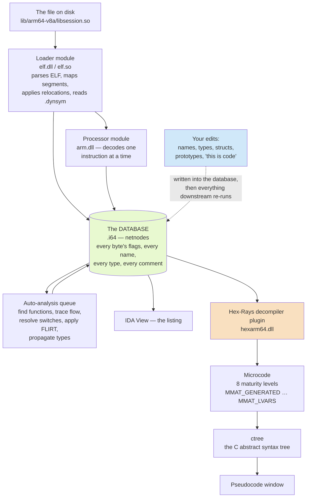
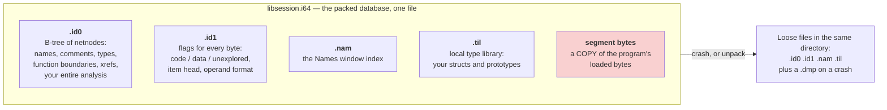
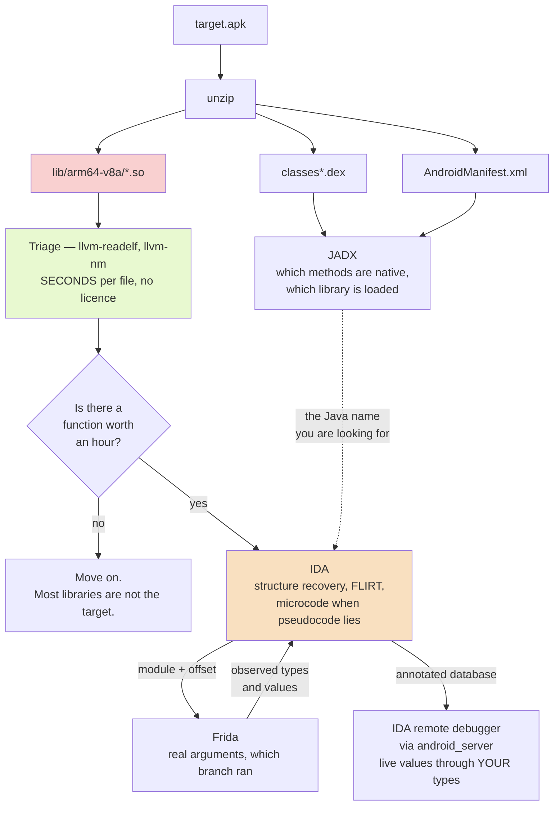
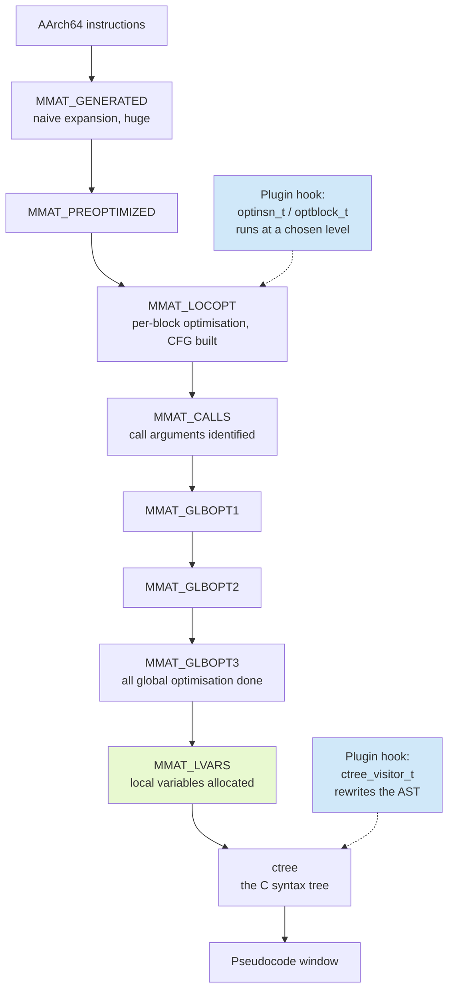
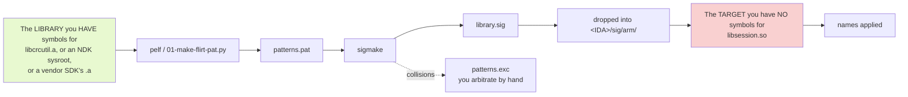
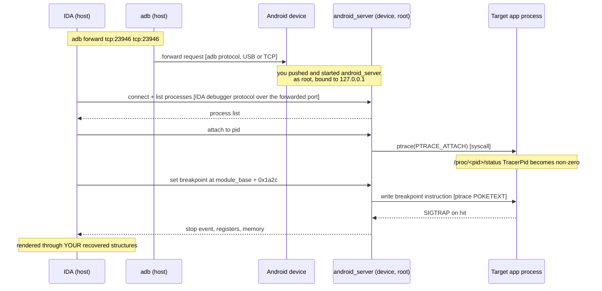
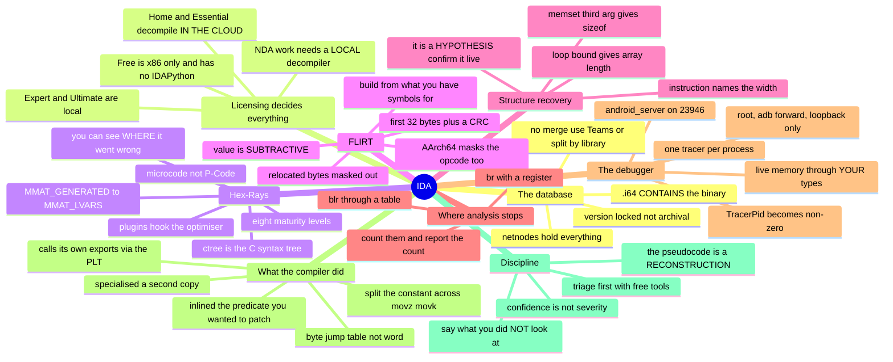

# 58 — IDA

> After this chapter you will be able to decide, with evidence rather than folklore, whether IDA Pro
> is worth its licence fee for the Android work you actually do — and, if you have one, drive it
> properly: recover structures from a stripped `.so`, read Hex-Rays microcode when the pseudocode
> lies, build FLIRT signatures for a statically-linked library, automate the whole thing in
> IDAPython, and attach a remote debugger to a process on a real device without disabling the
> protections you are supposed to be testing.

**Prerequisites:** [15-Native-Code](../15-Native-Code/README.md), [16-JNI](../16-JNI/README.md),
[17-Libraries](../17-Libraries/README.md), [18-ARM](../18-ARM/README.md),
[19-Memory](../19-Memory/README.md), [57-Ghidra](../57-Ghidra/README.md), and — **out of numeric
order, so read it first** — [68-ReverseEngineering](../68-ReverseEngineering/README.md). 68 is the
discipline this chapter is a tool within, and it does not depend on any tool chapter, so reading
68 → 58 costs you nothing.

**Useful alongside:** [40-Obfuscation](../40-Obfuscation/README.md),
[53-Frida](../53-Frida/README.md), [59-radare2](../59-radare2/README.md),
[65-Hooking](../65-Hooking/README.md)

**Applies to:** IDA 7.7 through 9.x; Hex-Rays decompiler for ARM-32 and ARM-64; target binaries from
Android 5–16 (API 21–36), `arm64-v8a` primarily, `armeabi-v7a` and `x86_64` where noted

---

> ## Read this before you read anything else: what is verified here and what is not
>
> **IDA Pro is commercial software and it is not installed on the machine where this chapter was
> written.** That was checked, not assumed:
>
> ```powershell
> # host
> Get-Command ida64,ida,idat64,idat -ErrorAction SilentlyContinue
> Get-ChildItem "C:\Program Files*\IDA*","$env:LOCALAPPDATA\Programs\IDA*" -ErrorAction SilentlyContinue
> ```
>
> Both returned nothing.
>
> This repository's entire value rests on a stated measurement having actually been taken. So this
> chapter contains **no invented IDA session, no fabricated decompiler listing, and no
> screenshot-style transcript.** Where a claim about IDA's behaviour is drawn from Hex-Rays'
> documentation, the SDK, or the published API reference rather than from a run, it says so.
>
> | Part of this chapter | Status |
> |---|---|
> | Every AArch64 listing, address, byte and count | **Measured.** NDK 25.2.9519653 / clang 14.0.7, built by [`examples/build.sh`](examples/build.sh), recorded in [`examples/03-ground-truth-aarch64.md`](examples/03-ground-truth-aarch64.md) |
> | The FLIRT pattern generator and its per-function output | **Measured.** [`scripts/01-make-flirt-pat.py`](scripts/01-make-flirt-pat.py) was run against a real static archive. Its CRC16 column is structurally correct and **numerically unconfirmed** — see §3.7 |
> | The device preflight for remote debugging | **Measured** on an `sdk_gphone16k_x86_64` AVD, Android 15 / API 35, by [`scripts/04-android-server-preflight.sh`](scripts/04-android-server-preflight.sh) |
> | The triage sweep over real Android system libraries | **Measured** on the same AVD — §8.1 |
> | IDA's licensing tiers, decompiler bundling, cloud decompilation, Lumina | **Documentation-derived**, retrieved from hex-rays.com in August 2026 and quoted with the wording used there. Prices change; re-check before quoting one |
> | The `dbgsrv` server binary names, default port and command-line options | **Documentation-derived**, from Hex-Rays' remote-debugging documentation |
> | Hex-Rays microcode maturity levels, the ctree, the decompiler API | **Documentation-derived**, from the published `hexrays.hpp` reference and the microcode view documentation |
> | Every IDAPython script in [`scripts/`](scripts/) | **Reviewed, not executed.** Each carries that label in its own header, with the API version it targets |
> | Keyboard shortcuts, menu paths, dialogue names | **Documentation-derived.** Verify against your own build; Hex-Rays moves menus between major versions |
>
> If you have a licence and something below is wrong, that is a finding. Write it down. This
> repository would rather ship a labelled gap than an unlabelled invention.

---

## Table of Contents

1. [Introduction](#1-introduction)
2. [High-Level Architecture](#2-high-level-architecture)
3. [Deep Internal Working](#3-deep-internal-working)
4. [Source Code Walkthrough (AOSP and the IDA SDK)](#4-source-code-walkthrough-aosp-and-the-ida-sdk)
5. [Security Perspective](#5-security-perspective)
6. [Reverse Engineering Perspective](#6-reverse-engineering-perspective)
7. [Dynamic Analysis](#7-dynamic-analysis)
8. [Static Analysis](#8-static-analysis)
9. [Examples](#9-examples)
10. [Common Interview Questions](#10-common-interview-questions)
11. [Common Mistakes](#11-common-mistakes)
12. [Hands-on Labs](#12-hands-on-labs)
13. [Summary](#13-summary)
14. [References](#14-references)

---

## 1. Introduction

### 1.1 The problem that existed before interactive disassemblers

Suppose someone hands you a printed book in a language you do not speak, with no dictionary, and asks
what it says. You have one advantage: you can write in the margins.

You start by noticing that one symbol appears at the start of every third page. You write "chapter?"
next to it. Later you find that symbol next to a number, so you cross out "chapter?" and write
"section, followed by its number". Three hundred marginal notes later, the book is readable — not
because the book changed, but because your notes accumulated into a translation.

That is exactly what reverse engineering a stripped binary is, and it is why the important word in
"interactive disassembler" is **interactive**.

Early disassemblers were not interactive. You fed them a file and they printed assembly. If the
output was wrong — and it was frequently wrong, because deciding which bytes are code and which are
data is undecidable in general — your only recourse was to run it again with different options and
print it again. Nothing you learned was retained. Every insight you had lived in your head or on
paper, and when you came back on Monday you started over.

> **Definition**
> A **disassembler** turns machine-code bytes back into assembly instructions. On AArch64 this is
> close to mechanical: every instruction is exactly four bytes and `c0 03 5f d6` is `ret`, always.
> The hard part is not decoding an instruction; it is knowing **where instructions start** and where
> data begins. That is the part a disassembler must guess, and the part you correct.

> **Definition**
> An **interactive disassembler** keeps a persistent *database* of everything it has decided and
> everything you have told it — names, types, comments, function boundaries, which bytes are code —
> and re-derives its output from that database. Your corrections are inputs to the next analysis, not
> annotations on a finished one.

IDA — the name is an initialism of **Interactive DisAssembler** — was the first widely-used tool
built around that idea, and the database model is still the thing it does better than anything else.
Chapter 57 makes the same argument about Ghidra, which adopted the model wholesale; the point here is
that the model came first and IDA is where it came from.

### 1.2 What would break without it

You can do Android native reverse engineering without IDA. Most people do, and this repository's
other chapters show you how. But three things get materially harder, and it is worth being precise
about which three, because vendors are not.

1. **Reading heavily-optimised C++.** A modern Android app's native layer is frequently C++ with
   virtual dispatch, templates and RTTI. Hex-Rays' handling of virtual calls and class reconstruction
   is the strongest available, and chapter 57 says so about itself in the other direction: Ghidra's
   §3.16 lists C++ handling as a limitation and points here.
2. **Identifying statically-linked library code.** A 40 MB `libfoo.so` that statically links BoringSSL,
   protobuf and curl contains perhaps 8,000 functions of which maybe 300 are the application's. FLIRT
   exists to name the other 7,700 so you never read them. §3.7 covers how it works and measures where
   it fails.
3. **Debugging on the device against your own annotations.** IDA ships debugger servers for Android
   and the debugger renders live registers and memory *through the types you defined*. §3.9.

Everything else — the disassembly itself, the decompilation of ordinary C, the scripting, the triage
— is available for free, and §3.13 says so plainly.

> **Pentester's Note**
> On a typical Android engagement you will read three native functions: the one that decides whether
> the device is rooted, the one that derives the encryption key, and the one that signs the API
> request. The question this chapter answers is not "is IDA good" — it is good — but **"does IDA get
> me to those three functions faster than a free tool, by enough to justify the licence?"** For most
> mobile pentesters the honest answer is no, and §3.13 and §3.12 give you the numbers to argue it
> either way with your employer.

### 1.3 The licensing reality, before anything else

Most tutorials open with "download IDA Free and follow along". **For Android arm64 work that advice
does not work**, and it is better to know now than after an hour of installation.

The following is **documentation-derived**, retrieved from hex-rays.com in August 2026. Editions and
their contents change; re-check before you quote a row of this table at a purchasing manager.

| Edition | Disassemblers | Decompiler | Scripting | Commercial use |
|---|---|---|---|---|
| **IDA Free** | **x86-32 and x86-64 only** | Cloud, x86 only | **No IDAPython, no SDK** — IDC only | **Not permitted** |
| **IDA Home** | x86-32, x86-64, ARM-32, **ARM-64** | **Cloud only**, matching the chosen disassembler | Yes | Hobbyist terms |
| **IDA Classroom** | One family of PC / ARM / MIPS / PPC / RISC-V | Cloud only | Yes | Education providers |
| **IDA Pro** | "All 60+ disassemblers" | "From 2 up to 12 decompilers of your choice" | Yes | Yes |

And within IDA Pro, the distinction that actually matters for consultancy work:

| IDA Pro plan | Decompilers | Where they run |
|---|---|---|
| **Essential** | 2 | **In the Hex-Rays cloud** ("on-line twin decompilers") |
| **Expert-2 / Expert-4 / Expert-6** | 2 / 4 / 6 | **Locally** — Hex-Rays' own wording is "air gap" |
| **Ultimate** | All | Locally |

Three consequences, and they are the most useful paragraphs in this section:

- **IDA Free cannot open an Android arm64 library at all.** No ARM-64 disassembler, no scripting.
  Every "getting started with IDA on Android" tutorial that tells you to use IDA Free is either old
  or wrong. The free tool for this job is [Ghidra](../57-Ghidra/README.md), which has a local ARM-64
  decompiler, full scripting, and an Apache 2.0 licence.
- **A learner's cheapest legitimate route to IDA on ARM-64 is IDA Home**, and its decompiler runs in
  the cloud. That is fine for your own fixtures and for open-source targets.
- **It is not fine for a client's binary.** See the next point, because it is a contract question and
  not a technical one.

> **Warning — the procurement trap that catches consultancies**
> **IDA Home, IDA Classroom and IDA Pro Essential decompile in the Hex-Rays cloud.** Hex-Rays states
> that it "does not process any personal data except the IP address of user and does not persist any
> data at all after the cloud decompilation takes place", and there is no reason to doubt that.
> **It is still very often not the question your client's NDA asks.** A typical mobile-application
> NDA prohibits transmitting the application binary, or any part of it, to a third party — and a
> cloud decompiler transmits function bytes to a third party by construction.
>
> If your engagements are covered by NDAs, the tier you need is **Expert-N or Ultimate**, which run
> the decompiler locally. Discover that before the purchase order, not during the engagement. This
> is documentation-derived and it is the single most expensive thing in this chapter to get wrong.

### 1.4 What this chapter owns, and what it does not

This is a repository, not a tool manual, and three other chapters are adjacent enough that stepping
on them would waste your time.

| Question | Chapter |
|---|---|
| What does this AArch64 instruction mean? What is AAPCS64? How do I patch four bytes? | [18-ARM](../18-ARM/README.md) — **18 owns the disassembly** |
| What is an ELF? What is `.dynsym`? What survives stripping? What is a relocation? | [15-Native-Code](../15-Native-Code/README.md) |
| How does a decompiler work? What is an IR? How do I retype `JNIEnv` and recover a `RegisterNatives` table? | [57-Ghidra](../57-Ghidra/README.md) — **57 owns the decompiler workflow** |
| How do I triage a hundred binaries fast, from a shell, over SSH, for free, on the device? | [59-radare2](../59-radare2/README.md) |
| *When* do I open a disassembler at all? How do I run an investigation? | [68-ReverseEngineering](../68-ReverseEngineering/README.md) — **68 owns the method** |
| What does DEX look like? How do I read Java? | [12-DEX-Internals](../12-DEX-Internals/README.md), [56-JADX](../56-JADX/README.md) |

**What is left, and what this chapter therefore owns:** the Hex-Rays decompiler's own internals
(microcode and the ctree, which are not P-Code and behave differently); the `.idb`/`.i64` database and
its consequences for confidentiality; FLIRT signatures, measured rather than described; type
libraries and interactive structure recovery; IDAPython as an automation surface; the debugger and
`android_server`; and — because this is a pentest repository — an honest account of when the money is
worth it.

> **Mental Model**
> Chapter 68 gives you an **evidence ladder**: Tier 3 is decompiled code, Tier 4 is ground-truth
> encoding, Tier 5 is observed execution. IDA is a Tier 3 and Tier 4 instrument in one window, which
> is genuinely useful — the pseudocode pane and the listing pane are synchronised, so you can move
> between "what a plausible source program would look like" and "what the bytes say" in one click.
> That does not promote Tier 3 to Tier 4. **Hex-Rays pseudocode is a reconstruction, exactly as
> Ghidra's C is**, and 68's rule holds: Tiers 1–3 tell you what to believe provisionally; Tiers 4–6
> tell you what to write down.

### 1.5 A note on how to read the rest of this

Every measured listing in this chapter comes from one fixture, which you build:

```bash
# host
cd 58-IDA/examples
OUTDIR=/tmp/ch58 ./build.sh
```

It produces a stripped `libsession.so` and an unstripped answer key, and it prints the ground truth
you will check your tool against. The labs are written so that **they work whether you own IDA, own
Ghidra, own neither, or own all three** — the target is yours, so nothing gates on a licence. Where
IDA does something a free tool cannot, the lab says so and tells you what to do instead.

---

## 2. High-Level Architecture

### 2.1 The pipeline



Read that diagram as three claims.

**First, the database is the centre, not the display.** In IDA, the listing you look at is a *render*
of the database, and so is the pseudocode, and so is the graph view, and so is the debugger's memory
window. Nothing is stored as text. When you press `N` and rename a function, you are writing a
`netnode` (§3.1); every view that mentions that address redraws itself from the new value. This is
why an IDA session is worth saving and a `objdump` run is not.

**Second, the loader and the processor module are replaceable parts.** IDA's support for sixty
architectures is not sixty special cases inside one program; it is sixty processor modules
implementing one interface. On Android you will use exactly two — `arm` for both AArch64 and
AArch32, and `pc` for x86/x86-64 emulator builds — but the modularity is why the ARM module is as
mature as it is: it is the same module that has been maintained since ARM7.

**Third, the decompiler is a plugin and a separate product.** `hexarm64` is not part of IDA; it is
licensed separately, priced separately, and can be absent. That is not an implementation detail, it
is the licensing table in §1.3 expressed as an architecture. Ghidra's decompiler is a separate
*process* (chapter 57 §2) but not a separate *purchase*; IDA's is the other way round.

### 2.2 The database, and what is actually in it



The box coloured red is the one people forget, and it has a consequence in §5.1 that has cost real
consultancies real money: **an `.i64` contains a copy of the program's bytes.** It is not a set of
annotations that references a file elsewhere; it is self-contained, which is why you can hand
somebody an `.i64` and they can work with it without the original. Which means you can also hand
somebody a client's proprietary binary by attaching what you think is "just my notes".

The four internal streams are worth naming because you will meet them as loose files. IDA works on an
*unpacked* database while it is open and packs it on close. If IDA crashes, or is killed, the loose
`.id0` / `.id1` / `.nam` / `.til` files remain and IDA offers to recover from them on the next open.
Seeing them next to a `.so` is not corruption; it is an interrupted session.

| Extension | Contains | Why you care |
|---|---|---|
| `.idb` | Packed database, **32-bit** address space | Pre-9.0. Opening a 64-bit binary produced an `.i64` instead |
| `.i64` | Packed database, 64-bit address space | Every Android arm64 target |
| `.id0` | The netnode B-tree — the analysis itself | Present loose only while open or after a crash |
| `.id1` | Per-byte flags | As above |
| `.nam` | Name index | As above |
| `.til` | **Type library.** Ships as a standalone format too | The mechanism in §3.8; `jni.til` would live here |
| `.sig` | Compiled FLIRT signatures | §3.7 |
| `.pat` | FLIRT *patterns*, text, pre-compilation | §3.7 — the format [`scripts/01-make-flirt-pat.py`](scripts/01-make-flirt-pat.py) emits |
| `.idc` | IDA's own C-like scripting language | The only scripting IDA Free has |

> **Under the Hood**
> A **netnode** is IDA's universal storage primitive: a record keyed by an address (or by an arbitrary
> name), holding a set of sparse arrays — one for byte-sized values, one for 32-bit, one for strings,
> one for blobs — each indexed by a small integer "alt" or "sup" key. Everything IDA knows is stored
> as netnode entries. A function's comment is a string at one index; its flags are an integer at
> another; a plugin's private state is whatever it wants at a name it chose.
>
> The design consequence you will feel: **IDA has no schema.** Two plugins can store conflicting
> information about the same address and neither will notice. It is also why the database format has
> stayed compatible across decades, and why `ida_netnode` is the API you reach for when you write a
> plugin that must remember something. Documentation-derived; the interface is in the SDK's
> `netnode.hpp`.

### 2.3 Where IDA sits in an Android workflow



The shape of this diagram is the chapter's thesis. **IDA is not the first tool in the pipeline and it
should not be.** The green box — `llvm-readelf` and `llvm-nm`, which come free with the NDK you
already have — answers the questions that decide *which* file deserves attention, in seconds per
file. §8.1 measures that on real Android system libraries. Opening a hundred libraries in an
interactive disassembler to discover that ninety-seven of them are vendor SDKs is a way of spending
a day.

The loop on the right is where IDA earns its keep. You find a function statically; you hook it with
Frida and print the real arguments; the arguments tell you the types; you set those types in IDA and
the pseudocode becomes readable; the readable code tells you what to hook next. Chapter 57 draws the
same loop for Ghidra, and it is the same loop — the tools are interchangeable in it. What is *not*
interchangeable is the last box: attaching a debugger that renders live memory through the structures
you recovered. §3.9 and §7.

---

## 3. Deep Internal Working

### 3.1 The database: what "interactive" costs and buys

**What.** Every fact IDA derives or you supply lives in a per-program database, stored packed as one
`.i64` file and unpacked as four while open.

**Why it exists.** Because disassembly is not a function of the bytes alone. Whether the four bytes
at `0x850` are an instruction or a jump table depends on facts that are not in those bytes. A tool
that recomputes everything from the file each time can never accumulate the answer; a tool with a
database can.

**When it matters.** The moment your analysis exceeds what you can hold in your head — which is
roughly the third function.

**Where it hurts.** Three places, and all three are worth knowing before your first real engagement.

| Problem | Detail | What to do |
|---|---|---|
| The database contains the program | An `.i64` is self-sufficient; it holds a copy of the loaded segments | Never send one outside the engagement boundary. §5.1 |
| The database is a version-locked binary format | A database written by IDA 9.0 is not readable by 8.4. Databases are not a long-term archival format for your findings | Export what matters: the pseudocode of the functions you care about, as text, into the report. §8.4 |
| Two analysts cannot share one database | There is no merge. IDA Teams (a separately-licensed add-on) exists precisely because of this | Split by library, not by function, and agree naming conventions up front |

> **Pentester's Note**
> Decide your naming convention in the first ten minutes and write it at the top of the database as a
> comment at the entry point. Something like: `j_` prefix for confirmed JNI entry points, `chk_` for
> anything that returns a boolean the app acts on, `TODO_` for a function you looked at and
> deliberately deferred. Chapter 68 §3.12 argues that naming *is* the technique rather than
> housekeeping, and it is right; the specific value of doing it in IDA is that the Names window
> becomes a filterable index of your own findings. Type `chk_` into it and you have your report's
> findings section.

**The image base, and the arithmetic that connects static to dynamic.** Chapter 18 §6.6 owns this and
warns that a tool's default base for a `.so` is not the file's virtual address — it records Ghidra's
default of `0x00100000`. IDA loads an `ET_DYN` ELF at the virtual addresses in the program headers,
which for an NDK-built library typically start at `0`, so an address in IDA usually equals the file
virtual address. **Usually is not always**, and you must not assume it:

```text
runtime address = module_base + (ida_address - ida_image_base)
```

Get `ida_image_base` from `idaapi.get_imagebase()`, never from memory; get `module_base` from
`Process.findModuleByName(...)` or from `/proc/<pid>/maps`. The script
[`scripts/02-ida-android-annotate.py`](scripts/02-ida-android-annotate.py) emits every function as an
*offset* from the image base for exactly this reason — an offset survives the difference between
tools, an address does not.

### 3.2 The loader and the processor module

**The loader** decides what kind of file this is and how it maps into the address space. For an
Android `.so` that is the ELF loader, and the decisions it makes at import time are the ones you
cannot easily undo later.

| Import-time decision | Correct value for Android arm64 | What goes wrong if it is not |
|---|---|---|
| File type | `ELF64 for ARM64 (Shared object)` | A "binary file" import gives you no sections, no symbols, no relocations, and a flat blob |
| Processor | `ARM Little-endian [ARM]`, ARMv8-A | Wrong endianness or wrong architecture produces confident, plausible nonsense |
| "Manual load" | Off, normally | On, you get to choose the base and which segments load. Useful for a dumped-from-memory library where the file layout is wrong |
| Loading segments vs sections | Segments, which is the default | Sections can disagree with segments in a packed library. The loader is right to trust the program headers |
| "Create imports segment" | On | Otherwise PLT targets show as addresses rather than names |

IDA reads `e_machine` from the ELF header and normally gets this right unaided. Chapter 15 tabulates
the mapping — `183` / `0xB7` is `EM_AARCH64` and means `lib/arm64-v8a/`. When IDA asks you to choose,
the file is packed, corrupt, or not an ELF, and that is itself information.

> **Warning**
> An APK usually ships several ABI directories, and `lib/arm64-v8a/libfoo.so` and
> `lib/armeabi-v7a/libfoo.so` are **different binaries built from the same source**. Analyse the one
> the device under test actually loads. Confirm it, do not infer it:
>
> ```bash
> # adb shell
> cat /proc/$(pidof com.example.app)/maps | grep '\.so'
> ```
>
> Chapter 68 measured a whole session correlating an API 35 emulator's runtime against an API 30
> phone's static corpus and calls it the worst kind of error, because every subsequent measurement is
> internally consistent and about the wrong thing.

**The processor module** decodes one instruction at a time and, critically, tells the analysis engine
what that instruction *does to control flow*: does it fall through, does it branch, is the branch
conditional, does it return, is the target computed. Everything the auto-analyser knows about program
structure comes from those answers.

The Android-relevant limits of the ARM module, all documentation-derived, all worth checking on your
own build:

- **Pointer authentication** (`PACIASP`, `AUTIASP`, `RETAA`, `BLRAA`) appears in libraries built for
  ARMv8.3-A. On CPUs without PAC these encode into the hint/NOP space and execute as no-ops, which is
  how one binary runs everywhere. They are not obfuscation. The one that matters for analysis is
  `BLRAA` — an authenticated indirect call — because a tool that does not model it as a call will
  lose the edge.
- **BTI** (`bti c`, encoding `0xd503245f` — chapter 18 verified that word) marks legal indirect-branch
  landing pads. Seeing them at every function entry is normal on API 31+ builds.
- **MTE** and **SVE** instructions appear rarely in app code and are usually decoded but not
  semantically modelled, which matters only if you are decompiling them.

### 3.3 Auto-analysis: what it is actually doing while the progress bar moves

When IDA opens a binary it queues a large number of analysis steps and works through them until the
queue empties. The queue is re-entrant: a step can enqueue more work, which is why the counter can go
up. Understanding the order explains most "why did IDA do that" questions.

| Stage | What it does | The Android-specific failure |
|---|---|---|
| Segment creation | Maps program headers to segments | A packer with a bogus section table can produce overlapping segments; trust the segments |
| Entry-point seeding | `e_entry`, `.init_array`, `.init`, `.fini_array`, every `.dynsym` export | `.init_array` on arm64 reads as **eight zero bytes** in the file; the real address is the addend of an `R_AARCH64_RELATIVE` relocation. IDA applies relocations, so it follows the pointer; a hexdump does not. Chapter 15 owns the mechanism |
| Flow tracing | From each seed, follow control flow, marking bytes as code | Stops at anything it cannot resolve. Every `br <reg>` in §3.5 is a stop |
| Function creation | A run of code reached by a call becomes a function | Tail-called functions may be absorbed into the caller unless the callee is separately reachable |
| Non-returning discovery | Notice that `abort` never returns, withdraw the code after its call sites | If missed, IDA disassembles the *next* function's prologue as a continuation of this one |
| Switch recognition | Match jump-table idioms and recover the cases | §3.5. The measured clang 14 idiom is a **byte** table, not a word table |
| FLIRT | Hash function starts, look them up in loaded `.sig` files, apply names | §3.7 |
| Type propagation | Apply prototypes from type libraries, propagate through call sites | §3.8 |
| String literal detection | Find and mark C strings | Defeated entirely by the XOR encoding in the fixture, and by every real obfuscator |
| Stack frame analysis | Recover the frame layout and name locals | Feeds the decompiler |

Two controls are worth knowing by name. **`Options > General > Analysis > Reanalyze program`** re-runs
the queue with everything you have since told it, which is what you do after marking a function
non-returning. And **"Analysis options 2 > Make final analysis pass"** is what converts remaining
unexplored bytes into code aggressively; on a stripped, obfuscated library it can turn 200 functions
into 2,000, and that jump is itself diagnostic — chapter 57 makes the same point about Ghidra's
Aggressive Instruction Finder.

> **Mental Model**
> Auto-analysis is a fixed-point computation, and **you are part of the loop.** Every fact you supply
> — this is a function, this returns nothing, this parameter is a `session_ctx *` — re-enters the
> queue and can produce a cascade. Anyone who reads IDA's output passively, without editing, is
> getting perhaps a fifth of what the tool can do. Chapter 57 §3.11 says exactly this about Ghidra
> and it is not a coincidence: it is a property of the model both tools use.

### 3.4 Hex-Rays: microcode, and why it is not P-Code

This is the section that justifies the chapter existing alongside 57.

Chapter 57 explains **P-Code**, Ghidra's intermediate representation: one flat IR, produced by SLEIGH
from each instruction, on which all analysis runs. Hex-Rays' design is different in a way that
changes what you can do when the output is wrong.

> **Definition**
> **Microcode** is the Hex-Rays decompiler's intermediate representation: a register-transfer-level
> instruction set into which each machine instruction is expanded. Like P-Code it is
> architecture-neutral, so the decompiler is written once and instantiated per processor.
>
> **Unlike P-Code, microcode is exposed at eight distinct *maturity levels*.** The same function has
> eight successive microcode representations, from a naive expansion of each instruction to a
> heavily-optimised form with local variables allocated. You can look at any of them.

The maturity levels, from the published `hexrays.hpp` reference (documentation-derived — the constant
names are quoted exactly):

| Level | Constant | What has happened by this point |
|---|---:|---|
| 1 | `MMAT_GENERATED` | Microcode generated. One machine instruction has become several micro-instructions. Nothing optimised. Enormous and unreadable |
| 2 | `MMAT_PREOPTIMIZED` | The pre-optimisation pass is complete |
| 3 | `MMAT_LOCOPT` | Local optimisation of each basic block is complete, and the control-flow graph exists |
| 4 | `MMAT_CALLS` | **Call arguments have been detected.** Before this level, a call is an opaque event; after it, arguments and return values are modelled |
| 5 | `MMAT_GLBOPT1` | First pass of global (whole-function) optimisation |
| 6 | `MMAT_GLBOPT2` | Most global optimisation passes done |
| 7 | `MMAT_GLBOPT3` | All global optimisation complete |
| 8 | `MMAT_LVARS` | **Local variables allocated.** Closest to the pseudocode you see |

There is also `MMAT_ZERO`, the "nothing yet" state.

After `MMAT_LVARS` the decompiler builds a second, different structure:

> **Definition**
> The **ctree** is the decompiler's C abstract syntax tree: the `if`s, `while`s, expressions and
> declarations that the pseudocode window prints. It is built from mature microcode, and the
> documentation is explicit that it requires maturity `MMAT_LVARS` or higher because it needs local
> variable allocation to have happened. **Microcode is the semantics; the ctree is the syntax.**



**Why any of this matters to you, in one paragraph.** When Hex-Rays produces pseudocode you do not
believe, you have two ways to find out why. You can compare against the listing — which chapter 57
also tells you to do, and which is right. Or you can open the microcode at each maturity level and
watch the moment the wrong thing happens. If a value is correct at `MMAT_CALLS` and wrong at
`MMAT_GLBOPT2`, a global optimisation made a bad assumption, and you now know it is an optimisation
problem rather than a decoding problem. That diagnostic path exists in IDA and does not exist in
Ghidra, and it is the single most concrete technical reason a senior researcher keeps a Hex-Rays
licence.

**How to look at it.** *View → Open subviews → Microcode*, or `Ctrl+Shift+F8` on the function; the
`>` and `<` keys move between maturity levels. (Documentation-derived — verify the binding on your
build; Hex-Rays has changed it between versions.)

> **Under the Hood**
> The two-hook structure in the diagram is why the deobfuscation plugin ecosystem is what it is.
> Obfuscators that flatten control flow or insert opaque predicates produce microcode with
> recognisable, removable patterns. A plugin registers an `optinsn_t` or `optblock_t` callback, gets
> called during optimisation at a maturity level of its choosing, rewrites the microcode, and the
> decompiler proceeds — so the *pseudocode* comes out deobfuscated without anyone patching the
> binary. Published tools of this shape exist for exactly this purpose; the mechanism is the
> microcode API and it is documented in the SDK. Ghidra's equivalent surface is much less exposed,
> which is why the same plugins do not exist there.
>
> The practical consequence for you: if your target is protected by a commercial obfuscator, check
> whether a microcode plugin already handles it before you spend a week. See
> [40-Obfuscation](../40-Obfuscation/README.md).

**The honest limit.** All of the above is documentation-derived. It has not been exercised on this
machine, and microcode work is genuinely difficult — the API is C++-first, the Python bindings are
thinner, and the published guidance assumes you are comfortable in the SDK. Do not include "we will
write a microcode plugin" in an engagement plan until you have written one.

### 3.5 Switch tables and indirect control flow — where static analysis stops

**The problem.** A disassembler follows control flow. `b 0x4cb4` is an edge it can follow. `br x10` is
not — the destination is in a register, computed at run time, and the bytes contain no answer.

There are two reasons a compiler emits `br`, and they need different responses.

**Reason one: a dense `switch`.** The compiler built a table of destinations and indexes it with the
switch value. Both IDA and Ghidra recognise the common idioms and recover the cases. When recognition
succeeds you get twelve labelled case bodies; when it fails you get one `br` and twelve orphaned
basic blocks belonging to no function.

Here is the idiom clang 14 actually emitted for the fixture's twelve-case switch — **measured**, and
worth reading closely because it is *not* the form most references print:

```text
# host: llvm-objdump -d --disassemble-symbols=session_step libsession-unstripped.so
    4e74: 3f 2c 00 71   cmp   w1, #11              ; the bound check
    4e80: 88 02 00 54   b.hi  0x4ed0               ; -> default
    4e84: e9 ff ff 90   adrp  x9, 0x0              ; page of the table
    4e88: e8 03 01 2a   mov   w8, w1
    4e8c: 29 41 21 91   add   x9, x9, #2128        ; + low 12 bits  (0x850)
    4e90: 8a 00 00 10   adr   x10, #16             ; the ANCHOR
    4e94: 2b 69 68 38   ldrb  w11, [x9, x8]        ; ONE BYTE from the table
    4e98: 4a 09 0b 8b   add   x10, x10, x11, lsl #2 ; scaled by 4 (word count)
    4e9c: 40 01 1f d6   br    x10
```

And the table itself, twelve bytes in `.rodata`:

```text
0x00000850  0f 11 15 1a 1d 20 00 00 00 23 33 38
```

| Fact | Consequence for your tool |
|---|---|
| Entries are **one byte**, not four or eight | A hex dump shows twelve small numbers, not a run of addresses. Nothing looks like a pointer |
| They are offsets **from an `adr` anchor**, not absolute | The table is position-independent and meaningless without the anchor instruction |
| `lsl #2` scales them to instruction words | Maximum reach is 255 × 4 = 1020 bytes; a larger switch forces the compiler to a different form |
| The bound check is a separate `cmp`/`b.hi` **before** the table | This is what makes the indirect branch safe |

> **Warning**
> That last row is a live hazard during your own analysis. If you ever patch out a bound check like
> `cmp w1, #11 ; b.hi <default>` — perhaps because it looked like a licence check — you have
> converted a safe table dispatch into an **out-of-bounds indirect branch**, which is a control-flow
> hijack primitive. You will have introduced a vulnerability into a binary you are assessing. Chapter
> 18 owns patching; the rule that applies here is: understand what a check bounds before removing it.

**Reason two: a genuine function pointer.** The fixture has exactly one, and no static tool can
resolve it:

```text
    4eac: 29 21 26 91   add   x9, x9, #2440
    4eb8: 28 59 68 f8   ldr   x8, [x9, w8, uxtw #3]
    4ebc: 00 01 3f d6   blr   x8
```

The table is three relocated pointers in `.data`; the index is derived from a caller-supplied
argument. There are four honest responses and you should know all four:

| Response | How | When it is right |
|---|---|---|
| Read the table | The relocations name the targets: `R_AARCH64_RELATIVE` addends `0x54f8`, `0x54fc`, `0x5510` | The table is static and small — most of the time |
| Tell the tool | IDA: place the cursor on the `blr` and use *Edit → Other → Specify switch idiom*, or set the operand's type so the call has a known prototype. Also `add_cref` from a script | You know the targets and want the call graph to reflect them |
| Resolve at run time | Hook the `blr` with Frida and log `x8` | The table is built at run time, or you cannot prove which entry is used |
| Record the gap | Note it as unresolved in your findings | Always, if you did not do one of the other three |

The last row is not a cop-out; it is chapter 68's discipline. The annotate script's `--` indirect
inventory (§3.10) exists to make the gap countable rather than invisible.

> **Pentester's Note**
> Count the indirect calls in a library before you promise anyone a "complete" static review. In the
> chapter's fixture the count is 1 and the code is 300 lines. In a real obfuscated library protected
> by control-flow flattening the count is in the hundreds, every one is the same dispatcher, and a
> purely static reading covers almost nothing. That count belongs in your methodology section.

### 3.6 Structure recovery — the thing IDA does in one keystroke

**The problem.** A function receives a pointer and reads `[x0]`, `[x0, #4]`, `[x0, #8]`, `[x0, #68]`.
Those are fields of a structure. Until your tool knows the structure, every access renders as
arithmetic and every field looks unrelated to every other.

Chapter 57 §3.11 walks the manual method — observe the offsets, create a structure, add fields at the
observed offsets, retype the parameter — and that method works in every tool including this one. What
IDA adds is a shortcut worth knowing about, because it changes the economics:

**In the pseudocode window, right-click a variable used as a base pointer and choose
*Create new struct type*.** Hex-Rays walks every access made through that variable inside the current
function, infers a field at each offset with the width the access used, and generates the structure
for you. You then rename the fields.

(Documentation-derived — the feature and its menu placement are documented, but the exact wording of
the menu item varies by version, and this has not been exercised here.)

The measured raw material it would work from, for the fixture's context structure:

| Access seen in the listing | Field it implies |
|---|---|
| `ldr w8, [x0]` | 4 bytes at `+0x00` |
| `ldr w8, [x0, #4]` then `orr w8, w8, #2` | 4 bytes at `+0x04`, used as a bit field |
| `ldr x8, [x0, #8]` | **8** bytes at `+0x08` — note `x`, not `w` |
| `add x9, x19, #16` then `ldrb`/`strb` bounded by `cmp x8, #16` | a 16-byte array at `+0x10` |
| passed to `strlen`/`memcpy`, bounded by `#31` | a 32-byte char array at `+0x20` |
| `str w8, [x19, #64]` | 4 bytes at `+0x40` |
| `ldr w8, [x19, #68]` compared against 0–3 | 4 bytes at `+0x44`, an enum |
| `ldr w8, [x19, #72]`, `add w8, w8, #1`, `str` | 4 bytes at `+0x48`, a counter |
| `ldr w8, [x0, #76]` | 4 bytes at `+0x4c` |

Three inference rules do all the work, and they are tool-independent:

1. **The instruction names the width.** `ldrb` is 1 byte, `ldrh` 2, `ldr w` 4, `ldr x` 8. You never
   have to guess a field's size.
2. **A loop bound gives an array length.** A `strb` loop starting at `+0x10` and terminating on
   `cmp x8, #16` means sixteen bytes at `+0x10`.
3. **`memset(p, 0, N)` gives you `sizeof`.** Look for the constant in the third argument of the
   `memset` in the initialiser. In the fixture that is `0x50`, and it confirms the layout exactly.

> **Mental Model**
> A recovered structure is **a hypothesis about memory layout**, and it can be wrong in a way that
> stays consistent. If you place a field at `+0x08` as `uint64_t` when the truth is two `uint32_t`s,
> every access still decodes and the pseudocode still reads plausibly — it just says something false
> about the program. The check is a padding hole: real structures have them and a recovered structure
> with no holes at all is slightly suspicious. The fixture deliberately has none, and lab 02 asks you
> to add a field that creates one and re-derive the layout, because that is the version of this
> problem you will meet.

**Where the structures live.** IDA 9.0 removed the separate Structures and Enums windows and folded
both into **Local Types**, backed by `typeinf.hpp` / `ida_typeinf`. That is not cosmetic: the modules
`ida_struct` and `ida_enum` were **deleted** from the API, and any script written before 9.0 that
manipulates structures needs rewriting. This is the single most disruptive IDAPython change in years
and §3.10 handles it.

### 3.7 FLIRT — measured, not described

**The problem, stated with a number.** The fixture's stripped library contains 21 functions. Three of
them — `ch58_crc32`, `ch58_fnv1a64`, `ch58_hex` — came from a static archive and are somebody else's
code. Reading them is wasted time. In a real 8,000-function library that ships a statically-linked
BoringSSL, the ratio is far worse: perhaps 96% of the functions are library code.

> **Definition**
> **FLIRT** — Fast Library Identification and Recognition Technology — is IDA's mechanism for putting
> the right name on a library function in a stripped binary. It works by matching each function's
> **first 32 bytes** against a database of patterns built from the library's object files, with the
> bytes a linker would rewrite masked out. A match applies the name.

**The format, in full, because it is simpler than its reputation.** A `.pat` file is text, one line
per function:

```text
<PATTERN>  <ALEN> <ACRC> <TLEN>  :<OFF> <NAME>  [^<OFF> <REFNAME>]...
```

| Field | Meaning |
|---|---|
| `PATTERN` | Exactly 64 hex characters — the function's first 32 bytes. A byte a linker may rewrite is written as `..` |
| `ALEN` | 2 hex digits: how many bytes *after* the first 32 the CRC covers. Counting stops at the first variant byte, and at `0xFF` |
| `ACRC` | 4 hex digits: a CRC16 over exactly those bytes |
| `TLEN` | 4 hex digits: the function's total length |
| `:OFF NAME` | A public name at that offset inside the function — normally one, at `:0000` |
| `^OFF NAME` | A name this function *references*. This is how FLIRT distinguishes two functions with identical bodies that call different things |

`sigmake` compiles a `.pat` into a `.sig`, which IDA loads. FLAIR — the toolkit containing `pelf`
(ELF), `plb` (COFF/OMF) and `sigmake` — ships with an IDA Pro licence and is not separately
downloadable; this repository will not point you anywhere else for it.

**Now the measurement.** [`scripts/01-make-flirt-pat.py`](scripts/01-make-flirt-pat.py) implements the
format above and was run against the fixture's real static archive. This is what came out:

```text
# host
$ python3 -B scripts/01-make-flirt-pat.py /tmp/ch58/libcrcutil.a --explain

architecture      : AArch64
functions found   : 3  (0 skipped by --min-size)
round-trip parse  : all 3 lines OK

ch58_crc32       from 02-crcutil.o     size  292 bytes
   masked in the first 32 bytes: +0x00, +0x01, +0x02, +0x03, +0x04, +0x05,
     +0x06, +0x07, +0x08, +0x09, +0x0a, +0x0b, +0x0c, +0x0d, +0x0e, +0x0f,
     +0x14, +0x15, +0x16, +0x17
   CRC covers 12 byte(s) after the pattern, value 0x6576

ch58_fnv1a64     from 02-crcutil.o     size   56 bytes
   nothing masked in the first 32 bytes -- a strong pattern
   CRC covers 24 byte(s) after the pattern, value 0x2F8B

ch58_hex         from 02-crcutil.o     size   72 bytes
   masked in the first 32 bytes: +0x04, +0x05, +0x06, +0x07, +0x10, +0x11,
     +0x12, +0x13
   CRC covers 40 byte(s) after the pattern, value 0x0115
```

And the three pattern lines:

```text
................................0A070037........0C6490520CB7BD72 0C 6576 0124 :0000 ch58_crc32
E80300AAA06484D24084B0F2809CD3F2407EF9F2010100B4693680D20920C0F2 18 2F8B 0038 :0000 ch58_fnv1a64
E20100B4........08040091E90302AA........2B004039290500F16BFD44D3 28 0115 0048 :0000 ch58_hex
```

**Read those three lines carefully, because they invert the intuition most people have.**

`ch58_crc32` is the table-driven CRC-32. It is the function everyone thinks of as *easy* to identify,
because it carries a distinctive constant. **It produced the weakest pattern of the three:** 20 of
its first 32 bytes are masked, leaving 12 informative bytes and a 12-byte CRC. Every masked word is an
`adrp`/`add` pair referring to the lookup table or the ready flag — and every one of those is a
relocation the linker rewrites, so FLIRT cannot depend on it.

`ch58_fnv1a64` has no table at all. Its constants are immediates materialised with `movz`/`movk`,
which are not relocations. **Nothing is masked; the full 32 bytes are usable, plus a 24-byte CRC.**
It is the strongest signature of the three.

> **Under the Hood — why AArch64 is worse for FLIRT than x86**
> On x86, a relocated field is usually a 4-byte absolute address embedded in a longer instruction, so
> masking it costs four bytes and the opcode survives. On AArch64 every instruction is exactly four
> bytes and the relocated field lives *inside* the instruction word, sharing it with the opcode bits.
> FLIRT's format is byte-granular — it cannot say "these eleven bits vary" — so **the whole
> instruction word must be masked, opcode included.** A function whose prologue references three
> globals loses twelve of its first thirty-two bytes to relocations that only actually vary in a
> handful of bits.
>
> That is a structural reason ARM FLIRT coverage is thinner than x86 FLIRT coverage, and it is not a
> criticism of anyone's signature database. It is also why the `^OFF REFNAME` referenced-name field
> matters more on ARM than on x86: it recovers discriminating power that masking threw away.

> **Warning — what this script's numbers are and are not**
> [`scripts/01-make-flirt-pat.py`](scripts/01-make-flirt-pat.py) parses `ar` archives and ELF64
> objects correctly — verified against `llvm-nm` and `llvm-readelf` — and every line it emits
> round-trips through its own parser. **Its `ACRC` column has never been checked against `sigmake`,
> because FLAIR ships only with an IDA licence and IDA is not installed here.** The CRC16 implemented
> is the reflected polynomial `0x8408` algorithm published in FLAIR's `crc16.cpp`, but "implemented
> from the published description" is not "verified byte-for-byte". Treat the pattern and length
> columns as correct and the CRC column as structurally right and numerically unconfirmed. If you own
> FLAIR, run `pelf` over the same archive and diff the columns — that one command closes the gap and
> is worth reporting back.

**The workflow, end to end.** The direction of travel is the part people get backwards:



You build signatures from a library you possess *with* symbols, and apply them to a target you possess
*without* them. A stripped `.so` cannot be a source of patterns — it has no `STT_FUNC` symbols to name
them with. The script says so if you point it at one.

**Collisions and the `.exc` file.** When two functions produce the same pattern, `sigmake` refuses to
proceed and writes a `.exc` exclusions file listing the clashes; you edit it to say which name wins
(or that neither does) and re-run. On AArch64 this happens more than on x86 for the masking reason
above: generic prologues plus heavy masking makes collisions common. It is tedious and it is also the
moment you learn which of "your" functions are actually the same function inlined twice.

**What to build signatures *for*, on Android.** In rough order of payoff:

| Source | Why |
|---|---|
| The NDK sysroot's static libraries (`libc.a`, `libm.a`, `libc++_static.a`) | Names the CRT and STL functions in every NDK-built target |
| A vendor SDK you were given as a `.a` or an unstripped `.so` | The highest-value case: you have the answer key for one library and the target for another |
| An open-source library at the version the target ships | BoringSSL, curl, zlib, protobuf, SQLite. Match the version; a different release produces different bytes |
| Your own earlier engagement's databases | This is what **Lumina** automates, and §3.11 explains why you may not want it to |

> **Pentester's Note**
> FLIRT's real value on Android is **subtractive**. It does not tell you which function is
> interesting; it tells you which 7,700 are not, so the 300 that remain are a list you can read. That
> is the same argument chapter 52 makes about sweeps producing leads rather than findings, applied to
> functions instead of strings — and it is why "how many functions did FLIRT name?" is a better first
> question than "what did it name them?"

### 3.8 Type libraries — the `.til` and the `JNIEnv` problem

**The problem.** The decompiler infers types from usage, and usage is ambiguous. Telling it that one
parameter is a `session_ctx *` propagates through every expression that touches it. Telling it that
one *import* is `void *memcpy(void *, const void *, size_t)` propagates through every caller.

> **Definition**
> A **type library** (`.til`) is a compiled collection of C type declarations — structures, unions,
> enums, typedefs and function prototypes — that IDA can load into a database and apply. IDA ships
> a set for common platforms; `tilib` builds new ones; and `File → Load file → Parse C header file`
> (`Ctrl+F9`) parses a header directly into the current database's local types.

This is IDA's counterpart to Ghidra's `.gdt` data type archives, and chapter 57 §3.8 spends its
longest subsection on why defining `JNIEnv` is the highest-value single action in Android native
reverse engineering. **That argument is identical here and this chapter will not restate it.** Read
57 §3.8 for the *why*; what follows is only the IDA-specific *how*.

| Task | Ghidra | IDA |
|---|---|---|
| Load a prepared archive | Data Type Manager → *Open File Archive…* → `jni_all.gdt` | *File → Load file → Type library file…*, or drop a `.til` into `<IDA>/til/` |
| Parse a header instead | *File → Parse C Source…* | *File → Load file → Parse C header file…* (`Ctrl+F9`) |
| Retype one variable | Click it, `Ctrl+L` | Click it in the pseudocode, `Y` |
| Set a whole prototype | Right-click function → *Edit Function Signature* | Click the function name, `Y`, type the C declaration |
| Where user structs live | Data Type Manager | **Local Types** (`Shift+F1`) — and from 9.0 this is where enums live too |

The header to parse is the NDK's own, so the types match the revision your target was built against:

```bash
# host — find it
ls "$ANDROID_NDK/toolchains/llvm/prebuilt/<host>/sysroot/usr/include/jni.h"
```

> **Warning**
> Parsing `jni.h` directly frequently fails on the first attempt, in both tools, because the header
> pulls in platform definitions the parser does not have. The symptom is a long list of parse errors
> and a type library missing exactly the struct you wanted. Two fixes, in order of preference: define
> the handful of macros the parser complains about in a small wrapper header that `#include`s `jni.h`;
> or extract the `JNINativeInterface` struct and the handful of `j*` typedefs into a standalone header
> of your own and parse that. Chapter 57 lists a published prepared archive for Ghidra; for IDA,
> parsing a trimmed header is the reliable route.

**Beyond JNI.** The types worth having in a `.til` for Android work, none of which ship by default:

| Type | Why |
|---|---|
| `JNIEnv`, `JNINativeInterface`, `JavaVM`, `JNINativeMethod` | Chapter 57 §3.8 and §3.9 |
| Bionic's `soinfo` | If you are reading a library dumped from memory, or a linker-namespace bypass. Chapter 17 |
| `AAssetManager`, `ANativeWindow`, `AInputEvent` | NDK API surfaces that appear in games and media apps |
| ART internals (`ArtMethod`, `mirror::Object` headers) | Only if you are attacking the runtime. Chapter 13 owns the layouts and warns they are version-specific |
| The target's own structures, as you recover them | The point of §3.6 — and putting them in a shared `.til` rather than one database is what makes them apply across the app's several libraries |

### 3.9 The debugger and `android_server`

This is the capability where IDA's advantage over the free tools is least arguable, and the setup is
where most people give up. So: preconditions first, measured, then the mechanism.

**The architecture.**



The last note is the whole point. Every other Android debugging path — Frida, LLDB, `gdbserver` —
shows you bytes. IDA shows you `s->flags` because you told it what `s` is.

**The server binaries.** IDA ships these under `<IDA>/dbgsrv/` (documentation-derived, from Hex-Rays'
remote-debugging documentation):

| Binary | ABI | Use it when |
|---|---|---|
| `android_server` | AArch64 | `arm64-v8a` — the normal Android case |
| `android_server32` | ARM | `armeabi-v7a` |
| `android_x64_server` | x86-64 | x86_64 emulator images |
| `android_x86_server` | x86 | x86 emulator images |

Also present for non-Android Linux: `linux_server`, `linux_server32`, `armlinux_server`,
`armlinux_server32`. The default listening port is **23946**, and the documented options are `-p`
(port), `-i` (bind address), `-P` (password), `-v` (verbose), `-t` (plain unencrypted TCP), `-k` /
`-K` (keep session alive / kill debuggee on close), and `-c` / `-k` for a TLS certificate chain and
private key.

> **Warning — choose the server by the process, not by the device**
> **Measured** on an `sdk_gphone16k_x86_64` AVD, Android 15 / API 35:
>
> ```text
> ro.product.cpu.abilist = x86_64,arm64-v8a
> ```
>
> That device advertises both, because it has a native bridge. An app on it may be running as x86_64
> *or* as translated arm64. The right server is the one matching **the target process**, which you
> read from `/proc/<pid>/maps`, not the one matching the device's first advertised ABI.

**The preconditions, measured.** [`scripts/04-android-server-preflight.sh`](scripts/04-android-server-preflight.sh)
checks each separately so a failure names itself. Run against the same AVD:

```text
# host
$ ./scripts/04-android-server-preflight.sh

1. device
  [ ok ] sdk_gphone16k_x86_64  Android 15 / API 35
         ABI list: x86_64,arm64-v8a
  [warn] this device advertises BOTH x86_64 and arm64-v8a.

2. root
  [ ok ] root via 'su 0': uid=0(root) ... context=u:r:su:s0

3. ptrace
  [ ok ] no /proc/sys/kernel/yama/ptrace_scope on this device

4. SELinux
  [warn] SELinux is Enforcing

5. a writable, executable directory
  [ ok ] /data/local/tmp/ch58ida is writable
  [ ok ] execution from /data/local/tmp/ch58ida works

6. the port
  [ ok ] adb forward tcp:23946 -> tcp:23946 established
```

Three of those results are worth extracting, because two of them contradict widely-copied advice.

> **Warning — `ptrace_scope` does not exist here, and most guides tell you to set it**
> Search for "IDA Android debugging" and a large fraction of the results tell you to run
> `echo 0 > /proc/sys/kernel/yama/ptrace_scope`. **Measured on an API 35 AVD: that file is absent.**
> The Yama LSM's `ptrace_scope` is a mainline-Linux control; this Android image does not expose it.
> If your attach fails on such a device, `ptrace_scope` is not why, and following that advice wastes
> the first twenty minutes of your debugging session on a file that is not there. Check before you
> write, on your device:
>
> ```bash
> # adb shell
> cat /proc/sys/kernel/yama/ptrace_scope 2>/dev/null || echo "(absent)"
> ```

**Root.** `ptrace`-attaching to another application's process requires it, and the preflight found it
via `su 0 id`. Note the form: **AVDs take `su 0 <cmd>`, not `su -c <cmd>`**. AOSP's `su` rejects the
`-c` form with `su: invalid uid/gid '-c'`, which reads exactly like "not rooted" even though
`su 0 id` on the same device returns `uid=0(root) … context=u:r:su:s0` seconds later — chapter 68
nearly recorded the API 35 emulator as unrooted on that basis. Magisk's `su` on a physical device
accepts the `-c` form, so **neither form is universally correct and the only safe habit is to try
both**; [62-Magisk](../62-Magisk/README.md) and [63-LSPosed](../63-LSPosed/README.md) measured the
split independently. Without root your only target is a `FLAG_DEBUGGABLE` application, and chapter 60
measured that `run-as` refuses in two distinct ways whose messages are easy to misread.

**SELinux.** Enforcing is the correct state and you should leave it. A server launched from the `su`
domain generally has the ptrace permissions it needs. If an attach is silently refused, look for the
AVC rather than reaching for `setenforce`:

```bash
# adb shell (root)
su 0 dmesg -T | grep -i avc | tail
```

> **Warning**
> Do not run `setenforce 0` to make a debugging session work on a device whose behaviour you are
> assessing. Chapter 22 owns the reasoning: you would be measuring a device that no longer resembles
> the one your finding is about, and any conclusion about access control becomes worthless. If you
> genuinely need permissive, use a dedicated test device and say so in the methodology.

**Two costs of attaching, both of which change what you are measuring:**

1. **`TracerPid` in `/proc/<pid>/status` becomes non-zero** and any app can read it. Chapter 38
   measured something important here that cuts the other way — **a JDWP debugger does *not* set
   `TracerPid`** — so the check detects `ptrace`-based attachment specifically, which is exactly what
   `android_server` does. An app with meaningful anti-tamper will notice. Worse than crashing is
   silently taking a decoy path; chapter 67 owns the bypasses.
2. **One tracer per process.** If `frida-server` is already attached, `ptrace` will fail. You cannot
   run Frida and IDA's debugger against the same process at the same time. Choose, or detach.

**Deploying.** The [preflight script's](scripts/04-android-server-preflight.sh) `deploy` mode is
reviewed, not executed — it needs a binary that ships only with a licence. Two details in it are worth
lifting out even if you write your own:

- **Bind to loopback** (`-i127.0.0.1`) and reach it through `adb forward`. A debugger server listening
  on `0.0.0.0` on a phone is a remote code execution service on whatever network the phone is on, with
  your session attached to it. The `-i` option exists; use it.
- **Some vendor builds block `execve()` under `/data/local/tmp`.** Chapters 22 and 68 both hit this on
  a retail Redmi. The workaround is to invoke through the linker:
  `su 0 /system/bin/linker64 /data/local/tmp/ch58ida/android_server -p23946`.

**Debugging Java as well.** IDA also has a **Dalvik/DEX debugger** for the managed side. It is a
genuinely distinctive capability — very few tools let you step Dalvik bytecode — but it is a different
job from this chapter's, it requires the application to be debuggable, and chapters
[51-DynamicAnalysis](../51-DynamicAnalysis/README.md) and [53-Frida](../53-Frida/README.md) cover the
managed-side workflows most testers actually use. Documentation-derived; not exercised here.

### 3.10 IDAPython — the automation surface

**Why script at all.** Because the interactive part of an interactive disassembler is the expensive
part. Anything you would do identically to fifty functions should be done to fifty functions by a
script, and anything you would do identically to fifty *libraries* should be done headlessly.

**The module layout.** IDA 7.0 split the API into `ida_*` modules mirroring the C++ SDK headers, and
kept `idaapi`, `idc` and `idautils` as convenience layers. The ones you will use for Android work:

| Module | Header it mirrors | What you get |
|---|---|---|
| `idautils` | — | `Functions()`, `Segments()`, `XrefsTo()`, `Strings()`, `Heads()`, `Names()` |
| `idc` | `idc.idc` | The old script API — `SetType`, `GetDisasm`, `get_operand_type`, `qexit` |
| `ida_funcs` | `funcs.hpp` | `get_func`, `get_func_name`, `add_func`, `update_func`, `FUNC_NORET` |
| `ida_bytes` | `bytes.hpp` | `get_bytes`, `get_dword`, `get_flags`, `is_code`, patching |
| `ida_name` | `name.hpp` | `set_name`, `get_ea_name` |
| `ida_typeinf` | `typeinf.hpp` | Types, prototypes, and **from 9.0, structures and enums too** |
| `ida_segment` | `segment.hpp` | Segment enumeration |
| `ida_ua` | `ua.hpp` | `print_insn_mnem`, instruction decoding |
| `ida_hexrays` | `hexrays.hpp` | `decompile()`, the ctree, microcode, visitors |
| `ida_auto` | `auto.hpp` | `auto_wait()` — **essential in headless scripts** |
| `ida_ida` | `ida.hpp` | Database-wide settings; from 9.0 the `inf_get_*` accessors |
| `ida_nalt` | `nalt.hpp` | `get_root_filename()` and other per-database attributes |

> **Warning — the IDA 9.0 breaking changes that will bite you**
> Two removals in 9.0 break a large fraction of scripts written before it, and both are
> documentation-derived from Hex-Rays' own porting guide:
>
> | Removed in 9.0 | Replacement |
> |---|---|
> | `idaapi.get_inf_structure()` | The individual `inf_get_*()` accessors, e.g. `ida_ida.inf_get_min_ea()` |
> | The modules `ida_struct` and `ida_enum`, with `struct.hpp` and `enum.hpp` | `ida_typeinf` / `typeinf.hpp`; the Structures and Enums windows became **Local Types** |
>
> The second is the disruptive one. Any script that created a structure programmatically — which is
> most structure-recovery automation — must be rewritten against the type-info API. A script found on
> the internet that uses `ida_struct` predates 9.0 and will fail with an `ImportError` that does not
> explain itself. [`scripts/02-ida-android-annotate.py`](scripts/02-ida-android-annotate.py) shims the
> first case explicitly so one file works either side of the boundary; the second cannot be shimmed
> and is avoided.

**The Android-specific script this chapter ships.**
[`scripts/02-ida-android-annotate.py`](scripts/02-ida-android-annotate.py) does the six things you
would otherwise do by hand in the first twenty minutes:

1. Reports what kind of library this is, with the one ratio that matters — **named functions over
   total functions.** Under 5% means stripped, and you now know to work from strings, imports and
   structure rather than from names.
2. Demangles and comments every statically-registered JNI export.
3. Marks the standard Android non-returning functions so IDA withdraws the invented code after their
   call sites.
4. Applies prototypes to the libc imports whose types propagate usefully.
5. **Inventories every indirect call and indirect branch** — the places static analysis stops — so the
   gap is a number rather than an absence.
6. Emits a Frida-ready map of `name → offset from image base`.

Point 6 is the one most scripts skip and the one that pays. The reason to annotate a database is to
produce hypotheses, and a hypothesis you cannot test in the next five minutes usually does not get
tested.

The script is **reviewed, not executed** — its header says so, and says which API version it targets.
Its one pure-Python component, the JNI name demangler, *was* executed:

```text
# host — the demangler, extracted and run standalone
Java_com_pentest_ch58_Session_nativeSelfTest         -> ('com.pentest.ch58.Session', 'nativeSelfTest', None)
Java_com_example_my_1pkg_Helper_compute              -> ('com.example.my_pkg.Helper', 'compute', None)
Java_com_example_Crypto_decrypt__Ljava_lang_String_2 -> ('com.example.Crypto', 'decrypt', 'Ljava_lang_String_2')
Java_com_example_A_f___3B                            -> ('com.example.A', 'f', '_3B')
session_seal                                         -> None
JNI_OnLoad                                           -> None

all 6 assertions PASS
```

The `_1` → `_`, `_3` → `[` and `__` overload-separator rules are the JNI specification's; chapter 16
derives them and chapter 57 §3.9 tabulates them.

**Headless mode.** `idat` (before 9.0, `idat64` for 64-bit targets) is the text-mode IDA:

```bash
# host — analyse one library and run a script, asking nothing
idat64 -A -c \
       -o/tmp/ch58/libsession.i64 \
       -S"\"scripts/02-ida-android-annotate.py\" --out /tmp/ch58/annot.json" \
       -L/tmp/ch58/ida.log \
       /tmp/ch58/libsession.so
```

| Option | Meaning | Why it matters in a batch |
|---|---|---|
| `-A` | Autonomous: never prompt | Without it, the first dialogue blocks forever and you will not see why |
| `-c` | Create a fresh database, discarding any existing one | Otherwise a stale `.i64` silently supplies yesterday's analysis |
| `-S"script args"` | Run the script after auto-analysis; the quoted contents reach `idc.ARGV` | Quote it as **one** argument |
| `-L<file>` | Log file | The only place a headless failure explains itself |
| `-o<file>` | Put the database here | Keeps `.i64` files out of the extracted APK tree |
| `-p<type>` | Force a processor type | For a headerless blob dumped from memory |
| `-B` | Batch: analyse, produce an `.asm`, exit | The crude form, when you only want a listing |

> **Under the Hood**
> `ida_auto.auto_wait()` at the top of a headless script is not optional. `-S` runs your script when
> the initial autoanalysis is *scheduled*, not necessarily finished, so without the wait your script
> can enumerate functions before they exist and report a library with eleven functions. This is the
> single most common cause of a headless IDA script producing plausible, wrong, reproducible results.

**Language and ecosystem notes.** IDAPython is Python 3 from IDA 7.4 onward and Python 3 only from
9.0. IDC — the original C-like scripting language — still exists and is the *only* scripting available
in IDA Free, which is a further reason IDA Free is not a route into Android work.

### 3.11 Lumina and the cloud decompiler — the confidentiality section

This section has no equivalent in chapters 57 or 59, because the tools they cover do not have this
property. It is the part of this chapter most likely to matter to your employer.

> **Definition**
> **Lumina** is a Hex-Rays service that stores metadata about functions — names, prototypes, comments,
> operand types — keyed by a hash of the function, on a server. Push a function you have named and
> others can pull that name; pull a function you have not named and you may get somebody else's. The
> public server is operated by Hex-Rays; **Private Lumina** is a self-hosted server sold as an add-on.

The upside is obvious and real: on a target that statically links a well-known library, Lumina can
name hundreds of functions instantly, and it degrades far more gracefully than FLIRT because it
matches on decompiler-derived features rather than raw bytes.

The downside needs stating precisely, because it is easy to overstate and easy to dismiss.

| What leaves your machine | To whom | When |
|---|---|---|
| **Cloud decompiler** (IDA Free, Home, Classroom, IDA Pro *Essential*): the function's bytes and the context needed to decompile them | Hex-Rays' servers | Every time you open the pseudocode window on a function |
| **Lumina push**: a function hash plus the metadata you supply — names, prototypes, comments | The Lumina server (public, or your own) | When you push, which is a deliberate action |
| **Lumina pull**: the function hashes you are asking about | The Lumina server | When you pull |

Hex-Rays states of the cloud decompiler that it "does not process any personal data except the IP
address of user and does not persist any data at all after the cloud decompilation takes place", and
describes Lumina as exchanging "only hashes and metadata, avoiding sensitive byte patterns". Both
statements are documentation-derived and there is no reason to doubt either.

**They are still not the question your NDA asks.** Three distinct problems, in increasing order of how
often they actually bite:

1. **Transmission, not retention.** A standard mobile-application NDA prohibits *transmitting* the
   binary or any part of it to a third party. A cloud decompiler transmits function bytes to a third
   party. Whether the third party keeps them is a separate question that the clause usually does not
   ask. If your engagements are NDA-covered, you need a **local** decompiler — IDA Pro Expert-N or
   Ultimate — and §1.3 has the table.
2. **A hash of a function is an oracle.** Even with no bytes transmitted, asking a Lumina server "do
   you know this function?" tells the server that somebody is analysing something containing that
   function. For a widely-shipped library that discloses nothing. For a *bespoke* function in a
   client's proprietary binary, it is a fingerprint of an unreleased product, held by a party with no
   contract with your client.
3. **Push is worse than pull, and push is the friendly default.** Pushing your annotations sends the
   names *you* invented — and your names are your findings. `chk_root_bypassable`,
   `derive_key_from_imei`, `TODO_this_is_the_signing_routine`. On a client engagement those names are
   confidential work product, and they can be pulled by anyone who later opens a binary containing the
   same function.

> **Pentester's Note — the policy to actually adopt**
> Decide Lumina's setting per *engagement*, not once. For your own research and open-source targets,
> the public server is a genuine accelerator; use it. For client work under NDA: use a **local**
> decompiler tier, disable Lumina push, and if you want the benefit, buy Private Lumina and host it
> inside your own boundary. Then write which you did into the methodology section of the report,
> because "which third parties saw the binary" is a question a mature client will eventually ask, and
> "I do not know" is the wrong answer.
>
> The same discipline applies to any tool. The reason it gets a section here rather than in 57 or 59
> is that Ghidra and radare2 do not phone anywhere, so the question does not arise; with IDA it
> arises by default, at tiers people buy precisely because they are cheaper.

### 3.12 What the tiers mean for the work you actually do

Pulling §1.3 together into a decision, because "should we buy IDA" is a question you will be asked.

| If your work is… | Then… |
|---|---|
| Mostly Java-layer: manifests, exported components, network, storage, WebViews | You will open a `.so` a few times a year. **Ghidra**, and spend the money on devices |
| Native RE occasionally — one hard library per engagement | **Ghidra** first. Revisit if you find yourself specifically blocked on C++ virtual dispatch or on library identification |
| Native RE weekly, under NDA, with C++-heavy targets | **IDA Pro Expert-N** or Ultimate — a local decompiler is a contractual requirement, not a preference |
| Vulnerability research on native code, patch diffing, exploit development | IDA Pro plus the decompiler, and budget for the time to learn microcode. This is the population IDA is built for |
| Learning, at home, on your own fixtures and open-source targets | **Ghidra** — it is free, local, scriptable, and its ARM-64 decompiler is good. **IDA Home** if you want to learn IDA specifically; its cloud decompiler is fine for code you own |
| Learning, and you were about to download IDA Free | It cannot open an arm64 library and has no IDAPython. Use Ghidra |

> **Mental Model**
> The right way to think about the three tools is not a ranking. **Ghidra's centre of gravity is deep
> interactive analysis of one binary, for free. IDA's is the best decompiler output money can buy plus
> mature on-device debugging. radare2's is fast, scriptable, composable triage that runs anywhere,
> including on the phone.** Chapter 57 §3.16 states this and this chapter honours it. A senior
> researcher uses all three and knows which question each answers fastest — and the question IDA
> answers fastest is rarely the first question you have.

### 3.13 Limits — the honest list

| Limit | Detail | Reach for |
|---|---|---|
| **Cost** | The largest single limit, and it is not a technical one. A licence with ARM-64 decompilation is a four-figure annual commitment | [Ghidra](../57-Ghidra/README.md) |
| **Cloud decompilation at the cheaper tiers** | Home, Classroom and Pro Essential decompile off-machine — §3.11 | A local tier, or Ghidra |
| Batch triage of hundreds of files | Works headlessly, but each file costs a full analysis pass and several hundred megabytes | [radare2](../59-radare2/README.md), or the free `llvm-*` sweep in §8.1 |
| Very large binaries | A 100 MB library is a long analysis and a large database | Triage first; open the function, not the file |
| DEX and Java bytecode | There is a DEX loader and a Dalvik debugger, but the decompilation is not competitive | [JADX](../56-JADX/README.md) |
| Anti-analysis constructs | Obfuscators explicitly target Hex-Rays; some crash or hang the decompiler | The listing; the microcode view; [40-Obfuscation](../40-Obfuscation/README.md) |
| Emulation | No first-class emulator comparable to Unicorn or Qiling | Unicorn, Qiling, or Frida's `Interceptor` |
| **It cannot tell you which code runs** | Nor what a runtime value was, nor where an indirect branch went, nor what the author intended | [53-Frida](../53-Frida/README.md), and chapter 68's evidence ladder |

That last row deserves its emphasis. Everything in §3.5 about indirect control flow, everything in
§3.4 about the decompiler being a reconstruction, and chapter 57's warning that decompiler output is
unsound by design all reduce to it. **Report "the binary contains a function that does X", not "the
app does X", unless you observed it.**

---

## 4. Source Code Walkthrough (AOSP and the IDA SDK)

IDA is not open source and is not part of AOSP, so this section serves two purposes: it walks the
**published SDK headers** that define the objects your scripts manipulate, and it walks the **AOSP
code** that defines the structures you will be typing into IDA.

### 4.1 The SDK headers worth reading

The IDA SDK ships with a licence and its reference documentation is published at
`cpp.docs.hex-rays.com`. These are the headers whose contents you will actually meet. All
documentation-derived; none exercised here.

| Header | What it defines | Why you would open it |
|---|---|---|
| `hexrays.hpp` | The entire decompiler API: `mba_t` (the microcode array), `minsn_t`, `mop_t`, `cfunc_t`, `cinsn_t`, `cexpr_t`, `ctree_visitor_t`, and the `mba_maturity_t` enum from §3.4 | The one header to read if you intend to do anything beyond reading pseudocode |
| `netnode.hpp` | The `netnode` primitive from §2.2 | When your plugin must persist state in the database |
| `typeinf.hpp` | `tinfo_t`, type parsing, prototypes — and from 9.0, structures and enums | Any script that creates or applies types |
| `funcs.hpp` | `func_t`, `FUNC_NORET`, function boundaries | Marking non-returning functions, iterating functions |
| `bytes.hpp` | Per-byte flags, reading and patching bytes | Anything byte-level |
| `ua.hpp` | `insn_t`, `op_t` — one decoded instruction and its operands | Instruction-level scanning |
| `xref.hpp` | Cross-references, both directions | Building call graphs, finding callers |
| `loader.hpp`, `idp.hpp` | The loader and processor-module interfaces | Only if you are writing one |
| `dbg.hpp` | The debugger API | Scripted breakpoint work |

The `mba_maturity_t` enum in `hexrays.hpp` is the concrete artefact behind §3.4, and its member names
— `MMAT_ZERO`, `MMAT_GENERATED`, `MMAT_PREOPTIMIZED`, `MMAT_LOCOPT`, `MMAT_CALLS`, `MMAT_GLBOPT1`,
`MMAT_GLBOPT2`, `MMAT_GLBOPT3`, `MMAT_LVARS` — are quoted from that reference.

### 4.2 The AOSP side: what you are typing into IDA

The types worth adding to a `.til` come from AOSP, and their file paths are stable. No line numbers
are quoted anywhere in this chapter; paths are.

| AOSP path | What it gives you |
|---|---|
| `libnativehelper/include_jni/jni.h` | Android's own `jni.h`: `JNINativeInterface` in its specification-mandated order, `JNINativeMethod`, and the `j*` typedefs. **This is the header to parse.** Chapter 57 §4.1 walks its shape |
| `art/runtime/jni/jni_internal.cc` | The implementation of every `JNIEnv` function, including `RegisterNatives` — the C++ behind the table you are typing |
| `art/runtime/java_vm_ext.cc` | `JavaVMExt`, library loading, and how `JNI_OnLoad` gets called |
| `bionic/linker/linker.cpp` | How a `.so` is mapped, relocated and initialised, including `.init_array` — which matters because IDA seeds analysis from those entries |
| `bionic/linker/linker_soinfo.cpp` | `soinfo`, the linker's per-library structure. Relevant if you dump a library from memory and need to rebuild its headers |
| `bionic/libc/include/dlfcn.h` | `dlopen`, `dlsym` prototypes — two of the imports §3.10's script flags |

Browse them on Android Code Search — <https://cs.android.com/> — and see
[07-AOSP](../07-AOSP/README.md) for the navigation technique.

### 4.3 One complete path: from a Java `native` declaration to an address in your database

Worth tracing once, because it is the path every Android native analysis walks and each step is owned
by a different chapter.

1. **Java declares it.** `public native String seal();` in `com.pentest.ch58.Session`. You find this in
   JADX — [56-JADX](../56-JADX/README.md).
2. **The class loads the library.** `System.loadLibrary("session")` in a static initialiser. Java's
   `Runtime.loadLibrary0` reaches `art/runtime/java_vm_ext.cc`, which asks the linker to `dlopen`
   `libsession.so`.
3. **The linker maps it.** `bionic/linker/linker.cpp` maps the segments, applies relocations —
   including the `R_AARCH64_RELATIVE` entries that populate the fixture's function-pointer table — and
   runs `.init_array`. [15-Native-Code](../15-Native-Code/README.md) and
   [17-Libraries](../17-Libraries/README.md).
4. **ART binds the method.** Either it finds an exported symbol whose name is the mangling of the fully
   qualified Java name, or `JNI_OnLoad` already called `RegisterNatives` with a table.
   [16-JNI](../16-JNI/README.md), and [57-Ghidra](../57-Ghidra/README.md) §3.9 for recovering the
   dynamic case.
5. **You find the symbol.** `llvm-nm -D --defined-only libsession.so | grep ' T Java_'` gives
   `0x5358 T Java_com_pentest_ch58_Session_nativeSelfTest` — **measured**.
6. **IDA loads it at that virtual address**, and `idaapi.get_imagebase()` tells you the base to
   subtract. §3.1.
7. **Frida attaches at `module_base + offset`.** `Process.findModuleByName("libsession.so").base.add(
   0x5358 - imagebase)`. [53-Frida](../53-Frida/README.md), [65-Hooking](../65-Hooking/README.md).

Every one of those steps is a place the chain can break silently — the library not being loaded, the
wrong ABI being analysed, the symbol being dynamically registered, the image base differing. Chapter
68's method exists to catch exactly those.

---

## 5. Security Perspective

### 5.1 The `.idb` is the finding, and it leaks

This is the most common real-world security incident involving a reverse-engineering tool, and it has
nothing to do with the tool being attacked.

**The mechanism, restated from §2.2:** an `.i64` contains a copy of the analysed program's loaded
segments. It is self-sufficient. That is a feature — it is why you can hand a colleague a database and
they can work without the binary — and it is the whole problem.

| How it leaks | What actually happened |
|---|---|
| Attached to a bug report | "Here is my database so you can see what I mean" — the database contains the client's binary |
| Committed to a repository | A `.i64` next to the `.so` in a scratch directory, swept up by `git add .` |
| Left in an extracted APK tree | Batch analysis writes the database beside the input by default, and the tree gets zipped up as evidence |
| Uploaded to a malware-sharing service | Along with the sample, "for context" — with your client's name in your function names |
| Sent to a vendor for support | A crash reproducer that is also a proprietary binary |

The defences are boring and effective:

```bash
# host — never write the database next to the input
idat64 -A -c -o"$WORKDIR/$(basename "$so").i64" ... "$so"
```

Add `*.i64`, `*.idb`, `*.id0`, `*.id1`, `*.nam`, `*.til` to `.gitignore` on every machine you own — and
this repository's artefact blocklist already refuses them, which is why chapter 58 ships
sources and a build script and no databases.

> **Warning**
> The same argument applies to a Ghidra project directory and to a radare2 project file, and to the
> extracted APK tree itself. The reason it gets a section here is that IDA's database is the most
> *shareable-feeling* of them — one file, opens cleanly on someone else's machine, plainly "just
> notes". It is not just notes.

### 5.2 Your tool is a parser of attacker-controlled input

A disassembler is a program that reads a file format defined by someone else and, in the malware case,
crafted by an adversary who knows you will open it. Loaders, processor modules, debug-info parsers and
signature loaders are all parsers, all written in C++, all attack surface.

This is a **class** of issue, not a specific claim: this chapter names no CVE identifiers for IDA
because it has verified none, and inventing one would be worse than omitting it. What is true and
worth acting on:

- Hex-Rays ships fixes for parsing defects in its release notes; read them when you update.
- The exposure is real for anyone analysing malware, and it is *why* the malware-analysis discipline
  runs tools in a VM. [69-MalwareAnalysis](../69-MalwareAnalysis/README.md) owns that discipline.
- IDA executes code from its own configured directories — plugins, and `idapythonrc.py` — at startup.
  A "helpful" plugin from an untrusted source runs with your privileges every time you open a
  database. Treat installing an IDA plugin exactly as you would treat installing anything else that
  runs unsandboxed on your workstation, and prefer plugins whose source you can read.
- The database format is a rich binary format read by the same program. Opening somebody else's `.i64`
  is opening an untrusted file in a complex parser.

> **Pentester's Note**
> The practical version of all of this: **analyse malware in a disposable VM with no credentials, no
> client data and no network path to either.** That advice long predates any specific defect and does
> not depend on one existing.

### 5.3 What you are actually looking for in an Android `.so`

IDA is a means; these are the ends. Each row is a thing a native library plausibly does that matters
to a report.

| What | Why it is in native code | How you find it |
|---|---|---|
| A hardcoded key or secret | The developer believed native code is harder to read. It is harder, not hard | Strings, then cross-references; if strings are encoded, the decode routine and then the debugger. §3.9 |
| A key derivation | To bind data to a device or a user | Trace backwards from the crypto primitive's key schedule with the call-graph "callers" view |
| A request-signing routine | To stop trivial API replay | The function that consumes a URL and produces a header. Chapter 53 §5.1's argument applies: you do not break it, you *borrow* it |
| A root or tamper check | To resist exactly what you are doing | Imports of `__system_property_get`, `stat` on `/system/bin/su`, `access`. Chapters 37, 38 |
| A memory-safety bug | Because the language permits it | `memcpy` with a length that came from outside. Chapter 70 owns the discipline |
| A packer or loader stub | To hide the real payload | Tiny `.text`, huge `.rodata`, `mprotect` imported, and almost no strings |
| Custom crypto | Because someone thought they could | The absence of a recognised primitive plus a lot of XOR and rotation |

> **Warning — honest severity**
> Finding a key in a native library is a finding whose severity depends entirely on what the key
> protects. Chapter 57 §3.12's table grades key sources and this chapter defers to it. What is worth
> adding: **"the app obfuscates its strings" is not a vulnerability, and "the app does not obfuscate
> its strings" is not one either.** MASVS-RESILIENCE controls are about raising attacker cost, and a
> report that lists obfuscation weaknesses at the same severity as a hardcoded credential has told
> the client nothing about what to fix first. Chapters 52 and 33 measured what happens when a sweep's
> confidence ranking is mistaken for severity ranking: 15 of 17 HIGH-band leads rejected by hand, and
> 132 high-confidence hits that were 132 false positives.

### 5.4 How attackers use IDA against an application

Symmetry matters here: everything this chapter teaches is available to whoever wants to attack the
app, and the licence is not a barrier to them.

| Attacker goal | What they do with a disassembler |
|---|---|
| Remove a licence or subscription check | Find the check, patch it — and, per chapter 18 §5.4 and this chapter's fixture, discover the compiler inlined it and patch the caller instead |
| Clone an API client | Recover the signing routine and reimplement it, or call it in-process |
| Extract paid content | Find the decryption routine and the key derivation |
| Build a cheat | Recover the game-state structure — §3.6 is exactly this technique |
| Bypass integrity checks | Find every check, then decide whether patching or hooking is cheaper. Chapter 67 |
| Repackage | Change the code, re-sign, redistribute. Chapter 38 measured that a `classes.dex` CRC check **passes** a re-signed APK, because the DEX did not change |

The defensive conclusion is the one this repository repeats: **client-side secrets are not secrets.**
Obfuscation raises cost and buys time; it does not change outcomes. The only properties that survive a
fully reversed binary are ones where the secret or the decision lives on a server.

### 5.5 OWASP MASVS / MASTG mapping

| Identifier | Relevance to this chapter |
|---|---|
| **MASVS-CODE** | Binary-level code quality; whether the native code carries the mitigations chapter 15 checks for |
| **MASVS-RESILIENCE** | Anti-tampering, obfuscation, integrity, debugger and root detection — the standard against which "the app is obfuscated" is judged, and the one this chapter's techniques test |
| **MASVS-CRYPTO** | Where a key found in a `.so` maps to |
| **MASVS-STORAGE** | Where a native-derived encryption key protecting local data lands |
| MASTG, Android techniques | The catalogue of concrete procedures, including native reverse engineering — <https://mas.owasp.org/MASTG/techniques/android/> |

Cite the identifier in the finding. "The library contains an embedded HMAC key" is an observation;
mapping it to a control is what makes it something a programme can track.

### 5.6 Malware, and forensics

**Malware.** Android malware puts logic in native code for the same reasons legitimate apps do, plus
one more: most automated analysis pipelines are much better at DEX than at ELF. A packer that decrypts
its payload in `JNI_OnLoad` and loads it with `InMemoryDexClassLoader` defeats every tool that reads
`classes.dex` from the APK. The IDA-specific contributions to that work are structure recovery on the
loader's context, FLIRT to eliminate the statically-linked commodity code, and the debugger to catch
the payload after decryption. [69-MalwareAnalysis](../69-MalwareAnalysis/README.md) owns the
discipline; chapter 22 measured that modern app domains lost `file:execute_no_trans` on
`app_data_file`, which is *why* loaders moved to in-memory class loading.

**Forensics.** A native library recovered from a device is evidence, and evidence has requirements a
reversing session does not: hash the file before you touch it, record the tool and version, and keep
the database separate from the exhibit. An `.i64` is derived work product, not the exhibit — and per
§5.1, it contains a copy of the exhibit, which the chain of custody had better acknowledge.

---

## 6. Reverse Engineering Perspective

### 6.1 The same bytes in four tools

You will move between tools, and the vocabularies differ in ways that trip people up. This table is
the translation, with the measured fixture as the common referent.

| Concept | `llvm-objdump` | IDA | Ghidra | radare2 |
|---|---|---|---|---|
| An unnamed function | `<session_step+0x34>` | `sub_4DEC` | `FUN_00004dec` | `fcn.00004dec` |
| An unnamed data item | (address only) | `byte_850`, `off_D7B8`, `unk_850` | `DAT_00000850` | `obj.…` / address |
| A local variable | (none) | `v3`, `a1` for arguments | `local_18`, `param_1` | (varies) |
| "I could not type this" | (n/a) | `_DWORD`, `_QWORD`, `__int64` | `undefined4`, `undefined8` | (n/a) |
| An unrecovered switch | `br x10` | `br X10` plus orphan blocks | `br x10` plus orphan blocks | `br x10` |
| Bad or unreachable bytes | `<unknown>` | `db`, "unexplored" | `halt_baddata` | invalid |
| Go to address | (n/a) | `G` | `G` | `s <addr>` |
| Cross-references to here | (n/a) | `X` | `Ctrl+Shift+F` | `axt` |
| Rename | (n/a) | `N` | `L` | `afn` |
| Set a type / prototype | (n/a) | `Y` | `Ctrl+L` / *Edit Function Signature* | `afs` |
| Decompile | (n/a) | `F5` | `Ctrl+E` (always open) | `pdc` / `pdg` with plugins |

Chapter 18 §6.5 owns reading the listing view when the decompiler fails, and its table is written in
Ghidra's vocabulary. This row set is the same content in IDA's; the shapes it describes are identical
because they are properties of the compiler, not of the tool.

### 6.2 Reading pseudocode critically

Hex-Rays output is very good, which is precisely what makes it dangerous: it reads like source, and
you stop checking. Six habits, each of which has a measured justification somewhere in this
repository.

1. **Watch the listing and the pseudocode together.** They are synchronised; clicking a line in one
   highlights the other. The listing is Tier 4 on chapter 68's ladder and the pseudocode is Tier 3.
   When they disagree, the listing wins.
2. **Treat every `_DWORD`/`__int64` cast as a question.** An untyped value is the decompiler telling
   you it gave up — the exact counterpart of Ghidra's `undefined8`, which chapter 57 §3.4 defines. It
   is an invitation to supply a type, not a fact about the program.
3. **Check the arity of every call.** If the callee's prototype is wrong, the arguments shown are
   wrong, and they will be *plausibly* wrong. §3.8.
4. **A function that appears unused may not be.** The fixture's `session_check_magic` is exported,
   correct and called by nothing, because the compiler inlined it — **measured, 0 call sites.**
   Chapters 18, 54 and 65 each hit this independently.
5. **A function may exist more than once.** The fixture's `session_step` is present twice in different
   shapes, one of them specialised on a constant argument — **measured**, visible as a second jump
   table with an extra collapsed case. Statements of the form "the function does X" can be false of
   one copy and true of the other.
6. **Where control flow left, say so.** Every `blr` and every unrecovered `br` is a boundary of your
   analysis. §3.5.

> **Warning**
> Chapter 56 built a case where decompiled Java is clean, warning-free, and returns **100** while the
> bytecode returns **105** — and shipped a program that runs both readings and prints both numbers.
> That is the managed-code version of this section's whole argument. A decompiler's output is evidence
> toward a finding; it is not the finding.

### 6.3 What obfuscation does, and what it does to IDA specifically

| Technique | What you see | What to do |
|---|---|---|
| String encryption | Almost no strings; a decode routine called everywhere. The fixture reproduces this — **measured: 0 matches for either plaintext** | Find the decoder, then either reimplement it or read strings from memory at run time |
| Control-flow flattening | The graph view becomes a hub with dozens of spokes — recognisable across the room | Microcode-level deobfuscation plugins (§3.4) exist for this shape; otherwise trace dynamically |
| Opaque predicates | Branches whose condition is constant but not provably so | Same; a microcode optimisation pass can fold them |
| Indirect call obfuscation | Every call becomes a table lookup | §3.5. This is where the indirect-call *count* becomes your coverage metric |
| Anti-decompilation | The decompiler crashes, hangs, or produces nothing on one specific function | Fall back to the listing; raise the timeout; look at the microcode, which may survive where the ctree does not |
| Packing | Tiny `.text`, huge `.rodata`, `mprotect` imported | Dump from memory after unpacking; chapter 40 |
| Symbol stripping | Not obfuscation, just the default. **Measured: 43 symbols in, 11 out** | FLIRT for the library half; structure recovery for the rest |

> **Under the Hood**
> Obfuscators are written against specific tools. A vendor that tests against Hex-Rays produces output
> that breaks Hex-Rays and may decompile fine in Ghidra — and vice versa. **When one decompiler
> refuses a function, try the other one before concluding the function is hard.** That is a genuine
> argument for owning both, and it is more honest than any feature comparison: the tools fail on
> different inputs.

### 6.4 A worked reading, in shapes rather than addresses

Working the fixture's `session_seal` from nothing, with no answer key. This is the sequence, and it is
tool-independent.

**Step 0 — what you have.** A stripped library. Eleven exported names, of which one is a `Java_*`
export. Everything else is `sub_XXXX`.

**Step 1 — the export tells you the entry.** `Java_com_pentest_ch58_Session_nativeSelfTest` demangles
to `com.pentest.ch58.Session.nativeSelfTest`. Its callees are the library's real API.

**Step 2 — one parameter is passed everywhere.** Four functions take the same first argument and index
it at `+0`, `+4`, `+8`, `+0x40`, `+0x44`, `+0x48`. That is a context structure. §3.6.

**Step 3 — the constant comparison is a magic value.** `mov w9, #21326` / `movk w9, #21317, lsl #16`
compared against `[x0]`. That is `0x5345534E` — and, **measured**, those four bytes appear nowhere in
the file, because the constant only ever exists in a register. A byte-level search for it fails.

**Step 4 — the string that is present tells you about the one that is not.** `0123456789abcdef` in
`.rodata` is a hex digit table; its cross-reference lands you in the hex encoder. Meanwhile a 300-line
library with essentially no other strings has encoded them.

**Step 5 — find the decoder.** A loop that XORs a constant over a `.rodata` array and writes to the
stack. Its callers are where the strings matter.

**Step 6 — the check that is not a check.** `session_check_magic` is exported and never called. If you
had started by patching it you would have spent an hour proving a patch works and changing nothing.

At no point did the tool matter. That is the point of §3.13's last row, and it is why chapter 68 owns
the method and this chapter owns only the instrument.

---

## 7. Dynamic Analysis

### 7.1 The arithmetic that connects the two worlds

Everything in this section depends on one equation, and getting it wrong wastes hours:

```text
runtime_address = module_base + (ida_address - ida_image_base)
```

```javascript
// Frida REPL — the only correct way to write this down
const IMAGEBASE = 0x0;          // read from idaapi.get_imagebase(), do NOT assume
const m = Process.findModuleByName("libsession.so");
const at = (ida) => m.base.add(ptr(ida).sub(IMAGEBASE));

Interceptor.attach(at(0x508c), {          // session_seal, measured address
    onEnter(args) {
        this.ctx = args[0];
        console.log("[seal] ctx =", this.ctx);
    },
    onLeave(retval) {
        // The structure, recovered in IDA, read back at run time.
        const s = this.ctx;
        console.log("  magic      = 0x" + s.readU32().toString(16));
        console.log("  flags      = 0x" + s.add(0x04).readU32().toString(16));
        console.log("  issued_at  = " + s.add(0x08).readU64());
        console.log("  key        = " + hexdump(s.add(0x10), { length: 16, header: false }));
        console.log("  user       = " + s.add(0x20).readUtf8String());
        console.log("  crc        = 0x" + s.add(0x40).readU32().toString(16));
        console.log("  state      = " + s.add(0x44).readS32());
        console.log("  step_count = " + s.add(0x48).readU32());
        console.log("  -> " + retval);
    }
});
```

Chapter 18 §6.6 owns this arithmetic and warns that a tool's default base is not the file's virtual
address. The discipline that removes the risk entirely: **work in `module + offset`, never in absolute
addresses**, which is why [`scripts/02-ida-android-annotate.py`](scripts/02-ida-android-annotate.py)
emits offsets rather than addresses.

### 7.2 Confirming a recovered structure — the highest-value dynamic check

The script above is not a demonstration; it is the *test* for §3.6's hypothesis. A recovered structure
is a claim about memory layout, and the cheapest way to falsify it is to print every field at a point
where you know what the values should be.

| What you see | What it means |
|---|---|
| `magic = 0x5345534e` | `+0x00` is correct and 4 bytes wide |
| `user = "tester"` | `+0x20` is a NUL-terminated string, as claimed |
| `state` moving 0 → 1 → 2 across calls | `+0x44` is the enum you thought |
| `issued_at` a plausible epoch value | `+0x08` is 8 bytes, not two 4-byte fields |
| Garbage in one field only | **That field's offset or width is wrong.** Fix it and re-read |

The last row is why this is worth doing before you build a report around a structure. Chapter 68's
evidence ladder puts a recovered layout confirmed by observation at Tier 5; unconfirmed, it is Tier 3.

### 7.3 IDA's debugger, and when to prefer it over Frida

§3.9 covers the deployment. The question here is *when*, and the honest answer is: less often than
IDA's marketing implies and more often than Frida users assume.

| Situation | Better tool | Why |
|---|---|---|
| Print a function's arguments | **Frida** | Thirty seconds, no root strictly required for a debuggable app, no `TracerPid` |
| Log every call to a family of functions | **Frida** | `Interceptor` plus a loop over exports |
| Modify a return value | **Frida** | One line |
| Single-step a tight obfuscated routine | **IDA debugger** | Frida's granularity is the function; Stalker is instruction-level but awkward for interactive work |
| Watch a structure evolve through fifty operations | **IDA debugger** | Live memory rendered through your recovered types — nothing else does this |
| Find where a value came from | **IDA debugger** | Hardware watchpoints, if the device supports them |
| Anything on a process where frida-server is already attached | **Neither, until you detach** | One tracer per process |
| Anything on a device you must not modify | **Neither** | Both require pushing a binary and root |

> **Pentester's Note**
> The combination that works best on Android is the one chapter 57 recommends for Ghidra and it does
> not change here: **the disassembler for static understanding and annotation, Frida for runtime.**
> Reach for the IDA debugger when Frida's function-level view is too coarse — which is a real
> situation, and a minority of them.

### 7.4 Feeding runtime discoveries back

The loop closes when a runtime observation becomes a static annotation:

| Observed at run time | Written back into the database |
|---|---|
| `blr x8` went to `0x54f8` | A cross-reference, so the call graph is complete (`ida_xref.add_cref`) |
| The first argument is always a pointer to a 0x50-byte block | The structure, and the prototype |
| This function is called 4,000 times per second | A comment saying so — it is a hot path, not a decision point |
| This branch never taken in normal operation | A comment. It may be the error path, or the interesting one |
| The decoded string at `+0x18` on the stack is `/system/bin/su` | A comment on the encoded array, so the next reader does not redo the work |

The last one is the highest-value habit in the list, and it costs one keystroke. Chapter 68 §3.12
argues that note-taking is a technique rather than housekeeping; the IDA-specific reason is that the
database is the only place that knowledge survives the session.

### 7.5 Dumping a library from memory

When a packer decrypts the real library at run time, the file on disk is not the program. The workflow:

```javascript
// Frida REPL — dump a module after it has been unpacked
const m = Process.findModuleByName("libpayload.so");
console.log(m.name, m.base, "size", m.size);
const buf = m.base.readByteArray(m.size);
// send() it to the host; see 53-Frida for the receiving side
send({ name: m.name, base: m.base.toString(), size: m.size }, buf);
```

Then load the dump into IDA with **Manual load** enabled, setting the base to the address the module
occupied. The section headers will be wrong or absent — chapter 15 ships a fixture with the section
header table removed, exactly as packers produce — so you are working from program headers and from
whatever you can reconstruct.

> **Warning**
> A memory dump is a *post-relocation* image. Its GOT entries hold resolved addresses, its
> `.data.rel.ro` holds real pointers rather than zeros, and its `.bss` holds live data. That is a
> convenience for reading and a hazard for comparison: the dump will differ from the file everywhere a
> relocation applied, and diffing the two will report changes that are not changes.

---

## 8. Static Analysis

### 8.1 Triage first — measured, on real Android system libraries

The argument of §2.3 in numbers. [`scripts/03-ida-batch-triage.sh`](scripts/03-ida-batch-triage.sh)
was run against five libraries pulled from the `sdk_gphone16k_x86_64` AVD, Android 15 / API 35, using
only `llvm-readelf` and `llvm-nm` from the NDK — **no IDA, no licence, seconds per file**:

```text
# host
$ ABI_FILTER=x86_64 ./scripts/03-ida-batch-triage.sh --backend llvm /tmp/ch58-dev

LIBRARY                       ABI          SIZE STRIP Java_* ONLOAD NOTABLE IMPORTS
libandroid_runtime.so         x86_64    2623840   YES      0     0 dlopen,dlsym,fork,kill,prctl,syscall
libbinder.so                  x86_64     833544   YES      0     0 __system_property_get,dlsym
libcrypto.so                  x86_64    1592592   YES      0     0 __system_property_get,syscall
libmedia_jni.so               x86_64     654904   YES      0     1   -  <- DYNAMIC binding
libsqlite.so                  x86_64    2028792   YES      0     0   -
```

Four things worth extracting from five rows:

1. **`libmedia_jni.so` has `JNI_OnLoad` and zero `Java_*` exports.** That is the canonical dynamic-
   registration signature, in a stock AOSP library, with no obfuscation involved. Dynamic registration
   is not an evasion technique; it is how a large amount of ordinary Android code is written. Chapter
   57 §3.9 owns recovering the table.
2. **`libandroid_runtime.so` has neither** — no `Java_*` exports *and* no `JNI_OnLoad` — despite being
   the library that registers most of the framework's native methods. It is loaded by the zygote and
   registers through internal `register_*` functions called from C++ during runtime startup. **That is
   a third binding pattern**, and neither of the two cases every tutorial teaches covers it. If your
   triage logic concludes "no JNI here", it is wrong about this library.
3. **Everything is stripped.** All five. That is the normal state and it is why FLIRT and structure
   recovery are the skills, not symbol reading.
4. **`__system_property_get` in `libcrypto.so`** is not a root check. BoringSSL reads properties for
   entropy and configuration. Chapter 38 measured a detector that reported a self-signature check in
   18 of 18 APKs and was lying, because `getPackageInfo` is how every SDK reads its own version
   string. **An import is a reading order, not a verdict.**

> **Mental Model**
> That table cost seconds and no licence, and it decides which file gets the next two hours. **Reach
> for the expensive interactive tool when you have chosen a function to read, not to choose a file to
> open.** Chapter 59 makes the same argument with a different toolchain and goes further — radare2 will
> run this on the phone.

### 8.2 The static workflow, in order

Once triage has chosen a library:

| Order | Step | Why here |
|---|---|---|
| 1 | Import with the right processor and confirm the image base | Everything downstream depends on it |
| 2 | Load FLIRT signatures and any type libraries **before** analysis, or re-run analysis after | Names and prototypes propagate; applying them later means re-deriving |
| 3 | Let auto-analysis finish | `auto_wait()` in a script; the progress bar interactively |
| 4 | Run [`02-ida-android-annotate.py`](scripts/02-ida-android-annotate.py) | JNI entry points, non-returning functions, import prototypes, the indirect-call inventory |
| 5 | Read the Strings window | The fastest route from "this app checks for root somehow" to an address |
| 6 | Read the Imports window | The second-fastest route |
| 7 | Pick **one** function and do it properly | Structure recovery, prototypes, renaming. §3.6 |
| 8 | Confirm at run time | §7.2 |
| 9 | Export what the report needs, as text | §8.4 |

Step 7 is where people go wrong by doing step 7 for every function. Chapter 57 says it directly: if
you are decompiling the whole library, you have lost the plot.

### 8.3 Searching a database effectively

| Question | How |
|---|---|
| Where is this string used? | Strings window (`Shift+F12`), double-click, then `X` for cross-references |
| Who calls this function? | `X` on the name, or the *Function calls* view |
| What does this function call? | Same view, other direction |
| Where does this constant appear? | *Search → Immediate value*. Remember §6.4 step 3: a 32-bit constant may be two `movz`/`movk` halves and a search for the whole value finds nothing |
| Where are these bytes? | *Search → Sequence of bytes*. Accepts `?` wildcards — how you find a crypto S-box |
| Which functions did FLIRT name? | Sort the Functions window by name and look for the non-`sub_` entries |
| Which functions are large and unnamed? | Sort the Functions window by size. In a stripped library the largest unnamed function is very often the one you want |
| What is at this address? | `G` |

> **Pentester's Note**
> "Sort by size, look at the top of the list" is a genuinely good heuristic on a stripped Android
> library and almost nobody teaches it. The application's real logic — a parser, a crypto core, a
> state machine — is usually large. Small unnamed functions are usually accessors, thunks, or C++
> destructors.

### 8.4 What to export, and in what form

An `.i64` is not a deliverable (§5.1) and is not readable in five years (§3.1). What survives:

| Export | How | Why |
|---|---|---|
| The pseudocode of the functions you cite | *File → Produce file → Create C file*, or `ida_hexrays.decompile(ea)` in a script | The report quotes it; the database will not open in 2031 |
| A listing of the specific function | *File → Produce file → Create ASM file*, on a selection | Tier 4 evidence for a claim the pseudocode supports |
| Your names and comments | An IDAPython dump to JSON | Survives a version upgrade; can be re-applied |
| Addresses as **offsets** | Always as `module + 0xNNN` | An absolute address is meaningless to the next reader |
| The recovered structure, as C | Copy from Local Types | Goes straight into the remediation advice |

> **Warning**
> When you quote decompiled pseudocode in a report, **label it as decompiler output** and give the
> tool and version. It is a reconstruction (§6.2), the reader is entitled to know it is one, and if it
> is later shown to be wrong the label is the difference between a corrected finding and a credibility
> problem. Chapter 68 §3.10 catalogues the ways a tool lies with a straight face.

### 8.5 Batch analysis across an application portfolio

The valuable output at scale is not the inventory; it is the **diff**. Chapter 57 §9.5 makes this
argument for Ghidra and it is unchanged here: knowing that release 4.2.2 added an import of `ptrace`
that 4.2.1 did not have is worth more than knowing 4.2.2 imports `ptrace`.

```bash
# host — sweep, then diff two releases
./scripts/03-ida-batch-triage.sh --backend llvm v4.2.1.apk > /tmp/a.txt
./scripts/03-ida-batch-triage.sh --backend llvm v4.2.2.apk > /tmp/b.txt
diff /tmp/a.txt /tmp/b.txt
```

For function-level diffing IDA's own answer is **BinDiff** (free, with a BinExport plugin) or
**Diaphora** (open source, IDA-specific). Both compare two databases and report matched, changed and
new functions; both are the standard route from "a patch exists" to "here is the bug it fixed". That
workflow is chapter 70's territory and it is worth naming here because it is one of the few places IDA's
ecosystem is genuinely without a free equivalent of the same maturity.

---

## 9. Examples

Five graded examples. Every one uses the fixture you build, so every one is runnable today, with or
without a licence.

### 9.1 Simple — find the function behind an exported Java method

**Goal.** Given the stripped library, find the address of the native implementation of
`Session.nativeSelfTest` without opening any GUI.

```bash
# host
cd 58-IDA/examples && OUTDIR=/tmp/ch58 ./build.sh >/dev/null
NDKBIN="$ANDROID_HOME/ndk/25.2.9519653/toolchains/llvm/prebuilt/windows-x86_64/bin"
"$NDKBIN/llvm-nm" -D --defined-only /tmp/ch58/libsession.so | grep ' T Java_'
```

**Measured output:**

```text
0000000000005358 T Java_com_pentest_ch58_Session_nativeSelfTest
```

**Read it.** `Java_` + `com_pentest_ch58_Session` + `_nativeSelfTest`. The underscores between package
elements are separators; had the package contained a literal underscore it would appear as `_1`.
`0x5358` is a *virtual address in the file*. It is not where the function will be in memory, and it is
not necessarily where your disassembler will show it. §3.1.

**In IDA:** the same symbol appears in the Exports window; `Ctrl+E` opens it.

### 9.2 Intermediate — prove that a check function is dead

**Goal.** Establish, before spending an hour patching it, whether `session_check_magic` is worth
patching.

```bash
# host — count call sites, both direct and PLT-routed
NDKBIN="$ANDROID_HOME/ndk/25.2.9519653/toolchains/llvm/prebuilt/windows-x86_64/bin"
"$NDKBIN/llvm-objdump" -d /tmp/ch58/libsession-unstripped.so \
  | grep -cE 'bl[[:space:]]+.*<session_check_magic(@plt)?>'
```

**Measured output:**

```text
0
```

**Read it.** The function is exported, its body is correct, and nothing in the library calls it. At
`-O2` clang inlined the two-instruction predicate into every caller. A patch making it
`mov w0, #1 ; ret` would be verifiable, correct, and completely without effect.

**Why the `(@plt)?` is not optional.** Chapter 68 §8.3 measured that the bare `<name>` pattern produces
a **false negative** when a call is routed through the PLT — and this library's calls to its own
exported functions *are* PLT-routed, because default visibility makes them interposable. The
relocations prove it:

```text
0000000000009780  R_AARCH64_JUMP_SLOT  0000000000004c38  session_init
00000000000097a8  R_AARCH64_JUMP_SLOT  0000000000005364  ch58_crc32
```

So the `0` above is a real zero, not a grep artefact — which is exactly the distinction the optional
group exists to let you make.

**In IDA:** `X` on the function name. An empty cross-reference list says the same thing in one
keystroke, which is a fair illustration of what the interactive database buys.

### 9.3 Advanced — recover the context structure and confirm it at run time

**Goal.** Turn `[x0, #68]` into `s->state`, then prove the layout is right rather than merely
plausible.

**Static half.** From the listing, using only §3.6's three rules:

```text
ldr  w8, [x0]              -> 4 bytes at +0x00, compared against a magic
ldr  w8, [x0, #4]          -> 4 bytes at +0x04, used with orr/and: a bit field
ldr  x8, [x0, #8]          -> 8 bytes at +0x08  (x, not w)
add  x9, x19, #16          -> something 16 bytes in
cmp  x8, #16               -> ...and 16 bytes long: an array at +0x10
str  w8, [x19, #64]        -> 4 bytes at +0x40
ldr  w8, [x19, #68]        -> 4 bytes at +0x44, compared against 0..3: an enum
ldr  w8, [x19, #72]        -> 4 bytes at +0x48, incremented: a counter
```

The declaration you write:

```c
// Recovered. Paste into IDA's Local Types (Shift+F1, then Insert),
// or into Ghidra's Data Type Manager, or keep it as documentation.
struct session_ctx {
    unsigned int   magic;        // +0x00
    unsigned int   flags;        // +0x04
    unsigned long  issued_at;    // +0x08
    unsigned char  key[16];      // +0x10
    char           user[32];     // +0x20
    unsigned int   crc;          // +0x40
    int            state;        // +0x44
    unsigned int   step_count;   // +0x48
    unsigned int   reserved;     // +0x4c
};                               // sizeof = 0x50
```

**`sizeof` is not a guess.** `session_init` calls `memset(s, 0, sizeof(*s))`, so the constant in the
third argument gives it to you directly.

**Dynamic half.** The Frida script in §7.1 prints every field. If `user` reads as text and `magic`
reads as `0x5345534e`, the layout is confirmed to Tier 5. If one field is garbage, that field's offset
or width is wrong — and finding out now is much cheaper than finding out in review.

### 9.4 Real application — a signing routine you can borrow rather than break

**The pattern**, which you will meet on real engagements. An app signs each API request in native code:
a function takes the request body and a key, and returns a header value. The server rejects anything
unsigned.

**The wrong instinct** is to reimplement the algorithm. That is a day of work and a source of subtle
bugs.

**The right one**, which chapter 53 §5.1 states as *"you do not break the crypto, you borrow it"*:
find the function, learn its prototype, and call it in-process with your own inputs.

```javascript
// Frida REPL — turn the app's own signing routine into an oracle.
// The prototype comes from the static analysis: the shape you must get right
// is the argument count, their types, and the return type. Nothing else.
const m = Process.findModuleByName("libsession.so");
const IMAGEBASE = 0x0;                       // from idaapi.get_imagebase()

// int session_report(const session_ctx *s, char *out, size_t cap)
const report = new NativeFunction(
    m.base.add(0x5244 - IMAGEBASE),
    'int', ['pointer', 'pointer', 'ulong']);

rpc.exports = {
    // Give me a report for a context I already have a pointer to.
    sign: function (ctxAddrString) {
        const out = Memory.alloc(128);
        const rc = report(ptr(ctxAddrString), out, 128);
        return { rc: rc, value: rc > 0 ? out.readUtf8String() : null };
    }
};
```

**The honest severity, which the finding must state.** An oracle proves the client-side control is not
a control: anyone with the device can produce valid signatures for arbitrary inputs. It does **not**
prove the server accepts them. Confirm that separately, and grade on what the server does — chapter 46
measured that half the JWT failure classes involve no forgery at all, and the same discipline applies:
producing a valid-looking artefact is not the same as the server being wrong to trust it.

### 9.5 Enterprise — a portfolio sweep with a defensible methodology

**The situation.** Forty applications, quarterly. The question is not "what is in this binary" but
"what changed, and does anything need a human".

```bash
# host — one release, all apps
for apk in releases/2026Q3/*.apk; do
    ./scripts/03-ida-batch-triage.sh --backend llvm "$apk" \
        > "reports/$(basename "$apk" .apk).txt"
done

# host — the valuable output
for f in reports/*.txt; do
    diff -u "reports-prev/$(basename "$f")" "$f"
done | tee /tmp/quarterly-delta.txt
```

**What the sweep may and may not say.** Four rules, each with a measurement behind it:

| Rule | Why |
|---|---|
| Report **leads**, not findings | Chapter 52: 16,836 raw hits → 168 leads → 15 of 17 HIGH-band leads rejected by hand |
| Confidence is not severity | Same chapter: the best finding sat at MEDIUM 0.50 |
| An import is not a behaviour | Chapter 38: a detector agreeing with you about every sample is broken |
| Say what you did not look at | Chapter 68 §3.17 calls it the residue, and it belongs in the report |

**Where IDA enters this pipeline: it does not.** The sweep is free tooling, because a sweep needs to be
cheap enough to run every quarter on forty applications. IDA enters when the diff surfaces one library
that changed in a way nobody can explain — and then it is one analyst, one library, one afternoon, and
the licence pays for itself in that afternoon rather than in the sweep.

---

## 10. Common Interview Questions

### Beginner

**Q. What does the "I" in IDA stand for, and why does it matter?**
Interactive. The tool keeps a persistent database of everything it has derived and everything you have
told it, and re-derives its output from that database. Your corrections are inputs to the next
analysis, not annotations on a finished one. A non-interactive disassembler forgets everything between
runs, so nothing you learn accumulates.

**Q. What is the difference between a disassembler and a decompiler?**
A disassembler turns bytes into instructions — close to mechanical on a fixed-width instruction set
like AArch64. A decompiler infers a high-level program that would have compiled to those instructions:
which registers were variables, what their types were, which branch pattern was a `for` loop. Every one
of those is a guess. The disassembly is authoritative; the pseudocode is a reconstruction.

**Q. Can you use IDA Free for Android reverse engineering?**
No. IDA Free supports x86-32 and x86-64 only and has no ARM-64 disassembler, and it has no IDAPython
— only IDC. Android native code is overwhelmingly `arm64-v8a`. The free tool for this job is Ghidra.

**Q. What is a `.i64` file and why should you be careful with one?**
The packed IDA database for a 64-bit target. It contains not just your analysis but a **copy of the
program's loaded bytes**, so sending one to somebody sends them the binary. On a client engagement that
can be a contract breach dressed up as "here are my notes".

**Q. What is FLIRT for?**
Putting names on library functions in a stripped binary, by matching each function's first 32 bytes
against patterns built from the library's object files. Its value is subtractive: it tells you which
7,700 of 8,000 functions you do not need to read.

### Intermediate

**Q. Explain what happens when you press F5 on a function.**
The Hex-Rays plugin translates the function's instructions into microcode, an architecture-neutral
intermediate representation, and optimises it through eight maturity levels — `MMAT_GENERATED` through
`MMAT_LVARS`. At `MMAT_CALLS` call arguments are identified; by `MMAT_LVARS` local variables are
allocated. It then builds a ctree, the C abstract syntax tree, and prints it. Your types and prototypes
are inputs to that pipeline, which is why setting one can change the output completely.

**Q. How is Hex-Rays' microcode different from Ghidra's P-Code, and why would you care?**
Both are architecture-neutral IRs that let the analysis be written once. The difference that matters
in practice is that microcode is exposed at eight distinct maturity levels and you can inspect each
one. When pseudocode is wrong you can find the level at which it went wrong, which tells you whether
the problem is decoding, call-argument detection, or a global optimisation. Ghidra does not expose an
equivalent progression.

**Q. You open a stripped `.so` and there are no `Java_*` exports. What do you conclude?**
Not that there are no native methods. Either binding is dynamic — `JNI_OnLoad` calls `RegisterNatives`
with a table of name/signature/pointer triples — or the library is registered by some other means
entirely. A measured example of the third case: AOSP's `libandroid_runtime.so` has neither `Java_*`
exports nor `JNI_OnLoad`, because it registers through internal C++ functions during runtime startup.
Check for `JNI_OnLoad` first, then check whether the library is even the one the app loads.

**Q. Why might a patched function have no effect?**
Because the compiler inlined it. At `-O2` a small predicate is spliced into every caller and the
standalone copy is called by nothing. Measured on this chapter's fixture: `session_check_magic` is
exported, correct, and has **zero** call sites. Chapters 18, 54 and 65 hit the same failure
independently — it is the single most common reason a beginner concludes their patch or hook is broken.

**Q. What is a type library and why is loading one the first thing you do?**
A compiled collection of C declarations IDA can apply to a database. Loading one gives the decompiler
prototypes it cannot derive — that `memcpy`'s third argument is a size, that a parameter is a
`JNIEnv *` — and each fact propagates through every expression that touches the value. The alternative
is reading offset arithmetic.

### Senior

**Q. A colleague wants to buy IDA Home to do client work. What do you tell them?**
Three things. First, IDA Home's licence terms are hobbyist, not commercial. Second, and more
importantly, its decompiler runs **in the Hex-Rays cloud**, which means function bytes leave the
machine — and a typical mobile NDA prohibits transmitting the binary to a third party regardless of
whether that party retains it. The same applies to IDA Pro *Essential*. The tier with a local
decompiler is Expert-N or Ultimate. Third: check whether they need IDA at all, because for most mobile
work Ghidra is sufficient and free.

**Q. How would you identify statically-linked OpenSSL in a 40 MB stripped library?**
Build FLIRT signatures from the same version of the library — you need the version, because different
releases produce different bytes — and apply them. Failing that, look for the algorithm fingerprints
directly: the AES S-box as a 256-byte constant, the SHA-256 initial hash values, the CRC-32
polynomial. Failing that, Lumina, with the confidentiality caveat. And measure your coverage: "FLIRT
named 6,200 of 8,000 functions" is a statement about how much of the binary you can stop worrying
about.

**Q. Why is FLIRT weaker on AArch64 than on x86, structurally?**
Because FLIRT masks at byte granularity and AArch64 packs the relocated field inside a four-byte
instruction word alongside the opcode bits. Masking a relocation therefore destroys the opcode too. On
x86 a relocated absolute address is usually a separate four-byte field and the opcode survives.
Measured on this chapter's fixture: a table-driven CRC-32 lost **20 of its first 32 bytes** to
relocations, while an FNV-1a with no table lost none — which inverts the usual intuition that a
function with a distinctive constant table is the easy one to identify.

**Q. How do you decide whether an analysis is complete enough to report?**
By naming what you did not resolve. Count the indirect calls and unrecovered indirect branches — each
is a point where static reading stopped. State which conclusions rest on decompiler output (a
reconstruction) and which on the disassembly or on observed execution. Chapter 68's evidence ladder is
the vocabulary; a finding whose only support is Tier 3 should say so.

**Q. Frida and IDA's debugger are both attached to a process. What happens?**
The second one fails. `ptrace` permits one tracer per process. This surfaces as a confusing attach
error rather than a clear message, and it is worth checking before debugging the debugger.

### Staff Engineer

**Q. Design a tooling policy for a mobile security team of eight.**
Start from the work, not the tools. Most of the team's hours go on the Java layer, network and storage
— none of which needs a native disassembler. So: Ghidra everywhere, free, on every machine and in CI
for the headless sweeps. One or two IDA Pro Expert licences for the people who do native RE weekly,
specified with a **local** decompiler because of the NDA constraint. A documented policy on Lumina:
off for client work, on for research, and if the team wants the benefit on client work, Private Lumina
hosted inside the boundary. A rule that databases never leave the engagement directory and that the
artefact blocklist covers `*.i64`. And a measurement, revisited annually: how many engagements were
actually blocked on something only IDA could do?

**Q. Your team's static analysis reports 40 findings per app and the client ignores them. Diagnose.**
Almost certainly confidence ranking presented as severity ranking. Chapter 52 measured a real sweep:
16,836 raw hits became 168 leads, and hand-adjudicating the HIGH band rejected 15 of 17 — while the
genuinely interesting finding sat at MEDIUM. If the client sees a HIGH band that is 88% wrong, they
will correctly learn to ignore the whole report. The fix is not a better tool; it is a human
adjudication step between leads and findings, and an honest severity model that grades on impact
rather than on detector confidence.

**Q. How do you make native reverse engineering reproducible across a team?**
Version-pin the toolchain and record it in every report — this chapter's fixture records NDK
25.2.9519653 / clang 14.0.7 for exactly that reason. Ship a build script rather than binaries, so
everyone regenerates the same target. Export findings as text (pseudocode, listings, structures) rather
than as databases, because a database is version-locked and unreadable in a few years. Agree naming
conventions so the Names window is a shared index. And write the residue down: what you did not look
at is part of the result.

**Q. When would you invest in microcode-level tooling?**
When you face the same obfuscator repeatedly and it is costing days per engagement. A microcode
optimisation plugin can fold opaque predicates and undo control-flow flattening so the *pseudocode*
comes out clean without patching anything. It is a real capability with no Ghidra equivalent of the
same maturity. It is also genuinely hard, C++-first, and not something to promise in an engagement
plan before you have written one.

### Principal Engineer

**Q. Argue both sides of "the tool does not matter".**
For: every technique in this chapter — structure recovery, library identification, following an
indirect call, confirming a hypothesis at run time — is tool-independent, and the measured worked
reading in §6.4 never once depends on which disassembler is open. The skill is knowing what question
to ask and what would falsify the answer. Against: tools fail on *different inputs*, and that is not a
matter of preference. An obfuscator tested against Hex-Rays produces output that breaks Hex-Rays and
may decompile cleanly in Ghidra. A licence that decompiles in the cloud may be contractually unusable
on the binary in front of you. The honest synthesis: the *method* is tool-independent and the *failure
modes* are not, which is an argument for fluency in several rather than mastery of one.

**Q. A vendor claims their obfuscation "prevents reverse engineering". Respond.**
Obfuscation raises analyst cost; it does not change outcomes. Anything the client executes, the client
can observe. The only properties that survive a fully reversed binary are ones where the secret or the
decision lives outside the process. So the right question is not "can this be reversed" — it can — but
"how many analyst-hours does it cost, and is that longer than the value of what it protects remains
valid?" That reframes an unfalsifiable claim into a purchasing decision. Then check what it costs the
*defender*: obfuscation makes crash reports unreadable, complicates upgrades, and in several measured
cases in this repository defeats the vendor's own tooling.

**Q. How should decompiler output be treated in an evidentiary or regulatory context?**
As derived work product with a stated provenance, never as the program. Give the tool and version,
state that the output is a reconstruction, and support any load-bearing claim with the disassembly or
with observed execution. Chapter 56 built a case where decompiled Java is clean and returns 100 while
the bytecode returns 105 — and shipped a program proving it. That is not a hypothetical about a
hypothetical tool; it is a measured divergence in a mainstream one.

**Q. Where should the boundary sit between free and commercial tooling in a security programme?**
Put the free tools where the work is repetitive, wide and cheap — triage, sweeps, CI, anything run per
release across a portfolio — because that work must be affordable at scale and its output is leads
rather than findings. Put the commercial tools where the work is deep, narrow and expensive: one
analyst, one binary, one hard question. The failure mode to avoid is buying a licence to make triage
faster, which it does not, and then having no budget when a genuinely hard target arrives. Measure it:
count the engagements blocked on a capability only the commercial tool has. If that count is zero for
a year, the licence is buying comfort rather than capability, and comfort is a legitimate thing to buy
— just not out of the wrong budget line.

---

## 11. Common Mistakes

### 11.1 Developer mistakes

| Mistake | Why it fails | The fix |
|---|---|---|
| "It is in native code, so it is safe" | Native code is harder to read, not hard. This chapter is the counter-example | Do not put secrets on the client. Server-side checks |
| Encoding strings and calling it obfuscation | The decode routine is in the binary, and the plaintext is on the stack at run time. **Measured** on the fixture: neither plaintext is in the file, and both are trivially recoverable with a breakpoint | Understand what it buys: minutes, not security |
| A single root check in one place | One patch, or one hook, and it is gone | Many checks, at many altitudes, with responses that are not immediate. Chapter 20 §7 |
| Relying on `TracerPid` alone for anti-debug | Chapter 38 measured that a **JDWP debugger does not set it**. It detects `ptrace` attachment, which is what IDA's server does — and not what most testers use | Layer checks; accept none is decisive |
| Assuming the compiler preserves your structure | It reorders nothing, but it inlines, specialises and folds. Your careful `is_valid()` may not exist as a function | Do not assume a function boundary is a security boundary |
| Shipping an unstripped release build | The whole analysis becomes reading. **Measured: 43 symbols versus 11** | Strip release builds; keep the unstripped copy for your own crash symbolication |
| Custom crypto | Chapter 34 owns why. From the reverser's side: custom crypto is the easiest thing in a binary to recognise and the easiest to break | Use the platform's crypto |

### 11.2 Pentester mistakes

| Mistake | Why it fails | The fix |
|---|---|---|
| Opening IDA first | Triage answers "which file" in seconds, for free. §8.1 | Sweep, then open one file |
| Analysing the wrong ABI | `armeabi-v7a` and `arm64-v8a` are different binaries. Chapter 68 measured a session correlating the wrong device entirely | `cat /proc/<pid>/maps` |
| Analysing a library the app never loads | An APK ships libraries it does not use | Same check |
| Reporting decompiler output as fact | It is a reconstruction. Chapter 56 measured a 100-versus-105 divergence in decompiled Java | Label it; support load-bearing claims with the listing or with observation |
| Patching a function nothing calls | **Measured: 0 call sites** for the fixture's exported predicate | Check cross-references before patching. `X` |
| Reporting "obfuscation is weak" as HIGH | It is a MASVS-RESILIENCE observation, not an impact | Grade on what an attacker gets |
| Emailing an `.i64` | It contains the client's binary. §5.1 | Never. Export text |
| Using a cloud decompiler on a client binary | Transmits function bytes to a third party. §3.11 | A local tier, or Ghidra |
| Running `setenforce 0` to make a debug session work | You are now measuring a different device. Chapter 22 | Fix the actual precondition, or use a dedicated test device and say so |
| Following advice to set `ptrace_scope` | **Measured: the file does not exist on an API 35 image.** Twenty minutes on a file that is not there | Check first; the preflight script does |
| Attaching a debugger to a process frida-server owns | One tracer per process | Detach first |

### 11.3 Reverse engineer mistakes

| Mistake | Why it fails | The fix |
|---|---|---|
| Reading passively, never editing | The database is a fixed-point computation and you are part of it. Passive reading gets a fifth of the value | Retype, rename, comment. Every fact propagates |
| Not naming things | Six functions in, `sub_4C38` and `sub_4DEC` are indistinguishable | Name everything you understand, immediately. Chapter 68 §3.12 |
| Believing `sub_XXXX` counts | The function count changes when you enable aggressive analysis, and both numbers are true of different questions | State which setting produced a count |
| Searching for a 32-bit constant as bytes | **Measured**: `0x5345534E` appears nowhere in the fixture; it is two `movz`/`movk` halves | Search for the halves, or for the shape |
| Assuming a table is empty because the bytes are zero | **Measured**: the fixture's function-pointer table is three `R_AARCH64_RELATIVE` relocations and reads as 24 zero bytes | Check whether your tool applies relocations |
| Treating an unrecovered `br` as unimportant | It is the boundary of your analysis | Count them and report the count |
| Reimplementing an algorithm you could call | A day of work and a source of bugs | Borrow it. §9.4 |
| Using a script written for IDA 8.x on 9.0 | `ida_struct` and `ida_enum` were **removed**; `get_inf_structure()` was removed | Check the porting guide; shim what can be shimmed |
| Omitting `auto_wait()` in a headless script | Your script enumerates functions before they exist and reports plausible, wrong, reproducible results | `ida_auto.auto_wait()` first |

### 11.4 Four mistakes made while writing this chapter

Recorded because they are the useful kind, and because a chapter that claims everything worked first
time is not telling you how the work goes.

**One — the fixture did not contain the construct it claimed to teach.** `digest_table` was declared
`static const`, and the first build's disassembly contained **zero `blr` instructions**: clang proved
the table's contents and turned every indirect call into a direct one. The chapter would have taught
"here is an indirect call no static tool can resolve" over a binary containing no indirect call. The
fix was an exported setter that makes the table provably mutable. **The general lesson: a fixture is a
claim, and the only way to check it is to disassemble what you built.**

**Two — the predicted jump-table idiom was wrong.** The source comment predicted the widely-published
`ldrsw x9, [x8, x9, lsl #2]` form — a table of 32-bit offsets. clang 14 emitted a table of **single
bytes** scaled by four from an `adr` anchor. Twelve bytes, not forty-eight, and nothing in a hex dump
that looks like a pointer. Both the comment and §3.5 were rewritten from the measurement.

**Three — a build script silently lost half its own output.** The report used a `say`/`run` pair that
each opened `tee -a` separately. On a Windows host under Git Bash the interleaving dropped whole
section headings from the saved file while still printing them to the terminal, so the artefact and
the terminal disagreed and the artefact was the one nobody re-read. It now emits everything from one
function through one `tee`. **A report you did not read back is not evidence** — which is the same
argument this chapter makes about decompiler output, arriving from an unexpected direction.

**Four — the same failure as number one, in a different construct, found only by a final sweep.** The
fixture's two XOR-encoded strings were checked with `strings` and correctly reported **0 matches for
either plaintext**, so the construct looked verified. It was not. Dumping `.rodata` at the very end of
the chapter showed the *ciphertext* was missing too: clang had inlined `session_reveal`,
constant-folded the XOR at compile time, proved that `session_seal`'s comparison is always true, and
deleted **both arrays and the whole decode path** as dead. `session_seal` had compiled down to an
unconditional `orr w8, w8, #0x1`.

A chapter claiming to teach string obfuscation, over a binary containing no obfuscated strings, and
a check (`strings` finds nothing) that passed for exactly the wrong reason. The fix was
`__attribute__((noinline))` on the decoder; the encoded arrays are now in `.rodata` at `0x866` and
`0x875` and the decode runs. Adding those 29 bytes to `.rodata` **shifted every function address in
the file**, which is why every listing in this chapter was re-measured afterwards.

> **Mental Model**
> Numbers one and four are the same mistake and it is the one worth internalising: **a negative
> result can be produced by two different causes, and "the plaintext is absent" is satisfied both by
> "it is encrypted" and by "there is nothing there at all".** The check that distinguished them was
> looking for what *should* be present rather than confirming what should be absent. Chapter 68 §3.10
> catalogues the ways a tool lies with a straight face; this is the version where **your own test
> lies to you by passing.**

---

## 12. Hands-on Labs

Full material is in [`labs/`](labs/). Each lab states its objective, its setup, the steps, hints you
may consult when stuck, and the criteria that mean you are finished.

**Every lab works without an IDA licence.** The target is one you build, and each lab gives the IDA
route, the free-tool route, and the ground truth to check both against. Where IDA does something the
free tools cannot, the lab says so explicitly rather than pretending otherwise.

| Lab | Objective | Needs IDA? | Needs a device? | Difficulty |
|---|---|---|---|---|
| [Lab 01 — Your first database](labs/lab-01-first-database.md) | Build the fixture, triage it from the command line, load it, and recover everything the ground truth knows — without looking at the ground truth | No | No | Beginner |
| [Lab 02 — Structure recovery](labs/lab-02-struct-recovery.md) | Turn `[x0, #68]` into `s->state`. Derive the whole 0x50-byte layout from the listing, then break the fixture by adding a padding hole and re-derive it | No | Optional | Intermediate |
| [Lab 03 — FLIRT and type libraries](labs/lab-03-flirt-and-typelibs.md) | Build FLIRT patterns from a static archive, measure which functions produce strong signatures and which do not, and explain the result | No | No | Intermediate |
| [Lab 04 — CTF: the function that does not matter](labs/lab-04-ctf-the-function-that-does-not-matter.md) | Five flags. Each one is recoverable by at least two independent routes, and each is a trap that has cost somebody in this repository real time | No | Flag 4 only | Advanced |

### How to use these labs

Build the target yourself:

```bash
# host
cd 58-IDA/examples
OUTDIR=/tmp/ch58 ./build.sh
```

Two reasons this is not optional. You will need to modify the source to test variations — lab 02
requires it. And having compiled the code makes it far easier to recognise what the compiler did to
it, which is most of the skill.

Work each lab twice. The first pass is "get the answer". The second is "state, in one paragraph
without the word *somehow*, what the tool was doing and why the first approach was slower". The second
pass is what transfers to a target you did not write.

> **Warning**
> Analyse only binaries you wrote, applications you own, or targets you have written permission to
> examine. Reverse engineering may be restricted by licence terms and by law in your jurisdiction
> independently of your intent, and the fact that a technique is documented here is not authorisation.
> See [00-Introduction](../00-Introduction/README.md). This chapter will not point you at cracked
> builds, key generators, or licence circumvention for IDA or any other tool; the legitimate routes
> are IDA Free (for x86), IDA Home, the educational licence, and Ghidra.

---

## 13. Summary

### Key points

- **IDA's defining property is the database, not the disassembly.** Everything it derives and
  everything you tell it persists, and every view is rendered from it. That is what "interactive"
  means and it is why an IDA session is worth saving.
- **IDA Free cannot do Android arm64 work at all** — x86 only, no IDAPython. The free tool for this
  job is [Ghidra](../57-Ghidra/README.md).
- **The cheaper paid tiers decompile in the cloud.** IDA Home, Classroom and IDA Pro Essential send
  function bytes to Hex-Rays' servers. Under a typical NDA that is a contract problem regardless of
  retention. The tiers with a local decompiler are Expert-N and Ultimate.
- **Hex-Rays' microcode is exposed at eight maturity levels**, `MMAT_GENERATED` through `MMAT_LVARS`,
  and the ctree is built from the last of them. Being able to see *where* a decompilation went wrong
  is the strongest technical argument for the licence.
- **FLIRT identifies a function by its first 32 bytes, with relocated bytes masked** — and on AArch64
  the relocated field shares its instruction word with the opcode, so masking destroys more than on
  x86. **Measured:** a table-driven CRC-32 lost 20 of its first 32 bytes; an FNV-1a with no table lost
  none. The intuitive "distinctive constants make a function easy to identify" is backwards.
- **FLIRT's value is subtractive.** It tells you which functions you do not need to read.
- **Recovering a structure is the highest-value action on a stripped Android library**, and three rules
  do the work: the instruction names the width, a loop bound gives an array length, and `memset`'s
  third argument gives `sizeof`.
- **A recovered structure is a hypothesis.** Confirm it by printing every field at run time; one
  garbage field means one wrong offset.
- **Indirect calls and unrecovered indirect branches are the boundary of static analysis.** Count them.
  That count is your coverage statement.
- **A patched function can provably work and change nothing.** Measured: the fixture's exported
  predicate has **zero** call sites because `-O2` inlined it. Check cross-references before patching.
- **One function can exist twice, in different shapes.** Measured: an inlined copy specialised on a
  constant argument, with its own jump table and one extra collapsed case.
- **A 32-bit constant may not exist contiguously in the file.** Measured: `0x5345534E` is two
  `movz`/`movk` halves, and a byte search for it finds nothing — with no obfuscation involved.
- **A table of pointers can read as zeroes.** Measured: three `R_AARCH64_RELATIVE` relocations. Check
  whether your tool applies relocations before concluding a table is empty.
- **`ptrace_scope` does not exist on a current Android image** — measured absent on API 35 — and a
  large fraction of published Android debugging advice tells you to set it.
- **Attaching sets `TracerPid`, and one process gets one tracer.** You cannot run Frida and IDA's
  debugger against the same process.
- **An `.i64` contains the binary.** It is not a safe thing to email.
- **Triage before you open anything.** Measured on five real system libraries with free NDK tools in
  seconds: one uses dynamic JNI binding, one uses neither documented binding mechanism, all five are
  stripped.
- **Report "the binary contains a function that does X", not "the app does X",** unless you observed it.

### Mind map

The full chapter mind map is in [`mindmap.md`](mindmap.md). Condensed:



### Cheat sheet

The full printable version is [`cheatsheet.md`](cheatsheet.md). Condensed:

| Need | Action |
|---|---|
| Decide whether to open a file at all | `llvm-readelf -hS`, `llvm-nm -D`, `llvm-strings` — or [`scripts/03-ida-batch-triage.sh`](scripts/03-ida-batch-triage.sh) |
| Static JNI entry points | `llvm-nm -D --defined-only lib.so \| grep ' T Java_'` |
| Detect dynamic binding | No `Java_*` exports **and** `JNI_OnLoad` present |
| Decompile the current function | `F5` |
| See the microcode | `Ctrl+Shift+F8`, then `>` and `<` between maturity levels |
| Set a type or prototype | `Y` |
| Rename | `N` |
| Cross-references to here | `X` |
| Go to address | `G` |
| Strings window | `Shift+F12` |
| Local Types (structs, enums, from 9.0) | `Shift+F1` |
| Parse a C header into local types | `Ctrl+F9` |
| Headless run | `idat64 -A -c -o<db> -S"<script> <args>" -L<log> <file>` |
| Wait for analysis in a script | `ida_auto.auto_wait()` |
| Image base in a script | `idaapi.get_imagebase()` |
| Min/max EA on 9.0+ | `ida_ida.inf_get_min_ea()` / `inf_get_max_ea()` |
| IDA address → runtime | `module_base + (ida_ea - imagebase)` |
| Build FLIRT patterns | `pelf lib.a out.pat`, or [`scripts/01-make-flirt-pat.py`](scripts/01-make-flirt-pat.py) |
| Compile patterns | `sigmake -n"name" out.pat out.sig` → `<IDA>/sig/arm/` |
| Remote debug port | **23946** |
| Debug server for arm64 Android | `<IDA>/dbgsrv/android_server` |
| Check debugging preconditions | [`scripts/04-android-server-preflight.sh`](scripts/04-android-server-preflight.sh) |

### Quick revision

- What does the database contain that makes an `.i64` unsafe to email?
- Which IDA editions decompile in the cloud, and why does that matter more than whether the data is
  retained?
- Name the eight microcode maturity levels in order, and say what changes at `MMAT_CALLS`.
- What is the difference between microcode and the ctree, and which one does a deobfuscation plugin
  usually rewrite?
- How many bytes does a FLIRT pattern cover, and what happens to a byte the linker will rewrite?
- Why is FLIRT structurally weaker on AArch64 than on x86?
- Which produced the stronger FLIRT signature in this chapter's measurement — the table-driven CRC-32
  or the table-free FNV-1a — and why is that the opposite of what people expect?
- Give the three rules for deriving a field's type from a listing.
- How do you get `sizeof` for a recovered structure without guessing?
- You patched a check to return 1, verified it returns 1, and nothing changed. What happened?
- A 32-bit constant is in the source but a byte search of the binary finds nothing. Why?
- A table of function pointers reads as zeroes in a hex dump. What are you looking at?
- Give the arithmetic converting an IDA address to a runtime address, and name the two values you need.
- What is IDA's default remote debugging port, and which server binary do you push for `arm64-v8a`?
- Why is choosing that binary by `ro.product.cpu.abilist` a mistake?
- What did measurement say about `/proc/sys/kernel/yama/ptrace_scope` on API 35?
- Name three things that are true of a library with `JNI_OnLoad` and no `Java_*` exports — and one
  library measured here that has *neither*.
- Which IDAPython modules were removed in 9.0, and what replaced them?
- Why must a headless script call `auto_wait()`?
- Name two things IDA does that Ghidra does not, and two where you would use Ghidra instead.

---

## 14. References

### IDA and Hex-Rays — official

| Link | Open it when |
|---|---|
| <https://hex-rays.com/ida-pro> | The product and edition overview — the source of §1.3's tier table |
| <https://hex-rays.com/ida-free> | IDA Free's actual limitations, in Hex-Rays' own words |
| <https://hex-rays.com/ida-home> | IDA Home, including the cloud-decompiler statement |
| <https://hex-rays.com/decompiler> | The decompiler as a separate product, and which architectures exist |
| <https://docs.hex-rays.com/> | The current documentation hub. Start here; deep links move between versions |
| <https://docs.hex-rays.com/user-guide/debugger/remote-debugging> | The `dbgsrv` server binary names, the default port, and the server's command-line options — §3.9's source |
| <https://docs.hex-rays.com/core/decompiler> | The decompiler user guide, including the microcode view |
| <https://python.docs.hex-rays.com/> | **The IDAPython API reference.** The authority for every script in [`scripts/`](scripts/) |
| <https://cpp.docs.hex-rays.com/> | The C++ SDK reference, including `hexrays.hpp` and the `mba_maturity_t` enum |
| <https://docs.hex-rays.com/developer-guide/idapython/idapython-porting-guide-ida-9> | **Read before running any pre-9.0 script.** The `ida_struct` / `ida_enum` removals |
| <https://hex-rays.com/blog/> | Where new decompiler and microcode capabilities are explained first |
| <https://community.hex-rays.com/> | Where behaviour questions get answered, including the cloud-decompiler thread |
| <https://hex-rays.com/faqs/which-information-does-ida-share-with-cloud-services> | The cloud and Lumina data statements quoted in §3.11 |

### The free alternatives — read these before buying anything

| Link | Why |
|---|---|
| [57-Ghidra](../57-Ghidra/README.md) | **The FOSS decompiler competitor**, and the honest comparison. Free, local, scriptable, good ARM-64 decompilation |
| <https://github.com/NationalSecurityAgency/ghidra/releases> | Ghidra's releases |
| [59-radare2](../59-radare2/README.md) | Fast, scriptable, runs on the device, zero cost |
| <https://github.com/google/binexport> | BinExport — exports IDA and Ghidra databases for BinDiff |
| <https://github.com/joxeankoret/diaphora> | Diaphora — open-source binary diffing for IDA |

### JNI, ELF and ARM — the substrate

| Link | Covers |
|---|---|
| <https://docs.oracle.com/javase/8/docs/technotes/guides/jni/spec/jniTOC.html> | The JNI specification: the mangling rules §3.10's demangler implements, and the fixed `JNINativeInterface` ordering |
| <https://developer.android.com/training/articles/perf-jni> | Android's JNI rules |
| <https://developer.android.com/ndk/guides/abis> | The ABI table |
| <https://refspecs.linuxfoundation.org/elf/elf.pdf> | The ELF specification |
| <https://github.com/ARM-software/abi-aa> | AAPCS64 — the calling convention every argument-recovery guess assumes |
| <https://developer.arm.com/documentation/ddi0487/latest> | The ARM Architecture Reference Manual — the authority when a disassembly surprises you |

### AOSP

| Path | Why |
|---|---|
| `libnativehelper/include_jni/jni.h` | The header to parse into a type library |
| `art/runtime/jni/jni_internal.cc` | Every `JNIEnv` function, including `RegisterNatives` |
| `art/runtime/java_vm_ext.cc` | Library loading and `JNI_OnLoad` invocation |
| `bionic/linker/linker.cpp` | Mapping, relocation and `.init_array` — what IDA seeds analysis from |
| `bionic/linker/linker_soinfo.cpp` | `soinfo`, for memory-dumped libraries |

Browse on <https://cs.android.com/>; see [07-AOSP](../07-AOSP/README.md) for the technique.

### OWASP

| Identifier | Relevance |
|---|---|
| MASVS-CODE | Binary-level code quality and protections |
| MASVS-RESILIENCE | The standard against which "the app is obfuscated" is judged |
| MASVS-CRYPTO | Where a key recovered from a `.so` maps |
| <https://mas.owasp.org/MASTG/techniques/android/> | Concrete Android procedures, including native RE |

### This chapter's own files

| File | What it is |
|---|---|
| [`examples/01-session-target.c`](examples/01-session-target.c) | The reversing target. Every construct in it is deliberate and documented |
| [`examples/02-crcutil.c`](examples/02-crcutil.c) / [`.h`](examples/02-crcutil.h) | The static-archive half — the FLIRT target |
| [`examples/03-ground-truth-aarch64.md`](examples/03-ground-truth-aarch64.md) | **The answer key.** Every measured listing, address and count |
| [`examples/build.sh`](examples/build.sh) | Builds everything out of tree and regenerates the ground truth |
| [`scripts/01-make-flirt-pat.py`](scripts/01-make-flirt-pat.py) | FLAIR `.pat` generator. **Executed**; CRC column unconfirmed |
| [`scripts/02-ida-android-annotate.py`](scripts/02-ida-android-annotate.py) | IDAPython annotator. **Reviewed, not executed** |
| [`scripts/03-ida-batch-triage.sh`](scripts/03-ida-batch-triage.sh) | Portfolio sweep. llvm backend **executed**; IDA backend reviewed |
| [`scripts/04-android-server-preflight.sh`](scripts/04-android-server-preflight.sh) | Debugger preconditions. Preflight **executed**; deploy reviewed |
| [`cheatsheet.md`](cheatsheet.md) · [`mindmap.md`](mindmap.md) · [`faq.md`](faq.md) | The usual supporting set |
| [`references/README.md`](references/README.md) | Annotated links, with what each is good for |

### Related chapters

#### Prerequisites

| Chapter | Why |
|---|---|
| [15-Native-Code](../15-Native-Code/README.md) | ELF, symbols, relocations, what survives stripping — what IDA's loader is reading |
| [16-JNI](../16-JNI/README.md) | The `JNIEnv` model, registration, and the mangling rules |
| [17-Libraries](../17-Libraries/README.md) | `dlopen`, linker namespaces, `.init_array` |
| [18-ARM](../18-ARM/README.md) | **18 owns the disassembly.** The instruction set, AAPCS64, the address arithmetic, and patching |
| [19-Memory](../19-Memory/README.md) | `/proc/<pid>/maps`, page protections — how you find the runtime base |
| [57-Ghidra](../57-Ghidra/README.md) | **57 owns the decompiler workflow.** Read its §3.8 before doing any JNI typing here |
| [68-ReverseEngineering](../68-ReverseEngineering/README.md) | **68 owns the method.** IDA is a Tier 3 and Tier 4 instrument on its evidence ladder |

#### Companions

| Chapter | Why |
|---|---|
| [10-APK-Internals](../10-APK-Internals/README.md) | Where `lib/<abi>/` sits, and what `extractNativeLibs` changes |
| [37-RootDetection](../37-RootDetection/README.md) · [38-TamperDetection](../38-TamperDetection/README.md) | What the checks you find in a `.so` actually are, with measured base rates |
| [40-Obfuscation](../40-Obfuscation/README.md) | What degrades the decompiler, and what microcode plugins address |
| [51-DynamicAnalysis](../51-DynamicAnalysis/README.md) · [53-Frida](../53-Frida/README.md) | The other half of the loop. 53 is the tool you pair with this one |
| [56-JADX](../56-JADX/README.md) | The Java side: where you find the `native` declarations |
| [59-radare2](../59-radare2/README.md) | The command-line alternative — fast triage, scripting, and it runs on the phone |
| [65-Hooking](../65-Hooking/README.md) | What you do with an address once you have it — including GOT hooking, which §7 explains is cheap here |
| [69-MalwareAnalysis](../69-MalwareAnalysis/README.md) | Where native RE is not optional, and where §5.2's VM discipline is mandatory |
| [70-VulnerabilityResearch](../70-VulnerabilityResearch/README.md) | Memory-safety bug classes, patch diffing, and where BinDiff and Diaphora earn their place |

