# 58 — IDA · Mind map

One large map of the whole chapter. Print it, or read it as a checklist before an engagement.

```mermaid
mindmap
  root((58 IDA))
    Honesty first
      IDA is NOT installed where this was written
      verified with Get-Command and Get-ChildItem
      no invented session no fake listing
      measured parts are labelled
      documentation-derived parts are labelled
      a labelled gap beats an unlabelled invention
    Why interactive
      compilers destroy names types and structure
      disassembly is decoding decompilation is inference
      the DATABASE is what makes it interactive
      your corrections are inputs to the next analysis
      a fixed-point computation with you inside it
      passive reading gets a fifth of the value
    Licensing decides everything
      Free
        x86 only
        no ARM64 disassembler
        no IDAPython only IDC
        non-commercial
        CANNOT do Android arm64 at all
      Home
        adds ARM32 and ARM64
        decompiler runs IN THE CLOUD
        hobbyist terms
      Classroom
        one processor family
        cloud decompiler
      Pro Essential
        all disassemblers
        2 decompilers IN THE CLOUD
      Pro Expert 2 4 6
        2 4 6 decompilers LOCAL
      Pro Ultimate
        all decompilers LOCAL
      The NDA consequence
        cloud decompilation TRANSMITS function bytes
        transmission not retention is what the clause asks
        NDA work needs Expert-N or Ultimate
        discover this before the purchase order
      The learner route
        Ghidra is the free tool for this job
        IDA Home if you want IDA specifically
        never cracked builds or keygens
    The database
      netnode is the universal primitive
      no schema two plugins can disagree silently
      .i64 packed .id0 .id1 .nam .til loose
      loose files after a crash are a session not corruption
      CONTAINS A COPY OF THE PROGRAM
        never email one
        never commit one
        never write it beside the input
        gitignore i64 idb id0 id1 nam til
      version locked not archival
      no merge use Teams or split by library
      name things in the first ten minutes
      the Names window becomes your findings index
    Loader and processor module
      ELF loader reads e_machine
      183 is AArch64 is arm64-v8a
      segments not sections trust program headers
      analyse the ABI the DEVICE loads
      check proc pid maps do not infer
      PAC BTI MTE SVE decode may lag
      BLRAA is an authenticated indirect CALL
    Auto-analysis order
      segments
      entry points e_entry init_array dynsym
      flow tracing stops at every indirect branch
      function creation
      non-returning discovery
      switch recognition
      FLIRT
      type propagation
      strings
      stack frames
      reanalyze after you supply a fact
    Hex-Rays
      microcode is not P-Code
      eight maturity levels
        MMAT_GENERATED naive and huge
        MMAT_PREOPTIMIZED
        MMAT_LOCOPT CFG exists
        MMAT_CALLS arguments detected
        MMAT_GLBOPT1 2 3
        MMAT_LVARS locals allocated
      ctree is the C syntax tree
      ctree needs MMAT_LVARS or higher
      you can see WHERE it went wrong
        correct at CALLS wrong at GLBOPT2 means optimisation
        Ghidra has no equivalent progression
      plugin hooks
        optinsn_t and optblock_t on microcode
        ctree_visitor_t on the AST
        deobfuscation without patching the binary
      Ctrl Shift F8 then greater-than and less-than
      the API is C++ first do not promise it before writing one
    Where analysis STOPS
      br with a register
        a switch whose table was not recovered
        or a flattened dispatcher
      blr through a pointer
      four honest responses
        read the relocations
        tell the tool the targets
        resolve at run time with a hook
        record the gap
      COUNT them the count is your coverage
      MEASURED jump table is a BYTE table
        adrp add adr ldrb lsl 2 br
        12 bytes not 48
        nothing looks like a pointer
        bound check is a separate cmp and b.hi
        never patch a bound check you did not understand
    Structure recovery
      the highest-value action on a stripped library
      three rules
        the instruction names the width
        a loop bound gives the array length
        memset third argument gives sizeof
      IDA Create new struct type
        one keystroke
        sees ONLY the current function
        generate from the initialiser
      it is a HYPOTHESIS
        print every field at run time
        one garbage field is one wrong offset
      padding is INVISIBLE
        nothing accesses it
        positions can be right and the field list incomplete
        a perfectly dense layout is suspicious
      uint64 versus two uint32 at the same offset
        indistinguishable unless something loads all eight
        say subdivision unknown rather than guess
      Local Types from 9.0 structs and enums together
    FLIRT
      first 32 bytes plus CRC plus length plus name
      relocated bytes masked as two dots
      referenced names as the tie breaker
      pat compiled by sigmake into sig
      collisions land in an exc file you arbitrate
      direction
        build FROM a library you HAVE symbols for
        apply TO a target you do not
        a stripped so cannot be a source
      MEASURED on one archive
        table-driven CRC32 kept 12 of 32 bytes
        table-free FNV1a kept ALL 32
        the distinctive-constant function is the WEAKEST
      why AArch64 is structurally worse
        every instruction is 4 bytes
        the relocated field shares the word with the opcode
        masking destroys the opcode too
        x86 keeps the opcode
      value is SUBTRACTIVE
        it names the 7700 you should not read
        how many did it name is the better question
      free substitutes
        Ghidra Function ID
        sort by size application logic is large
        cross-reference density
        compile the candidate library and diff
    Type libraries
      til is IDA gdt is Ghidra
      Ctrl F9 parses a C header
      parse the NDK jni.h
        it usually fails first time
        write a wrapper or a trimmed header
        CHECK the type exists afterwards
      one prototype propagates to every caller
      memcpy strlen memset carry real type facts
      applying a type and seeing no change is INFORMATION
      chapter 57 owns the JNIEnv argument do not restate it
    Debugger
      android_server AArch64
      android_server32 ARM
      android_x64_server and android_x86_server
      default port 23946
      bind to loopback and forward over adb
      0.0.0.0 turns the phone into an RCE service
      MEASURED preconditions on API 35
        su 0 not su -c on AVDs
        yama ptrace_scope is ABSENT
        published advice to set it is noise
        SELinux Enforcing leave it find the AVC
        never setenforce 0 on a device you are measuring
        some vendor builds block execve in data local tmp
        workaround is linker64 path args
      costs of attaching
        TracerPid becomes non-zero
        a JDWP debugger does NOT set it
        ONE TRACER PER PROCESS
        Frida and IDA cannot both attach
      when it beats Frida
        single-stepping obfuscated code
        watching a struct evolve through YOUR types
        hardware watchpoints
      when Frida wins
        print arguments
        log a family of calls
        modify a return value
    IDAPython
      ida_ modules mirror SDK headers
      idautils idc idaapi are convenience layers
      auto_wait is MANDATORY headless
        without it you enumerate functions before they exist
        plausible wrong reproducible results
      9.0 removals
        get_inf_structure gone use inf_get_ accessors
        ida_struct and ida_enum DELETED use ida_typeinf
        an internet script using ida_struct predates 9.0
      headless
        -A autonomous or it hangs on a dialogue
        -c fresh database
        -S quoted as ONE argument reaches idc.ARGV
        -L is where failures explain themselves
        -o keeps i64 out of the APK tree
      emit OFFSETS not addresses
    Cloud and Lumina
      what leaves the machine
        cloud decompiler sends function bytes every F5
        Lumina push sends YOUR names which are your findings
        Lumina pull sends the hashes you ask about
      Hex-Rays says no personal data and no persistence
      the NDA asks about TRANSMISSION not retention
      a hash is an oracle about an unreleased product
      push is worse than pull and is the friendly default
      policy per ENGAGEMENT not once
        research use the public server
        client work local decompiler push off
        want the benefit buy Private Lumina inside your boundary
      write which you did into the methodology
      Ghidra and radare2 do not phone anywhere
    Discipline
      triage FIRST with free tools
        seconds per file no licence
        decides which file gets the next two hours
        MEASURED on five AOSP libraries
          all five stripped
          libmedia_jni has JNI_OnLoad and no Java_ exports
          libandroid_runtime has NEITHER
          a third binding pattern no tutorial teaches
      pseudocode is a RECONSTRUCTION
        listing wins when they disagree
        label it in the report with tool and version
      an import is a reading order not a verdict
      confidence is not severity
      say what you did NOT look at
      report the binary CONTAINS a function that does X
      not the app DOES X unless you observed it
    What the compiler did MEASURED
      inlined the exported predicate to ZERO call sites
        a patch that provably works and changes nothing
      inlined the same function TWICE in different shapes
        the second copy specialised on a constant argument
        one extra collapsed case in the second jump table
      split a 32-bit constant across mov and movk
        byte search finds NOTHING no obfuscation involved
      relocated a pointer table to read as 24 zero bytes
      routed calls to its own exports through the PLT
        bare grep is a FALSE NEGATIVE
        write bl name at-plt optional
      turned a tail call into b not bl plus ret
      turned if x less than zero into tbnz w1 31
      DEVIRTUALISED a static const function-pointer table
        the first fixture had zero blr
        needed an exported setter to survive
    Mistakes worth remembering
      opening IDA first
      analysing the wrong ABI
      analysing a library the app never loads
      patching a function nothing calls
      emailing an i64
      cloud-decompiling a client binary
      setenforce 0 to make a session work
      chasing ptrace_scope on a device that has none
      attaching over frida-server
      running a pre-9.0 script on 9.0
      forgetting auto_wait
      reporting obfuscation weakness as HIGH
```

---

## How to use this map

Read it top to bottom once. Then use the four branches that are actually decisions:

| Branch | The decision it makes |
|---|---|
| **Licensing decides everything** | Whether to buy, and which tier. Get this wrong and the tool is contractually unusable |
| **Discipline** | When to open IDA at all. Triage first, always |
| **Where analysis STOPS** | Whether your review is complete enough to report |
| **What the compiler did** | Whether the thing you are about to patch or hook is the thing that runs |

The rest is technique, and technique is learned by doing the [labs](labs/).

---

[README](README.md) · [cheatsheet](cheatsheet.md) · [faq](faq.md) · [references](references/README.md)
