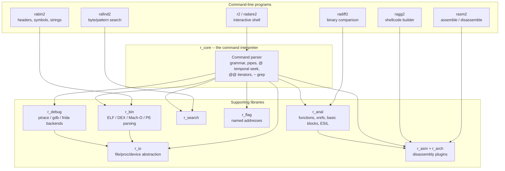
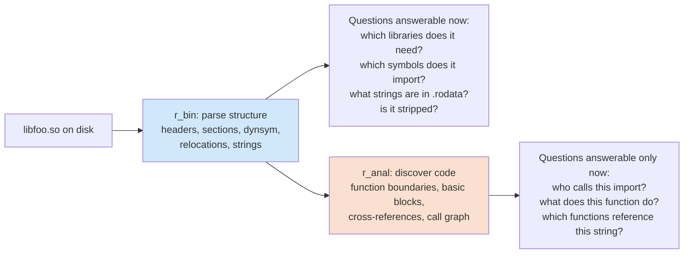
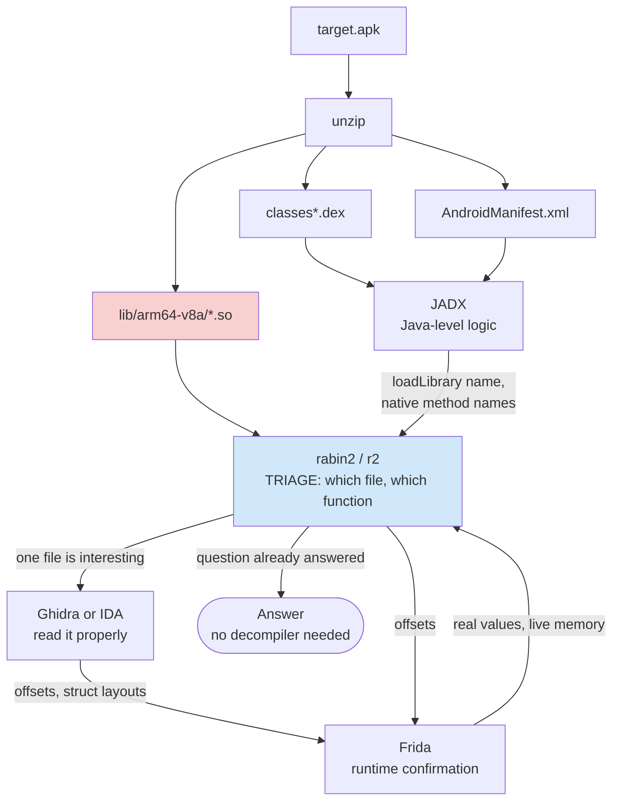
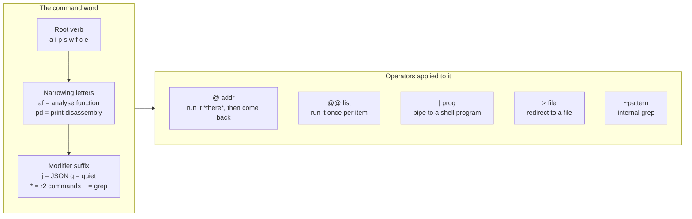
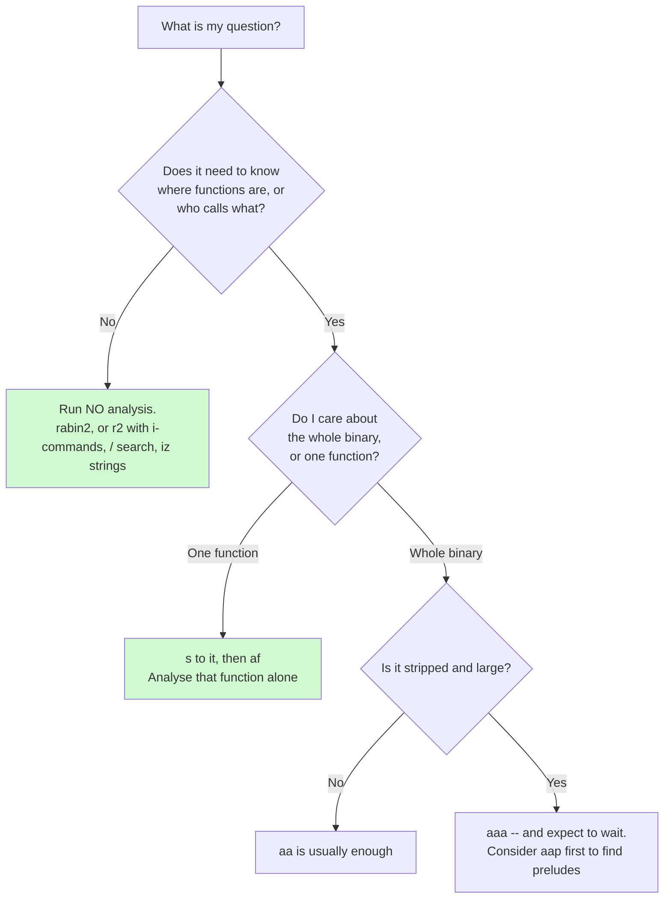
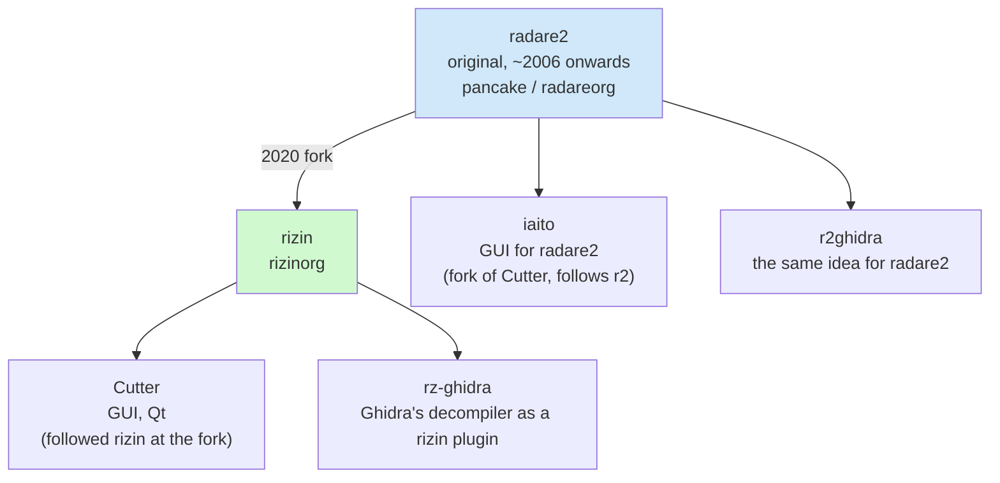
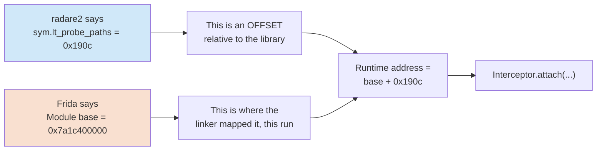
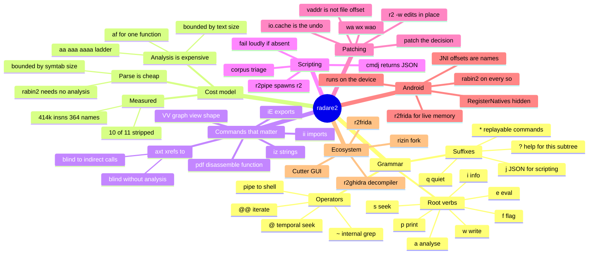

# 59 — radare2

> After this chapter you will be able to read radare2's command language as a *grammar* rather than
> memorising a command list, triage an Android `.so` from a shell prompt in seconds, script the whole
> thing from Python with `r2pipe`, patch a binary in place, and know precisely which of those jobs
> radare2 is the right tool for and which it is not.

**Prerequisites:** [02-Linux-Basics](../02-Linux-Basics/README.md), [15-Native-Code](../15-Native-Code/README.md), [16-JNI](../16-JNI/README.md), [17-Libraries](../17-Libraries/README.md), [18-ARM](../18-ARM/README.md), and — **out of numeric order, so read it first** — [68-ReverseEngineering](../68-ReverseEngineering/README.md), the discipline this chapter is a tool within; 68 does not depend on any tool chapter, so reading 68 → 59 costs you nothing
**Applies to:** radare2 5.x and rizin 0.6+/0.7+; target binaries from Android 5–16 (API 21–36), `arm64-v8a` primarily, `x86_64` and `armeabi-v7a` where noted

---

## Read this before you read anything else: what is measured here and what is not

This repository's rule is that claims are measured, not recited. This chapter is a partial exception
and it says so up front, because a fabricated tool transcript would be worse than an honest gap.

**radare2 is not installed on the machine this chapter was written on.** That was checked, not
assumed:

```powershell
# host (Windows PowerShell) -- every one of these reported "not recognized"
foreach ($n in @('r2','radare2','rizin','rabin2','rz-bin','cutter','iaito')) {
    Get-Command $n -ErrorAction SilentlyContinue
}
```

`r2`, `radare2`, `rizin`, `rabin2`, `rz-bin`, `cutter` and `iaito` are absent from `PATH`, absent
from Chocolatey's and Scoop's package directories, absent from `Program Files`, and absent from both
WSL distributions present on the machine (Ubuntu and Kali). `python -c "import r2pipe"` fails with
`ModuleNotFoundError`.

The consequence is stated plainly and applied consistently:

| Marker | Meaning |
|---|---|
| **Measured** | Produced by running something on this machine or on an attached device. The command, the output and the device are named. |
| **Unverified** | Transcribed from radare2's own documentation, its built-in help, and its source. It is believed correct and it has **not** been executed here. Treat the exact spelling of output as illustrative. |

Every radare2 command in this chapter is **Unverified**. Everything about the *binaries* — their
sizes, section layouts, symbol counts, instruction encodings, the disassembly listings, the patch
byte sequences, the timings, and the behaviour of the patched programs on a real device — is
**Measured**, using the Android NDK's LLVM tools and an attached Android 15 emulator, and each such
claim names how it was obtained.

That split is deliberate and it is more useful than it sounds. The hard part of this chapter is not
"which letters do I type"; it is "what is actually inside an Android native library, and what
question am I asking of it". Those facts are measured. The letters you type are documented, and the
labs are built so that a reader who installs radare2 can execute every one of them and see for
themselves.

> **Warning**
> If you find a command in this chapter that behaves differently from what is written, **the tool is
> right and this chapter is wrong.** Fix it here. radare2's command set moves quickly, and the
> radare2/rizin fork means two closely-related tools with diverging spellings. Section 3.14 covers
> that fork explicitly.

---

## Table of Contents

1. [Introduction](#1-introduction)
2. [High-Level Architecture](#2-high-level-architecture)
3. [Deep Internal Working](#3-deep-internal-working)
4. [Source Code Walkthrough (AOSP)](#4-source-code-walkthrough-aosp)
5. [Security Perspective](#5-security-perspective)
6. [Reverse Engineering Perspective](#6-reverse-engineering-perspective)
7. [Dynamic Analysis](#7-dynamic-analysis)
8. [Static Analysis](#8-static-analysis)
9. [Examples](#9-examples)
10. [Common Interview Questions](#10-common-interview-questions)
11. [Common Mistakes](#11-common-mistakes)
12. [Hands-on Labs](#12-hands-on-labs)
13. [Summary](#13-summary)
14. [References](#14-references)

---

## 1. Introduction

### The problem: you have four hundred libraries and one afternoon

Picture the situation that produces this tool. You have pulled sixty APKs from a client's portfolio.
Each ships between two and thirty native libraries. You need to answer one question about all of
them: *which of these libraries calls `ptrace`?* Or *which of these embeds an AWS key?* Or *which of
these has a `JNI_OnLoad` that calls `RegisterNatives`?*

You could open each one in a graphical tool. Sixty APKs at an average of eight libraries each is 480
files. At two minutes of clicking per file — and two minutes is optimistic once you count the import
dialogue and waiting for analysis — that is sixteen hours of work whose entire output is a yes/no
column.

That is not a reverse engineering problem. It is a **data processing** problem that happens to
involve binaries, and it wants a data processing tool: something with no GUI, no start-up cost, and a
text interface you can put in a loop.

> **Mental Model**
> Ghidra is a workshop: you carry the object into it, set it on the bench, and work on it for a day.
> radare2 is a set of hand tools on a belt: you take the tool to the object, do one thing, and move
> on. Neither is better. You would not rebuild an engine with a multitool, and you would not carry a
> workbench to inspect four hundred bolts.

### The second problem: the machine with the binaries is not the machine with the GUI

The other situation that produces this tool is remoteness. You are on an SSH session into a jump
host inside a client's network. The APK is on that host and cannot leave it — that is often a
contractual condition, not a preference. There is no display. There may be no Java runtime. You have
a terminal and nothing else.

More specifically for Android: sometimes the binary you want is **on the phone**, it was written
there at runtime, and it will not survive being copied off. A library decrypted into
`/data/data/<pkg>/files` by a packer, a `dex` file materialised by an in-memory loader, a `.so`
dropped by a first-stage payload. radare2 builds for `aarch64` Android and runs on the device itself,
which is a capability its graphical competitors do not have. Section 7.4 covers this.

### What radare2 is

> **Definition**
> **radare2** (usually written `r2`) is a free and open-source reverse-engineering *framework*: a
> library (`r_core` and around twenty sibling libraries) plus a set of command-line programs built on
> it. The best-known program is the interactive shell, also called `r2`, but the framework also ships
> `rabin2` (binary metadata), `rafind2` (searching), `radiff2` (comparison), `rasm2` (assemble and
> disassemble), `ragg2` (shellcode compilation) and others.

The word *framework* is load-bearing. radare2 is not primarily an application with a scripting
feature bolted on; it is a set of libraries with a shell wrapped around them. That inversion explains
most of what people find strange about it, including the command language, and it is why `r2pipe`
(section 3.11) feels less like an API and more like talking to the program in its own language.

> **Definition**
> **rizin** is a fork of radare2 created in late 2020 by a group of former radare2 contributors, with
> different governance and an explicit emphasis on API stability and documentation. **Cutter**, the
> graphical front end, followed rizin. The two projects remain deeply similar — the command grammar
> in section 3 applies to both — but command spellings have drifted. Section 3.14 gives the
> practical rules.

### Why this chapter spends its first third on a command language

Every honest account of radare2 says the same thing: the command interface is the barrier. People
install it, type `?`, receive several hundred lines of output, and uninstall it.

That reaction is rational and it is also a misunderstanding. The output of `?` looks like a list of
hundreds of arbitrary commands. It is not. It is a **grammar** with roughly a dozen root verbs and a
consistent set of suffixes, and once you see the grammar you can *derive* commands you have never
been taught. `afl` is not a thing you memorise; it is `a` + `f` + `l`, and if you know what those
three letters mean you also already know `afn`, `afi`, `aflj` and `afl~Java_` without being told.

That is why section 3.2 is the longest subsection in this chapter, and why the first lab does nothing
but teach the grammar. Everything else follows from it.

> **Pentester's Note**
> The single most common failure mode with this tool is treating it as a command list to be looked up
> each time. People who do that stay slow forever and eventually go back to a GUI. People who spend
> one focused hour on the grammar are productive for the rest of their career. Chapter 59's first lab
> is that hour.

### What would break without it

Three things become materially harder, and they are precisely the three the rest of this repository
already asks radare2 for.

1. **Corpus-scale questions.** [57-Ghidra](../57-Ghidra/README.md) §3.16 sends batch triage of
   hundreds of files here explicitly, because `analyzeHeadless` pays a JVM start-up and a full
   analysis pass per file. Section 9.5 builds the corpus scanner.
2. **Cross-reference questions asked from a shell.**
   [39-EmulatorDetection](../39-EmulatorDetection/README.md) §8.4 and
   [67-BypassingProtections](../67-BypassingProtections/README.md) §8.4 both promise the same
   one-liner: `axt sym.imp.<something>` to list every call site of an imported function at once.
   Section 3.7 explains what `axt` actually does and where it is blind.
3. **Working on the device.** Nothing else in this repository's toolchain runs on the phone.

> **Mental Model**
> The right question is never "should I use radare2 or Ghidra?" It is "is my question about *one*
> function or about *many* files?" Many files, or no display: radare2. One function, read carefully,
> with a decompiler: [Ghidra](../57-Ghidra/README.md) or [IDA](../58-IDA/README.md). The two-step of
> triaging in r2 and then opening the one interesting file in a decompiler is not a compromise — it
> is what experienced people actually do.

---

## 2. High-Level Architecture

### The library stack



Read that bottom-up, because the bottom is where the design decisions live.

**`r_io` is the reason radare2 can open things that are not files.** It abstracts "a sequence of
bytes I can read and maybe write" behind a URI scheme. A path opens a file. `malloc://512` opens a
scratch buffer. `dbg:///bin/ls` opens a process under a debugger. `frida://...` opens a live Android
app through [Frida](../53-Frida/README.md). Every command above it — disassembly, search, patching —
works identically regardless of which of those you opened. When you later read that you can patch a
running process with the same `wa` command you used on a file, this layer is why.

**`r_bin` is the file-format parser**, and it is the part that knows what an ELF is: program headers,
sections, the dynamic symbol table, relocations, the `DT_NEEDED` list. It is exposed directly as
`rabin2` and inside the shell as the `i` command family. Crucially, it does *no* code analysis — it
reads structure only, which is why it is fast enough to run across hundreds of files.

**`r_anal` is where the expensive work happens**: discovering where functions begin and end, building
basic blocks, computing cross-references, and — optionally — emulating instructions with ESIL. The
`a` command family drives it. Almost every performance question about radare2 is really a question
about how much of `r_anal` you asked for. Section 3.6 is about exactly that.

**`r_flag` is the naming layer** and it is more important than it looks. A *flag* is a name bound to
an address. Every symbol, every string, every function radare2 discovers becomes a flag. When you
type `sym.imp.access` you are not using a special symbol syntax; you are naming a flag, and flags are
just a namespace of names you can also add to yourself.

### The separation that matters: parse versus analyse



This diagram is the single most useful thing in this chapter for making radare2 fast.

The left box is **cheap**. Parsing an ELF's structure is reading a few hundred bytes of headers and
walking two or three tables. It is bounded by the size of the symbol table, not the size of the code.

The right box is **expensive**. Discovering functions in a stripped binary means starting from every
entry point you know about, following every branch, and repeating until nothing new appears — and
then, if you asked for it, doing an additional linear sweep over the bytes nothing referenced.

A very large fraction of real triage questions live entirely in the left box. "Does this library
import `ptrace`?" is a `.dynsym` lookup. "What are its strings?" is a scan of `.rodata`. Neither
needs a single instruction to be decoded. **The most common way to make radare2 slow is to run full
analysis when your question did not need any.**

Here is the scale of what the right box has to chew through, measured on the libraries this chapter
uses as its corpus:

> **Measured** — libraries pulled with `adb pull` from the attached AVD `sdk_gphone16k_x86_64`
> (Android 15 / API 35), then measured on the host with `llvm-readelf` and `llvm-nm` from NDK
> 25.2.9519653. `.text bytes` is the section's size field; instruction count is exact for AArch64
> because every instruction is four bytes.

**AArch64 libraries, from `/system/lib64/arm64/`:**

| Library | File bytes | `.text` bytes | Instructions | `.dynsym` entries | Relocations |
|---|---:|---:|---:|---:|---:|
| `libandroid_runtime.so` | 306,880 | 36,720 | 9,180 | 1,149 | 1,152 |
| `libc.so` | 1,043,784 | 510,348 | 127,587 | 1,477 | 1,648 |
| `libcrypto.so` | 1,394,600 | 843,420 | 210,855 | 2,503 | 4,241 |
| `libicui18n.so` | 2,799,504 | 1,590,884 | 397,721 | 6,468 | 9,057 |
| `libsqlite.so` | 1,930,416 | 1,657,588 | 414,397 | **364** | 1,363 |

**x86_64 libraries, from `/system/lib64/`** (instruction counts are omitted because x86 is
variable-width and cannot be derived by division):

| Library | File bytes | `.text` bytes | `.dynsym` entries | Relocations |
|---|---:|---:|---:|---:|
| `libmedia_jni.so` | 654,904 | 337,929 | 1,113 | 2,802 |
| `libcrypto.so` | 1,592,592 | 1,032,872 | 2,499 | 4,136 |
| `libsqlite.so` | 2,028,792 | 1,747,859 | 364 | 1,363 |
| `libandroid_runtime.so` | 2,623,840 | 1,493,358 | 3,992 | 14,190 |
| `libhwui.so` | 13,005,808 | 6,336,785 | 1,080 | 17,683 |
| `libLLVM_android.so` | 21,465,896 | 9,712,602 | 16,241 | 68,165 |

Two facts in that table deserve to be pulled out, because they drive everything in section 3.6.

**First: ten of the eleven are stripped — and the exception is worth knowing.** Ten have zero
`.symtab` sections and carry only the dynamic symbol table, which exists because the loader needs it.
Verified directly:

```bash
# host -- count .symtab sections and total symbols in each corpus library
for f in *.so; do
  printf "%-24s symtab_sections=%s nm_lines=%s\n" "$f" \
     "$(llvm-readelf -S "$f" | grep -c '\.symtab')" \
     "$(llvm-nm "$f" 2>/dev/null | wc -l)"
done
```

| Library | `.symtab` sections | Symbols `llvm-nm` can read |
|---|---:|---:|
| **`libc.so`** (AArch64) | **1** | **2,667** |
| The other ten | 0 | 0 |

**AArch64 `libc.so` ships a full symbol table with 2,667 entries.** Everything else in the corpus —
including `libcrypto.so`, `libsqlite.so`, `libicui18n.so`, `libhwui.so` and the 21 MB
`libLLVM_android.so` — is stripped down to `.dynsym`.

> **Pentester's Note**
> Check before you assume. This chapter's first draft asserted that all eleven were stripped, because
> the check had only been run over the x86_64 half of the corpus; running it over the whole corpus
> contradicted that. It is a small thing, and it is the exact shape of the mistake that makes people
> distrust a report. **`llvm-nm <file> | wc -l` costs nothing and it is either zero or it is a gift** —
> when a platform library keeps its symbols, every function you reach in it comes pre-named and you
> should stop reversing it and start reading the names.

For the ten stripped libraries, the reason function discovery is work rather than a table lookup is
exactly that absence.

**Second: look at `libsqlite.so`.** On AArch64 it carries **1,657,588 bytes of code — 414,397
instructions — behind 364 exported names.** That is one name per roughly 4,554 bytes of machine code.
`libhwui.so` on x86_64 is worse in absolute terms: 6.3 MB of code behind 1,080 names.

> **Under the Hood**
> Those ratios are the whole cost model. When a tool "analyses" a stripped library it is not reading
> names; it is *inventing* them, by finding the 400,000 instructions, deciding which addresses are
> function entry points, and grouping the rest into basic blocks. The `.dynsym` table gives it a few
> hundred starting points for four hundred thousand instructions. Everything expensive about `aaa`
> follows from that arithmetic, and so does every technique in section 3.6 for avoiding it.

### Where radare2 sits in the Android workflow



The important edge in that diagram is the one going straight from triage to **Answer**. A large
share of native-code questions on a real engagement are settled without ever opening a decompiler:
*does this app do certificate pinning in native code?* is answered by looking for the pinning
library's strings and imports. *Does this obfuscator call `ptrace`?* is an import lookup. Reaching
for a decompiler on those questions is not thoroughness; it is a slower route to the same answer.

The other edge worth noticing is **triage feeding Frida directly**, without passing through a
decompiler. Once radare2 has told you that the function at `0x190c` is the one that calls `access`,
you have everything you need to hook `module.base.add(0x190c)`. Section 7 builds that bridge.

---

## 3. Deep Internal Working

### 3.1 Getting radare2, and the one thing to get right

radare2 is distributed as source and as packages. The project's own recommendation is to build from
git, because distribution packages are frequently a year or more behind and the command set moves.

```bash
# host (Linux/macOS) -- the project's own installer; builds and installs into the source tree
git clone https://github.com/radareorg/radare2
cd radare2
sys/install.sh
r2 -v
```

```bash
# host (Debian/Ubuntu) -- distribution package: older, but fine for learning the grammar
sudo apt-get install -y radare2
```

```bash
# host -- rizin, the fork, is packaged separately
sudo apt-get install -y rizin       # or build from https://github.com/rizinorg/rizin
```

For Windows, the project publishes release ZIPs on GitHub; Cutter publishes a Windows installer and
an AppImage. `r2pipe`, the Python binding used throughout section 3.11, is a separate install:

```bash
# host -- the Python binding; it shells out to r2, so r2 itself must be on PATH first
python3 -m pip install r2pipe
```

> **Warning**
> `pip install r2pipe` installs a *client*. It does not install radare2. The module works by
> launching `r2` as a subprocess and talking to it over pipes, so a machine with `r2pipe` and no `r2`
> will import successfully and then fail at `r2pipe.open()`. That is a confusing failure and it is
> worth knowing before you meet it. On the machine this chapter was written on, **neither** is
> present — `python -c "import r2pipe"` raises `ModuleNotFoundError`, which is how the absence at the
> top of this chapter was established.

**The one thing to get right** is that radare2 opens files **read-only by default**. Not
read-only-ish: writes are silently discarded unless you asked for write mode. This is a deliberate
safety property and it catches everyone once.

| Invocation | Mode | Use |
|---|---|---|
| `r2 libfoo.so` | Read-only | Everything except patching |
| `r2 -w libfoo.so` | Read-write, **modifies the file in place** | Patching. Copy the file first. |
| `r2 -n libfoo.so` | No `r_bin` parsing at all | Raw/corrupt files, shellcode, firmware blobs |
| `r2 -A libfoo.so` | Runs `aaa` on load | Convenient, and section 3.6 explains when it is a mistake |
| `r2 -q -c '<cmd>' libfoo.so` | Run one command, print, exit | The scripting workhorse |
| `r2 -i script.r2 libfoo.so` | Run a script file, then drop to the shell | Reproducible setup |
| `r2 -d <program>` | Open under the debugger | Section 7 |

> **Warning**
> `r2 -w` edits the file you named, immediately, with no undo and no backup. There is no "save"
> step — `wa` writes through to disk the moment you press Enter. Always work on a copy. Every
> patching example in this chapter copies the file first, and lab 03 makes the copy the first
> numbered step for exactly this reason.

### 3.2 The command language, taught as a grammar

This is the section that makes the tool usable. Read it slowly once and you will not need to read it
again.

Radare2's commands look like line noise because they are **compressed**, not because they are
arbitrary. A command is built from a *root verb*, zero or more *narrowing letters*, and zero or more
*modifier suffixes*, followed by *operators* that redirect where the command looks and what happens
to its output.



#### Step 1 — the root verbs

There are about a dozen you will use. Learn these and you have the map.

| Verb | Mnemonic | Domain |
|---|---|---|
| `a` | **a**nalyse | Function discovery, cross-references, the call graph, ESIL emulation |
| `i` | **i**nfo | Everything `r_bin` parsed: headers, sections, imports, exports, strings, libraries |
| `p` | **p**rint | Render bytes as something: disassembly, hex, strings, structures |
| `s` | **s**eek | Move the current address |
| `w` | **w**rite | Modify bytes (requires `-w`) |
| `f` | **f**lag | Name an address, or list names |
| `c` | **c**ompare | Compare bytes or files |
| `e` | **e**val | Get or set configuration variables |
| `S` | **S**ections | Sections and segments (capital S; lowercase `s` is seek) |
| `d` | **d**ebug | Debugger control |
| `V` | **V**isual | Enter visual mode |
| `q` | **q**uit | Leave |
| `?` | help | Append to *anything* to get help for that subtree |

> **Mental Model**
> `?` is not a command, it is a **suffix that means "explain this prefix"**. `?` alone lists the root
> verbs. `a?` lists everything under `a`. `af?` lists everything under `af`. `afl?` explains the
> variants of `afl`. This is the single most valuable key in the tool: you never need to remember a
> command, only the letter it starts with, because you can always descend into the tree. Anyone who
> tells you radare2 requires memorisation has not been shown this.

#### Step 2 — narrowing letters

Each letter after the verb narrows the meaning, and the narrowing is consistent across trees. `l`
almost always means "list". `j` almost always means "JSON".

```
a          analysis root
 af        analyse function
  afl      analyse function list          -- list all discovered functions
  afi      analyse function info          -- details of the current function
  afn      analyse function name          -- rename the current function
  afv      analyse function variables     -- locals and arguments
 ax        analysis xrefs
  axt      xrefs TO here      ("to")      -- who references this address
  axf      xrefs FROM here    ("from")    -- what does this address reference
 aa        analyse all
  aaa      analyse all, more
  aaaa     analyse all, experimental extras
```

```
i          info root (from r_bin)
 ii        imports
 iE        exports
 is        symbols
 iz        strings in data sections
 izz       strings in the whole file
 il        linked libraries
 iS        sections
 ie        entrypoints
 iI        binary info (arch, bits, stripped, PIC, canary, NX)
```

```
p          print root
 pd        print disassembly (N instructions)
  pdf      print disassembly of function
  pdr      print disassembly recursively
 px        print hexdump
 ps        print string
 pf        print formatted (apply a struct definition)
```

Notice what just happened. You were not given a list of thirty commands. You were given three trees
and a rule, and the thirty commands fall out. `iEj` is "exports, as JSON" and you can construct it
without ever having seen it written down.

#### Step 3 — the universal suffixes

These attach to almost any command in any tree.

| Suffix | Effect | Why you want it |
|---|---|---|
| `j` | Output as JSON | **The scripting suffix.** `aflj` gives you a parseable list of functions. Section 3.11 lives on this. |
| `q` | Quiet — values only, no decoration | Shell pipelines. `aflqj`, `izq` |
| `*` | Output as radare2 commands | Extraordinary and under-used: the output can be *replayed* into another r2 session. This is how you move analysis between binaries. |
| `,` | Output as a table, with sortable columns | Interactive browsing of large lists |
| `?` | Help for this prefix | Discussed above |

> **Under the Hood**
> The `*` suffix is the mechanism behind most serious radare2 automation, and it exists because of
> the framework design in section 2. `f*` emits every flag as a series of `f name size addr`
> commands. Feed that text into a different r2 session and that session now has your names. There is
> no project file format to learn and no serialisation library — the tool's own command language *is*
> its save format. `Ps`/`Po` (project save/open) are built on the same idea.

#### Step 4 — the operators, which is where the power is

This is the part that separates people who find radare2 clumsy from people who find it fast.

**`@` — the temporal seek.** Run this command *as if* the cursor were somewhere else, then put the
cursor back.

```
# Unverified -- disassemble the function at that symbol without moving the cursor
pdf @ sym.lt_verify_license
```

Without `@` you would type `s sym.lt_verify_license`, then `pdf`, then `s -` to go back. `@` is that
in one step, and because it is an operator it composes with everything.

Variants worth knowing:

| Operator | Meaning |
|---|---|
| `@ addr` | Temporarily seek to `addr` |
| `@!size` | Temporarily set the block size |
| `@a:arm:64` | Temporarily change architecture — useful for mixed ARM/Thumb |
| `@e:key=value` | Temporarily change a config variable for this one command |

**`@@` — the iterator.** This is radare2's `for` loop and it is the reason the tool scales.

```
# Unverified -- run pdf once for every discovered function
pdf @@ fcn.*

# Unverified -- print the disassembly around every cross-reference to an import
pd 5 @@= `axt sym.imp.access ~[1]`

# Unverified -- run a command once per flag matching a glob
afi @@ sym.Java_*
```

| Form | Iterates over |
|---|---|
| `@@ glob` | Every flag whose name matches the glob |
| `@@= a b c` | The literal addresses listed |
| `@@f` | Every function |
| `@@b` | Every basic block in the current function |
| `@@i` | Every instruction in the current function |
| `@@s:from to step` | A numeric range |
| `@@c:cmd` | Every address in the *output* of `cmd` — the general form |

`@@c:` is the general case and it is worth internalising: it lets any command that emits addresses
drive any other command.

**`~` — the internal grep.** radare2 has grep built in, and it works even where a shell pipe would
not (inside visual mode, inside scripts, on Windows).

| Form | Meaning |
|---|---|
| `~foo` | Lines containing `foo` |
| `~!foo` | Lines *not* containing `foo` |
| `~foo,bar` | Lines containing `foo` **or** `bar` |
| `~[2]` | Column 2 of each line |
| `~:0` | Row 0 |
| `~foo[1]` | Column 1 of lines matching `foo` |
| `~?` | Count matching lines instead of printing them |

That last one is quietly excellent for triage: `afl~?` is "how many functions did you find", as a
number, with no post-processing.

Now re-read the commands that [39-EmulatorDetection](../39-EmulatorDetection/README.md) §8.4 and
[37-RootDetection](../37-RootDetection/README.md) §8.4 promised, and notice that they are no longer
opaque:

```
# Unverified -- from 39-EmulatorDetection section 8.4
is~system_property                      # symbols, grepped for system_property
axt sym.imp.__system_property_get       # every xref TO that import
iz~qemu,goldfish,ranchu                 # data strings containing any of three words
pdf @ sym.check_env                     # disassemble that function, cursor unchanged

# Unverified -- from 37-RootDetection section 8.4
iz~su                                   # data strings containing "su"
ii~access                               # imports containing "access"
afl~Java_                               # discovered functions whose name contains Java_
```

Each is a verb, a narrowing letter, and an operator. Nothing was memorised.

#### Step 5 — the prompt tells you where you are

```
[0x00001914]> 
```

The number in brackets is the **current seek address**, and almost every command is implicitly
relative to it. `pdf` means "disassemble the function *here*". `px` means "hex dump *here*". This is
the mental shift that makes the tool click: radare2 is *modal on position* in the way a text editor
is modal on the cursor.

| Seek form | Meaning |
|---|---|
| `s 0x190c` | Absolute address |
| `s sym.lt_gate` | A flag name |
| `s +32` / `s -32` | Relative |
| `s-` | Undo the last seek (a seek history, like a browser's back button) |
| `s+` | Redo |
| `s entry0` | The entry point |

> **Mental Model**
> If you take one thing from this section: **radare2 is a text editor whose document is a binary.**
> There is a cursor (`s`), a way to look at the document through different renderings (`p`), a way to
> modify it (`w`), a way to search (`/`), a way to bookmark (`f`), and a way to repeat an action over
> many places (`@@`). Every editor you have used has those six things. The letters are just shorter.

### 3.3 First contact: what a session actually looks like

Here is the orientation sequence on the chapter's own target library, `libr2target.so`, which
[`examples/01-r2-target.c`](examples/01-r2-target.c) builds. Every command is
**Unverified**; every *fact about the binary* underneath it is **Measured** with `llvm-readelf`,
`llvm-nm` and `llvm-objdump`, and is reproduced from those measurements.

```
# Unverified -- commands; the facts they report are measured, see below
$ r2 libr2target.so
[0x00001914]> iI          # what am I looking at?
[0x00001914]> iE          # what does it export?
[0x00001914]> ii          # what does it import?
[0x00001914]> iz          # what strings are in the data sections?
[0x00001914]> aa          # discover functions (cheap analysis)
[0x00001914]> afl         # list what was found
[0x00001914]> pdf @ sym.lt_gate
```

> **Measured** — the exported symbols of `libr2target.so`, built with
> `aarch64-linux-android21-clang` from NDK 25.2.9519653 at `-O2 -Wall -Wextra` (zero diagnostics),
> read with `llvm-nm -D --defined-only`:

```
00000000000019d0 T JNI_OnLoad
00000000000019cc T Java_com_pentest_ch59_Native_staticCheck
0000000000001990 T lt_gate
000000000000190c T lt_probe_paths
0000000000001944 T lt_verify_license
0000000000001a5c T main
```

> **Warning**
> Those addresses are from **one** build. Editing a comment in the source, changing compiler
> version, or changing flags will move every one of them. Read the addresses out of your own
> build — `examples/build.sh` prints them in its report — rather than copying them from
> here. Every lab in this chapter tells you to do that, and this is why.

That listing is what `iE` reports and what seeds `afl`. Note what is **absent**: the function
`dyn_gate`, which the library registers at runtime through `RegisterNatives`, is `static` in C and
therefore never reaches `.dynsym`. It exists, it is reachable from Java, and no symbol lists it.
Section 3.10 is about finding things like it.

> **Measured** — `llvm-readelf -S`, the sections that matter:

| Section | Address | File offset | Size | Flags |
|---|---|---|---|---|
| `.dynsym` | `0x2d0` | `0x2d0` | `0x108` | A |
| `.dynstr` | `0x4ac` | `0x4ac` | `0xa3` | A |
| `.rodata` | `0x690` | `0x690` | `0x50` | A, merge, strings |
| `.text` | `0x18bc` | `0x8bc` | `0x250` | A, execute |
| `.plt` | `0x1b10` | `0xb10` | `0x90` | A, execute |
| `.data.rel.ro` | `0x2ba0` | `0xba0` | `0x20` | write, A |

Look hard at `.text`: **address `0x18bc`, file offset `0x8bc`.** They differ by `0x1000`. That gap is
where every hand-rolled patching script goes wrong, and section 3.12 is about it.

And look at `.rodata`: **`0x50` bytes total.** That whole section is fifty bytes, and dumping it
shows the library's entire string content at once:

```
/system/xbin/su . com/pentest/ch59/Native . (Ljava/lang/String;)I . . dynGate . gate=%d\n .
```

(`.` marks a NUL terminator.) Every fact sections 6.3 and 9.3 recover about the dynamic JNI
registration is visible in those fifty bytes — the class name, the method name and the signature sit
next to each other because the compiler emitted them in the order the code referenced them.

### 3.4 `rabin2` — the part you will use most and think about least

`rabin2` is `r_bin` as a standalone program. It never analyses code. It is therefore fast, safe to
run on hostile input, and ideal inside a shell loop.

| Flag | Prints |
|---|---|
| `-I` | Binary info: architecture, bits, endianness, stripped, PIC, NX, canary, RELRO |
| `-e` | Entry points |
| `-i` | Imports |
| `-E` | Exports |
| `-s` | Symbols |
| `-z` | Strings in data sections |
| `-zz` | Strings anywhere in the file |
| `-l` | Linked libraries (`DT_NEEDED`) |
| `-S` | Sections |
| `-SS` | Segments (program headers) |
| `-R` | Relocations |
| `-H` | Header fields |
| `-c` | Classes — for DEX, the class list |
| `-j` | JSON output, combinable with all of the above |
| `-q` | Quiet |

The combination that matters for Android triage is `rabin2 -I` plus `rabin2 -l`, because together
they answer "what is this and what does it depend on" in a single millisecond-scale call:

```bash
# Unverified -- the two-command orientation for any unknown .so
rabin2 -I lib/arm64-v8a/libfoo.so
rabin2 -l lib/arm64-v8a/libfoo.so
```

> **Pentester's Note**
> `rabin2 -I` reports the hardening flags — `nx`, `canary`, `pic`, `relro`. On Android these are
> almost always all enabled because the NDK enables them by default, so a library where one is
> **missing** is interesting: it usually means a hand-rolled build system, a very old prebuilt, or a
> vendor blob that never went through the NDK. That is a lead about *provenance*, which is often more
> useful than the flag itself.

### 3.5 Flags — the naming layer, and why `sym.imp.` looks the way it does

> **Definition**
> A **flag** in radare2 is a name bound to an address, with a size. Flags live in **flag spaces**,
> which are namespaces. Everything radare2 knows the name of is a flag: symbols, strings, sections,
> functions, imports, your own annotations.

The naming convention is mechanical, and once you see it the strange-looking names become
self-explanatory:

| Prefix | Flag space | Example |
|---|---|---|
| `sym.` | Symbols defined in this binary | `sym.lt_gate` |
| `sym.imp.` | **Imported** symbols — the PLT stub, not the real function | `sym.imp.access` |
| `str.` | Strings, with the content mangled into the name | `str.system_xbin_su` |
| `sect.` | Sections | `sect..text` |
| `fcn.` | Functions radare2 discovered that had no symbol | `fcn.00001914` |
| `loc.` | Labels inside functions | `loc.000019bc` |
| `obj.` | Data objects | `obj.kMethods` |
| `reloc.` | Relocation targets | |

Two of those repay attention.

**`sym.imp.X` is the PLT stub, not `X`.** When `libfoo.so` calls `access()`, it does not call libc
directly; it calls a small stub in `.plt` which jumps through the Global Offset Table to wherever the
dynamic linker put the real `access`. `sym.imp.access` names *that stub*. This is exactly why
`axt sym.imp.access` works as a "find every call site" query: every call in the library goes through
the one stub, so cross-references to the stub are the complete call list within this binary.

> **Measured** — this is visible in the chapter's own target. `llvm-objdump -d` on
> `libr2target.so` shows `lt_probe_paths` calling the stub, not libc:
>
> ```
>     192c: 8d 00 00 94   bl   0x1b60 <access@plt>
> ```
>
> and `llvm-readelf -S` confirms a `.plt` section at address `0x1b10`, size `0x90` — enough for a
> handful of stubs.

**`fcn.` versus `sym.`** is your instant read on how much the binary told you. In a stripped library
almost every function is `fcn.<address>`; a library where most functions are `sym.<name>` either
kept its symbols or you are looking at the exports only. `afl~fcn.~?` versus `afl~sym.~?` gives you
the ratio as two numbers.

You can create flags yourself, and you should:

```
# Unverified -- naming what you have understood is how analysis accumulates
f my.rootcheck 0 @ 0x190c          # bind a name to an address
afn probe_su_paths @ 0x190c        # rename the *function* at that address
f-  my.rootcheck                   # remove it
f*                                 # dump every flag as replayable r2 commands
```

That last line is how you carry a day's work from one binary to another, or into a bug report.

### 3.6 Analysis levels — `aaa` and what it actually costs

This is the subsection where radare2's reputation for speed is either earned or squandered, and it
is the one the rest of this repository points at.

> **Definition**
> **Analysis** in radare2 means turning an undifferentiated array of bytes into a *program*:
> deciding which bytes are instructions, where functions start and end, which instructions branch to
> which, and which addresses reference which others. None of this is recorded in a stripped ELF. All
> of it is inferred.

The `a` family is a ladder, and you choose a rung:

| Command | Name | What it does | Rough relative cost |
|---|---|---|---|
| *(none)* | — | No analysis. `i*` commands still work fully | Zero |
| `aa` | analyse all | Analyse function entry points from symbols and the entry point, follow calls | Baseline |
| `aaa` | + more | `aa`, plus auto-name functions, find preludes, compute all cross-references, propagate types | Several times `aa` |
| `aaaa` | + experimental | `aaa` plus extra passes: emulation-assisted reference finding, more aggressive prelude search | Substantially more than `aaa` |
| `aab` | basic blocks | Analyse basic blocks only | Cheap |
| `aac` | analyse calls | Follow call instructions from the current function | Targeted |
| `aap` | preludes | Search for function prologue byte patterns | Moderate |
| `af` | analyse function | Analyse **only** the function at the cursor | Tiny |
| `aef` | ESIL emulate function | Symbolic/concrete emulation of one function | Expensive, per-function |

> **Mental Model**
> `aaa` is not a magic word that means "get ready". It is a *purchase*. You are buying a complete
> call graph and cross-reference database, and the price scales with the size of `.text`. If your
> question does not need a call graph, you are paying for nothing. If it does, `aaa` is cheap
> compared with doing it by hand.

**The decision rule, which is worth more than any timing number:**



The two green boxes are where most of your time should be spent and where most people never go.

**Honest numbers.** This chapter cannot report `aaa` timings, because radare2 is not installed here.
It can report the cost of the one step every analyser must pay regardless of design — decoding every
instruction in `.text` once — measured with `llvm-objdump`, which does a linear sweep and nothing
else. That is a **floor**, not an estimate of `aaa`:

> **Measured** — `llvm-objdump -d <file> | wc -l`, wall-clock, on the host (Windows, Git Bash).
> Each figure is a single run.

| Library | Arch | Disassembly lines | Time | Lines/second |
|---|---|---:|---:|---:|
| `libc.so` | AArch64 | 134,892 | 641 ms | ~210,000 |
| `libcrypto.so` | AArch64 | 216,033 | 864 ms | ~250,000 |
| `libsqlite.so` | AArch64 | 415,971 | 1,513 ms | ~275,000 |
| `libicui18n.so` | AArch64 | 420,696 | 1,583 ms | ~266,000 |
| `libLLVM_android.so` | x86_64 | 2,551,900 | 9,089 ms | ~281,000 |

> **Warning**
> Do not read that table as "radare2 analyses `libsqlite.so` in 1.5 seconds". It is not radare2 and
> it is not analysis — it is a different program performing the *cheapest possible subset* of the
> work. What the table legitimately establishes is the shape of the cost: **linear in `.text` size,
> at a few hundred thousand instructions per second, and essentially independent of file size.**
> `libLLVM_android.so` is 21 MB but only 9.7 MB of it is code, and the time tracks the 9.7. Anything
> that discovers functions, builds basic blocks and computes cross-references does strictly more work
> than this per instruction — expect a multiple, not a match, and measure it yourself with `time r2
> -A -q -c q <file>` once you have the tool.

**The practical consequences**, which are what the rest of this repository is relying on:

- **For a yes/no question across many files, run no analysis at all.** `rabin2 -i` on 480 libraries
  is a few seconds of total work, because it never decodes an instruction.
- **`aaa` on a 6 MB `.text` is not free and never will be.** If you need it, pay it once and save a
  project (`Ps`), rather than re-running it every session.
- **`af` on one function is essentially instant**, and answers most "what does this do" questions.

> **Pentester's Note**
> The workflow that actually gets used: `rabin2 -i *.so | grep` across the corpus to find the three
> interesting files; open one of those three in `r2`; `s` to the interesting symbol; `af` then `pdf`.
> Full `aaa` gets run when — and only when — you need cross-references across the whole binary,
> which in practice means when you are asking `axt`. Section 9.5 automates the first step.

### 3.7 Cross-references: `axt`, and its two blind spots

`axt <addr>` answers "what references this address". It is the command three other chapters in this
repository promised you, and it is genuinely the highest-value single command in the tool for
security work.

```
# Unverified -- the promised one-liners, now readable
axt sym.imp.__system_property_get     # every property read       (39-EmulatorDetection 8.4)
axt sym.imp.abort                     # every abort() call site   (67-BypassingProtections 8.4)
axt sym.imp.access                    # every filesystem probe
axt @@ str.*su*                       # every xref to any string containing "su"  (37-RootDetection 8.4)
```

The reason this is powerful is the PLT-stub property from section 3.5: within one library, *all*
calls to an imported function funnel through one stub, so cross-references to that stub are a
complete inventory of call sites. "Does this library read system properties in one place or thirty?"
is one command, and the answer reshapes your test plan.

`axf` is the reverse — what does *this* address reference — and is how you walk outwards from a
function you are reading.

**Blind spot one: `axt` requires analysis.** Cross-references are computed by `aaa` (or by `aar`
specifically). On a freshly opened binary with no analysis, `axt` returns nothing, and it returns
nothing *silently*. Somebody loses an hour to this at least once.

**Blind spot two, and it is the important one: `axt` only sees references it could compute
statically.** An indirect call through a register — `blr x8` — has no static target. If a library
loads a function pointer from a table and calls it, the call site does not appear in `axt`'s output
for the target.

> **Measured** — this is not hypothetical, and the chapter's own target demonstrates it. Every
> JNI call in `JNI_OnLoad` is an indirect call through the `JNIEnv` function table. From
> `llvm-objdump -d libr2target.so`:
>
> ```
>     1a18: 08 00 40 f9   ldr   x8, [x0]          ; load the JNINativeInterface pointer
>     1a1c: 08 19 40 f9   ldr   x8, [x8, #48]     ; +0x30 -> FindClass
>     1a20: 00 01 3f d6   blr   x8                ; indirect call: no static target
>     ...
>     1a3c: 08 00 40 f9   ldr   x8, [x0]
>     1a40: 08 5d 43 f9   ldr   x8, [x8, #1720]   ; +0x6b8 -> RegisterNatives
>     1a44: 00 01 3f d6   blr   x8
> ```
>
> No cross-reference analysis will tell you that `0x1a44` calls `RegisterNatives`, because the
> instruction says `blr x8` and nothing more. What tells you is the **constant `1720`**, which is
> `0x6b8`, which is `RegisterNatives`'s fixed offset in the JNI function table. Reading that
> constant is the skill.this independently confirms the JNI table offsets given in
> [57-Ghidra](../57-Ghidra/README.md) §3.8 — `0x30` for `FindClass`, `0x6b8` for `RegisterNatives` —
> measured here from a different direction.

> **Pentester's Note**
> The general rule, and it applies to every static tool including the expensive ones: **a static
> cross-reference graph is a lower bound.** Everything reached through a function pointer, a vtable,
> a jump table, `dlsym`, or JNI dispatch is missing from it. When a static tool tells you a function
> has no callers, the correct conclusion is "no *direct* callers", and the next step is
> [Frida](../53-Frida/README.md), not a conclusion.

### 3.8 Seeking, searching and the string commands

**Searching** is the `/` family, and it has more variants than you will need but four that you will
use constantly.

| Command | Searches for |
|---|---|
| `/ string` | A literal ASCII string |
| `/w string` | A wide (UTF-16) string — common in code that came from Java |
| `/x 4855c3` | A hex byte pattern |
| `/x 48..c3` | A hex pattern with wildcards (`.` is a nibble wildcard) |
| `/a mov eax` | An assembled instruction — radare2 assembles it and searches for the bytes |
| `/R pop rdi` | A ROP gadget search |
| `/c jmp` | Search disassembly text for a mnemonic |
| `/m` | Search using magic signatures (identify embedded file types) |

`/x` with wildcards is the workhorse for finding code patterns that survive recompilation, and `/a`
is the friendly version of it — you type the instruction and radare2 works out the bytes.

**Strings** deserve their own note because the distinction between `iz` and `izz` catches people.

| Command | Scope |
|---|---|
| `iz` | Strings in *data sections* only (`.rodata`, `.data`) |
| `izz` | Strings anywhere in the file, including sections not marked as data |
| `izzz` | Raw scan, ignoring sections entirely |

`iz` is what you want almost always; `izz` is what you want when a packer has put the interesting
data somewhere structurally odd.

**A measured warning about strings**, which is the most valuable single finding in this chapter and
which section 5.3 develops fully:

> **Measured** — [`examples/01-r2-target.c`](examples/01-r2-target.c) hides the path
> `/system/xbin/su` by XOR-ing it with `0xA7` at compile time and decoding it at runtime. Built at
> **`-O2`**, the string is *plainly visible* in the binary:
>
> ```bash
> # host -- llvm-strings from NDK 25.2.9519653, on the -O2 build
> $ llvm-strings -n 4 libr2target.so | grep xbin
> /system/xbin/su
> ```
>
> Built from the identical source at **`-O0`**, it is not:
>
> ```bash
> $ llvm-strings -n 4 /tmp/o0.so | grep xbin
> (no output)
> ```
>
> **Optimisation defeated the obfuscation.** The reason is in the disassembly: at `-O2` clang
> evaluated the entire XOR loop at compile time, because both the ciphertext and the key were
> compile-time constants. The loop does not exist in the shipped binary. What remains is a single
> 16-byte vector load of the *already-decoded plaintext* out of `.rodata`:
>
> ```
> 000000000000190c <lt_probe_paths>:
>     1918: e8 ff ff f0   adrp  x8, 0x0
>     1924: 00 a5 c1 3d   ldr   q0, [x8, #1680]     ; 1680 = 0x690 = .rodata
>     1928: e0 03 80 3d   str   q0, [sp]
>     192c: 8d 00 00 94   bl    0x1b60 <access@plt>
> ```
>
> Fifteen bytes of ciphertext, a fifteen-iteration loop and a key — all replaced by one
> `ldr q0`, a single 16-byte NEON load of the finished plaintext.

This is the inverse of what almost everyone assumes. Higher optimisation made the secret *more*
visible, not less, and it did so by deleting the code that was supposed to hide it.
[`examples/02-r2-target-hardened.c`](examples/02-r2-target-hardened.c) shows the fix and section 5.3
explains why it works.

### 3.9 Visual mode and panels — the parts that are not a command line

radare2 has two interactive full-screen modes, and people who only ever use the prompt miss most of
the tool's ergonomics.

**Visual mode** is entered with `V` and left with `q`. Inside it, single keypresses do things and
there is no Enter key involved.

| Key | Does |
|---|---|
| `p` / `P` | Cycle forwards/backwards through print modes (disassembly, hex, strings, debug) |
| `V` | Enter the **graph** view — basic blocks as a navigable control-flow graph |
| `hjkl` | Move (vi keys); arrows also work |
| `g` | Seek to a flag or address by name, with completion |
| `x` | Show cross-references *to* the current address, and let you jump to one |
| `X` | Cross-references *from* |
| `;` | Add a comment at the cursor |
| `d` | Define — convert bytes to code, data, a string, a function |
| `c` | Toggle cursor mode, so you can select a byte range |
| `A` | Assemble at the cursor — the interactive form of `wa` |
| `u` / `U` | Undo / redo a seek |
| `:` | Run a normal r2 command without leaving visual mode |
| `?` | Help for the current mode |

**The graph view (`VV`) is the one to learn first.** It draws the current function's basic blocks
with arrows between them, and — exactly as
[57-Ghidra](../57-Ghidra/README.md) §3.7 notes for Ghidra's Function Graph — its real value is
*shape recognition*. A normal function is a tree that flows downwards. A function processed by a
control-flow-flattening obfuscator is a wheel: one central dispatcher block with dozens of blocks
radiating out and returning to it. You can identify obfuscation from the shape before reading a
single instruction. See [40-Obfuscation](../40-Obfuscation/README.md).

**Panels mode** is entered with `v` (lowercase) and gives a tiled multi-pane layout — disassembly,
registers, stack, symbols, hexdump — closer to what a graphical debugger looks like. `|` and `-`
split panes, `X` closes one, `Tab` cycles. It is most useful when debugging (section 7), where you
genuinely want to watch four things at once.

> **Pentester's Note**
> The two-key sequence worth building into muscle memory is `VV` on a function you have just found,
> then `x` on any call to see who else reaches it. That loop — look at the shape, jump to a caller,
> look at that shape — is how you build a mental map of an unfamiliar library in ten minutes without
> reading much code at all.

### 3.10 DEX support, and its real limits

radare2 has a DEX plugin in `r_bin`. It is genuinely useful and it is genuinely not a Java tool, and
being clear about which is which will save you time.

**What works:**

```bash
# Unverified -- DEX metadata via rabin2
rabin2 -I classes.dex        # header: version, checksum, endianness
rabin2 -c classes.dex        # class list with method signatures
rabin2 -s classes.dex        # symbols: methods and fields
rabin2 -z classes.dex        # the string pool
```

Inside `r2`, `pd` on a method disassembles **Dalvik bytecode** — radare2 has a Dalvik architecture
plugin, so you see `invoke-virtual`, `iget-object`, `const-string` and the rest, addressed and
cross-referenced like any other architecture. Set it explicitly with `e asm.arch=dalvik` if
auto-detection did not.

**What does not work, and why it matters:**

| Limitation | Consequence |
|---|---|
| There is no Java decompiler | You get Dalvik bytecode, never Java source. For readable Java use [JADX](../56-JADX/README.md). |
| Multi-DEX is per-file | An APK with `classes.dex` through `classes7.dex` is seven separate radare2 sessions with no shared cross-reference graph |
| It does not read the APK container | You unzip first; radare2 opens the `.dex`, not the `.apk` |
| Cross-references across the Java/native boundary do not exist | radare2 will not connect a `native` method declaration in DEX to its implementation in a `.so` |
| Obfuscated DEX is as unreadable here as anywhere | Chapters [40](../40-Obfuscation/README.md), [41](../41-ProGuard/README.md) and [42](../42-R8/README.md) apply unchanged |

> **Pentester's Note**
> The honest position: **use [JADX](../56-JADX/README.md) for DEX.** radare2's DEX support earns its
> place in exactly two situations. First, batch metadata extraction — `rabin2 -c` across a thousand
> APKs to find which ones declare a class matching a pattern is fast and scriptable in a way that
> launching JADX is not. Second, when a DEX is *malformed* deliberately: anti-decompilation tricks
> that make JADX bail out often leave radare2's byte-level view working, because it is not trying to
> reconstruct Java, only to decode instructions. That second case is rare and, when it happens, it is
> the only tool that helps. See [12-DEX-Internals](../12-DEX-Internals/README.md) for the format
> itself, which is what you will be reading by hand at that point.

### 3.11 `r2pipe` — scripting, and the design idea behind it

> **Definition**
> **`r2pipe`** is a family of small libraries (Python, JavaScript, Go, Rust, Ruby and more) that
> launch `r2` as a child process, write commands to its standard input, and read the output back.
> There is no C API binding, no FFI, and no serialisation format to learn: you send the same text you
> would type, and you get back the same text you would see.

That sounds primitive. It is in fact the design's biggest strength, and it follows directly from the
`j` suffix in section 3.2:

```python
# Unverified (r2pipe not installed here) -- the entire API, essentially
import r2pipe
r2 = r2pipe.open("libfoo.so")
r2.cmd("aa")                       # send a command, get text back
functions = r2.cmdj("aflj")        # send a command, get parsed JSON back
r2.quit()
```

`cmd` returns a string. `cmdj` returns already-parsed JSON. Because *almost every* radare2 command
takes a `j` suffix, `cmdj` works nearly everywhere, and the result is that any interactive
exploration you did by hand converts into a script mechanically: append `j`, call `cmdj`, index the
dictionary.

**Three connection modes** are worth knowing:

| Form | Meaning |
|---|---|
| `r2pipe.open("file")` | Spawn a new `r2` on that file |
| `r2pipe.open("file", flags=["-2"])` | Spawn with extra command-line flags (`-2` silences stderr) |
| `r2pipe.open()` | **Attach to the r2 that is running this script.** Inside `#!pipe` scripts |
| `r2pipe.open("frida://...")` | Through the r2frida plugin — section 7.3 |

The third is how you write scripts that run *inside* an interactive session: `r2` sets an environment
variable, `r2pipe.open()` with no arguments finds it, and the script drives the session the analyst
is looking at.

**The performance property that makes this the right tool for corpus work** is that `r2pipe.open()`
is a process spawn, and a process spawn is cheap compared with a JVM start-up plus a project
creation. This is the mechanism behind [57-Ghidra](../57-Ghidra/README.md) §3.16's recommendation to
come here for "batch triage of hundreds of files".

Two complete, runnable scripts ship with this chapter:

- [`scripts/r2-triage.py`](scripts/r2-triage.py) — walks a directory of `.so` files and emits one CSV
  row per library: architecture, stripped or not, hardening flags, counts of imports and exports, and
  whether each of a configurable list of "interesting" imports is present. It runs **no** code
  analysis, by design, per section 3.6.
- [`scripts/r2-jni-inventory.py`](scripts/r2-jni-inventory.py) — finds JNI entry points, both the
  statically registered `Java_*` exports and the `RegisterNatives` tables, and reports what it could
  and could not resolve.

Both degrade honestly: if `r2pipe` or `r2` is missing they say so and exit non-zero rather than
producing an empty result that looks like a clean scan.

> **Warning**
> A batch script that silently reports "no findings" when the tool failed to load is worse than no
> script, because it produces a false negative that looks like evidence. Both scripts here check for
> the tool first and fail loudly. When you write your own, do the same — and make the failure mode
> `exit 1`, so a shell loop notices.

There is also a shell-level counterpart, [`scripts/so-corpus-stats.sh`](scripts/so-corpus-stats.sh),
which produces the section 2 scale table. It uses `rabin2` when available and **falls back to
`llvm-readelf`** when it is not — which is how the numbers in this chapter were actually produced,
and which makes the script useful on a machine in the state this one is in.

### 3.12 Patching with `r2 -w`

Patching is where radare2 is at its most pleasant, because the write commands mirror the print
commands exactly.

| Command | Writes |
|---|---|
| `wa <asm>` | **A**ssemble the instruction and write it here |
| `wao <op>` | Write **o**peration: transform the current instruction (`nop`, `jinf`, `ret1`, `trap`, `nocj`) |
| `wx <hex>` | Raw he**x** bytes |
| `w <string>` | An ASCII string |
| `wz <string>` | A zero-terminated string |
| `wf <file>` | The contents of a file |
| `wv <value>` | A value, respecting endianness and size |
| `wopO` | Write a De Bruijn pattern (for offset discovery) |

`wao` is the convenient one: `wao nop` turns the instruction at the cursor into architecture-correct
no-ops without you needing to know the encoding or the length. `wao ret1` makes a function return 1.

**The AArch64 encodings you will use by hand**, all verified:

> **Measured** — assembled with `aarch64-linux-android21-clang -c -x assembler-with-cpp` from NDK
> 25.2.9519653 and read back with `llvm-objdump -d`:

| Instruction | Bytes (little-endian file order) | Word |
|---|---|---|
| `mov w0, #1` | `20 00 80 52` | `0x52800020` |
| `mov w0, #0` | `00 00 80 52` | `0x52800000` |
| `ret` | `c0 03 5f d6` | `0xd65f03c0` |
| `nop` | `1f 20 03 d5` | `0xd503201f` |

The `ret` and `nop` values match those recorded independently in
[18-ARM](../18-ARM/README.md); they are reproduced here because a patching section that makes you go
and look them up is a patching section you will not use.

So "make this function return true" is:

```
# Unverified -- three equivalent spellings of the same patch
r2 -w libfoo.so
[0x0]> s sym.lt_verify_license
[0x0]> wa mov w0, 1; ret          # assemble
[0x0]> wx 200080 52c0035fd6       # or write the bytes directly
[0x0]> wao ret1                   # or let r2 work it out
```

**The trap: addresses are not file offsets.** radare2 handles this for you when it has parsed the
binary, which is most of the time — but the moment you write a script that opens the file with
Python, or you use `-n` to skip parsing, you own the translation.

> **Measured** — on the chapter's `r2gate` executable, `llvm-readelf -S` reports:
>
> ```
> .text   PROGBITS   0000000000004794   000794   000288   AX
> ```
>
> Virtual address `0x4794`, file offset `0x794`. The delta is **`0x4000`**. The function
> `lt_verify_license` is at virtual address `0x4854` (from `llvm-nm`), so its bytes live at file
> offset `0x854`. Patching at `0x4854` in a raw file editor would corrupt something else entirely —
> in this binary, a location past the end of the file.

The general rule: **file offset = virtual address − (section virtual address − section file
offset)**, computed per section, because different sections can have different deltas. `iS` in
radare2 prints both columns side by side, which is why doing it inside radare2 is safer than doing it
by hand.

> **Warning**
> On Android there is a further step that has nothing to do with radare2: a patched `.so` inside an
> APK invalidates the APK signature, so the app will not install until you re-sign it. See
> [10-APK-Internals](../10-APK-Internals/README.md) and
> [38-TamperDetection](../38-TamperDetection/README.md). And if the app checks its own signature at
> runtime, re-signing is exactly what it is looking for. Patching a library is often the *easy* half
> of the job.

### 3.13 `radiff2` and `rafind2`

**`radiff2`** compares two binaries. On Android engagements the two binaries are usually two versions
of the same app, and the question is "what changed in this release" — which is frequently the fastest
route to a patched vulnerability.

| Flag | Mode |
|---|---|
| *(none)* | Byte-level diff |
| `-A` | Analyse both, then diff at **function** level — matches functions across versions even when addresses moved |
| `-C` | Show the function match table with similarity percentages |
| `-s` | Similarity score for the whole file |
| `-g <function>` | Emit a graph diff of one function, in Graphviz format |
| `-j` | JSON |

`radiff2 -C old.so new.so` is the command that matters: it prints a table of functions with a
similarity column, so functions at 100% are unchanged, functions at 0% are new or removed, and the
handful in between are what actually changed. That is patch-diffing, and it is the same technique
covered in [70-VulnerabilityResearch](../70-VulnerabilityResearch/README.md).

**`rafind2`** searches files for patterns without opening a session — the binary-aware `grep`.

```bash
# Unverified -- find a byte pattern across a whole directory of libraries
rafind2 -x 'c0035fd6' -r lib/
rafind2 -s '/system/xbin/su' -r lib/
rafind2 -Z -r lib/                       # print printable strings, like strings(1)
```

Its advantage over `grep` is that it reports *offsets* in a form you can hand straight back to
`r2 -s <offset>`, and it understands `-x` hex patterns with wildcards.

### 3.14 radare2 versus rizin versus Cutter

You will meet all three names and the relationship confuses people.



| | radare2 | rizin |
|---|---|---|
| Command grammar | The grammar in section 3.2 | **The same grammar**, with drifted spellings |
| Tools | `r2`, `rabin2`, `radiff2`, `rafind2`, `rasm2` | `rizin`, `rz-bin`, `rz-diff`, `rz-find`, `rz-asm` |
| Pipe library | `r2pipe` | `rzpipe` |
| GUI | `iaito` | **Cutter** |
| Ghidra decompiler plugin | `r2ghidra` | `rz-ghidra` |
| Emphasis | Speed of development, many features | API stability, documentation, testing |

**Practical rules:**

1. **Learn the grammar once.** It transfers. `afl`, `axt`, `pdf`, `iz`, `@@` and `~` work in both.
2. **Tool names differ by prefix.** `rabin2` becomes `rz-bin`. A script that shells out to `rabin2`
   needs one line changed to work with rizin.
3. **Cutter is rizin's GUI.** If you want a graphical front end with a decompiler, install Cutter
   plus `rz-ghidra` — which gives you Ghidra's actual decompiler inside a Qt application, without a
   JVM. For many people this is the most pleasant way to consume both projects.
4. **Follow whichever your tutorials use** until the grammar is second nature, then stop caring.

> **Pentester's Note**
> The decompiler question is worth being direct about. Base radare2 ships `pdc`, a
> "pseudo-decompiler" that is a prettified rendering of the disassembly rather than a real
> decompiler — it does no type inference or control-flow structuring worth the name. If you want real
> decompiled C, install `r2ghidra` (or `rz-ghidra`), which embeds Ghidra's native decompiler and
> gives you `pdg`. It is the same decompiler engine described in
> [57-Ghidra](../57-Ghidra/README.md) §3.2, and the honest way to describe the result is that you get
> Ghidra's output with radare2's driving.

### 3.15 Configuration variables you will actually change

`e` gets and sets configuration. `e?` lists everything (there are hundreds); `e??<prefix>` gives
help. These are the ones that come up on Android work.

| Variable | Purpose |
|---|---|
| `asm.arch` | Architecture: `arm`, `x86`, `dalvik` |
| `asm.bits` | 16 / 32 / 64 — the ARM/AArch64 switch |
| `asm.cpu` | CPU variant; for ARM32, `e asm.cpu=thumb` |
| `asm.pseudo` | Render disassembly in a pseudo-C syntax instead of mnemonics |
| `asm.describe` | Append a plain-English description to each instruction — excellent while learning |
| `asm.bytes` | Show/hide raw bytes in the listing |
| `asm.emu` | Show emulated register values as comments — very useful on obfuscated code |
| `anal.hasnext` | Continue analysing after a function ends; helps on stripped binaries |
| `bin.demangle` | Demangle C++ symbols |
| `scr.color` | Colour output (`0` when redirecting to a file) |
| `scr.utf8` | Box-drawing characters in graphs |
| `io.cache` | **Cache writes in memory instead of touching the file** |
| `dbg.profile` | A debug profile file for setting up the target environment |

> **Pentester's Note**
> `e io.cache=1` is the safety net that `r2 -w` lacks. With it set, writes go to an in-memory overlay:
> you can patch, disassemble to check your work, patch again, and only commit with `wci` when
> satisfied. Turn it on before any patching session. It converts "irreversible file edit" into
> something with an undo, and section 12's lab 03 uses it for exactly that reason.

`e asm.describe=1` deserves a special mention for anyone learning AArch64 alongside this chapter: it
annotates every instruction with a one-line description of what it does, turning the disassembly into
a self-teaching document. Pair it with [18-ARM](../18-ARM/README.md).

### 3.16 Limitations — when radare2 is the wrong tool

The honest counterpart to section 3.6's advocacy. This table deliberately does not restate the
comparison in [57-Ghidra](../57-Ghidra/README.md) §3.16 from the other side; read that one too.

| Limitation | Detail | Reach for |
|---|---|---|
| No native decompiler | `pdc` is a prettified disassembly, not decompilation. Real C output requires the `r2ghidra` plugin | [Ghidra](../57-Ghidra/README.md), or `r2ghidra` inside radare2 |
| Java and DEX | Dalvik bytecode only; no Java reconstruction, no multi-DEX cross-referencing | [JADX](../56-JADX/README.md) |
| C++ class recovery | Demangling works; vtable and class-hierarchy reconstruction is limited | [IDA](../58-IDA/README.md), or Ghidra |
| Library function identification | `zignatures` exist but the ecosystem of ready-made signatures is small | [IDA](../58-IDA/README.md)'s FLIRT ecosystem |
| Sustained interactive work on one function | Possible, but annotation ergonomics favour a GUI | [Ghidra](../57-Ghidra/README.md), or Cutter |
| Analysis stability across versions | The command set moves; scripts break between releases | Pin a version in CI |
| Learning curve | Real, and front-loaded | Budget the hour; lab 01 is that hour |

> **Mental Model**
> Reduced to one sentence each: **radare2 answers questions about *many* binaries, or about a binary
> on a machine with no display. [Ghidra](../57-Ghidra/README.md) answers questions about *one*
> function, carefully, for free. [IDA](../58-IDA/README.md) answers the questions the other two
> could not.** A senior researcher has all three installed and reaches without thinking about it.

---

## 4. Source Code Walkthrough (AOSP)

radare2 is not part of AOSP, so this section does what
[57-Ghidra](../57-Ghidra/README.md) §4 does: it walks the AOSP-defined structures that radare2 is
*showing you*, and then the parts of radare2's own source that explain its behaviour.

### 4.1 The ELF structures `r_bin` reads

Everything in section 3.4 comes from three tables defined by the ELF specification and populated by
the NDK's linker. Android's own view of them lives in
`bionic/libc/include/elf.h` and `bionic/libc/kernel/uapi/linux/elf.h`.

| Structure | Field radare2 surfaces | Command |
|---|---|---|
| `Elf64_Ehdr` | `e_machine`, `e_type`, `e_entry` | `iI`, `ie` |
| `Elf64_Phdr` | `PT_LOAD` segments, `p_flags` | `iSS` |
| `Elf64_Shdr` | `.text`, `.rodata`, `sh_addr` vs `sh_offset` | `iS` |
| `Elf64_Sym` (in `.dynsym`) | `st_name`, `st_value`, `st_info` | `is`, `iE`, `ii` |
| `Elf64_Dyn` (in `.dynamic`) | `DT_NEEDED`, `DT_SONAME`, `DT_INIT_ARRAY` | `il`, `id` |
| `Elf64_Rela` | Relocation targets | `ir` |

> **Measured** — the `DT_NEEDED` list of the chapter's target, which is what `rabin2 -l` prints,
> read with `llvm-readelf -d`: the library depends on `libc.so` and `libdl.so`, both of which appear
> in `llvm-strings` output as the only two `lib*.so` strings in the file.

The one that repays understanding is `DT_INIT_ARRAY`, because it is where code runs *before* anything
you were looking at.

> **Pentester's Note**
> `iS~init_array`, which [67-BypassingProtections](../67-BypassingProtections/README.md) §8.4 uses,
> is asking a specific question: **does this library run code at load time, before `JNI_OnLoad` and
> before any Java code calls into it?** Functions in `.init_array` execute when the dynamic linker
> maps the library. Anti-debug checks, string decryption and integrity checks live there precisely
> because they run before an analyst's breakpoints are set. A non-empty `.init_array` in a security
> library is always worth reading first.

### 4.2 The JNI structures, and the offsets you will read as constants

The reason section 3.7's `blr x8` example is readable at all is that the JNI function table has a
**specification-fixed layout**. AOSP declares it in
`libnativehelper/include_jni/jni.h`:

```c
// libnativehelper/include_jni/jni.h -- the fixed-order table, abridged
struct JNINativeInterface {
    void*       reserved0;
    void*       reserved1;
    void*       reserved2;
    void*       reserved3;

    jint        (*GetVersion)(JNIEnv *);
    jclass      (*DefineClass)(JNIEnv*, const char*, jobject, const jbyte*, jsize);
    jclass      (*FindClass)(JNIEnv*, const char*);
    /* ... roughly 225 further entries, in an order the JNI specification fixes ... */
    jint        (*RegisterNatives)(JNIEnv*, jclass, const JNINativeMethod*, jint);
    /* ... */
};
```

Because the order is fixed and every entry is one pointer wide, an offset *is* a function name. The
four reserved slots at the start are why `GetVersion` is at `0x20` rather than `0x00`.

> **Measured** — from `llvm-objdump -d libr2target.so`, the two offsets this chapter's target
> actually uses, both confirming [57-Ghidra](../57-Ghidra/README.md) §3.8's table:
>
> | Instruction | Offset | Decimal | Function |
> |---|---|---|---|
> | `ldr x8, [x8, #48]` | `0x30` | 48 | `FindClass` |
> | `ldr x8, [x8, #1720]` | `0x6b8` | 1720 | `RegisterNatives` |
>
> And on the `JavaVM` side, `JNI_OnLoad`'s first act is `ldr x8, [x8, #48]` followed by `blr x8` —
> offset `0x30` in `JNINativeInterface`'s much shorter sibling `JNIInvokeInterface`, where after
> three reserved slots and `DestroyJavaVM` and `AttachCurrentThread`, index 6 is **`GetEnv`**.

This is the single most transferable skill in native Android RE, and it needs no tool at all: **see a
constant offset dereferenced from a pointer that came from parameter one, and look it up in
`jni.h`.** See [16-JNI](../16-JNI/README.md) for the full table.

### 4.3 `RegisterNatives` on the ART side

What the `blr x8` at offset `0x6b8` reaches is ART's implementation, in
`art/runtime/jni/jni_internal.cc`. Its job is to walk the caller-supplied array of
`JNINativeMethod` structures and, for each, find the declared Java method and set its native entry
point.

```c
// libnativehelper/include_jni/jni.h -- the structure the native side builds
typedef struct {
    const char* name;         // Java method name, e.g. "dynGate"
    const char* signature;    // JNI type signature, e.g. "(Ljava/lang/String;)I"
    void*       fnPtr;        // pointer to the C function
} JNINativeMethod;
```

Three pointers, twenty-four bytes on a 64-bit target. That fixed shape is what makes the table
findable in a binary, and it is what [`scripts/r2-jni-inventory.py`](scripts/r2-jni-inventory.py)
looks for.

> **Measured** — in the chapter's target the table is a single entry. `llvm-objdump` shows
> `JNI_OnLoad` materialising its address with `adrp x2, 0x2000` followed by `add x2, x2, #2984`,
> giving `0x2ba8`; `llvm-readelf -S` places `.data.rel.ro` at `0x2ba0` with size `0x20`. The table
> therefore sits eight bytes into `.data.rel.ro`. `llvm-strings` confirms the two strings it points
> at are present in `.rodata`:
>
> ```
> (Ljava/lang/String;)I
> dynGate
> ```
>
> The C function it names, `dyn_gate`, is `static` and appears in `.symtab` in an unstripped build
> but **never** in `.dynsym`. In the stripped build that ships, nothing names it at all.

That is the complete picture of why dynamic registration defeats naive symbol listing, and why the
strings `dynGate` and `(Ljava/lang/String;)I` are the thread you pull instead.

### 4.4 Where the linker gets involved

The `sym.imp.` distinction in section 3.5 is a fact about `bionic`'s dynamic linker, whose source is
`bionic/linker/linker.cpp` and `bionic/linker/linker_soinfo.cpp`. A call to an imported function
compiles to a branch to a PLT stub; the stub loads a pointer from the GOT and jumps through it; the
linker fills the GOT entry in, either eagerly or on first use depending on the binding mode.

> **Under the Hood**
> This is also the mechanism that makes PLT/GOT hooking possible, which is what several hooking
> frameworks in [65-Hooking](../65-Hooking/README.md) do: overwrite the GOT entry and every future
> call through the stub goes to you. From radare2's side the useful consequence is the one in section
> 3.5 — one stub per imported function means `axt` on the stub is a complete local call inventory.

### 4.5 radare2's own source, where it explains behaviour

| Path in the radare2 tree | What it explains |
|---|---|
| `libr/core/cmd.c` | The command parser: how `@`, `@@`, `~`, `|` and `>` are dispatched. Reading this is how you learn what is legal to compose |
| `libr/core/cmd_anal.c` | Every `a` command, including the definitions of `aa`, `aaa` and `aaaa` as sequences of smaller steps |
| `libr/bin/p/bin_elf.c`, `libr/bin/format/elf/` | The ELF loader |
| `libr/bin/p/bin_dex.c`, `libr/bin/format/dex/` | The DEX loader whose limits section 3.10 describes |
| `libr/anal/` | Function discovery, basic blocks, cross-references |
| `libr/esil/` | The ESIL emulator |
| `libr/arch/p/arm/`, `libr/arch/p/dalvik/` | Architecture plugins |

> **Under the Hood**
> `cmd_anal.c` is worth ten minutes even if you never write C, because it shows that `aaa` is
> literally a *macro*: a fixed sequence of smaller analysis commands, each of which you can run
> individually. Once you have seen that, "which part of `aaa` do I actually need" stops being a
> mysterious question and becomes a list you can pick from. That is the whole content of section
> 3.6, and it is discoverable from the source in a way it is not from the documentation.

---

## 5. Security Perspective

### 5.1 What you are looking for in an Android native library

A native library is where developers put the things they do not want you to see, on the widespread
and incorrect belief that native code is meaningfully harder to read than DEX. In practice the
inventory is short and predictable.

| Target | First command | Why it is there |
|---|---|---|
| Hardcoded keys and secrets | `iz~key,secret,token,api` then `axt` on the hits | "It's in C, nobody will find it" |
| Certificate pins | `iz` for base64 or hex digests; `ii~ssl,x509` | [36-CertificatePinning](../36-CertificatePinning/README.md) |
| Root detection | `ii~access,stat,fopen,system`; `iz~su,magisk,superuser` | [37-RootDetection](../37-RootDetection/README.md) |
| Emulator detection | `axt sym.imp.__system_property_get` | [39-EmulatorDetection](../39-EmulatorDetection/README.md) |
| Anti-debug | `ii~ptrace,prctl`; `iS~init_array` | [38-TamperDetection](../38-TamperDetection/README.md) |
| Request signing | Look for HMAC/SHA in imports, then `axt` | [46-Tokens](../46-Tokens/README.md) |
| Memory-safety bugs | `ii~memcpy,strcpy,sprintf,alloca` then read each call site | [70-VulnerabilityResearch](../70-VulnerabilityResearch/README.md) |
| Load-time code | `iS~init_array` | Section 4.1 |

The pattern is the same every time: **an import tells you a capability exists; `axt` tells you where
it is used; reading one function tells you whether it matters.** Three steps, and the first two are
one command each.

### 5.2 How attackers use radare2 against an application

Symmetrically to how you use it, because it is the same activity with different authorisation.

- **Corpus reconnaissance.** Scrape a category of apps from a store, run a `rabin2`-based scanner
  across every library, and rank targets by which ones import interesting functions. This is cheap
  enough to do across thousands of apps, which is precisely why section 9.5 exists — an attacker's
  version of that script is a weekend project.
- **Version diffing for patched bugs.** `radiff2 -C` between the version before a security release
  and the version after. The functions that changed are the fix; the fix describes the bug. See
  [70-VulnerabilityResearch](../70-VulnerabilityResearch/README.md).
- **Automated protection stripping.** Once one app's root check is understood, a `wa`-based patch
  driven by a byte-pattern search generalises to every app that used the same commercial SDK.
- **On-device analysis of dropped payloads.** Malware that decrypts a stage-two library into private
  storage leaves it there only briefly. radare2 running on the phone can read it in place. See
  [69-MalwareAnalysis](../69-MalwareAnalysis/README.md).

### 5.3 How developers get this wrong

The developer misconceptions that this chapter's measurements speak to directly.

**"Native code is hard to reverse."** It is *different*, not hard. The inventory in 5.1 is eight
commands long. Anything reachable from Java has a `Java_`-prefixed export or a `RegisterNatives`
entry, both of which are enumerable.

**"I XORed my strings, so `strings` will not find them."** This is the measured finding from section
3.8 and it is worth stating as a rule:

> **Warning**
> **A compile-time-constant obfuscation is not obfuscation; it is a comment to the optimiser.** If
> both the ciphertext and the key are constants known at compile time, clang at `-O2` is entitled to
> evaluate your decode loop during compilation and store the plaintext. It did exactly that here:
> `/system/xbin/su` appears verbatim in `llvm-strings` output of the `-O2` build and is absent from
> the `-O0` build of identical source. The developer who tests at `-O0`, sees nothing in `strings`,
> and ships at `-O2` has shipped the plaintext.

The fix is to make the key opaque to the optimiser, and it was verified:

> **Measured** — [`examples/02-r2-target-hardened.c`](examples/02-r2-target-hardened.c) declares
> the key `static volatile unsigned char`. Built at `-O2` with the same compiler and flags,
> `llvm-strings -n 4 | grep -iE 'xbin|/system'` produces **no output**, and `llvm-objdump` confirms
> the decode loop survived — vectorised into `dup v0.8b` and `eor v0.8b, v0.8b, v1.8b`, but present,
> operating on ciphertext still in `.rodata`.

`volatile` works because it forbids the compiler from assuming the value it just stored is the value
it will read back, which breaks the constant-folding chain. This is the same reasoning that
[19-Memory](../19-Memory/README.md) applies to scrubbing secrets with a `volatile` loop, and the same
class of finding: **a standard defensive idiom that the optimiser is allowed to delete.**

> **Pentester's Note**
> This gives you a fast, high-value check to run on any app that claims native string protection:
> run `strings` on the shipped library and look for the very things it was protecting. When it hits,
> it is a genuine finding with a clean explanation and a one-line remediation, and it is
> embarrassing enough to get fixed. It is also a *severity* argument: the developer believed the
> secret was protected and made downstream decisions on that basis.

**"The check is in a function called `verifyLicense`, so that is the security boundary."** Section 5.4
is entirely about why that is wrong.

**"Patching my library is hard."** It is four bytes. What makes patching hard on Android is APK
re-signing and runtime integrity checks
([38-TamperDetection](../38-TamperDetection/README.md)) — not the binary edit.

### 5.4 The most important thing in this chapter: patch the decision, not the check

Reverse engineers find a function, patch it, and expect behaviour to change. It very often does not,
and the reasons are systematic rather than mysterious.

[18-ARM](../18-ARM/README.md) §5.4 records one mechanism, measured on a physical device: a signature
check was patched to return 1, *verified* returning 1, and the program still refused — because clang
had **inlined** the check, so the patched standalone copy was called by nothing.

This chapter measured a second, independent mechanism producing the identical symptom.

> **Measured** — the target `r2gate` (AArch64, built with
> `-O2 -pie -Wl,-z,max-page-size=16384`) was pushed to the AVD `sdk_gphone16k_x86_64` (Android 15 /
> API 35, x86_64, running the AArch64 binary through `libndk_translation.so`) and run in four
> variants. `lt_verify_license` accepts the key `radare2`; `lt_probe_paths` checks for
> `/system/xbin/su`. Patches were applied by writing the verified encodings from section 3.12 at the
> file offsets derived in section 3.12, and confirmed in place with `llvm-objdump -d`.

| Binary | `key=wrongkey` | `key=radare2` |
|---|---|---|
| Unpatched | `gate=0` | **`gate=0`** |
| `lt_verify_license` patched to `mov w0,#1; ret` | `gate=0` | **`gate=0`** |
| `lt_probe_paths` patched to `mov w0,#0; ret` | `gate=0` | **`gate=1`** |
| Both patched | `gate=1` | `gate=1` |

Read the second row carefully. **The function named `lt_verify_license` was patched to unconditionally
return success, the patch was verified present in the bytes, and the program's behaviour did not
change at all.**

The reason is in the control flow, and `llvm-objdump -d` shows it in eight instructions:

```
00000000000048a0 <lt_gate>:
    48b0: db ff ff 97   bl    0x481c <lt_probe_paths>
    48b4: 60 00 00 34   cbz   w0, 0x48c0            ; if probe == 0, continue
    48b8: e0 03 1f 2a   mov   w0, wzr               ; else return 0 immediately
    48bc: 05 00 00 14   b     0x48d0
    48c0: e0 03 13 aa   mov   x0, x19
    48c4: e4 ff ff 97   bl    0x4854 <lt_verify_license>
```

`lt_gate` calls the root probe **first** and returns early if it fires. On this device the probe
fires, because — a measured fact worth its own note — **the stock Google emulator image ships
`/system/xbin/su`**:

```
# adb shell -- on sdk_gphone16k_x86_64, API 35
$ ls -l /system/xbin/su
-rwsr-x--- 1 root shell 51224 2025-01-23 23:03 /system/xbin/su
```

So `lt_verify_license` was never reached. The patch was correct, applied, and irrelevant.

> **Common Confusion — this fires from `adb shell`, and *not* from an app.**
> The probe above ran as uid 2000, which is in the `shell` group. `/system/xbin` is
> `drwxr-x--- root:shell`, so an app cannot traverse it at all. Measured on the same AVD, same
> minute:
>
> ```
> # adb shell            -> -rwsr-x--- 1 root shell 51224 /system/xbin/su
> # run-as <app> test -e -> Permission denied   (the check returns FALSE)
> ```
>
> So "the stock emulator ships `su`" is true, and "a stock emulator fails a path-based root check" is
> **only true from the shell**. A real root check runs in an app, where this particular path is
> invisible. The `su` in question is **AOSP's**, not Magisk's — it rejects `-c` and takes
> `su <uid> <cmd>`, which is the same fact as the AVD's `su 0` syntax quirk, not a second one.
> [37-RootDetection](../37-RootDetection/README.md) owns the consequence;
> [39-EmulatorDetection](../39-EmulatorDetection/README.md) measured the same shell-versus-app gap in
> the property namespace.

> **Mental Model**
> **The function with the security-sounding name is rarely the security boundary.** The boundary is
> wherever the *decision* is made, and the decision is usually a `cbz` in a caller you have not
> looked at yet. Before patching anything, run `axt` on it and read the caller. If you cannot explain
> what happens to the return value, you are not ready to patch.
>
> Note also that the third row is the *correct* attack and it required both the right key and the
> right patch — the key alone yields `gate=0` on this device. Real targets stack conditions like
> this routinely, and a bypass that fixes one of them looks exactly like a bypass that does not work.

Two failure mechanisms, same symptom, recorded together:

| Mechanism | Where measured | Tell |
|---|---|---|
| The check was **inlined**, so the standalone copy is dead | [18-ARM](../18-ARM/README.md) §5.4 | `axt` on the function returns few or no callers, yet the logic demonstrably runs |
| The check is **short-circuited** by an earlier guard | This chapter, §5.4 | `axt` finds the caller; reading the caller shows an earlier `bl` and a `cbz` |

Both are diagnosed the same way: **read the caller before you patch the callee.**

### 5.5 Vulnerability classes you find this way

Described as classes, with no invented identifiers.

| Class | How it surfaces | Chapter |
|---|---|---|
| Hardcoded credentials in native code | `iz` finds the string; `axt` proves it is used | [34-Cryptography](../34-Cryptography/README.md) |
| Stack buffer overflow from a JNI string | `GetStringUTFChars` result reaching `strcpy`/`sprintf` into a fixed buffer | [70-VulnerabilityResearch](../70-VulnerabilityResearch/README.md) |
| Integer truncation before allocation | A 64-bit length narrowed to 32 or 16 bits before `malloc` | [19-Memory](../19-Memory/README.md) |
| Trust in a client-side gate | The whole of §5.4 | [67-BypassingProtections](../67-BypassingProtections/README.md) |
| Weak or homebrew crypto | `iz` shows no standard constants, `ii` shows no crypto imports, yet the app claims encryption | [34-Cryptography](../34-Cryptography/README.md) |
| Unsafe library loading | `dlopen` on a path under app-writable storage | [17-Libraries](../17-Libraries/README.md) |

> **Warning**
> **Never report a memory-safety finding from static reading alone**, whether the reading was
> assembly or decompiled C. Section 3.7's blind spots mean you may be wrong about reachability, and
> [70-VulnerabilityResearch](../70-VulnerabilityResearch/README.md) measured that the *same* heap
> overflow can present as a loud ASan abort, a silent UBSan note, or nothing at all depending on
> which allocation it lands in. Reach it at runtime, or report it as a code-quality observation and
> say so.

### 5.6 OWASP MASVS / MASTG mapping

| Identifier | Area | How radare2 contributes |
|---|---|---|
| **MASVS-CODE-4** | Weaknesses in third-party and native code | Corpus-wide import scanning; §9.5 |
| **MASVS-CRYPTO-1** | Cryptographic key management | Locating hardcoded keys in `.rodata`; §5.3 |
| **MASVS-CRYPTO-2** | Use of proven implementations | Import analysis showing homebrew crypto |
| **MASVS-RESILIENCE-1** | Platform integrity validation | Enumerating root/emulator checks; §5.1 |
| **MASVS-RESILIENCE-2** | Anti-tampering | `.init_array` and self-check discovery; §4.1 |
| **MASVS-RESILIENCE-3** | Anti-static-analysis | Assessing whether obfuscation actually works; §5.3's measured failure is a MASVS-RESILIENCE-3 finding |
| **MASVS-RESILIENCE-4** | Anti-dynamic-analysis | `ptrace`/`prctl` import discovery |
| **MASTG-TEST-0001 family** | Static analysis of native code | The whole of section 8 |

### 5.7 Malware analysis and forensics

For [69-MalwareAnalysis](../69-MalwareAnalysis/README.md), radare2's advantages are specific:

- **It does not execute anything.** `rabin2` on a hostile file parses structure only. Compare with
  tools that run the sample.
- **It runs on the device**, so a payload decrypted into private storage can be read where it lives.
- **It handles deliberately malformed files.** Samples are frequently built to crash parsers.
  `r2 -n` skips `r_bin` entirely and gives you a raw byte view when structure-aware parsing fails,
  which is the state in which most anti-analysis DEX and ELF tricks leave a tool.
- **It is scriptable**, so a family signature becomes a `rafind2` pattern applied to a corpus.

Forensically, the properties that matter are that radare2 opens files read-only by default (section
3.1) and never writes to the target unless `-w` was passed, so running it does not alter evidence.
Hash first regardless; `#sha256` inside a session hashes the current block.

---

## 6. Reverse Engineering Perspective

### 6.1 Getting from an APK to the file radare2 opens

```bash
# host -- an APK is a zip; radare2 does not open the container
unzip -o target.apk -d target_extracted/
ls target_extracted/lib/
# arm64-v8a  armeabi-v7a  x86_64
```

> **Warning**
> `lib/arm64-v8a/libfoo.so` and `lib/armeabi-v7a/libfoo.so` are **different binaries** from the same
> source. Analyse the one the device under test actually loads. Confirm with
> `adb shell getprop ro.product.cpu.abi`, and confirm again at runtime by reading `/proc/<pid>/maps`.
> Occasionally the 32-bit build retains symbols the 64-bit build does not, which is worth two seconds
> of checking before you start.

The device this chapter used reports:

```
# adb shell -- sdk_gphone16k_x86_64, API 35
$ getprop ro.product.cpu.abilist
x86_64,arm64-v8a
```

which is the AVD advertising both native x86_64 and translated arm64 — the arrangement
[39-EmulatorDetection](../39-EmulatorDetection/README.md) measured in detail. A library extracted
from `lib/arm64-v8a/` will run there, through `libndk_translation.so`, which is how this chapter's
own AArch64 test binary was executed.

### 6.2 The orientation sequence, and what each answer means

This is the sequence to run on any unknown library, in this order, with the reasoning attached. It is
also what [17-Libraries](../17-Libraries/README.md) §"open in Ghidra, IDA or radare2" is pointing at.

```
# Unverified -- the standard opening, ~5 seconds, no analysis
[0x0]> iI       # arch, bits, stripped, PIC, canary, NX
[0x0]> il       # what it links against
[0x0]> ii       # what it imports -- capabilities
[0x0]> iE       # what it exports -- the attack surface reachable from Java
[0x0]> iS       # sections -- is there an .init_array?
[0x0]> iz       # strings -- intent
```

| Answer | What it tells you |
|---|---|
| `stripped=true` | Normal. Expect `fcn.*` names, budget for `aaa` |
| `stripped=false` | Unusual in release. Either a debug build leaked, or a vendor SDK — read the names, they are free |
| `canary=false` or `nx=false` | Not built with the NDK defaults. Provenance lead |
| `il` shows `libssl`/`libcrypto` | Network crypto happens here, not in Java |
| `il` shows an unfamiliar `lib*.so` | Find it in the APK; it may be the real target |
| `iE` shows `Java_*` symbols | Statically registered JNI. The names give you the Java class and method |
| `iE` shows **only** `JNI_OnLoad` | Dynamic registration. Section 6.3 |
| `iS` shows a non-empty `.init_array` | Code runs at load. Read it first |
| `iz` shows almost nothing | Strings are encrypted, packed, or the library is small. Check `izz` |

### 6.3 Recognising the Java/native boundary from the native side

Two registration mechanisms, two very different search problems.

**Static registration.** The C function is named by a mangled convention and exported, so it appears
in `.dynsym` and `iE` lists it.

> **Measured** — `llvm-nm -D` on the chapter's target shows
> `Java_com_pentest_ch59_Native_staticCheck`, which decodes as class
> `com.pentest.ch59.Native`, method `staticCheck`.

The decoding rule, covered fully in [16-JNI](../16-JNI/README.md): `Java_`, then the fully-qualified
class name with `.` replaced by `_`, then `_`, then the method name; overloaded methods get `__`
plus the mangled signature. **Note the escape rule that chapter records: `_` in an identifier becomes
`_1`, `;` becomes `_2`, `[` becomes `_3`, and a Unicode character becomes `_0` followed by *four*
hex digits.**

A measured detail that will otherwise confuse you:

> **Measured** — the JNI entry point in this chapter's target compiles to exactly one
> instruction:
>
> ```
> 00000000000019cc <Java_com_pentest_ch59_Native_staticCheck>:
>     19cc: 61 00 00 14   b   0x1b50 <lt_probe_paths@plt>
> ```
>
> The compiler emitted a tail call. The exported JNI function contains no logic whatsoever; it
> branches immediately to the real implementation. If you disassemble the export and find a single
> `b`, you have not found the code — follow the branch.

**Dynamic registration.** The library exports only `JNI_OnLoad` and builds the mapping at runtime.
`iE` will not help. What helps:

| Approach | Command | Reliability |
|---|---|---|
| Look for the signature strings | `iz~^\(` — JNI signatures start with `(` | High. The strings must exist |
| Look for the method-name strings next to them | `iz` and read the neighbourhood | High |
| Find the table in `.data.rel.ro` | `iS`, then `px` over it | Good, if you know the shape |
| Read `JNI_OnLoad` and follow the `RegisterNatives` argument | `pdf @ sym.JNI_OnLoad` | Definitive, but manual |
| Hook it at runtime | [Frida](../53-Frida/README.md); section 7.2 | Definitive and easy. Prefer this |

> **Measured** — in the chapter's target the giveaway strings are exactly what section 4.3
> predicts. `llvm-strings` output contains, adjacent in `.rodata`:
> `com/pentest/ch59/Native`, `(Ljava/lang/String;)I`, `dynGate`. The name of the C function that
> implements it, `dyn_gate`, appears only in `.symtab` and is absent from the stripped build.

> **Pentester's Note**
> A JNI type signature is a uniquely greppable shape: it begins with `(`, contains only the letters
> `ZBCSIJFDV`, `L...;` and `[`, and ends with `)` plus one type. `iz~^\(` is close to a perfect
> detector for "this library registers natives dynamically", and it costs nothing because it needs no
> analysis.

### 6.4 Patterns you learn to recognise in AArch64

Cross-reference [18-ARM](../18-ARM/README.md), which owns the instruction set. These are the shapes
that mean something specific in a *security* context.

| Pattern | Meaning |
|---|---|
| `adrp xN, ...` + `add xN, xN, #imm` | Materialising an address of something in `.rodata` or `.data`. `adrp` reaches ±4 GiB |
| `adrp` + `ldr` | Loading a *value* from a global, rather than its address |
| `ldr x8, [x0]` + `ldr x8, [x8, #imm]` + `blr x8` | **A JNI call.** The `#imm` names the function; §4.2 |
| `bl <sym.imp.X>` | A call to an imported function — the thing `axt` indexes |
| `cbz` / `cbnz` right after a `bl` | **A decision on a function's return value.** This is where security gates live |
| `cset wN, eq` | Converting a comparison to a boolean 0/1 return |
| `mov wN, #imm` + `movk wN, #imm, lsl #16` | A 32-bit constant being built in two halves. Magic values look like this |
| `b <somewhere>` as a function's only instruction | A tail call; the real code is elsewhere (§6.3) |
| `stp x29, x30, [sp, #-N]!` | Standard prologue; a function boundary |
| `ldp x29, x30, [sp], #N` + `ret` | Standard epilogue |
| `paciasp` / `autiasp` / `retaa` | Pointer authentication. Not obfuscation — ignore unless attacking CFI |

The `movk` pattern is worth internalising because it is how you find magic constants:

> **Measured** — the licence comparison in this chapter's target, from `llvm-objdump -d`:
>
> ```
>     1974: 08 57 8e 52   mov    w8, #29368
>     1978: 48 f0 b7 72   movk   w8, #49026, lsl #16
>     197c: 3f 01 08 6b   cmp    w9, w8
>     1980: e0 17 9f 1a   cset   w0, eq
> ```
>
> `49026` is `0xBF82` and `29368` is `0x72B8`, so the constant being compared against is
> `0xBF8272B8`. Two `mov`/`movk` instructions, one `cmp`, one `cset` — that shape is "compare against
> a 32-bit magic number and return the boolean", and it is the single most recognisable security
> check in AArch64.
>
> The FNV-1a constants that *produce* the hash are visible the same way a few instructions earlier:
>
> ```
>     1950: a9 b8 93 52   mov    w9, #40389
>     1954: 6b 32 80 52   mov    w11, #403
> ```
>
> with their `movk` partners supplying the high halves — `0x811C9DC5` (the FNV-1a 32-bit offset
> basis) and `0x01000193` (the FNV-1a prime). **Recognising a published algorithm's constants tells
> you the algorithm without reading the loop**, and here it tells you the check is FNV-1a against a
> single target hash, which is the whole of lab 04's puzzle.

> **Pentester's Note**
> Keep a list of well-known constants and search for them with `/x`. FNV-1a's `0x01000193`, SHA-256's
> `0x6a09e667`, MD5's `0x67452301`, CRC-32's `0xedb88320`, AES's S-box first bytes `637c777b`. One
> `/x` hit identifies an algorithm in a stripped binary in under a second, and
> [34-Cryptography](../34-Cryptography/README.md) has the list that matters.

### 6.5 What obfuscation does, and how the graph view exposes it

| Technique | Effect on radare2 | Counter |
|---|---|---|
| String encryption | `iz` returns little of interest | Find the decrypt routine, `axt` its callers, or dump strings at runtime |
| Control-flow flattening | `afl` finds few functions; each is huge; `VV` shows the wheel shape | Read the dispatcher's state variable; consider emulation |
| Opaque predicates | Dead branches that analysis follows | `asm.emu` may fold them; otherwise read carefully |
| Symbol stripping | Everything is `fcn.<addr>` | Normal; work from strings and imports |
| Anti-disassembly padding | `afl` count is implausibly low or high | `aap` prelude search, `e anal.hasnext=1` |
| Packing | `iz` and `ii` are nearly empty; a large high-entropy section | Dump from memory at runtime; section 7.4 |
| Custom linking | `.init_array` does the real work | Read `.init_array` first |

The tell that costs nothing: **compare `iE` count against `afl` count.** A library with 4 exports and
2,000 functions is normal. A library with 4 exports and 11 functions, none of which look like they do
anything, is packed — the real code has not been decoded yet, and no amount of static analysis will
find it.

> **Mental Model**
> Every obfuscation trades *your* time against the *device's* time. Anything the CPU must execute
> must first be decoded into a form the CPU accepts, and that form is readable at the moment it
> exists. If static analysis is defeated, the answer is not more static analysis — it is to let the
> app do the decoding and read the result. That is the whole argument for section 7, and it is the
> method [68-ReverseEngineering](../68-ReverseEngineering/README.md) formalises.

---

## 7. Dynamic Analysis

### 7.1 The address arithmetic that connects static to dynamic

Every static-to-dynamic handover on Android is this one calculation, and getting it wrong is the most
common error at the boundary.

> **Definition**
> A shared library is compiled **position-independent**: its symbols have addresses relative to the
> start of the library, not absolute addresses. At load time the dynamic linker maps it at some base
> address. The runtime address of a function is therefore **load base + static offset**, and the load
> base is different in every process and, with ASLR, in every run.



```javascript
// Frida REPL -- the correct form. NEVER paste a static address directly.
const m = Process.getModuleByName("libr2target.so");
console.log("base:", m.base);
const target = m.base.add(0x190c);          // the offset radare2 reported
Interceptor.attach(target, {
    onEnter(args) { console.log("lt_probe_paths called"); },
    onLeave(ret)  { console.log("  -> returned", ret.toInt32()); }
});
```

> **Warning**
> A static address pasted straight into `Interceptor.attach` will point at an unmapped page or, far
> worse, at valid-but-unrelated memory. The second case does not crash; it produces confident,
> completely wrong output. Always go through `Module.base`.

### 7.2 Recovering dynamic JNI registrations at runtime

Section 6.3 established that dynamic registration hides the mapping from every static tool. The
runtime answer is short: hook `RegisterNatives` and print what it is handed.

```javascript
// Frida REPL -- dump every RegisterNatives call, resolving each fnPtr to module+offset
// so the offsets can be pasted back into radare2 with `s`.
const RegisterNativesIndex = 215;   // fixed index in the JNI function table

function hookRegisterNatives() {
    const envp = Java.vm.getEnv().handle.readPointer();
    const addr = envp.add(RegisterNativesIndex * Process.pointerSize).readPointer();
    Interceptor.attach(addr, {
        onEnter(args) {
            const nMethods = args[3].toInt32();
            const methods  = args[2];
            for (let i = 0; i < nMethods; i++) {
                // JNINativeMethod is three pointers: name, signature, fnPtr
                const rec  = methods.add(i * Process.pointerSize * 3);
                const name = rec.readPointer().readCString();
                const sig  = rec.add(Process.pointerSize).readPointer().readCString();
                const fn   = rec.add(Process.pointerSize * 2).readPointer();
                const mod  = Process.findModuleByAddress(fn);
                const off  = mod ? fn.sub(mod.base) : ptr(0);
                console.log(
                    `${name}${sig}  ->  ${mod ? mod.name : "?"}+0x${off.toString(16)}`);
            }
        }
    });
}
Java.perform(hookRegisterNatives);
```

The output is a list of `name signature -> library+offset` lines, and the offset is exactly what you
type after `s` in radare2. That is the loop: runtime tells you *where*, radare2 tells you *what*.

> **Pentester's Note**
> `RegisterNatives` is index 215 in the `JNINativeInterface` table, which is offset `215 * 8 =
> 1720 = 0x6b8` on a 64-bit target — **the same `0x6b8` measured in section 4.2's disassembly.** The
> index form and the offset form are the same fact, and seeing that they agree is a good check that
> you have the right table. See [16-JNI](../16-JNI/README.md).
>
> Because registration happens inside `JNI_OnLoad`, which runs at `System.loadLibrary` time, you must
> **spawn** rather than attach: `frida -U -f com.example.app -l dump.js`. Attaching to a running app
> means the calls already happened. This is the single most common reason this script "does not
> work".

### 7.3 r2frida — radare2 driving a live process

> **Definition**
> **r2frida** is a radare2 IO plugin that makes a live [Frida](../53-Frida/README.md) session look
> like a file. Once opened, the *entire* radare2 command set operates on the target process's memory:
> `pd` disassembles live code, `px` dumps live memory, `s` seeks within the process, and `w` writes
> to it.

```bash
# host -- install the plugin through radare2's package manager
r2pm -ci r2frida
```

```bash
# host -- attach to a running app on a USB device
r2 'frida://usb//com.example.app'

# host -- spawn instead, so JNI_OnLoad has not run yet
r2 'frida://spawn/usb//com.example.app'
```

Inside the session, r2frida adds a command family under `:` (its own namespace):

| Command | Does |
|---|---|
| `:i` | Target information: pid, arch, platform |
| `:dm` | Memory map — the live equivalent of `/proc/<pid>/maps` |
| `:dmm` | Loaded modules with base addresses |
| `:il` | List libraries |
| `:is <lib>` | Symbols of a loaded library |
| `:ie <lib>` | Exports |
| `:dt <addr>` | Trace calls to an address |
| `:dtf <addr> <fmt>` | Trace with formatted arguments |
| `:dc` | Continue execution |
| `:eval` | Run JavaScript in the Frida agent |
| `:dxc <addr> <args>` | **Call a function in the target process** |

The capabilities that justify installing it:

- **`:dmm` then `s` and `pd`** disassembles code *as it exists in memory*, after any runtime
  decryption or patching. This is the answer to packing (section 6.5).
- **Dumping a decrypted library** straight out of memory into a file you then open normally:
  `:dm` to find the range, then `wtf dumped.so <size> @ <base>`.
- **`:dxc`** calls a function in the live process with arguments you choose. That turns a
  reverse-engineering question into an experiment: rather than reasoning about what
  `lt_verify_license` accepts, call it with candidate keys and read the return value.

> **Pentester's Note**
> r2frida is the answer to "the static file is not the code that runs". Packers, self-modifying
> code, JIT and runtime string decryption all defeat file-based analysis and all are transparent to
> it, because you are reading memory after the runtime did the work. Its cost is that it inherits
> every Frida detection surface — see [37-RootDetection](../37-RootDetection/README.md) and
> [67-BypassingProtections](../67-BypassingProtections/README.md).

### 7.4 Running radare2 on the device itself

This is the capability that no other tool in this repository's static toolchain has, and it is
[57-Ghidra](../57-Ghidra/README.md) §3.16's "quick look, over SSH, no JVM" taken to its conclusion.

Three routes, in increasing order of intrusiveness:

**Termux** — an Android terminal emulator with a package repository, no root required:

```bash
# on-device, in Termux
pkg install radare2
r2 -v
```

**A static build pushed to `/data/local/tmp`** — no app install required, works over `adb`:

```bash
# host -- cross-compile or fetch an aarch64 build, then push
adb push r2-aarch64 /data/local/tmp/r2
adb shell chmod 755 /data/local/tmp/r2
adb shell /data/local/tmp/r2 -v
```

**`r2pm -ci r2frida` on the host, targeting the device** — section 7.3, which needs nothing on the
device except frida-server.

> **Warning**
> Two environment traps this repository has already measured, both of which apply to anything you
> push to a device:
>
> - Some vendor builds **block `execve` on `/data/local/tmp`**, so a binary pushed there refuses to
>   run even after `chmod +x` — a *transport* success and an *execution* failure, which look
>   identical from the outside. The workaround is to invoke the loader explicitly:
>   `adb shell /system/bin/linker64 /data/local/tmp/r2 -v`, which loads the executable through the
>   dynamic linker instead of exec'ing it directly. [60-ADB §3.7](../60-ADB/README.md) and
>   [65-Hooking](../65-Hooking/README.md) both measured it; 65 records the exact symptom, `No such
>   device or address` with exit **126**.
> - On **16 KiB-page devices** — which includes the AVD used for this chapter — binaries not linked
>   with `-Wl,-z,max-page-size=16384` segfault at load with no diagnostic that points at page size.
>   [70-VulnerabilityResearch](../70-VulnerabilityResearch/README.md) and
>   [39-EmulatorDetection](../39-EmulatorDetection/README.md) both measured this; a three-line
>   `int main(void){return 42;}` exits **139**. This chapter's own test binary is built with that
>   flag, which is why it runs.

> **Measured** — the AArch64 test binary for this chapter, built with
> `-Wl,-z,max-page-size=16384`, pushed to `/data/local/tmp` on the AVD `sdk_gphone16k_x86_64`
> (x86_64, API 35, 16 KiB pages confirmed by `getconf PAGE_SIZE` returning `16384`), executed
> successfully and produced `gate=0`. An AArch64 ELF running on an x86_64 emulator is
> `libndk_translation.so` doing its job, and it means an arm64 corpus can be exercised on this device
> without a physical phone.

**Why on-device analysis is worth the trouble:** the file you want may exist only there. A packer
that decrypts a library into `/data/data/<pkg>/files` and unlinks it after loading; a payload written
by a first-stage dropper; a library whose integrity check refuses to run if the file's inode or path
differs. In each case copying the file off is either impossible or changes the thing you are
measuring.

### 7.5 The debugger

radare2 has a built-in debugger driven by the `d` command family.

| Command | Does |
|---|---|
| `db <addr>` | Set a breakpoint |
| `db-` | Remove |
| `dbl` | List breakpoints |
| `dc` | Continue |
| `ds` | Step one instruction |
| `dso` | Step over |
| `dr` | Show registers; `dr rax=1` sets one |
| `dm` | Memory maps |
| `dbt` | Backtrace |
| `dpt` | Threads |

Attaching to an Android app process is possible via `gdbserver`/`lldb-server` over an `adb forward`,
but in practice on Android the combination that works is **r2frida for live memory** and
[Frida](../53-Frida/README.md) for interception. The native debugger comes into its own on
device-local ELF executables rather than on app processes.

> **Warning**
> Attaching any `ptrace`-based debugger sets `TracerPid` in `/proc/<pid>/status` to a non-zero value,
> and any app with meaningful anti-tamper reads it. The app may exit — or, far worse, silently switch
> to a decoy code path and cost you an afternoon. See
> [38-TamperDetection](../38-TamperDetection/README.md). A process can only be traced
> by one tracer at a time, so Frida and a debugger contend.

### 7.6 ESIL — emulation without a device

> **Definition**
> **ESIL** (Evaluable Strings Intermediate Language) is radare2's intermediate representation: every
> instruction is translated into a small stack-machine expression string, which radare2 can then
> *evaluate*. Its purpose is the same as Ghidra's P-Code — write analysis once, run it on every
> architecture — but ESIL is additionally designed to be **executed**, which P-Code's role in Ghidra
> is not.

| Command | Does |
|---|---|
| `ae <expr>` | Evaluate an ESIL expression |
| `aei` | Initialise the ESIL VM |
| `aeim` | Initialise ESIL memory (a stack) |
| `aer` | ESIL registers |
| `aes` | Step one ESIL instruction |
| `aesu <addr>` | Step until an address |
| `aef` | Emulate a whole function |
| `e asm.emu=1` | Annotate the disassembly with emulated values |

The practical use on Android is **string decryption without running the app**. A library that
decrypts its strings in a self-contained function — no syscalls, no library calls, just arithmetic on
a buffer — can have that function emulated: set up memory, point a register at the ciphertext, run
to the end, read the plaintext out of ESIL memory.

`e asm.emu=1` is the low-effort version and is genuinely useful on obfuscated code: radare2
annotates each instruction with the values it computed, so opaque predicates and constant-folded
arithmetic become visible in comments without you doing anything.

> **Warning**
> ESIL emulation stops being useful the moment the function calls libc, makes a syscall, or reads
> device state — which real string decryptors often do deliberately, precisely to defeat emulation.
> When it works it is excellent; when it does not, it fails confusingly rather than cleanly. Budget a
> few minutes, and fall back to r2frida (section 7.3) or Frida rather than fighting it.

---

## 8. Static Analysis

### 8.1 Triage before you open anything

The fastest analysis is the one you do not do. These are ordinary Unix tools plus `rabin2`, and they
answer a surprising share of real questions.

```bash
# host -- unpack and inventory
unzip -o target.apk -d x/ && ls -lS x/lib/arm64-v8a/

# host -- what is each library, in one line each
for f in x/lib/arm64-v8a/*.so; do echo "== $f"; rabin2 -I "$f" | head -20; done

# host -- which libraries import something interesting
for f in x/lib/arm64-v8a/*.so; do
  if rabin2 -qi "$f" 2>/dev/null | grep -qE 'ptrace|__system_property_get|dlopen'; then
    echo "INTERESTING: $f"
  fi
done

# host -- strings across all libraries at once, with the filename attached
for f in x/lib/arm64-v8a/*.so; do rabin2 -qz "$f" 2>/dev/null | sed "s|^|$(basename $f): |"; done \
  | grep -iE 'su\b|magisk|frida|xposed|http://'
```

[`scripts/r2-triage.py`](scripts/r2-triage.py) is the maintained version of that loop, and
[`scripts/so-corpus-stats.sh`](scripts/so-corpus-stats.sh) is the version that produced this
chapter's section 2 table.

> **Pentester's Note**
> Run `rabin2 -qz` before anything else, every time. Strings are free, they need no analysis, and on
> a typical Android library they tell you the app's whole intent: endpoint URLs, the crypto library's
> version banner, log messages naming internal class names, the name of the commercial protection
> SDK. On more than one engagement the entire native-code finding came from the string list and the
> disassembler was never opened.

### 8.2 The radare2 static workflow, in order

1. **Open without analysis.** `r2 libfoo.so`. Not `-A`.
2. **Orient with `i` commands.** Section 6.2's sequence.
3. **Decide whether you need analysis at all.** Section 3.6's decision tree.
4. **If a specific function is the target:** `s sym.name`, then `af`, then `pdf`. Seconds.
5. **If you need cross-references:** `aaa`, and wait. Then `axt`.
6. **Name what you learn.** `afn` and `f`. Analysis that is not written down is done twice.
7. **Save.** `Ps <name>` writes a project; `Po <name>` reopens it with everything intact.

Step 7 is the one people skip and regret. Re-running `aaa` on a 6 MB `.text` every morning is a
self-inflicted wound.

### 8.3 Searching effectively

| Question | Command |
|---|---|
| Where is this string used? | `axt @@ str.*pattern*` |
| Where is this byte pattern? | `/x deadbeef` |
| Where is this instruction? | `/a bl sym.imp.access` |
| Which functions are large? | `aflj` then sort by `size` — or `afl,` for a sortable table |
| Which functions have no callers? | `afl` cross-checked against `axt` per function |
| Which functions call an import? | `axt sym.imp.X` |
| Which strings look like keys? | `iz~=` (base64 padding) or `izq | grep -E '^[A-Za-z0-9+/]{32,}='` |
| Is this constant present? | `/x 9301000` for FNV-1a's prime, little-endian |

> **Warning**
> Byte-pattern searches must respect **endianness**. AArch64 is little-endian, so the constant
> `0x01000193` sits in the file as `93 01 00 01`, and searching for `01000193` finds nothing. This
> catches everybody. `/v4 0x01000193` searches for a 4-byte *value* with endianness handled, which is
> the safer form.

### 8.4 Finding the things other chapters send you here for

Consolidated, with the source chapter named, so that this section is the single place the promises
are honoured.

```
# Unverified -- root detection  (37-RootDetection section 8.4)
r2 -A libintegrity.so
[0x0]> iz~su                       # strings containing "su"
[0x0]> ii~access                   # the filesystem-probe import
[0x0]> axt @@ str.*su*             # cross-references to those strings
[0x0]> afl~Java_                   # JNI entry points
[0x0]> pdf @ sym.Java_com_target_NativeCheck_isRooted
```

```
# Unverified -- emulator detection  (39-EmulatorDetection section 8.4)
r2 -A libsec.so
[0x0]> is~system_property
[0x0]> axt sym.imp.__system_property_get     # every property read, at once
[0x0]> iz~qemu,goldfish,ranchu
[0x0]> pdf @ sym.check_env
```

```
# Unverified -- anti-tamper responses  (67-BypassingProtections section 8.4)
r2 -A libguard.so
[0x0]> is~JNI_OnLoad
[0x0]> iS~init_array               # does code run at load time?
[0x0]> axt sym.imp.abort           # every abort() call site
[0x0]> s sym.JNI_OnLoad; pdf
```

The shared idea, stated once: **`axt` on an import is the native equivalent of grepping for a Java
API call.** Find the *responses* — `abort`, `exit`, `_exit`, `raise`, `pthread_exit` — and walk
backwards to the branches that reach them. That is faster than finding the checks, because there are
usually many checks and few responses.

> **Warning**
> Recall section 3.7's second blind spot and section 5.4's measurement. `axt sym.imp.abort` finds
> call sites; it does not tell you which ones execute, and it will miss any response dispatched
> through a function pointer. And a check whose *response* is not a call at all — a value quietly
> perturbed so that something fails much later, as in
> [37-RootDetection](../37-RootDetection/README.md)'s lab 04 — is invisible to this method entirely.
> It is a lead generator, not an inventory.

### 8.5 Comparing two versions

```bash
# host -- what changed between releases
radiff2 -C old/lib/arm64-v8a/libfoo.so new/lib/arm64-v8a/libfoo.so
radiff2 -s old/.../libfoo.so new/.../libfoo.so       # one similarity number
radiff2 -g sym.lt_gate old/... new/... | dot -Tpng > gate-diff.png
```

`-C` prints matched functions with a similarity percentage. Sort ascending and read the top of the
list: those are the functions that changed, and on a security release they are the patch.

### 8.6 Crossing back to the Java side

radare2 will not do this for you (section 3.10). The workflow is manual and short:

1. `iE~Java_` in radare2 gives you exported JNI names.
2. Decode each to a class and method name (section 6.3).
3. Search the [JADX](../56-JADX/README.md) output for that class.
4. Read the Java caller to learn what the arguments *mean* — radare2 can tell you a parameter is a
   `jstring`, but only the Java side tells you it is a username.
5. For dynamically registered methods, get the list from section 7.2's Frida script first.

---

## 9. Examples

Five graded examples. Every radare2 command is **Unverified**; every stated fact about a binary is
**Measured** by the means named.

### 9.1 Simple — is there a root check in this library?

The most common question in Android native triage, answered without analysis.

```bash
# host -- three commands, no code analysis, well under a second
rabin2 -qz libtarget.so | grep -iE '/su$|xbin|magisk|superuser|busybox'
rabin2 -qi libtarget.so | grep -iE 'access|stat|fopen|system|popen'
rabin2 -qE libtarget.so | grep -i 'Java_'
```

Interpretation: strings naming su paths plus an `access` import plus a `Java_*` export whose name
contains `isRooted` is a root check, and you have not decoded an instruction.

> **Measured** — run against this chapter's own target at `-O2`, the first command **hits**:
> `llvm-strings -n 4 libr2target.so | grep xbin` prints `/system/xbin/su`, despite the source
> XOR-encrypting that string. Section 3.8 explains why, and it is the finding, not an accident of the
> example.

### 9.2 Intermediate — enumerate every call site of an import

```
# Unverified
$ r2 libtarget.so
[0x0]> aa                                  # cheap analysis is enough for xrefs to imports
[0x0]> ii~access                           # confirm the import exists
[0x0]> axt sym.imp.access                  # every call site
[0x0]> pd 8 @@= `axt sym.imp.access ~[1]`  # 8 instructions of context at each
```

The last line is the grammar from section 3.2 doing real work: `axt` produces lines, `~[1]` takes
column 1 (the addresses), backticks substitute that list, `@@=` iterates over it, and `pd 8` runs at
each. One line replaces a manual loop.

> **Measured** — the ground truth in this chapter's target is a single call site.
> `llvm-objdump -d libr2target.so` shows exactly one `bl` to `access@plt`, at `0x192c`, inside
> `lt_probe_paths`:
>
> ```
>     192c: 8d 00 00 94   bl   0x1b60 <access@plt>
> ```
>
> A correct `axt sym.imp.access` must report one reference, from `lt_probe_paths`.

### 9.3 Advanced — find a dynamically registered native method

Section 6.3's problem, solved statically as far as it can be, then finished at runtime.

```
# Unverified -- the static half
[0x0]> iE                                  # only JNI_OnLoad? then registration is dynamic
[0x0]> iz~^\(                              # JNI signatures: they all start with "("
[0x0]> iz                                  # read the neighbourhood: the method name is adjacent
[0x0]> iS~data.rel.ro                      # the table usually lives here
[0x0]> aa; pdf @ sym.JNI_OnLoad            # read it and find the RegisterNatives argument
```

> **Measured** — the static half succeeds completely on this chapter's target, and each step's
> ground truth was established with LLVM tools:
>
> | Step | Measured result |
> |---|---|
> | Signature strings | `llvm-strings` shows `(Ljava/lang/String;)I` |
> | Adjacent method name | `dynGate`, immediately after it in `.rodata` |
> | Class name | `com/pentest/ch59/Native` |
> | Table location | `.data.rel.ro` at `0x2ba0`; `JNI_OnLoad` materialises `0x2ba8` via `adrp x2, 0x2000` + `add x2, x2, #2984` |
> | The `RegisterNatives` call | `ldr x8, [x8, #1720]` + `blr x8` at `0x1a40`–`0x1a44` |
> | The implementing function | `dyn_gate` — **absent from `.dynsym` entirely** |
>
> So static analysis recovers the method name, its signature, its class, and the address of the table
> that points at the code — but the code itself has no name. Reading the pointer out of the table at
> `0x2ba8` gives the address; that is the last static step, and section 7.2's Frida script gives the
> same answer in one line without any of this.

### 9.4 Real application — patch a licence gate, and discover it does nothing

This is section 5.4's measurement rebuilt as a worked example, because the *process* is the lesson.

```
# Unverified -- the naive attempt, which any tutorial would tell you to make
$ cp r2gate r2gate.patched
$ r2 -w r2gate.patched
[0x0]> e io.cache=1                     # safety net, section 3.15
[0x0]> aa
[0x0]> s sym.lt_verify_license
[0x0]> wa mov w0, 1; ret
[0x0]> pdf                              # confirm the patch is present
[0x0]> wci                              # commit the cache to the file
```

> **Measured** — the patch applies correctly. `llvm-objdump -d` on the patched file at the
> function's address shows exactly what was intended:
>
> ```
>     4854: 20 00 80 52   mov   w0, #1
>     4858: c0 03 5f d6   ret
> ```
>
> And the program's behaviour is **unchanged**: on the AVD, `./r2gate.patched radare2` still prints
> `gate=0`, identical to the unpatched binary.

The diagnosis is one command:

```
# Unverified -- who calls the thing I patched, and what do they do with the result?
[0x0]> axt sym.lt_verify_license
[0x0]> pdf @ sym.lt_gate
```

> **Measured** — `lt_gate` calls `lt_probe_paths` first and returns 0 if it fires
> (`bl 0x4824` then `cbz w0, 0x48c8`), and the probe fires because
> **the AVD ships `/system/xbin/su`** (`-rwsr-x--- 1 root shell 51224`). Patching the probe instead
> produces `gate=1` with the correct key. The full four-variant truth table is in section 5.4.

The lesson, stated as a procedure: **before patching a function, run `axt` on it and read every
caller.** If you cannot say what happens to the return value, the patch is a guess.

### 9.5 Enterprise — triage a portfolio

The scenario from section 1: sixty APKs, hundreds of libraries, one question.

```bash
# host -- unpack every APK, then scan every library
mkdir -p work && for a in apks/*.apk; do
  n=$(basename "$a" .apk)
  unzip -oq "$a" 'lib/*' -d "work/$n" 2>/dev/null
done

# host -- the maintained scanner, which emits CSV
python3 -B scripts/r2-triage.py work/ --out portfolio.csv \
    --watch ptrace,__system_property_get,dlopen,dlsym,fork,execve,system,popen
```

[`scripts/r2-triage.py`](scripts/r2-triage.py) emits one row per library with architecture, stripped
status, hardening flags, import and export counts, and a column per watched import. Sorting that CSV
is the entire triage: the libraries with `ptrace=1` are the anti-debug ones, and those are the ten
files a human should look at out of four hundred.

**Why this belongs to radare2 rather than to a decompiler**, with the arithmetic made explicit: the
scanner does structural parsing only — no function discovery, no cross-references, no decompilation —
so its per-file cost is bounded by symbol-table size rather than by `.text` size. Section 2's table
shows why that distinction matters: `libhwui.so` is 13 MB with only 1,080 dynamic symbols, so
structural parsing reads a few tens of kilobytes of tables while a full analysis pass would have to
work through 6.3 MB of code. [57-Ghidra](../57-Ghidra/README.md) §3.16 routes this workload here for
exactly that reason, and section 3.6's floor measurements are the honest way to think about the
difference.

> **Pentester's Note**
> Add a hash column and keep the CSVs. Across a portfolio the same vendor SDK appears in many apps
> with an identical `.so`; deduplicating by hash routinely cuts a 400-file corpus to 60 distinct
> binaries. The single highest-value improvement you can make to a triage script is
> `sha256` plus `sort -u`, and [`scripts/r2-triage.py`](scripts/r2-triage.py) emits it.

---

## 10. Common Interview Questions

### Beginner

**Q: What is radare2, and how is it different from Ghidra?**

radare2 is a command-line reverse-engineering framework: a set of libraries plus programs built on
them, driven by a compact command language and scriptable from Python through `r2pipe`. Ghidra is a
graphical analysis platform whose centre of gravity is a decompiler.

The practical difference is the shape of the question each suits. radare2 is fast to start, has no
GUI requirement, and composes into shell pipelines, so it is the right tool for many files, for
remote or on-device work, and for automation. Ghidra gives you decompiled C and a persistent
annotated database, so it is the right tool for reading one function carefully. A senior answer notes
they are complementary and that `r2ghidra` embeds Ghidra's decompiler inside radare2.

**Q: What does `aaa` do, and why would you not run it?**

`aaa` is analysis: discovering function boundaries, building basic blocks, computing cross-references
and auto-naming. You would skip it because it is the expensive part of the tool and many questions do
not need it. Imports, exports, strings, sections and linked libraries all come from parsing the ELF
structure, which is cheap and needs no analysis. Running `aaa` to find out whether a library imports
`ptrace` is paying for a call graph to answer a symbol-table question.

**Q: How do you find the strings in a library?**

`iz` for strings in data sections, `izz` for the whole file, or `rabin2 -z` without opening a
session. `iz` is the right default; `izz` is for when a packer has put data somewhere structurally
unusual.

**Q: What does `pdf` do?**

Print Disassembly of Function: disassemble the function containing the current seek address. It
requires that radare2 knows a function is there, so on a stripped binary you generally need `af` (or
prior `aa`) first.

### Intermediate

**Q: Explain radare2's command grammar. How would you find a command you have never used?**

Commands are a root verb, narrowing letters and a suffix, followed by operators. Roots include `a`
(analyse), `i` (info), `p` (print), `s` (seek), `w` (write), `f` (flag), `e` (eval). Narrowing is
consistent — `l` lists, `j` emits JSON. Operators are `@` (temporarily seek), `@@` (iterate), `~`
(internal grep), `|` (shell pipe).

To find an unknown command you append `?` to any prefix: `a?` lists the analysis tree, `af?` the
function subtree, `afl?` the variants of `afl`. That is the answer the question is really testing —
that you navigate the tree rather than memorising a list.

**Q: What is the difference between `sym.access` and `sym.imp.access`?**

`sym.imp.access` is the PLT stub inside this binary that forwards to libc's `access`. `sym.access`
would be a definition of `access` in this binary, which for an app library there is not. The
distinction matters because `axt sym.imp.access` is a complete inventory of call sites *within this
binary* — every call funnels through the one stub — which is what makes that command so useful.

**Q: How would you list every place a library reads a system property?**

`aa` for analysis, then `axt sym.imp.__system_property_get`. The value is the count and the spread:
one call site from one function is a single check, thirty across twelve functions is a detection
suite, and that changes your test plan. Caveat: it misses indirect calls, so it is a lower bound.

**Q: You need to know which of 400 libraries call `ptrace`. How?**

`rabin2 -qi` on each, grepped — no analysis, so it is bounded by symbol-table size and takes seconds
in total. Scripted with `r2pipe` if you want structured output. The key insight is recognising this
as a symbol-table question rather than a code-analysis question.

**Q: How do you patch a binary, and what is the trap?**

Open with `r2 -w` on a *copy*, seek to the target, and use `wa` to assemble, `wx` for raw bytes, or
`wao` for a transformation like `nop`. Set `e io.cache=1` first so writes are staged in memory and
committed with `wci`.

The trap is that virtual addresses are not file offsets — they differ per section by the section's
`sh_addr` minus `sh_offset`. radare2 handles it when it has parsed the binary; any script that opens
the file directly must do the arithmetic itself. On Android there is the further step that a patched
`.so` invalidates the APK signature.

### Senior

**Q: When do you reach for radare2, when Ghidra, and when IDA Pro?**

radare2 when the question spans many files, when there is no display, when the target is on a device,
or when the work needs to be automated. Ghidra for sustained interactive analysis of one binary with
a decompiler, at no licence cost. IDA when its decompiler or analysis genuinely does better on an
awkward or heavily obfuscated target, when a specific plugin is required, or when the team is
standardised on it and the budget exists.

The senior part of the answer is that these are not exclusive: triage in radare2, sustained work in
Ghidra, one stubborn function in IDA. The cost of switching is low and the cost of forcing one tool
onto an unsuitable job is high. See [57-Ghidra](../57-Ghidra/README.md) and
[58-IDA](../58-IDA/README.md).

**Q: A library has one export, `JNI_OnLoad`. Its native methods are called from Java. Find them.**

The mapping is built at runtime by `RegisterNatives`, so no symbol names it. Statically: search for
JNI type signature strings — they begin with `(` and use a restricted alphabet — and the method-name
strings adjacent to them; find the `JNINativeMethod` table, usually in `.data.rel.ro`, as an array of
three-pointer records; read `JNI_OnLoad` and identify the `RegisterNatives` call by the constant
offset `0x6b8` dereferenced from the `JNIEnv` table.

Dynamically, and far more cheaply: hook `RegisterNatives` with Frida, spawn rather than attach
because registration happens at `System.loadLibrary` time, and print name, signature and function
pointer as module-plus-offset. Then paste the offsets back into radare2.

The best answer states the static route to prove understanding and then says you would use the
dynamic one.

**Q: You patched a check function to return true and verified the bytes. Behaviour did not change. Why?**

At least four mechanisms, and the right answer names more than one.

First, the check was **inlined**, so the standalone function you patched is called by nothing —
measured in [18-ARM](../18-ARM/README.md) §5.4. Second, an **earlier guard short-circuits** it so it
is never reached — measured in this chapter's §5.4, where patching `lt_verify_license` to return 1
changed nothing because `lt_gate` returns early on a root probe. Third, there are **multiple copies**
of the check. Fourth, the result is **re-verified elsewhere**, possibly server-side, in which case no
client patch can work.

The diagnostic is the same for the first three: run `axt` on the function and read the callers before
patching. If you cannot say what happens to the return value, you are guessing.

**Q: How do you analyse a library that only exists in memory?**

r2frida: `r2 'frida://usb//com.example.app'` makes the live process look like a file, so the whole
command set operates on process memory. `:dmm` lists modules with base addresses; seek and `pd`
disassembles code as it currently exists, after any runtime decryption; `wtf` dumps a range to a file
for offline analysis. The general principle is that anything the CPU executes must be decoded into
executable form first, and at that moment it is readable — so packing is a reason to move to runtime,
not a reason to try harder statically.

### Staff Engineer

**Q: Design a CI job that flags risky native code across a company's app portfolio.**

Structure it as three tiers by cost.

Tier one, on every build: `rabin2`-level structural checks only. Hardening flags present; no
unexpected new `DT_NEEDED`; watched imports (`ptrace`, `dlopen`, `system`, `execve`,
`__system_property_get`) diffed against the previous build; strings scanned for endpoint URLs and
key-shaped material. Bounded by symbol-table size, so it runs in seconds per library and can gate
every commit.

Tier two, nightly: `radiff2 -C` against the last release to produce a changed-function list, and full
analysis only on libraries whose hash changed. Deduplicate by `sha256` first — vendor SDKs repeat
across apps and this typically cuts the corpus severalfold.

Tier three, on demand: a decompiler, for a human, on the handful of functions tiers one and two
flagged.

The design points an interviewer is listening for: **cost tiering driven by what each tier can
answer**, hash deduplication, diffing against a baseline rather than absolute thresholds so the
signal is *change*, pinning the tool version because the command set moves between releases, and
failing loudly rather than emitting an empty report when the tool is missing — a silent false
negative in a security gate is worse than no gate.

**Q: Your team says radare2 is unmaintainable because scripts break between versions. Respond.**

Concede the premise: it is true, the command set does move, and the radare2/rizin fork means two
diverging spellings. Then mitigate. Pin the version in the container that runs the scripts. Prefer
the `j` suffix and `cmdj`, because JSON field names are more stable than human-readable output
formatting. Keep the surface small — a triage script should use ten commands, not a hundred. Put a
smoke test in CI that runs the scripts against a known binary and asserts known values, so a version
bump fails visibly rather than silently returning nothing.

Then be honest about scope: this is an argument for not building your *permanent* analysis platform
on radare2's command surface, and not an argument against using it for triage, where its speed
advantage is large and the scripts are small enough to fix in an afternoon.

**Q: How would you measure whether adopting radare2 for triage is actually worth it?**

Define the question the triage must answer, then measure end-to-end wall-clock for the current
process and the proposed one on the same corpus, including human time. Measure the *quality* too:
run both over a corpus with known findings and compare false negatives, because a faster process that
misses things is not faster.

Be specific about what dominates. Section 2's measurements show structural parsing is bounded by
symbol-table size and code analysis by `.text` size, and those differ by orders of magnitude — 13 MB
`libhwui.so` has 1,080 dynamic symbols against 6.3 MB of code. If the triage question is structural,
the speed-up is large and real. If it needs cross-references, it is much smaller, and you should say
so rather than quoting a benchmark that measured the wrong thing.

### Principal Engineer

**Q: Argue for and against basing a security-analysis platform on radare2.**

For: it is genuinely free with no licence-server constraint, so it deploys to CI, to air-gapped
client hosts and to every engineer without procurement. Its architecture is a set of libraries, so
you can build on `r_bin` and `r_anal` directly rather than driving a UI. The `r_io` abstraction means
files, processes and remote targets are the same thing to every command above it, which is
architecturally unusual and very powerful. It runs on the device. It is scriptable in whatever
language you already use.

Against: the command surface is the API, and it is not stable; the human-readable output formats are
not contracts. The decompiler story requires a plugin that embeds a competitor's engine. Documentation
lags the code, so the source is frequently the reference. The fork split the community, the tooling
and the tutorials. And the learning curve is real, which is an organisational cost, not just an
individual one.

The synthesis: use it as a **component** for cheap structural work at corpus scale, where its
advantages are decisive and the integration surface is ten commands. Do not make it the substrate of
a long-lived platform that needs a stable API — for that, either drive the C libraries directly and
accept owning the binding, or use a tool with an API contract. Match the volatility of the dependency
to the lifetime of the thing you are building.

**Q: What are the epistemics of static analysis? What can a tool like this never tell you?**

Static analysis produces a *lower bound* on behaviour and an *upper bound* on code. Everything it
reports about structure — imports, sections, strings — is a fact. Everything it reports about
behaviour is an inference over an incomplete graph.

Concretely, five things it cannot tell you. **Which code runs**: reachability through function
pointers, vtables, `dlsym` and JNI dispatch is not decidable in practice, and section 3.7 measured a
real `blr x8` with no static target. **Runtime values**: anything derived from server responses,
device state or user input is not in the binary. **Whether a check matters**: section 5.4 measured a
patched function that was provably correct and completely irrelevant. **Whether a finding is
exploitable**: [70-VulnerabilityResearch](../70-VulnerabilityResearch/README.md) measured one defect
presenting three ways, two of them silent. **What the server does**, which is usually the fact that
determines a client-side control's real severity.

The professional consequence is a discipline about language. A static finding is a hypothesis with an
address attached. Report it as "reachable from `Java_com_x_Y_z`, not confirmed at runtime" and you
are accurate and useful. Report it as "the app is vulnerable" and you will eventually be wrong in
front of a client. This is the method [68-ReverseEngineering](../68-ReverseEngineering/README.md)
formalises, and every measured contradiction recorded in this repository is an instance of it.

**Q: The industry treats obfuscation as a security control. Assess that, with evidence.**

Obfuscation raises cost; it does not create a boundary. The distinction is that a boundary holds
against unlimited effort and a cost merely delays.

The evidence in this chapter is unusually clean, because the obfuscation did not merely fail against
effort — it failed against the *compiler*. A compile-time-constant XOR of a sensitive string was
folded away entirely by clang at `-O2`, so the plaintext `/system/xbin/su` appeared verbatim in the
shipped binary while being absent from the `-O0` build of identical source. The developer's own
optimiser deleted the protection, and the naive test — build debug, run `strings`, see nothing —
confirms exactly the wrong configuration.

The general principles follow. Anything the CPU must execute must exist in executable form at some
moment, and at that moment it is readable — which is why runtime analysis defeats packing
categorically rather than incrementally. Any secret shipped to a device is a secret the device's
owner has. Obfuscation is therefore correctly valued as a *rate limiter* on mass automated attack,
not as a control that protects a specific asset. It is worth deploying and it is not worth relying
on, and a security review that grades it as a control has made a category error.

---

## 11. Common Mistakes

### Developer mistakes

| Mistake | Why it fails | Fix |
|---|---|---|
| Believing native code is meaningfully harder to reverse | Section 5.1's inventory is eight commands | Assume native logic is readable; design as if it were |
| XOR-ing strings with a compile-time constant key | **Measured**: clang at `-O2` folds the loop away and stores the plaintext (§3.8) | Make the key opaque — `volatile`, or derive it at runtime (§5.3) |
| Testing obfuscation at `-O0` | The shipped build is `-O2` and behaves differently | Run `strings` on the *release* artefact |
| Putting the security decision in a function with an obvious name | It is the first thing searched for | The name is irrelevant; the *architecture* is what matters |
| Client-side-only gates | Any client-side check can be patched | Verify server-side; the client check is UX |
| Shipping a debug build with symbols | Hands the analyst every name for free | Verify `rabin2 -I` reports `stripped=true` on release |
| Assuming a stripped binary hides structure | Exports, imports, strings and relocations all survive stripping | Strip *and* assume everything remaining is public |
| Hardcoding keys in `.rodata` | `iz` finds them in milliseconds | Derive keys; use the [KeyStore](../49-KeyStore/README.md) |

### Pentester mistakes

| Mistake | Consequence | Fix |
|---|---|---|
| Running `-A` on everything by reflex | Minutes of analysis for a symbol-table question | Section 3.6's decision tree |
| Running `axt` before analysis | Returns nothing, **silently**, and looks like a real negative | `aa` first; confirm with `afl~?` |
| Reading `axt` output as a complete call list | Misses every indirect call (§3.7, measured) | Treat as a lower bound; confirm at runtime |
| Patching the function with the security-sounding name | **Measured**: changed nothing (§5.4) | `axt` the function and read the callers first |
| Pasting a static address into Frida | Points at unmapped or unrelated memory | Always `Module.base.add(offset)` (§7.1) |
| Analysing the wrong ABI directory | Different binary from the one running | Check `getprop ro.product.cpu.abi` |
| Forgetting `r2 -w` edits in place with no undo | Corrupted original, no backup | Work on a copy; `e io.cache=1` |
| Byte-searching without endianness | `/x 01000193` finds nothing on little-endian | Use `/v4 0x01000193` |
| Attaching instead of spawning to catch `RegisterNatives` | Registration already happened | `frida -U -f <pkg>` |
| Re-running `aaa` every session | Minutes lost daily on a large library | `Ps` to save, `Po` to reopen |
| Reporting a memory-safety bug from static reading alone | Reachability may be wrong; severity almost certainly is | Reach it at runtime or label it as unconfirmed |

### Reverse engineer mistakes

| Mistake | Consequence | Fix |
|---|---|---|
| Trying to memorise commands | Permanently slow; eventual abandonment | Learn the grammar and use `?` (§3.2) |
| Not naming anything | The same function is understood three times | `afn` and `f` as you go; `f*` to export |
| Ignoring `.init_array` | Miss code that runs before everything you looked at | `iS~init_array` in the opening sequence |
| Treating the `Java_*` export as the implementation | **Measured**: it can be a single `b` tail call (§6.3) | Follow the branch |
| Assuming an offset in an indirect call is meaningless | It is a JNI function name (§4.2) | Look it up in `jni.h` |
| Fighting ESIL on a function that calls libc | Emulation fails confusingly | Time-box it; move to r2frida |
| Confusing radare2 and rizin command spellings | Scripts fail obscurely | Section 3.14; pick one |
| Believing `pdc` is a decompiler | It is prettified disassembly | Install `r2ghidra` for `pdg` |
| Not checking whether the tool is installed before trusting a script's empty output | A false negative that looks like evidence | Fail loudly; both shipped scripts do |

---

## 12. Hands-on Labs

Four labs of increasing difficulty. All four are built on binaries **you compile yourself** from
sources in [`examples/`](examples/), so nothing depends on a third-party APK and everything is
reproducible.

| Lab | Title | Difficulty | Time | Focus |
|---|---|---|---|---|
| 01 | [The command language](labs/lab-01-the-command-language.md) | Beginner | 1–2 h | The grammar: verbs, suffixes, `@`, `@@`, `~`. The hour that makes the tool usable |
| 02 | [Triage a real library](labs/lab-02-triage-a-real-library.md) | Intermediate | 2–3 h | `rabin2`, the orientation sequence, analysis cost, JNI discovery, corpus scanning |
| 03 | [Patching, and the function that did not matter](labs/lab-03-patching-and-the-wrong-function.md) | Advanced | 3–4 h | `r2 -w`, `io.cache`, address arithmetic, and reproducing §5.4's measured failure |
| 04 | [CTF: The gate that was not there](labs/lab-04-ctf-the-gate-that-was-not-there.md) | CTF | 4–6 h | Everything, against a target that punishes patching the obvious function |

### Before you start

**radare2 must be installed.** As stated at the top of this chapter, it was not installed on the
machine where this was written, so every command is marked **Unverified**. Install it first
(section 3.1), and treat any discrepancy as a bug in this chapter.

Build the targets:

```bash
# host -- builds out of tree into $HOME/ch59-build (or $1). Never writes into the repo.
cd 59-radare2/examples
./build.sh
```

[`examples/build.sh`](examples/build.sh) requires the Android NDK and builds every target this
chapter uses, in both `-O0` and `-O2` variants so that lab 02 can reproduce the string-folding
measurement. It builds **out of tree** — the repository ships sources, never binaries.

> **Warning**
> Lab 03 and lab 04 involve patching binaries and running them on a device. Push only to
> `/data/local/tmp`, use a test device or an emulator, and clean up afterwards — each lab ends with a
> cleanup step. Do not run these against an app you do not own. See the ethics note in
> [68-ReverseEngineering](../68-ReverseEngineering/README.md).

---

## 13. Summary

### Key points

- **radare2 is a framework, not an application.** Libraries first, a shell on top. That inversion
  explains the command language, `r2pipe`, and why `r_io` lets one command set operate on files,
  processes and live devices alike.
- **The command language is a grammar, not a list.** Root verb, narrowing letters, suffix, operators.
  `?` on any prefix explains that subtree. Learn this once and you can derive commands you have never
  seen — this is the whole barrier to the tool, and it is one hour wide.
- **Parsing and analysis are different costs.** Structure (`i` commands, `rabin2`) is bounded by
  symbol-table size. Analysis (`a` commands) is bounded by `.text` size. **Measured**: `libhwui.so`
  is 13 MB with 1,080 dynamic symbols against 6.3 MB of code — the two differ by orders of magnitude,
  and most triage questions live entirely in the cheap half.
- **Ten of eleven corpus libraries were stripped**; AArch64 `libc.so` was the exception and kept
  2,667 symbols. AArch64 `libsqlite.so` carries 414,397 instructions behind 364 names. Function
  discovery is invention, not lookup, and that arithmetic is the entire cost model for `aaa` — but
  check each file, because a platform library that kept its symbols saves you the whole exercise.
- **`axt` is the highest-value command for security work**, and it has two blind spots: it needs
  analysis to have run, and it cannot see indirect calls. **Measured**: every JNI call in the sample
  target is `blr x8` with no static target.
- **An offset dereferenced from `JNIEnv` is a function name.** **Measured**: `#48` is `FindClass`,
  `#1720` is `RegisterNatives` — independently confirming
  [57-Ghidra](../57-Ghidra/README.md)'s table.
- **Compile-time obfuscation is not obfuscation.** **Measured**: clang at `-O2` folded an XOR string
  decoder away entirely and stored `/system/xbin/su` in plaintext; the `-O0` build of identical
  source hid it. A `volatile` key restores the protection.
- **Patch the decision, not the check.** **Measured**: `lt_verify_license` was patched to return 1,
  the bytes were verified, and behaviour did not change — an earlier root probe short-circuited it.
  This is a second, independent mechanism for the symptom [18-ARM](../18-ARM/README.md) §5.4 recorded
  from inlining.
- **Virtual addresses are not file offsets.** **Measured**: a `0x4000` delta in the sample binary.
  radare2 handles it; your Python script does not.
- **radare2 runs on the phone.** Nothing else in this toolchain does, and for memory-only or
  drop-and-delete payloads that is the difference between analysis and no analysis.

### Mind map



### Cheat sheet

| Task | Command |
|---|---|
| Open read-only | `r2 file.so` |
| Open for patching | `r2 -w file.so` (copy first) |
| One command, then exit | `r2 -q -c 'iz' file.so` |
| Help for any prefix | `<prefix>?` — e.g. `af?` |
| Binary info | `iI` / `rabin2 -I` |
| Imports / exports / strings | `ii` / `iE` / `iz` |
| Linked libraries | `il` / `rabin2 -l` |
| Sections | `iS` |
| Cheap analysis | `aa` |
| Full analysis | `aaa` |
| One function only | `af` |
| List functions | `afl`; count with `afl~?` |
| Disassemble function | `pdf` |
| Who references this | `axt <addr>` |
| What does this reference | `axf <addr>` |
| Seek | `s <addr|flag>`; back with `s-` |
| Search string / hex / value | `/ str` · `/x cafe` · `/v4 0x01000193` |
| Iterate | `<cmd> @@ <glob>` |
| Grep output | `<cmd>~pattern`; count `~?`; column `~[1]` |
| Rename function | `afn newname` |
| Export all flags | `f*` |
| Save / open project | `Ps name` / `Po name` |
| Graph view | `VV` |
| Patch instruction | `wa mov w0, 1` |
| Patch bytes | `wx 200080 52` |
| Nop an instruction | `wao nop` |
| Staged writes | `e io.cache=1`, commit `wci` |
| Diff two versions | `radiff2 -C old.so new.so` |
| Live process | `r2 'frida://usb//com.pkg'` |

**AArch64 patch encodings** (measured, §3.12):

| Instruction | Bytes |
|---|---|
| `mov w0, #1` | `20 00 80 52` |
| `mov w0, #0` | `00 00 80 52` |
| `ret` | `c0 03 5f d6` |
| `nop` | `1f 20 03 d5` |

### Quick revision

- What are the seven root verbs, and what does `?` do after any prefix?
- Why is `rabin2 -i` fast on a 13 MB library while `aaa` is not?
- What does `sym.imp.access` name, and why does that make `axt` on it useful?
- Name `axt`'s two blind spots.
- What is at offset `0x6b8` in the `JNIEnv` table, and how do you know?
- A library exports only `JNI_OnLoad`. Give the static route and the dynamic route to its natives.
- Why did `/system/xbin/su` appear in the `-O2` build and not the `-O0` build?
- You patched `lt_verify_license` to return 1 and nothing changed. Name two mechanisms.
- Convert virtual address `0x4854` to a file offset given `.text` at vaddr `0x4794`, offset `0x794`.
- Which command stages writes so you can undo them, and which commits them?
- What does `@@` do, and write a command that disassembles every function.
- Name the three things radare2 does that Ghidra and IDA cannot.

---

## 14. References

### radare2 — official

- [radare2 on GitHub](https://github.com/radareorg/radare2) — source; `libr/core/cmd.c` is the
  command parser and the real reference for what is composable.
- [rada.re](https://rada.re/n/) — project home.
- [The radare2 book](https://book.rada.re/) — the official manual. The command-grammar chapters are
  the ones worth reading end to end.
- [r2wiki](https://github.com/radareorg/radare2-book) — the book's source.
- [r2pipe](https://github.com/radareorg/radare2-r2pipe) — bindings for every language.
- [r2frida](https://github.com/nowsecure/r2frida) — the Frida IO plugin, §7.3.
- [r2ghidra](https://github.com/radareorg/r2ghidra) — Ghidra's decompiler as a radare2 plugin.

### rizin and Cutter

- [rizin](https://rizin.re/) — the fork; §3.14.
- [rizin on GitHub](https://github.com/rizinorg/rizin)
- [Cutter](https://cutter.re/) — the Qt GUI.
- [rz-ghidra](https://github.com/rizinorg/rz-ghidra) — decompiler plugin for rizin/Cutter.

### Learning the tool

- [radare2 cheat sheet (official)](https://github.com/radareorg/radare2/blob/master/doc/intro.md) —
  the short introduction shipped in the source tree.
- [r2con talks](https://rada.re/con/) — the project's own conference; the workshop tracks are the
  best structured teaching material available.
- [Megabeets: A journey into radare2](https://www.megabeets.net/a-journey-into-radare-2-part-1/) —
  the introduction most people learn from.

### Android and JNI

- [JNI specification — function table](https://docs.oracle.com/javase/8/docs/technotes/guides/jni/spec/functions.html)
  — the fixed order that makes offsets equal names (§4.2).
- [Android NDK documentation](https://developer.android.com/ndk) — the toolchain that produced the
  measured binaries.
- [Android ABI management](https://developer.android.com/ndk/guides/abis) — why `lib/` has several
  directories (§6.1).
- [Termux](https://termux.dev/) — on-device package manager, §7.4.

### AOSP — the structures being read

- `libnativehelper/include_jni/jni.h` — `JNINativeInterface` and `JNINativeMethod` (§4.2, §4.3).
- `art/runtime/jni/jni_internal.cc` — ART's `RegisterNatives` (§4.3).
- `bionic/linker/linker.cpp`, `bionic/linker/linker_soinfo.cpp` — PLT/GOT resolution behind
  `sym.imp.` (§4.4).
- `bionic/libc/include/elf.h` — the ELF structures `r_bin` parses (§4.1).

### ELF and ARM

- [ELF specification (System V ABI)](https://refspecs.linuxfoundation.org/elf/elf.pdf) — sections
  versus segments, and the `sh_addr`/`sh_offset` distinction behind §3.12's trap.
- [Arm Architecture Reference Manual for A-profile](https://developer.arm.com/documentation/ddi0487/latest)
  — instruction encodings; the source of truth behind §3.12's measured bytes.
- [Capstone](https://www.capstone-engine.org/) — the disassembly engine radare2 can use, and the same
  one Frida's `Instruction.parse` uses.

### OWASP

- [OWASP MASVS](https://mas.owasp.org/MASVS/) — MASVS-CODE, MASVS-CRYPTO and MASVS-RESILIENCE are the
  families §5.6 maps to.
- [OWASP MASTG](https://mas.owasp.org/MASTG/) — the testing guide; its native-code static analysis
  tests are what section 8 implements.

### Related chapters

#### Prerequisites

| Chapter | Why |
|---|---|
| [02-Linux-Basics](../02-Linux-Basics/README.md) | Shell pipelines, which every triage loop here is built from |
| [15-Native-Code](../15-Native-Code/README.md) | ELF, the NDK, and how a `.so` is built — this chapter reads what that one produces |
| [16-JNI](../16-JNI/README.md) | The JNI function table, name mangling, and `RegisterNatives` |
| [17-Libraries](../17-Libraries/README.md) | Loading, `DT_NEEDED`, and library layout in an APK |
| [18-ARM](../18-ARM/README.md) | The AArch64 instruction set; §6.4's patterns assume it |
| [68-ReverseEngineering](../68-ReverseEngineering/README.md) | The investigation method; this chapter is a tool inside it |

#### Companions

| Chapter | Relationship |
|---|---|
| [57-Ghidra](../57-Ghidra/README.md) | The decompiler-centred alternative. Its §3.16 routes batch triage and no-display work here; §3.6 and §9.5 substantiate that with measurement |
| [58-IDA](../58-IDA/README.md) | The commercial alternative, and the cases where it wins |
| [56-JADX](../56-JADX/README.md) | Owns DEX and Java. §3.10 explains why radare2 does not compete there |
| [53-Frida](../53-Frida/README.md) | The runtime half of every workflow in §7 |
| [12-DEX-Internals](../12-DEX-Internals/README.md) | The DEX format itself, for when §3.10's byte-level view is all that works |
| [37-RootDetection](../37-RootDetection/README.md) | Its §8.4 commands are explained in §3.2 and consolidated in §8.4 |
| [39-EmulatorDetection](../39-EmulatorDetection/README.md) | Source of the `axt sym.imp.__system_property_get` workflow |
| [67-BypassingProtections](../67-BypassingProtections/README.md) | Source of the `axt sym.imp.abort` workflow |
| [40-Obfuscation](../40-Obfuscation/README.md) | What §6.5's graph shapes mean |
| [70-VulnerabilityResearch](../70-VulnerabilityResearch/README.md) | Patch diffing with `radiff2`, and the limits of static severity claims |
| [69-MalwareAnalysis](../69-MalwareAnalysis/README.md) | Why read-only parsing and on-device analysis matter for hostile samples |
| [10-APK-Internals](../10-APK-Internals/README.md) | Re-signing after a patch |
| [38-TamperDetection](../38-TamperDetection/README.md) | What notices that you patched |
