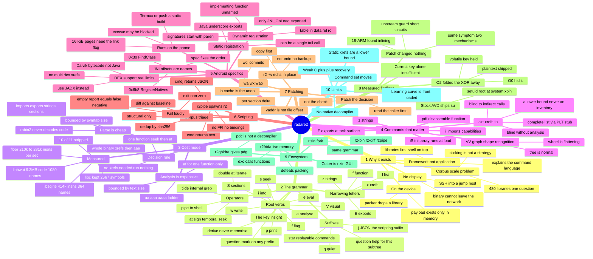
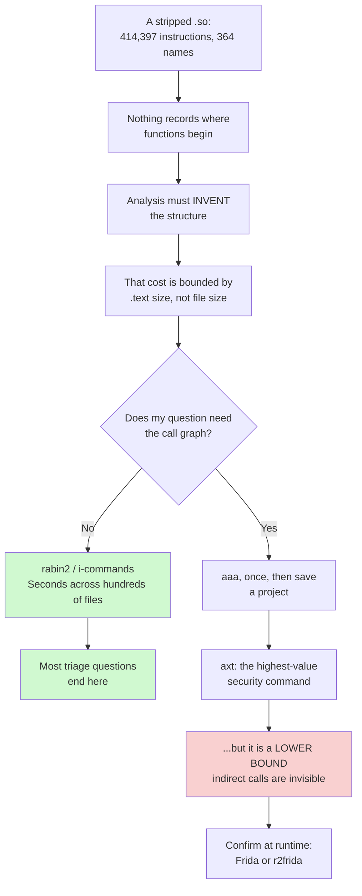
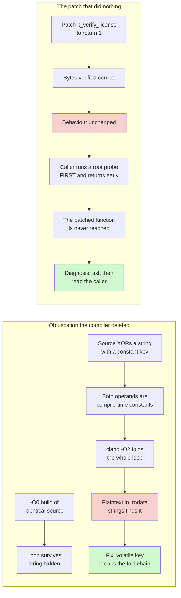

# 59 — radare2 mind map

A single map of the whole chapter. Use it to check recall: cover a branch and try to reconstruct it.

---

## How the pieces connect

The map above is a hierarchy, but the chapter's actual logic is a chain. If you can narrate this
chain unaided, you understand the chapter:

Read that from the top. The stripped binary forces invention; invention costs time proportional to
code size; therefore the first question is always *"do I need this at all?"*, and the honest answer
is usually no. When the answer is yes, `axt` is what you bought — and even then its output is a
floor, not a census, which is why the chain ends at runtime rather than at a conclusion.

---

## The two failure modes, side by side

These are the chapter's measured findings and the two most expensive mistakes in the topic.

The left branch inverts an assumption everybody holds: **higher optimisation made the secret more
visible**, because the optimiser is entitled to evaluate a constant expression and does not know it
was load-bearing.

The right branch is the same symptom this repository already recorded from a different cause. In
[18-ARM](../18-ARM/README.md) §5.4 the check had been *inlined*, so the standalone copy was dead
code. Here it is *short-circuited* by an earlier guard. Two mechanisms, one symptom, one diagnosis:
**read the caller before you patch the callee.**

---

## Quick revision prompts

Cover the answers and work down the list.

| Prompt |
|---|
| Name the seven root verbs and say what `?` does after any prefix. |
| Why is `rabin2 -i` fast on a 13 MB library when `aaa` is not? |
| What does `sym.imp.access` actually name, and why does that make `axt` on it useful? |
| Name `axt`'s two blind spots. |
| What is at `JNIEnv` offset `0x6b8`, and how would you know without a reference? |
| A library exports only `JNI_OnLoad`. Give the static route and the dynamic route to its natives. |
| Why did `/system/xbin/su` appear in the `-O2` build and not the `-O0` build? |
| Which one-word change fixed it, and why does that word work? |
| You patched a check to return 1 and nothing changed. Name two mechanisms. |
| Convert vaddr `0x4854` to a file offset given `.text` at vaddr `0x4794`, offset `0x794`. |
| Which command stages writes, and which commits them? |
| Write a command that disassembles every function whose name contains `lt_`. |
| Name three things radare2 does that Ghidra and IDA cannot. |
| What shape does a control-flow-flattened function make in `VV`? |
| Why must a corpus scanner exit non-zero when its tools are missing? |
