# 60 — ADB Mind Map

One map of the whole chapter. Read it outward from the centre: the protocol first, then what runs on
top of it, then who is allowed to, then what that means for a report.

```mermaid
mindmap
  root((60 - ADB<br/>protocol and transport))
    1. Three programs
      adb client
        thin, exits immediately
        speaks the smart-socket text protocol
        never touches USB
      adb server
        127.0.0.1:5037, one per machine
        owns every transport
        reads ~/.android/adbkey
        NO authentication on 5037
        adb kill-server resets it
      adbd on the device
        started by init on a property trigger
        uid 2000 shell, domain u:r:adbd:s0
        /apex/com.android.adbd/bin/adbd since API 30
        argv carries --root_seclabel=u:r:su:s0
        CapEff 0, CapBnd SETUID+SETGID
    2. Wire protocol
      24-byte header
        command - 4 ASCII chars as LE uint32
        arg0 - sender's own value
        arg1 - the peer's value
        data_length
        data_check - documented CRC32
          implemented as a byte sum
          verified by nobody
          arrives as 0x00000000
        magic = command XOR 0xffffffff
          the only framing check there is
      Message types
        A_CNXN - version, maxdata, banner
        A_AUTH - 1 TOKEN 2 SIGNATURE 3 RSAPUBLICKEY
        A_STLS - upgrade to TLS
        A_OPEN - service string + NUL
        A_OKAY - stream up, and every ack
        A_WRTE - payload
        A_CLSE - end of stream
        A_SYNC - legacy, unseen
      Versions
        0x01000000 - maxdata 4 KiB
        0x01000001 - maxdata 256 KiB
    3. Streams
      opener picks a non-zero local id
      peer replies with its own id
      demultiplex on arg1
      window of exactly one A_WRTE
      A_CLSE arg0=0 means refused
      no error message, no error code
      ids are per-connection, never stable
      interleaving is real
        a stale A_CLSE can arrive after
        the next A_OPEN
    4. Services - the real surface
      shell:  and  shell,v2:
        v1 - PTY, merged streams, NO exit code
        v2 - id byte, LE length, payload
          0 stdin 1 stdout 2 stderr
          3 exit code 4 close-stdin 5 winsize
        banner advertises, service string selects
      exec: - via sh, binary safe
      abb: / abb_exec:
        NUL-delimited args
        no shell anywhere in the path
        argv cannot carry NUL - build it yourself
      sync: - SEND RECV STAT LIST DATA DONE
        64 KiB chunks inside A_WRTE
        STAT v1 cannot express an error
      root: unroot: tcpip: usb:
      remount: reboot: framebuffer:
      jdwp track-jdwp reverse:
      DESTRUCTIVE ones take effect at once
    5. Authentication - the security core
      gated by ro.adb.secure
      RSA-2048 PKCS#1 v1.5
      signs SHA1-DigestInfo || token
        the 20-byte token is NOT hashed
        RSA_sign(NID_sha1, token, 20)
      host key
        ~/.android/adbkey
        UNENCRYPTED PKCS#8, no passphrase
        $ADB_VENDOR_KEYS adds more
      public key blob
        mincrypt RSAPublicKey struct
        4 + 4 + 256 + 256 + 4 = 524 bytes
        base64 = 700 chars, starts QAAA
        comment field is NOT authenticated
      device stores
        /data/misc/adb/adb_keys
          0640 system:shell
          u:object_r:adb_keys_file:s0
          shell DENIED by SELinux, not DAC
        /data/misc/adb/adb_temp_keys.xml
          lastConnection in epoch ms
          7-day idle expiry since API 30
        /adb_keys on the ramdisk
          a pre-authorised VENDOR key
      the dialog
        adbd cannot draw
        writes to its seqpacket socket
        AdbDebuggingManager in system_server
        UsbDebuggingActivity in SystemUI
        suppressed while the screen is locked
    6. Privilege
      ro.secure=1 drops adbd to uid 2000
      ro.debuggable=1 allows adb root
      rooted adbd -> u:r:su:s0
      user build refuses without restarting
      shell is NOT an app
        parent is adbd, not zygote
        no ART, no Context, no Application
        NO targetSdkVersion at all
          so no scoped storage
          no background limits
        no MCS categories
      but uid 2000 IS com.android.shell
        sharedUserId android.uid.shell
        /system/priv-app/Shell, PRIVILEGED
        200 requested
        183 install permissions granted
        16 runtime permissions SYSTEM_FIXED
          CAMERA RECORD_AUDIO READ_SMS
          FINE and BACKGROUND LOCATION
        platform.xml grants shell only INTERNET
      groups
        inet, log, adb, readproc, sdcard_rw
    7. Transports
      USB
        FunctionFS ep0 ep1 ep2
        class 0xFF subclass 0x42 protocol 0x01
        no encryption, no integrity
      adb tcpip 5555
        CLEARTEXT
        service.adb.tcp.port - dies at reboot
        persist.adb.tcp.port - never does
        a listening socket beats a property
      wireless debugging - API 30+
        mDNS _adb-tls-connect._tcp
        TLS 1.3, mutual certificates
        SPAKE2 with a 6-digit code
    8. adb install is three streams
      install-create -S size -> session id
      install-write  -> APK as A_WRTE payloads
      install-commit -> PackageManagerService
      staging /data/app/vmdl<id>.tmp/base
        owned system:system
        invisible to pm list packages
        orphaned one = IR evidence
      the transport never checks anything
        INSTALL_FAILED_USER_RESTRICTED
        is an OEM policy on the caller
    9. Security
      an authorised key is a CREDENTIAL
        transferable - one file
        no passphrase, ever
        no UI to enumerate it
        grants 183 platform permissions
      workstation is the weak end
        5037 has no auth
        adbkey readable by anything as you
      exposure
        TCP + ro.adb.secure=0 = remote shell
        + ro.debuggable=1 = remote ROOT shell
        worms scanning 5555 since 2018
      severity depends on DEVICE ROLE
        test bench - not a finding
        kiosk / signage / TV / head unit - critical
    10. Discipline
      never report shell access as app access
      never adb tcpip a device you care about
      never offer your pubkey to someone
        else's device
      never commit or screenshot adbkey
      exec-out, not shell, for binary data
      measure, do not quote a version table
```

---

## How the pieces connect

If you remember only the spine of the map, remember this chain:

1. A **transport** exists (USB endpoints or a TCP socket).
2. `A_CNXN` establishes a **session** and exchanges **feature banners**.
3. `A_AUTH` decides **whether you are allowed**, using a credential stored on the device.
4. `A_OPEN` with a **service string** creates a **stream**, identified by an id pair.
5. `A_WRTE` and `A_OKAY` carry bytes with a one-message window.
6. Whatever the service does, it does as **`adbd`'s identity** — uid 2000 on a production build.
7. The framework's own checks then run **against uid 2000**, in `system_server`, over Binder.

Steps 3 and 6 are the security chapter. Steps 1, 2, 4 and 5 are the protocol chapter. Step 7 is
somebody else's chapter — [25-Binder](../25-Binder/README.md) and
[23-Permissions](../23-Permissions/README.md) — and knowing where the boundary is, is most of
knowing where a finding belongs.
