# 61 — Fastboot

> After this chapter you will be able to read a fastboot session byte by byte, explain the bootloader
> lock state machine and every transition in it, say precisely what `--disable-verity` changes and
> why it cannot work on a locked device, tell an unlocked bootloader from outside the device without
> trusting a single property, and reason about what an unlocked bootloader does to every other
> control in this repository.

**Prerequisites:** [02-Linux-Basics](../02-Linux-Basics/README.md),
[06-Android-Architecture](../06-Android-Architecture/README.md),
[20-Security-Architecture](../20-Security-Architecture/README.md),
[60-ADB](../60-ADB/README.md)
**Useful afterwards:** [62-Magisk](../62-Magisk/README.md),
[50-HardwareBackedSecurity](../50-HardwareBackedSecurity/README.md),
[07-AOSP](../07-AOSP/README.md)
**Applies to:** Android 4.0 onwards for the base protocol; A/B slots from Android 7.0 (API 24);
dynamic partitions and `fastbootd` from Android 10 (API 29); virtual A/B from Android 11 (API 30).

---

> **Warning — read this before you type a single command from this chapter**
>
> This is the only chapter in the repository whose commands can destroy hardware and erase data
> irrecoverably. Three facts, stated once, plainly, because they are facts and not scare tactics:
>
> 1. **Unlocking a bootloader erases all user data**, by design, and on a device with file-based
>    encryption it destroys the keys as well, so the old data cannot be recovered by any forensic
>    tool. This is a security property, not an inconvenience — [§3.9](#39-the-factory-reset-guarantee)
>    explains exactly which attack it prevents.
> 2. **Unlocking voids the warranty on most devices**, and on some it blows a one-time fuse that no
>    software can un-blow.
> 3. **`fastboot flash` of a wrong image can leave a device that will not boot and will not re-enter
>    fastboot**, which means no software recovery path exists.
>
> Everything here assumes a device that is **yours**, bought for testing, holding no personal
> accounts, on an engagement you are authorised to perform. Never a client device, never a borrowed
> one, never your own phone. This chapter also does not cover, and will not help with, defeating
> carrier locks or anti-theft protection; those are legal and ethical boundaries, not technical ones.

---

## Table of Contents

1. [Introduction](#1-introduction)
2. [High-Level Architecture](#2-high-level-architecture)
3. [Deep Internal Working](#3-deep-internal-working)
4. [Source Code Walkthrough (AOSP)](#4-source-code-walkthrough-aosp)
5. [Security Perspective](#5-security-perspective)
6. [Reverse Engineering Perspective](#6-reverse-engineering-perspective)
7. [Dynamic Analysis](#7-dynamic-analysis)
8. [Static Analysis](#8-static-analysis)
9. [Examples](#9-examples)
10. [Common Interview Questions](#10-common-interview-questions)
11. [Common Mistakes](#11-common-mistakes)
12. [Hands-on Labs](#12-hands-on-labs)
13. [Summary](#13-summary)
14. [References](#14-references)

---

## 1. Introduction

### 1.1 The problem: a computer that will not run your code

Think about what a phone is when you first take it out of the box. It is a computer, and you own it,
and yet there is one thing you cannot do with it that you can do with every laptop ever sold: you
cannot boot software of your own choosing. Turn it on and it runs the manufacturer's operating
system. There is no BIOS screen, no boot menu, no "press F12 to select boot device". The chain from
power-on to home screen is sealed.

That seal is deliberate and it is mostly good. It is what makes a stolen phone useless to the thief,
what makes an "evil maid" attack — someone with ten minutes of physical access and a USB cable —
fail instead of succeed, and what lets your bank's app make a defensible claim that the operating
system underneath it has not been rewritten. [20-Security-Architecture §3.1](../20-Security-Architecture/README.md#31-verified-boot-and-android-verified-boot-20-avb)
covers that machinery, called Verified Boot, in full.

But a seal with no key at all would be an unusable device for the people who have to build it. The
engineer who compiled the operating system needs a way to put it onto the phone. The repair
technician needs a way to restore a phone that will not boot. The security researcher needs a way to
run an instrumented build. And — this is the part people forget — **you**, as the owner, need a way
to say "I withdraw my delegation; I decide what runs here", because a device you cannot control is
not a device you own.

**Fastboot is the key to that seal, and the lock it opens is the most consequential lock on the
device.**

> **Definition — bootloader**
> The **bootloader** is the first software the device runs after the silicon's own immutable boot
> ROM. Its job is to find an operating-system kernel, verify it, load it into memory, and jump to it.
> It runs *before* Linux exists, so there is no filesystem, no process, no `adb`, no Android at all —
> only the bootloader, the flash storage, and whatever peripherals it has drivers for. On almost
> every Android device one of those peripherals is USB, and one of the things it can do over USB is
> speak a protocol called **fastboot**.

> **Definition — fastboot (three different things with one name)**
> The word is overloaded, and mixing the three up is the single most common source of confusion in
> this topic:
>
> | The word | What it is |
> |---|---|
> | **fastboot the protocol** | A tiny text-command-over-USB protocol. Five response prefixes, a handful of commands. Documented in AOSP at `system/core/fastboot/README.md`. |
> | **fastboot the host tool** | The `fastboot` executable that ships in Google's `platform-tools` alongside `adb`. Speaks the protocol from your laptop. |
> | **fastboot mode** | The state the *device* is in while its bootloader is listening for that protocol, instead of booting Android. Also called "bootloader mode". |
>
> A fourth thing, **`fastbootd`**, is a *different implementation* of the same protocol that runs
> inside Android's recovery ramdisk rather than in the bootloader. [§3.6](#36-fastbootd--userspace-fastboot-and-why-it-had-to-exist)
> is about why that had to be invented.

### 1.2 What would break if fastboot did not exist

Take it away and see what falls over.

- **A device with a corrupt boot image would be landfill.** There would be no path to write a good
  image, because writing images is Android's job and Android is what is broken. Fastboot is the
  recovery mechanism of last resort that runs *below* the thing that failed.
- **Nobody could develop Android.** The AOSP build system's `m` produces images that are put onto a
  device with `fastboot flashall`. Chapter [07-AOSP](../07-AOSP/README.md) builds them; this chapter
  is how they get there.
- **Security research on Android would be nearly impossible.** Every rooted research device in the
  world went through `fastboot flashing unlock` first. [62-Magisk](../62-Magisk/README.md) patches a
  boot image; fastboot is what puts the patched image on the device.
- **There would be no owner-controlled alternative operating systems.** GrapheneOS, CalyxOS, LineageOS
  and every custom ROM install through fastboot.

### 1.3 The analogy that actually holds

Imagine a bank vault whose door is welded shut from the inside, with a small brass letterbox in it.

Through the letterbox you can pass three kinds of note: a **question** ("how big is the vault?"), a
**parcel** ("here are some documents, hold them on the shelf by the door"), and an **instruction**
("take the documents from the shelf and put them in drawer number four"). The person inside — the
bootloader — reads your note, does the thing, and posts back one of exactly five kinds of reply:
*done*, *refused*, *send the parcel now*, *here is some progress information*, or *here is some text
to print*.

That is the entire fastboot protocol, and the analogy holds unusually well:

- You **cannot** ask "what is in drawer four?" on most devices. The letterbox is deliberately
  one-way for bulk data. (Some bootloaders implement a `fetch` command; most do not — see
  [§3.4](#34-the-command-set-and-what-each-command-actually-does).)
- The parcel shelf has **finite size**, and the person inside will tell you how big it is if you
  ask. That is `getvar:max-download-size`, and it is why large images are split.
- There is one drawer whose contents decide **whether the vault door opens at all** next time. Put
  the wrong papers in it and the vault never opens again. That is the boot partition, and that is
  why `fastboot boot` — "read these documents aloud once, do not file them" — exists and is the
  habit that saves devices.

### 1.4 Why this chapter matters to a penetration tester specifically

There are two distinct reasons, and both matter.

**First, it is how you build your test devices.** You cannot instrument an app on a stock, locked
phone. Everything in [53-Frida](../53-Frida/README.md), [62-Magisk](../62-Magisk/README.md) and
[65-Hooking](../65-Hooking/README.md) presupposes a device you control, and fastboot is step zero.

**Second — and this is the part that ends up in reports — an unlocked bootloader is not a
configuration detail. It is a change to the threat model that every other control in this repository
was designed against.** Root detection, certificate pinning, tamper detection, KeyStore key binding,
SELinux, the app sandbox: each of these assumes something about the platform beneath it. Unlocking
the bootloader is the act of removing the guarantee that the platform is the one the OEM shipped.
[§5.7](#57-what-an-unlocked-bootloader-does-to-every-other-control-in-this-repository) works through
that control by control, which is the section a client actually needs.

> **Mental Model**
> `adb` talks to Android. `fastboot` talks to the thing that decides whether Android runs. They are
> not two modes of one tool; they are two protocols, over two different USB interfaces, spoken by two
> different pieces of software, with completely different trust properties. `adb` runs *inside* the
> security model. `fastboot` runs *underneath* it.

### 1.5 What this chapter measured, and what it deliberately did not

This repository's standing rule is to measure rather than recite. That rule collides with this
chapter's subject matter, because most fastboot commands are destructive and the only physical
devices available are a daily-driver phone and a borrowed handset. **No destructive command was run
against any device while writing this chapter, and no device was rebooted into a bootloader.**

What *was* measured, on an `sdk_gphone16k_x86_64` AVD running Android 15 / API 35 and on the host:

| Measured | Result | Where |
|---|---|---|
| `fastboot --version` | `35.0.2-12147458` | [§3.2](#32-the-wire-protocol-five-prefixes-and-nothing-else) |
| Does an emulator have a bootloader? | **No.** `adb reboot bootloader` returns to Android in ~40 s; `fastboot devices` never sees it | [§7.6](#76-the-emulator-cannot-teach-you-fastboot-and-here-is-the-proof) |
| The dynamic-partition extent map inside `super` | Five logical partitions, every one 1 MiB-aligned | [§3.7](#37-dynamic-partitions-and-the-super-partition) |
| A real `vbmeta` partition, parsed | AVB 1.0 header, algorithm SHA256_RSA4096, `flags = 0` | [§3.8](#38-vbmeta-flags-and-what---disable-verity-actually-disables) |
| What `--disable-verity` changes | **Exactly one byte, at offset 123**, and it invalidates the image's own hash | [§3.8](#38-vbmeta-flags-and-what---disable-verity-actually-disables) |
| Which `getvar` names the shipped tool knows | 14 extracted from the binary | [§3.3](#33-getvar--the-only-safe-thing-you-can-do-to-an-unfamiliar-device) |

Everything that could not be measured is labelled in place as **described from the protocol
specification and AOSP source, not observed**. There is a lot of it, and that is the correct outcome
for this subject. Inventing a plausible-looking transcript of `fastboot flashing unlock` would be
worse than useless here, because a reader might act on it.

---

## 2. High-Level Architecture

### 2.1 Where fastboot sits relative to everything else

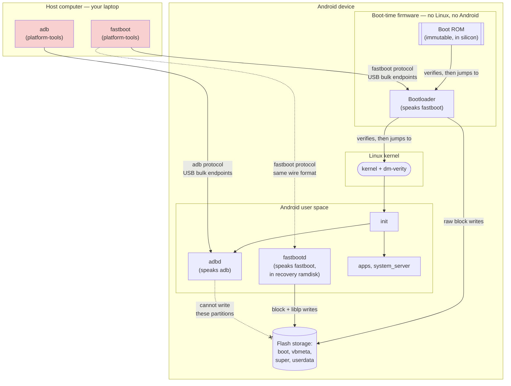

Read this top to bottom on the device side, because that is the order in which the device wakes up.

The **boot ROM** is burned into the system-on-chip at manufacture and cannot be changed by anyone,
including the manufacturer, after the die is cut. It contains, or has access to, a public key (or a
hash of one) in one-time-programmable fuses. Its only job is to load the bootloader, check its
signature against that key, and jump to it. This is the *root of trust* — the one link in the chain
that nothing verifies, because nothing earlier exists.

The **bootloader** is the box that matters here. It is a small, self-contained program with its own
USB driver, its own flash driver, and its own display driver. It has no filesystem, no processes and
no memory protection worth the name. When it decides not to boot Android — because you asked it not
to, or because it was told to enter fastboot mode — it sits in a loop reading commands from a USB
bulk endpoint. That loop is the fastboot protocol.

Notice the two dotted lines. `fastbootd` speaks the *same protocol* from *inside Android's recovery
ramdisk*, which means it has a Linux kernel underneath it and can therefore do things the bootloader
cannot ([§3.6](#36-fastbootd--userspace-fastboot-and-why-it-had-to-exist)). And `adbd` is drawn with
a crossed line to flash storage because that is the whole point: `adbd` runs as a normal Android
process under SELinux and cannot write the boot partition even as root. Different protocol,
different privilege, different trust boundary.

### 2.2 The three-legged transaction that every fastboot operation is built from

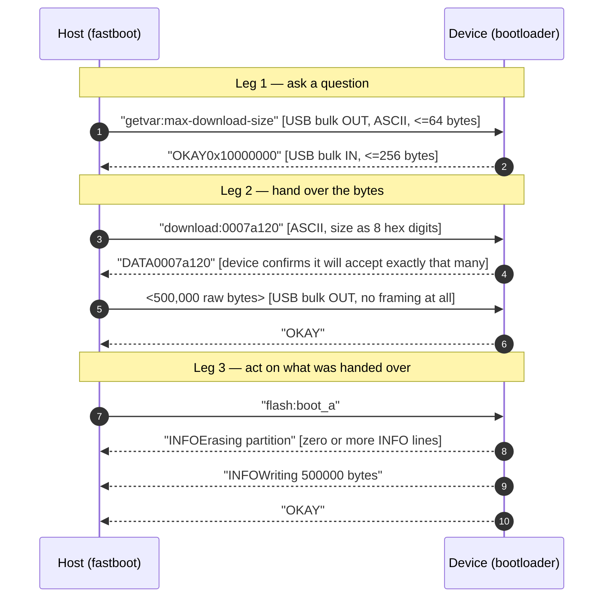

This is the shape of nearly everything fastboot does, and internalising it removes most of the
mystery.

**Leg 1** is a query. The host sends an ASCII string of at most 64 bytes; the device replies with a
string of at most 256 bytes whose first four characters are one of five fixed prefixes. There is no
length field, no checksum, no session identifier and no encryption. It is about as simple as a
protocol can be while still being a protocol.

**Leg 2** is the only place bulk data moves, and it is worth dwelling on the design. The device
**never** streams data on its own initiative. The host announces a size, the device either accepts
that size by replying `DATA` with the same size echoed back, or refuses with `FAIL`. Only after the
`DATA` acknowledgement does the host send raw bytes — and those bytes have no framing whatsoever.
The device counts them. When the count is reached, both sides go back to command mode.

**Leg 3** acts on the buffer that leg 2 filled. This is the crucial architectural fact: **`flash:`
does not carry the image.** It carries only a partition name, and it operates on whatever is
currently sitting in the device's download buffer. So does `boot`. So does `flashing unlock` on
devices that require a signed token. One buffer, many consumers.

> **Under the Hood**
> That separation explains a failure mode people find baffling. If your `download:` succeeded and
> your `flash:` failed, the image is *still in the device's RAM*. Re-issuing `flash:` alone would
> work — the host tool does not offer you that, because it has no reason to assume the buffer
> is still intact after a `FAIL`. It also explains `fastboot boot`: exactly the same download, then
> a different verb.

### 2.3 The lock-state machine — the most important diagram in this chapter

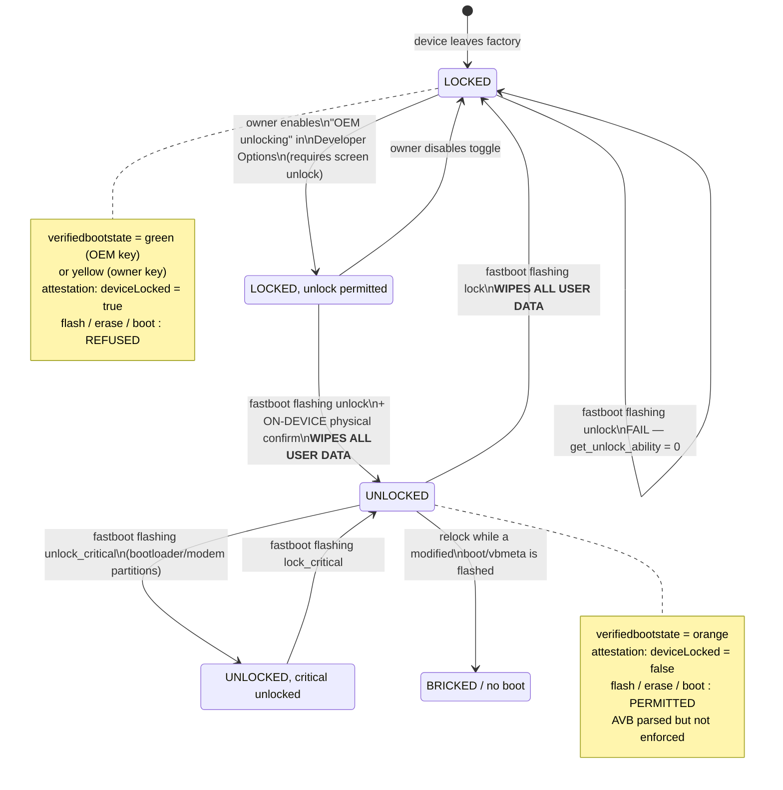

This diagram is the chapter in one picture, so read every transition.

**The factory state is LOCKED.** In that state the bootloader refuses `flash:`, `erase:`, `format`,
`boot` and `set_active` — every command that could change what runs. It will still answer `getvar:`
and `reboot`, which is why reconnaissance is safe and modification is not.

**Getting from LOCKED to unlockable requires the running operating system.** This is the design
decision that makes the whole scheme work, and it is easy to miss. You cannot unlock a device purely
from fastboot mode. Someone must first boot Android, unlock the screen with the owner's credential,
enter Developer Options, and turn on "OEM unlocking". That flips a flag in a partition the bootloader
reads at boot. The bootloader exposes the flag as `fastboot flashing get_unlock_ability`, which
returns `1` or `0`. Without that `1`, the unlock command fails, and there is no fastboot-side way to
change it.

Read that again as an attack model: **a thief with your locked, powered-off phone cannot unlock the
bootloader, because doing so requires your screen-lock credential first.** That single dependency is
what makes physical theft of a modern Android device a dead end.

**The unlock transition wipes user data**, and the wipe is performed by the bootloader itself, not by
Android. [§3.9](#39-the-factory-reset-guarantee) explains why an unlock that did not wipe would be a
complete bypass of device encryption.

**The relock transition also wipes** — for the mirror-image reason. And the edge from UNLOCKED to
BRICKED is the one that costs people devices: relocking while a modified boot image is flashed
produces a device whose bootloader refuses the boot image, and which cannot be unlocked again because
unlocking requires Android to set the flag, and Android will not boot. Always flash a full stock
factory image, boot it, verify it, *then* relock.

### 2.4 Two implementations of one protocol

```mermaid
flowchart LR
    subgraph Boot["Bootloader fastboot — closed-source, per-OEM"]
        B1["Runs before Linux"]
        B2["Knows physical partitions<br/>from the GPT"]
        B3["Owns the lock state<br/>and the fuses"]
        B4["Can flash: bootloader,<br/>vbmeta, boot, super (raw)"]
    end
    subgraph FBD["fastbootd — AOSP, open source"]
        F1["Runs on a Linux kernel<br/>inside the recovery ramdisk"]
        F2["Knows LOGICAL partitions<br/>via liblp"]
        F3["Cannot change lock state"]
        F4["Can flash: system, vendor,<br/>product — inside super"]
    end
    HOST["fastboot host tool<br/>— identical wire format to both"]
    HOST --> Boot
    HOST --> FBD
    Boot -- "reboot fastboot" --> FBD
    FBD -- "reboot bootloader" --> Boot
```

Two programs, one protocol, complementary abilities. The bootloader can do the privileged things —
change lock state, write the bootloader itself, write raw partitions listed in the partition table.
What it *cannot* do, on a modern device, is write `/system`, because `/system` is no longer a
partition. It is a *logical* partition carved out of a container called `super`, and understanding
that container requires a metadata parser (`liblp`) that would bloat every OEM's bootloader.

So AOSP moved that half of the job into a userspace daemon that already has a kernel, a filesystem
and `liblp` available: `fastbootd`. `getvar:is-userspace` returns `yes` on it and `no` on the
bootloader, which is how the host tool knows where it is and — importantly — **automatically reboots
you to the right one**. [§3.6](#36-fastbootd--userspace-fastboot-and-why-it-had-to-exist) has the
detail.

---

## 3. Deep Internal Working

### 3.1 How a device enters fastboot mode, and how it leaves

There are exactly three ways in, and knowing all three is a practical survival skill rather than
trivia — because the first one stops working precisely when you need it most.

**Route 1 — from a running Android, via the Bootloader Control Block.**

```bash
# host
adb reboot bootloader
```

What actually happens is more interesting than the command suggests. Android does not have a
side-channel to the bootloader; it has a *mailbox*. A small raw partition conventionally named
`misc` holds a structure called the **Bootloader Control Block (BCB)**, defined in AOSP at
`bootable/recovery/bootloader_message/include/bootloader_message/bootloader_message.h`:

```c
// bootable/recovery/bootloader_message/include/bootloader_message/bootloader_message.h
struct bootloader_message {
    char command[32];        // "boot-recovery", "bootonce-bootloader", or empty
    char status[32];
    char recovery[768];
    char stage[32];
    char reserved[1184];
};
```

`adb reboot bootloader` causes `init` to write the string `bootonce-bootloader` into `command[]`,
then perform an ordinary reboot. The bootloader starts, reads `misc`, sees the request, clears it —
that is what "bootonce" means — and enters fastboot mode instead of booting Linux. `adb reboot
recovery` uses the same mailbox with the string `boot-recovery`.

> **Definition — `misc` partition**
> A small (typically 1 MiB) raw partition holding no filesystem, used purely as a shared structure
> between Android and the bootloader. It is the *only* channel by which running Android can influence
> the next boot. It also carries the "wipe data" command that a factory reset from Settings uses.

**Route 2 — a hardware key combination.** Power off completely, then hold a vendor-specific
combination (very commonly Volume Down + Power) while powering on. This route works when Android
does not boot at all, which is exactly the situation route 1 cannot help with.

> **Warning**
> **Write your device's key combination down before you flash anything.** The single most common way
> people lose a device in this chapter is: flash a bad image, device bootloops, `adb reboot
> bootloader` no longer works because there is no Android to run it, and they do not know the key
> combination. The combination is not discoverable from a bricked device. Look it up while the device
> still works.

**Route 3 — from fastbootd back to the bootloader**, with `fastboot reboot bootloader`, and the
reverse with `fastboot reboot fastboot`. These only apply once you are already in one of the two.

Getting out is simpler: `fastboot reboot` boots Android normally, `fastboot continue` resumes the
boot that was interrupted, and holding the power button for 10–20 seconds forces a power cut on
essentially every device.

| Command | Where it runs | Effect |
|---|---|---|
| `adb reboot bootloader` | Android | Writes BCB, reboots to bootloader fastboot |
| `adb reboot fastboot` | Android (API 29+) | Reboots to `fastbootd` in the recovery ramdisk |
| `adb reboot recovery` | Android | Writes BCB, reboots to recovery |
| `fastboot reboot` | fastboot mode | Normal boot |
| `fastboot reboot bootloader` | fastbootd | Switch to bootloader fastboot |
| `fastboot reboot fastboot` | bootloader | Switch to `fastbootd` |
| `fastboot continue` | fastboot mode | Resume the interrupted boot |

> **Under the Hood — measured**
> The AVD used for this chapter has **no `misc` partition at all**. `ls /dev/block/by-name/misc`
> returns `No such file or directory`, and `/dev/block/by-name/` contains only `metadata`, `super`,
> `vbmeta` and the two raw disks. That is the mechanical reason the emulator cannot enter fastboot
> mode: there is no mailbox to leave a message in, and no bootloader to read it. See
> [§7.6](#76-the-emulator-cannot-teach-you-fastboot-and-here-is-the-proof).

### 3.2 The wire protocol: five prefixes and nothing else

The protocol is specified in AOSP at `system/core/fastboot/README.md`. It is short enough that you
can hold all of it in your head, which is rare and worth exploiting.

**Transport.** USB, using a bulk IN and a bulk OUT endpoint on an interface whose descriptor is
class `0xFF`, subclass `0x42`, protocol `0x03`. Those three magic numbers are how the host tool
finds a fastboot device among everything else plugged in, and they are *different* from adb's
(`0xFF`/`0x42`/`0x01`). This is why a device in fastboot mode disappears from `adb devices` and
appears in `fastboot devices`, and why a device in Android does the opposite. There is also a
non-USB transport — `fastboot -s tcp:HOST` and `udp:HOST` — used by some development boards and by
`fastbootd` over a network; it wraps the same byte stream.

**Host to device.** A command is an ASCII string of **at most 64 bytes**, sent as a single bulk
transfer. It is not NUL-terminated and carries no length prefix; the USB transfer length *is* the
length. Sixty-four bytes is a hard limit, and it is the reason partition names are short.

**Device to host.** A response is an ASCII string of **at most 256 bytes** whose first exactly-four
characters are one of five prefixes:

| Prefix | Meaning | Remaining bytes |
|---|---|---|
| `OKAY` | Success, transaction complete | Optional payload — for `getvar` this is the value |
| `FAIL` | Failure, transaction complete | Human-readable reason |
| `DATA` | "Send me exactly this many bytes now" | Eight hex digits: the byte count |
| `INFO` | Progress or diagnostic; **more responses follow** | Text the host prints with a leading `(bootloader)` |
| `TEXT` | Free-form text; **more responses follow** | Text the host prints verbatim, no prefix |

All five were confirmed present in the shipped host binary — see the extraction in
[§8.3](#83-reading-the-host-binary-itself). `TEXT` is the newest and is used for multi-line
human-readable output where `INFO`'s automatic `(bootloader)` prefix would be noise.

**The critical rule: `INFO` and `TEXT` do not end a transaction.** The host keeps reading until it
sees `OKAY` or `FAIL`. A bootloader that sends `INFO` and then stops leaves the host blocked forever.
This is a real failure mode on flaky USB cables and a real bug class in bootloader firmware.

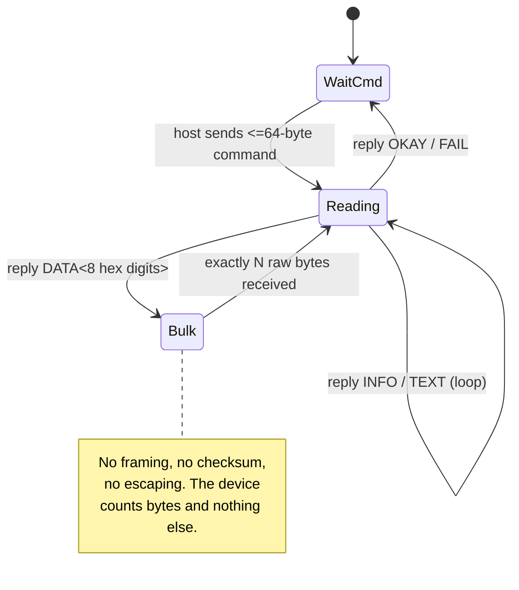

The diagram shows why the protocol is both simple and fragile. There is exactly one state where bulk
data flows, it is entered only by an explicit `DATA` response, and it is left only by the byte count
being reached. If the host and device disagree about the count — which cannot happen in a correct
implementation, because the device *echoes back the size it will accept* — the transport wedges.

> **Warning — there is no authentication and no integrity checking on the wire**
> Nothing in the fastboot protocol authenticates the host, and nothing checksums the payload. On an
> unlocked device, anything that can drive the USB port can flash anything. A malicious charging
> station cannot reach a *locked* device's flash because the bootloader refuses `flash:`, but an
> unlocked device in fastboot mode is completely open to whatever it is plugged into. This is a real
> consideration for a device you carry to a conference. Some OEMs mitigate it with a signed-command
> extension (`fastboot stage` + `fastboot oem` with a vendor token); it is not part of the base
> protocol.

### 3.3 `getvar` — the only safe thing you can do to an unfamiliar device

`getvar` is a read. On a locked device it is essentially the *only* thing the bootloader will do for
you, and it is therefore the entire reconnaissance surface.

```bash
# host — device must already be in fastboot mode
fastboot getvar product
fastboot getvar all          # dumps everything the bootloader is willing to name
```

`getvar:all` is special: the device answers with a stream of `INFO` lines, one variable per line,
then a final `OKAY`. It is not guaranteed to list everything — a bootloader may implement variables
it does not enumerate — but in practice it is the fastest way to characterise an unknown device.

The variable names below were **extracted from the shipped `fastboot.exe` (35.0.2-12147458)** rather
than copied from documentation, so this table reflects what the current host tool actually asks for:

| Variable | Meaning | Why a tester cares |
|---|---|---|
| `version` | Fastboot protocol version, historically `0.4` | Almost never useful; near-universally `0.4` |
| `product` | Device/board codename | The single most important identifier — factory images are keyed on it |
| `serialno` | Device serial | Identifying the unit in a fleet |
| `secure` | `yes` if the bootloader requires signed images | Predicts whether unsigned flashes are possible |
| `unlocked` | `yes` / `no` — the lock state | **The headline answer.** See the caveat below |
| `max-download-size` | Size of the device's download buffer, in hex | Determines whether images need sparsing |
| `partition-type:NAME` | Filesystem type the partition expects | Tells `fastboot format` what to build |
| `partition-size:NAME` | Partition size in hex bytes | Catches "image too large" before you flash |
| `is-logical:NAME` | `yes` if `NAME` lives inside `super` | **Tells you whether you need `fastbootd`** |
| `has-slot:NAME` | `yes` if `NAME` has `_a` / `_b` variants | Whether to append a slot suffix |
| `slot-count` | Number of slots — `2` on A/B, `1` or absent otherwise | A/B detection |
| `current-slot` | `a` or `b` | Which slot the next boot will use |
| `is-userspace` | `yes` on `fastbootd`, `no` in the bootloader | **How the host tool knows which one it is talking to** |
| `super-partition-name` | Usually `super` | Retrofit devices differ |
| `snapshot-update-status` | `none` / `snapshotted` / `merging` | Virtual A/B state — flashing during a merge corrupts it |
| `version-bootloader` | Bootloader build string | Correlating against known-vulnerable bootloader versions |
| `version-baseband` | Modem firmware version | Same, for the modem |
| `logical-block-size`, `erase-block-size` | Storage geometry | Alignment for `format` |
| `off-mode-charge`, `battery-voltage` | Charging state | Some devices refuse to flash under a voltage threshold |

> **Pentester's Note — `getvar:unlocked` is a claim, not evidence**
> The bootloader is answering a question about itself. On a device where the bootloader has been
> replaced, that answer is whatever the replacement says it is. The non-forgeable statement of lock
> state is the `deviceLocked` field inside a **hardware key attestation certificate**, which is
> produced by the TEE from a value the bootloader hands it over a channel normal-world software
> cannot touch. [50-HardwareBackedSecurity](../50-HardwareBackedSecurity/README.md) owns that, and it
> is not a theoretical distinction: that chapter measured a device reporting
> `ro.boot.verifiedbootstate = green` from `getprop` while its own TEE-signed attestation said
> `verifiedBootState = Unverified, deviceLocked = false` — seconds apart, on the same device. Use
> `getvar` to characterise a device you control. Never use it as the basis of an assurance claim.

> **Warning — `getvar` is safe; the reboot to reach it is not always**
> On a device you do not own, entering fastboot mode is itself a state change: it interrupts the boot,
> may clear the BCB, and on encrypted devices returns you to a pre-unlock state. Reconnaissance is
> not free. Ask before you reboot a client device.

### 3.4 The command set, and what each command actually does

Grouped by risk. Everything in the first group is a read; everything below it changes state.

**Safe on any device (reads and reboots):**

| Command | Wire form | Notes |
|---|---|---|
| `fastboot devices` | *(none — USB enumeration only)* | Lists devices in fastboot mode. **Measured: with no such device attached it prints nothing and exits 0** — silence, not an error |
| `fastboot getvar NAME` | `getvar:NAME` | See [§3.3](#33-getvar--the-only-safe-thing-you-can-do-to-an-unfamiliar-device) |
| `fastboot reboot` | `reboot` | Boot Android |
| `fastboot continue` | `continue` | Resume the interrupted boot |
| `fastboot flashing get_unlock_ability` | `flashing get_unlock_ability` | Returns `1` or `0`. A read |

**Changes what runs, but writes nothing to flash:**

| Command | Wire form | Notes |
|---|---|---|
| `fastboot boot IMAGE` | `download:` then `boot` | Loads a boot image into RAM and boots it **once**. See [§3.11](#311-fastboot-boot--the-run-without-flashing-primitive) |
| `fastboot set_active SLOT` | `set_active:a` | Changes which A/B slot boots next. Reversible by setting it back |

**Writes flash — destructive, irreversible without a backup:**

| Command | Wire form | Notes |
|---|---|---|
| `fastboot flash PART IMG` | `download:` then `flash:PART` | Overwrites a partition |
| `fastboot flash:raw PART KERNEL [RAMDISK]` | builds a boot image host-side, then `flash:` | Constructs the Android boot image header on the host |
| `fastboot erase PART` | `erase:PART` | Erases a partition |
| `fastboot format[:TYPE[:SIZE]] PART` | builds a filesystem host-side, then `flash:` | See the note below |
| `fastboot flashall` / `fastboot update ZIP` | many of the above | Flashes a whole factory image |
| `fastboot wipe-super` | `download:` + `flash:super` | Resets `super` to an empty default layout |
| `fastboot create/delete/resize-logical-partition` | `create-logical-partition:...` | `fastbootd` only |
| `fastboot snapshot-update cancel\|merge` | `snapshot-update:cancel` | Virtual A/B; `cancel` **may leave the device unbootable until reflashed** |

**Changes the security state of the device:**

| Command | Effect |
|---|---|
| `fastboot flashing unlock` | LOCKED to UNLOCKED. **Wipes all user data.** Requires `get_unlock_ability = 1` and physical confirmation on the device |
| `fastboot flashing lock` | UNLOCKED to LOCKED. **Wipes all user data.** Bricks the device if a modified boot image is present |
| `fastboot flashing unlock_critical` | Additionally permits writing bootloader/modem partitions |
| `fastboot oem unlock` | The pre-Android-6 spelling. Vendor-defined, so behaviour varies |
| `fastboot oem ...` | Entirely vendor-defined. Some vendors ship debug commands here; some ship memory dumps |

> **Under the Hood — `fastboot format` runs on your laptop, not on the phone**
> `format` is not a device command. The host tool asks `getvar:partition-type:NAME` and
> `getvar:partition-size:NAME`, builds an empty filesystem of that type and size **on the host**, and
> then flashes it like any other image. That is why Google's `platform-tools` ships `mke2fs.exe`,
> `make_f2fs.exe` and `mke2fs.conf` next to `fastboot.exe` — confirmed by listing the directory, and
> by the strings `/mke2fs`, `/make_f2fs` and `MKE2FS_CONFIG=` inside `fastboot.exe` itself. A
> corollary that catches people: if the host's `mke2fs` is missing or the wrong version, `format`
> fails with an error that appears to come from the device and does not.

> **Pentester's Note — `fastboot oem` is where the interesting bugs live**
> The base protocol is small, well-reviewed and implemented by everyone. `oem` is a vendor extension
> namespace with no specification and no shared test suite, frequently written by the team under the
> most schedule pressure, and running in the most privileged execution context on the device with no
> memory protection. Historically this is where bootloader vulnerabilities have clustered: unbounded
> `strcpy` of the argument string, commands that were meant to be factory-only and shipped enabled,
> and commands that write arbitrary memory addresses. `fastboot oem help` on some devices enumerates
> them. Treat every `oem` verb as an unaudited parser reachable over USB — because that is what it is.

### 3.5 Sparse images: how a 3 GB image crosses a 256 MB buffer

A modern `super` partition image can be several gigabytes. A bootloader's download buffer is
typically 256 MB to 512 MB — `getvar:max-download-size` tells you. Two problems follow: the image
does not fit, and most of it is zeros anyway.

The **Android sparse image format** solves both. It is defined in AOSP at
`system/core/libsparse/include/sparse/sparse_format.h`.

```c
// system/core/libsparse/include/sparse/sparse_format.h  — field names as defined there
typedef struct sparse_header {
  __le32 magic;            // 0xed26ff3a
  __le16 major_version;    // 1
  __le16 minor_version;    // 0
  __le16 file_hdr_sz;      // 28
  __le16 chunk_hdr_sz;     // 12
  __le32 blk_sz;           // block size in bytes, typically 4096
  __le32 total_blks;       // size of the *expanded* image, in blocks
  __le32 total_chunks;     // number of chunk headers that follow
  __le32 image_checksum;   // CRC32 of the expanded image, or 0
} sparse_header_t;

typedef struct chunk_header {
  __le16 chunk_type;       // 0xCAC1 RAW, 0xCAC2 FILL, 0xCAC3 DONT_CARE, 0xCAC4 CRC32
  __le16 reserved1;
  __le32 chunk_sz;         // size in blocks of the *expanded* data
  __le32 total_sz;         // size in bytes of this chunk including its header
} chunk_header_t;
```

Four chunk types, and the whole idea is in them:

| Type | Value | On-disk cost | Expands to |
|---|---|---|---|
| `RAW` | `0xCAC1` | `chunk_sz * blk_sz` bytes | Those bytes, verbatim |
| `FILL` | `0xCAC2` | **4 bytes** | `chunk_sz` blocks of that 4-byte pattern repeated |
| `DONT_CARE` | `0xCAC3` | **0 bytes** | `chunk_sz` blocks the writer may skip entirely |
| `CRC32` | `0xCAC4` | 4 bytes | Nothing — a running checksum of everything so far |

A filesystem image is mostly `DONT_CARE` (unallocated) and `FILL` (zeroed) regions with islands of
`RAW`. A 3 GB `system.img` routinely sparses to a few hundred megabytes, and — this is the part that
matters for the buffer problem — the host can **re-sparse**: split one sparse image into several
smaller sparse images, each below `max-download-size`, each carrying a `DONT_CARE` chunk at the front
that positions its data at the right offset. The device flashes them in sequence. That is what
`fastboot -S 100M flash super super.img` does, and what the tool does automatically when an image
exceeds the buffer.

> **Mental Model**
> Sparse format is not compression. There is no dictionary, no entropy coding, and a sparse image of
> random data is *larger* than the raw data (by the chunk headers). It is a description of a disk
> image that says "these blocks are these bytes, and I decline to say anything about those blocks" —
> and the enormous saving comes entirely from being allowed to decline.

> **Warning — `DONT_CARE` means the old contents survive**
> A `DONT_CARE` chunk is not "write zeros here". It is "skip this range". Flashing a sparse image
> over a partition therefore does **not** guarantee that the ranges the image declines to describe
> are erased — whatever was there before is still there. For a factory image this is fine, because
> the filesystem's own metadata says those blocks are free. For a forensic examiner or anyone
> reasoning about data remanence, it is a real and frequently-overlooked fact. If you need the old
> bytes gone, `erase` first.

This chapter ships a complete, tested implementation of the format:
[`scripts/sparse-tool.py`](scripts/sparse-tool.py) parses, verifies, expands and creates sparse
images, and [`labs/lab-02-sparse-images.md`](labs/lab-02-sparse-images.md) walks through building
one by hand.

### 3.6 `fastbootd` — userspace fastboot, and why it had to exist

Before Android 10, `/system`, `/vendor` and `/product` were physical partitions listed in the GPT.
The bootloader could find them by name and write them, because "find a partition by name and write
it" is a thing a bootloader can do with a GPT parser and a few hundred lines of code.

Then came **dynamic partitions**. `/system` and friends stopped being physical partitions and became
*logical* ones, carved at runtime out of a single physical container called `super`, described by a
metadata format called **LP** (logical partition) whose parser lives in AOSP at
`system/core/fs_mgr/liblp/`. [§3.7](#37-dynamic-partitions-and-the-super-partition) covers the format.

That created a problem with no good answer:

- Asking every OEM to embed `liblp` in their closed-source bootloader means N independent
  implementations of a non-trivial metadata format, each a potential source of bricks, each shipping
  on a different schedule from AOSP.
- Not supporting it means `fastboot flash system` — the single most-used command in Android
  development — stops working.

AOSP's answer was to move that half of the protocol into a program that already has a Linux kernel,
`liblp` and a block layer underneath it: **`fastbootd`**, which lives in the **recovery ramdisk** and
whose source is at `system/core/fastboot/device/`. It is open source, shared by every device, and
updated with the platform.

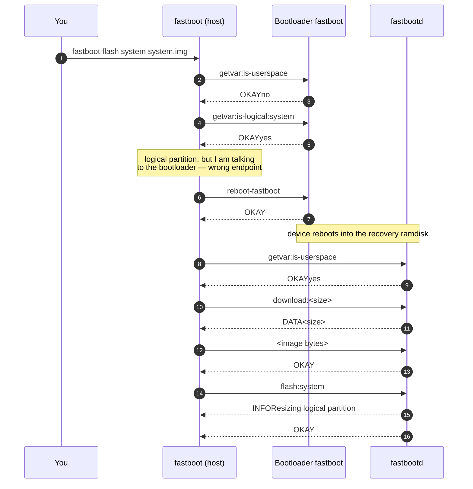

The important thing in that diagram is that **the host tool does the rerouting for you**. You type
one command; the tool queries `is-userspace` and `is-logical:`, decides the bootloader cannot serve
the request, issues `reboot-fastboot`, waits for the device to come back, and continues. The first
time you see a device reboot in the middle of a flash you will think something went wrong. Nothing
did.

| Capability | Bootloader fastboot | `fastbootd` |
|---|---|---|
| `getvar` | Yes | Yes |
| `flash` physical partitions (`boot`, `vbmeta`, `super`) | Yes | Partially — cannot write the bootloader itself |
| `flash` logical partitions (`system`, `vendor`, `product`) | **No** | **Yes** |
| `create/delete/resize-logical-partition` | No | Yes |
| `flashing unlock` / `lock` | **Yes — only here** | No |
| `flash` the bootloader / modem | Yes (needs `unlock_critical`) | No |
| `gsi wipe/disable/status` | No | Yes |
| Source available | No — closed, per-OEM | **Yes — `system/core/fastboot/device/`** |
| Runs on a Linux kernel | No | Yes |

> **Pentester's Note**
> `fastbootd` is the half of the protocol you can actually read the source of, and that makes it the
> better target for study. It also has a genuinely different trust posture: it runs on a full Linux
> kernel with SELinux, inside a ramdisk that AVB verified — so a `fastbootd` compromise is a
> compromise of verified code, whereas a bootloader compromise is a compromise of the verifier. When
> you are reasoning about impact, that distinction decides the severity.

### 3.7 Dynamic partitions and the `super` partition

> **Definition — dynamic partition**
> A **dynamic** (or *logical*) partition is a named extent inside a single large physical partition
> called `super`. Its size is not fixed at manufacture; it is described by metadata at the start of
> `super` and can be changed by an update. The point is that a system update that needs `/system` to
> grow by 200 MB can take that space from `/product` without repartitioning the device.

This was measured directly. On the API 35 AVD, `/dev/block/by-name/` contains no `system`, no
`vendor`, no `product` — only `super`, `vbmeta` and `metadata`. The logical partitions exist as
device-mapper devices, and their extent map is readable:

```
# adb shell, as root — dmctl table <name>, on sdk_gphone16k_x86_64 / API 35
system        0-1829440: linear, 253:2 2048
system_dlkm   0-  14088: linear, 253:2 1832960
system_ext    0- 425232: linear, 253:2 1847296
product       0-4189224: linear, 253:2 2273280
vendor        0- 217800: linear, 253:2 6463488
```

Every one is a `linear` device-mapper target pointing at major:minor `253:2`, which is `vda2`, which
is `super`. The two numbers are length and offset, both in 512-byte sectors. Read them as a map of
the inside of `super`:

| Logical partition | Start sector | Length (sectors) | Start / 2048 |
|---|---:|---:|---:|
| `system` | 2,048 | 1,829,440 | 1 |
| `system_dlkm` | 1,832,960 | 14,088 | 895 |
| `system_ext` | 1,847,296 | 425,232 | 902 |
| `product` | 2,273,280 | 4,189,224 | 1,110 |
| `vendor` | 6,463,488 | 217,800 | 3,156 |

**Every start offset is an exact multiple of 2,048 sectors — one mebibyte.** That is `liblp`'s
default partition alignment, visible in real data rather than quoted from a header file. It also
explains the gaps: `system` ends at sector 1,831,488 but `system_dlkm` begins at 1,832,960, leaving
1,472 sectors unused purely to hit the next 1 MiB boundary. A tester who tries to reconstruct
`super` by concatenating partition images and does not reproduce that alignment will produce an image
that flashes and does not boot.

The metadata that describes this lives at the start of `super` and is defined at
`system/core/fs_mgr/liblp/include/liblp/metadata_format.h`. Its essential structure:

| Structure | Role |
|---|---|
| `LpMetadataGeometry` | 4 KiB, at offset 4096. Magic `0x616c4467`, sizes and slot count for the metadata itself |
| `LpMetadataHeader` | Version, checksum, and the offsets of the four tables below |
| `LpMetadataPartition` | One per logical partition: name, attributes, first extent index, extent count |
| `LpMetadataExtent` | One per contiguous run: `num_sectors`, target type, `target_data` (start sector) |
| `LpMetadataPartitionGroup` | Grouping with a maximum total size — this is what stops an update over-committing `super` |
| `LpMetadataBlockDevice` | The physical device(s) backing it, and the alignment |

> **Warning — measured, and worth knowing before you rely on `lpdump`**
> `lpdump` on the API 35 AVD returns `Failed to read metadata.`, both with no argument and pointed
> directly at `/dev/block/by-name/super`, even running as root. The device-mapper tables above are
> populated and correct, so the mapping exists — the metadata read is what fails, and the emulator's
> `super` layout is the likely reason. **The lesson generalises: `dmctl table` reports what the
> kernel is actually doing, while `lpdump` reports what the metadata claims.** When they disagree,
> the kernel is the ground truth. Prefer `dmctl table` when you want evidence.

There is one more layer stacked on top, and the AVD shows it cleanly:

```
# adb shell, as root
/dev/block/dm-5 / ext4 ro,seclabel,relatime 0 0     <- the root filesystem is dm-5
system-verity   0-1800416: verity, 1 254:0 254:0 4096 4096 225052 225052 sha256 <root> <salt> ...
```

`dm-5` is `system-verity`, a **dm-verity** target whose backing device is `254:0` — which is `system`,
the linear target above. So the full stack for the root filesystem on this device is:

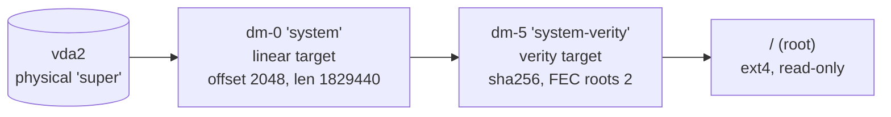

Four layers, each doing one job: the physical partition holds the bytes, the linear target picks out
the range belonging to `system`, the verity target hashes every 4 KiB block on read and compares it
against a Merkle tree, and the mount presents it as a filesystem. **The reason `fastboot flash
system` needs `fastbootd` is layer two.** The bootloader can write `vda2`; it cannot work out which
part of `vda2` is `system` without `liblp`. [20-Security-Architecture §3.2](../20-Security-Architecture/README.md#32-dm-verity--integrity-for-partitions-too-large-to-hash-at-boot)
owns layer three.

> **Under the Hood — measured, and honestly incomplete**
> Only `system` had a verity device on this AVD. `/vendor`, `/product` and `/system_ext` mount their
> linear targets (`dm-4`, `dm-3`, `dm-2`) directly, with no verity layer — even though the `vbmeta`
> partition on the same device *does* carry `AvbHashtreeDescriptor` entries for all four (see
> [§3.8](#38-vbmeta-flags-and-what---disable-verity-actually-disables)). Descriptors present, mappings
> absent. I could not determine from the device why, and I am not going to guess: it may be an
> emulator-specific first-stage-init path, and the emulator is explicitly not a reference for boot
> behaviour. Recorded as an observation, not a conclusion.

> **Mental Model — A/B and dynamic partitions are orthogonal, and the AVD proves it**
> The same device measured `ro.boot.dynamic_partitions = true` and `ro.build.ab_update = false`, with
> `ro.boot.slot_suffix` empty. Dynamic partitions with no A/B. People routinely assume the two
> arrived together because they are of a similar vintage; they are independent features and you will
> meet all four combinations.

### 3.8 `vbmeta` flags, and what `--disable-verity` actually disables

This is the part of fastboot that intersects Verified Boot, and it is where the most confident
misinformation lives. [20-Security-Architecture §3.1](../20-Security-Architecture/README.md#31-verified-boot-and-android-verified-boot-20-avb)
owns AVB itself — the descriptors, the rollback indexes, the four boot states. What is owned *here*
is narrower and more concrete: **what these two host-tool flags do to the bytes.**

```
--disable-verity           Sets disable-verity when flashing vbmeta.
--disable-verification     Sets disable-verification when flashing vbmeta.
```

That is the entire documentation `fastboot --help` gives, and it is not enough to reason with. So the
`vbmeta` partition was pulled off the API 35 AVD and parsed.

```
# measured — vbmeta partition, sdk_gphone16k_x86_64, API 35, 6784 bytes
magic                     AVB0
required_libavb_version   1.0
authentication_data_block_size  576
auxiliary_data_block_size       4224
algorithm_type            2          (SHA256_RSA4096)
hash_offset / hash_size   0 / 32
signature_offset / size   32 / 512
public_key_offset / size  3176 / 1032
descriptors_offset / size 0 / 3176
rollback_index            0
flags                     0
rollback_index_location   0
release_string            "avbtool 1.3.0"
```

The `flags` field is a `uint32`, big-endian, at **byte offset 120** of a 256-byte header. Two bits
are defined, in `external/avb/libavb/avb_vbmeta_image.h`:

| Bit | Constant | Effect when set |
|---|---|---|
| 0 | `AVB_VBMETA_IMAGE_FLAGS_HASHTREE_DISABLED` | Every `AvbHashtreeDescriptor` is ignored. **dm-verity is not set up at all.** |
| 1 | `AVB_VBMETA_IMAGE_FLAGS_VERIFICATION_DISABLED` | The *whole* vbmeta chain is skipped. Nothing is verified — not the boot image hash, not the chained vbmetas, nothing. |

Applying each flag to that real image and diffing byte for byte:

```
flags field at offset 120..124 = 00000000
--disable-verity         -> flags=0x00000001   bytes changed: [123]
--disable-verification   -> flags=0x00000002   bytes changed: [123]
both                     -> flags=0x00000003   bytes changed: [123]
```

**One byte.** The difference between a device that enforces integrity on every read of `/system` and
one that does not is byte 123 of a 6,784-byte partition. The host tool does exactly this and says so
in its own log line, which is present in the binary: `Rewriting vbmeta struct at offset: %lld`.

Now the part that is usually stated wrongly. AVB computes its integrity hash over the header
concatenated with the auxiliary data block. That was verified against the real image:

```
stored hash (from the authentication block)  93dfae214512fd0b4109c245337a01e885809c29b6c6388d117d16a5cabe3b7b
recomputed  sha256(header[0:256] || aux_block)  93dfae214512fd0b4109c245337a01e885809c29b6c6388d117d16a5cabe3b7b
                                             MATCH

after flipping byte 123 to 0x01 (--disable-verity):
recomputed  3695fea807c912e3c0c7c265282055ae5d14c3f1b8594bbcd6f40e83b3e68371
                                             NO MATCH
```

> **Warning — the conclusion this forces, and it is not the popular one**
> **`fastboot --disable-verity` produces a `vbmeta` image that fails AVB's own integrity check.** The
> flags field is *inside* the region the hash covers, so setting it invalidates the hash, and the
> signature over that hash no longer verifies against the OEM public key. It is not a supported
> configuration option that AVB honours; it is a deliberate corruption that **only an unlocked
> bootloader will accept**, because only an unlocked bootloader treats a verification failure as
> advisory. On a locked device the same image produces boot state RED and a device that will not
> boot. Anyone who tells you "just flash vbmeta with `--disable-verity` and then relock" is
> describing a brick.

Two more consequences that follow directly:

- **`--disable-verification` is strictly larger than `--disable-verity`.** Verity-disabled still
  verifies the boot image hash and the chained vbmetas; it only stops the hashtree machinery.
  Verification-disabled stops everything, including the check on `boot` itself. Reach for the
  smaller one. In practice, patching a boot image with Magisk needs *neither* on most devices,
  because the unlocked bootloader is already not enforcing.
- **What it disables is `dm-verity`, not the AVB signature check on `boot`.** The most common
  misunderstanding is that `--disable-verity` is what lets a patched boot image run. It is not; the
  unlocked state is. `--disable-verity` is what lets you *modify `/system`* — remount it read-write,
  add files — because with the hashtree gone there is no per-block hash to violate.

The descriptors that flag neutralises were also read off the same device, so the scope is concrete:

| Descriptor | Partition | Notes |
|---|---|---|
| `AvbChainPartitionDescriptor` | `system` | Delegated to a separate 520-byte key, rollback index location 1 |
| `AvbHashDescriptor` | `vendor_boot` | 98,304 bytes, sha256 — a whole-partition hash checked once at boot |
| `AvbHashtreeDescriptor` | `product` | 2,110,955,520 bytes, 4 KiB blocks, FEC roots 2 |
| `AvbHashtreeDescriptor` | `system_dlkm` | 6,995,968 bytes |
| `AvbHashtreeDescriptor` | `system_ext` | 214,192,128 bytes |
| `AvbHashtreeDescriptor` | `vendor` | 109,670,400 bytes |

Setting bit 0 disables the four hashtree entries. It leaves the `vendor_boot` hash and the chained
`system` verification alone. That precision is what a report needs, and it is why "disable-verity
turns off Verified Boot" is a sentence to avoid.

For full vbmeta parsing, use chapter 20's tool rather than re-implementing it:
[`../20-Security-Architecture/scripts/parse-vbmeta.py`](../20-Security-Architecture/scripts/parse-vbmeta.py).
This chapter ships a narrower one focused on the flags and the hash invariant:
[`scripts/vbmeta-flags.py`](scripts/vbmeta-flags.py).

### 3.9 The factory-reset guarantee

Unlocking wipes user data. It is worth being precise about *why*, because the reasoning is the whole
security argument for the feature and it comes up in interviews constantly.

Suppose unlocking did **not** wipe. Then this attack works, in about fifteen minutes, against any
device with any screen lock:

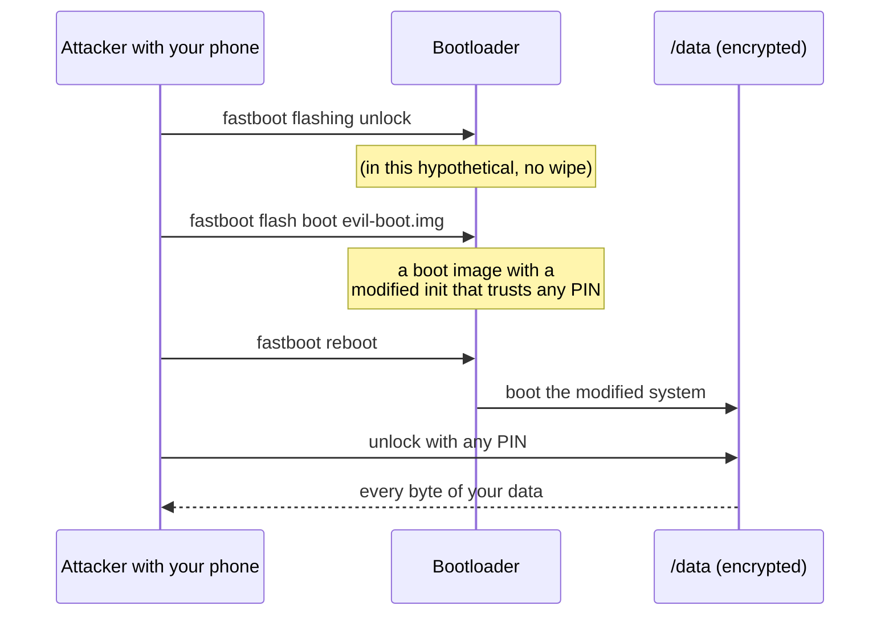

Your screen lock is not the thing protecting your data — the disk encryption keyed to your screen
lock is. Unlocking the bootloader lets the attacker replace the code that *checks* the screen lock.
Without the wipe, "unlock, flash a permissive boot image, read everything" would be a complete
one-command bypass of Android's entire data-at-rest story.

So the guarantee is: **crossing the lock boundary in either direction destroys the data that the
previous state was protecting.** Two mechanisms enforce it in practice:

1. **The bootloader erases `userdata` itself**, before it will report the new state. This is done by
   the bootloader, not by Android, precisely so it cannot be skipped by controlling Android.
2. **On devices with file-based encryption, the keys are destroyed**, which makes the erase
   cryptographic rather than merely physical. Even a bit-for-bit image of the flash taken afterwards
   yields nothing, because the class keys that wrapped the file keys are gone.

> **Pentester's Note — the practical consequence for evidence handling**
> This is why "unlock the bootloader and dump `/data`" is not a forensic technique on a modern
> Android device, and why claims that it is should be met with scepticism. If a device arrives
> locked, its user data is not reachable through fastboot at all — the paths that exist go through
> exploiting the bootloader, exploiting the running system, or a vendor's own service tooling.
> Recording that a device was locked on receipt is therefore a meaningful statement about what could
> and could not have happened to it.

> **Warning — relocking wipes too, and people forget**
> The symmetry is not decorative. Going UNLOCKED to LOCKED also wipes, because the data written while
> unlocked was written under a weaker guarantee and must not be carried into the stronger state where
> attestation will vouch for the device. Plan for it: an engagement's evidence must be off the device
> before you relock it.

### 3.10 A/B slots and virtual A/B

> **Definition — A/B (seamless) updates**
> An **A/B** device has two complete copies of every partition needed to boot — `boot_a`/`boot_b`,
> `system_a`/`system_b`, `vbmeta_a`/`vbmeta_b`, and so on. One copy is *active* and running; the
> update is written to the *inactive* copy while you use the phone; a reboot switches which is
> active. Introduced in Android 7.0.

The point is resilience as much as convenience. If the new slot fails to boot, the bootloader falls
back to the old one — so a failed update is a reboot, not a brick. That fallback is driven by a small
per-slot state stored where the bootloader can see it:

| Per-slot field | Meaning |
|---|---|
| `priority` | 0–15. The bootloader tries the highest-priority bootable slot first |
| `tries_remaining` | Decremented on each boot attempt. At zero, the slot is marked unbootable |
| `successful_boot` | Set by Android **after** it has come up healthily, via `update_verifier` |

That third field is the interesting one. A slot is not trusted because it was flashed; it is trusted
because it booted and Android then said so. AOSP's `system/update_engine/` writes the new slot,
`hardware/interfaces/boot/` defines the `IBootControl` HAL that manipulates the flags, and
`system/update_engine/update_verifier/` is what marks the boot successful.

**What this means for fastboot**, concretely:

```bash
# host — which slot is live?
fastboot getvar current-slot        # a | b
fastboot getvar slot-count          # 2 on A/B, 1 or absent otherwise

# flashing targets the ACTIVE slot unless you say otherwise
fastboot flash boot boot.img                 # -> boot_a if slot a is active
fastboot --slot other flash boot boot.img    # -> boot_b
fastboot --slot all   flash boot boot.img    # -> both
fastboot set_active b                        # switch which one boots next
```

> **Warning — the single most common A/B mistake**
> Flashing a patched boot image to one slot, then having the device switch slots (because an OTA
> completed, or because the slot you flashed failed to boot), and concluding that "the patch did not
> work". It worked; you are running the other slot. Always record `current-slot` before and after,
> and prefer `--slot all` when you actually want the change to survive a slot switch. On an
> A/B device, "it stopped being rooted after an update" almost always means the *other* slot is
> live and it was never patched.

> **Mental Model**
> A/B is a double-buffer. You are always rendering into the buffer you are not displaying. `set_active`
> is the buffer swap. Everything confusing about A/B becomes obvious once you hold that picture.

**Virtual A/B** (Android 11+) is the answer to the obvious objection: two copies of everything doubles
the storage cost, which is unacceptable on a budget device. Virtual A/B keeps *one* copy of the large
partitions and uses copy-on-write snapshots — the `dm-snapshot` and later `dm-user`/`snapuserd`
machinery — to represent the second. During an update, writes for the new slot land in COW files on
`/data`; after a successful boot, a **merge** copies them into place.

This creates a state you must respect:

```bash
# host
fastboot getvar snapshot-update-status    # none | snapshotted | merging
```

| Value | Meaning | Safe to flash? |
|---|---|---|
| `none` | No update in flight | Yes |
| `snapshotted` | An update is staged but not merged | **No** — flash after `snapshot-update cancel` |
| `merging` | A merge is actively running | **No** — let it finish, or `snapshot-update merge` |

> **Warning**
> `fastboot snapshot-update cancel` is documented by the tool itself as something that "may make the
> device unbootable until it is reflashed" — that wording is from `fastboot --help` verbatim. Flashing
> partway through a virtual-A/B merge is one of the reliable ways to produce a device that needs a
> full factory image. If `snapshot-update-status` is not `none`, deal with that first.

### 3.11 `fastboot boot` — the run-without-flashing primitive

Of every command in this chapter, this is the one to build a habit around.

```bash
# host
fastboot boot patched-boot.img
```

Mechanically it is `download:` followed by the `boot` command: the image goes into the download
buffer and the bootloader boots *from RAM*. **Nothing is written to flash.** Power-cycle and the
device comes back exactly as it was.

Why that matters is a matter of arithmetic. `fastboot flash boot` on a wrong image gives you a device
that does not boot, and your recovery path is fastboot mode plus the correct factory image plus the
key combination you hopefully wrote down. `fastboot boot` on a wrong image gives you a device that
does not boot **once**, and your recovery path is holding the power button. Same information gained,
enormously different downside.

| | `fastboot boot img` | `fastboot flash boot img` |
|---|---|---|
| Writes flash | No | Yes |
| Survives reboot | No | Yes |
| Recovery from a bad image | Power-cycle | Reflash a known-good image |
| Available on a locked device | No | No |
| Available on every unlocked device | **No — see below** | Yes |

> **Warning — `fastboot boot` is not universal**
> Several OEMs disable the `boot` command in their bootloaders even when unlocked, because
> "boot arbitrary RAM image" is exactly the primitive an attacker wants and the vendor judged the
> tradeoff differently. You will see `FAILED (remote: 'unknown command')` or a vendor-specific
> refusal. On those devices there is no free test, and flashing is the only path — which means
> downloading the full stock factory image *first*, confirming you can enter fastboot with the key
> combination, and accepting the risk deliberately rather than discovering it.

> **Pentester's Note — the workflow this enables**
> `fastboot boot` turns "modify the platform" from a destructive experiment into an iterable one. A
> boot image with an instrumented `init`, a kernel with extra tracing, a ramdisk with your own
> `init.rc` service — all of them become try-it-and-reboot rather than flash-and-pray. When you are
> characterising an unfamiliar device, alternate `fastboot boot` with `adb shell` and you can iterate
> in a couple of minutes per cycle without ever changing the device's persistent state. That last
> property is also what makes it defensible on a device that is not entirely yours: you can
> demonstrate that the flash was never written.

### 3.12 When there is no fastboot: EDL, download mode, and honest limits

Fastboot is a courtesy the bootloader extends. If the bootloader itself is corrupt, there is nothing
to extend it. Silicon vendors therefore provide a lower-level recovery path in the boot ROM — code
that cannot be corrupted because it is in mask ROM.

| Vendor path | Common name | What it is |
|---|---|---|
| Qualcomm | **EDL** (Emergency Download Mode, "9008" after its USB PID) | The boot ROM enumerates as a USB device and accepts a signed "programmer" binary (a `.mbn`/`.elf` loader) which then speaks the Firehose protocol to read and write raw storage |
| Samsung | **Download Mode / Odin** | A vendor bootloader mode spoken to by Odin (Windows) or Heimdall |
| MediaTek | **BROM / Preloader mode** | Boot ROM download path, driven by SP Flash Tool |
| Unisoc, others | Various | Vendor-specific |

Three honest statements about these, because this is a subject where confident nonsense is abundant:

1. **They are recovery mechanisms, not bypasses.** On a device with a properly implemented secure
   boot, the programmer binary EDL accepts must be signed by the OEM. Without a signed programmer you
   can enumerate the device and do nothing else. The publicly circulating programmer binaries are
   leaked or extracted OEM-signed loaders for specific chipsets, and their availability is an
   accident of that OEM's key handling, not a property of EDL.
2. **Where they *have* been bypasses, it was a specific vulnerability in a specific boot ROM or
   preloader** — an authentication step that could be skipped, a signature check on the wrong buffer,
   a loader that was signed with a test key. Those are real and have been published, and they are
   per-chipset, per-generation facts with a shelf life. I am deliberately not naming CVE identifiers
   here; describing the class is accurate, and inventing an identifier would not be.
3. **Nothing here defeats disk encryption.** Reading raw flash from EDL on a modern device gives you
   ciphertext whose keys are in the TEE and derived from a credential you do not have. "Dump the
   phone with EDL" as a data-recovery claim is usually a claim about a pre-FBE device or about a
   device where the examiner also has the passcode.

> **Warning — what a "hard brick" is**
> A **soft brick** is a device that does not boot Android but still reaches fastboot; it is recoverable
> with a factory image. A **hard brick** is a device whose bootloader is gone or refuses to run, so
> there is no fastboot; recovery requires the vendor path above, and on many devices requires an
> OEM-signed programmer you do not have. **The transition between the two is `fastboot flash
> bootloader` (or `xbl`, `aboot`, `sbl1`, or whatever your SoC calls it).** This is exactly why those
> partitions sit behind `unlock_critical` as a separate, additional gate — the bootloader is
> protecting itself from you, on purpose, and that protection is a good thing.
>
> The practical rule: **never flash a partition whose name you cannot explain.** If you do not know
> what `xbl_config_b` is, you are not in a position to judge whether the image you have is the right
> one for it.

### 3.13 Version matrix

| Feature | Introduced | Notes |
|---|---|---|
| Base fastboot protocol | Android 1.x era | `getvar`, `download`, `flash`, `erase`, `boot`, `continue`, `reboot` |
| `fastboot oem unlock` | Android 4.0 (API 14) era, per-OEM | Vendor-defined semantics |
| "OEM unlocking" toggle + `get_unlock_ability` | Android 5.0 (API 21) | The dependency on a booted, unlocked OS |
| `fastboot flashing unlock` / `lock` | Android 6.0 (API 23) | The standardised replacement for `oem unlock` |
| AVB 2.0 / `vbmeta`, four boot states | Android 8.0 (API 26) | [20-Security-Architecture](../20-Security-Architecture/README.md) |
| A/B (seamless) updates | Android 7.0 (API 24) | `slot-count`, `current-slot`, `set_active` |
| Dynamic partitions, `super`, **`fastbootd`** | Android 10 (API 29) | `is-logical:`, `is-userspace` |
| Virtual A/B | Android 11 (API 30) | `snapshot-update-status` |
| `init_boot` partition (GKI) | Android 13 (API 33) | The ramdisk moved out of `boot`; changes which image you patch |
| `fastboot fetch` | Android 12 (API 31) era | Optional; most retail bootloaders do not implement it |

> **Warning — every row above is a *specification* date, not a device fact**
> OEMs ship partial implementations, disable commands, and add their own. The only reliable statement
> about a specific device is what `getvar all` says on that device. Treat this table as a guide to
> what to *look for*, never as a claim about what is present.

---

## 4. Source Code Walkthrough (AOSP)

An unusual property of this chapter: **half the system is closed source.** The bootloader is written
by the SoC vendor and the OEM, ships as a signed binary, and is not in AOSP. What *is* in AOSP is the
host tool, `fastbootd`, the protocol specification, and every format the protocol carries. That is
still most of the interesting code, and it is enough to reason precisely about the closed half,
because the closed half must implement a documented wire protocol.

### 4.1 The map

| Path in the AOSP tree | What lives there |
|---|---|
| `system/core/fastboot/README.md` | **The protocol specification.** Short. Read it once, properly |
| `system/core/fastboot/fastboot.cpp` | Host tool: argument parsing, the flashing plan, `--disable-verity` handling |
| `system/core/fastboot/engine.cpp` | Host tool: the queue of actions and their retry/skip logic |
| `system/core/fastboot/fastboot_driver.cpp` | Host tool: the wire protocol itself — `RawCommand`, `Download`, `HandleResponse` |
| `system/core/fastboot/usb_linux.cpp`, `usb_windows.cpp`, `usb_osx.cpp` | Host tool: finding the interface by class/subclass/protocol |
| `system/core/fastboot/tcp.cpp`, `udp.cpp`, `socket.cpp` | Host tool: the non-USB transports |
| `system/core/fastboot/fs.cpp` | Host tool: `format`, which shells out to `mke2fs` / `make_f2fs` |
| `system/core/fastboot/device/` | **`fastbootd`** — the userspace implementation |
| `system/core/fastboot/device/commands.cpp` | `fastbootd`: one handler function per verb |
| `system/core/fastboot/device/variables.cpp` | `fastbootd`: one getter per `getvar` name |
| `system/core/fastboot/device/flashing.cpp` | `fastbootd`: writing partitions, including logical ones |
| `system/core/fastboot/device/usb_client.cpp` | `fastbootd`: the FunctionFS gadget that presents the USB interface |
| `system/core/fastboot/fuzzy_fastboot/` | The conformance test suite an OEM's bootloader is meant to pass |
| `system/core/libsparse/` | The sparse image format, both directions |
| `system/core/fs_mgr/liblp/` | LP metadata — the `super` partition layout |
| `system/core/fs_mgr/libsnapshot/` | Virtual A/B snapshots and `snapuserd` |
| `external/avb/libavb/avb_vbmeta_image.h` | The `AvbVBMetaImageHeader` struct and the two flag constants |
| `external/avb/avbtool.py` | The host-side AVB tool. Readable Python; the fastest route to understanding AVB |
| `bootable/recovery/bootloader_message/` | The BCB — `misc` partition structure |
| `bootable/recovery/` | Recovery, which hosts `fastbootd` |
| `hardware/interfaces/boot/` | `IBootControl` — the A/B slot HAL |
| `system/update_engine/` | A/B update application, and `update_verifier` which marks a slot successful |

### 4.2 Tracing one complete path: `fastboot flash system system.img`

This is the path worth following end to end, because it touches every subsystem in the chapter.

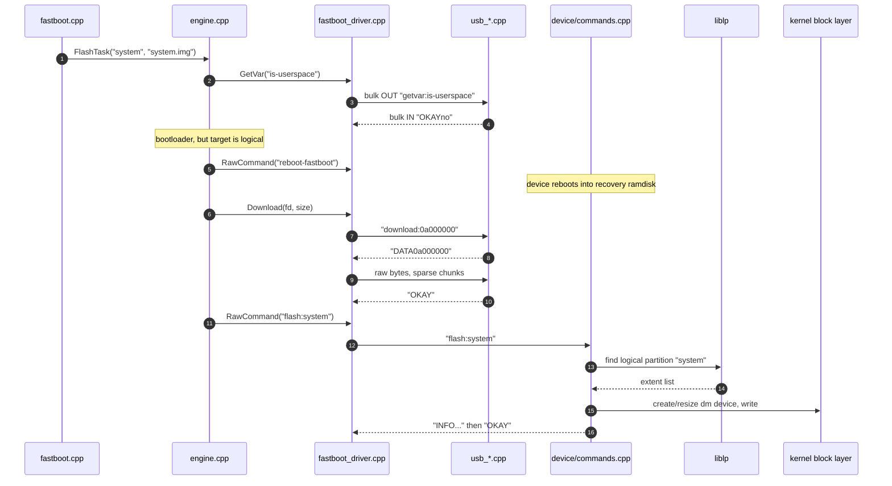

**Step 1 — the host decides where to send it.** `fastboot.cpp` builds a list of tasks. Before
flashing it queries `is-userspace` and `is-logical:system`. A logical target plus a non-userspace
endpoint means the request must be rerouted, so the tool emits `reboot-fastboot` and waits for the
device to reappear. This is why a single `fastboot flash system` can reboot your device — the tool is
doing a thing you did not ask for, because the thing you did ask for is impossible where you asked
it.

**Step 2 — sparsing, if needed.** The tool compares the image size against `max-download-size`. If it
is larger, `libsparse` re-sparses it into a sequence of smaller sparse images
([§3.5](#35-sparse-images-how-a-3-gb-image-crosses-a-256-mb-buffer)), and steps 3 and 4 repeat once
per piece.

**Step 3 — download.** `fastboot_driver.cpp` writes `download:` followed by the size as exactly eight
lowercase hex digits, reads the reply, and asserts the reply is `DATA` with the same size echoed
back. Then it writes the raw bytes in transport-sized chunks and reads the terminating `OKAY`.

**Step 4 — flash.** `flash:system` reaches `fastbootd`'s `commands.cpp`. That handler resolves
`system` through `liblp` to a set of extents inside `super`, ensures a device-mapper device exists
for it — creating or resizing it if the incoming image needs a different size — and writes the
download buffer through the kernel's block layer.

**Step 5 — what did not happen.** Notice that at no point did anything verify the image. `fastbootd`
does not check that `system.img` is signed, or that it matches the `vbmeta` currently on the device,
or that it is even an ext4 filesystem. Verification happens at *boot*, by AVB, and only if the
bootloader is locked. The flash path is deliberately dumb; the intelligence is in the verifier.

### 4.3 The two flag constants, in their own header

```c
// external/avb/libavb/avb_vbmeta_image.h  — the two defined flag values
typedef enum {
  AVB_VBMETA_IMAGE_FLAGS_HASHTREE_DISABLED = (1 << 0),
  AVB_VBMETA_IMAGE_FLAGS_VERIFICATION_DISABLED = (1 << 1)
} AvbVBMetaImageFlags;
```

And the header they live in, abbreviated to the fields that matter for
[§3.8](#38-vbmeta-flags-and-what---disable-verity-actually-disables). Every multi-byte field is
**big-endian**, which is unusual on an ARM or x86 device and catches people writing parsers:

```c
// external/avb/libavb/avb_vbmeta_image.h  — abbreviated; total size is 256 bytes
typedef struct AvbVBMetaImageHeader {
  uint8_t  magic[AVB_MAGIC_LEN];              /* offset   0  "AVB0"          */
  uint32_t required_libavb_version_major;     /* offset   4                  */
  uint32_t required_libavb_version_minor;     /* offset   8                  */
  uint64_t authentication_data_block_size;    /* offset  12                  */
  uint64_t auxiliary_data_block_size;         /* offset  20                  */
  uint32_t algorithm_type;                    /* offset  28                  */
  /* ... hash/signature/public-key/descriptor offsets and sizes ... */
  uint64_t rollback_index;                    /* offset 112                  */
  uint32_t flags;                             /* offset 120  <-- THE BYTE    */
  uint32_t rollback_index_location;           /* offset 124                  */
  uint8_t  release_string[AVB_RELEASE_STRING_SIZE]; /* offset 128            */
  uint8_t  reserved[80];                      /* offset 176                  */
} AVB_ATTR_PACKED AvbVBMetaImageHeader;
```

Counting the field offsets by hand from that struct gives 120 for `flags`, and the big-endian layout
puts the low-order byte last, at **offset 123** — which is exactly the byte the measurement in
[§3.8](#38-vbmeta-flags-and-what---disable-verity-actually-disables) found changing. Struct arithmetic
and the observed diff agree, which is the confirmation that matters: neither alone would be
convincing.

The verification routine that this defeats is `avb_vbmeta_image_verify()` in
`external/avb/libavb/avb_vbmeta_image.c`. Its shape is:

1. Check the magic and the required libavb version.
2. Byte-swap the header into host order.
3. Compute a hash over the 256-byte header **as it appears on disk** concatenated with the auxiliary
   data block.
4. Compare that against the hash stored in the authentication block.
5. Verify the signature over that hash using the public key in the auxiliary block.
6. Separately, the caller checks that public key against the one the device trusts.

Step 3 is why the flags field is covered: it is inside the first 256 bytes. Step 6 is why an unlocked
bootloader still boots: it is the step an unlocked bootloader treats as advisory.

### 4.4 `fastbootd`'s command dispatch

`system/core/fastboot/device/commands.cpp` is a table of handlers, and reading it is the fastest way
to know what a *conformant* implementation must do. The shape is one function per verb, each taking
the device object and the argument list, each returning a bool and writing its own response:

```c++
// system/core/fastboot/device/commands.cpp — shape of a handler, paraphrased
bool GetVarHandler(FastbootDevice* device, const std::vector<std::string>& args) {
    if (args.size() < 2) {
        return device->WriteFail("Missing argument");
    }
    // ... look the name up in the variable table in variables.cpp ...
    // ... and reply OKAY<value> or FAIL<reason> ...
}
```

Two things in that file are worth a tester's attention:

- **The `getvar` table in `variables.cpp` is the authoritative list of what a device *should* answer.**
  A retail bootloader that answers fewer is normal; one that answers *more* has vendor extensions,
  and vendor extensions are where the bugs are.
- **`fastbootd` refuses lock-state changes.** `flashing unlock` is not in its table at all, because
  the lock state lives in storage only the bootloader may write. That is an architectural boundary,
  not a policy that could be relaxed.

### 4.5 The conformance suite nobody mentions

`system/core/fastboot/fuzzy_fastboot/` is a test suite Google publishes for OEMs to validate their
bootloader's fastboot implementation. It contains both conformance tests (does `getvar` handle an
over-long name?) and deliberately malformed input.

For a researcher this is a gift, because it is a published list of the things a bootloader is
*expected* to get wrong. Reading its test names is a reconnaissance exercise: every case it tests is
a case some bootloader failed. It requires a real device in fastboot mode to run, so **it was not
executed for this chapter** — but the source is readable without one, and reading it is the single
highest-yield hour available on this topic.

---

## 5. Security Perspective

### 5.1 What the lock actually protects, stated precisely

Before attacks, the claim. A **locked** bootloader on a device with a correctly implemented Verified
Boot makes exactly this statement, and no more:

> *The code that ran between power-on and the point where user data was decrypted was signed by a key
> whose public half is in this device's fuses, and its rollback index was not lower than the one
> recorded in tamper-evident storage.*

It does **not** say that the running system is uncompromised — a signed system with a remote
code-execution bug is still signed. It does **not** say that the user has not installed malware. And
it says nothing at all about anything that happened after boot.

**Unlocking retracts that statement entirely.** Not weakens — retracts. The correct way to phrase it
in a report is not "the device is less secure" but "the platform-integrity assumption that control X
depends on is no longer available on this device".

### 5.2 How attackers abuse fastboot

| Attack | Preconditions | What it achieves |
|---|---|---|
| **Evil maid via an already-unlocked device** | Physical access; bootloader already unlocked | Flash a modified boot image with a persistent backdoor. No exploit required — this is the intended function of an unlocked bootloader, pointed at the wrong owner |
| **Unlock-and-wipe as denial of service** | Physical access; `get_unlock_ability = 1` | Destroys all data. Cannot read it, but the wipe itself is the damage |
| **Malicious USB host against an unlocked device in fastboot mode** | Device left in fastboot mode plugged into an untrusted port | Full flash write. The protocol has no host authentication |
| **`oem` command exploitation** | Device reachable in fastboot mode | Memory corruption in the most privileged context on the device. Historically the richest vein of bootloader bugs |
| **Downgrade to a vulnerable firmware** | Unlocked, and rollback index not yet advanced past the target | Reintroduce a patched vulnerability, then exploit it. AVB rollback indexes are the defence; they only work if they were bumped |
| **Flashing a GSI or permissive-SELinux build** | Unlocked | A device that looks stock to naive checks but has no SELinux enforcement |
| **Boot-image "boot once" for volatile compromise** | Unlocked; `boot` command available | A compromise that leaves *nothing* on flash — power-cycle and the evidence is gone. Notable for forensics |

That last row deserves emphasis because it inverts an assumption. Most persistence techniques trade
stealth for durability. `fastboot boot` is the opposite: it is maximally invasive and completely
non-persistent, and a forensic image of the flash afterwards shows nothing.

### 5.3 How developers and organisations misuse the surrounding controls

**Reading `ro.boot.verifiedbootstate` and calling it an integrity check.** This is the dominant
mistake and it appears in a large fraction of real apps.

```java
// examples/BootStateChecker.java — VULNERABLE. Do not ship this.
public static boolean isDeviceTrustworthy() {
    String state = SystemProperties.get("ro.boot.verifiedbootstate", "");
    return "green".equals(state);
}
```

**Why developers write it:** it is one line, it needs no server, it needs no dependencies, and on
every device they test it returns the right answer. It is the cheapest thing that appears to work.

**Why it does not work:** `ro.boot.*` properties are set by `init` from `androidboot.*` keys on the
kernel command line or in bootconfig, and then live in a shared-memory property area that root can
rewrite. Magisk's `resetprop` will set it to `green` in one command. Chapter 50 measured a device
reporting `green` while its own TEE-signed attestation simultaneously said `Unverified` and
`deviceLocked = false`. **The property is attacker-controlled data on precisely the devices the check
exists to detect.**

**Why it is worse than nothing on an emulator, and this was measured here.** On the API 35 AVD:

```
ro.boot.verifiedbootstate   = <empty>
ro.boot.flash.locked        = <empty>
ro.boot.vbmeta.device_state = <empty>
ro.boot.vbmeta.digest       = 2c9cddc5782070a7bad50e8178173f45bc36ec4603add76004d09e3bfce71eea
ro.boot.vbmeta.size         = 6784
ro.boot.veritymode          = enforcing
```

The lock-state properties are not `orange`; they are **absent**. `/proc/bootconfig` on the same
device explains exactly why — it carries `androidboot.vbmeta.size`, `androidboot.vbmeta.digest`,
`androidboot.vbmeta.hash_alg` and `androidboot.veritymode`, and **no `androidboot.verifiedbootstate`,
no `androidboot.flash.locked`, no `androidboot.slot_suffix`** for `init` to derive them from. Property
empty exactly when the bootconfig key is missing: cause and effect, measured on one device in one
session.

The consequence for the check above is direct. A developer writing the defensive-looking inverse —

```java
// Even worse: "not orange means fine"
return !"orange".equals(SystemProperties.get("ro.boot.verifiedbootstate"));
```

— gets `true` on an emulator, where the property is the empty string. The check passes on the least
trustworthy platform it could possibly encounter.

**The secure fix**, in full, is in [`examples/BootStateChecker.java`](examples/BootStateChecker.java).
Its core is that the only non-forgeable statement of device state is inside a hardware key-attestation
certificate, verified **server-side** against Google's root, with the `deviceLocked` and
`verifiedBootState` fields read out of the attestation extension:

```java
// The correct shape. Full version in examples/BootStateChecker.java.
// 1. Generate a key in the AndroidKeyStore with setAttestationChallenge(serverNonce).
// 2. Export the certificate chain.
// 3. Send the WHOLE CHAIN to your server. Do not parse it on the device.
// 4. On the server: verify the chain to a known Google root, check the challenge matches
//    the nonce you issued, then read RootOfTrust.deviceLocked and .verifiedBootState
//    from the attestation extension.
// The device never gets to state its own verdict.
```

> **Pentester's Note — how to grade this finding honestly**
> Finding `ro.boot.verifiedbootstate` in an app is a real finding, but its severity depends entirely
> on what the app does with it. If it is one input among many in a risk score that also includes
> server-verified attestation, it is **Informational** — a weak signal used weakly. If it is the sole
> gate on a security decision, it is a genuine control failure, and the honest severity is driven by
> what is behind the gate. Reporting every occurrence as High is how a report gets ignored. This is
> the same discipline [37-RootDetection](../37-RootDetection/README.md) and
> [38-TamperDetection](../38-TamperDetection/README.md) apply to their own checks.

### 5.4 Vulnerability classes in bootloaders themselves

Every entry here is a **class**, described from public research literature. Specific identifiers are
deliberately omitted rather than guessed.

**Class 1 — unbounded copies in `oem` command handlers.**

```c
// The shape of the bug. Not from any specific vendor's source.
static void handle_oem_command(const char *arg) {
    char buf[64];
    strcpy(buf, arg);          /* arg is attacker-controlled, up to ~60 bytes of the
                                  64-byte command -- and there is no stack canary here */
    dispatch(buf);
}
```

*Why it is written this way:* the bootloader is a freestanding C program with no libc hardening, no
ASLR, no stack protector and no NX, and it is under intense size pressure. Bounds checks cost bytes,
and the input "comes from our own tool".

*Detection, statically:* if you can obtain the bootloader image (from a factory image; the partition
is often named `aboot`, `xbl`, `abl`, `sbl1` or `uefi`), load it in
[57-Ghidra](../57-Ghidra/README.md) and look for the command dispatch table — a run of pointers to
string literals like `"oem "`, `"getvar:"`, `"flash:"`. From there, every handler is a parser
reachable over USB.

*Detection, dynamically:* `system/core/fastboot/fuzzy_fastboot/` is the published harness for exactly
this, and `fastboot oem help` enumerates the verbs on some devices.

*Exploitation:* a stack overflow in an environment with no mitigations is a straightforward
control-flow hijack. The bootloader has no memory protection and runs before any of the isolation
Android provides.

*Secure fix, as code:*

```c
static void handle_oem_command(const char *arg, size_t arg_len) {
    char buf[64];
    if (arg_len >= sizeof(buf)) {
        fastboot_fail("argument too long");
        return;
    }
    memcpy(buf, arg, arg_len);
    buf[arg_len] = '\0';
    dispatch(buf);
}
```

...plus the structural fix, which matters more: **compile the bootloader with a stack protector, and
build the command table so that handlers receive an explicitly-bounded slice rather than a
NUL-terminated pointer.**

*Honest severity:* **Critical** where it is reachable on a *locked* device, because it defeats
Verified Boot at its root and yields a persistent, undetectable compromise. **Low** where it requires
an already-unlocked bootloader, because on an unlocked device the attacker can flash whatever
they like — an exploit that grants what the device already grants is not a vulnerability, it is a
complicated way to do something easy. **That distinction decides the entire severity, and it is the
first question to ask about any bootloader bug.**

**Class 2 — `getvar` name handling.** The command is capped at 64 bytes, and `getvar:` consumes seven
of them, so a variable name can be 57 bytes. Handlers that copy it into a smaller buffer, or that use
it to index a table without validating, are the same bug in a smaller space.

**Class 3 — partition name confusion in `flash:`.** The handler must map an attacker-supplied string
to a partition. Bugs here look like: accepting names containing `../` or absolute paths, accepting a
name that aliases a critical partition through a vendor alias table, or accepting a slot suffix that
indexes out of range. The consequence is writing a partition that `unlock_critical` was meant to
protect.

**Class 4 — sparse image parsing.** The sparse header is entirely attacker-controlled and contains
lengths and counts. A `chunk_sz` that overflows when multiplied by `blk_sz`, a `total_sz` smaller than
`chunk_hdr_sz`, or a chunk count that disagrees with the data present are the classic shapes. This is
a parser handling untrusted input in a privileged context, which is the canonical description of an
attack surface. [`scripts/sparse-tool.py`](scripts/sparse-tool.py) implements the checks a correct
parser needs, precisely so you can see what a buggy one omits.

**Class 5 — the unlock decision itself.** The bootloader must read a flag written by Android. Bugs
here look like: reading it from a partition writable by something other than the intended component,
caching the decision across a reboot, or an `oem unlock` verb that never checks `get_unlock_ability`
at all because it predates the standardised path.

### 5.5 OWASP MASVS and MASTG mapping

| Identifier | Relevance |
|---|---|
| **MASVS-RESILIENCE-1** | The app validates the integrity of the platform it runs on. Fastboot state is what that validation is *about* |
| **MASVS-RESILIENCE-2** | Anti-tampering. An unlocked bootloader is the substrate every tampering technique in this repository is built on |
| **MASVS-STORAGE-1 / -2** | The factory-reset guarantee ([§3.9](#39-the-factory-reset-guarantee)) is why data at rest survives physical possession |
| **MASVS-CRYPTO-1** | Key attestation, which is the only trustworthy report of lock state |
| **MASTG device-integrity / root-detection tests** | The practical tests. **Look the current test identifier up before citing it in a report** — MASTG test numbering has been renumbered between major versions, and a stale ID reads as carelessness |

> **Warning**
> MASVS v2 categories (`MASVS-RESILIENCE-n`) are stable; MASTG *test* identifiers have moved between
> editions. Cite the category confidently and look the test number up rather than repeating one from
> memory. [71-OWASP-Mobile](../71-OWASP-Mobile/README.md) has the current mapping.

### 5.6 How a pentester tests this, end to end

The methodology, in the order it should be executed. Everything in the first three steps is
non-destructive.

1. **Establish device posture from the running system, without rebooting.** Run
   [`scripts/bootstate-audit.sh`](scripts/bootstate-audit.sh). It reads every relevant property,
   `/proc/bootconfig` where readable, the partition layout, the device-mapper tables and the slot
   state, and prints a verdict *with the evidence next to it*.
2. **Cross-check the properties against hardware attestation.** Properties are claims; attestation is
   evidence. [50-HardwareBackedSecurity](../50-HardwareBackedSecurity/README.md) has the procedure.
   Where the two disagree, record both — that disagreement is itself a finding about the device.
3. **Determine what the app does with any of it.** Static sweep for the property names
   ([§8](#8-static-analysis)), then hook the readers at runtime ([§7](#7-dynamic-analysis)) to see
   which are actually consulted and what happens to the result.
4. **Only then, and only on a device you own, consider changing state.** Record everything first.

> **Pentester's Note — the sentence to put in the report**
> Not "the bootloader is unlocked". That is a device fact, and if it is *your* test device it is a
> statement about your methodology, not about the client. The finding is about the *app*: "the
> application's platform-integrity check reads `ro.boot.verifiedbootstate`, a property that any
> process with root can rewrite; on our test device the check passed while hardware attestation
> simultaneously reported the device as unlocked. The control does not detect the condition it exists
> to detect." That is falsifiable, reproducible and actionable, and it names the app rather than the
> lab.

### 5.7 What an unlocked bootloader does to every other control in this repository

This is the section a client actually needs, because it converts one device fact into a
threat-model change across the whole stack.

| Control | Chapter | Effect of an unlocked bootloader |
|---|---|---|
| **Verified Boot / dm-verity** | [20](../20-Security-Architecture/README.md) | Retracted. AVB still parses and reports, but failure is advisory. `--disable-verity` becomes usable, which makes `/system` writable |
| **Hardware key attestation** | [50](../50-HardwareBackedSecurity/README.md) | **Still works, and still tells the truth.** `deviceLocked = false` and `verifiedBootState = Unverified` appear in every certificate the TEE issues. This is the one control the unlock does not defeat, and that is exactly why it exists |
| **KeyStore key binding** | [49](../49-KeyStore/README.md) | Keys already generated may be invalidated across the transition. New keys still get hardware backing, but their attestation now says the device is unlocked |
| **App sandbox / UID isolation** | [21](../21-App-Sandbox/README.md) | Intact until root is installed. Unlocking alone changes nothing here — it is the *enabler* for the change, not the change |
| **SELinux** | [22](../22-SELinux/README.md) | Intact until a modified policy or a permissive kernel is flashed. The unlock makes both possible |
| **Root detection** | [37](../37-RootDetection/README.md) | Every property-based and file-based check becomes defeatable, because the attacker controls the platform that answers |
| **Certificate pinning** | [36](../36-CertificatePinning/README.md) | Not directly affected — but the unlock enables root, which enables Frida, which defeats pinning trivially |
| **Play Integrity** | [20 §3.6](../20-Security-Architecture/README.md#36-play-integrity-api--what-it-is-and-where-the-trust-sits) | `MEETS_STRONG_INTEGRITY` becomes unobtainable without a TEE compromise or a leaked keybox, because it is anchored in attestation rather than properties |
| **Tamper detection** | [38](../38-TamperDetection/README.md) | Self-signature and DEX-integrity checks still function, but they run on a platform that can lie to them |
| **Frida / instrumentation** | [53](../53-Frida/README.md), [65](../65-Hooking/README.md) | Becomes possible, which is why every research device starts here |
| **Emulator detection** | [39](../39-EmulatorDetection/README.md) | Unrelated to lock state, but shares the same failure mode: both families read properties that root can rewrite |
| **Widevine DRM** | — | Commonly drops from L1 to L3 on unlock, because the provisioning is bound to boot state |
| **Device data at rest** | [33](../33-Storage/README.md) | The unlock *wiped* it. Data written afterwards is protected by the same FBE machinery, but on a device that no longer attests as locked |

The two rows worth reading twice are **hardware key attestation** and **Play Integrity**. Almost
everything else on this list degrades or fails when the bootloader is unlocked. Those two continue to
work correctly and report the truth, because their root of trust is in the TEE rather than in
software the unlock made writable. **That asymmetry is the strongest argument in the repository for
attestation over local checks**, and it is measured rather than argued: chapter 50 pulled a TEE-signed
attestation from a rooted device that was reporting `green` from `getprop`, and the attestation said
`Unverified`.

### 5.8 How malware abuses it

Comparatively rarely, and for a structural reason worth understanding: **malware runs on a device
that is already booted, and fastboot requires a reboot into a mode the user can see.** A phone
displaying a fastboot screen is conspicuous.

Where it does appear:

- **Bootkits on already-unlocked devices** — supply-chain compromise of a device that shipped
  unlocked, or a second-hand device sold with a modified boot image. This is the realistic version of
  the threat, and it targets cheap, unbranded hardware most often.
- **Persistence via a modified boot ramdisk**, surviving a factory reset because a factory reset
  wipes `userdata` and not `boot`. This is the single most valuable property of a boot-partition
  implant.
- **Downgrade attacks** where the actor has physical access and the rollback index has not advanced.

> **Pentester's Note — the factory-reset asymmetry**
> "I factory reset it and it came back" is a strong indicator of boot-partition or `/system`
> persistence, because a factory reset does not touch either. On an unlocked device, the way to
> actually clear it is a full factory-image flash, not a reset. This distinction matters in incident
> response and is frequently missed.

### 5.9 How a forensic analyst investigates

| Question | Where the answer is | Trust level |
|---|---|---|
| Was the bootloader unlocked at the time of imaging? | `getvar:unlocked`, `ro.boot.flash.locked` | **Low** — self-reported |
| Was it unlocked, really? | Hardware key attestation: `deviceLocked` | **High** — TEE-signed |
| Was it *ever* unlocked? | Some OEMs record it in a persistent counter or fuse; vendor-specific | Varies; ask the vendor |
| Which slot is running? | `ro.boot.slot_suffix`, `bootctl get-current-slot` | Medium |
| Has the boot image been modified? | Hash `boot` / `init_boot` against the OEM factory image for the exact fingerprint | **High** — if you have the reference image |
| Has `/system` been modified? | dm-verity is either enforcing or it is not. `dmctl table` shows the real mapping | **High** |
| What was on the device before it was unlocked? | **Nothing. The unlock wiped it and destroyed the keys** | Definitive |

That last row is the forensically important one, and it works in both directions: it forecloses a
recovery avenue, and it also means that **an unlock event is a destruction-of-evidence event with a
hard boundary** — everything on the device postdates it.

### 5.10 Bug bounty patterns

The realistic patterns, stated without inventing report URLs:

- **A fastboot command reachable on a locked device that should not be.** Any `flash`, `erase`, `boot`
  or `oem` verb that acts on a locked device is a direct Verified Boot bypass and is the
  highest-value finding in this area.
- **Unlock without `get_unlock_ability`.** A vendor `oem unlock` path that skips the Android-set flag
  breaks the theft-protection property in
  [§2.3](#23-the-lock-state-machine--the-most-important-diagram-in-this-chapter).
- **Unlock without a wipe**, on any code path, for the reason in [§3.9](#39-the-factory-reset-guarantee).
- **Memory corruption in a bootloader parser reachable on a locked device** — `getvar` names, sparse
  headers, boot image headers, partition names.
- **App-side**: platform-integrity gates that can be defeated by a property write. Common, real, and
  usually correctly triaged as low to medium unless the gate protects something material.

Vendor programmes that accept these exist at Google, Qualcomm, Samsung and others; check each
programme's current scope rather than assuming, because bootloader scope changes.

---

## 6. Reverse Engineering Perspective

Fastboot itself is not something you reverse-engineer inside an APK — no app speaks the protocol. What
*does* appear in apps is the downstream consequence: code that tries to work out whether the
bootloader is locked. That is the primary target here. The secondary target is the bootloader binary
itself, and boot images on disk.

### 6.1 What a lock-state check looks like in JADX

The pattern is a property read compared against a string literal. In
[56-JADX](../56-JADX/README.md) output it is unmissable if you know what to look for:

```java
// jadx output — the common shape
public final boolean m4321a() {
    String bootState = C1204b.m2201a("ro.boot.verifiedbootstate", "");
    String flashLocked = C1204b.m2201a("ro.boot.flash.locked", "");
    if (!"green".equals(bootState)) {
        return false;
    }
    return "1".equals(flashLocked);
}
```

Three recognition cues, in order of reliability:

1. **The literal strings survive obfuscation by default.** [40-Obfuscation](../40-Obfuscation/README.md)
   explains why: R8 renames identifiers, not string constants, unless string encryption is added
   separately. So `ro.boot.verifiedbootstate` is very often still there in plain text even in a
   heavily-minified APK.
2. **`SystemProperties` is hidden API**, so app code cannot call it directly. It is reached by
   reflection (`Class.forName("android.os.SystemProperties")` then `getMethod("get", ...)`) or by
   running `getprop` as a subprocess. Both are distinctive.
3. **The comparison values are a tiny closed set**: `green`, `yellow`, `orange`, `red`, `locked`,
   `unlocked`, `0`, `1`. Grepping for those next to a `ro.boot.` string finds the logic even when
   every method name is `a`, `b`, `c`.

### 6.2 The same thing in Smali

```smali
# Reflection-based SystemProperties.get, as apktool renders it
.method private static getProp(Ljava/lang/String;)Ljava/lang/String;
    .locals 5

    const-string v0, "android.os.SystemProperties"
    invoke-static {v0}, Ljava/lang/Class;->forName(Ljava/lang/String;)Ljava/lang/Class;
    move-result-object v1

    const-string v2, "get"
    const/4 v3, 0x1
    new-array v3, v3, [Ljava/lang/Class;
    const/4 v4, 0x0
    const-class v0, Ljava/lang/String;
    aput-object v0, v3, v4
    invoke-virtual {v1, v2, v3}, Ljava/lang/Class;->getMethod(Ljava/lang/String;[Ljava/lang/Class;)Ljava/lang/reflect/Method;
    move-result-object v1

    # ... invoke it with the property name, return the String ...
    return-object v0
.end method

.method public static isVerified()Z
    .locals 2

    const-string v0, "ro.boot.verifiedbootstate"
    invoke-static {v0}, Lcom/example/a/b;->getProp(Ljava/lang/String;)Ljava/lang/String;
    move-result-object v0

    const-string v1, "green"
    invoke-virtual {v1, v0}, Ljava/lang/String;->equals(Ljava/lang/Object;)Z
    move-result v1

    return v1
.end method
```

**The patch is one instruction.** Replace the `invoke-virtual` + `move-result v1` pair with
`const/4 v1, 0x1`, or change the literal `"green"` to whatever the device actually reports.
The second option is more durable because it survives the method being inlined elsewhere.

> **Warning — the trap chapter 18 measured, and it applies exactly here**
> Patching a check function is not the same as defeating the check. `18-ARM` §5.4 patched a native
> `verify_signature` to `return 1`, verified it returning 1, and the caller *still* refused — because
> the compiler had inlined the check and the patched copy was called by nothing. The Java analogue is
> R8 inlining a small static helper into three call sites. **Always verify by observing the
> behaviour, never by observing that the patch applied.** [65-Hooking](../65-Hooking/README.md)
> measured the same failure with an installed, verified Frida hook that changed nothing.

### 6.3 Native-side checks

In a native library the same logic uses bionic's `__system_property_get`:

```c
// The C form. Look for this import in libfoo.so.
#include <sys/system_properties.h>

int device_is_verified(void) {
    char value[PROP_VALUE_MAX];
    __system_property_get("ro.boot.verifiedbootstate", value);
    return strcmp(value, "green") == 0;
}
```

Find it with:

```bash
# host — is the app reading boot properties from native code?
llvm-readelf --dyn-syms libfoo.so | grep -E '__system_property_(get|read|find)'
strings -a libfoo.so | grep -E '^ro\.boot\.'
```

`__system_property_get` is the legacy API and the most common. `__system_property_find` plus
`__system_property_read_callback` is the modern one and is what a library trying to be quiet will
use, because the string may then be built at runtime rather than sitting in `.rodata`.

There is also the crude form, which is easy to spot and surprisingly common:

```c
// Running getprop as a subprocess. Look for popen/fork+exec of "getprop".
FILE *f = popen("getprop ro.boot.flash.locked", "r");
```

### 6.4 Reading a boot image

If you obtain a `boot.img` — from a factory image, or from a `fastboot fetch` on the rare device that
supports it — its header format is defined in AOSP at
`system/tools/mkbootimg/include/bootimg/bootimg.h`. The first eight bytes are the magic `ANDROID!`.

```bash
# host — first, what is it?
xxd -l 64 boot.img
# 00000000: 414e 4452 4f49 4421 ...   ANDROID!...

# header version is a uint32; its offset depends on the version, so use a tool
```

The practical tool for this is `magiskboot`, and [62-Magisk §3.1](../62-Magisk/README.md#31-the-boot-image-and-what-patching-actually-changes)
owns the unpacking and patching workflow completely. What is worth knowing *here* is the
version-dependence, because it determines which partition you would flash:

| Header version | Introduced around | Ramdisk lives in |
|---|---|---|
| 0–2 | Android 9 and earlier | `boot` |
| 3 | Android 11 | `boot` (generic) + `vendor_boot` (vendor ramdisk) |
| 4 | Android 13 | `init_boot` holds the generic ramdisk; `boot` holds only the kernel |

That last row is the reason "patch `boot.img`" advice from 2021 produces a device with no root on a
2023 device: on a GKI launch device the ramdisk is not in `boot` any more. Detect it by looking, not
by guessing:

```bash
# adb shell — does this device have an init_boot partition?
ls -l /dev/block/by-name/ | grep -E 'init_boot|boot_[ab]?$|vendor_boot'
```

### 6.5 Reversing the bootloader itself

This is a real activity and worth outlining honestly, including its cost.

1. **Obtain the image.** Factory images contain it, typically under names like `bootloader.img`
   (which is itself a container of several sub-images), `abl`, `xbl`, `aboot`, `sbl1` or `uefi`.
2. **Identify the container.** Qualcomm's `bootloader.img` is a packed archive of ELF images; some
   are ELF, some are raw. `file` and a hex viewer get you started.
3. **Load into Ghidra with the right architecture and base address.** ELF images carry their own load
   address; raw ones do not, and getting the base wrong makes every cross-reference garbage. The
   usual technique is to find the string table and adjust the base until pointers into it line up.
4. **Find the command dispatch table.** Search for the string `"getvar:"`. On almost every
   implementation it sits in a table of `{string, handler}` pairs. That table *is* the attack surface,
   enumerated for you.
5. **Look at the `oem` handlers first**, for the reasons in [§5.4](#54-vulnerability-classes-in-bootloaders-themselves).

[57-Ghidra](../57-Ghidra/README.md) covers the tooling. Two honest caveats: bootloader images are
often signed and sometimes encrypted, in which case step 1 gets you a blob and no further; and this
is genuinely hard work with a low hit rate, which is why it is a specialism rather than a routine
engagement activity.

### 6.6 What obfuscation does to all of this

Very little, and that is the useful observation. The property names are strings in a system API
contract — the app cannot rename them, because `init` will not answer to a different name. So:

| Obfuscation | Effect on a lock-state check |
|---|---|
| Identifier renaming (R8/ProGuard) | Method and class names become `a`, `b`. **The property strings survive.** |
| String encryption | The strings become opaque. **But the decryption routine must run before the property read**, so a Frida hook on `__system_property_get` or `SystemProperties.get` still sees the plaintext |
| Native migration | Moves the check to C. Still calls `__system_property_get`, which is still hookable |
| Control-flow flattening | Makes reading it painful. Does not change what it calls |
| Remote attestation | **Actually changes the picture** — there is nothing local left to patch |

The pattern here generalises: **a check that must call a system API to get its answer can always be
observed at that API.** Only a check whose answer comes from off-device escapes it, which is the
argument for attestation restated from the reverse engineer's side.

---

## 7. Dynamic Analysis

### 7.1 Establishing device state without touching the bootloader

Everything here is read-only and runs against a booted device. This is the safe, default posture, and
it is what [`scripts/bootstate-audit.sh`](scripts/bootstate-audit.sh) automates.

```bash
# adb shell — the boot state the bootloader reported to init
getprop ro.boot.verifiedbootstate      # green | yellow | orange | red | (empty)
getprop ro.boot.flash.locked           # 1 = locked, 0 = unlocked
getprop ro.boot.vbmeta.device_state    # locked | unlocked
getprop ro.boot.veritymode             # enforcing | logging | disabled
getprop ro.boot.vbmeta.digest          # sha256 of the vbmeta chain
getprop ro.boot.vbmeta.invalidate_on_error
getprop ro.oem_unlock_supported        # 1 if the device can be unlocked at all
getprop sys.oem_unlock_allowed         # 1 if the user enabled the toggle

# A/B and partition layout
getprop ro.boot.slot_suffix            # _a | _b | (empty on non-A/B)
getprop ro.build.ab_update             # true | false
getprop ro.boot.dynamic_partitions     # true if /system lives inside super
getprop ro.virtual_ab.enabled
```

```bash
# adb shell — the raw source those properties are derived from
cat /proc/cmdline    | tr ' ' '\n' | grep androidboot
cat /proc/bootconfig | grep androidboot
```

> **Warning — measured: both of those are `Permission denied` from `adb shell` on API 35**
> `/proc/cmdline` and `/proc/bootconfig` both returned `Permission denied` to the shell user on the
> API 35 AVD, and were readable only as root. This corroborates
> [39-EmulatorDetection](../39-EmulatorDetection/README.md), which measured the same restriction and
> found `/proc/cmdline` unreadable from an app as well. **If you are testing whether an *app* can
> read these, test it from an app** — the shell is not an app, and chapter 60 quantified exactly how
> much more privileged it is.

```bash
# adb shell — the physical partition layout
ls -l /dev/block/by-name/

# adb shell as root — what the kernel is ACTUALLY doing (ground truth)
dmctl list devices
dmctl table system
dmctl table system-verity

# adb shell as root — what the metadata CLAIMS
lpdump

# adb shell as root — A/B slot state, where the HAL exists
bootctl get-number-slots
bootctl get-current-slot
```

> **Pentester's Note**
> `dmctl table` and `lpdump` answer different questions and can disagree. `dmctl` reports live kernel
> mappings; `lpdump` reports the metadata in `super`. On the API 35 AVD, `dmctl table` produced a
> complete, correct extent map while `lpdump` returned `Failed to read metadata.` even as root. When
> they disagree, **the kernel is the truth** — it is the thing that is actually serving reads.

### 7.2 A complete Frida script: watching every boot-state read

This script hooks all four routes an app can take to a boot property and logs each one with a stack
trace. It ships as [`scripts/bootprop-observer.js`](scripts/bootprop-observer.js), in a fuller form
than the excerpt below — the shipped version also hooks `ProcessBuilder`, watches `openat` for
`/proc/cmdline`, and prints a summary of every property seen on detach.

> **Warning — verification status of this script, stated honestly**
> The shipped script **parses cleanly** (`node --check`) and its hook targets are the documented
> platform APIs, but **it was not executed against a live process while writing this chapter.** The
> `frida-server` binary present on the available API 35 emulator refuses to load: `CANNOT LINK
> EXECUTABLE ... empty/missing DT_HASH/DT_GNU_HASH ... (new hash type from the future?)`, which is a
> frida build newer than that image's dynamic linker understands. The rooted physical device was out
> of scope for this chapter's safety constraints. Treat the script as reviewed and unrun; if a hook
> fails on your device, the likely causes are a hidden-API restriction on `SystemProperties` or a
> different libc soname, both of which the script reports rather than swallowing.

```javascript
// frida -U -f com.example.target -l scripts/bootprop-observer.js
//
// Logs every read of a boot/lock-state property, by any of the four routes an
// app can use, with the calling stack. Read-only: it observes, it does not spoof.

const WATCH = [
    "ro.boot.verifiedbootstate", "ro.boot.flash.locked",
    "ro.boot.vbmeta.device_state", "ro.boot.veritymode",
    "ro.boot.slot_suffix", "ro.boot.vbmeta.digest",
    "ro.oem_unlock_supported", "sys.oem_unlock_allowed",
    "ro.bootloader", "ro.boot.bootloader", "ro.debuggable", "ro.secure",
];

function watched(name) {
    return name && WATCH.some(w => name.indexOf(w) !== -1);
}

// Route 1 -- java.lang.SystemProperties (hidden API, reached by reflection)
Java.perform(function () {
    const SP = Java.use("android.os.SystemProperties");
    ["get", "getInt", "getLong", "getBoolean"].forEach(function (m) {
        SP[m].overloads.forEach(function (ov) {
            ov.implementation = function () {
                const r = ov.apply(this, arguments);
                if (watched(arguments[0])) {
                    console.log("[SystemProperties." + m + "] " +
                                arguments[0] + " -> " + r);
                    console.log(Java.use("android.util.Log")
                        .getStackTraceString(Java.use("java.lang.Exception").$new()));
                }
                return r;
            };
        });
    });

    // Route 2 -- Runtime.exec("getprop ...")
    const Runtime = Java.use("java.lang.Runtime");
    Runtime.exec.overload("[Ljava.lang.String;").implementation = function (cmd) {
        const j = cmd.join(" ");
        if (j.indexOf("getprop") !== -1) console.log("[Runtime.exec] " + j);
        return this.exec(cmd);
    };
    Runtime.exec.overload("java.lang.String").implementation = function (cmd) {
        if (cmd.indexOf("getprop") !== -1) console.log("[Runtime.exec] " + cmd);
        return this.exec(cmd);
    };
});

// Route 3 -- bionic __system_property_get (legacy native API)
const spg = Module.findExportByName("libc.so", "__system_property_get");
if (spg !== null) {
    Interceptor.attach(spg, {
        onEnter(args) { this.name = args[0].readCString(); this.out = args[1]; },
        onLeave(ret) {
            if (watched(this.name)) {
                console.log("[__system_property_get] " + this.name +
                            " -> " + this.out.readCString());
            }
        },
    });
} else {
    console.log("[!] __system_property_get not found -- unusual, check libc name");
}

// Route 4 -- bionic __system_property_find (modern native API)
const spf = Module.findExportByName("libc.so", "__system_property_find");
if (spf !== null) {
    Interceptor.attach(spf, {
        onEnter(args) { this.name = args[0].readCString(); },
        onLeave(ret) {
            if (watched(this.name)) {
                console.log("[__system_property_find] " + this.name +
                            (ret.isNull() ? " -> NOT FOUND" : " -> found"));
            }
        },
    });
}

console.log("[*] boot-property observer installed. Exercise the app.");
```

> **Pentester's Note — observe before you spoof, always**
> This script deliberately does not change any return value. Run it first and read the log. Two things
> come out of that discipline that a spoofing script hides. First, you learn *which* properties the
> app actually consults, which is often a much shorter list than the strings suggest. Second, you get
> the stack trace, which tells you where the decision is made — and that is where the finding is.
> Chapter 54 measured `objection android sslpinning disable` reporting three successful hooks against
> an app with no network code at all: **a hook installing is not the same as a check existing.** The
> observer script cannot make that mistake, because it reports what was called rather than what was
> hooked.

### 7.3 Spoofing, when you have decided you need it

Once you know what is read, one line per property inverts it:

```javascript
// frida -U -f com.example.target -l spoof.js
// Only after running the observer. Spoofing before observing hides the finding.
Java.perform(function () {
    const SP = Java.use("android.os.SystemProperties");
    const FAKE = {
        "ro.boot.verifiedbootstate": "green",
        "ro.boot.flash.locked": "1",
        "ro.boot.vbmeta.device_state": "locked",
        "ro.debuggable": "0",
    };
    SP.get.overload("java.lang.String").implementation = function (n) {
        if (n in FAKE) { console.log("[spoof] " + n + " -> " + FAKE[n]); return FAKE[n]; }
        return this.get(n);
    };
});
```

The device-side equivalent, if you have Magisk, is `resetprop` — and it is more thorough, because it
changes the property in the shared property area so *every* route sees the new value, including
native reads and subprocesses:

```bash
# adb shell as root, on a device you own
resetprop ro.boot.verifiedbootstate green
resetprop ro.boot.flash.locked 1
```

> **Warning**
> `resetprop` on `ro.` properties is a global, device-wide change that persists until reboot and
> affects every app. On a shared or daily-driver device that is a bigger intervention than it looks.
> Prefer the per-process Frida hook when you only need one app to see it.

### 7.4 Watching a fastboot session from the host

If you *do* have an authorised test device in fastboot mode, the host tool tells you what it is doing:

```bash
# host — print every command and response on the wire
fastboot --verbose getvar all
```

`--verbose` prints the raw command strings and the raw responses, which turns the tool into a
protocol tracer. For deeper analysis, USB capture works on all three platforms — `usbmon` plus
Wireshark on Linux, USBPcap on Windows. The payload is ASCII for commands and raw image data for
downloads, so a capture is readable without a dissector.

[`examples/fastboot-wire-transcript.md`](examples/fastboot-wire-transcript.md) is an annotated
transcript built from the protocol specification and the host tool's own strings, **labelled
as reconstructed rather than captured**, because no device was put into fastboot mode for this
chapter.

### 7.5 What I deliberately did not run, and why

Stating this precisely, because the alternative — a plausible-looking fabricated transcript — would
be actively dangerous in a chapter someone might follow along with.

| Command | Why not |
|---|---|
| `fastboot flashing unlock` | **Factory-resets the device.** The only physical arm64 device available is a daily driver |
| `fastboot flashing lock` | Same wipe, plus a real brick risk |
| `fastboot flash ...` | Destroys a partition. No spare device |
| `fastboot erase` / `format` | Destroys data |
| `fastboot boot` | Requires a bootloader-mode device; the only ones available are not mine to reboot |
| `adb reboot bootloader` on a phone | Entering fastboot mode is itself a state change on someone's daily driver |
| `fuzzy_fastboot` | Requires a device in fastboot mode |

Every behaviour above is therefore described **from the protocol specification, the AOSP source, and
the host tool's own strings and help output**, and is labelled as such where it appears. That labelling
is not a disclaimer; it is the difference between a chapter you can trust and one you cannot.

### 7.6 The emulator cannot teach you fastboot, and here is the proof

The Android emulator is where this repository does its free experimentation. For this chapter it
cannot be, and the negative result is worth recording precisely because it is easy to assume
otherwise.

```
# host, against sdk_gphone16k_x86_64 (Android 15 / API 35), emulator-5554

$ adb reboot bootloader
rc=0

$ fastboot devices        # t = +6 s
                          # (no output, exit 0)
$ adb devices             # t = +6 s
emulator-5554   offline

... polled every 10 s ...

$ fastboot devices        # t = +40 s -- still nothing, ever
$ adb devices             # t = +40 s
emulator-5554   device    # back in Android
```

**The AVD accepted the command, rebooted, and came straight back into Android in about 40 seconds.
`fastboot devices` never saw it, at any point.** `adb reboot fastboot` behaved the same way.

Three independent structural reasons, all measured on the same device:

1. **There is no `misc` partition.** `ls /dev/block/by-name/misc` returns `No such file or directory`.
   With no Bootloader Control Block there is no mailbox for `adb reboot bootloader` to leave its
   request in ([§3.1](#31-how-a-device-enters-fastboot-mode-and-how-it-leaves)).
2. **There is no `boot` partition, and no `recovery` partition.** `/dev/block/by-name/` contains only
   `metadata`, `super`, `vbmeta` and the two backing disks. The emulator's kernel is supplied by QEMU
   directly, not loaded from flash by a bootloader.
3. **There is no boot control HAL.** `bootctl get-number-slots` returns `Failed to get bootctl
   module.` and `lshal | grep -i boot` is empty.

> **Warning — do not generalise from the emulator in this chapter**
> The AVD has no bootloader, so it has no lock state, no `flashing unlock`, no slots and no fastboot
> transport. It is still useful for the *downstream* material — the property surface, the dynamic
> partition layout, dm-verity mappings, and a real `vbmeta` to parse, all of which produced
> measurements used in this chapter. But any statement of the form "on an emulator, fastboot does X"
> is meaningless. This is the same discipline `68-ReverseEngineering` applied when it identified the
> AVD and then deliberately declined to use it: **recording a platform you chose not to use is as
> valuable as recording one you did.**

### 7.7 Logcat during boot

On a device that boots normally, the boot chain leaves traces you can read without root:

```bash
# host — capture from the very start of boot
adb logcat -b all -d | grep -iE 'avb|vbmeta|verity|dm-verity|bootloader|slot'
```

```bash
# adb shell as root — the kernel's own view
dmesg | grep -iE 'verity|device-mapper|dm-|avb'
```

`dm-verity` corruption events appear in `dmesg` with the block number that failed, which is the one
place a verity failure is visible in ordinary operation. On a device configured with
`restart_on_corruption` — which the API 35 AVD is, per its dm table — the device reboots instead of
returning an error to the reader, so the evidence is in the *previous* boot's log
(`adb logcat -L`, or the pstore/ramoops console under `/sys/fs/pstore/`).

---

## 8. Static Analysis

### 8.1 Finding lock-state logic in an APK

```bash
# host — decompile, then sweep for the property names
apktool d target.apk -o target-out
grep -rn "ro\.boot\." target-out/           --include=*.smali --include=*.xml
grep -rn "verifiedbootstate\|flash\.locked\|device_state" target-out/
grep -rn "oem_unlock" target-out/
```

```bash
# host — the reflection wrapper is a stronger signal than the property name,
# because a library that hides the property name still has to call this
grep -rn "android\.os\.SystemProperties" target-out/ --include=*.smali
grep -rn "getprop" target-out/ --include=*.smali
```

```bash
# host — DEX strings without decompiling, which is much faster on a large APK
unzip -o target.apk 'classes*.dex' -d /tmp/dex
strings -a /tmp/dex/classes*.dex | grep -E '^ro\.boot\.|verifiedbootstate|^getprop'
```

### 8.2 Native libraries

```bash
# host
unzip -o target.apk 'lib/*' -d /tmp/libs
for so in /tmp/libs/lib/*/*.so; do
  hits=$(strings -a "$so" | grep -cE '^ro\.boot\.|verifiedbootstate')
  syms=$(llvm-readelf --dyn-syms "$so" 2>/dev/null | grep -c '__system_property')
  [ "$hits" -gt 0 ] || [ "$syms" -gt 0 ] && echo "$so  strings=$hits  propsyms=$syms"
done
```

A library that imports `__system_property_get` but has no `ro.boot.` strings is *more* interesting
than one with both: it means the property name is constructed at runtime, which is a deliberate
attempt to evade exactly the grep above. Hook it at runtime ([§7.2](#72-a-complete-frida-script-watching-every-boot-state-read))
and the constructed name appears in plain text.

> **Warning — a hit is a lead, not a finding**
> This repository has measured this three separate times. Chapter 52 swept a 17 MB app and rejected
> **15 of 17** high-confidence hits by hand. Chapter 33's leak hunter returned **132 hits and 132
> false positives**. Chapter 38's mapper initially reported a self-signature check in 18 of 18 APKs
> and was wrong. Expect the same here: `ro.boot.` appears in analytics SDKs, crash reporters and
> device-fingerprinting libraries that are doing telemetry rather than security. **The finding is
> what the value is used for, and that requires reading the call site.**

### 8.3 Reading the host binary itself

`fastboot` is not obfuscated and its strings are a compact specification of what it can do. This is
how the `getvar` table and the response prefixes in this chapter were produced, rather than copied
from documentation:

```bash
# host — every getvar name the shipped tool knows
strings -a "$(command -v fastboot)" | grep -E \
  '^(max-download-size|partition-type:|partition-size:|slot-count|current-slot|has-slot:|is-userspace|is-logical:|super-partition-name|snapshot-update-status|serialno|product|secure|unlocked|version-bootloader|version-baseband|logical-block-size|erase-block-size)$' | sort -u

# host — the five response prefixes
strings -a "$(command -v fastboot)" | grep -E '^(OKAY|FAIL|DATA|INFO|TEXT)$'

# host — proof that --disable-verity edits the vbmeta struct in place
strings -a "$(command -v fastboot)" | grep -i 'Rewriting vbmeta struct'

# host — proof that `format` shells out to host filesystem builders
strings -a "$(command -v fastboot)" | grep -E 'mke2fs|make_f2fs|MKE2FS_CONFIG'
```

Measured output from `fastboot 35.0.2-12147458` for the third command:

```
Rewriting vbmeta struct at offset: %lld
```

That single string is the whole of [§3.8](#38-vbmeta-flags-and-what---disable-verity-actually-disables)
confirmed from the vendor's own binary.

### 8.4 Analysing a factory image offline

Everything below runs on files, with no device involved, which makes it the safest useful analysis in
the chapter.

```bash
# host — unpack a factory image
unzip factory-image.zip
unzip image-<device>-<build>.zip
ls -la boot.img init_boot.img vbmeta*.img super*.img dtbo.img

# host — what is in vbmeta? (chapter 20's parser, or avbtool from external/avb)
python3 ../20-Security-Architecture/scripts/parse-vbmeta.py vbmeta.img
python3 61-Fastboot/scripts/vbmeta-flags.py vbmeta.img          # just the flags + hash check

# host — is a super image sparse, and what is in it?
python3 61-Fastboot/scripts/sparse-tool.py info super.img
python3 61-Fastboot/scripts/sparse-tool.py verify super.img

# host — record the reference hashes BEFORE you touch a device
sha256sum boot.img init_boot.img vbmeta.img > reference-hashes.txt
```

That last line is the habit worth building. A hash of the stock image, recorded before anything is
flashed, is what turns "is this boot image modified?" from an opinion into an arithmetic fact later.

### 8.5 Where to look in a build tree

If you have an AOSP tree ([07-AOSP](../07-AOSP/README.md)):

```bash
# host, in an AOSP tree — what fastboot will flash for this target
cat $ANDROID_PRODUCT_OUT/fastboot-info.txt          # the flashing plan, Android 14+
ls -la $ANDROID_PRODUCT_OUT/*.img
cat $ANDROID_PRODUCT_OUT/android-info.txt           # required bootloader/baseband versions
```

`fastboot-info.txt` is newer and worth knowing about: it is a declarative description of the flashing
sequence that `fastboot flashall` follows, replacing logic that used to be hard-coded in the tool.
`fastboot --disable-fastboot-info` falls back to the old image-list behaviour, which is occasionally
necessary when the file is stale.

---

## 9. Examples

Five graded examples, simple to enterprise. Every one runs; none of them touches a bootloader.

### 9.1 Simple — establish a device's boot posture in one command

The beginner's version of every question in this chapter: *is this device's platform the one the
manufacturer shipped?*

```bash
# host — no root needed, no reboot, non-destructive
adb shell 'for p in ro.boot.verifiedbootstate ro.boot.flash.locked \
                    ro.boot.vbmeta.device_state ro.boot.veritymode \
                    ro.boot.slot_suffix sys.oem_unlock_allowed; do
             printf "%-32s = %s\n" "$p" "$(getprop $p)"
           done'
```

Interpretation table — but read the warning under it before you use it:

| `verifiedbootstate` | `flash.locked` | Reading |
|---|---|---|
| `green` | `1` | Stock, locked, OEM-signed. The hardest target |
| `yellow` | `1` | Locked with an owner-supplied key — a deliberately-installed custom OS such as GrapheneOS |
| `orange` | `0` | Unlocked. The normal state of a research device |
| `red` | `1` | Verification failed. You are looking at a device mid-failure |
| *(empty)* | *(empty)* | **The bootloader never reported one.** Measured on the API 35 AVD. Not a state — an absence |

> **Warning**
> Every value in that table is self-reported by software the unlock made writable. Treat it as
> orientation for your own test device, never as an assurance claim. The non-forgeable version is in
> [50-HardwareBackedSecurity](../50-HardwareBackedSecurity/README.md).

### 9.2 Intermediate — read the two flags out of a real `vbmeta`

Forty lines that answer "is verity disabled on this image?" definitively, from bytes rather than
properties. This is the core of [`scripts/vbmeta-flags.py`](scripts/vbmeta-flags.py).

```python
#!/usr/bin/env python3
# Read the AVB vbmeta flags. Big-endian; flags is a uint32 at offset 120.
import struct, sys, hashlib

HDR = 256
FLAG_HASHTREE_DISABLED     = 1 << 0
FLAG_VERIFICATION_DISABLED = 1 << 1

blob = open(sys.argv[1], "rb").read()
if blob[:4] != b"AVB0":
    sys.exit("not a vbmeta image: magic is %r" % blob[:4])

auth_sz, aux_sz = struct.unpack(">QQ", blob[12:28])
flags,          = struct.unpack(">I",  blob[120:124])

print("hashtree_disabled     :", bool(flags & FLAG_HASHTREE_DISABLED))
print("verification_disabled :", bool(flags & FLAG_VERIFICATION_DISABLED))

# AVB hashes header || auxiliary block, and stores the result in the auth block.
stored = blob[HDR:HDR + 32]
calc   = hashlib.sha256(blob[:HDR] + blob[HDR + auth_sz:HDR + auth_sz + aux_sz]).digest()
print("integrity hash        :", "MATCH" if stored == calc else "MISMATCH")
```

Run against the `vbmeta` pulled off the API 35 AVD, this prints:

```
hashtree_disabled     : False
verification_disabled : False
integrity hash        : MATCH
```

Run against the same image with byte 123 set to `0x01` — which is exactly what
`fastboot --disable-verity` does — it prints `True` and `MISMATCH`. **That mismatch is the whole
argument of [§3.8](#38-vbmeta-flags-and-what---disable-verity-actually-disables) in two lines of
output.**

### 9.3 Advanced — build a sparse image by hand and prove the round trip

This demonstrates the format that makes multi-gigabyte flashing possible, and it needs no device.

```python
#!/usr/bin/env python3
# Build a 4 MiB image that is 99% zeros, as a sparse image, then expand it back.
# Full implementation with verification: scripts/sparse-tool.py
import struct

BLK   = 4096
BLOCKS = 1024                     # 4 MiB expanded
payload = b"FASTBOOT" * (BLK // 8)  # one block of real data

header = struct.pack("<IHHHHIIII",
    0xed26ff3a,   # magic
    1, 0,         # major, minor
    28, 12,       # file header size, chunk header size
    BLK,          # block size
    BLOCKS,       # total blocks in the EXPANDED image
    2,            # total chunks
    0)            # image checksum (0 = not computed)

raw  = struct.pack("<HHII", 0xCAC1, 0, 1, 12 + BLK) + payload
fill = struct.pack("<HHII", 0xCAC2, 0, BLOCKS - 1, 12 + 4) + struct.pack("<I", 0)

open("demo.simg", "wb").write(header + raw + fill)
```

Running that and then `sparse-tool.py info` on the result gives, measured:

```
on disk         4152 bytes
expands to      4194304 bytes
ratio           1010.2 : 1
```

**4,152 bytes on disk representing a 4,194,304-byte image**, with no compression algorithm at all.
The arithmetic is worth doing by hand once: 28 bytes of file header, plus a `RAW` chunk of 12 + 4,096,
plus a `FILL` chunk of 12 + 4. The `FILL` chunk stores a single four-byte pattern and a repeat count,
and that is the entire trick.

Expanding it back and comparing byte for byte is what `scripts/sparse-tool.py expand` does, and
[`labs/lab-02-sparse-images.md`](labs/lab-02-sparse-images.md) walks the round trip step by step,
including the deliberately-malformed images that a careless parser accepts.

### 9.4 Real application — the vulnerable check and its replacement

The full source of both halves is [`examples/BootStateChecker.java`](examples/BootStateChecker.java).
Here is the shape of the argument.

**Vulnerable** — this is what is actually in apps:

```java
// VULNERABLE. Reads a value that root can rewrite, and decides locally.
public boolean deviceIsTrustworthy() {
    try {
        Class<?> sp = Class.forName("android.os.SystemProperties");
        Method get = sp.getMethod("get", String.class, String.class);
        String state = (String) get.invoke(null, "ro.boot.verifiedbootstate", "");
        String locked = (String) get.invoke(null, "ro.boot.flash.locked", "");
        return "green".equals(state) && "1".equals(locked);
    } catch (Exception e) {
        return true;          // <-- and it fails OPEN, which is the second bug
    }
}
```

Two defects, and the second is the one that gets missed in review. The first is that the inputs are
attacker-controlled. The second is that the `catch` returns `true`: an attacker who makes the
reflection *throw* — trivially, by hooking `Class.forName` — gets a pass without ever touching a
property. **A security check that fails open is not a check.**

**Fixed** — the device stops being asked for its own verdict:

```java
// SECURE. The device produces evidence; the server reaches the verdict.
public byte[] buildAttestationEvidence(byte[] serverNonce)
        throws GeneralSecurityException, IOException {
    KeyPairGenerator kpg = KeyPairGenerator.getInstance(
            KeyProperties.KEY_ALGORITHM_EC, "AndroidKeyStore");
    kpg.initialize(new KeyGenParameterSpec.Builder(
                "attest-" + System.currentTimeMillis(),
                KeyProperties.PURPOSE_SIGN)
            .setDigests(KeyProperties.DIGEST_SHA256)
            .setAttestationChallenge(serverNonce)   // binds to THIS request
            .build());
    kpg.generateKeyPair();

    KeyStore ks = KeyStore.getInstance("AndroidKeyStore");
    ks.load(null);
    Certificate[] chain = ks.getCertificateChain("attest-...");
    return encodeChain(chain);   // send it ALL to the server, unparsed
}
```

The server verifies the chain to a known Google root, confirms the challenge equals the nonce it
issued (which defeats replay), and reads `deviceLocked` and `verifiedBootState` out of the attestation
extension. **The device never states a conclusion, so there is no local conclusion to patch.**

| | Vulnerable | Fixed |
|---|---|---|
| Where the verdict is formed | On the device | On the server |
| Defeated by `resetprop` | Yes, in one command | No |
| Defeated by a Frida hook | Yes | Only by compromising the TEE |
| Defeated by making the check throw | Yes — it fails open | No — no evidence means no pass |
| Works offline | Yes | No, and that is a real cost |
| Requires server infrastructure | No | Yes |

> **Pentester's Note — grade this honestly**
> The fixed version has real costs: it needs a server, it needs network, and it will reject some
> legitimate devices with broken or absent attestation. If a client has chosen the local check
> deliberately, with those tradeoffs understood and something else compensating, the finding is
> **Informational**. If the local check is the only gate on a payment or credential flow, it is a
> control failure. Report the difference; do not report the pattern.

### 9.5 Enterprise — a fleet device-posture pipeline

At scale the question changes from "is this device unlocked?" to "which of our forty thousand devices
have a platform state we did not authorise, and when did that change?"

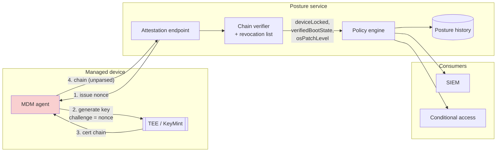

Six design decisions that separate this from a naive implementation:

1. **The nonce is server-issued and single-use.** Without it, a captured chain from a compliant device
   replays forever. This is the single most common flaw in home-grown attestation.
2. **The chain is never parsed on the device.** Anything the device parses, the device can lie about.
   Ship the bytes.
3. **Revocation is checked** against Google's published attestation key revocation list. A leaked
   keybox produces a chain that verifies perfectly and belongs to no real device — this is a real,
   active problem, not a theoretical one.
4. **Posture is stored as history, not as a boolean.** "This device became unlocked on the 14th" is
   an incident; "this device is unlocked" is a row in a table nobody reads.
5. **`osPatchLevel` and `osVersion` come from the same attestation** and are equally non-forgeable,
   which makes this pipeline do double duty for patch compliance.
6. **A device that cannot attest is a distinct outcome from one that attests badly.** Emulators,
   devices with software-only KeyMint, and devices with a broken attestation provisioning all land
   here — and chapter 50 measured that **on an emulator every key reports `SOFTWARE`, `hardwareEnforced`
   is empty, and the chain still verifies perfectly.** A pipeline that only checks "does the chain
   verify" passes an emulator. Check the security level, not just the signature.

> **Warning — the enterprise failure mode**
> Treating "bootloader unlocked" as an automatic block. A meaningful fraction of an engineering
> organisation's devices are unlocked for legitimate reasons, and a policy that blocks them
> unconditionally gets exceptions carved into it until it means nothing. The useful policy is
> *risk-tiered*: unlocked devices lose access to the highest tier and keep the rest, and every state
> *change* raises an alert.

---

## 10. Common Interview Questions

### 10.1 Beginner

**Q. What is the difference between `adb` and `fastboot`?**
They are two different protocols spoken to two different pieces of software over two different USB
interfaces. `adb` talks to `adbd`, a daemon running inside a booted Android, so it exists only when
Android is running and it operates inside Android's security model. `fastboot` talks to the
bootloader, which runs before Linux exists, so it is available when Android is broken and it operates
*beneath* the security model. A device is visible to exactly one of them at a time.

**Q. What does "unlocking the bootloader" mean?**
It changes a flag the bootloader consults before deciding whether to enforce Verified Boot and
whether to accept commands that write flash. Locked: the bootloader refuses to boot an image that
does not verify against the OEM key, and refuses `flash`, `erase` and `boot`. Unlocked: verification
still happens and is still reported, but failure no longer stops the boot, and the write commands are
accepted.

**Q. Why does unlocking erase all your data?**
Because unlocking lets an attacker replace the code that checks your screen lock. If the data
survived, "unlock, flash a permissive boot image, read everything" would be a one-command bypass of
device encryption for anyone holding the phone. The wipe is performed by the bootloader itself, and
on file-based-encryption devices the keys are destroyed as well, so the erase is cryptographic rather
than merely physical.

**Q. What is `fastboot boot` and why should you use it?**
It downloads a boot image into RAM and boots from it once, writing nothing to flash. A wrong image
costs you a power-cycle instead of a bricked device. It is the correct default when testing any
modified boot image.

**Q. Name three ways to get a device into fastboot mode.**
`adb reboot bootloader` from a running Android; a hardware key combination held during power-on
(commonly Volume Down + Power); and `fastboot reboot bootloader` from `fastbootd`. The second is the
one to write down, because it is the only one that works when Android will not boot.

### 10.2 Intermediate

**Q. Walk me through what happens on the wire when I run `fastboot flash boot boot.img`.**
The host sends `getvar:max-download-size` and compares the image against it, sparsing if needed. Then
`download:` followed by the size as eight hex digits. The device replies `DATA` echoing that size,
after which the host writes exactly that many raw bytes with no framing, and the device replies
`OKAY`. Then the host sends `flash:boot`, and the device acts on whatever is in its download buffer,
emitting zero or more `INFO` lines and finally `OKAY` or `FAIL`.`flash:` does not carry the
image — the download and the flash are separate transactions against a shared buffer.

**Q. What is `fastbootd` and why does it exist?**
A userspace implementation of the same protocol, living in the recovery ramdisk, source at
`system/core/fastboot/device/`. It exists because dynamic partitions made `/system` a logical
partition inside `super`, described by `liblp` metadata. Requiring every OEM to embed an `liblp`
parser in a closed-source bootloader would have produced N independent implementations of a
brick-prone format. Moving that half of the protocol into a program that already has a kernel and
`liblp` was the better answer. `getvar:is-userspace` distinguishes them, and the host tool reroutes
automatically.

**Q. What is the sparse image format and why is it not compression?**
A description of a disk image as a sequence of chunks, four types: `RAW` (these exact bytes), `FILL`
(this four-byte pattern, N times), `DONT_CARE` (I decline to describe this range), and `CRC32`. There
is no dictionary and no entropy coding — a sparse image of random data is *larger* than the raw data.
The saving comes entirely from being allowed to say nothing about most of the image.

**Q. What does `--disable-verity` actually do?**
It sets bit 0 of the `flags` field in the `vbmeta` header — a `uint32` at big-endian offset 120, so
byte 123 — which makes AVB ignore every `AvbHashtreeDescriptor`, so dm-verity is never set up. Because
the flags field is inside the region AVB hashes, setting it also invalidates the image's own integrity
hash and therefore its signature. It is not a supported option; it is a corruption only an unlocked
bootloader will accept.

**Q. What is the difference between A/B slots and dynamic partitions?**
They are unrelated features that arrived at similar times. A/B is two complete copies of the boot-path
partitions with a bootloader-managed active pointer, for resilient updates. Dynamic partitions are
logical extents inside a `super` container, for flexible sizing. You will encounter all four
combinations — the API 35 AVD used for this chapter has dynamic partitions and **no** A/B.

### 10.3 Senior

**Q. Why can you not unlock a bootloader purely from fastboot mode?**
Because `fastboot flashing unlock` checks a flag that only a booted, screen-unlocked Android can set
— the "OEM unlocking" toggle in Developer Options, exposed to the bootloader as
`flashing get_unlock_ability`. That dependency is the entire theft-protection story: a thief with a
locked, powered-off phone cannot unlock it, because unlocking requires the owner's screen-lock
credential first. Any vendor path that skips it is a serious vulnerability.

**Q. A device shows `ro.boot.verifiedbootstate = green`. What have you learned?**
Almost nothing, if you cannot also establish that root has not touched the property area. That
property is written by `init` from the kernel command line into a shared-memory area that root can
rewrite; `resetprop` does it in one command. Chapter 50 of this repository measured a device
reporting `green` while its own TEE-signed attestation, pulled seconds later, said
`verifiedBootState = Unverified, deviceLocked = false`. The property is a claim by software the
unlock made writable. Attestation is evidence, because the TEE learns the state over a channel the
normal world cannot reach.

**Q. Why is relocking a bootloader with a patched boot image dangerous?**
A locked bootloader enforces verification. A patched boot image does not verify. So the device enters
boot state RED and refuses to boot — and it cannot be unlocked again, because unlocking requires
Android to set a flag and Android will not start. The device is recoverable only through a vendor
low-level path, if one exists for that model. The safe order is always: flash the full stock factory
image, boot it, confirm it works, *then* relock.

**Q. Under what circumstances is a bootloader memory-corruption bug not a serious vulnerability?**
When it requires an already-unlocked bootloader. On an unlocked device the attacker can flash whatever
they like, so an exploit that yields code execution grants nothing that was not already granted. The
severity question for any bootloader bug is: **is it reachable on a locked device?** If yes, it
defeats Verified Boot at its root and is Critical. If no, it is usually Low.

**Q. How do you tell an unlocked bootloader from outside the device?**
Four sources, in increasing order of trustworthiness: the boot properties (`ro.boot.flash.locked`,
`ro.boot.verifiedbootstate`), which root can rewrite; `getvar:unlocked` in fastboot mode, which the
bootloader self-reports; the visible warning screen at boot on most devices; and a hardware key
attestation certificate's `deviceLocked` field, which is populated by the TEE and signed by a key the
normal world never sees. Only the last is evidence. In practice you also cross-check: a device whose
properties and attestation disagree is a more interesting finding than either reading alone.

### 10.4 Staff Engineer

**Q. Design the unlock flow for a new Android device. What are the security requirements?**
Six, and each maps to an attack:

1. Unlocking must require a *booted, authenticated* OS session, so a thief cannot do it. (Blocks
   physical theft.)
2. Unlocking must wipe user data and destroy encryption keys, atomically, performed by the bootloader.
   (Blocks unlock-and-read.)
3. The unlock-allowed flag must live in storage the bootloader can read and normal-world software
   cannot forge; the write path must be limited to the intended system component. (Blocks flag
   forgery.)
4. The transition must be reported to the TEE over a channel the normal world cannot influence, so
   attestation reflects it. (Blocks lying about the state.)
5. Relocking must also wipe, so data written under the weak state is not carried into the strong one.
   (Blocks laundering data across the boundary.)
6. The state must be visible to the user at every boot. (Blocks the evil-maid case where the owner is
   unaware.)

Then the tradeoffs: physical confirmation on the device makes remote and automated unlocking
impossible but also prevents a malicious host from doing it silently. A carrier-controllable
unlock-allowed flag protects financed devices but creates permanently non-unlockable hardware, which
is an ownership question rather than a security one.

**Q. Your fleet has 40,000 Android devices. How do you detect unlocked bootloaders, and what do you
do about it?**
Detect with hardware key attestation, server-verified — never with properties, for the reason above.
Nonce per request, chain verified to a Google root, revocation list checked, `deviceLocked` and
`verifiedBootState` read from the attestation extension. Store posture as *history* so a state change
is an event. Then tier the response rather than blocking: unlocked devices lose the highest access
tier and keep the rest, and every transition alerts. A blanket block accumulates exceptions until the
policy is decorative. Also plan for the "cannot attest" bucket, which is distinct from "attests badly"
and includes emulators, software-only KeyMint and broken provisioning — and remember that an emulator's
attestation chain **verifies perfectly** while reporting `SOFTWARE` security level, so check the level
and not just the signature.

**Q. Why is the fastboot protocol so primitive, and would you change it?**
Because it must be implementable in a few kilobytes, in freestanding C, with no allocator, on every
SoC anyone ships, and because it is the recovery path of last resort — complexity there is a bricking
risk. The design choices follow: fixed-size ASCII commands, no framing on bulk data, five response
prefixes, device counts bytes and nothing else. What I would change: the absence of any host
authentication means an unlocked device in fastboot mode is fully open to any USB host, and a
challenge-response using a key the owner enrolled at unlock time would close that at modest cost.
What I would *not* change is the simplicity of the data path — every proposal to add framing or
compression adds parser surface to the most privileged code on the device.

**Q. How would you approach auditing an OEM's bootloader implementation?**
Start with `system/core/fastboot/fuzzy_fastboot/`, which is Google's own conformance and
malformed-input suite and is effectively a published list of what implementations get wrong. Then
enumerate the command surface: `getvar all`, `oem help`, and the dispatch table recovered from the
binary in Ghidra. Prioritise by reachability on a *locked* device, because that is what determines
severity. Focus on the three parsers that take attacker-controlled length fields — sparse headers,
boot image headers, partition names — and on the `oem` namespace, which has no specification and no
shared test suite.

### 10.5 Principal Engineer

**Q. Verified Boot, fastboot unlocking, and key attestation are three parts of one system. Explain how
they compose, and where the composition is weakest.**
Verified Boot establishes what ran. The lock state determines whether Verified Boot's verdict is
*binding* or *advisory*. Attestation transports both facts to a remote party over a channel the
normal world cannot forge. Composed, they let a server make a defensible statement about code
identity on hardware it does not control — which is a genuinely remarkable thing to be able to do.

The composition is weakest at the *provisioning* boundary. Attestation's guarantee reduces entirely to
"the attestation key was installed at manufacture in a TEE and never left it". Leaked keyboxes break
that without breaking anything cryptographic — the chain verifies, the maths is fine, and the device
does not exist. That is why revocation lists are load-bearing rather than a formality, and why the
industry moved toward remotely-provisioned keys. The second weakness is *time*: attestation reports
boot state, and boot was potentially months ago. A device compromised after boot attests exactly as a
clean one does.

**Q. Is an unlockable bootloader a security flaw?**
No, and arguing it is confuses two threat models. The unlock requires the owner's authenticated
consent and destroys the data it was protecting, so it grants an attacker nothing they did not already
have — a thief cannot use it, and an owner using it is exercising ownership. What it *does* is change
who the relying party is trusting. On a locked device, a bank's app trusts the OEM. On an unlocked
device it trusts the owner, and the app's answer is not to pretend otherwise but to *detect* it —
which is exactly what attestation is for, and why attestation reports the state rather than blocking
the boot.

The genuinely difficult question is the adjacent one: a device that *cannot* be unlocked by its owner
is one where the owner is not the ultimate authority over their own hardware. That is a policy
position with real costs — no security research, no alternative operating systems, no independent
repair, and no recourse when the vendor ends support. Android's design, where unlocking is possible,
consent-gated and destructive, is a deliberate and defensible answer to that tension. Whether carriers
should be able to remove the option permanently is a different argument, and it is not a technical one.

**Q. You find a vulnerability that lets a locked bootloader be unlocked without a wipe. Walk me
through the impact analysis.**
It is Critical, and the reasoning is what matters. Impact: any attacker with physical possession of
any device with this bootloader gets full access to user data, defeating Android's entire
data-at-rest model. Scope: every device shipping that bootloader — likely millions, across models,
including devices already sold, which cannot be recalled. Attack complexity: physical access only, no
credential, no user interaction; the sort of thing that industrialises at a border crossing or a
repair shop.

Then the parts people miss. **Detectability:** does exploitation leave a trace? If the device
subsequently reports as locked and attests as locked, then no, and the vulnerability is also an
undetectable-persistence primitive. **Remediation:** a bootloader fix must ship through a
bootloader update, which is the least-updated component on the device and on some models is not
updatable at all in the field. **Rollback:** a fixed bootloader is only effective if the rollback
index prevents reinstalling the vulnerable one — so a fix without an anti-rollback bump is not a fix,
it is a speed bump. That last point is where a lot of real bootloader patches have been quietly
incomplete, and asking about it is the thing that separates a senior analysis from a principal one.

---

## 11. Common Mistakes

### 11.1 Developer mistakes

| Mistake | Why it is wrong | What to do instead |
|---|---|---|
| Using `ro.boot.verifiedbootstate` as a security gate | Root rewrites it in one command; chapter 50 measured a device where it disagreed with hardware attestation | Server-verified key attestation |
| Failing open in the `catch` block | An attacker who makes the check *throw* passes it, without touching a property | Fail closed, and treat an exception as an untrustworthy device |
| `!"orange".equals(state)` | **Measured: an emulator returns the empty string**, so the check passes on the least trustworthy platform available | Enumerate the accepted values explicitly, and treat anything else as unknown |
| Checking device state on the device | Anything the device computes, the device can be made to compute differently | Ship evidence; let a server reach the verdict |
| Blocking all unlocked devices unconditionally | Accumulates exceptions until the policy means nothing | Risk-tier the response; alert on the *change* |
| Assuming a verifying attestation chain proves hardware | **Measured: on an emulator every key is `SOFTWARE`, `hardwareEnforced` is empty, and the chain verifies perfectly** | Check `securityLevel`, not only the signature |

### 11.2 Pentester mistakes

| Mistake | Consequence |
|---|---|
| **Running any command from this chapter on a client device** | Data destruction, possibly a brick, certainly the end of the engagement. There is no version of this that is acceptable |
| Rebooting a device into the bootloader "just to look" | Entering fastboot mode is a state change: it interrupts the boot, may clear the BCB, and returns an encrypted device to a pre-unlock state |
| Reporting "the bootloader is unlocked" as a finding | On your own test device that is a statement about your methodology, not about the client. The finding is what the *app* does about it |
| Trusting `getvar:unlocked` | The bootloader is answering a question about itself |
| Flashing to one A/B slot and concluding the patch failed | You are probably running the other slot. Record `current-slot` before and after; prefer `--slot all` |
| Flashing during a virtual A/B merge | `snapshot-update-status` was not `none`. This reliably produces a device needing a full factory image |
| Treating every `ro.boot.` string hit as a finding | Chapter 52 rejected 15 of 17 high-confidence hits by hand; chapter 33 measured 132 hits and 132 false positives. Read the call site |
| Generalising from the emulator | **Measured: an AVD has no bootloader, no `misc`, no `boot` partition and no boot control HAL.** Nothing about fastboot can be learned there |
| Not writing down the hardware key combination | The single most common way a device is lost. It is not discoverable from a bricked phone |
| Relocking with a patched image still flashed | A brick with no recovery path on most devices |

### 11.3 Reverse engineer mistakes

| Mistake | Consequence |
|---|---|
| Patching a check function and assuming the check is defeated | **`18-ARM` §5.4 measured a function patched to `return 1`, verified returning 1, while the caller still refused** — the compiler had inlined the check. `65-Hooking` measured the same with a verified Frida hook that changed nothing. Verify behaviour, not the patch |
| Parsing AVB structures as little-endian | Every multi-byte field in `AvbVBMetaImageHeader` is **big-endian**, which is unusual and produces silently absurd values rather than an error |
| Assuming `flags = 0` means verity is on | It means the vbmeta does not *disable* it. Whether verity actually runs also depends on the descriptors present and on what first-stage init does — **measured on the API 35 AVD: four hashtree descriptors present, only one verity device actually created** |
| Assuming the ramdisk is in `boot.img` | Since Android 13 GKI launches it is in `init_boot`. Guessing here is what produces "flashed successfully, no root" |
| Trusting `lpdump` over `dmctl table` | **Measured: `lpdump` failed on a device where `dmctl table` produced a complete, correct extent map.** The kernel is ground truth |
| Reconstructing `super` by concatenating images | Logical partitions are 1 MiB-aligned with gaps between them. A naive concatenation flashes and does not boot |
| Assuming string obfuscation hides the check | The decryption must run before the property read, so a hook at `SystemProperties.get` or `__system_property_get` still sees plaintext |

---

## 12. Hands-on Labs

Four labs. The first three need no bootloader-mode device at all; the fourth is a CTF that runs
entirely on files.

| Lab | Title | Difficulty | What it teaches | Needs a device? |
|---|---|---|---|---|
| 01 | [Device posture from the outside](labs/lab-01-device-posture.md) | Beginner | Read every boot-state signal a device exposes, know which are evidence and which are claims, and build the audit into a repeatable script | An ordinary booted device or an emulator. **Never a bootloader** |
| 02 | [The sparse image format, by hand](labs/lab-02-sparse-images.md) | Intermediate | Build, parse, verify and deliberately break sparse images; find the parser bugs a privileged implementation must not have | No — files only |
| 03 | [vbmeta, verity, and the one byte that matters](labs/lab-03-vbmeta-and-verity.md) | Advanced | Parse a real vbmeta, locate the flags field, demonstrate that `--disable-verity` invalidates the image's own hash, and map descriptors to live dm-verity devices | A rooted device or emulator for the dm half |
| 04 | [CTF — The Bricked Vault](labs/lab-04-ctf-bricked-vault.md) | CTF | Recover a flag from a deliberately-damaged set of firmware artefacts, using everything above | No — files only |

> **Warning**
> **No lab in this chapter asks you to unlock a bootloader, flash a partition, or reboot a device
> into fastboot mode.** That is deliberate. The destructive procedure is documented in
> [62-Magisk/labs/lab-01](../62-Magisk/labs/lab-01-root-a-device.md), which is where it belongs — it
> is a rooting procedure that happens to use fastboot. This chapter teaches the protocol, the state
> machine and the formats, all of which can be learned without risking hardware.

---

## 13. Summary

### 13.1 Key points

- **Fastboot is a protocol, a host tool, and a device mode**, and confusing the three is the main
  source of muddle in this topic. A fourth thing, `fastbootd`, is a second implementation of the same
  protocol in Android userspace.
- **The wire protocol is five response prefixes** — `OKAY`, `FAIL`, `DATA`, `INFO`, `TEXT` — with
  commands capped at 64 bytes and responses at 256. `INFO` and `TEXT` do not end a transaction.
- **Every operation is at most three legs**: query, download into a shared buffer, act on the buffer.
  `flash:` does not carry the image.
- **The lock state machine has one non-obvious edge**: you cannot get from LOCKED to unlockable from
  fastboot. It requires a booted, screen-unlocked Android to set a flag. That single dependency is
  what makes phone theft a dead end.
- **Unlocking wipes**, and so does relocking, and the reason is that crossing the boundary in either
  direction invalidates the protection the previous state provided.
- **`fastboot boot` runs an image from RAM without writing flash.** It is the habit that saves
  devices. It is not available on every device.
- **`--disable-verity` sets one bit in one byte**, at offset 123 of `vbmeta`, and that byte is inside
  the region AVB hashes — so the image no longer verifies against its own signature. Only an unlocked
  bootloader will accept it.
- **`fastbootd` exists because dynamic partitions made `/system` a logical extent inside `super`**,
  and parsing `liblp` in every OEM's closed-source bootloader was the worse option.
- **A/B and dynamic partitions are orthogonal.** Measured together on one device: dynamic partitions
  `true`, A/B `false`.
- **An unlocked bootloader changes the threat model for every other control in this repository** —
  except hardware key attestation and Play Integrity, which keep working and keep telling the truth.
  That asymmetry is the argument for attestation over local checks.
- **The emulator has no bootloader.** Measured: `adb reboot bootloader` returns to Android in 40
  seconds and `fastboot devices` never sees it.

### 13.2 The chapter as a map

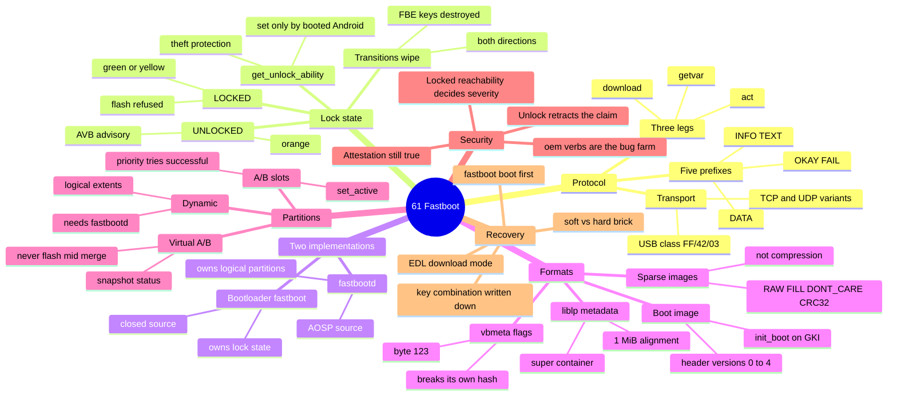

### 13.3 Condensed cheat sheet

| Question | One-line answer |
|---|---|
| Is this device unlocked? | `getprop ro.boot.flash.locked` (claim) then key attestation `deviceLocked` (evidence) |
| Which slot is live? | `getprop ro.boot.slot_suffix` or `bootctl get-current-slot` |
| Is `/system` inside `super`? | `getprop ro.boot.dynamic_partitions`, and `ls /dev/block/by-name/` |
| What is `super` actually mapped as? | `dmctl table <name>` as root — the kernel's truth |
| Is verity running? | `dmctl list devices` for a `-verity` device; `getprop ro.boot.veritymode` |
| Is verity disabled in vbmeta? | Byte 123 of the vbmeta header, bit 0. `scripts/vbmeta-flags.py` |
| Can this image be flashed as-is? | `fastboot getvar max-download-size` versus the file size |
| Do I need `fastbootd`? | `fastboot getvar is-logical:<partition>` |
| Is it safe to flash right now? | `fastboot getvar snapshot-update-status` must be `none` |
| How do I test a boot image safely? | `fastboot boot img` — RAM only, nothing written |
| How do I get out of a bootloop? | Hardware key combination into fastboot, then the full stock factory image |

### 13.4 Quick revision prompts

- Name the five fastboot response prefixes and which two do not end a transaction.
- Why does `flash:` not carry the image?
- What is `get_unlock_ability` and which component sets it?
- Which byte does `--disable-verity` change, and what else does changing it break?
- Why does `fastboot flash system` sometimes reboot your device unprompted?
- What is the difference between `DONT_CARE` and a run of zeros?
- Give one reason A/B exists that has nothing to do with saving download time.
- Which single control keeps working correctly on an unlocked bootloader, and why?
- Why is a bootloader memory-corruption bug sometimes Low severity?
- What does an empty `ro.boot.verifiedbootstate` mean, and where was it measured?
- Why must you flash a stock image *before* relocking, never after?
- What is in `misc`, and what happens on a device that does not have it?

---

## 14. References

### AOSP source

| Path | What it is |
|---|---|
| `system/core/fastboot/README.md` | The fastboot protocol specification. The primary source for this chapter |
| `system/core/fastboot/fastboot.cpp` | Host tool entry point, flashing plan, vbmeta flag rewriting |
| `system/core/fastboot/fastboot_driver.cpp` | The wire protocol implementation |
| `system/core/fastboot/fs.cpp` | `format`, and the shell-out to `mke2fs` / `make_f2fs` |
| `system/core/fastboot/device/` | `fastbootd` — the open-source half of the protocol |
| `system/core/fastboot/device/commands.cpp` | One handler per verb; the conformance reference |
| `system/core/fastboot/device/variables.cpp` | The authoritative `getvar` table |
| `system/core/fastboot/fuzzy_fastboot/` | Google's conformance and malformed-input suite for OEM bootloaders |
| `system/core/libsparse/include/sparse/sparse_format.h` | The sparse header and chunk structures |
| `system/core/fs_mgr/liblp/include/liblp/metadata_format.h` | `super` partition metadata |
| `system/core/fs_mgr/libsnapshot/` | Virtual A/B snapshots, `snapuserd` |
| `external/avb/libavb/avb_vbmeta_image.h` | `AvbVBMetaImageHeader`, and the two flag constants |
| `external/avb/libavb/avb_vbmeta_image.c` | `avb_vbmeta_image_verify()` — the hash this chapter recomputed |
| `external/avb/avbtool.py` | Host-side AVB tool; the most readable description of the format |
| `bootable/recovery/bootloader_message/include/bootloader_message/bootloader_message.h` | The BCB struct in `misc` |
| `bootable/recovery/` | Recovery, which hosts `fastbootd` |
| `hardware/interfaces/boot/` | `IBootControl` — the A/B slot HAL |
| `system/update_engine/` | A/B update application and `update_verifier` |
| `system/tools/mkbootimg/include/bootimg/bootimg.h` | Android boot image header, versions 0–4 |

### Official documentation

- Android Open Source Project — *Fastboot* and *Fastbootd* pages under `source.android.com/docs/setup`
  and `source.android.com/docs/core/architecture/bootloader`.
- Android Open Source Project — *Verified Boot*, *Implementing dm-verity*, *Boot flow*, at
  `source.android.com/docs/security/features/verifiedboot`.
- Android Open Source Project — *A/B (seamless) system updates* and *Virtual A/B*, at
  `source.android.com/docs/core/ota`.
- Android Open Source Project — *Dynamic partitions*, at
  `source.android.com/docs/core/architecture/bootloader/partitions`.
- Android Developers — *Key and ID attestation*, at
  `developer.android.com/privacy-and-security/security-key-attestation`.
- Google — factory images and OTA images for Pixel devices, and the flashing instructions on those
  pages. These are the reference artefacts for any Pixel-based lab device.

### OWASP

| Identifier | Relevance |
|---|---|
| MASVS-RESILIENCE-1 | Platform integrity validation — the category this chapter's app-side findings sit in |
| MASVS-RESILIENCE-2 | Anti-tampering |
| MASVS-STORAGE-1, MASVS-STORAGE-2 | Data at rest, which the factory-reset guarantee protects |
| MASVS-CRYPTO-1 | Key management and attestation |
| MASTG | Device-integrity and root-detection tests. **Verify the current test identifier before citing one** |

### CVEs and vulnerability research

This chapter deliberately names **no CVE identifiers**. Bootloader vulnerabilities are real,
published, and per-vendor per-generation, and an identifier quoted from memory is worse than a
description of the class. To find the real ones:

- Qualcomm's and Samsung's published security bulletins, which list bootloader and TrustZone issues
  with their own identifiers.
- The Android Security Bulletin's *Bootloader* and *Kernel components* sections.
- `system/core/fastboot/fuzzy_fastboot/`, which is a published list of the failure modes that
  motivated the suite.

Read [§5.4](#54-vulnerability-classes-in-bootloaders-themselves) for the classes; look the
identifiers up at the point of writing a report.

### Related chapters

| Chapter | Relationship |
|---|---|
| [20-Security-Architecture](../20-Security-Architecture/README.md) | **Owns AVB, dm-verity, fs-verity and the four boot states.** This chapter owns what fastboot *does to* that chain |
| [62-Magisk](../62-Magisk/README.md) | Owns rooting, boot-image patching and `magiskboot`. This chapter owns the transport and the state machine that make patching possible |
| [60-ADB](../60-ADB/README.md) | The other protocol that talks to a device — with Android behind it, and inside the security model |
| [07-AOSP](../07-AOSP/README.md) | Builds the images this chapter flashes |
| [50-HardwareBackedSecurity](../50-HardwareBackedSecurity/README.md) | Key attestation, and the TEE's non-forgeable view of lock state |
| [49-KeyStore](../49-KeyStore/README.md) | Key binding to boot state |
| [06-Android-Architecture](../06-Android-Architecture/README.md) | Where the boot sequence is first introduced |
| [37-RootDetection](../37-RootDetection/README.md) | The checks an unlocked bootloader makes defeatable |
| [38-TamperDetection](../38-TamperDetection/README.md) | Integrity checks running on a platform that can lie to them |
| [39-EmulatorDetection](../39-EmulatorDetection/README.md) | The same property-forgery failure mode, applied to a different question |
| [57-Ghidra](../57-Ghidra/README.md) | Tooling for reversing a bootloader image |
| [71-OWASP-Mobile](../71-OWASP-Mobile/README.md) | Current MASVS and MASTG mapping |

### This chapter's own files

| File | Contents |
|---|---|
| [cheatsheet.md](cheatsheet.md) | Every command and constant, tables only |
| [mindmap.md](mindmap.md) | The whole chapter as one Mermaid mind map |
| [faq.md](faq.md) | The questions learners actually ask, including the ones that feel dumb |
| [references/README.md](references/README.md) | Annotated links |
| [scripts/bootstate-audit.sh](scripts/bootstate-audit.sh) | Read-only device posture audit with evidence next to every verdict |
| [scripts/fastboot-recon.sh](scripts/fastboot-recon.sh) | Read-only fastboot reconnaissance; refuses every destructive verb by construction |
| [scripts/vbmeta-flags.py](scripts/vbmeta-flags.py) | Read, set and un-set the AVB disable flags, and prove what that does to the hash |
| [scripts/sparse-tool.py](scripts/sparse-tool.py) | Parse, verify, expand and create Android sparse images |
| [scripts/bootprop-observer.js](scripts/bootprop-observer.js) | Frida: log every boot-state property read by all four routes |
| [examples/README.md](examples/README.md) | What each example is and how to run it |
| [examples/BootStateChecker.java](examples/BootStateChecker.java) | The vulnerable check and its server-side replacement, side by side |
| [examples/fastboot-wire-transcript.md](examples/fastboot-wire-transcript.md) | An annotated protocol transcript, labelled as reconstructed |
| [examples/measured-avd-boot-state.md](examples/measured-avd-boot-state.md) | Every raw measurement this chapter is built on |
| [labs/lab-01-device-posture.md](labs/lab-01-device-posture.md) | Lab 01 |
| [labs/lab-02-sparse-images.md](labs/lab-02-sparse-images.md) | Lab 02 |
| [labs/lab-03-vbmeta-and-verity.md](labs/lab-03-vbmeta-and-verity.md) | Lab 03 |
| [labs/lab-04-ctf-bricked-vault.md](labs/lab-04-ctf-bricked-vault.md) | Lab 04 — CTF |

---
