# 61 — Fastboot: mind map

One map of the whole chapter. Read it outward from the centre; each branch corresponds to a section
of [README.md](README.md).

```mermaid
mindmap
  root((61 Fastboot))
    One word three things
      Protocol
        text commands over USB
        AOSP system core fastboot README
      Host tool
        platform-tools binary
        35.0.2 measured
      Device mode
        bootloader listening
        adb invisible here
      fastbootd
        a fourth thing
        same protocol userspace
    Wire protocol
      Transport
        USB class FF subclass 42
        protocol 03 fastboot
        protocol 01 adb
        tcp and udp variants
      Five prefixes
        OKAY ends
        FAIL ends
        DATA then bulk
        INFO continues
        TEXT continues
      Limits
        command 64 bytes
        response 256 bytes
        download colon 8 hex digits
      Three legs
        ask with getvar
        fill the shared buffer
        act on the buffer
      No authentication
      No integrity check
    Lock state machine
      LOCKED
        green OEM key
        yellow owner key
        flash erase boot refused
        getvar still answers
      get_unlock_ability
        set only by booted Android
        needs the screen credential
        this is theft protection
      UNLOCKED
        orange
        AVB advisory not off
        everything permitted
      unlock_critical
        bootloader and modem
        the brick boundary
      Transitions wipe
        unlock wipes
        relock wipes
        FBE keys destroyed
        bootloader does it not Android
      RED
        locked plus failed verify
        relock with patched image
        cannot unlock cannot flash
    Two implementations
      Bootloader fastboot
        closed source per OEM
        owns the lock state
        owns physical partitions
        cannot parse liblp
      fastbootd
        AOSP open source
        recovery ramdisk
        owns logical partitions
        cannot change lock state
      is-userspace
        how the host tells them apart
        host reroutes automatically
    Formats
      Sparse images
        magic ED26FF3A little endian
        RAW FILL DONT_CARE CRC32
        not compression
        random data grows
        DONT_CARE leaves old bytes
        re-sparsing for the buffer
      vbmeta flags
        big endian uint32 offset 120
        byte 123 changes
        bit 0 hashtree disabled
        bit 1 verification disabled
        breaks its own hash
        only unlocked accepts it
      Boot image
        header versions 0 to 4
        v4 ramdisk in init_boot
        do not guess look
      liblp metadata
        super container
        1 MiB alignment measured
        extents in 512B sectors
    Partitions
      Dynamic
        system inside super
        linear dm targets
        needs fastbootd
      A B slots
        priority tries successful
        set_active is a buffer swap
        slot all survives a switch
      Virtual A B
        copy on write snapshots
        snapshot-update-status
        never flash mid merge
      Orthogonal
        dynamic without A B measured
      misc
        the BCB mailbox
        adb reboot bootloader needs it
    Getting in and out
      adb reboot bootloader
      hardware key combination
        write it down first
      reboot fastboot
      continue
      hold power 10 to 20 s
    fastboot boot
      RAM only nothing written
      recovery is a power cycle
      not on every device
      iterate without persisting
    Security
      Unlock retracts the claim
        not weakens retracts
      Attestation still true
        deviceLocked in the TEE
        the one control that survives
      Property checks are worthless
        resetprop one command
        green while TEE said Unverified
        empty on an emulator
        fails open in the catch
      oem verbs
        no spec no test suite
        most privileged context
        where the bugs cluster
      Severity rule
        reachable on LOCKED is Critical
        needs UNLOCKED is usually Low
      Parser classes
        oem argument copies
        getvar name handling
        partition name confusion
        sparse header arithmetic
        the unlock decision itself
    Recovery
      Soft brick
        fastboot still reachable
        factory image fixes it
      Hard brick
        bootloader gone
        vendor path or nothing
      EDL download mode BROM
        recovery not bypass
        needs a signed loader
        does not defeat encryption
      Never flash a partition
        whose name you cannot explain
    Telling from outside
      Properties are claims
      getvar unlocked is a claim
      dmctl is ground truth
      Hash boot against factory image
      Attestation is evidence
    Measured here
      one byte offset 123
      1 MiB alignment in real data
      emulator has no bootloader
      empty is not a boot state
      lpdump failed dmctl worked
      descriptors are not mappings
      fastboot devices silent exit 0
      format runs mke2fs on the host
```

## How to use this map

**Reading the chapter for the first time.** Follow the branches clockwise from *One word three
things*. That is the order the README uses, and each branch is one or two sections.

**Revising.** Cover the map and try to reconstruct the branches from the six section headings:
protocol, lock state, two implementations, formats, partitions, security. If a branch will not come
back, that section is the one to re-read.

**Interview preparation.** The three branches that get asked about most are **Lock state machine**
(especially `get_unlock_ability` and why the wipe exists), **Two implementations** (why `fastbootd`
had to be invented), and **Security → Severity rule** (why a bootloader bug is sometimes Low).

**Working an engagement.** Only two branches matter live: *Telling from outside*, and *Security →
Property checks are worthless*. Everything else is background for the finding you will write.

## The five things to carry if you forget the rest

1. **`flash:` does not carry the image.** Three legs, one shared buffer.
2. **You cannot unlock from fastboot alone** — a booted, screen-unlocked Android has to permit it,
   and that dependency is what makes phone theft a dead end.
3. **`--disable-verity` is one byte, and it breaks the image's own signature.** It is a corruption
   only an unlocked bootloader accepts, not an option AVB honours.
4. **`fastboot boot` before `fastboot flash`, every time.** RAM is free; flash is not.
5. **Every local answer to "is this device locked?" is a claim.** Only a TEE-signed attestation is
   evidence.

## Related maps

- [20-Security-Architecture/mindmap.md](../20-Security-Architecture/mindmap.md) — AVB, dm-verity and
  the boot states, which this chapter cites rather than restates
- [62-Magisk/mindmap.md](../62-Magisk/mindmap.md) — what you do once the bootloader is unlocked
- [60-ADB/mindmap.md](../60-ADB/mindmap.md) — the other protocol, with Android behind it
