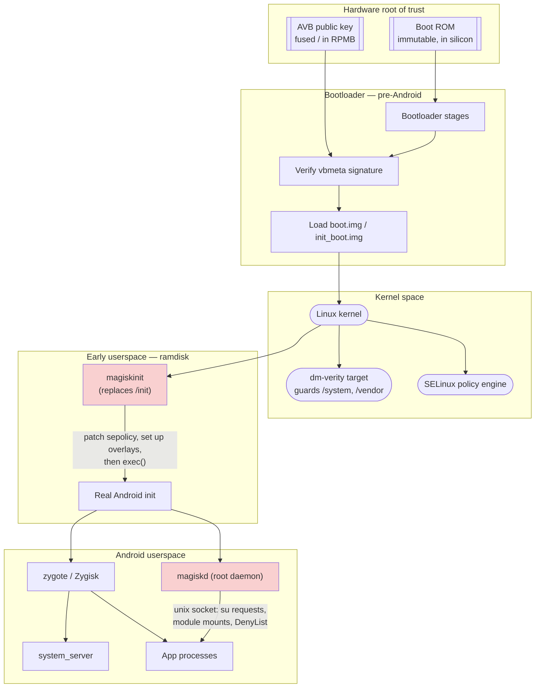
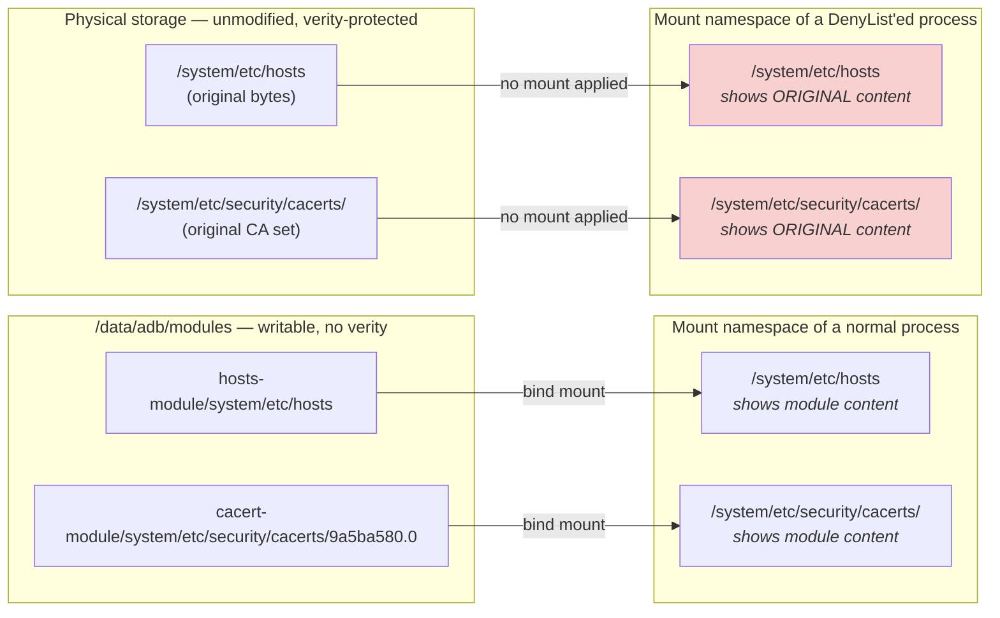
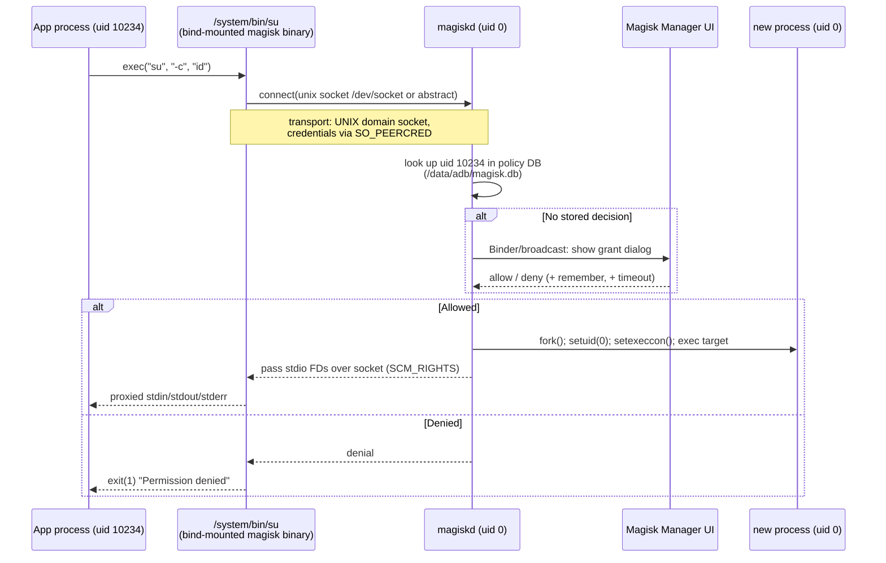
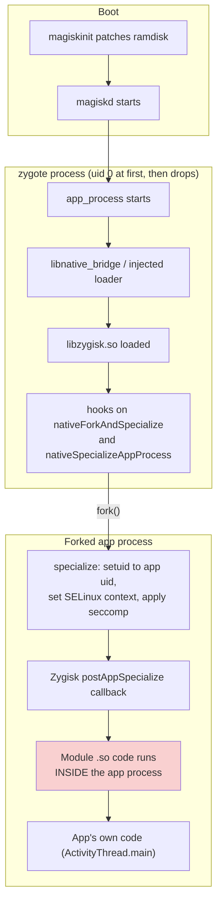
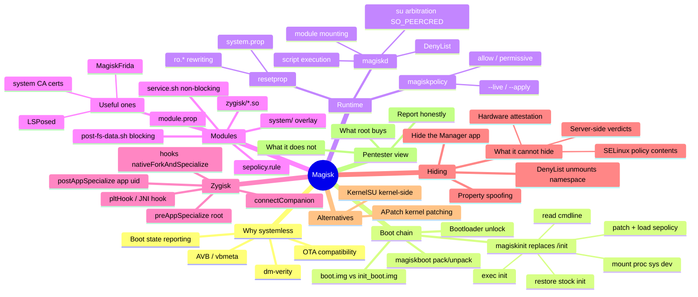

# 62 — Magisk

> After this chapter you will understand what "systemless root" actually means at the byte level, be
> able to patch and boot a Magisk-rooted device from scratch without following a tutorial, write your
> own Magisk module, explain exactly what Zygisk and DenyList do and do not do, and argue honestly
> about where the hiding arms race stands.

**Prerequisites:** [02-Linux-Basics](../02-Linux-Basics/README.md),
[06-Android-Architecture](../06-Android-Architecture/README.md),
[20-Security-Architecture](../20-Security-Architecture/README.md),
[21-App-Sandbox](../21-App-Sandbox/README.md),
[22-SELinux](../22-SELinux/README.md),
[60-ADB](../60-ADB/README.md),
[61-Fastboot](../61-Fastboot/README.md)
**Applies to:** Android 6–16 (API 23–36). Magisk 20.4+ for the modern module format; Magisk 24+ for
Zygisk; Magisk 26+ for `init_boot` handling on GKI devices.

---

## Table of Contents

1. [Introduction](#1-introduction)
2. [High-Level Architecture](#2-high-level-architecture)
3. [Deep Internal Working](#3-deep-internal-working)
4. [Source Code Walkthrough (AOSP)](#4-source-code-walkthrough-aosp)
5. [Security Perspective](#5-security-perspective)
6. [Reverse Engineering Perspective](#6-reverse-engineering-perspective)
7. [Dynamic Analysis](#7-dynamic-analysis)
8. [Static Analysis](#8-static-analysis)
9. [Examples](#9-examples)
10. [Common Interview Questions](#10-common-interview-questions)
11. [Common Mistakes](#11-common-mistakes)
12. [Hands-on Labs](#12-hands-on-labs)
13. [Summary](#13-summary)
14. [References](#14-references)

---

## 1. Introduction

### The problem that Magisk exists to solve

Imagine a library where every book has been photographed, and a sealed envelope in the librarian's
safe contains a single number: a cryptographic fingerprint of all those photographs combined. Every
morning, before opening, the librarian re-photographs every book, recomputes the number, and compares
it against the envelope. If a single comma has changed on a single page, the number changes, and the
library does not open.

That is what **Verified Boot** does to an Android device. Every read from the `/system` partition is
checked against a hash tree, and the root of that tree is signed by a key burned into the device.
Change one byte of `/system` and the device either refuses to boot or, at minimum, reports a
different boot state to any software that asks.

Before Verified Boot, rooting Android was crude and simple: you mounted `/system` read-write, copied
a binary called `su` into `/system/xbin/`, set its permissions so that any process could execute it
and it would run as UID 0, and rebooted. The change was permanent, visible in a directory listing,
and completely at odds with the model Android was moving toward.

> **📖 Definition — root**
> On any Unix-like system, "root" is the user with UID 0, for which the kernel skips almost every
> permission check. "Rooting" an Android device means installing a mechanism that lets a chosen
> process obtain UID 0 on demand. Android ships with no such mechanism, deliberately: the security
> model depends on every app being an isolated, unprivileged Linux user.

> **📖 Definition — dm-verity**
> A Linux kernel device-mapper target that sits between the filesystem and the block device. Every
> 4 KiB block read from the underlying partition is hashed and checked against a Merkle tree whose
> root hash is signed. A modified block produces a hash mismatch, and the kernel returns an I/O
> error (or panics, depending on the configured mode). See
> [20-Security-Architecture](../20-Security-Architecture/README.md).

> **📖 Definition — AVB (Android Verified Boot)**
> The chain that establishes and checks those signatures. The bootloader verifies `vbmeta`, which
> contains the signed hash descriptors for `boot`, `system`, `vendor` and other partitions. `vbmeta`
> itself is verified against a key stored in hardware. The result is a boot state — `green`
> (verified, stock key), `yellow` (verified, user-supplied key), `orange` (unlocked, unverified) —
> exposed as `ro.boot.verifiedbootstate`.

Once dm-verity became mandatory, the old approach stopped working. Writing `su` into `/system`
either failed outright (the partition is read-only and the bootloader is locked) or, if you disabled
verity to make it possible, left the device in a permanently and detectably degraded state. Worse,
OTA updates apply block-level patches to `/system`, so any modification broke updates entirely.

**Magisk's answer is to modify nothing.**

### The key insight

Magisk, written by John Wu (`topjohnwu`), takes the position that the real partitions should be left
byte-for-byte identical to what the manufacturer shipped. Instead:

1. The **boot image** — a small partition containing the kernel and the initial RAM disk — is
   patched. On devices with a locked-down `vbmeta`, this is the one partition an unlocked bootloader
   will let you replace without touching the verified filesystems.
2. Inside that patched boot image, Magisk's own `magiskinit` binary runs **before Android's `init`**.
   It sets everything up, then hands control to the real `init`.
3. Modified files are presented to the system using **bind mounts and mount namespaces** — a Linux
   kernel feature that makes a file at path X appear to contain the contents of a different file,
   for some processes and not others, without changing the underlying storage at all.

> **🧠 Mental Model**
> Old-style root is graffiti on the wall: permanent, visible to anyone who looks, and it wrecks the
> paintwork. Magisk is a projector: the wall is untouched, but from where the app is standing, the
> wall appears to have something written on it. Turn off the projector — which is exactly what
> DenyList does — and the app sees the original wall again.

This is what "systemless" means. It is not marketing. It is a precise technical claim: no bytes on
`/system`, `/vendor`, `/product` or any other verified partition are changed, so dm-verity is
satisfied and OTA logic sees an unmodified filesystem.

### What would break if Magisk did not exist

For a security researcher, quite a lot:

| Capability | Why root is required |
|---|---|
| Reading another app's private data | `/data/data/<pkg>` is `0700` owned by that app's UID |
| Running `frida-server` | Needs to `ptrace` arbitrary processes; only root can `ptrace` across UIDs |
| Installing a system CA certificate | The trust store lives on a read-only, verified partition |
| Capturing traffic with `tcpdump` | Raw sockets need `CAP_NET_RAW` and typically root |
| Reading `/data/misc/keystore`, `/data/system/packages.xml` | System-owned paths |
| Live-patching the platform to observe framework behaviour | Requires code injection into `system_server` |

Without root you can still do real work — static analysis, network interception on apps that trust
user CAs, testing exported components, dynamic analysis of `debuggable` builds via `run-as` — but a
large fraction of the interesting surface is closed. Root is the difference between examining an app
from the outside and standing inside it.

### What root does not buy you

This is where most beginners over-estimate. Being root on the device does **not** give you:

- **Anything the server enforces.** If the backend validates a signature over a request body using a
  key you do not have, root does not help until you extract the key — and root helps you extract the
  key, but the enforcement is still server-side.
- **TEE / StrongBox secrets.** Keys generated in the Trusted Execution Environment or a secure
  element with `setIsStrongBoxBacked(true)` never leave that hardware. Root is Linux UID 0; the TEE
  runs in a different world entirely. See
  [50-HardwareBackedSecurity](../50-HardwareBackedSecurity/README.md).
- **A clean Play Integrity verdict.** Since hardware-backed attestation became the norm, the
  bootloader's unlocked state is signed by the TEE and reported to Google's servers. This is
  discussed honestly in [§5](#5-security-perspective) and in
  [67-BypassingProtections](../67-BypassingProtections/README.md).
- **Freedom from SELinux.** Root is UID 0, but SELinux is an orthogonal mandatory access control
  layer. A root process in a restrictive domain can be less capable than an unprivileged process in
  a permissive one. This is why `magiskpolicy` exists.

> **⚠️ Warning**
> Everything in this chapter assumes a device you own, bought for testing, and are willing to brick.
> Unlocking a bootloader **erases all user data**, voids warranties on many devices, permanently
> trips fuses on some (Samsung KNOX, for example), and on a small number of devices cannot be
> undone. Never do any of this to a client-owned device, a personal phone with real accounts on it,
> or a device you cannot afford to lose.

---

## 2. High-Level Architecture

### 2.1 Where Magisk sits in the boot chain



Read that top to bottom. The bootloader verifies `vbmeta` against a key it cannot change. When the
bootloader is **unlocked**, this verification is either skipped or downgraded to a warning, which is
the entire reason an unlocked bootloader is the precondition for Magisk. The kernel then boots and
mounts the ramdisk. Ordinarily the first userspace program is `/init` from AOSP. In a
Magisk-patched boot image, `/init` **is** `magiskinit`. It does its work and then executes the real
`init`, which it has stashed elsewhere in the ramdisk.

Note carefully what is *not* modified: `/system` and `/vendor` are still guarded by dm-verity and
still contain exactly the bytes the manufacturer signed. Magisk never fights dm-verity; it sidesteps
it.

### 2.2 The overlay illusion



The same absolute path, `/system/etc/hosts`, resolves to two different files depending on which
process is asking. That is not a trick or a hack in the pejorative sense — it is exactly what Linux
mount namespaces are for, and containers are built on the same primitive. See
[02-Linux-Basics](../02-Linux-Basics/README.md) for bind mounts and namespaces from first
principles.

The important consequence for a tester: **a module's effect is per-namespace**. If you install a
system CA certificate as a Magisk module and then add your target app to DenyList to hide root, you
have also removed your certificate from that app's view, and interception will stop working. That
interaction surprises people constantly.

### 2.3 The `su` request flow



This diagram is worth internalising because it explains why `su` on a Magisk device behaves
differently from `su` on a classic rooted device.

Classic `su` was a setuid-root binary: the kernel raised its privileges at `exec()` time, and the
binary itself decided whether to allow the request. Magisk's `su` is **not setuid**. It is an
ordinary unprivileged program that connects to an already-root daemon over a UNIX socket. The daemon
learns the caller's real UID from the kernel via `SO_PEERCRED` — which the caller cannot forge — then
consults its policy database, optionally prompts the user, and if allowed, forks a new root process
and passes the file descriptors back.

> **🔬 Under the Hood**
> Passing file descriptors over a UNIX socket uses `sendmsg()` with an `SCM_RIGHTS` control message.
> The kernel duplicates the descriptor into the receiving process's descriptor table. This is the
> same primitive Binder uses for FD passing and the reason `adb shell` output from `cmd` reaches your
> terminal (see [25-Binder](../25-Binder/README.md)). Understanding it once pays off in three
> different chapters.

### 2.4 Zygisk — injection into every app



**Zygote** is the process every Android app is forked from; it preloads the framework classes and
native libraries once so that each app starts fast (see
[11-Android-Runtime](../11-Android-Runtime/README.md)). Because everything is forked from zygote,
anything you get into zygote's address space is inherited, copy-on-write, by every single app on the
device.

Zygisk exploits exactly that. It loads `libzygisk.so` into zygote and hooks the JNI functions that
zygote calls when it forks a new app — `nativeForkAndSpecialize` for ordinary apps and
`nativeSpecializeAppProcess` for the "unspecialized app process" path. After the fork and after the
process has dropped privileges to the app's UID, Zygisk calls each registered module's
`postAppSpecialize` entry point, and module native code runs inside the app's process with the app's
identity.

That is the modern injection point, and it is why LSPosed (see
[63-LSPosed](../63-LSPosed/README.md)) is implemented as a Zygisk module. It is also the mechanism
DenyList uses: DenyList work happens in the same hook, just before the app's own code runs, when
there is still an opportunity to clean up.

---

## 3. Deep Internal Working

### 3.1 The boot image and what patching actually changes

An Android boot image (`boot.img`) is a simple container format. Its header is defined in AOSP at
`system/tools/mkbootimg/include/bootimg/bootimg.h`, and it has evolved through several versions.

| Boot header version | Introduced around | Contents |
|---|---|---|
| v0 / v1 | Android 9 and earlier | kernel, ramdisk, second stage, optional recovery DTBO |
| v2 | Android 10 | adds `dtb` section |
| v3 | Android 11 (GKI) | kernel + ramdisk only; vendor ramdisk moves to `vendor_boot` |
| v4 | Android 12+ | v3 plus a boot signature section |

From Android 13 on GKI devices, the *generic* ramdisk moved again, into a separate **`init_boot`**
partition. This is the single most common source of confusion for people following an old tutorial:
on a Pixel 7 or newer you patch `init_boot.img`, not `boot.img`, because that is where the ramdisk
containing `/init` lives.

> **📖 Definition — ramdisk**
> A small compressed CPIO archive embedded in the boot image. The kernel unpacks it into a RAM
> filesystem and executes `/init` from it. It contains `init`, the `.rc` startup scripts, the SELinux
> policy files, and the mount points that the real filesystems will later be mounted onto.

`magiskboot` — Magisk's own boot image manipulation tool — performs the following when you patch:

1. **Unpack.** Split the image into `kernel`, `ramdisk.cpio`, `dtb` and header fields, handling
   whichever compression the vendor used (gzip, lz4, lzma, xz, bzip2, lz4_legacy).
2. **Back up the original `init`.** The stock `/init` inside the CPIO is renamed to
   `.backup/init`, along with a record of what was changed, so that Magisk can restore the stock
   image later and so the real `init` can still be executed.
3. **Insert `magiskinit`.** A new `/init` is written into the CPIO — this is `magiskinit`, a
   statically linked binary of roughly a megabyte.
4. **Insert `overlay.d` support and the Magisk payload.** Compressed copies of the `magisk` binaries
   and configuration go into the ramdisk.
5. **Patch the kernel image if needed.** Two common patches: forcing `skip_initramfs` handling on
   system-as-root devices, and neutralising `dm-verity` / `forceencrypt` strings in the kernel
   command line when the device requires it.
6. **Repack.** Rebuild the CPIO, recompress, and rebuild the image with the original header fields
   preserved so the bootloader still recognises it.

> **🔬 Under the Hood**
> On devices where the ramdisk is absent (older "system-as-root" designs where the kernel mounts
> `/system` directly as `/`), Magisk cannot simply replace `/init`. It instead uses the **recovery**
> partition ramdisk or relies on a `vendor_boot`/`init_boot` ramdisk. `magiskinit` contains logic to
> detect which situation it is in at runtime by inspecting the kernel command line
> (`androidboot.*` parameters) and the presence of `/system_root`. This detection code is the reason
> a single Magisk build works across a wildly heterogeneous device population.

### 3.2 `magiskinit` — the first program that runs

`magiskinit` runs as PID 1 with no filesystem mounted except the ramdisk. Its job, in order:

| Step | What it does | Why it matters |
|---|---|---|
| 1 | Mount `/proc`, `/sys`, `devtmpfs` | Nothing works without these |
| 2 | Read `/proc/cmdline` and `/proc/bootconfig` | Determines device topology: A/B, system-as-root, 2SI, recovery mode |
| 3 | Collect the stock SELinux policy | Usually from `/sepolicy` or `/vendor/etc/selinux/precompiled_sepolicy` |
| 4 | Patch the policy with `magiskpolicy` rules | Creates the `magisk` domain and permits it everything |
| 5 | Load the patched policy into the kernel | Writes to `/sys/fs/selinux/load` — **before** anything else can |
| 6 | Restore the stock `init` and patch `.rc` files | Adds a service entry that will start `magiskd` |
| 7 | `execve("/system/bin/init")` | Hands off; `magiskinit` ceases to exist as a process |

Step 5 is the crux, and it is worth dwelling on. SELinux policy can only be loaded **once** per boot
unless the kernel is built with policy reload permitted. Whoever loads it first wins. `magiskinit`
runs before `init`, so it loads a policy that includes Magisk's own rules, and `init`'s later attempt
to load the stock policy is a no-op because the policy is already loaded and, on production kernels,
`/sys/fs/selinux/load` is made unwritable after the first load.

> **📖 Definition — SELinux domain**
> A label attached to a process that determines what it may do. Every rule in policy has the form
> "domain X may perform operation O on objects labelled Y". Being UID 0 does not exempt you: a root
> process in the `untrusted_app` domain still cannot read `/data/system/packages.xml`. See
> [22-SELinux](../22-SELinux/README.md).

### 3.3 `magiskpolicy` and why root without policy is useless

`magiskpolicy` (historically `supolicy` in other roots) is a compiled-policy editor. It reads a
binary `sepolicy` file, applies textual rules, and writes it back or loads it directly.

Common invocations:

```bash
# device, as root — grant a domain a specific permission at runtime
magiskpolicy --live "allow untrusted_app magisk_file file { read open getattr execute }"
```

```bash
# device, as root — make one domain permissive (logs denials but allows them)
magiskpolicy --live "permissive untrusted_app"
```

```bash
# device, as root — apply rules from a file (this is what modules' sepolicy.rule does)
magiskpolicy --live --apply /data/adb/modules/mymodule/sepolicy.rule
```

The rule syntax mirrors `allow` statements in the AOSP policy language:

| Statement | Meaning |
|---|---|
| `allow SOURCE TARGET CLASS PERM` | Permit an operation |
| `deny SOURCE TARGET CLASS PERM` | Remove a previously allowed operation |
| `auditallow SOURCE TARGET CLASS PERM` | Log when it happens (even though allowed) |
| `dontaudit SOURCE TARGET CLASS PERM` | Suppress the denial log without allowing |
| `permissive DOMAIN` | Make a whole domain non-enforcing |
| `enforce DOMAIN` | Undo that |
| `type NAME` / `attradd` / `typeattribute` | Create types and attributes |
| `create DOMAIN` | Create a new domain |
| `genfscon FS PATH CONTEXT` | Label a filesystem path |

Magisk creates a domain conventionally called `magisk` and grants it broad access, then transitions
`magiskd` into it. Root shells spawned through `su` are placed in a permissive context by default so
that your commands actually work.

> **🔍 Pentester's Note**
> When a command fails as root with "Permission denied" and `dmesg | grep avc` shows a denial, you
> are looking at SELinux, not at Unix permissions. The fastest diagnostic is `id -Z` to see your
> context and `getenforce` to see global mode. The fastest fix during testing — and it is a *testing*
> fix, never a production one — is a targeted `magiskpolicy --live "allow ..."` derived from the
> denial message. Do not run `setenforce 0` globally: it changes app behaviour, and several apps
> detect it as a tampering signal.

### 3.4 `magiskd` — the root daemon

`magiskd` is started by an `init` service entry that `magiskinit` injected into the `.rc` files. It
runs as root in the `magisk` SELinux domain and owns everything stateful:

| Responsibility | Detail |
|---|---|
| `su` request arbitration | Listens on a socket; checks the policy DB; prompts via the Manager app |
| Module mounting | Builds the overlay at `post-fs-data` time and bind-mounts module files |
| Script execution | Runs `post-fs-data.sh` and `service.sh` for every enabled module |
| DenyList enforcement | Watches for process forks and unmounts in targeted namespaces |
| Zygisk companion processes | Hosts a root-privileged helper per Zygisk module |
| Logging | Writes to logcat and to `/cache/magisk.log` or `/data/adb/magisk.log` |

The persistent state lives under `/data/adb`, which is deliberately chosen: it is on the data
partition (writable, not verity-protected), and it survives app uninstalls and Magisk app updates.

| Path | Contents |
|---|---|
| `/data/adb/magisk/` | The Magisk binaries themselves |
| `/data/adb/magisk.db` | SQLite database: root grant policy, settings, DenyList |
| `/data/adb/modules/` | Installed and active modules |
| `/data/adb/modules_update/` | Modules staged for the next reboot |
| `/data/adb/post-fs-data.d/` | Standalone scripts run at `post-fs-data` |
| `/data/adb/service.d/` | Standalone scripts run at `late_start` |

### 3.5 Boot stages and when your code runs

This table is the one to memorise if you write modules.

| Stage | Trigger | What exists yet | Typical use |
|---|---|---|---|
| `post-fs-data` | After `/data` is decrypted and mounted, **before** zygote starts | No framework, no apps, no network | Modify files, set properties, prepare mounts. **Blocking** — the boot waits for you, and Magisk enforces a timeout (historically around 40 seconds) |
| `late_start service` | After zygote has started, during the boot animation | Framework coming up, `service` calls may work | Anything that needs the framework. **Non-blocking**, runs in parallel |
| `boot-completed` | After `sys.boot_completed=1` | Everything | Late fix-ups, launching helper apps |

> **⚠️ Warning**
> A `post-fs-data.sh` that hangs will bootloop the device. Never put an unbounded `while` loop, a
> network call, or a `wait` on something that may never arrive in `post-fs-data.sh`. If you need to
> wait for the framework, use `service.sh` and poll `getprop sys.boot_completed`.

### 3.6 Module structure

A Magisk module is a ZIP with a defined layout. Once installed it lives at
`/data/adb/modules/<module_id>/`.

```
mymodule/
├── module.prop              # required metadata
├── post-fs-data.sh          # optional: runs at post-fs-data (blocking)
├── service.sh               # optional: runs at late_start (non-blocking)
├── boot-completed.sh        # optional: runs after boot completes
├── uninstall.sh             # optional: runs when the module is removed
├── customize.sh             # optional: runs at install time, inside the installer
├── system.prop              # optional: resetprop key=value lines applied at boot
├── sepolicy.rule            # optional: magiskpolicy rules applied at boot
├── skip_mount               # optional empty file: do NOT mount system/
├── disable                  # empty file present => module disabled
├── remove                   # empty file present => module removed next boot
├── zygisk/
│   ├── arm64-v8a.so         # Zygisk module native code
│   └── x86_64.so
└── system/                  # mirrored onto / — this is the overlay
    ├── etc/
    │   └── security/
    │       └── cacerts/
    │           └── 9a5ba580.0
    └── bin/
        └── mytool
```

`module.prop` is a simple key=value file:

```properties
id=systemcacerts
name=System CA Certificates
version=v1.2
versionCode=12
author=you
description=Installs pentest CA certificates into the system trust store, systemlessly.
```

The `id` must match `[a-zA-Z][a-zA-Z0-9._-]*` and becomes the directory name. `versionCode` must be
an integer and is what the updater compares.

**How the `system/` overlay is applied.** At `post-fs-data`, `magiskd` walks every enabled module's
`system/` directory. For each file it finds, it bind-mounts the module's file over the corresponding
path on the real root. For a *directory* that exists in both places, it must create a tmpfs "clone"
of the real directory, populate it with bind mounts to every original entry plus the module's new
entries, and mount that over the original — otherwise adding one file to `/system/bin` would hide
every other binary in `/system/bin`.

> **🔬 Under the Hood**
> That directory-cloning behaviour is why adding a single CA certificate to
> `/system/etc/security/cacerts/` requires Magisk to replicate the entire directory. It is also why
> `mount | grep magisk` on a rooted device shows a long list of individual bind mounts rather than
> one overlay — and consequently why a detection routine that counts unexpected mounts is such an
> effective root check. See [37-RootDetection](../37-RootDetection/README.md).

**Special files:**

| File | Effect |
|---|---|
| `.replace` (empty file inside a module directory) | Replace the whole target directory instead of merging |
| `skip_mount` | Skip the `system/` overlay entirely (module is scripts-only) |
| `disable` | Module stays installed but inert |
| `remove` | Module is deleted on next boot |

### 3.7 `resetprop` and system properties

Android system properties live in shared memory and, for `ro.*` keys, are supposed to be immutable
after first set. `resetprop` — bundled with Magisk — writes directly into the property area,
bypassing the read-only restriction.

```bash
# device, as root — read a property including hidden ones
resetprop ro.boot.verifiedbootstate
```

```bash
# device, as root — set a read-only property that init already fixed
resetprop ro.boot.verifiedbootstate green
```

```bash
# device, as root — delete a property entirely (n = no persist)
resetprop --delete ro.boot.vbmeta.device_state
```

A module's `system.prop` file is applied through `resetprop` at boot. Historically this was the
mechanism used to make a device *look* like it had a locked bootloader and a stock build. It still
works against naive checks that call `SystemProperties.get()`. It does **not** work against anything
that reads the values from a source `resetprop` does not control, and it does not affect
hardware-backed attestation at all.

| Property | Stock value on a clean device | What a naive check concludes if you spoof it |
|---|---|---|
| `ro.boot.verifiedbootstate` | `green` | Verified boot intact |
| `ro.boot.flash.locked` | `1` | Bootloader locked |
| `ro.boot.vbmeta.device_state` | `locked` | Same |
| `ro.build.tags` | `release-keys` | Official build |
| `ro.build.type` | `user` | Production build |
| `ro.debuggable` | `0` | Not a debug build |
| `ro.secure` | `1` | `adbd` will not run as root |
| `sys.oem_unlock_allowed` | `0` | OEM unlocking not enabled |

> **⚠️ Warning**
> Spoofing these properties is **not** a Play Integrity bypass and has not been for years. The
> hardware-backed attestation path signs the real boot state inside the TEE and sends it to Google's
> servers, where the verdict is computed. Nothing you do in Linux userspace changes what the TEE
> signed. Be precise about this when you report; claiming otherwise destroys your credibility.

### 3.8 Zygisk in detail

> **📖 Definition — Zygisk**
> Magisk's mechanism for running module code inside the zygote process and therefore inside every
> forked app process. The name is a portmanteau of "zygote" and "Magisk". It replaced the earlier
> third-party **Riru** framework, which achieved the same thing by hijacking a library that zygote
> loaded (`libmemtrack` in early versions, later `libnative_bridge`).

A Zygisk module is a native shared library that implements a defined C++ interface. The essential
callbacks:

| Callback | When it runs | Process identity at that moment |
|---|---|---|
| `onLoad(Api*, JNIEnv*)` | When the module is loaded into zygote | root, zygote |
| `preAppSpecialize(AppSpecializeArgs*)` | In the child, after `fork()`, **before** UID drop | still root |
| `postAppSpecialize(const AppSpecializeArgs*)` | After UID drop, SELinux transition and seccomp | the app's UID |
| `preServerSpecialize` / `postServerSpecialize` | Same, but for `system_server` | system (UID 1000) |

The `preAppSpecialize` window is unusually valuable: you are inside the target's process but still
root, before seccomp filters and before the SELinux domain transition. That is where privileged
setup happens.

Zygisk also provides:

| API | Purpose |
|---|---|
| `getFlags()` | Query whether the process is on DenyList, whether it is a first-party app, etc. |
| `setOption(FORCE_DENYLIST_UNMOUNT)` | Ask Magisk to unmount its modifications for this process |
| `setOption(DLCLOSE_MODULE_LIBRARY)` | Ask Magisk to unload your `.so` after specialisation — reduces detectability |
| `connectCompanion()` | Get a socket to a root-privileged companion process forked from `magiskd` |
| `getModuleDir()` | An FD for the module's own directory, usable after the app loses filesystem access |
| `hookJniNativeMethods()` | Replace entries in a JNI native method table (see [65-Hooking](../65-Hooking/README.md)) |
| `pltHookRegister()` / `pltHookCommit()` | PLT/GOT hooking of the target process |

> **🔬 Under the Hood**
> `connectCompanion()` exists because after `postAppSpecialize` your code has the app's UID and
> SELinux context and can no longer read `/data/adb` or open privileged sockets. The companion runs
> as root, forked from `magiskd`, and you talk to it over a UNIX socket. Any privileged work a
> Zygisk module needs — reading a config file, opening a raw socket, writing to a shared log — is
> delegated to the companion. This is the same architectural pattern as a privileged helper daemon
> in a desktop application.

### 3.9 DenyList — what it really does

This section matters more than any other in the chapter, because DenyList is the single most
misunderstood feature in the Android rooting ecosystem.

**What DenyList does:** for a process on the list, in the `preAppSpecialize`/`postAppSpecialize`
window, Magisk:

1. Unmounts every Magisk bind mount from that process's mount namespace, so `/system` and friends
   look original again.
2. Unmounts the Magisk-specific tmpfs mount points.
3. Removes the injected `su` binary from the paths that process can see.
4. Prevents Zygisk modules that have not opted out from being loaded into that process.

**What DenyList does not do:**

| Detection vector | Does DenyList help? |
|---|---|
| `/system/bin/su` exists | Yes — the bind mount is gone |
| `mount` / `/proc/self/mountinfo` shows Magisk mounts | Yes for that process |
| Magisk Manager package installed and visible | No — hide the app separately (random package name / repackage) |
| `/data/adb/` exists and is readable | Not applicable — an app cannot read it anyway, but a `stat()` returning `EACCES` vs `ENOENT` differs |
| `ro.boot.verifiedbootstate` is `orange` | No — that is `resetprop`'s job, and it is detectable elsewhere |
| Play Integrity / hardware attestation | **No.** Categorically no |
| Bootloader unlock state as reported by the TEE | **No** |
| Timing side channels from the extra mount layer | No |
| The `magisk` SELinux domain existing in the loaded policy | No — an app that can read `/sys/fs/selinux/policy` sees it |
| Zygote's memory maps containing an extra loaded library | Partially — `DLCLOSE_MODULE_LIBRARY` helps |
| Init process name / `/proc/1/exe` inode oddities | No |

> **🧠 Mental Model**
> DenyList is a **retreat**, not a cloak. It works by removing Magisk's effects from a process rather
> than by lying about them. Anything Magisk cannot remove — a property it did not set, a signature
> the TEE produced, a file it does not control — remains visible. Frame it to yourself as "make the
> process see a clean-ish system", not "make the app believe the device is unrooted".

### 3.10 The hiding arms race — an honest assessment

Root hiding has gone through distinct eras:

| Era | Hiding technique | How it was defeated |
|---|---|---|
| ~2013–2016 | Rename `su`, hide the SuperSU app | Checking many paths, checking `PackageManager` |
| 2016–2018 | Magisk Hide: unmount in target namespace | Reading `/proc/self/mountinfo` for leftovers; detecting the unmount itself |
| 2018–2020 | Property spoofing + basic SafetyNet | Google moved SafetyNet to hardware-backed attestation |
| 2020–2022 | MagiskHide removed from Magisk; DenyList introduced; Zygisk | Detection moved to Zygote memory inspection and native scanning |
| 2022–present | Play Integrity with hardware attestation; app-level SDKs | Not defeated on the client — the verdict is computed server-side from a TEE signature |

The honest conclusion, and the one you should carry into engagements and into interviews:

> **⚠️ Warning**
> **Root hiding is an arms race you may lose, and on a modern device with hardware-backed attestation
> you will lose it if the app checks properly.** Plan for this. Have a fallback: an older device
> without hardware attestation, an emulator with a patched image, a build of the app provided by the
> client with the checks disabled, or a negotiated exception in the rules of engagement. A tester who
> assumes root hiding will work and discovers on day one of a two-day engagement that it does not has
> made a scoping error, not a technical one.

The productive framing is in [67-BypassingProtections](../67-BypassingProtections/README.md): decide
the **cost** of removing a control, and if the cost exceeds the engagement budget, say so in the
report rather than burning the engagement on it.

### 3.11 Magisk versus KernelSU versus APatch

Three root solutions are in common use. They differ in where the privileged code lives.

| Dimension | Magisk | KernelSU | APatch |
|---|---|---|---|
| Where root logic lives | Userspace (`magiskd`), started from a patched ramdisk | **Inside the kernel**, as a patched or module-loaded kernel component | Inside the kernel, via a patched kernel image with a userspace-facing "KPM" system |
| What you flash | Patched `boot.img` / `init_boot.img` | A kernel built with KernelSU, or a GKI kernel image | A patched kernel image |
| Requires kernel source | No | Yes for non-GKI devices; GKI devices can use prebuilt images | Similar |
| Module system | Magisk modules, `system/` overlay | Its own module format; also supports OverlayFS | Magisk-compatible module support plus kernel patches |
| App-permission model | Per-UID grant, prompt-based | Per-UID allowlist enforced in-kernel | Similar |
| Hiding approach | DenyList (unmount per namespace) | Kernel-side; app never sees the mounts because they were never applied to it | Kernel-side |
| Detectability trade-off | Userspace artefacts are inherently visible to userspace scanning | Fewer userspace artefacts; kernel presence is harder to observe from an app | Between the two |
| Device support breadth | Very wide | Narrower — depends on kernel availability | Narrower |
| Maturity / ecosystem | Largest by far | Growing | Smallest |

> **🔍 Pentester's Note**
> The practical reason to know about KernelSU is that when an app's root detection defeats Magisk,
> moving the root implementation into the kernel sometimes moves you back ahead of it — because
> userspace scanning cannot see kernel state. It is not a silver bullet, and on devices with
> hardware attestation it changes nothing about the attestation verdict. Treat it as another option
> in the cost table, not as a magic answer.

### 3.12 Version matrix

| Behaviour | Android version / Magisk version |
|---|---|
| Patch `boot.img` | Most devices up to Android 12 |
| Patch `init_boot.img` | GKI devices from Android 13 (Pixel 7 and later, many 2023+ launches) |
| `vbmeta` must be flashed with `--disable-verity --disable-verification` | Many devices, particularly when the stock `vbmeta` chains to `boot` |
| MagiskHide available | Magisk ≤ 23 |
| DenyList + Zygisk available | Magisk ≥ 24 |
| Riru-based modules | Magisk ≤ 23 era; superseded by Zygisk |
| System CA store in `/system/etc/security/cacerts` | Up to Android 13 |
| System CA store managed by the Conscrypt APEX (`/apex/com.android.conscrypt/cacerts`) | Android 14+ — a plain `system/` overlay module is no longer sufficient |
| `MODULE_INDICATOR`/`SKIP_MOUNT` semantics stable | Magisk ≥ 20.4 module format |

---

## 4. Source Code Walkthrough (AOSP)

Magisk is not part of AOSP; it is a third-party project (`topjohnwu/Magisk` on GitHub, GPL-3.0).
But everything it manipulates *is* AOSP, and those are the files you need to be able to find.

### 4.1 The AOSP files Magisk interacts with

| AOSP path | What lives there | Why Magisk cares |
|---|---|---|
| `system/core/init/` | Android's `init`: `init.cpp`, `first_stage_init.cpp`, `selinux.cpp` | `magiskinit` impersonates the binary produced here and must replicate its early-boot contract |
| `system/core/init/selinux.cpp` | Loads the SELinux policy at first stage | Magisk must load its patched policy before this code would |
| `system/tools/mkbootimg/` | `mkbootimg.py`, `unpack_bootimg.py`, `bootimg.h` | The boot image format `magiskboot` parses |
| `external/avb/` | libavb, the Verified Boot implementation | Defines what `vbmeta` contains and how descriptors are checked |
| `frameworks/base/core/java/com/android/internal/os/Zygote.java` | `nativeForkAndSpecialize`, `nativeSpecializeAppProcess` | The Java side of the functions Zygisk hooks |
| `frameworks/base/core/jni/com_android_internal_os_Zygote.cpp` | The native implementations: `SpecializeCommon()`, `ForkCommon()` | Where the UID drop, SELinux transition and seccomp installation happen — the exact boundary Zygisk straddles |
| `frameworks/base/cmds/app_process/app_main.cpp` | The `app_process` binary | What classic Xposed replaced; see [64-Xposed](../64-Xposed/README.md) |
| `system/sepolicy/` | The SELinux policy sources | The policy `magiskpolicy` edits in compiled form |
| `bionic/libc/bionic/system_property_set.cpp` | Property setting | What `resetprop` bypasses |

### 4.2 Tracing the zygote fork — the path Zygisk intercepts

Follow this call chain in AOSP; it is the single most important path in this chapter and it recurs
in [63-LSPosed](../63-LSPosed/README.md) and [65-Hooking](../65-Hooking/README.md).

1. `system_server`'s `ZygoteProcess.startViaZygote()` writes an argument list to the zygote's
   UNIX socket (`/dev/socket/zygote`).
2. In the zygote process, `ZygoteConnection.processCommand()` parses those arguments into a
   `ZygoteArguments` object.
3. It calls `Zygote.forkAndSpecialize(uid, gid, gids, runtimeFlags, rlimits, mountExternal,
   seInfo, niceName, fdsToClose, fdsToIgnore, startChildZygote, instructionSet, appDataDir, ...)`
   in `frameworks/base/core/java/com/android/internal/os/Zygote.java`.
4. That is a thin wrapper over the JNI method `nativeForkAndSpecialize`, implemented in
   `frameworks/base/core/jni/com_android_internal_os_Zygote.cpp` as
   `com_android_internal_os_Zygote_nativeForkAndSpecialize`.
5. The native function calls `ForkCommon()`, which performs the actual `fork()`.
6. In the child, `SpecializeCommon()` runs. This is where, in order: mount namespace work happens,
   the app data directory is set up, `setresgid`/`setresuid` drop to the app's UID, capabilities are
   dropped, the seccomp filter is installed, and `selinux_android_setcontext()` transitions the
   process into `untrusted_app` or similar.
7. Control returns to Java in the child; `ZygoteInit` invokes `ActivityThread.main()` via reflection.

Zygisk replaces the JNI function pointer for `nativeForkAndSpecialize` in the zygote's JNI method
table so that its own function runs instead. Its function calls the original, then — knowing whether
it is in the parent or the child from the return value — invokes module callbacks at exactly the
right points relative to step 6.

> **🔬 Under the Hood**
> This "replace an entry in the JNI native method table" technique is a general-purpose hooking
> primitive, not a Magisk-specific trick. The table is populated by `RegisterNatives()`, and a
> pointer in it is just memory in the process. Zygisk exposes it to modules as
> `hookJniNativeMethods()`. The same technique is how you intercept an app's own JNI functions —
> covered fully in [16-JNI](../16-JNI/README.md) and [65-Hooking](../65-Hooking/README.md).

### 4.3 What `magiskinit` must replicate from `first_stage_init.cpp`

Reading `system/core/init/first_stage_init.cpp` tells you what any `init` replacement must do before
handing off. The essentials:

- Mount `tmpfs` on `/dev`, `proc` on `/proc`, `sysfs` on `/sys`, and `selinuxfs` on
  `/sys/fs/selinux`.
- Create the standard device nodes (`/dev/null`, `/dev/kmsg`, `/dev/random`, `/dev/urandom`).
- Parse the kernel command line and bootconfig for `androidboot.*` parameters.
- On devices using first-stage mount, mount the early partitions declared in the DTB.
- Set up logging to `/dev/kmsg`.
- `execv` the second-stage `init` with the argument `selinux_setup` or equivalent, depending on
  version.

`magiskinit` implements all of that, inserts its own work between the SELinux setup and the handoff,
and then executes the stock `init` it saved earlier. If you ever debug a boot failure, `dmesg` from
a recovery boot is where you look, because `magiskinit` logs to `/dev/kmsg`.

### 4.4 Reading Magisk's own source

The project is worth reading; it is unusually clean C++/Rust and Kotlin. The structure:

| Directory in `topjohnwu/Magisk` | Contents |
|---|---|
| `native/src/init/` | `magiskinit` — early boot, ramdisk handling, sepolicy patching |
| `native/src/core/` | `magiskd`, `su`, module mounting, DenyList |
| `native/src/boot/` | `magiskboot` — image pack/unpack, CPIO, compression |
| `native/src/sepolicy/` | `magiskpolicy` — compiled policy manipulation |
| `native/src/zygisk/` | Zygisk loader, JNI hooking, module API |
| `app/` | The Magisk Manager Android application (Kotlin) |
| `scripts/` | `util_functions.sh`, `boot_patch.sh`, `flash_script.sh` |

Magisk's own `boot_patch.sh` — in the `scripts/` directory of the **Magisk repository**, not this
chapter's `scripts/` — is especially instructive: it is a readable shell script that performs the
entire boot image patch, and reading it once removes all the mystery from the process. Clone
`topjohnwu/Magisk` and read it; there is no copy of it in this repository, and there should not be,
because it is upstream code that changes with every Magisk release.

---

## 5. Security Perspective

### 5.1 How attackers abuse root

Root on a device is a total compromise of the Android security model, and malware wants it.

- **Persistence.** A root-capable payload can write to `/data/adb/`, install itself as a Magisk
  module or a `service.d` script, and survive factory reset in some configurations (because
  `/data/adb` is on the data partition, a factory reset does remove it — but a boot-image-resident
  payload survives everything short of reflashing).
- **Cross-app data theft.** With UID 0 and a permissive SELinux context, every app's private
  directory, every SharedPreferences file, every SQLite database and every keystore blob file is
  readable.
- **Silent installation and permission grants.** `pm install` and `pm grant` as root need no user
  interaction.
- **Accessibility abuse.** Enabling an accessibility service via `settings put secure` gives an
  attacker the ability to read screen contents and inject input across the whole device.
- **Trojanised Magisk modules.** This is a real and under-appreciated supply chain. Users install
  modules from forums and Telegram channels; a module runs arbitrary root shell code at every boot,
  before any security software exists. There is no code signing on Magisk modules.

> **⚠️ Warning**
> Installing a Magisk module is equivalent to giving the module's author a permanent root shell on
> your device that runs at every boot before the framework starts. Read `post-fs-data.sh`,
> `service.sh` and `customize.sh` of every module before you install it. On your test device this is
> a hygiene matter; on any device that touches real accounts it is a serious risk.

### 5.2 How developers misuse root detection

The developer-side mistakes that make root detection weak are catalogued in
[37-RootDetection](../37-RootDetection/README.md); the Magisk-specific ones:

| Mistake | Why it fails |
|---|---|
| Checking only for `/system/bin/su` and `/system/xbin/su` | Magisk's `su` may be at a path the app does not check, and DenyList removes the bind mount entirely |
| Calling `Runtime.exec("su")` | Trivially hookable in Java; also produces a visible grant prompt that a user might see and refuse, giving a false negative |
| Reading `ro.build.tags` for `test-keys` | `resetprop` changes it; also produces false positives on legitimate custom ROMs |
| Looking for the package `com.topjohnwu.magisk` | The Manager can be installed under a randomised package name |
| Implementing all checks in Java | One Frida script or one LSPosed module neutralises the lot |
| Treating a root verdict as a hard block with no telemetry | You learn nothing; a silent server-side signal is far more useful |
| Trusting a client-side "device is clean" boolean sent to the server | The classic client-side trust failure |

The remediation to write in a report is always the same shape: **client-side root detection is a
speed bump, not a control**. It raises attacker cost. It should feed a server-side risk signal, be
implemented in native code with multiple independent checks whose results are combined
non-obviously, and be paired with hardware-backed attestation (Play Integrity) for anything that
actually matters.

### 5.3 Real vulnerability classes

Rather than fabricate CVE identifiers, here are the genuine classes of issue in this area, which is
what a report or an interview answer needs:

| Class | Description |
|---|---|
| Bootloader unlock without wipe | Some devices have historically shipped bootloaders that could be unlocked without triggering the mandated user-data wipe, converting physical access into full data extraction |
| `su` daemon socket authorisation flaws | Any root manager that identifies its caller by something forgeable (process name, `/proc` contents) rather than `SO_PEERCRED` can be tricked into granting root to an unauthorised app |
| Privilege escalation via root manager UI | Overlay/tapjacking attacks against the grant dialog: an attacker draws over the prompt so the user taps "Grant" believing they are tapping something else. This is why modern root managers can be configured to ignore taps while an overlay is present |
| Malicious module supply chain | As above; no signing, arbitrary boot-time root code |
| Verified Boot downgrade | Flashing an older, signed but vulnerable `boot`/`vbmeta` combination where rollback protection is absent or misconfigured |
| Kernel exploits used to obtain root without unlocking | The historical path (`dirtycow`-class, `binder` UAF-class bugs). These are real CVEs; look them up rather than trusting a number from memory |

> **🔍 Pentester's Note**
> If you are assessing a **device** rather than an app, the questions are: does the bootloader unlock
> wipe user data; is rollback protection enforced on `vbmeta`; is the boot state accurately reported
> to attestation; is `ro.debuggable` 0 on production builds; is there a `userdebug` build in the
> field. Those are device-integration findings and they are frequently real on OEM and IoT Android.

### 5.4 OWASP MASVS/MASTG mapping

| Topic in this chapter | MASVS control | MASTG relevance |
|---|---|---|
| Root detection and its bypass | MASVS-RESILIENCE (device integrity) | Tests for root detection and its resilience |
| System CA install for interception | MASVS-NETWORK | Tests around certificate handling and pinning |
| Reading app private data as root | MASVS-STORAGE | Tests for sensitive data in local storage |
| Attestation and hardware-backed integrity | MASVS-RESILIENCE, MASVS-AUTH | Device binding and attestation |
| Anti-tampering / integrity checks | MASVS-RESILIENCE | File and code integrity checks |

The MASVS position on resilience controls is worth quoting in spirit: they are defence in depth,
assessed by whether they meaningfully raise attacker effort, not by whether they are unbypassable.
Write your findings in that language.

### 5.5 How forensic analysts view a Magisk device

A forensic examiner cares about the opposite question: *was this device rooted, and when?* The
artefacts:

| Artefact | What it shows |
|---|---|
| `/data/adb/` existence and mtimes | Magisk installed, and roughly when |
| `/data/adb/magisk.db` | Every app that requested root, the decision, and timestamps |
| `/data/adb/magisk.log` | Boot-by-boot record of module loading and su grants |
| `ro.boot.verifiedbootstate` / `ro.boot.flash.locked` (real values, from the bootloader) | Unlock state |
| Bootloader unlock timestamp in some OEM logs | When the device was unlocked |
| Installed module directories | What was installed, by whom, with what scripts |
| `/data/adb/modules/*/module.prop` mtimes | Installation ordering |

If you are on the incident-response side, capture `/data/adb` in its entirety and hash it before
doing anything else, and record the real boot state before any reboot.

---

## 6. Reverse Engineering Perspective

### 6.1 Recognising root detection in JADX output

Decompiled root checks have a small number of recognisable shapes. In JADX you will see:

```java
// Shape 1 — path enumeration
private static final String[] SU_PATHS = {
    "/data/local/su", "/data/local/bin/su", "/data/local/xbin/su",
    "/sbin/su", "/system/bin/su", "/system/bin/failsafe/su",
    "/system/sd/xbin/su", "/system/xbin/su", "/su/bin/su",
    "/vendor/bin/su", "/system/bin/.ext/.su"
};

public static boolean checkSuBinary() {
    for (String p : SU_PATHS) {
        if (new File(p).exists()) return true;
    }
    return false;
}
```

```java
// Shape 2 — exec
public static boolean canExecuteSu() {
    Process process = null;
    try {
        process = Runtime.getRuntime().exec(new String[]{"/system/xbin/which", "su"});
        BufferedReader in = new BufferedReader(new InputStreamReader(process.getInputStream()));
        return in.readLine() != null;
    } catch (Throwable t) {
        return false;
    } finally {
        if (process != null) process.destroy();
    }
}
```

```java
// Shape 3 — build tags and packages
public static boolean checkBuildTags() {
    String tags = Build.TAGS;
    return tags != null && tags.contains("test-keys");
}

public static boolean checkPackages(Context ctx) {
    PackageManager pm = ctx.getPackageManager();
    for (String pkg : new String[]{"com.topjohnwu.magisk", "eu.chainfire.supersu",
                                   "com.noshufou.android.su", "com.koushikdutta.superuser"}) {
        try { pm.getPackageInfo(pkg, 0); return true; } catch (Exception ignored) {}
    }
    return false;
}
```

```java
// Shape 4 — mount table inspection (the Magisk-aware one)
public static boolean checkMounts() throws IOException {
    BufferedReader r = new BufferedReader(new FileReader("/proc/self/mountinfo"));
    String line;
    while ((line = r.readLine()) != null) {
        if (line.contains("magisk") || line.contains("core/mirror")
            || line.contains("core/img") || line.contains("/data/adb")) return true;
    }
    return false;
}
```

Shape 4 is the one that a careless "hide root" attempt fails against, and it is why DenyList exists.

### 6.2 The same checks in Smali

```smali
# File("/system/bin/su").exists()
new-instance v0, Ljava/io/File;
const-string v1, "/system/bin/su"
invoke-direct {v0, v1}, Ljava/io/File;-><init>(Ljava/lang/String;)V
invoke-virtual {v0}, Ljava/io/File;->exists()Z
move-result v2
if-eqz v2, :not_rooted
```

```smali
# Build.TAGS.contains("test-keys")
sget-object v0, Landroid/os/Build;->TAGS:Ljava/lang/String;
const-string v1, "test-keys"
invoke-virtual {v0, v1}, Ljava/lang/String;->contains(Ljava/lang/CharSequence;)Z
move-result v2
```

```smali
# Runtime.getRuntime().exec("su")
invoke-static {}, Ljava/lang/Runtime;->getRuntime()Ljava/lang/Runtime;
move-result-object v0
const-string v1, "su"
invoke-virtual {v0, v1}, Ljava/lang/Runtime;->exec(Ljava/lang/String;)Ljava/lang/Process;
move-result-object v2
```

The simplest static defeat is to flip the branch. For a method returning `Z`, replacing the whole
body works:

```smali
.method public static isDeviceRooted()Z
    .locals 1
    const/4 v0, 0x0
    return v0
.end method
```

See [67-BypassingProtections](../67-BypassingProtections/README.md) for when patching beats hooking.

### 6.3 Native root checks

When the checks are in a `.so`, the strings are usually still there:

```bash
# host — the fastest first look at a native library
strings -a -n 4 lib/arm64-v8a/libsecurity.so | grep -iE "su$|/su|magisk|superuser|busybox|xbin|test-keys|which|mountinfo"
```

Typical hits and what they imply:

| String found | Likely check |
|---|---|
| `/system/xbin/su`, `/sbin/su` | Path enumeration in native code |
| `magisk`, `.magisk`, `MagiskSU` | Magisk-specific detection |
| `/proc/self/mountinfo`, `/proc/mounts` | Mount table scan |
| `/proc/self/maps` | Library/injection scan (also catches Frida) |
| `test-keys`, `release-keys` | Build tag check via `__system_property_get` |
| `ro.boot.verifiedbootstate` | Property check |
| `/data/adb` | Magisk data directory probe |
| `getprop`, `sh`, `/system/bin/sh` | Shelling out from native code |

Then confirm dynamically. Do not conclude from strings alone: dead code and unused library strings
produce false positives constantly.

### 6.4 What obfuscation does to it

R8/ProGuard renames classes and methods but does **not** rename string literals by default. So
`isDeviceRooted()` becomes `a.b.c.d()`, but `"/system/xbin/su"` stays `"/system/xbin/su"`. Apps that
care use string encryption (see [40-Obfuscation](../40-Obfuscation/README.md)), which turns the
literal into a call to a decryptor:

```smali
const-string v0, "\u0012:q..."
invoke-static {v0}, Lcom/example/a/b;->a(Ljava/lang/String;)Ljava/lang/String;
move-result-object v1
```

At that point strings-based discovery fails and you switch to dynamic: hook
`java.io.File.<init>(String)` and `java.lang.String` comparison methods and simply watch what paths
the app constructs at runtime. Obfuscation hides code from a reader; it does not hide behaviour from
an observer.

---

## 7. Dynamic Analysis

### 7.1 Verifying your Magisk installation

```bash
# adb shell — the basic health check
su -c 'magisk -v'          # version string, e.g. 27.0:MAGISK
su -c 'magisk -V'          # version code, e.g. 27000
su -c 'magisk --path'      # the base directory Magisk is using, e.g. /debug_ramdisk
su -c 'id'                 # expect uid=0(root) gid=0(root)
su -c 'id -Z'              # SELinux context of the root shell
getenforce                 # Enforcing on a healthy device
```

> **⚠️ Warning — run those *inside* `adb shell`, not as arguments to it**
> `adb shell` does not preserve the host shell's quoting: it joins its arguments with spaces and
> hands the result to the device's `sh`. So `adb shell su -c 'magisk -v'` reaches the device as <!-- lint:allow SU-DASH-C SU-DASH-C-BARE -- the broken form, quoted as the counter-example this warning teaches -->
> `su -c magisk -v`, the `-v` is consumed by **`su`**, and you read *su's* version while believing
> you are reading Magisk's. From the host, write the whole device-side command as **one** argument:
> `adb shell "su -c 'magisk -v'"`. On an AOSP emulator whose `su` takes a uid instead of `-c`, use
> `adb shell "su 0 magisk -v"` — the `-c` form there fails with `su: invalid uid/gid '-c'`, which
> reads exactly like "not rooted".

```bash
# adb shell as root — list modules and their state
ls -la /data/adb/modules/
for m in /data/adb/modules/*/; do
  echo "== $m"
  cat "$m/module.prop" 2>/dev/null
  [ -f "$m/disable" ] && echo "  STATE: disabled"
  [ -f "$m/remove"  ] && echo "  STATE: pending removal"
done
```

```bash
# adb shell as root — see every mount Magisk has applied
cat /proc/self/mountinfo | grep -iE "magisk|worker|/data/adb"
```

That last command is the one to run before you believe any claim about hiding. If you can see the
mounts from a root shell, so can any process whose namespace they are applied to.

### 7.2 Confirming what a target process actually sees

This is the technique that resolves nearly every "is DenyList working" question.

```bash
# adb shell as root — inspect the mount namespace of the target process itself
PID=$(pidof -s com.example.target)
echo "pid=$PID"
cat /proc/$PID/mountinfo | grep -icE "magisk|worker"     # 0 means unmounted for this process
ls -l /proc/$PID/ns/mnt                                   # namespace identity
ls -l /proc/1/ns/mnt                                      # compare with init's
```

```bash
# adb shell as root — enter the target's namespace and look around as it does
nsenter --mount=/proc/$PID/ns/mnt -- ls -la /system/bin/su
nsenter --mount=/proc/$PID/ns/mnt -- ls -la /system/etc/security/cacerts/ | head
```

> **🔍 Pentester's Note**
> `nsenter` into the target's mount namespace is the single most useful diagnostic in this chapter.
> It answers, definitively and in one command, the question "what does the app see at this path?" —
> and it immediately reveals the DenyList/system-CA conflict described in §2.2, because your
> certificate will be missing from the listing.

### 7.3 Frida — observing root checks as they happen

Complete, runnable script. Full versions of everything here are in
[`scripts/`](scripts/).

```javascript
// frida -U -f com.example.target -l root-check-observer.js --no-pause
//
// Purpose : Observe (do NOT bypass) every root-detection-shaped operation the app performs,
//           so you can build an accurate inventory before deciding how to neutralise it.
// Usage   : frida -U -f <package> -l root-check-observer.js
// Requires: frida-server running on the device as root, at a version matching the host
//           frida/frida-tools; a SPAWN session (-f), because many checks run in a static
//           initialiser that has already executed by the time you could attach.
// Notes   : Observation only. Nothing is modified. Use bypass-root-checks.js afterwards.
//
// What this will NOT tell you:
//   * Checks that never enter libc through an exported symbol. A probe issued as
//     syscall(__NR_faccessat, ...) or as inline "svc #0" is invisible here.
//   * Checks in a library that is dlopen()ed after this script loads: the native hooks
//     are installed once, against whatever libc is already mapped.
//   * What the app DID with the answer. This prints probes, not decisions; a check whose
//     consequence is decoupled from its detection will look completely benign.
//   * Anything decided off-device. A Play Integrity verdict is computed on a server and
//     no amount of client-side observation reaches it.

'use strict';

function stack() {
  return Java.use('android.util.Log')
    .getStackTraceString(Java.use('java.lang.Exception').$new());
}

const INTERESTING = [
  'su', 'magisk', 'busybox', 'supersu', 'superuser', 'xposed', 'frida',
  '/data/adb', 'test-keys', 'mountinfo', '/proc/mounts', 'daemonsu', 'kernelsu'
];

function isInteresting(s) {
  if (s === null || s === undefined) return false;
  const l = String(s).toLowerCase();
  return INTERESTING.some(k => l.indexOf(k) !== -1);
}

Java.perform(function () {
  // ---- java.io.File construction and existence probes -----------------------
  const File = Java.use('java.io.File');

  File.$init.overload('java.lang.String').implementation = function (path) {
    if (isInteresting(path)) {
      console.log('[File.<init>] "' + path + '"\n' + stack());
    }
    return this.$init(path);
  };

  File.exists.implementation = function () {
    const r = this.exists();
    const p = this.getAbsolutePath();
    if (isInteresting(p)) {
      console.log('[File.exists] "' + p + '" -> ' + r);
    }
    return r;
  };

  File.canRead.implementation = function () {
    const r = this.canRead();
    if (isInteresting(this.getAbsolutePath())) {
      console.log('[File.canRead] "' + this.getAbsolutePath() + '" -> ' + r);
    }
    return r;
  };

  // ---- Runtime.exec --------------------------------------------------------
  const Runtime = Java.use('java.lang.Runtime');

  Runtime.exec.overload('java.lang.String').implementation = function (cmd) {
    console.log('[Runtime.exec] "' + cmd + '"\n' + stack());
    return this.exec(cmd);
  };

  Runtime.exec.overload('[Ljava.lang.String;').implementation = function (cmds) {
    console.log('[Runtime.exec[]] ' + JSON.stringify(cmds) + '\n' + stack());
    return this.exec(cmds);
  };

  // ---- System properties ---------------------------------------------------
  const SystemProperties = Java.use('android.os.SystemProperties');
  SystemProperties.get.overload('java.lang.String').implementation = function (k) {
    const v = this.get(k);
    console.log('[SystemProperties.get] ' + k + ' = "' + v + '"');
    return v;
  };
  SystemProperties.get.overload('java.lang.String', 'java.lang.String')
    .implementation = function (k, d) {
      const v = this.get(k, d);
      console.log('[SystemProperties.get] ' + k + ' = "' + v + '" (default "' + d + '")');
      return v;
    };

  // ---- PackageManager lookups ---------------------------------------------
  const PM = Java.use('android.app.ApplicationPackageManager');
  PM.getPackageInfo.overload('java.lang.String', 'int').implementation = function (p, f) {
    if (isInteresting(p)) console.log('[getPackageInfo] "' + p + '"\n' + stack());
    return this.getPackageInfo(p, f);
  };

  console.log('[*] Root-check observer installed. Exercise the app now.');
});

// ---- Native layer: catch checks that never touch Java ----------------------
['open', 'openat', 'access', 'stat', 'lstat', 'fopen'].forEach(function (name) {
  const addr = Module.findExportByName('libc.so', name);
  if (addr === null) return;
  Interceptor.attach(addr, {
    onEnter(args) {
      // The path argument index differs: openat/stat family put it in different slots.
      const idx = (name === 'openat') ? 1 : 0;
      try {
        const p = args[idx].readUtf8String();
        if (p && INTERESTING.some(k => p.toLowerCase().indexOf(k) !== -1)) {
          console.log('[native ' + name + '] "' + p + '"\n' +
            Thread.backtrace(this.context, Backtracer.ACCURATE)
              .map(DebugSymbol.fromAddress).join('\n'));
        }
      } catch (e) { /* unreadable pointer */ }
    }
  });
});
```

Run this **first**, before any bypass. An inventory of what the app actually checks is worth far
more than a bypass that works by accident.

### 7.4 Testing a module without rebooting

Rebooting to test a one-line change is intolerable. For script-only changes:

```bash
# adb shell as root — run a module's service script by hand
sh /data/adb/modules/mymodule/service.sh
echo "exit=$?"
```

```bash
# adb shell as root — apply a system.prop by hand
while IFS='=' read -r k v; do
  [ -z "$k" ] && continue
  case "$k" in \#*) continue;; esac
  resetprop "$k" "$v"
done < /data/adb/modules/mymodule/system.prop
```

```bash
# adb shell as root — apply sepolicy rules without rebooting
magiskpolicy --live --apply /data/adb/modules/mymodule/sepolicy.rule
```

Mount changes genuinely need a reboot, because they happen at `post-fs-data`. But you can simulate
one for a single path:

```bash
# adb shell as root — test a single overlay file before committing to a module
mount --bind /data/adb/modules/mymodule/system/etc/hosts /system/etc/hosts
cat /system/etc/hosts
umount /system/etc/hosts
```

### 7.5 Log-driven debugging of a boot failure

```bash
# host — after a bootloop, boot to recovery/safe mode and pull logs
adb shell "su -c 'cat /cache/magisk.log'" > magisk.log 2>/dev/null
adb shell "su -c 'cat /data/adb/magisk.log'" >> magisk.log 2>/dev/null
adb shell "su -c 'dmesg'" | grep -iE "magisk|init|avc" > kernel.log
```

```bash
# host — the nuclear option: boot with all modules disabled
# Hold Volume Down during boot to trigger Magisk's safe mode, OR:
# The outer quotes matter twice here: the glob must be expanded by root on the
# device, and the `&& reboot` must run inside the root shell, not beside it.
adb shell "su -c 'touch /data/adb/modules/*/disable && reboot'"
```

> **⚠️ Warning**
> Magisk's **safe mode** (triggered by holding Volume Down through boot on most devices) disables all
> modules for that boot. Learn the gesture for your device *before* you need it. It is the difference
> between a five-minute recovery and reflashing the whole phone.

---

## 8. Static Analysis

### 8.1 Analysing a Magisk module before installing it

Treat every module as untrusted root code, because that is exactly what it is.

```bash
#!/usr/bin/env bash
# host — audit a Magisk module ZIP before installing it
set -euo pipefail
Z="${1:?usage: audit-module.sh <module.zip>}"
D=$(mktemp -d)
unzip -q "$Z" -d "$D"

echo "== Identity =="
cat "$D/module.prop" 2>/dev/null || echo "  NO module.prop — not a valid module"

echo "== Files that will run as root =="
for f in customize.sh post-fs-data.sh service.sh boot-completed.sh uninstall.sh; do
  [ -f "$D/$f" ] && { echo "--- $f"; cat "$D/$f"; }
done

echo "== SELinux rules requested =="
cat "$D/sepolicy.rule" 2>/dev/null || echo "  (none)"

echo "== Properties it will set =="
cat "$D/system.prop" 2>/dev/null || echo "  (none)"

echo "== Files it will overlay onto the system =="
find "$D/system" -type f 2>/dev/null | sed "s|$D||" || echo "  (none)"

echo "== Native Zygisk code (runs in EVERY app process) =="
find "$D/zygisk" -name '*.so' 2>/dev/null | sed "s|$D||" || echo "  (none)"

echo "== Suspicious patterns =="
grep -rnEi 'curl|wget|nc |busybox wget|base64 -d|/data/data/|pm install|pm grant|settings put secure|am start|chattr|iptables' \
  "$D" --include='*.sh' || echo "  (none obviously)"

echo "Extracted to $D — inspect further before installing."
```

The "suspicious patterns" grep is the important part. A module that downloads something at boot, or
that grants permissions, or that touches another app's data directory, needs a very good explanation.

### 8.2 Finding root detection in an APK

```bash
# host — decode and sweep for root-check strings
apktool d -f target.apk -o work/ >/dev/null

grep -rn --include='*.smali' -E '"/(system|sbin|su|vendor|data)/[^"]*su"' work/smali* | head -50
grep -rn --include='*.smali' -e '"test-keys"' -e '"release-keys"' work/smali*
grep -rn --include='*.smali' -e 'com/topjohnwu/magisk' -e '"magisk"' work/smali*
grep -rn --include='*.smali' -e 'Ljava/lang/Runtime;->exec' work/smali* | head -30
grep -rn --include='*.smali' -e '"/proc/self/mountinfo"' -e '"/proc/mounts"' work/smali*
grep -rn --include='*.smali' -e 'RootBeer' -e 'rootbeer' work/smali*
```

`RootBeer` is a widely used open-source root detection library; finding it tells you immediately what
the check set is, because you can read its source.

```bash
# host — native libraries
for so in $(find work/lib -name '*.so'); do
  echo "== $so"
  strings -a -n 4 "$so" | grep -iE '(^|/)su$|/su/|magisk|supersu|busybox|test-keys|mountinfo|/data/adb|verifiedbootstate' | sort -u | head -20
done
```

```bash
# host — which JNI functions does the library export? (candidates for the check entry point)
readelf --dyn-syms -W work/lib/arm64-v8a/libsecurity.so | grep ' Java_' 
```

### 8.3 Detecting Magisk artefacts on a device image

If you are given a device image or a filesystem dump rather than a live device:

| Look for | Meaning |
|---|---|
| `/data/adb/magisk/` populated | Magisk installed |
| `/data/adb/magisk.db` | Root grant history — open it with `sqlite3` |
| `/data/adb/modules/` entries | Modules and their scripts |
| A `boot.img` whose ramdisk `/init` is not the AOSP `init` | Patched boot image |
| `.backup/` inside the ramdisk CPIO | Magisk's stock-file backup — a definitive indicator |
| `overlay.d/` in the ramdisk | Magisk overlay support |

```bash
# host — inspect a boot image's ramdisk for Magisk indicators
magiskboot unpack boot.img
mkdir -p ramdisk && cd ramdisk && cpio -idm < ../ramdisk.cpio
ls -la .backup/ overlay.d/ 2>/dev/null && echo "PATCHED BY MAGISK"
```

---

## 9. Examples

### 9.1 Simple — install Magisk end to end

This is the whole procedure. Read it once before you start; the ordering matters.

```bash
# ---------- Step 0: preconditions ----------
# host
adb devices                                   # device visible
adb shell getprop ro.product.device            # know your device codename
adb shell getprop ro.build.fingerprint         # know your exact build
adb shell getprop ro.boot.flash.locked         # 1 = locked, must become 0
```

```bash
# ---------- Step 1: enable OEM unlocking ----------
# On the device: Settings > About phone > tap "Build number" 7 times
# Then: Settings > System > Developer options > OEM unlocking = ON
# Also enable USB debugging.
# host
adb shell getprop sys.oem_unlock_allowed        # expect 1
```

```bash
# ---------- Step 2: unlock the bootloader (ERASES ALL DATA) ----------
# host
adb reboot bootloader
fastboot devices
fastboot flashing unlock        # or `fastboot oem unlock` on older devices
# Confirm on the device screen with the volume/power keys. The device wipes and reboots.
```

```bash
# ---------- Step 3: obtain the exact factory image for the installed build ----------
# host — download the OEM factory image matching ro.build.fingerprint EXACTLY,
# then extract the payload. For Pixel-style images:
unzip image-<device>-<build>.zip boot.img init_boot.img 2>/dev/null || true
ls -la boot.img init_boot.img
```

> **⚠️ Warning**
> The boot image **must** match the build currently installed on the device. Patching a boot image
> from a different build and flashing it produces, at best, a bootloop and, at worst, a device that
> cannot mount `/data`. Check `ro.build.fingerprint` and match it character for character.

```bash
# ---------- Step 4: patch on the device with the Magisk app ----------
# host — push the image the device will patch
adb push init_boot.img /sdcard/Download/     # or boot.img on pre-GKI devices
# Install the Magisk APK, open it, "Install" > "Select and Patch a File",
# choose the pushed image. The app writes /sdcard/Download/magisk_patched-<rand>.img
adb shell ls /sdcard/Download/magisk_patched*
adb pull /sdcard/Download/magisk_patched-XXXXX.img patched.img
```

```bash
# ---------- Step 5: TEST the image without flashing ----------
# host
adb reboot bootloader
fastboot boot patched.img        # non-persistent: a power cycle undoes it
# Wait for boot. Then:
adb shell "su -c 'magisk -v'"
```

> **🔍 Pentester's Note**
> `fastboot boot` is the most important safety habit in this entire chapter. It loads the image into
> RAM and boots it once. If the image is wrong, you power-cycle and the device boots the untouched
> stock image. Only flash after a successful `fastboot boot`. On some devices `fastboot boot` is
> disabled by the OEM; on those, accept the extra risk consciously and make sure you have the full
> factory image available for recovery before you flash.

```bash
# ---------- Step 6: flash for persistence ----------
# host
adb reboot bootloader
fastboot flash init_boot patched.img      # or: fastboot flash boot patched.img
fastboot reboot
```

```bash
# ---------- Step 7: verify ----------
# host
adb wait-for-device
# The outer quotes keep the whole `;`-separated sequence inside the root shell.
# Without them the device sh splits on `;` and only `magisk` runs as root —
# `id` then reports uid 2000 and the check silently lies.
adb shell "su -c 'magisk -v; magisk -V; id; id -Z'"
adb shell getenforce
adb shell "su -c 'ls /data/adb/'"
```

### 9.2 Intermediate — a system CA certificate module

The single most useful module a tester writes. Full source in
[`examples/system-ca-module/`](examples/).

```
systemca/
├── module.prop
├── customize.sh
└── system/
    └── etc/
        └── security/
            └── cacerts/
                └── 9a5ba580.0
```

```properties
# module.prop
id=systemca
name=Pentest System CA
version=v1.0
versionCode=1
author=you
description=Adds an interception CA to the system trust store, systemlessly. Testing use only.
```

First produce the certificate with the correct filename. Android's trust store looks files up by the
old-style subject hash, with a `.0` suffix:

```bash
# host — Burp: Proxy > Options > Import/Export CA certificate > DER, then:
openssl x509 -inform DER -in cacert.der -out burp.pem -outform PEM
HASH=$(openssl x509 -inform PEM -subject_hash_old -in burp.pem | head -1)
echo "hashed filename: ${HASH}.0"
mkdir -p systemca/system/etc/security/cacerts
cp burp.pem "systemca/system/etc/security/cacerts/${HASH}.0"
```

```bash
#!/system/bin/sh
# customize.sh — runs inside the Magisk installer at install time.
# Sets correct ownership and SELinux labels on the overlay files.
ui_print "- Installing pentest system CA"
set_perm_recursive "$MODPATH/system/etc/security/cacerts" 0 0 0755 0644
ui_print "- Certificate(s):"
for f in "$MODPATH"/system/etc/security/cacerts/*; do
  ui_print "    $(basename "$f")"
done
ui_print "- Reboot to activate"
```

```bash
# host — package and install
cd systemca && zip -r ../systemca.zip . -x '.*' && cd ..
adb push systemca.zip /sdcard/Download/
# Magisk app > Modules > Install from storage > systemca.zip > Reboot
```

```bash
# adb shell — verify after reboot
ls -la /system/etc/security/cacerts/ | grep -c ''      # should be original count + 1
openssl x509 -in /system/etc/security/cacerts/9a5ba580.0 -noout -subject
```

> **⚠️ Warning — Android 14+**
> From Android 14 the CA store is managed by the Conscrypt APEX module and lives under
> `/apex/com.android.conscrypt/cacerts`. A `system/etc/security/cacerts` overlay is no longer
> sufficient, because the runtime reads the APEX path. Modules targeting Android 14+ must bind-mount
> over the APEX directory instead — which requires more care because APEX mounts are set up later in
> boot. Use a module written for your Android version, and always verify with the certificate-check
> command above rather than assuming.

> **⚠️ Warning — DenyList interaction**
> If you add your target app to DenyList, Magisk unmounts this module in that app's namespace and
> your certificate disappears for exactly the app you wanted to intercept. When you need both root
> hiding and interception, use a Zygisk-module-based CA injector that runs *after* the DenyList
> unmount, or bypass pinning/trust at the app level with Frida instead. Verify with `nsenter` (§7.2).

### 9.3 Advanced — a scripted module with properties and SELinux rules

A module that prepares a device for testing: sets useful properties, opens SELinux for a testing
tool, and starts `frida-server` at boot.

```
pentest-prep/
├── module.prop
├── system.prop
├── sepolicy.rule
├── post-fs-data.sh
└── service.sh
```

```properties
# module.prop
id=pentestprep
name=Pentest Device Prep
version=v1.1
versionCode=11
author=you
description=Boot-time preparation for an authorised Android testing device: frida-server, logging, tuned properties.
```

```properties
# system.prop — applied via resetprop at boot
# Keep the screen awake longer during long instrumented runs.
persist.sys.screen_off_timeout=1800000
# Make dumpstate less noisy.
persist.log.tag.StrictMode=S
```

```
# sepolicy.rule — allow our tooling domain what it needs.
# Derived from real avc denials observed with:  dmesg | grep avc
allow magisk self { process } { execmem }
allow magisk shell_data_file file { read write open getattr execute }
```

```bash
#!/system/bin/sh
# post-fs-data.sh
# Runs BEFORE zygote. Blocking — keep it fast and never let it hang.
MODDIR=${0%/*}
LOG=/data/local/tmp/pentestprep.log

echo "[$(date)] post-fs-data start" >> "$LOG"

# Make sure our tool directory exists with sane permissions.
mkdir -p /data/local/tmp/tools
chmod 0755 /data/local/tmp/tools
chown 0:0 /data/local/tmp/tools

echo "[$(date)] post-fs-data done" >> "$LOG"
```

```bash
#!/system/bin/sh
# service.sh
# Runs at late_start, in parallel with the rest of boot. Safe to wait here.
MODDIR=${0%/*}
LOG=/data/local/tmp/pentestprep.log
FRIDA=/data/local/tmp/tools/frida-server

# Wait for the framework, but never forever.
i=0
while [ "$(getprop sys.boot_completed)" != "1" ] && [ $i -lt 120 ]; do
  sleep 1
  i=$((i+1))
done

echo "[$(date)] boot_completed=$(getprop sys.boot_completed) after ${i}s" >> "$LOG"

if [ -x "$FRIDA" ]; then
  if ! pgrep -f frida-server >/dev/null 2>&1; then
    nohup "$FRIDA" >/dev/null 2>&1 &
    echo "[$(date)] started frida-server pid=$!" >> "$LOG"
  else
    echo "[$(date)] frida-server already running" >> "$LOG"
  fi
else
  echo "[$(date)] frida-server not found at $FRIDA" >> "$LOG"
fi
```

Note the bounded wait loop. An unbounded `while` in `service.sh` will not bootloop the device (it is
non-blocking) but it will leave a runaway process; in `post-fs-data.sh` the same loop would be fatal.

> **🔍 Pentester's Note**
> Auto-starting `frida-server` at boot is convenient and also the single most detectable thing you
> can do. A default `frida-server` listens on TCP 27042 and its process name is `frida-server`. For
> anything beyond casual testing, rename the binary, bind it to a UNIX socket or a non-default port
> (`frida-server -l 127.0.0.1:12345`), and start it on demand rather than at boot. See
> [53-Frida](../53-Frida/README.md).

### 9.4 Real application — preparing a device for a banking app assessment

A realistic sequence, and realistic about where it stops working.

```bash
# host — 1. Baseline: does the app run at all on this device?
adb install -r -g target-bank.apk
adb logcat -c
adb shell monkey -p com.example.bank -c android.intent.category.LAUNCHER 1
sleep 5
adb logcat -d -b crash | tail -40
```

Suppose the app shows "This device is rooted" and exits. Inventory before acting:

```bash
# host — 2. Inventory the checks (observe, do not bypass)
frida -U -f com.example.bank -l scripts/root-check-observer.js --no-pause
```

Read the output. Suppose it shows: eleven `File.exists` probes for `su` paths, one
`SystemProperties.get("ro.build.tags")`, one `getPackageInfo("com.topjohnwu.magisk")`, and — from the
native hooks — an `openat("/proc/self/mountinfo")` with a backtrace into `libintegrity.so`.

```bash
# host — 3. Cheapest intervention first: DenyList
# Magisk app > Settings > enable Zygisk > Configure DenyList > tick com.example.bank
adb shell am force-stop com.example.bank
adb shell monkey -p com.example.bank -c android.intent.category.LAUNCHER 1
```

```bash
# host — 4. Verify what the app now sees
PID=$(adb shell pidof -s com.example.bank)
adb shell "su -c 'grep -ic magisk /proc/$PID/mountinfo'"    # expect 0
adb shell "su -c 'nsenter --mount=/proc/$PID/ns/mnt -- ls /system/bin/su'"  # expect: No such file
```

```bash
# host — 5. Hide the Manager package
# Magisk app > Settings > "Hide the Magisk app" — repackages under a random package name.
adb shell pm list packages | grep -i magisk    # should now show nothing recognisable
```

If it now starts, good. If it still refuses, you are in
[67-BypassingProtections](../67-BypassingProtections/README.md) territory: locate the native check,
decide between hooking, patching the `.so`, or patching the APK, and — critically — check whether the
verdict is being sent to the server, because if the server is deciding, no client-side work will
help.

```bash
# host — 6. The question that decides everything: is the verdict server-side?
# Intercept and look for an integrity/attestation token in the traffic.
adb shell settings put global http_proxy 10.0.2.2:8080
# In Burp, look for: a JWS in a field named integrityToken / attestation / deviceCheck,
# or a POST to an attestation endpoint before login is permitted.
```

If you find a Play Integrity JWS being sent and the server refuses to proceed on a `MEETS_BASIC` or
worse verdict, **stop and report that**. The honest finding is "the application enforces device
integrity server-side, and this control could not be bypassed from the client; testing therefore
proceeded on <alternative>". That sentence is worth more to a client than a week of failed hiding
attempts.

### 9.5 Enterprise — reproducible device provisioning

In an enterprise practice you provision many test devices and they must be identical.

```bash
#!/usr/bin/env bash
# host — provision-device.sh
# Purpose : Bring a freshly unlocked device to a known, documented test state.
# Usage   : ./provision-device.sh <serial> <path-to-patched-boot.img>
# Notes   : Assumes bootloader already unlocked. Records everything for the report.
set -euo pipefail

SERIAL="${1:?usage: provision-device.sh <serial> <patched.img>}"
IMG="${2:?usage: provision-device.sh <serial> <patched.img>}"
A="adb -s $SERIAL"
STAMP=$(date +%Y%m%d-%H%M%S)
EV="provision/$SERIAL/$STAMP"
mkdir -p "$EV"

echo "== Recording pre-state =="
$A shell getprop > "$EV/props-before.txt"
$A shell getprop ro.build.fingerprint | tee "$EV/fingerprint.txt"
sha256sum "$IMG" | tee "$EV/boot-image.sha256"

echo "== Flashing =="
$A reboot bootloader
sleep 5
fastboot -s "$SERIAL" flash init_boot "$IMG" 2>&1 | tee "$EV/flash.log" \
  || fastboot -s "$SERIAL" flash boot "$IMG" 2>&1 | tee -a "$EV/flash.log"
fastboot -s "$SERIAL" reboot
$A wait-for-device

echo "== Waiting for boot completion =="
until [ "$($A shell getprop sys.boot_completed | tr -d '\r')" = "1" ]; do sleep 2; done

echo "== Verifying root =="
$A shell "su -c 'magisk -v'" | tee "$EV/magisk-version.txt"
$A shell "su -c 'id'" | tee -a "$EV/magisk-version.txt"

echo "== Installing standard modules =="
for m in modules/systemca.zip modules/pentestprep.zip; do
  $A push "$m" /sdcard/Download/
  echo "  pushed $m — install via the Magisk app, then re-run with --verify"
done

echo "== Pushing tooling =="
$A push tools/frida-server /data/local/tmp/tools/frida-server
$A shell "su -c 'chmod 755 /data/local/tmp/tools/frida-server'"

echo "== Recording post-state =="
$A shell getprop > "$EV/props-after.txt"
$A shell "su -c 'ls -la /data/adb/modules/'" > "$EV/modules.txt"
$A shell "su -c 'cat /proc/self/mountinfo'" > "$EV/mountinfo.txt"
diff "$EV/props-before.txt" "$EV/props-after.txt" > "$EV/props-diff.txt" || true

echo "Done. Evidence in $EV/"
```

> **🧠 Mental Model**
> The artefact that matters in an enterprise engagement is not the rooted device — it is the
> *record* of exactly how the device was configured. When a client disputes a finding, the answer
> "here is the fingerprint, the boot image hash, the module list and the mount table at the time of
> testing" ends the conversation. Provision by script, never by hand.

---

## 10. Common Interview Questions

### Beginner

**Q: What does "systemless root" mean?**
It means the root mechanism does not modify any bytes on the verified partitions (`/system`,
`/vendor`, `/product`). Instead, the boot image's ramdisk is patched so that Magisk's own code runs
before Android's `init`, and modified files are presented to the system with bind mounts inside
mount namespaces. Because the underlying partitions are untouched, dm-verity is satisfied and OTA
block-level updates still apply cleanly.

**Q: Why do you need an unlocked bootloader?**
Because the bootloader verifies the boot image's signature against a key it trusts before executing
it. A patched boot image has a different hash and will not verify. Unlocking either disables that
check or downgrades it to a warning. Unlocking is also, by design, destructive: it wipes user data so
that unlocking cannot be used to read an existing user's data.

**Q: What is the difference between `fastboot boot` and `fastboot flash boot`?**
`fastboot boot img` downloads the image into RAM and boots it once; nothing on the device changes,
and a power cycle returns you to the stock image. `fastboot flash boot img` writes the image to the
boot partition permanently. Always test with `boot` before you `flash`.

**Q: Where does Magisk keep its files?**
Under `/data/adb/` — the binaries in `/data/adb/magisk/`, the policy database in
`/data/adb/magisk.db`, and modules in `/data/adb/modules/`. That location is on the data partition,
so it is writable and not verity-protected, and it survives app updates.

### Intermediate

**Q: Explain how a Magisk module adds a file to `/system` without writing to `/system`.**
At the `post-fs-data` stage, `magiskd` walks every enabled module's `system/` directory and creates
bind mounts. For a file, it bind-mounts the module's file over the target path. For a directory that
must gain a new entry while keeping its existing ones, it creates a tmpfs, populates it with bind
mounts back to each original entry plus the module's new entries, and mounts that tmpfs over the
original directory. The physical partition is never written.

**Q: What exactly does DenyList do?**
For each process on the list, during the Zygisk specialise hook, Magisk unmounts all of its bind
mounts and tmpfs mounts from that process's mount namespace, so the process sees the original
filesystem, and it suppresses loading of Zygisk modules that have not opted in. It does not spoof
properties, does not hide the Magisk Manager package, and has no effect whatsoever on hardware-backed
attestation.

**Q: You add an app to DenyList and your Burp interception stops working. Why?**
Because your system CA certificate is installed as a Magisk module, and DenyList unmounted that
module in the app's namespace along with everything else. Confirm with
`nsenter --mount=/proc/<pid>/ns/mnt -- ls /system/etc/security/cacerts/`. The fix is either to inject
the certificate through a Zygisk module that runs after the unmount, or to stop relying on the trust
store and hook the app's TLS verification directly.

**Q: What is Zygisk and why is it the right injection point?**
Zygisk loads a library into the zygote process and hooks the JNI functions zygote calls when forking
an app (`nativeForkAndSpecialize`, `nativeSpecializeAppProcess`). Because every app process is forked
from zygote, code injected there is inherited by every app. It is the right injection point because
it requires no per-app modification, it runs before the app's own code, and it gives you both a
pre-UID-drop window (still root) and a post-specialisation window (inside the app's identity).

**Q: Why does Magisk need to patch SELinux policy?**
Because being UID 0 is not sufficient on Android. SELinux is a mandatory access control layer applied
independently of UID; a root process in a restrictive domain is blocked from most of what root
implies. `magiskinit` loads a policy — before `init` can load the stock one — that creates a `magisk`
domain with the access the daemon needs, and `magiskpolicy` lets modules add further rules.

### Senior

**Q: Walk me through, in order, what happens from power-on to `magiskd` running.**
The boot ROM verifies and runs the bootloader. The bootloader verifies `vbmeta` (or, if unlocked,
proceeds with a warning) and loads the kernel and ramdisk from `boot`/`init_boot`. The kernel
initialises and executes `/init` from the ramdisk, which in a patched image is `magiskinit`.
`magiskinit` mounts `/proc`, `/sys` and `devtmpfs`, reads the kernel command line to determine the
device topology, locates and patches the SELinux policy with its own rules, loads that policy into
the kernel through `/sys/fs/selinux/load` — winning the race because nothing else has loaded one
yet — restores the stock `init` and patches the `.rc` files to add a `magiskd` service, then
`execve`s the real `init`. `init` proceeds normally, reaches the `post-fs-data` trigger, and starts
`magiskd`, which mounts modules and runs their scripts. Zygote starts with `libzygisk.so` loaded, and
from then on every app fork passes through Zygisk's hooks.

**Q: Why is Magisk's `su` not a setuid binary, and what does that buy?**
A setuid binary is privileged from the moment it is executed, so every bug in its argument parsing or
environment handling is a local privilege escalation. Magisk's `su` is unprivileged; it connects to
an already-root daemon over a UNIX socket. The daemon obtains the caller's real UID from the kernel
via `SO_PEERCRED`, which cannot be forged, and makes the policy decision itself. This shrinks the
attack surface to the socket protocol, centralises the policy, and makes the grant prompt possible.
It also means no `su` file with the setuid bit exists for a detector to find.

**Q: An app detects root even with DenyList, hidden Manager and spoofed properties. Give me five
things it could be looking at.**
(1) `/proc/self/mountinfo` for residual or anomalous mounts, including the *absence* of mounts that a
stock device would have. (2) The loaded SELinux policy at `/sys/fs/selinux/policy`, which contains
the `magisk` domain. (3) Zygote's or its own memory maps for an injected library. (4) The real boot
state from a source `resetprop` cannot reach — for example, a hardware-backed attestation certificate
chain generated through the Android Keystore, whose `RootOfTrust` extension carries the real verified
boot state signed by the TEE. (5) Timing and behavioural side channels — the extra mount layer, the
delay introduced by the Zygisk hooks, or a `stat()` returning `EACCES` where a stock device returns
`ENOENT`. Add: server-side Play Integrity, where nothing on the client is relevant.

**Q: Compare Magisk and KernelSU from a detection standpoint.**
Magisk's privileged logic lives in userspace and expresses itself through userspace artefacts —
mounts, a daemon process, a socket, a patched policy — all of which are in principle observable by
another userspace process. KernelSU moves the logic into the kernel: the mounts are simply never
applied to a non-allowlisted process's namespace, so there is nothing for it to observe, and the
privileged component is not a process at all. That is a genuine detection advantage. It is not
absolute — kernel version strings, module lists, and behavioural probes can still betray it — and it
changes nothing about hardware-backed attestation, which signs the real boot state regardless of what
userspace or the kernel later does.

### Staff Engineer

**Q: Design a root detection strategy for a banking app, and be honest about its limits.**
Layered, with the enforcement server-side. Client side: multiple independent checks implemented in
native code, not Java, with the results combined through a non-obvious function rather than a single
boolean; checks that look for *absence* as well as presence (a stock device has certain mounts and
certain files, and their disappearance is itself a signal); attestation via Play Integrity with the
nonce generated server-side and the verdict verified server-side. Server side: treat the client's
report as one input to a risk score alongside behavioural signals, device binding, and transaction
patterns — never as an authorisation decision. Limits to state plainly: a determined attacker with
physical device access and time will defeat every client-side check, so the controls buy time and
raise cost; they do not prevent. Anything that must not be forgeable must be enforced server-side.
Also state the false-positive cost: legitimate users on custom ROMs, older devices, and some OEM
builds will be blocked, and that has a real business cost that must be weighed.

**Q: How would you build a device fleet for a security testing practice?**
Cover: a mix of physical devices across API levels and OEMs, because behaviour differs; at least one
device without hardware-backed attestation for cases where it is unavoidable; devices provisioned by
script with recorded fingerprints and image hashes; a documented, versioned toolchain (Magisk
version, module set, frida-server version) so that findings are reproducible; emulators with
snapshots for anything that does not require real hardware; a policy that no client data ever touches
a rooted device; and a rebuild procedure that returns a device to stock, verified, between
engagements.

### Principal Engineer

**Q: Argue both sides of whether Android should provide a supported way to root a device.**
For: the current situation pushes researchers and privacy-conscious users into unlocking bootloaders
and installing third-party binaries from forums, which is strictly worse for those users' security
than a supported, attested, revocable mechanism would be. Device owners have a legitimate claim to
control the hardware they bought. Security research on real applications requires instrumentation,
and the absence of a supported path degrades the quality of independent security review of the whole
ecosystem. Against: any supported root path becomes an attack surface and a social-engineering
target — "enable developer root to claim your prize" — and the population that would be tricked into
enabling it vastly exceeds the population that would use it legitimately. Application developers
build their threat model around the assumption that a normal device's OS is trustworthy, and a
supported root path forces that assumption to be renegotiated. Resolution: the interesting design is
not "root or no root" but *attested, scoped, revocable* privilege — a mode that grants
instrumentation of one named application, with the attestation output marked non-production so that
servers can distinguish a test session from a real one. That preserves the researcher's capability
while removing the fraud value, which is the actual thing the ecosystem is defending.

**Q: The hiding arms race — where does it end?**
It ends where it has already effectively ended: with the trust anchor moving into hardware that
userspace cannot influence. Once the verdict is a signature produced inside the TEE over the real
boot state, and once that signature is verified on a server the attacker does not control, no amount
of userspace cleverness changes the outcome. What remains contested is everything *below* that bar:
apps that check locally, apps that trust a client-side boolean, and apps whose servers accept a
degraded verdict for business reasons. The research value shifts from "how do I hide" to "does this
application actually enforce what it claims to enforce" — which is a better question anyway, and it
is the question [67-BypassingProtections](../67-BypassingProtections/README.md) is built around.

---

## 11. Common Mistakes

### Developer mistakes

- Implementing root detection entirely in Java, where a single Frida script or LSPosed module
  neutralises every check at once.
- Using a single `boolean isRooted()` chokepoint — one method to hook, one branch to patch.
- Checking only for `su` at a handful of paths, and no mount, policy, or attestation signals.
- Sending a client-computed "device is clean" flag to the server and trusting it.
- Blocking outright on a root verdict, which produces support load from false positives on custom
  ROMs and teaches nothing, instead of feeding a server-side risk score.
- Assuming property values (`ro.build.tags`, `ro.debuggable`) are trustworthy. They are trivially
  rewritten by `resetprop`.
- Confusing SafetyNet-era property checks with Play Integrity. They are not the same thing and only
  one of them is meaningful today.

### Pentester mistakes

- Flashing a patched boot image without testing it with `fastboot boot` first.
- Patching a boot image from a different build than the one installed. Always match
  `ro.build.fingerprint`.
- Installing a Magisk module from an untrusted source without reading its scripts. It runs as root at
  every boot.
- Adding the target app to DenyList and then wondering why the system CA certificate stopped working.
- Putting a blocking wait in `post-fs-data.sh` and bootlooping the device.
- Running `setenforce 0` to fix a permission problem, thereby changing app behaviour and tripping
  detections that look at `getenforce`.
- Leaving `frida-server` running on its default port with its default name and then being surprised
  the app detected it.
- Claiming in a report that property spoofing bypasses Play Integrity. It does not, and the client's
  engineers know it.
- Reporting "root detection bypassed" as a finding. The bypass is a *method*; the finding is whatever
  you found afterwards.
- Not recording the device fingerprint, Magisk version and module set, and therefore being unable to
  reproduce a finding three weeks later.

### Reverse engineer mistakes

- Concluding from `strings` output that a check is present without confirming it executes.
- Assuming the check found in Java is the only one, when a native library performs the real check and
  the Java one is a decoy.
- Missing that the check runs in `.init_array` or a static initialiser, before an attach-mode Frida
  session exists. Spawn with `-f`.
- Interpreting the *absence* of a crash as the absence of detection. Many apps degrade silently —
  disable a feature, use a different endpoint, or flag the session server-side — rather than crash.
  See [67-BypassingProtections](../67-BypassingProtections/README.md).
- Testing on an emulator, finding a root check does not fire, and concluding there is none — when the
  app took a different code path because it detected the emulator.

---

## 12. Hands-on Labs

Full lab material is in [`labs/`](labs/).

| Lab | Objective | Difficulty |
|---|---|---|
| [Lab 01 — Root a device from scratch](labs/lab-01-root-a-device.md) | Unlock, patch, `fastboot boot`, verify, flash, and document every step with evidence | Beginner |
| [Lab 02 — Write a Magisk module](labs/lab-02-write-a-module.md) | Build a system-CA module and a scripted module from an empty directory, and prove each works | Intermediate |
| [Lab 03 — DenyList investigation](labs/lab-03-denylist-investigation.md) | Measure exactly what DenyList removes, using `nsenter` and a purpose-built probe app | Intermediate |
| [Lab 04 — Module supply-chain audit](labs/lab-04-module-audit.md) | Audit three module ZIPs, one of which is deliberately malicious, and write the finding | Advanced |
| [Lab 05 — CTF: The invisible mount](labs/lab-05-ctf-invisible-mount.md) | A challenge app hides a flag behind checks that DenyList alone does not defeat | Advanced |

**Assignment.** Provision a device entirely from a script you wrote, with no manual steps except the
two that require physical confirmation (bootloader unlock and module install). Then hand the script
to someone else and watch them run it without your help. Every place they get stuck is a bug in your
documentation, and documentation bugs are what cost you time on engagement day.

---

## 13. Summary

### Key points

- Verified Boot and dm-verity make persistent `/system` modification detectable and usually
  impossible, which is precisely why systemless root exists.
- Magisk modifies only the boot image. `magiskinit` replaces `/init` in the ramdisk, runs before
  Android's `init`, patches and loads the SELinux policy, then executes the real `init`.
- Modified files are presented through bind mounts inside mount namespaces. The physical partitions
  are never written.
- `magiskd` is the root daemon. `su` is unprivileged and asks the daemon; the daemon identifies the
  caller with `SO_PEERCRED`, which cannot be forged.
- `magiskpolicy` patches the compiled SELinux policy, because UID 0 without policy access is nearly
  useless on Android.
- Modules are directories under `/data/adb/modules/` with `module.prop`, an optional `system/`
  overlay, and optional `post-fs-data.sh` (blocking, pre-zygote) and `service.sh` (non-blocking,
  post-zygote) scripts.
- Zygisk injects into zygote by hooking `nativeForkAndSpecialize`, so module code runs in every app
  process. It is the modern injection point and the foundation of LSPosed.
- DenyList unmounts Magisk's modifications in a target process's mount namespace. It does not spoof
  properties, hide the Manager, or affect hardware-backed attestation.
- Root hiding is an arms race. On a device with hardware attestation and an app that checks properly,
  you will lose it. Plan a fallback and report the limit honestly.
- Root gives you the device. It does not give you the server, the TEE, or a clean integrity verdict.

### Mind map



### Condensed cheat sheet

| Need | Command |
|---|---|
| Magisk version | `adb shell "su -c 'magisk -v; magisk -V'"` |
| List modules | `adb shell "su -c 'ls /data/adb/modules/'"` |
| See Magisk mounts | `adb shell "su -c 'grep -i magisk /proc/self/mountinfo'"` |
| See what a target process sees | `adb shell "su -c 'nsenter --mount=/proc/$(adb shell pidof -s PKG)/ns/mnt -- ls /system/bin/su'"` |
| Apply SELinux rule live | `adb shell "su -c 'magiskpolicy --live \"allow untrusted_app magisk_file file read\"'"` |
| Read/write a `ro.` property | `adb shell "su -c 'resetprop ro.build.tags release-keys'"` |
| Test a boot image safely | `fastboot boot patched.img` |
| Flash after testing | `fastboot flash init_boot patched.img` |
| Disable all modules | `adb shell "su -c 'touch /data/adb/modules/*/disable && reboot'"` |
| Magisk logs | `adb shell "su -c 'cat /data/adb/magisk.log'"` |
| CA hashed filename | `openssl x509 -inform PEM -subject_hash_old -in ca.pem \| head -1` |
| Package a module | `cd mymodule && zip -r ../mymodule.zip . -x '.*'` |
| Check boot image for Magisk | `magiskboot unpack boot.img && cpio -t < ramdisk.cpio \| grep -E '^\.backup\|^overlay.d'` |

### Quick revision

- What does dm-verity protect, and how does Magisk avoid fighting it?
- Which partition do you patch on a Pixel 7, and why is it different from a Pixel 5?
- What is the first program that runs from a Magisk-patched ramdisk, and what does it do before
  handing off?
- Why must `magiskinit` load the SELinux policy before `init` does?
- How does `su` prove which UID is asking for root?
- Name the two module script hooks and state which one blocks the boot.
- What does Zygisk hook, and in which two windows does module code run?
- List three things DenyList hides and three things it cannot.
- Why does adding an app to DenyList break a system-CA Magisk module?
- Give one architectural reason KernelSU is harder to detect than Magisk.
- Name three things root does not give you.

---

## 14. References

### Project source

- Magisk — https://github.com/topjohnwu/Magisk
- Magisk documentation — https://topjohnwu.github.io/Magisk/
- Magisk module developer guide — https://topjohnwu.github.io/Magisk/guides.html
- Magisk installation guide — https://topjohnwu.github.io/Magisk/install.html
- Zygisk module sample — https://github.com/topjohnwu/zygisk-module-sample
- KernelSU — https://github.com/tiann/KernelSU
- APatch — https://github.com/bmax121/APatch

### AOSP source

- `system/core/init/` — Android `init`, first-stage boot, SELinux setup
- `system/tools/mkbootimg/` — boot image format and tooling
- `external/avb/` — Android Verified Boot (libavb)
- `system/sepolicy/` — SELinux policy sources
- `frameworks/base/core/jni/com_android_internal_os_Zygote.cpp` — `SpecializeCommon`, the fork path
  Zygisk hooks
- `frameworks/base/core/java/com/android/internal/os/Zygote.java` — the Java side of the same path
- `bionic/libc/bionic/system_property_set.cpp` — property setting, which `resetprop` bypasses
- Android Code Search — https://cs.android.com/

### Official documentation

- Verified Boot — https://source.android.com/docs/security/features/verifiedboot
- dm-verity — https://source.android.com/docs/security/features/verifiedboot/dm-verity
- AVB (Android Verified Boot 2.0) — https://android.googlesource.com/platform/external/avb/
- Boot image header versions — https://source.android.com/docs/core/architecture/bootloader/boot-image-header
- Generic Kernel Image (GKI) — https://source.android.com/docs/core/architecture/kernel/generic-kernel-image
- SELinux on Android — https://source.android.com/docs/security/features/selinux
- Play Integrity API — https://developer.android.com/google/play/integrity
- Key attestation — https://developer.android.com/privacy-and-security/security-key-attestation

### OWASP

- OWASP MASVS — https://mas.owasp.org/MASVS/
- OWASP MASTG — https://mas.owasp.org/MASTG/
- MASVS-RESILIENCE — the control group covering device integrity and anti-tampering

### Related chapters

- [02-Linux-Basics](../02-Linux-Basics/README.md) — mount namespaces, bind mounts, UNIX sockets
- [11-Android-Runtime](../11-Android-Runtime/README.md) — zygote and process creation
- [13-ART](../13-ART/README.md) — the runtime Zygisk-based hooking frameworks target
- [16-JNI](../16-JNI/README.md) — JNI method tables, the object Zygisk's JNI hooking modifies
- [20-Security-Architecture](../20-Security-Architecture/README.md) — Verified Boot in context
- [21-App-Sandbox](../21-App-Sandbox/README.md) — what root lets you cross
- [22-SELinux](../22-SELinux/README.md) — policy, domains, and why `magiskpolicy` exists
- [35-SSL](../35-SSL/README.md) — the trust store a CA module modifies
- [36-CertificatePinning](../36-CertificatePinning/README.md) — why a system CA is sometimes not enough
- [37-RootDetection](../37-RootDetection/README.md) — the full catalogue of checks
- [50-HardwareBackedSecurity](../50-HardwareBackedSecurity/README.md) — the TEE, and why root stops there
- [53-Frida](../53-Frida/README.md) — the tool root exists to enable
- [61-Fastboot](../61-Fastboot/README.md) — the bootloader protocol used to install all of this
- [63-LSPosed](../63-LSPosed/README.md) — the flagship Zygisk module
- [65-Hooking](../65-Hooking/README.md) — the mechanisms Zygisk exposes
- [67-BypassingProtections](../67-BypassingProtections/README.md) — the methodology this chapter serves
