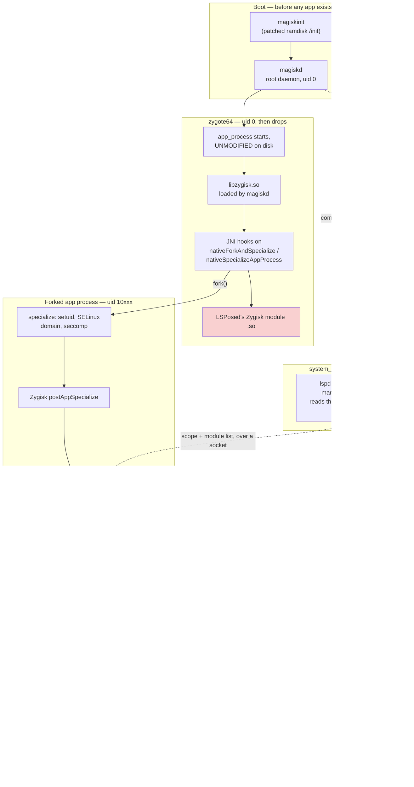
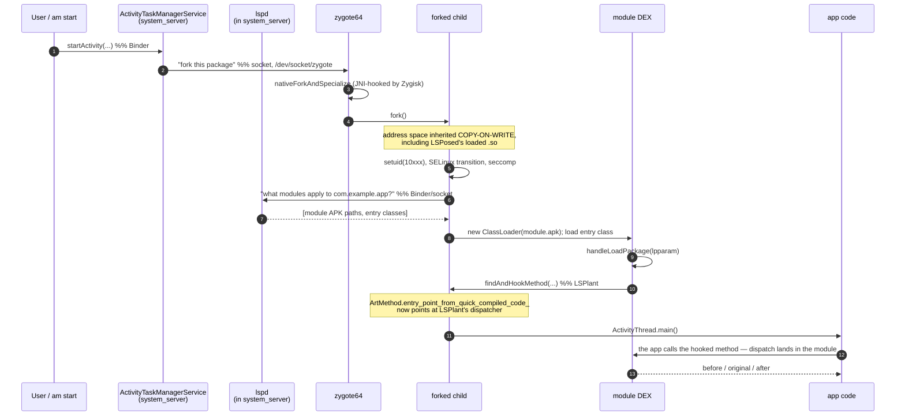
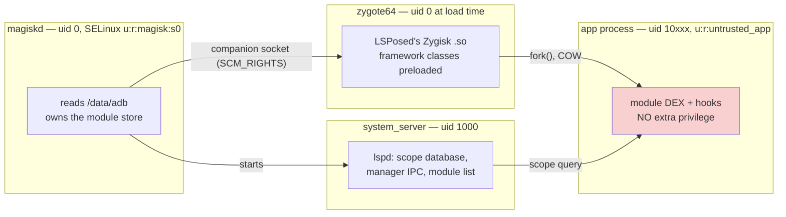
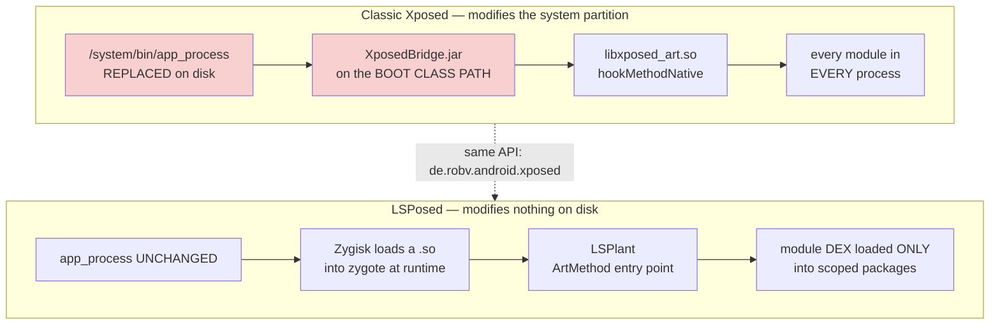
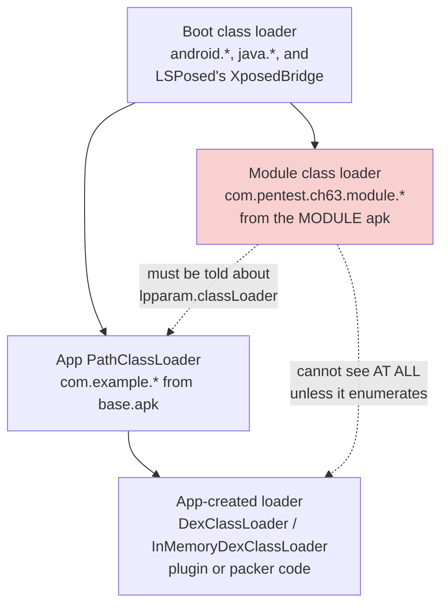
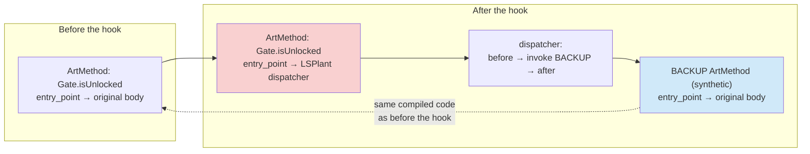
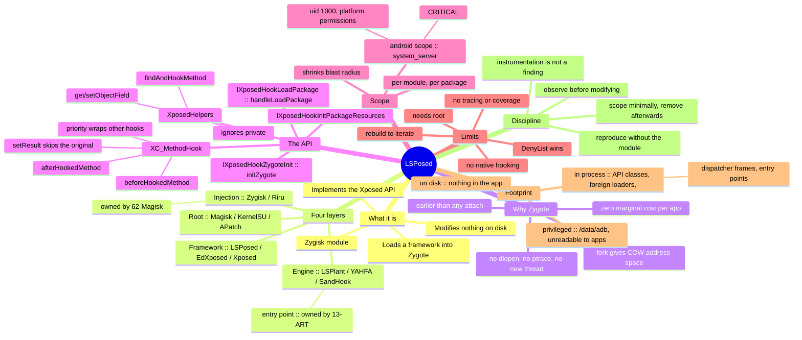

# 63 — LSPosed

> After this chapter you will be able to explain exactly how a Java method hook installed inside
> Zygote reaches every application on the device — which process, which pointer, which class loader —
> write and build an LSPosed module end to end with no network connection, decide from the target
> rather than from habit whether LSPosed or Frida is the right instrument, and enumerate from
> measurement rather than folklore what a detector can actually see when LSPosed is installed.

**Prerequisites:** [04-Java](../04-Java/README.md) ·
[11-Android-Runtime](../11-Android-Runtime/README.md) · [13-ART](../13-ART/README.md) ·
[16-JNI](../16-JNI/README.md) · [62-Magisk](../62-Magisk/README.md) · and — **out of numeric order,
so read it first** — [65-Hooking](../65-Hooking/README.md). 65 is a genuine forward dependency: §2.4
below maps what LSPosed physically writes *onto chapter 65's taxonomy* rather than restating it, and
65 depends on nothing after it, so reading 65 → 63 costs you nothing.
**Applies to:** Android 8.1 (API 27) through Android 15 (API 35). LSPosed's supported floor is
API 27; classic Xposed, which this chapter contrasts against throughout, stopped at API 27 and is the
subject of [64-Xposed](../64-Xposed/README.md).
**Measured on:** an AVD, `sdk_gphone16k_x86_64` (`emu64xa16k`), **Android 15 / API 35, x86_64**,
rooted with **Magisk 30.7**. Every number in this chapter that came from a device came from that one,
and §7.1 records exactly what was and was not observable on it — including the fact that **LSPosed
itself was not installed**, and what that means for which claims here are measured and which are
source-level.

---

## Table of Contents

1. [Introduction](#1-introduction)
2. [High-Level Architecture](#2-high-level-architecture)
3. [Deep Internal Working](#3-deep-internal-working)
4. [Source Code Walkthrough (AOSP)](#4-source-code-walkthrough-aosp)
5. [Security Perspective](#5-security-perspective)
6. [Reverse Engineering Perspective](#6-reverse-engineering-perspective)
7. [Dynamic Analysis](#7-dynamic-analysis)
8. [Static Analysis](#8-static-analysis)
9. [Examples](#9-examples)
10. [Common Interview Questions](#10-common-interview-questions)
11. [Common Mistakes](#11-common-mistakes)
12. [Hands-on Labs](#12-hands-on-labs)
13. [Summary](#13-summary)
14. [References](#14-references)

---

## 1. Introduction

### 1.1 A workshop that stamps out identical objects

Imagine a workshop that makes clay figures. Rather than sculpting each figure from scratch — which
would be slow — the workshop keeps one master mould. Every figure is pressed from that mould, and
each comes out identical; the workers then paint each one differently, give it a name, and send it
out.

You want to change something about the figures. You have two ways to do it.

You could **wait for a figure to leave the workshop, find it wherever it ended up, and modify it
there.** You need to physically reach it, you need a tool, you leave marks, and when you are finished
you have changed exactly one figure. Do it to a thousand figures and you have done the work a
thousand times.

Or you could **put something inside the mould.** Not change the mould's shape — put a tiny worker
inside it who gets pressed into every figure along with the clay. Each figure now comes out of the
press with that worker already inside, already awake, already able to rearrange things before the
painters even see it. You did the work once. Nobody ever had to open a finished figure.

The mould is **Zygote**, the Android process from which every application process is forked. The
first approach is [Frida](../53-Frida/README.md), which attaches to a process that is already
running. The second is **LSPosed**.

That single structural difference — *arrive before the process exists, rather than break into it
afterwards* — is where every practical property of LSPosed comes from: its persistence, its
awkwardness during development, its almost total lack of an injection event for a detector to notice,
and the reason it needs root and Frida sometimes does not.

### 1.2 What problem existed before this?

Android has always had a hooking framework. It was called **Xposed**, written by a developer known as
rovo89, and it worked — for years, it was the only way to change an application's behaviour without
repackaging it. The way it worked created four problems, and LSPosed exists because of all four.

Xposed did its injection by **replacing a file in the system partition**. Specifically it replaced
`/system/bin/app_process`, the binary that starts Zygote and every app process, with its own version
that loaded an extra jar — `XposedBridge.jar` — into the boot class path before anything else ran.

> **📖 Definition — boot class path.** The list of `.jar` files whose classes the runtime loads before
> and outside any application's own class loader. Classes on it are visible to every process on the
> device without anyone asking for them. `java.lang.String`, `android.app.Activity` and every other
> framework class live there. Putting your own jar on it means your classes are visible everywhere,
> which is exactly what Xposed needed and exactly why it required system modification.

The four problems, in the order they became fatal:

| # | Problem | Why it was fatal |
|---|---|---|
| 1 | **`/system` had to be writable** | Android 4.4 introduced dm-verity and Android 7 made Verified Boot mandatory on new devices. A modified `/system` fails verification: the device either refuses to boot or boots into a warning state that a remote server can see |
| 2 | **`app_process` is version-specific** | It is compiled against a specific Android release. Every new Android version needed a new Xposed port, hand-written, months late |
| 3 | **A module ran in every process** | There was no scope. Enable a module and its `handleLoadPackage` fired inside your banking app, your keyboard, `system_server` and everything else. One buggy module bootlooped the device |
| 4 | **OTA updates broke it** | An over-the-air update replaces `/system`. Every update un-installed Xposed, and re-installing it re-broke verified boot |

Official Xposed stopped at Android 8.1 / API 27. That is not a coincidence: it is roughly when the
combination of Verified Boot, Project Treble and A/B partitioning made "write a modified binary into
`/system`" stop being a thing an ordinary user could do at all.

### 1.3 What would break if LSPosed did not exist?

Less than you might expect, and more than is comfortable. Frida can do most of what LSPosed can do,
in a single session. What you lose without LSPosed is the set of jobs where *persistence* or
*earliness* is the point:

- **Instrumentation that must survive a reboot.** A logging harness that runs for a week across
  normal phone use cannot be a Frida session, because the session dies when the process does.
- **Instrumentation of a process you cannot attach to.** `system_server` can be attached to with
  root, but attaching to it while it is doing real work is a good way to reboot a device. A module
  is already inside it before it starts.
- **Targets that die when injected into.** A protected application that watches for `ptrace`
  attachment (the mechanism Frida's default attach uses — see [53-Frida](../53-Frida/README.md))
  will notice Frida arriving. There is no arrival to notice with LSPosed; the code is inherited
  through `fork()`.
- **Anything that must run before the application's first line of code.** A `static` initialiser, a
  `.init_array` constructor, an `Application.attachBaseContext` — by the time a Frida *attach*
  lands, these have already run. `frida -f` (spawn) narrows the window; a module closes it.
- **Distribution to somebody who is not you.** A module is an APK. You can hand it to a colleague.
  You cannot hand somebody a Frida session.

### 1.4 What LSPosed is, precisely

> **📖 Definition — LSPosed.** A **Zygisk module** (see [62-Magisk](../62-Magisk/README.md)) that
> loads a framework into the Zygote process, so that framework code is inherited by every forked
> application process; that framework then, on a per-application basis chosen by the user, loads
> third-party **module** APKs into the target process and lets their code replace the entry points of
> arbitrary Java methods via ART's `ArtMethod` structure. It implements the **Xposed API**
> (`de.robv.android.xposed`), so modules written for classic Xposed run unchanged, but it shares no
> code with classic Xposed and modifies no partition.

Unpack that definition into the five claims it makes, because each is a separate mechanism and this
chapter's §3 is organised around them:

1. **It is a Zygisk module.** It does not patch a partition, does not replace `app_process`, and does
   not need `/system` to be writable. It needs a Zygisk-capable root implementation, which in
   practice means Magisk 24 or later with Zygisk enabled.
2. **It gets into Zygote.** Everything downstream follows from `fork()` inheriting an address space.
3. **It is scoped.** Per module, per application, chosen by the user. Classic Xposed had no such
   concept. This is LSPosed's single largest practical improvement and the one people underrate.
4. **It loads foreign DEX into a foreign process.** A module APK's classes end up executing with the
   *target's* uid, in the *target's* process, with the *target's* permissions.
5. **The hook itself is ART entry-point replacement.** Which is [13-ART](../13-ART/README.md)'s
   subject and [65-Hooking](../65-Hooking/README.md)'s hook type 1. This chapter does not re-derive
   it.

### 1.5 Five names people confuse, disentangled

This is the single most common source of wrong answers about LSPosed, in interviews and in practice,
so it gets a table before anything else.

| Name | Who | How it gets into the process | ART hooking engine | Scope | State |
|---|---|---|---|---|---|
| **Xposed** (classic) | rovo89 | Replaces `/system/bin/app_process`; adds `XposedBridge.jar` to the boot class path | `hookMethodNative` in `libxposed_art.so` | **Global** — every process | Ended at API 27. See [64-Xposed](../64-Xposed/README.md) |
| **Riru** | RikkaW | Replaces a native library Zygote already loads, so the loader pulls Riru in for free | None — Riru is a *substrate*, not a hooking framework | n/a | Superseded by Zygisk |
| **EdXposed** | ElderDrivers | A **Riru** module | YAHFA, or SandHook, selectable | Per-application (added late) | Largely superseded |
| **LSPosed** | LSPosed developers | A **Zygisk** module (older builds: a Riru module) | **LSPlant** | Per-application, per-process | Current |
| **libxposed** | LSPosed developers | Same as LSPosed | Same | Same | The newer, cleaner API. Modules may use either |

Three things worth extracting from that table, because they are the parts that get mis-stated:

- **Riru and Zygisk are the same *kind* of thing** — a way to get a native library into Zygote — and
  neither of them hooks anything by itself. Zygisk is Magisk's built-in successor to Riru.
  [62-Magisk §3.8](../62-Magisk/README.md) owns that mechanism in full.
- **YAHFA, SandHook and LSPlant are the same *kind* of thing** — an ART method-hooking engine — and
  none of them knows anything about Zygote, packages or scope. §3.9 covers what distinguishes them.
- **"Xposed" is the name of an API as well as of a framework.** A module that `implements
  IXposedHookLoadPackage` is "an Xposed module" even when the only framework that will ever load it
  is LSPosed. When somebody says "I wrote an Xposed module in 2025", they almost certainly mean an
  LSPosed module written against the Xposed API.

> **🧠 Mental Model.** Draw the stack with three independent layers and you will never confuse these
> names again: **root** (Magisk / KernelSU / APatch) gives you privilege; **injection** (Zygisk /
> Riru) gets a native library into Zygote; **framework** (LSPosed / EdXposed / classic Xposed)
> decides whose code runs where and installs the actual method hooks using an **engine** (LSPlant /
> YAHFA / SandHook / `hookMethodNative`). Four layers, four vocabularies, and almost every confused
> statement about Xposed collapses two of them together.

### 1.6 Why a security professional cares

Three distinct reasons, and they pull in different directions.

**As a tester**, LSPosed is an instrument. It is the right one when persistence or earliness matters,
and the wrong one when iteration speed matters. §7.9 lays out the decision.

**As a defender or reviewer**, LSPosed is a *threat model*. An LSPosed module runs inside your
application's process with your application's identity. It sees every argument to every method, every
decrypted string, every `SharedPreferences` write, and every key handle. Nothing in the app sandbox
([21-App-Sandbox](../21-App-Sandbox/README.md)) helps, because the module is not outside the sandbox
— it is inside it, wearing your uid. The only controls that survive are the ones that do not live in
that address space at all.

**As an incident responder or malware analyst**, LSPosed is *infrastructure*. Banking trojans have
shipped as Xposed modules for a decade, for the same reason testers like it: a module that hooks
`TextView.setText` in every app harvests one-time passcodes from every app at once, survives reboots,
and needs no accessibility-service prompt. The presence of a hooking framework on a device under
investigation is a first-class finding, and §5.9 covers what to collect.

### 1.7 Ethics, stated once

> **⚠️ Warning.** Every module in this chapter targets an application you build yourself from this
> chapter's labs. Point a module at software you do not own and are not explicitly authorised to
> test and you are, depending on jurisdiction, committing an offence — and in every jurisdiction
> breaching the terms under which the software was licensed to you. **Modules that defeat licensing,
> payment or anti-cheat controls in shipped third-party software are out of scope for this
> repository and will not be found in it.** Where an example needs a network endpoint it uses the
> `.invalid` top-level domain, which is reserved by RFC 2606 and can never resolve.

The professional framing that makes this practical rather than preachy: **a module is a modification
you install on a device, and the device belongs to someone.** If it is your test device, that someone
is you. If it is a client's device, the authorisation is in the rules of engagement, in writing,
before you install anything. If it is a device you found, stop.

### 1.8 What this chapter owns, and what it does not

This chapter is referenced 29 times from 8 other chapters, and every one of those references is a
promise about scope. The boundary is drawn tightly on purpose: three neighbouring chapters own the
mechanisms LSPosed *composes*, and re-deriving them here would produce three worse copies.

| Topic | Owner | This chapter's role |
|---|---|---|
| `ArtMethod`, `entry_point_from_quick_compiled_code_`, why hooks fail | [13-ART](../13-ART/README.md) | **Cite.** The field, the four failure causes and the inspection script are 13's. This chapter explains what LSPlant does *with* them |
| What a hook physically is; the five interception points; trampolines; PLT/GOT | [65-Hooking](../65-Hooking/README.md) | **Cite.** LSPosed is hook type 1, delivered using types 3 and 5. 65 owns all of that as mechanism |
| Root, `magiskd`, the module system, **Zygisk's injection mechanism**, DenyList | [62-Magisk](../62-Magisk/README.md) | **Cite.** This chapter owns what LSPosed *does with* the Zygisk API, not how Zygisk gets into Zygote |
| Frida as a tool — API, CLI, agents, RPC, `ptrace` attach | [53-Frida](../53-Frida/README.md) | **Cite**, and extend. 53's FAQ 24 already draws the Frida/LSPosed comparison; §7.9 here extends it with the cases that table does not cover rather than repeating it |
| Classic Xposed's history, `app_process` replacement, `hookMethodNative` in depth | [64-Xposed](../64-Xposed/README.md) | Explain **just enough** to make LSPosed's design legible, then link forward |
| Root and tamper *detection* | [37-RootDetection](../37-RootDetection/README.md), [38-TamperDetection](../38-TamperDetection/README.md) | Own **LSPosed's specific footprint**; hand the general detection taxonomy over |
| Bypass methodology, the arms race | [67-BypassingProtections](../67-BypassingProtections/README.md) | Own the artefacts; hand over the cost model |
| `RegisterNatives` and the JNI method table | [16-JNI](../16-JNI/README.md) | Cite — it is how Zygisk hooks Zygote's fork functions |
| Class loaders, DEX loading, `InMemoryDexClassLoader` | [12-DEX-Internals](../12-DEX-Internals/README.md), [09-Android-App-Internals](../09-Android-App-Internals/README.md) | Cite for the format; own the class-loader *problem* a module faces |

What is left, and what you will find nowhere else in this repository:

- LSPosed's architecture end to end — four processes, four privilege levels, one hook.
- The `XposedBridge` API surface, exhaustively, with the semantics that are not in any doc comment.
- Scope: what it is, where it lives, and the two security consequences that follow.
- LSPlant, and why a managed hook needs a *backup method* the way a native hook needs a trampoline.
- Module development from empty directory to loaded hook, offline.
- **What LSPosed looks like to a detector**, measured.
- When a pentester should reach for it instead of Frida — and, more usefully, when not to.

---

## 2. High-Level Architecture

### 2.1 The injection chain, end to end



Read this diagram top to bottom as **one boot and one app launch**, and note four things about it.

**First, `app_process` is untouched.** The box at the top of the Zygote column says so explicitly.
This is the entire architectural difference from classic Xposed, which replaced that binary. Nothing
on any partition is modified, which is why LSPosed coexists with dm-verity and with an OTA that
rewrites `/system`.

**Second, the shaded boxes are all inside the forked app process.** Everything genuinely
attacker-controlled happens after the fork, at the app's uid, in the app's address space. The module
is not privileged; it is *early*. That distinction is the whole security story and §5 develops it.

**Third, there is a decision node.** `DECIDE` is scope, and it is the box classic Xposed did not
have — its equivalent diagram would go straight from `postAppSpecialize` to `LOAD` for every process
on the device. §3.4 covers what hangs off that difference.

**Fourth, `lspd` lives in `system_server`, not in Zygote.** That looks like an odd place to put a
manager, and it is the design decision most worth understanding; §3.3 explains it.

### 2.2 One app launch, as a sequence



The line to stare at is **step 6**: `fork()`. Everything LSPosed loaded into Zygote before that point
is now present in the child at no cost, with no injection, and with no event any in-process observer
could have watched. There is no `ptrace` attach, no `dlopen` of an agent, no new thread appearing,
no `mmap` of an anonymous executable region that was not already there — the memory was inherited.

Compare with Frida, whose equivalent sequence has a step where a foreign process calls `ptrace` on
this one. That step is observable — `/proc/self/status`'s `TracerPid` names it — and it is the
single largest reason to reach for LSPosed against a hostile target.

The second line worth noting is **step 10**, the query to `lspd`. This is a real IPC on every process
start, and it is the one part of the injection chain a determined detector can find by timing or by
socket enumeration. §5.5 is honest about how weak that signal is in practice.

### 2.3 Four processes, four privilege levels



Four boxes, four different answers to "what can this code do?", and confusing them is how people
arrive at wrong conclusions about LSPosed's power.

- **`magiskd`** is root and owns `/data/adb`. It is the only participant that can read the module
  store. Measured on the test device: `/data/adb` returns `EACCES` to both `shell` (uid 2000) and an
  application uid.
- **Zygote** is root at the moment LSPosed's library is loaded, which is why the library can do
  privileged setup then and only then.
- **`lspd`** is `system` (uid 1000). It has the platform's privileges — enough to read the package
  database and to expose a manager interface — and not root.
- **The module** has *no privilege at all beyond the app it landed in*. It cannot read `/data/adb`.
  It cannot see other apps' data. It has exactly the permissions the target declared in its manifest.

> **⚠️ Warning.** "A module runs as root" is wrong and it is the most common misconception about
> LSPosed. A module runs as the **target application**. If you want privileged work done from a
> module you must ask something privileged to do it for you — which is precisely what Zygisk's
> `connectCompanion()` exists for ([62-Magisk §3.8](../62-Magisk/README.md)) and why LSPosed keeps a
> daemon rather than doing everything in-process.

### 2.4 What LSPosed physically writes, mapped onto chapter 65's taxonomy

[65-Hooking §3.17](../65-Hooking/README.md) enumerates five hook types by what each overwrites.
LSPosed uses three of them, at three different points in the chain, and they are easy to conflate.

| Stage | Whose code | 65's hook type | What is overwritten | Why here |
|---|---|---|---|---|
| Get into Zygote's fork path | Zygisk (Magisk's) | **Type 5 — `RegisterNatives`** | `JNINativeMethod.fnPtr` for `nativeForkAndSpecialize` and `nativeSpecializeAppProcess` | These are the only two functions every app launch must pass through |
| Zygisk's own plumbing | Zygisk (Magisk's) | **Type 3 — PLT/GOT** | A slot in a module's `.got.plt` | Zygisk exposes `pltHookRegister`/`pltHookCommit` and uses them itself |
| Hook a Java method | LSPlant (LSPosed's) | **Type 1 — managed** | `ArtMethod.entry_point_from_quick_compiled_code_` | The one and only thing a module actually installs |

The row that matters for a pentester is the last one. **Every hook a module installs is hook type 1
and nothing else.** A module cannot inline-hook a native function through the Xposed API; it cannot
touch a `.got.plt` slot; it cannot patch `.text`. If your target's decision is made in C, an LSPosed
module reaches it only by hooking the Java method that calls into C — which means you are hooking the
boundary, not the decision. §3.15 is explicit about this limit and §7.9 turns it into a tool-choice
rule.

> **🔬 Under the Hood.** Nothing stops a module from loading its own native library with
> `System.loadLibrary` once it is inside the target process and doing native inline hooking from
> there — it is ordinary code in an ordinary process. But that is you writing a native hooking engine
> ([65-Hooking §3.4](../65-Hooking/README.md)) and calling it from a module, not the Xposed API doing
> it for you. Say which one you mean.

### 2.5 Classic Xposed and LSPosed, side by side



The dotted line is the point of the diagram. **The two columns share an API and share nothing else.**
A module built in 2015 against `de.robv.android.xposed:api:82` loads in LSPosed today, because
LSPosed re-implements that API surface faithfully. Everything underneath — how the framework arrives,
what installs the hook, who decides which processes are affected — was rebuilt.

That is worth saying plainly because it produces a specific and common analysis error: **you cannot
tell from a module APK which framework will load it.** The manifest meta-data, the
`assets/xposed_init` file and the `de.robv` imports are identical in both worlds. §6.1 covers what
you *can* tell, and §8 automates it.

Two consequences flow from the left-hand column that are worth carrying even though classic Xposed is
of historical interest only, because they explain design choices that otherwise look arbitrary:

- **Xposed's jar was on the boot class path, so modules could reference framework classes directly.**
  LSPosed's module code is loaded by an ordinary class loader inside the app, so the class loader
  question in §3.5 is a problem LSPosed has and classic Xposed did not.
- **Xposed hooked at `app_process` startup, before Zygote preloaded anything.** LSPosed's Zygisk
  library arrives at a slightly later moment. In practice this matters for a small number of very
  early framework hooks and for nothing else, but it is the honest reason `initZygote` and
  `handleLoadPackage` have the capabilities they have — see §3.13.

---
## 3. Deep Internal Working

### 3.1 Zygote, and why "before the process exists" is a category difference

> **📖 Definition — Zygote.** A process started early in boot which loads the Android runtime,
> preloads several thousand framework classes and a set of shared libraries, and then does nothing
> but wait on a socket. When the system needs a new application process, it does not `execve` a new
> program: it tells Zygote to `fork()`. The child inherits everything Zygote loaded, then
> *specialises* — takes the app's uid, enters the app's SELinux domain, installs the app's seccomp
> filter, and finally runs `ActivityThread.main`.

[11-Android-Runtime](../11-Android-Runtime/README.md) owns Zygote as a runtime construct. The single
fact this chapter needs is the one about `fork()`:

**`fork()` gives the child a copy of the parent's entire address space, copy-on-write.** Every page
Zygote had mapped, the child has mapped. Every library Zygote loaded, the child has loaded. Every
global the parent initialised, the child sees initialised. The child did not load anything; it
inherited.

Three consequences, and each is a whole property of LSPosed:

| Consequence | Why |
|---|---|
| **A library in Zygote is a library in every app** | Nothing is copied per app; the pages are shared until written to. The cost of injecting into 200 apps is the cost of injecting into one |
| **There is no injection event in the app process** | Nobody called `dlopen`. Nobody called `ptrace`. Nobody created a thread. The process was *born* with the code present |
| **`LD_PRELOAD` does not work on Android apps** | [65-Hooking §3.7](../65-Hooking/README.md) makes this point: the linker consults `LD_PRELOAD` at `execve`, and an app process never has one. Zygisk is the platform's answer to the same problem |

> **🧠 Mental Model.** Frida asks "how do I get into this process?" LSPosed asks "how do I get into
> the process that all processes are made from?" The first is a break-in; the second is inheritance.
> Every difference in detectability, persistence and iteration speed between the two tools is
> downstream of that one question.

### 3.2 What Zygisk hands LSPosed

[62-Magisk §3.8](../62-Magisk/README.md) owns Zygisk: how `magiskd` gets `libzygisk.so` into Zygote,
what `nativeForkAndSpecialize` is, and what the whole callback surface looks like. This section
answers only the question 62 does not: **which parts of that surface does LSPosed actually use, and
what for?**

| Zygisk facility | LSPosed's use of it |
|---|---|
| `onLoad(Api*, JNIEnv*)` | Runs in Zygote, as root. LSPosed does its one-time framework setup here — including opening file descriptors it will need later, while it still can |
| `preAppSpecialize(AppSpecializeArgs*)` | Runs in the child **before** the uid drop, so still root. LSPosed reads the incoming package name and uid here and decides whether this process needs anything at all |
| `postAppSpecialize(const AppSpecializeArgs*)` | Runs **after** the uid drop, SELinux transition and seccomp. This is where a module's DEX is actually loaded, because by now the process is genuinely the app |
| `preServerSpecialize` / `postServerSpecialize` | The `system_server` path. This is how `lspd` gets into `system_server` — see §3.3 |
| `connectCompanion()` | A socket to a root-privileged process forked from `magiskd`. LSPosed needs it because after the uid drop it can no longer read `/data/adb` |
| `getModuleDir()` | A directory file descriptor that stays valid after the process loses filesystem access to that path |
| `setOption(DLCLOSE_MODULE_LIBRARY)` | Asks Magisk to `dlclose` the module `.so` after specialisation, so it does not remain in `/proc/self/maps` |

The two rows that repay attention are `preAppSpecialize` and `postAppSpecialize`, because the choice
between them is the whole privilege story.

**`preAppSpecialize` still has root.** It is the only moment in an app process's life when
LSPosed's code is privileged. Anything that needs privilege must happen there or be delegated to the
companion.

**`postAppSpecialize` has the app's identity**, which is exactly what is needed to load DEX into the
app's class loader and to install hooks that the app's own code will hit. It is also why a module has
no privilege: by the time module code runs, the process has been an ordinary app for several
milliseconds.

> **⚠️ Warning.** `getFlags()` reports whether the process is on Magisk's **DenyList**, and LSPosed
> respects it — a DenyListed process gets no modules. That is a feature when you are trying to hide,
> and a genuinely confusing failure mode when you are not: a module that works everywhere and
> silently does nothing in one app is very often a DenyList entry somebody added months ago and
> forgot. §7.4 makes checking it step one of the diagnostic.

### 3.3 `lspd`, and why the manager lives in `system_server`

LSPosed runs a daemon, historically called `lspd`, and it injects it into **`system_server`** — the
process that hosts `ActivityManagerService`, `PackageManagerService` and most of the platform.

That looks like an odd place for a hooking framework's bookkeeping. There are four reasons, and they
are all consequences of what a manager needs to be able to do:

| The manager must… | Why `system_server` is where that is possible |
|---|---|
| Know which packages exist, their uids, and when one is installed or removed | `PackageManagerService` *is* that information. In `system_server` it is a field reference away; from anywhere else it is Binder IPC and permission checks |
| Be reachable from every app process at fork time, cheaply | `system_server` is already up before Zygote forks anything, and every app already talks to it constantly |
| Survive as long as the device is up | `system_server` restarting means the device is rebooting anyway |
| Present a manager UI without shipping a launcher icon that root detection can see | LSPosed's "parasitic manager" is launched *through* the system rather than as an ordinary installed app — which is why on a stock LSPosed install there is often **no LSPosed icon in the app drawer at all** |

That last row surprises people who go looking for LSPosed on a device and conclude it is not
installed because there is no icon. It is also, deliberately, one less artefact.

> **🔍 Pentester's Note.** "No LSPosed app in the launcher" is not evidence of absence, and neither is
> `pm list packages | grep -i lsposed`. The manager can be reached through a shortcut, through a
> dial-pad code, or through the Magisk app, and its package name can be randomised. §5.5 and §7.5
> cover what *is* evidence.

### 3.4 Scope — the feature classic Xposed did not have

**Scope** is a per-module list of packages. A module's code is loaded only into processes belonging
to a package on its list. The list is chosen by the user in LSPosed's manager, pre-populated from the
module's `xposedscope` manifest hint (see [`examples/AndroidManifest.xml`](examples/AndroidManifest.xml)),
and stored in LSPosed's own database under `/data/adb`, which no application can read.

Classic Xposed had nothing equivalent: enable a module and it ran everywhere.

Two security consequences follow, and they point in opposite directions.

**Consequence 1 — scope shrinks the blast radius, which shrinks the footprint.** A module scoped to
one package means 199 of the device's 200 processes load nothing, allocate nothing, and have no
foreign class loader. An application that is not in any module's scope is, from inside itself, running
on a device where LSPosed's *framework* exists but has done nothing to it. That is why "is LSPosed
installed?" and "is this app being hooked?" are different questions with different answers, and why a
detector that answers the first while claiming to answer the second is wrong.

**Consequence 2 — scope is where a malicious module's power is decided, and the dangerous entry is not
an app.** LSPosed's scope list includes two pseudo-targets that are not ordinary apps:

| Scope entry | What it means | Why it matters |
|---|---|---|
| A normal package | The module loads into that app's processes, with that app's uid | Bounded by that app's sandbox |
| **`android`** (the system framework) | The module loads into **`system_server`**, at uid 1000 with the platform's permissions | Effectively a system-wide compromise. A hook in `system_server` sees every Binder transaction on the device |
| **`system`/manager-adjacent entries** | Varies by build | Treat any non-app scope entry as privileged |

> **⚠️ Warning.** A module you enable with `android` in scope is code you have granted **system**
> privileges to, on a device you also root. There is no meaningful sandbox left. Review the module's
> source, or do not enable it with that scope. This is the single highest-consequence decision a user
> of LSPosed makes and the manager's checkbox does not look any different from the others.

§5.4 develops this into a full vulnerability class with detection and a fix.

### 3.5 Getting a module's DEX into a foreign process — and the class-loader problem

The module APK is a file on disk, owned by the module's own package. The target application is a
different uid with a different sandbox. Getting the module's code to *execute* inside the target is
therefore a genuine problem, and it is solved with an ordinary Android mechanism.

> **📖 Definition — class loader.** The object responsible for turning a class *name* into a loaded
> class. Android's runtime has several, arranged in a parent-first delegation chain: the boot class
> loader (framework classes), then the app's `PathClassLoader` (the app's own DEX), then any loader
> the app created itself. **A class name is only meaningful relative to a loader.** Two different
> loaders can each define a class called `com.example.Foo`, and those are two different classes that
> cannot be assigned to one another.

LSPosed loads a module's DEX with a dedicated class loader whose parent chain reaches the framework
classes, and whose sibling — reachable but not inherited — is the app's own loader. That arrangement
is what makes `lpparam.classLoader` necessary rather than decorative.



Read the two dotted lines; they are the two mistakes.

**The first dotted line** is why every hook call takes a class loader. Write
`XposedHelpers.findAndHookMethod("com.example.Foo", null, ...)` — passing `null` for the boot loader —
and you get `ClassNotFoundError` for an application class, every time, because the boot loader has
never heard of it. The module's *own* loader has not either. Only `lpparam.classLoader` has.

**The second dotted line** is the one that costs people an afternoon. If the target loads its real
code with its own `DexClassLoader` — a plugin architecture, a dynamic feature module, or a commercial
packer that decrypts the true DEX at runtime — then the class you want does not exist in
`lpparam.classLoader` at `handleLoadPackage` time, and it may not exist yet at all. Symptom:
`ClassNotFoundError` on a class you can plainly see in jadx.

The fix is the same one [13-ART](../13-ART/README.md) and [53-Frida](../53-Frida/README.md) both
give for their own version of this problem: hook the loader instead of the class.

```java
// Hook the ClassLoader constructor, or ClassLoader.loadClass, and wait for
// the class to appear.  See examples/LateClassHookModule.java for the full,
// commented version of this pattern.
XposedHelpers.findAndHookMethod(ClassLoader.class, "loadClass",
        String.class, boolean.class, new XC_MethodHook() {
    @Override protected void afterHookedMethod(MethodHookParam param) {
        if ("com.example.packed.RealGate".equals(param.args[0])) {
            installRealHooks((Class<?>) param.getResult());
        }
    }
});
```

> **🔬 Under the Hood.** This is the managed-layer twin of the *timing* problem
> [65-Hooking §4.4](../65-Hooking/README.md) describes for native libraries: `.init_array` runs
> inside `dlopen`, so a hook installed after `System.loadLibrary` returns is already too late. Here
> the resource is a class rather than a library and the gate is a class loader rather than the
> dynamic linker, but the shape — *be earlier, or hook the thing that creates it* — is identical.

### 3.6 The `XposedBridge` API surface

This is the API you actually write against. It has been stable for a decade, which is remarkable and
is the main reason ten-year-old modules still work.

#### 3.6.1 The entry-point interfaces

A module class implements one or more of these. The class is named in `assets/xposed_init` (§3.12).

| Interface | Method | When it is called | Available there |
|---|---|---|---|
| `IXposedHookZygoteInit` | `initZygote(StartupParam)` | Once, in Zygote, before any app exists | Framework classes, root, `startupParam.modulePath`. **No app classes, no Context** |
| `IXposedHookLoadPackage` | `handleLoadPackage(LoadPackageParam)` | Once per **process**, in the app, before the app's code | The app's class loader, package name, process name, `ApplicationInfo`. **No Context yet** |
| `IXposedHookInitPackageResources` | `handleInitPackageResources(InitPackageResourcesParam)` | When a package's resources are first loaded | `XResources`, for replacing layouts, strings, drawables |

`IXposedMod` is the empty marker interface all three extend. You will see it in a decompiled module's
class hierarchy and it means nothing on its own.

#### 3.6.2 `LoadPackageParam` — everything you are told about where you landed

| Field | Type | What it is, and the trap |
|---|---|---|
| `packageName` | `String` | The package. **Not** unique per process |
| `processName` | `String` | e.g. `com.example.app:worker`. Differs from `packageName` for any component with `android:process`. Installing a UI hook in a `:worker` process is a common way to write a hook that installs and never fires |
| `classLoader` | `ClassLoader` | The app's loader. Pass this to every `findAndHookMethod` for an app class |
| `appInfo` | `ApplicationInfo` | `sourceDir` (the APK path), `dataDir`, `uid`, and the flag bits — `FLAG_DEBUGGABLE` among them |
| `isFirstApplication` | `boolean` | False in a process hosting a second package. Rare, and it exists because it is not impossible |

#### 3.6.3 Installing hooks

| Call | Signature shape | Use it when |
|---|---|---|
| `XposedHelpers.findAndHookMethod(String className, ClassLoader cl, String methodName, Object... paramTypesAndCallback)` | The varargs array's **last** element is the `XC_MethodHook`; everything before it is a parameter type | You know the exact signature. The common case |
| `XposedHelpers.findAndHookMethod(Class<?> clazz, String methodName, Object... …)` | Same, with a resolved `Class` | You already have the class |
| `XposedHelpers.findAndHookConstructor(...)` | Same, for `<init>` | Hooking object creation |
| `XposedBridge.hookAllMethods(Class<?> clazz, String name, XC_MethodHook cb)` | Returns `Set<Unhook>` | Six overloads and you want all of them, or you do not know the signature |
| `XposedBridge.hookAllConstructors(Class<?> clazz, XC_MethodHook cb)` | Returns `Set<Unhook>` | Every constructor |
| `XposedBridge.hookMethod(Member m, XC_MethodHook cb)` | Takes a `Method` or `Constructor` | You resolved the member yourself, e.g. by iterating `getDeclaredMethods()` |
| `XposedBridge.invokeOriginalMethod(Member, Object, Object[])` | Static | Call the *unhooked* original, from anywhere, including from outside a hook |

> **⚠️ Warning.** The varargs form is not type-checked at compile time. `findAndHookMethod("Foo", cl,
> "bar", String.class, new XC_MethodHook(){...})` and `findAndHookMethod("Foo", cl, "bar",
> new XC_MethodHook(){...}, String.class)` both compile; the second throws at runtime because the last
> element is not a callback. Every "my module crashes on load with `IllegalArgumentException`" report
> is worth checking against this first.

The type arguments may be given as `Class` objects **or as fully qualified type name strings**. The
string form is how you name a class the module itself cannot import:

```java
// Both are legal.  The string form resolves against the SAME class loader
// you passed for the target class.
XposedHelpers.findAndHookMethod("com.example.Gate", cl, "check",
        "com.example.Credentials",           // a type the module cannot import
        new XC_MethodHook() { /* … */ });
```

#### 3.6.4 Logging

`XposedBridge.log(String)` and `XposedBridge.log(Throwable)` are the module's output channel. Two
things about them that are not obvious:

- **It is not `Log.d`.** It goes to LSPosed's own log, which the manager displays and which survives
  independently of `logcat`'s ring buffer. Using `android.util.Log` from a module works too, and the
  line then appears under the *target application's* tag and pid, which is sometimes exactly what you
  want and sometimes exactly what you do not.
- **It is an artefact.** Anything a module logs is readable by anything that can read that log. This
  repository has already measured the general form of that problem — `dumpsys` records broadcast
  extras in cleartext, so a test broadcast carrying a secret stays recoverable afterwards. Treat a
  module's log the same way: do not log a captured credential you would not want to leave behind, and
  clear the log when the engagement ends.

### 3.7 `XC_MethodHook` — the lifecycle, precisely

This is the class every hook is an instance of, and the semantics of its four operations are where
most module bugs live.

```mermaid
stateDiagram-v2
    [*] --> Dispatch: app calls the hooked method
    Dispatch --> Before: beforeHookedMethod(param)
    Before --> Skipped: param.setResult() or setThrowable() was called
    Before --> Original: neither was called
    Original --> After: original body ran; result/throwable recorded
    Skipped --> After: original body NEVER ran
    After --> Return: caller receives param.getResultOrThrowable()
    Return --> [*]
```



Walk the diagram once and four rules fall out of it.

**Rule 1 — `setResult` in `before` skips the original body.** This is the managed-layer equivalent of
[65-Hooking](../65-Hooking/README.md)'s 8-byte wholesale replacement: nothing calls through. Use it
when you do not care what the method would have said, and be aware that any side effect the method
had is now also gone. A method that both returns a boolean *and* increments a counter, hooked this
way, stops incrementing the counter.

**Rule 2 — `afterHookedMethod` runs either way.** Including after a `before` that skipped the
original. That is why `param.getResult()` in `after` can return a value the method never computed.

**Rule 3 — `param.args` is live.** Writing `param.args[0] = "x"` in `before` changes what the
original body receives. Writing it in `after` changes nothing, because the call already happened.

**Rule 4 — `setResult` clears the throwable and `setThrowable` clears the result.** They are one
slot with two faces. `getResultOrThrowable()` is the accessor that respects both.

| Operation | In `before` | In `after` |
|---|---|---|
| `param.args[i] = v` | Changes the argument the original receives | No effect |
| `param.setResult(v)` | **Skips the original body**, sets the return value | Rewrites the return value the caller sees |
| `param.setThrowable(t)` | Skips the original body, makes the call throw | Makes the call throw instead of returning |
| `param.getResult()` | `null` — nothing has run yet | The value the caller is about to receive |
| `param.hasThrowable()` | `false` | True if the original threw |
| `param.thisObject` | The receiver, or `null` if static | Same |
| `param.method` | The hooked `Method`/`Constructor` | Same |

#### 3.7.1 Priority, and what happens when two modules hook the same method

`XC_MethodHook` extends `XCallback`, which carries an `int priority` — `PRIORITY_DEFAULT` is 50,
with `PRIORITY_LOWEST` and `PRIORITY_HIGHEST` at the extremes. When several hooks are installed on one
method they nest:

```
   HIGHEST.before  →  DEFAULT.before  →  LOWEST.before
                            ↓
                     ORIGINAL BODY
                            ↓
   HIGHEST.after   ←  DEFAULT.after   ←  LOWEST.after
```

Higher priority runs its `before` **first** and its `after` **last** — it wraps the others, like an
outer layer of an onion. Two practical consequences:

- **A high-priority hook that calls `setResult` in `before` prevents every lower-priority hook's
  `before` from running at all**, and the original body with it. One module can silently disable
  another's, and neither will log anything about it.
- **Ordering between two hooks at the same priority is not something you should rely on.** If your
  module's correctness depends on running before another module's, set a priority and say so in the
  module's description.

`XC_MethodReplacement` is the sub-class for "replace the body entirely": it makes
`beforeHookedMethod` and `afterHookedMethod` `final` and gives you one method,
`replaceHookedMethod(param)`, whose return value is the result. `XC_MethodReplacement.returnConstant(v)`
is the one-liner for the most common case, and `XC_MethodReplacement.DO_NOTHING` returns `null` (or
the appropriate zero) without running anything.

### 3.8 `XposedHelpers` — the reason modules are readable

Everything `XposedHelpers` does can be done with `java.lang.reflect`. It exists because the
reflective version of "read a private field on an object whose class you cannot import" is six lines
of boilerplate with two checked exceptions, and a module that does that forty times is unreadable.

| Method family | What it replaces | Note |
|---|---|---|
| `findClass(name, cl)` / `findClassIfExists` | `Class.forName(name, false, cl)` | The `IfExists` variant returns `null` instead of throwing — use it for optional targets |
| `getObjectField` / `getIntField` / `getBooleanField` / `getLongField` | `getDeclaredField` + `setAccessible(true)` + `get` | Typed variants avoid boxing and a cast |
| `setObjectField` / `setIntField` / … | The same, writing | This is how a module flips a cached security decision — see §5.3 |
| `getStaticObjectField` / `setStaticObjectField` | The same, on a `Class` | Static state is process-global; changing it affects every caller |
| `callMethod(obj, name, args…)` | `getDeclaredMethod` + `invoke` | Argument types are inferred from the values, which fails on `null` and on primitives-versus-boxes |
| `callStaticMethod(clazz, name, args…)` | The same, static | |
| `newInstance(clazz, args…)` | `getDeclaredConstructor` + `newInstance` | |
| `getAdditionalInstanceField` / `setAdditionalInstanceField` | Nothing — there is no reflective equivalent | A per-object side table. This is how you attach state to an object whose class you do not control, without adding a field to it |

The last row is worth a moment: `setAdditionalInstanceField(someAppObject, "ch63.seen", Boolean.TRUE)`
gives you a place to remember something about an object you did not create and cannot subclass. It is
implemented as a weak-keyed map, so it does not leak the object.

> **🔍 Pentester's Note.** `XposedHelpers` also has an internal member cache, so repeated
> `findAndHookMethod` calls on the same target are cheap. That is a performance note for module
> authors and a **detection** note for everyone else: a module hooking a hot method adds work to
> every invocation of it, and a target that times its own methods can notice. Timing-based hook
> detection is real, weak, and covered in [67-BypassingProtections](../67-BypassingProtections/README.md).

### 3.9 The engine: what actually rewrites the method

Everything above is API. The part that changes what the CPU does is a separate, swappable component,
and it is worth naming the three that have mattered.

| Engine | Used by | Approach |
|---|---|---|
| **`hookMethodNative`** | Classic Xposed | Sets the target `ArtMethod`'s `kAccNative` access flag and points its entry at a single generic JNI dispatcher, `XposedBridge.handleHookedMethod`, which looks up the callbacks and reflectively invokes them. One dispatcher for every hook |
| **YAHFA** | EdXposed (option) | "Yet Another Hook Framework for ART". Generates a per-target trampoline and swaps `ArtMethod` fields, keeping a *backup* `ArtMethod` that still carries the original entry point. Needed per-Android-version knowledge of `ArtMethod`'s layout |
| **SandHook** | EdXposed (option) | Two modes: entry-point replacement like the above, and a genuine **native inline hook** of the method's compiled body — i.e. [65-Hooking](../65-Hooking/README.md)'s hook type 2 applied to JIT/AOT output |
| **LSPlant** | **LSPosed** | LSPosed's own library. Generates the hook and backup pair at runtime as real Java methods (in a DEX it builds in memory), then swaps entry points, and drives ART's own deoptimisation machinery so that callers stop using inlined copies |

The mechanism they share is [13-ART](../13-ART/README.md)'s, and it is one sentence:

```cpp
// art/runtime/art_method.h
void* entry_point_from_quick_compiled_code_;
```

**Every dispatch of a Java method reads that pointer and jumps to it. The hook is: write a different
pointer.** [65-Hooking §3.3](../65-Hooking/README.md) states the same thing as hook type 1, and
13-ART derives it, including how to locate the field without hard-coding an offset. Neither is
re-derived here.

> **⚠️ Warning.** `ArtMethod`'s layout is **not stable**. ART became a Mainline module at API 29,
> which means two devices reporting the same Android release can have different ART builds with
> different field offsets. A hooking engine with hard-coded offsets works on the author's phone and
> fails on yours. This is the concrete reason LSPlant derives offsets at runtime rather than
> tabulating them, and the reason YAHFA's per-version tables were a maintenance burden.

### 3.10 The backup method — the trampoline of the managed world

Here is the part that has no counterpart in the API and that most module authors never think about.

A hook that merely *replaces* a method is easy: point the entry somewhere else, done. But
`XC_MethodHook` promises that the original body runs between `before` and `after`. Something must be
able to invoke the original — and the original's entry point has just been overwritten.

The answer is structurally identical to [65-Hooking §2.3](../65-Hooking/README.md)'s trampoline: keep
a second way in.



The blue box is the backup: a synthetic `ArtMethod` that nothing in the application's DEX refers to,
whose entry point is the value the target's entry point had before the hook. Calling it runs the
original body. The dispatcher calls it between the two callbacks, and `XposedBridge.invokeOriginalMethod`
exposes it to you directly.

Three consequences of this design that show up in practice:

| Consequence | Why |
|---|---|
| **Un-hooking is possible and cheap** | Write the backup's entry point back into the target. `Unhook.unhook()` is that |
| **The original's code is never modified** | Which is why a checksum over the app's DEX or over its compiled `.odex` sees nothing. Contrast with SandHook's inline mode, which does modify compiled code |
| **A recursive call inside the original does NOT re-enter the hook** | The original body was compiled with direct references; going through the backup does not pass the target's entry point again. This is usually what you want and occasionally a surprise |

> **🔬 Under the Hood.** The native and managed worlds converge here in a way worth noticing.
> An inline hook needs a *trampoline* holding the displaced instructions because the function's first
> bytes were overwritten. A managed hook needs a *backup method* holding the original entry pointer
> because the method's dispatch slot was overwritten. Different layer, different artefact, same
> reason: **if you want to call through, you must keep a copy of what you destroyed.**

### 3.11 Deoptimisation — why the hook can install perfectly and never fire

[13-ART](../13-ART/README.md) owns the four-cause table for hook failure and this chapter does not
restate it. What belongs here is the specific reason it matters *more* for LSPosed than for Frida.

The single most common cause is **inlining**. If the ahead-of-time compiler decided that
`Gate.isUnlocked` was small enough to paste into `LoginActivity.onClick`, then at runtime there is no
dispatch through `isUnlocked`'s `ArtMethod` at all — the caller's compiled code contains a copy of the
body. Overwriting the entry point changes a pointer nothing reads.

ART's answer is **deoptimisation**: throw away compiled code and go back to interpreting, so that
every call becomes a real dispatch again. LSPlant drives this, which is why LSPosed hooks generally
fire where a naive entry-point write would not.

Where LSPosed is at a disadvantage relative to Frida is not the mechanism but the **feedback loop**:

| | Frida | LSPosed |
|---|---|---|
| Hook did not fire; you want to try hooking the caller instead | Edit the script, press Enter | Rebuild the module APK, reinstall, force-stop the target, relaunch |
| Diagnose whether it was inlining | `cmd package compile -m verify -f <pkg>` then retry, in seconds | Same command, then the rebuild cycle |
| See what the hook saw | Console, live | `XposedBridge.log`, read afterwards |

That table, not any deep property of ART, is why the working practice this chapter recommends is
**explore with Frida, ship with LSPosed** — §7.9.

> **🔍 Pentester's Note.** Run `adb shell cmd package compile -m verify -f <pkg>` and force-stop
> before concluding a module's hook does not work. It discards the AOT-compiled code, so the inlined
> copy stops existing and the dispatch comes back. If the hook then fires, your finding is "the check
> is inlined at `-O2`", which is a more interesting sentence than "my module did not work".

### 3.12 Packaging: what makes an APK a module

Nothing structural. A module is an ordinary APK with three additions.

**1. Manifest meta-data**, inside `<application>`:

| `android:name` | Required | Meaning |
|---|---|---|
| `xposedmodule` | **Yes** | Value `true`. Without it the manager will not list the APK at all |
| `xposedminversion` | **Yes** in practice | The minimum **Xposed API** version — not an Android version, not an LSPosed version. `82` is the long-standing level |
| `xposeddescription` | Recommended | One line, shown in the manager |
| `xposedscope` | Recommended | Comma-separated packages the module is *intended* for. A pre-selection hint, **not** an enforcement boundary |

**2. `assets/xposed_init`** — a plain text file, one fully-qualified class name per line, naming the
classes that implement the entry-point interfaces. This chapter's is one line:

```
com.pentest.ch63.module.VaultUnlockModule
```

See [`examples/xposed_init`](examples/xposed_init) and [`examples/AndroidManifest.xml`](examples/AndroidManifest.xml).

**3. The API on the compile classpath and nowhere else.** In Gradle:

```gradle
dependencies {
    compileOnly 'de.robv.android.xposed:api:82'
}
```

> **⚠️ Warning.** `compileOnly`, never `implementation`. At runtime the framework supplies
> `de.robv.android.xposed.*`. A module that packages its own copy ends up with the module's classes
> calling the module's `XposedBridge` — a different class from the one the framework loaded — and the
> hooks are installed into nothing. The symptom is a module that loads cleanly, logs nothing, and
> hooks nothing. This chapter's [`scripts/build-xposed-module.sh`](scripts/build-xposed-module.sh)
> enforces the same separation without Gradle: it compiles against a generated stub API and then
> **excludes those classes from the DEX**, which is exactly what `compileOnly` does.

Newer LSPosed builds also read a `META-INF/xposed/` directory carrying `module.prop`,
`java_init.list` and `scope.list` — the same three facts in a different container, introduced with
the newer `libxposed` API. A module may ship either form; a module that ships both is readable by
old and new frameworks alike.

### 3.13 Timing: the three entry points and what exists at each


| At this point | You have | You do not have |
|---|---|---|
| `initZygote` | Root, framework classes, your own module path | Any app class, any `Context`, any package identity |
| `handleLoadPackage` | The app's class loader, package and process name, `ApplicationInfo` | A `Context`; the app's `Application` object; anything the app loads later |
| `Application.attachBaseContext` (reachable by hooking it) | A `Context`, at last | Anything a `ContentProvider` will initialise |
| `ContentProvider.onCreate` | Almost everything | — |

The row people trip over is the third. **`handleLoadPackage` runs before the app has a `Context`**, so
a module that wants one hooks `Application.attachBaseContext` or
`Instrumentation.callApplicationOnCreate` and does its real work from there:

```java
XposedHelpers.findAndHookMethod("android.app.Application", lpparam.classLoader,
        "attachBaseContext", Context.class, new XC_MethodHook() {
    @Override protected void afterHookedMethod(MethodHookParam param) {
        Context ctx = (Context) param.args[0];
        // Now you have a Context: resources, SharedPreferences, a ClassLoader
        // that has seen more than it had at handleLoadPackage time.
    }
});
```

The row that matters for *analysis* is the second-to-last one. Many SDKs initialise from a
`ContentProvider` declared in their own manifest — the `androidx.startup` pattern — which runs
**before `Application.onCreate`**. A hook installed in `onCreate` to watch an SDK's initialisation is
already too late. `handleLoadPackage` is not.

### 3.14 Resource hooking

`IXposedHookInitPackageResources` and `XResources` let a module replace a target's resources —
strings, drawables, dimensions, and whole layouts — before they are inflated. It is the mechanism
behind the entire "theme and tweak the UI" half of the Xposed module ecosystem.

For security work it is a much smaller deal than method hooking, with two genuine uses:

- **Replacing a layout to expose something the UI hides.** Turning a `View` from `GONE` to `VISIBLE`,
  or removing a `FLAG_SECURE` on a window, is occasionally the fastest way to see what an application
  is willing to render but not to show.
- **Replacing a string that is compared against.** Rare, and usually a sign you should be hooking the
  comparison instead.

It cannot touch anything computed at runtime, which is most of what matters. Treat it as a UI tool.

### 3.15 What LSPosed cannot do

Stating the limits precisely is more useful than any capability list, because every one of these is a
case where a tester reaches for the wrong instrument.

| Limit | Why | What to use instead |
|---|---|---|
| **Hook a native function** | The Xposed API's only primitive is the ART entry point. There is no `Interceptor.attach` | Frida, or a native library loaded from your module and a hooking engine of your own ([65-Hooking](../65-Hooking/README.md)) |
| **Hook a method the compiler inlined into every caller** | Nothing dispatches through the `ArtMethod` | `cmd package compile -m verify -f`, or hook the callers ([13-ART](../13-ART/README.md)) |
| **Trace arbitrary code paths** | There is no `Stalker` equivalent, no coverage engine | Frida |
| **Change anything without a reboot or a force-stop** | Modules are loaded at process start. Editing scope or installing a module requires the target to restart; some changes require a reboot | Frida for the iteration loop |
| **Run at all on an unrooted device** | It is a Zygisk module, and Zygisk needs Magisk | Frida gadget in a repackaged APK; `android:debuggable` plus JDWP |
| **Reach a process on Magisk's DenyList** | LSPosed honours the flag | Take the app off the DenyList, if that is compatible with your goal |
| **Run inside an `android:isolatedProcess`** | Isolated processes are a separate, more restricted sandbox | Hook the non-isolated side of the IPC |
| **Give a module root** | The module runs as the target app | Zygisk companion, or a helper the module talks to |

### 3.16 Version matrix

| Behaviour | Version | Consequence |
|---|---|---|
| Classic Xposed supported | Android ≤ 8.1 (API 27) | Below LSPosed's floor; see [64-Xposed](../64-Xposed/README.md) |
| LSPosed's supported floor | **Android 8.1 / API 27** | A module's `xposedminversion` is an *API* number and says nothing about this |
| Riru-based injection | Magisk ≤ 23 era | Superseded; old EdXposed guides assume it |
| Zygisk available | **Magisk ≥ 24** | The mechanism LSPosed now requires |
| ART is a Mainline module | API 29+ | `ArtMethod` layout can differ between devices reporting the same Android release. **Never hard-code the offset** |
| Non-SDK interface restrictions | API 28+ | Affects *reflection from an app*; a framework hook is not subject to it, but a module using reflection on hidden APIs may need LSPosed's exemption or `HiddenApiBypass` |
| System CA store moves to the Conscrypt APEX | API 34+ | Not an LSPosed change, but it breaks the most common reason people install a Magisk module alongside it ([62-Magisk](../62-Magisk/README.md)) |
| `libxposed` API and `META-INF/xposed/` packaging | Recent LSPosed | Both packaging forms are read; `de.robv` modules are not deprecated |

### 3.17 The footprint — what LSPosed actually leaves behind

This is the section a pentest repository needs and most write-ups skip. It is split into what was
**measured** on the test device and what is **structural** and therefore stated without a device
number.

**Measured**, on the AVD described in §7.1 — Magisk 30.7, **LSPosed not installed**:

| Artefact | From `shell` (uid 2000) | From an app uid | Note |
|---|---|---|---|
| `/data/adb` (the module store's parent) | `EACCES` | `EACCES` | And a non-existent sibling returns `ENOENT` — the two are **distinguishable**, so `File.exists()` returning `false` conflates "absent" with "forbidden" |
| `/data/adb/modules` | `EACCES` | `EACCES` | Where an LSPosed install lives. Not readable, but its *parent's* refusal is itself a signal |
| `/data/adb/lspd` | `EACCES` | `EACCES` | **Root reports this path `ENOENT` — LSPosed is genuinely absent — and every unprivileged viewpoint still gets `EACCES`.** The refusal happens at `/data/adb`, above the leaf. An app therefore gets the *same answer for installed and not installed* |
| `/debug_ramdisk` (Magisk's tmpfs) | listable as a stat, contents refused | contents refused (`EACCES`) | Mode `drwx--x--x` — traverse, do not list |
| `/debug_ramdisk/magisk` | present, `0755` | **readable — ELF header dumped from an app uid** | Path-guessing beats directory listing. A directory you cannot list is not a directory you cannot read from |
| `/proc/self/mountinfo` | 3 entries | **3 matching lines: 2 sourced `magisk`, 1 `devpts` mounted under `/debug_ramdisk/.magisk/`** | The loudest signal on this device, needs no root and no path guessing |
| `/sys/fs/selinux/policy` | `0444` on disk | **`EACCES`** — SELinux refuses despite DAC allowing | Root sees types `magisk`, `magisk_file`, `magisk_log_file` in it |

The `/proc/self/mountinfo` result is worth quoting because it is three lines an application can read
with `BufferedReader` and no permissions at all — but **read the fields, not the substring**. Two of
the three name `magisk` as the mount *source*; the third is an ordinary `devpts` that matches only
because its mount *point* is `/debug_ramdisk/.magisk/pts`. `grep -c magisk` returns 3 and
`grep -c ' magisk '` in the source field returns 2, and a detector that reports the first number is
counting a coincidence alongside two facts. This was caught by
[74-CaseStudies](../74-CaseStudies/README.md) re-running the measurement, and it is the same class of
error as [64-Xposed](../64-Xposed/README.md)'s 1,141 substring hits that resolved to zero findings:

```
# app uid, via run-as, on the test device
56 42 0:20 / /debug_ramdisk rw,relatime shared:13 - tmpfs magisk rw,seclabel,mode=755
57 56 0:26 / /debug_ramdisk/.magisk/worker rw,relatime shared:14 - tmpfs magisk rw,seclabel,mode=755
58 56 0:27 / /debug_ramdisk/.magisk/pts rw,nosuid,noexec,relatime shared:15 - devpts devpts rw,...
```

> **⚠️ Warning — read this measurement precisely.** These were taken through `run-as`, whose SELinux
> domain is `runas_app`, **not** `untrusted_app`. This repository's standing rule is *prove
> reachability from an app, not from the shell*, and `run-as` sits between the two: it has the app's
> uid and MCS categories (`u:r:runas_app:s0:c207,c256,c512,c768`) but a domain with its own rules.
> Treat the `EACCES` results as **at least** that restrictive for a real app, and the *readable*
> results — `/debug_ramdisk/magisk` and `mountinfo` — as needing confirmation from a real app before
> you publish them as detection signals. [Lab 01](labs/lab-01-mapping-the-injection-chain.md) builds
> that app.

**Structural** — the artefacts an LSPosed install adds on top of the Magisk substrate above. These
are not measured here because LSPosed was not installed on the available device; they are stated from
the framework's design and each is checkable with one command in
[`scripts/lsposed-footprint.sh`](scripts/lsposed-footprint.sh):

| Artefact | Visible to | Why it exists |
|---|---|---|
| A Zygisk module directory under `/data/adb/modules` | root only | LSPosed ships as a Magisk/Zygisk module |
| LSPosed's own database and log under `/data/adb` | root only | Scope, enabled modules, log |
| The `lspd` daemon's presence in `system_server` | root, by reading `system_server`'s maps | The manager |
| A foreign `ClassLoader` in a scoped app's loader graph | **the app itself**, trivially | The module's DEX had to be loaded by something |
| `de.robv.android.xposed.*` classes resolvable inside a scoped app | **the app itself**, one `Class.forName` | The framework provides them |
| A stack frame naming LSPosed in a deliberately thrown exception | **the app itself** | The dispatcher is on the call stack of every hooked method |
| An `ArtMethod` entry point outside the boot image, the app's `.odex` and the JIT code cache | the app, with effort | The hook itself |

The pattern across both tables is the one [65-Hooking §5.9](../65-Hooking/README.md) states for
forensics generally: **a detector inside the app can see the framework's effects; a detector inside
the app cannot see the framework's files.** The privileged artefacts are unreadable and the
in-process ones are trivially readable. §5.5 turns that into a detection hierarchy and an honest
assessment of what each level is worth.

---
## 4. Source Code Walkthrough (AOSP)

LSPosed is not part of AOSP. What *is* in AOSP is every seam it uses, and knowing those seams is what
lets you reason about the framework without reading its source. Paths below are stable; **no line
numbers are quoted**, because they are not.

### 4.1 The fork path — the two functions everything hangs off

```
frameworks/base/core/java/com/android/internal/os/Zygote.java
frameworks/base/core/jni/com_android_internal_os_Zygote.cpp
frameworks/base/core/java/com/android/internal/os/ZygoteConnection.java
frameworks/base/core/java/com/android/internal/os/ZygoteInit.java
```

`Zygote.java` declares the two native methods every application process is created through:

```java
// frameworks/base/core/java/com/android/internal/os/Zygote.java  (abridged)
private static native int nativeForkAndSpecialize(int uid, int gid, int[] gids,
        int runtimeFlags, int[][] rlimits, int mountExternal, String seInfo,
        String niceName, int[] fdsToClose, int[] fdsToIgnore, boolean startChildZygote,
        String instructionSet, String appDataDir, /* … */);

private static native void nativeSpecializeAppProcess(int uid, int gid, int[] gids,
        int runtimeFlags, int[][] rlimits, int mountExternal, String seInfo,
        String niceName, boolean startChildZygote, String instructionSet,
        String appDataDir, /* … */);
```

Two functions, and **every** application on the device passes through one of them. That is why
Zygisk hooks exactly these two and nothing else: it is the narrowest possible waist in the whole
system.

The implementations live in `com_android_internal_os_Zygote.cpp`, which registers them with
`RegisterNatives` from a `JNINativeMethod` table in `register_com_android_internal_os_Zygote`. That
table is the hook point, and it is [16-JNI §3.8](../16-JNI/README.md)'s subject and
[65-Hooking](../65-Hooking/README.md)'s hook type 5:

```cpp
// frameworks/base/core/jni/com_android_internal_os_Zygote.cpp  (shape, abridged)
static const JNINativeMethod gMethods[] = {
    { "nativeForkAndSpecialize", "(II[II[[IILjava/lang/String;…)I",
      (void *) com_android_internal_os_Zygote_nativeForkAndSpecialize },
    { "nativeSpecializeAppProcess", "(II[II[[IILjava/lang/String;…)V",
      (void *) com_android_internal_os_Zygote_nativeSpecializeAppProcess },
    /* … */
};
```

**Rewriting `fnPtr` in that table is a single pointer write, and it changes what happens on every
app launch on the device.** No instruction is modified, so nothing that checksums code sees anything.
That is the same property [65-Hooking §3.8](../65-Hooking/README.md) gives hook type 5 in general;
here it is applied at the one place in Android where it has maximum leverage.

Following the C++ down one more level, `SpecializeCommon` is where the child does the work the name
suggests — `setresuid`, `setresgid`, `selinux_android_setcontext`, the seccomp filter install, and
the mount-namespace work. **Zygisk's `preAppSpecialize` runs before that block and
`postAppSpecialize` after it**, which is the mechanical reason for the privilege difference described
in §3.2.

### 4.2 The `system_server` path

```
frameworks/base/core/java/com/android/internal/os/ZygoteInit.java   — forkSystemServer
frameworks/base/services/java/com/android/server/SystemServer.java  — main, run
```

`ZygoteInit.main` calls `forkSystemServer` before it starts serving app fork requests, and the result
is the one process on the device that is not an app and not Zygote. Zygisk's
`preServerSpecialize`/`postServerSpecialize` callbacks fire on that path, and that is the seam
`lspd` uses to get into `system_server` (§3.3).

`SystemServer.run` then starts the services in three phases — bootstrap, core, other — and it is
worth knowing that `PackageManagerService` comes up in the bootstrap phase. Anything LSPosed wants to
know about packages is available very early.

### 4.3 What classic Xposed replaced, and what LSPosed does not touch

```
frameworks/base/cmds/app_process/app_main.cpp
```

This is the source of `/system/bin/app_process`, the binary classic Xposed replaced with its own
build. Its `main()` decides whether it is starting Zygote (`--zygote`) or running a single Java class,
sets up the `AndroidRuntime`, and calls `AndroidRuntime::start`.

Xposed's modified version added `XposedBridge.jar` to the class path before that call. **LSPosed
touches this file not at all** — it is byte-identical to the stock binary on an LSPosed device, which
is the reason an integrity check over `/system` finds nothing.

[62-Magisk §4](../62-Magisk/README.md) already cites this file for the same contrast. It is repeated
here because it is the single strongest one-sentence answer to "how is LSPosed different from
Xposed?": *the file classic Xposed replaced is untouched.*

### 4.4 Where the hook lands

```
art/runtime/art_method.h            — the structure and its entry point field
art/runtime/art_method-inl.h        — accessors, including pointer-size handling
art/runtime/class_linker.cc         — class and method resolution
art/runtime/instrumentation.cc      — deoptimisation
art/runtime/jit/jit.cc              — the JIT that can overwrite an entry point
art/runtime/entrypoints/quick/quick_trampoline_entrypoints.cc  — what an entry point can point at
```

```cpp
// art/runtime/art_method.h  (abridged)
class ArtMethod {
  // …
  struct PtrSizedFields {
    void* data_;
    void* entry_point_from_quick_compiled_code_;
  } ptr_sized_fields_;
};
```

[13-ART §3.15–3.17](../13-ART/README.md) derives all of this, including
[`13-ART/scripts/artmethod-inspect.js`](../13-ART/scripts/artmethod-inspect.js), which locates the
field without hard-coding an offset. The three files worth adding here, because they are the ones
LSPlant interacts with beyond the simple pointer write:

- **`instrumentation.cc`** is where deoptimisation lives. A hooking engine that wants its hook to
  fire on a method the compiler inlined has to get ART to discard the compiled code that contains the
  inlined copy. That is not a hack; it is the same machinery a debugger uses when you set a
  breakpoint.
- **`jit.cc`** is the reason a hook can vanish. If the method is hot, the JIT compiles it and writes
  a **new** entry point — over yours. Any engine must mark the method so the JIT leaves it alone.
- **`quick_trampoline_entrypoints.cc`** enumerates the values an entry point can legitimately hold:
  the resolution trampoline, the interpreter bridge, the generic JNI trampoline. Knowing them is how
  you tell "hooked" from "not compiled yet" when you read a pointer back — which is exactly what a
  detector does, and §5.5 uses it.

### 4.5 Loading foreign code into an app

```
libcore/dalvik/src/main/java/dalvik/system/BaseDexClassLoader.java
libcore/dalvik/src/main/java/dalvik/system/InMemoryDexClassLoader.java
libcore/dalvik/src/main/java/dalvik/system/DexPathList.java
frameworks/base/core/java/android/app/LoadedApk.java          — getClassLoader
frameworks/base/core/java/android/app/ActivityThread.java     — handleBindApplication
```

`LoadedApk.getClassLoader` is where an application's `PathClassLoader` is created, and
`ActivityThread.handleBindApplication` is where the `Application` object is instantiated and
`attachBaseContext` runs. Everything a module does with `lpparam.classLoader` is a reference to the
object the first of those created; everything a module does to get a `Context` is a hook on the
second.

`InMemoryDexClassLoader` matters for a reason [22-SELinux](../22-SELinux/README.md) measured: modern
app domains lost `file:execute_no_trans` and `file:execmod` on `app_data_file`, which is what pushed
loaders towards loading DEX from a `ByteBuffer` rather than from a file the app wrote. Any framework
that has to materialise foreign code inside an app process runs into the same constraint.

### 4.6 One complete path, from `am start` to a hooked method

| # | Where | What happens |
|---|---|---|
| 1 | `adb shell am start -n com.example/.Main` | Binder to `ActivityTaskManagerService` in `system_server` |
| 2 | `ProcessList.startProcessLocked` | No process for `com.example`; ask Zygote for one |
| 3 | `/dev/socket/zygote` | The argument list is written to Zygote's socket |
| 4 | `ZygoteConnection.processCommand` | Parses it, calls `Zygote.forkAndSpecialize` |
| 5 | `Zygote.nativeForkAndSpecialize` | **JNI table entry already rewritten by Zygisk.** Control reaches Magisk's code first |
| 6 | Zygisk | Calls each loaded module's `preAppSpecialize`; **LSPosed decides here whether this package needs anything** |
| 7 | `SpecializeCommon` (`com_android_internal_os_Zygote.cpp`) | `fork()`; the child `setresuid`s to 10xxx, transitions to `u:r:untrusted_app`, installs seccomp |
| 8 | Zygisk | Calls `postAppSpecialize` in the child. **Now at the app's uid** |
| 9 | LSPosed | Queries `lspd`: which modules are scoped to `com.example`? |
| 10 | LSPosed | Builds a class loader over the module APK; loads the class named in `assets/xposed_init` |
| 11 | The module | `handleLoadPackage(lpparam)` runs. **This is your code, first line** |
| 12 | `XposedHelpers.findAndHookMethod` | Resolves `com.example.Gate.isUnlocked` through `lpparam.classLoader` |
| 13 | LSPlant | Creates a backup `ArtMethod`; writes a new `entry_point_from_quick_compiled_code_`; deoptimises callers |
| 14 | `ActivityThread.main` | The app's own code starts. It has no idea any of the above happened |
| 15 | `Gate.isUnlocked("0000")` | Dispatch reads the entry point, lands in LSPlant's dispatcher |
| 16 | The module | `beforeHookedMethod` → backup method (the original body) → `afterHookedMethod` |

Steps 5, 8 and 13 are the three hooks, in three different layers, from two different projects. Step
11 is the only one you write. **That asymmetry — one line of your code sitting on top of three
mechanisms owned by other people — is the honest description of what using LSPosed feels like, and
why the failure modes are so hard to diagnose without the map above.**

### 4.7 LSPosed's own tree, for when you need the ground truth

> **⚠️ Warning.** The paths in this table name files in **the LSPosed project's own repository**, not
> in this one and not in AOSP. They are here as a reading guide. Do not treat them as files this
> chapter ships.

| Area | What to read it for |
|---|---|
| The Zygisk module entry (`onLoad`, `preAppSpecialize`, `postAppSpecialize`) | The concrete use of the Zygisk API described in §3.2 |
| The `lspd` daemon | Scope storage, the manager interface, `system_server` injection |
| `LSPlant` (a **separate** repository) | The hooking engine: backup method creation, entry-point swap, deoptimisation |
| The `de.robv.android.xposed` compatibility layer | How the classic API is mapped onto LSPlant |
| `libxposed` (a separate repository) | The newer API surface |

Reading LSPlant alongside [`65-Hooking/examples/trampoline-hook.c`](../65-Hooking/examples/trampoline-hook.c)
is the single most instructive comparison available: the same problem — *keep a way to call the
original* — solved once in native code with a trampoline page, and once in managed code with a
synthetic method.

---

## 5. Security Perspective

### 5.1 How attackers abuse it

| Technique | What it achieves | Layer |
|---|---|---|
| Hook the app's own decrypt/verify routine | Reads plaintext without breaking any crypto — you *borrow* it. Chapter 34 already shows the `SecretKeySpec` hook in Xposed form | Managed |
| Hook `TextView.setText` / notification callbacks | Harvests one-time passcodes across every scoped app | Managed |
| Hook `SharedPreferences.Editor.putString` | Sees every stored value at the moment it is stored, including ones written encrypted | Managed |
| Hook the certificate-pinning path (`X509TrustManager.checkServerTrusted`, OkHttp's `CertificatePinner`) | Traffic interception that persists across reboots ([36-CertificatePinning](../36-CertificatePinning/README.md)) | Managed |
| Hook `PackageManager.getPackageInfo` | Defeats self-signature verification ([38-TamperDetection](../38-TamperDetection/README.md)) | Managed |
| Hook `KeyStore` operations | Uses a hardware-backed key without extracting it. The key never leaves; it never needs to ([49-KeyStore](../49-KeyStore/README.md)) | Managed |
| Scope a module to `android` | Hooks inside `system_server`. Every Binder transaction on the device becomes visible | **Platform** |

The last row is the one that separates LSPosed from every in-app technique, and §5.4 treats it as its
own vulnerability class.

The `KeyStore` row is the one developers underestimate, and it is worth stating in the same words
[65-Hooking §5.1](../65-Hooking/README.md) uses because it is exactly the same point at a different
layer: **non-exportable is not the same as non-usable.** A module calls the same `Cipher` object your
code calls, with the same key handle, and receives the same plaintext.

### 5.2 How developers misuse it — the anti-patterns that create the opportunity

| Anti-pattern | Why it fails against a module |
|---|---|
| Caching a security decision in a `static` field | `XposedHelpers.setStaticBooleanField` is one line and beats the entire check forever |
| Detecting the *framework* (package names, `/data/adb`, the LSPosed app) rather than the *effect* | The manager can be hidden and renamed; `/data/adb` is unreadable anyway. See §5.5 |
| Making the decision in Java when the consequence is native | The managed layer is the only layer LSPosed reaches — so putting the decision there hands it over |
| Assuming a `private` method is safe | `XposedHelpers` ignores access modifiers entirely. `private` is a compiler concept |
| Assuming obfuscation prevents hooking | It attacks target *selection*, not mechanism ([40-Obfuscation](../40-Obfuscation/README.md)). Once the attacker has the renamed name, `a.b.c()` hooks identically |
| Relying on `Build`/`getprop` values for integrity | Chapter 50 measured `ro.boot.verifiedbootstate` reading `green` while the TEE reported `Unverified` on the same device, seconds apart |
| Shipping a self-integrity check with the baseline in the same process | The checker and the checked share an address space. Same argument as [65-Hooking §5.5](../65-Hooking/README.md) |

### 5.3 Vulnerability class: a security decision cached in the process

**Vulnerable code**

```java
// com.pentest.ch63.vault.VaultGate — the shape this chapter's lab app ships.
public final class VaultGate {
    private static Boolean sDeviceOk = null;      // evaluated once, cached forever
    private int mFailedAttempts = 0;

    public boolean isUnlocked(String pin) {
        if (sDeviceOk == null) {
            sDeviceOk = !RootCheck.isRooted() && !TamperCheck.isRepackaged();
        }
        if (!sDeviceOk) { return false; }
        if (matches(pin, loadExpectedPin())) { mFailedAttempts = 0; return true; }
        mFailedAttempts++;
        return false;
    }

    private boolean matches(String entered, String expected) {
        return entered != null && entered.equals(expected);
    }
}
```

**Why developers write it.** The root check is genuinely expensive — it stats a dozen paths and reads
`mountinfo` — and caching an expensive pure function is correct engineering advice. It is being
applied to something that is not a pure function and not a performance problem.

**Static detection**

```bash
# host
jadx -d out app.apk
grep -rn "static.*Boolean.*[Ss]ecure\|static.*Boolean.*[Tt]rust\|static.*Boolean.*[Oo]k" out/sources/
grep -rn "isRooted\|isRepackaged\|isDeviceSecure" out/sources/ | head -40
```

Look for a `static` box type (`Boolean`, not `boolean`) — the nullable form is the tell that it is a
lazily-computed cache rather than a constant.

**Dynamic detection.** Three lines in a module, and note that they do not hook anything:

```java
// The field write beats the check without a single hook being installed.
Class<?> gate = XposedHelpers.findClass("com.pentest.ch63.vault.VaultGate", lpparam.classLoader);
XposedBridge.log("cached: " + XposedHelpers.getStaticObjectField(gate, "sDeviceOk"));
XposedHelpers.setStaticObjectField(gate, "sDeviceOk", Boolean.TRUE);
```

**Exploit.** Set the field. The check never runs again in this process, for any caller, for the life
of the process — and because a module runs at `handleLoadPackage`, before the app's code, the field
is set before the first evaluation would have happened.

**Secure fix as code**

```java
public final class VaultGate {
    // 1. No cached security decision. The signals are collected fresh…
    // 2. …and they are not the decision. They are evidence sent to a server
    //    that makes the decision, against a nonce the client did not choose.
    public void requestUnlock(String serverNonce, String pin, Callback cb) {
        IntegrityBundle b = new IntegrityBundle(
                PlayIntegrity.token(serverNonce),   // TEE-signed, server-verified
                RootSignals.collect(),              // advisory only
                pin);
        Api.post("https://vault.example.invalid/unlock", b, cb);
    }
}
```

The real fix is not a better check or an uncacheable one. It is **moving the decision out of the
attacker's address space.** A module can still call `requestUnlock` with any PIN it likes; what it
cannot do is make the server say yes.

**Honest severity.** **Informational to Low** on its own. A user who roots their own device and
flips a boolean in their own copy of the app has attacked nothing but themselves, and reporting
"client-side check bypassable on a rooted device" as a finding is noise — this is the same judgement
[65-Hooking §5.3](../65-Hooking/README.md) reaches by a different route. It becomes **High** when the
bypassed decision is the only thing gating a *server-side* action: an entitlement the server grants
on the client's assertion, a purchase the server records because the client says it happened, an API
the server exposes because the client claimed to be secure. **Rate the server-side consequence, not
the client-side bypass.**

### 5.4 Vulnerability class: a module with system scope is a system compromise

This one has no equivalent in Frida, in repackaging, or in any other technique in this repository,
and it is the reason LSPosed deserves its own chapter rather than a section in 65.

**The vulnerable configuration** is not code. It is a checkbox:

```
LSPosed manager → Modules → "Battery Tweaks Pro" → Scope
    [x] android            ← this one
    [x] com.android.systemui
    [ ] …
```

Ticking `android` loads that module's DEX into **`system_server`**, at uid 1000, in the platform's
SELinux domain, with the platform's permissions. From there a hook on any framework method sees or
controls essentially the whole device.

**Why users do it.** Because the module asked. `xposedscope` pre-selects the boxes, the manager
presents `android` in the same list and the same font as `com.example.notes`, and a module that
genuinely does need a framework hook — a battery tweak, a notification modifier, a per-app locale
switcher — asks for it legitimately. There is no way to tell the two apart from the checkbox.

**Static detection** — of a module APK, before you install it:

```bash
# host — what does this module claim, and what does it actually reference?
python3 -B scripts/detect-xposed-module.py suspicious-module.apk --verbose

# the two questions that matter
unzip -p suspicious-module.apk AndroidManifest.xml | strings | grep -i xposedscope
unzip -p suspicious-module.apk assets/xposed_init
```

A module whose `xposedscope` includes `android`, or whose entry class hooks
`com.android.server.*` / `android.app.ActivityManager` / `android.os.ServiceManager`, is asking for
the platform. That is not automatically malicious — it is automatically *high consequence*.

**Dynamic detection** — from a device you control:

```bash
# device, root
# which modules are loaded into system_server?
su 0 sh -c 'grep -icE "lspd|xposed" /proc/$(pidof system_server)/maps'
su 0 sh -c 'ls -la /proc/$(pidof system_server)/fd | grep -iE "\.apk|/data/adb"'
```

An `.apk` file descriptor open in `system_server` that does not belong to a platform package is a
module, and its path names it.

**Exploit.** Trivial, once scoped. A hook on `ActivityManagerService.startActivity` sees every
activity launch on the device; on `NotificationManagerService.enqueueNotification`, every
notification including OTP text; on `PackageManagerService.checkPermission`, the ability to grant
anything to anyone.

**Secure fix as code.** There is no code fix inside a target app, because the compromise is not in
the target app. The fixes are operational, and they belong in a report as recommendations to the
*device owner*:

```text
1. Treat "android" scope as equivalent to installing a system app you did not build.
   Review the module's source, or do not enable it with that scope.
2. Do not install modules from a store; build from source you have read.
3. On an engagement device, enable exactly the modules the engagement needs, scoped to
   exactly the packages in scope, and remove them at the end. Record what was enabled
   in the report — a module left behind is a finding against you.
4. Never enable an untrusted module on a device that also holds real credentials.
```

**Honest severity.** As a finding against an *application*: **not applicable** — this is not the
app's vulnerability. As a finding against a *device or a fleet*: **Critical**, and it is one of the
few places in this repository where that word is used without hedging. A module with `android` scope
is unrestricted code execution in the platform process. As a finding against a *tester's own
methodology*: **High**, because a tester who enables a random module from a forum on the device
holding their client's data has created the incident themselves.

> **🔍 Pentester's Note.** This is the concrete reason the "rooted test device" in a mature practice
> is a dedicated, wiped, no-real-accounts device. It is not superstition about root. It is that the
> tooling ecosystem — Magisk modules, Zygisk modules, LSPosed modules — is a supply chain you
> participate in every time you flash a zip, and one of its links runs in `system_server`.

### 5.5 Vulnerability class: detecting the framework instead of the effect

**Vulnerable code** — this is defensive code, and the vulnerability is that it does not work.

```java
// A real-world shape: check for the framework's artefacts.
public static boolean hookingFrameworkPresent(Context ctx) {
    String[] packages = {
        "de.robv.android.xposed.installer",
        "org.lsposed.manager",
        "org.meowcat.edxposed.manager",
        "com.topjohnwu.magisk",
    };
    PackageManager pm = ctx.getPackageManager();
    for (String p : packages) {
        try { pm.getPackageInfo(p, 0); return true; } catch (Exception ignored) { }
    }
    return new File("/data/adb/lspd").exists()
        || new File("/system/framework/XposedBridge.jar").exists();
}
```

**Why developers write it.** Every root-detection blog post has this list. It is cheap, it needs no
permissions, and it produces a `true` on a naive test device, which feels like it works.

**Why it fails, point by point — and each of these is measured or structural, not asserted:**

| The check | Why it fails |
|---|---|
| `pm.getPackageInfo("org.lsposed.manager")` | LSPosed's manager is commonly **not an installed launcher app at all** (§3.3), and its package name can be randomised. Package-visibility rules from API 30 also mean a query for a package you did not declare in `<queries>` returns `NameNotFoundException` even when it *is* installed — so this check can return `false` on a device where the app plainly exists |
| `new File("/data/adb/lspd").exists()` | **Measured, and worse than it looks.** On the test device root reports `/data/adb/lspd` as genuinely `ENOENT` — LSPosed is *not* installed — while both `shell` and an app uid get `EACCES`, because the refusal happens at `/data/adb` before the leaf is ever reached. `File.exists()` maps `ENOENT` and `EACCES` alike to `false`. **So the check returns the same answer, `false`, whether LSPosed is installed or not.** It has no discriminating power at all on a rooted device, which is the only kind of device it could ever matter on |
| `/system/framework/XposedBridge.jar` | That is a *classic Xposed* artefact. LSPosed never creates it. This line detects a framework that stopped being supported at API 27 |
| `com.topjohnwu.magisk` | Detects root, not hooking. And DenyList exists precisely to make this fail |

**Detection that does work**, in ascending order of value, all of it from *inside* the app:

```java
// 1. Is the API present in this process at all? A scoped module's process has it.
try {
    Class.forName("de.robv.android.xposed.XposedBridge", false,
                  ctx.getClassLoader());
    // present -> something loaded the framework into THIS process
} catch (ClassNotFoundException expected) { /* clean */ }

// 2. Is there a foreign frame on our own stack?
StackTraceElement[] trace = new Throwable().getStackTrace();
for (StackTraceElement e : trace) {
    String c = e.getClassName();
    if (c.startsWith("de.robv.android.xposed") || c.contains("lsposed")
            || c.contains("LSPHooker")) {
        // a hook dispatcher is between us and our caller
    }
}

// 3. Is our own class loader graph the shape we built it?
ClassLoader cl = MyClass.class.getClassLoader();
while (cl != null) { /* log cl.getClass().getName(); */ cl = cl.getParent(); }
```

**Exploit — how an attacker defeats even the working checks.** Every one of the three above is code
running in the attacker's address space, which means the attacker hooks *it*:

```java
// Defeat check 1 by hooking the lookup itself.
XposedHelpers.findAndHookMethod(ClassLoader.class, "loadClass", String.class,
        new XC_MethodHook() {
    @Override protected void beforeHookedMethod(MethodHookParam param) {
        if (String.valueOf(param.args[0]).startsWith("de.robv.android.xposed")) {
            param.setThrowable(new ClassNotFoundException((String) param.args[0]));
        }
    }
});
```

Check 2 is defeated by hooking `Throwable.getStackTrace` and filtering. Check 3 by hooking
`ClassLoader.getParent`. **The arms race is [67-BypassingProtections](../67-BypassingProtections/README.md)'s
subject; the structural point belongs here: an in-process check can always, in principle, be defeated,
because the checker and the thing it checks are the same address space.**

**Secure fix as code** — the only one that changes the outcome rather than the cost:

```java
// Collect signals; do not decide. Send them somewhere the attacker is not.
public static void reportPosture(String serverNonce, Callback cb) {
    Bundle b = new Bundle();
    b.putString("integrity", PlayIntegrity.token(serverNonce)); // TEE-signed
    b.putStringArray("mounts", MountInfo.suspicious());          // evidence, not verdict
    b.putBoolean("xposed_api_visible", XposedApiVisible.check());
    Api.post("https://posture.example.invalid/report", b, cb);
}
```

Two properties make this different in kind from the code above. The integrity token is signed by
hardware the attacker does not control, so it cannot be forged in-process. And the client *reports*
rather than *blocks*, so an attacker cannot see whether they were noticed and cannot iterate against
the check in a tight loop.

**Honest severity.** A broken framework-detection check is **Informational**. It is not a
vulnerability that an app can be hooked; it is a property of the platform. The finding worth writing
is the one underneath: *"the application's only control over X is a client-side check, which is
bypassable, therefore X is effectively unprotected"* — and then the severity is X's severity, not the
check's.

> **⚠️ Warning.** Do not report "the app does not detect LSPosed" as a finding at all unless the
> threat model explicitly includes a compromised device. MASVS-RESILIENCE is scoped that way in the
> standard's own words, and reporting resilience gaps against an app with no resilience requirement
> is the single most common way a mobile report loses a developer's attention.

### 5.6 OWASP MASVS / MASTG mapping

| Identifier | Relevance to this chapter |
|---|---|
| **MASVS-RESILIENCE-1** | Anti-tampering. A module modifies no file, so file-integrity controls are structurally blind to it |
| **MASVS-RESILIENCE-2** | Anti-debugging and runtime-integrity checks. LSPosed leaves no `TracerPid` — chapter 38 already measured that a JDWP debugger does not either |
| **MASVS-RESILIENCE-3** | Detection of an instrumented environment. §5.5 is the honest version of this control |
| **MASVS-RESILIENCE-4** | Obfuscation. Raises the cost of finding the method to hook; changes nothing about the hook |
| **MASVS-CRYPTO-2** | Key management. A module demonstrates "cannot be extracted" and "cannot be misused" are different claims |
| **MASVS-PLATFORM-1** | IPC. A module scoped to `android` sits inside the platform's IPC |
| **MASTG** — Android anti-reversing test procedures | Where a module is the tool rather than the subject |

### 5.7 How a pentester actually tests with LSPosed

1. **Establish device posture and record it.** Which device, which root implementation, which Magisk
   version, is Zygisk on, which modules are already installed, is the target on the DenyList.
   [`scripts/lsposed-footprint.sh`](scripts/lsposed-footprint.sh) does all of it in one run and
   prints a block you can paste into the report's methodology section.
2. **Explore with Frida first.** Find the method, confirm the signature, confirm the hook fires.
   Iteration speed matters more than anything else at this stage.
3. **Port to a module only when persistence or earliness is the reason.** §7.9's decision table.
4. **Scope the module to exactly the package under test.** Never `android` unless the finding is in
   the platform and the client agreed.
5. **Observe before modifying.** A module that logs arguments produces findings; a module that forces
   return values produces demos.
6. **Reproduce without the module.** If the module revealed a hard-coded PIN, show the PIN working on
   a clean device. A finding that only reproduces under instrumentation is weaker than one that does
   not — and this is the same rule [65-Hooking §5.7](../65-Hooking/README.md) states.
7. **Remove the module and record that you did.** Scope entries, enabled modules and LSPosed logs are
   state you added to somebody's device.

### 5.8 How malware abuses it

The distinguishing characteristic of malicious use is not technique but **scope and persistence**.
A tester hooks one app for one session; a banking trojan installs a module scoped to every financial
app on the device and survives every reboot.

| Malicious pattern | Why a module is the right tool for it |
|---|---|
| OTP interception | Hook `TextView.setText` and notification posting across every app at once. No accessibility-service prompt, no SMS permission |
| Overlay-free credential theft | Hook the login `Activity`'s own field readers. No overlay, so overlay detection sees nothing |
| Transaction tampering | Hook the payment SDK's amount/recipient setters between the UI and the network |
| Persistence | The module is an APK plus a database row. Uninstalling the *trojan's* visible app leaves the module |
| Evading app-level integrity | The APKs on disk are unmodified and correctly signed, so every self-signature check passes |

That last row is why [38-TamperDetection](../38-TamperDetection/README.md) classifies runtime
instrumentation as tamper type T-B — "leaves the APK alone" — and rates the on-disk evidence as
**nothing**.

> **🔍 Pentester's Note.** Malware in this class needs root, which is a large barrier for
> opportunistic infection and almost none for a user who rooted the device themselves and then
> installed a module from a forum. The realistic infection path is not an exploit; it is a
> "free premium unlocker" zip. That is the same supply-chain argument as §5.4, pointed the other way.

### 5.9 How a forensic analyst investigates

| Artefact | What it tells you | Where |
|---|---|---|
| `/data/adb/modules/*/module.prop` | Every Magisk/Zygisk module, with name, version and author | Root; image |
| LSPosed's database under `/data/adb` | **Which modules were enabled and for which packages** — the scope table is the single most valuable artefact on the device | Root; image |
| LSPosed's log | Every `XposedBridge.log` line every module wrote, including anything a module captured | Root; image |
| Module APKs on disk | Ordinary APKs. Decompile them; `assets/xposed_init` names the entry class | Root; image |
| `/proc/<pid>/maps` for `system_server` | A module in the platform process | Live device, root |
| `/proc/<pid>/fd` for a scoped app | An open FD onto a module APK that is not the app's own | Live device, root |
| `dumpsys package` for the module packages | Install time, installer package, and whether it was sideloaded | `adb shell`, no root |
| `/proc/<pid>/mountinfo` | The Magisk substrate underneath | Any uid |

The order matters. **Get the scope table first**, because it answers the question the rest of the
investigation depends on: *which applications was this module able to see?* A module installed but
scoped to nothing has run nowhere.

> **⚠️ Warning.** Everything in that table lives under `/data/adb`, which means acquiring it requires
> root on the device — which means your acquisition changes the device. Document the acquisition
> method in the report. This repository's standing discipline applies: **your own rooting is
> methodology, not a finding.**

---
## 6. Reverse Engineering Perspective

Everything in this section was produced from the module in
[`examples/VaultUnlockModule.java`](examples/VaultUnlockModule.java), compiled and disassembled by
[`scripts/build-xposed-module.sh`](scripts/build-xposed-module.sh) on the host. Building the fixture
rather than dissecting somebody else's module is deliberate: the provenance is checkable, the licence
is not a question, and you can change the source and watch the bytecode change.

```bash
# host — the exact command that produced every listing below
./scripts/build-xposed-module.sh --out /tmp/ch63 --keep --decompile
```

Measured on this machine, with JDK 24, build-tools 35.0.1's `d8`, and `baksmali`:

```
[*] compiling 13 source files
[+] compiled: 27 class files
[*] dexing 9 module class files (API classes excluded, as compileOnly would)
[+] classes.dex: 11272 bytes
```

Nine classes from two source files: two module classes plus seven anonymous `XC_MethodHook`
subclasses. Note the second line — **27 classes compiled, 9 dexed.** The other 18 are the generated
API stub, excluded from the DEX exactly as `compileOnly` would exclude the real jar (§3.12).

### 6.1 Recognising a module APK on sight

Three signals, and you need none of them to be a decompiler:

```bash
# host — the whole triage, without unpacking
unzip -l module.apk | grep -i 'assets/xposed'
unzip -p module.apk assets/xposed_init
unzip -p module.apk AndroidManifest.xml | strings | grep -iE 'xposedmodule|xposedminversion|xposedscope'
```

| Signal | What it means | Reliability |
|---|---|---|
| `assets/xposed_init` exists | It is a classic-API module, and the file **names the entry class** | Near certain |
| `META-INF/xposed/java_init.list` | It is a `libxposed`-API module | Near certain |
| `xposedmodule` meta-data in the manifest | The manager will list it | Near certain — this is the load-bearing declaration |
| `de/robv/android/xposed/` type references in `classes.dex` | The code calls the API | Certain, and this is the one obfuscation cannot remove |
| An `xposedscope` naming `android` | It wants `system_server` | See §5.4 |

The last row of the table is the durable one. **A module must reference `de.robv.android.xposed`
types by their real names**, because those classes are supplied by the framework at runtime and
renaming them would break the linkage. R8 can rename everything the module owns and nothing the
module imports. That makes the type-reference list an obfuscation-proof fingerprint, and it is what
[`scripts/detect-xposed-module.py`](scripts/detect-xposed-module.py) keys on.

Measured, the full reference list from this chapter's module:

```
Lde/robv/android/xposed/IXposedHookLoadPackage;
Lde/robv/android/xposed/IXposedHookZygoteInit$StartupParam;
Lde/robv/android/xposed/IXposedHookZygoteInit;
Lde/robv/android/xposed/XC_MethodHook$MethodHookParam;
Lde/robv/android/xposed/XC_MethodHook$Unhook;
Lde/robv/android/xposed/XC_MethodHook;
Lde/robv/android/xposed/XposedBridge;
Lde/robv/android/xposed/XposedHelpers;
Lde/robv/android/xposed/callbacks/XC_LoadPackage$LoadPackageParam;
```

Nine types. Read that list as a capability statement: it implements two entry points, it hooks
methods, it uses helpers, and it inspects results. A module whose list also contains
`XC_MethodReplacement` replaces bodies wholesale; one containing `XC_InitPackageResources` touches
the UI.

### 6.2 What the API looks like in the bytecode

The counted call sites, measured from the DEX:

```
     28 Lde/robv/android/xposed/XposedBridge;->log(Ljava/lang/String;)V
      7 Lde/robv/android/xposed/XC_MethodHook;-><init>()V
      4 Lde/robv/android/xposed/XposedHelpers;->findAndHookMethod(Ljava/lang/String;Ljava/lang/ClassLoader;Ljava/lang/String;[Ljava/lang/Object;)Lde/robv/android/xposed/XC_MethodHook$Unhook;
      3 Lde/robv/android/xposed/XC_MethodHook$MethodHookParam;->getResult()Ljava/lang/Object;
      2 Lde/robv/android/xposed/XposedBridge;->hookAllMethods(Ljava/lang/Class;Ljava/lang/String;Lde/robv/android/xposed/XC_MethodHook;)Ljava/util/Set;
      1 Lde/robv/android/xposed/XposedHelpers;->getObjectField(Ljava/lang/Object;Ljava/lang/String;)Ljava/lang/Object;
      1 Lde/robv/android/xposed/XposedHelpers;->findClassIfExists(Ljava/lang/String;Ljava/lang/ClassLoader;)Ljava/lang/Class;
      1 Lde/robv/android/xposed/XposedHelpers;->findClass(Ljava/lang/String;Ljava/lang/ClassLoader;)Ljava/lang/Class;
      1 Lde/robv/android/xposed/XposedHelpers;->findAndHookMethod(Ljava/lang/Class;Ljava/lang/String;[Ljava/lang/Object;)Lde/robv/android/xposed/XC_MethodHook$Unhook;
      1 Lde/robv/android/xposed/XC_MethodHook$MethodHookParam;->hasThrowable()Z
      1 Lde/robv/android/xposed/XC_MethodHook$MethodHookParam;->getThrowable()Ljava/lang/Throwable;
```

Read that as an arithmetic check. **Seven `XC_MethodHook.<init>` calls means seven callbacks were
instantiated; four `findAndHookMethod` (string form) plus one `findAndHookMethod` (class form) plus
two `hookAllMethods` means seven installations.** Seven and seven. That agreement is a cheap sanity
check when triaging a module you did not write: a callback constructed but never passed to an
installer is dead code, and an installer with no callback constructed nearby is a reflective or
generated call worth a second look.

Note also **`findAndHookMethod` appears with two different descriptors** — the `String, ClassLoader`
form and the `Class` form. A grep for the method name alone would have counted five and told you
nothing about the difference; the descriptor tells you which four hooks resolve a class by name (and
therefore carry the target's name as a string constant) and which one already had a `Class` object.

#### 6.2.1 The measured smali for one hook installation

`hookPinComparison` — the hook that reads the expected PIN — compiles to this, verbatim from
`baksmali`:

```smali
.method private hookPinComparison(Lde/robv/android/xposed/callbacks/XC_LoadPackage$LoadPackageParam;)V
    .registers 7

    .line 279
    :try_start_0
    const-string v0, "com.pentest.ch63.vault.VaultGate"

    iget-object p1, p1, Lde/robv/android/xposed/callbacks/XC_LoadPackage$LoadPackageParam;->classLoader:Ljava/lang/ClassLoader;

    const-string v1, "matches"

    const-class v2, Ljava/lang/String;

    const-class v3, Ljava/lang/String;

    new-instance v4, Lcom/pentest/ch63/module/VaultUnlockModule$3;

    invoke-direct {v4, p0}, Lcom/pentest/ch63/module/VaultUnlockModule$3;-><init>(Lcom/pentest/ch63/module/VaultUnlockModule;)V

    filled-new-array {v2, v3, v4}, [Ljava/lang/Object;

    move-result-object v2

    invoke-static {v0, p1, v1, v2}, Lde/robv/android/xposed/XposedHelpers;->findAndHookMethod(Ljava/lang/String;Ljava/lang/ClassLoader;Ljava/lang/String;[Ljava/lang/Object;)Lde/robv/android/xposed/XC_MethodHook$Unhook;
    :try_end_16
    .catchall {:try_start_0 .. :try_end_16} :catchall_17
```

Six things an analyst reads straight off that listing, without decompiling anything:

| Line | What it tells you |
|---|---|
| `const-string v0, "com.pentest.ch63.vault.VaultGate"` | **The target class, in plain text.** Obfuscation of the *module* does not touch it — it is a string constant naming somebody else's class |
| `iget-object p1, …->classLoader:` | It is hooking an **application** class, not a framework class. A framework hook passes `null` here |
| `const-string v1, "matches"` | **The target method name**, in plain text |
| `const-class v2` / `v3`, both `String` | The signature: `(String, String)` |
| `filled-new-array {v2, v3, v4}` | The varargs array. **The callback is the last element** — the API contract from §3.6.3, visible in the bytecode |
| `.catchall` around the whole thing | The module defends against `NoSuchMethodError`. Its absence in a module you are triaging means the author never tested against a version where the target changed |

> **🔍 Pentester's Note.** That first row is the most useful fact in this whole section. **A module
> cannot hide what it hooks.** Class names, method names and field names are string constants,
> because reflection is string-based. String encryption can hide them — and then the encryption
> routine becomes the thing you hook, which is the same trade every packer makes
> ([40-Obfuscation](../40-Obfuscation/README.md)). Absent that, `strings module.apk | grep -E
> '^[a-z]+\.[a-z]+\.'` gives you a module's entire target list in one command.

#### 6.2.2 The anonymous callback class

Each `new XC_MethodHook() { … }` becomes its own class:

```smali
.class Lcom/pentest/ch63/module/VaultUnlockModule$3;
.super Lde/robv/android/xposed/XC_MethodHook;
.source "VaultUnlockModule.java"

# annotations
.annotation system Ldalvik/annotation/EnclosingMethod;
    value = Lcom/pentest/ch63/module/VaultUnlockModule;->hookPinComparison(...)V
.end annotation
```

The `EnclosingMethod` annotation is a free cross-reference: it names the method that installed the
hook, so from any callback you can walk straight back to its installation site. R8 strips it under a
default configuration, which is itself a signal — a module built with obfuscation on is worth more
attention than one built without.

### 6.3 The measurement that matters most, and it is a negative

The module's source contains this:

```java
private static final boolean OBSERVE = true;
// …
if (!OBSERVE) {
    param.setResult(Boolean.TRUE);
    XposedBridge.log(TAG + "   FORCED result=true (original skipped)");
}
```

Now grep the compiled DEX for the dangerous call:

```
$ grep -rc 'setResult' smali/com/pentest/ch63/module/
LateClassHookModule$1.smali:0
LateClassHookModule$2.smali:0
LateClassHookModule$3.smali:0
LateClassHookModule.smali:0
VaultUnlockModule$1.smali:0
VaultUnlockModule$2.smali:0
VaultUnlockModule$3.smali:0
VaultUnlockModule$4.smali:0
VaultUnlockModule.smali:0

$ grep -rn 'FORCED' smali/
(no output)
```

**Zero occurrences across all nine classes.** `OBSERVE` is a `static final boolean` initialised to a compile-time constant, so
`javac` folded the condition and eliminated the entire branch. The field survives, carrying its value
in the class definition:

```smali
.field private static final OBSERVE:Z = true
```

but the code inside the `if` is not in the DEX at all.

This is the most important sentence in §6, so it gets its own callout:

> **⚠️ Warning.** **A module's most dangerous capability can be completely absent from the shipped
> bytecode while being one boolean away in the source.** Triaging a module by grepping its DEX for
> `setResult` or `XC_MethodReplacement` tells you what *this build* does — not what the author can
> ship tomorrow from the same source with a one-character change and the same package name and
> signature. When the question is "should I trust this module?", the artefact to review is the
> source and the build, not the APK.

The same reasoning inverts usefully during analysis: a module whose DEX *does* contain `setResult` is
a module that was built to change behaviour, and that is a much stronger statement than the presence
of the API surface generally.

### 6.4 What obfuscation does to a module — and to its target

| Obfuscation, applied to… | Effect |
|---|---|
| **The module**, identifier renaming | The module's own class names go. `de.robv.*` references do not, and neither do the target class/method name strings. Detection is unaffected |
| **The module**, string encryption | Hides the target names. Now the decryptor is the interesting function — and it must be callable before `handleLoadPackage` uses it |
| **The module**, entry class renamed | **Breaks the module.** `assets/xposed_init` names the class by string; R8 does not know to update an asset. Every module needs a `-keep` on its entry classes, which is why an obfuscated module still tells you its entry point |
| **The target**, identifier renaming | The module's hard-coded `"com.example.Gate"` stops resolving on the next release. This is the main maintenance cost of shipping a module against a third-party app |
| **The target**, aggressive inlining | The hook installs and never fires. §3.11 |
| **The target**, a packer | The class does not exist in `lpparam.classLoader`. §3.5's second dotted line |

The `-keep` row is worth stating as a rule, because it is a permanent, structural leak: **an
obfuscated Xposed module must publish its entry class name in plaintext in `assets/xposed_init`.**
There is no configuration in which that is not true, because the framework reads that file with no
knowledge of the mapping.

### 6.5 Recognising a hooked method at runtime

From inside the target process — this is what a detector does, and what you do when you are checking
your own module worked.

The mechanism is [13-ART](../13-ART/README.md)'s: read `entry_point_from_quick_compiled_code_` back
and ask whether it points somewhere legitimate. The legitimate values are enumerated in
`art/runtime/entrypoints/quick/quick_trampoline_entrypoints.cc`:

| The entry point points into… | Meaning |
|---|---|
| The boot image (`/apex/com.android.art/javalib/boot*.art`) | An AOT-compiled framework method. Normal |
| The app's `.odex` / `.vdex` in `/data/app/*/oat/` | An AOT-compiled app method. Normal |
| The JIT code cache (an anonymous `rwx`/`r-x` region owned by the runtime) | JIT-compiled. Normal |
| A **resolution or interpreter-bridge trampoline** | Not compiled yet. Normal |
| **Anywhere else** | Hooked, or a bug |

The observable that needs no native code at all is the stack:

```java
// Inside the target. If a method of ours is hooked, the dispatcher is between
// us and our caller.
StackTraceElement[] st = new Throwable().getStackTrace();
```

A hooked method's stack shows a frame belonging to the framework's dispatcher between the hooked
method and its caller. That is not an accident of implementation; it is what "the dispatcher calls
before, then the backup, then after" (§3.10) *means*.

### 6.6 Attributing a hook to a module

The question a responder asks: *which module hooked this?*

| Approach | Works when | Note |
|---|---|---|
| Read the scope table from `/data/adb` | You have root and the device | **The definitive answer.** §5.9 |
| Walk the target's class loaders and list any whose path is not the app's own APK | You have code in the target | Each foreign loader names a module APK path |
| List the target's open file descriptors for foreign `.apk` paths | Root, live device | `ls -la /proc/<pid>/fd` |
| Read the stack in a hooked method and look at the dispatcher's callback object | You have code in the target | The callback's class name is the module's |
| Read LSPosed's log | Root | Modules that log identify themselves. Modules that do not, do not |

The second and fourth are available to the *application* as well as to you, which is the honest
version of "can an app tell which module is hooking it?" — **yes, if it looks, and the module can
hook the looking.**

---

## 7. Dynamic Analysis

### 7.1 Device posture — measured, and the honest gaps

Establish this before anything else. Every claim below is version- and configuration-gated, and this
repository has a documented case where a device whose posture was not established taught the exact
opposite of the truth.

```bash
# host — run this first, every time
adb devices -l
adb -e shell getprop ro.product.model
adb -e shell getprop ro.build.version.sdk
adb -e shell 'su 0 id' || adb -e shell 'su -c id' || echo "not rooted"
adb -e shell 'su 0 /debug_ramdisk/magisk -v'
adb -e shell 'su 0 ls /data/adb/modules'
adb -e shell pm list packages | grep -iE 'lsposed|xposed|magisk'
```

What that produced on the device used for this chapter:

```
emulator-5554   device   product:sdk_gphone16k_x86_64  model:sdk_gphone16k_x86_64  device:emu64xa16k
ro.product.model      = sdk_gphone16k_x86_64
ro.build.version.sdk  = 35            (Android 15)
uname -m              = x86_64
su 0 id               = uid=0(root) gid=0(root) … context=u:r:su:s0
magisk -v             = 30.7:MAGISK:R
magisk -V             = 30700
magisk --list         = su, resetprop
/data/adb/modules     = EMPTY
pm list packages      = com.topjohnwu.magisk    (and no lsposed/xposed package)
```

> **⚠️ Warning — `su -c` fails on this emulator in a way that reads as "not rooted".**
> ```
> $ adb -e shell 'su -c id'
> su: invalid uid/gid '-c'
> ```
> The AVD's `su` takes `su 0 <command>`, not `su -c <command>`. A previous chapter in this repository
> nearly recorded this device as unrooted on exactly that basis. **Try both forms before concluding
> anything**, and note that the two physical devices this repository has used — a Redmi `M2101K6P`
> and an `i9000S` — take the `-c` form. Neither was attached during this chapter's work.

**Three honest gaps, stated up front so no reader mistakes a source-level claim for a measurement:**

1. **LSPosed was not installed on the available device, and this chapter did not install it.**
   Installing it means downloading a release zip and flashing a Zygisk module, which is a change to
   somebody's device that a chapter should not make unasked. Every LSPosed-specific claim in §3 is
   therefore *source- and design-level*, and every claim marked "measured" is about the **Magisk and
   Zygisk substrate** LSPosed sits on, or about the module DEX built on the host in §6.
2. **Zygisk was not enabled on the test device**, so the injection path was not observed end to end.
   The evidence: Magisk's settings table contained only `bootloop|0` with no `zygisk` row, and
   `/proc/<zygote pid>/maps` contained no Zygisk mapping. Since LSPosed *requires* Zygisk, the device
   as configured could not have run it.
3. **The app-uid measurements in §3.17 were taken through `run-as`**, whose SELinux domain is
   `runas_app` rather than `untrusted_app`. [Lab 01](labs/lab-01-mapping-the-injection-chain.md)
   builds a real app to close that gap; until you run it, treat those results as indicative.

That is more hedging than most write-ups contain, and it is the point. **A chapter that says "LSPosed
leaves artefact X" without saying which device it looked at is telling you what it read, not what it
saw.**

### 7.2 Verifying an LSPosed installation

```bash
# host
./scripts/lsposed-footprint.sh                 # everything below, in one run
./scripts/lsposed-footprint.sh --serial emulator-5554 --json
```

The individual checks, so you can run them by hand and know what each proves:

```bash
# 1. Is there a Zygisk-capable root implementation, and which?
adb shell 'su 0 /debug_ramdisk/magisk -v' 2>/dev/null || adb shell 'su -c magisk -v'

# 2. Is Zygisk ON?  Two independent checks, because the settings row can be absent.
adb shell 'su 0 magisk --sqlite "select * from settings"'
adb shell 'su 0 sh -c "grep -ic zygisk /proc/$(pidof zygote64)/maps"'

# 3. Is LSPosed installed as a module?
adb shell 'su 0 sh -c "ls -d /data/adb/modules/*/ ; cat /data/adb/modules/*/module.prop"'

# 4. Is the daemon in system_server?
adb shell 'su 0 sh -c "grep -icE \"lspd|xposed\" /proc/$(pidof system_server)/maps"'

# 5. Which packages are scoped?  (LSPosed's own database, root only)
adb shell 'su 0 ls -la /data/adb' | grep -i lsp
```

Check 2 is the one worth doing twice. **A `zygisk` row absent from the settings table means the
default is in force, not that Zygisk is on** — read the zygote process's maps to settle it. On the
test device both checks agreed: no row, no mapping, Zygisk off.

### 7.3 Installing and enabling a module

```bash
# host — build the APK with your normal toolchain, then:
adb install -r module.apk

# The module is now installed and NOT enabled.  Enabling it and choosing its
# scope is done in LSPosed's manager, which is deliberately not scriptable —
# there is no adb command for it, and that is a security property, not an
# omission.

# Then, for the change to take effect:
adb shell am force-stop com.pentest.ch63.vault
adb shell am start -n com.pentest.ch63.vault/.MainActivity

# Reading the module's output:
adb logcat | grep CH63                 # if the module also used android.util.Log
# and LSPosed's own log, through the manager, for XposedBridge.log lines
```

> **⚠️ Warning.** `am force-stop` is necessary and frequently forgotten. A module is loaded at
> **process start**. Installing a module, enabling it, or changing its scope does nothing to a process
> that is already running — and Android keeps app processes alive long after the user leaves the app.
> The symptom is a module that "does not work" and then mysteriously starts working the next morning.

### 7.4 The diagnostic order when a module does not fire

Follow this in order. Each step is cheap and each rules out a whole class of cause.

| # | Check | Command / method | If this is the problem |
|---|---|---|---|
| 1 | Did the process restart? | `adb shell ps -A \| grep <pkg>`, note the pid, force-stop, compare | Force-stop and relaunch |
| 2 | Is the module enabled **and scoped** to this package? | LSPosed manager | Scope it |
| 3 | Is the target on Magisk's **DenyList**? | `adb shell 'su 0 magisk --denylist ls'` | LSPosed skips DenyListed processes (§3.2) |
| 4 | Did the framework load the module at all? | LSPosed's log shows module loads | A malformed `assets/xposed_init` or a missing `xposedmodule` meta-data |
| 5 | Did `handleLoadPackage` run? | Log unconditionally on the **first line** of it | If not, the problem is above this line, not in your hook |
| 6 | Are you in the right **process**? | Log `lpparam.processName` | An `android:process` component (§3.6.2) |
| 7 | Did `findAndHookMethod` throw? | Your `catch` should log it | Wrong signature, wrong class loader, or R8 renamed it |
| 8 | Was the method **inlined**? | `adb shell cmd package compile -m verify -f <pkg>`, force-stop, retry | Hook the caller instead ([13-ART](../13-ART/README.md)) |
| 9 | Is the class loaded by a loader you cannot see? | Enumerate loaders; hook `ClassLoader.loadClass` | §3.5 |
| 10 | Does anything call the method? | jadx; search for call sites | A perfect hook on dead code |

Steps 5 and 7 are the two people skip, and skipping them is how an afternoon disappears.
[65-Hooking §11.2](../65-Hooking/README.md) makes the same point for native hooks and it is worth
repeating in this vocabulary: **"never fired" and "fired but did nothing" are different problems with
different fixes, and an unconditional log on entry is what distinguishes them.**

### 7.5 A Frida script that finds LSPosed from inside a process

This is the tool you use when the question is *"is this app being hooked, and by what?"* — asked from
outside, so that a module cannot trivially lie to you the way it can to the app's own checks.

Run it against a process you own:

```bash
# host — requires root and frida-server
frida -U -f com.pentest.ch63.vault -l scripts/detect-lsposed.js
```

Then, in the REPL:

```
lsp.scan()          // classes, loaders, stack, maps — one report
lsp.loaders()       // every ClassLoader in the process and its path
lsp.stack("com.pentest.ch63.vault.VaultGate", "isUnlocked")
```

The report distinguishes four independent signals, because any one of them alone is weak:

```
SIGNAL                          RESULT
-------------------------------------------------------------------
de.robv.android.xposed present   yes   (loaded by dalvik.system.PathClassLoader)
foreign class loaders            1     -> /data/app/~~…/com.pentest.ch63.module-…/base.apk
dispatcher frame in stack        yes   at VaultGate.isUnlocked
entry point outside known ranges yes   0x… not in boot image / odex / JIT cache
```

Full source and the honest caveats: [`scripts/detect-lsposed.js`](scripts/detect-lsposed.js).

> **⚠️ Warning.** This script was **not executed against a live LSPosed installation**, because the
> available device had neither LSPosed nor Zygisk enabled (§7.1). Its class-loader and stack-walking
> halves were exercised against an ordinary process on the test device; the LSPosed-specific
> assertions are reviewed code, and the script's own header says so. That distinction matters more
> than the script does: this repository's rule is that a chapter shows numbers for what it measured
> and says so plainly for what it did not.

### 7.6 Using a module and Frida together

They are not exclusive, and the combination is genuinely useful in one specific configuration:

- **Module for earliness, Frida for iteration.** Ship a minimal module whose only job is to run at
  `handleLoadPackage` and hold the process still — for example by hooking
  `Application.attachBaseContext` and blocking until a file appears — then attach Frida at leisure
  and do the real work. You get the module's timing with Frida's feedback loop.
- **Module for reach, Frida for depth.** A module hooks the Java boundary; Frida's `Interceptor`
  handles the native side of the same call. §3.15's first limit disappears.

The cost is that you now have two instruments in the process and either can confuse the other. If a
result surprises you, remove one.

### 7.7 What LSPosed does *not* change, and how to prove it

A useful habit when writing up an engagement: demonstrate the null result explicitly.

```bash
# host — the APK on disk is byte-identical to the one that was installed
adb shell 'su 0 sha256sum /data/app/~~*/com.pentest.ch63.vault-*/base.apk'
# compare with the APK you installed
sha256sum vault.apk

# the app's own signature check still passes
adb shell 'dumpsys package com.pentest.ch63.vault | grep -A2 signatures'
```

Both come back clean on a hooked app, because nothing on disk changed. That is the measured form of
[38-TamperDetection](../38-TamperDetection/README.md)'s claim that runtime instrumentation leaves
**nothing** in the APK, and it is worth putting in a report next to the finding — it tells the
developer why their existing integrity control did not fire.

### 7.8 `logcat`, `dumpsys` and the artefacts you leave

```bash
# host
adb logcat -b all | grep -iE 'lsposed|xposed|lspd'     # framework and module chatter
adb shell dumpsys package com.pentest.ch63.module      # install time, installer, paths
adb shell 'su 0 ls -la /proc/$(pidof com.pentest.ch63.vault)/fd' | grep -i apk
```

The third command is the one that catches a module in the act on a live device: an open file
descriptor onto an APK that is not the process's own package is a loaded module, and the path names
it.

### 7.9 LSPosed or Frida — the decision, extended

[53-Frida](../53-Frida/README.md)'s FAQ 24 already has the comparison table, and it is correct; this
section adds the rows that decide real cases rather than repeating it.

| Situation | Reach for | Why |
|---|---|---|
| You do not yet know the method signature | **Frida** | You will get it wrong three times. Each wrong guess costs a rebuild with a module |
| The decision is made in native code | **Frida** | A module cannot reach it (§3.15) |
| The target dies or behaves differently when attached | **LSPosed** | There is no attach. The code was inherited through `fork()` |
| You need to observe across a week of ordinary phone use | **LSPosed** | A session does not survive a reboot |
| You need to be inside a `static {}` block or `ContentProvider.onCreate` | **LSPosed**, or `frida -f` | `handleLoadPackage` is earlier than a spawn-and-resume in practice |
| You need to instrument `system_server` continuously | **LSPosed** | Attaching to `system_server` with Frida is possible and hazardous |
| You need to hand the capability to someone who is not you | **LSPosed** | A module is an APK |
| You need coverage, tracing, or `Stalker` | **Frida** | No equivalent exists |
| The device is not rooted | **Frida** (gadget in a repackaged APK) | LSPosed requires Magisk |
| You need to change behaviour ten times an hour | **Frida** | This is the whole argument |
| You need the *least* observable footprint inside the target | **LSPosed** | No `ptrace`, no injected agent, no extra thread — but the framework's classes are visible in-process (§5.5), so "least" is not "none" |

> **🧠 Mental Model.** **Explore with Frida; ship with LSPosed.** Frida's advantage is the feedback
> loop, and the feedback loop is what you need while you are still wrong about things. LSPosed's
> advantage is that the result is a durable artefact that runs without you. Almost every module worth
> having started life as a Frida script.

---

## 8. Static Analysis

### 8.1 Triaging a module APK without running it

```bash
# host — the fast path
python3 -B scripts/detect-xposed-module.py module.apk
python3 -B scripts/detect-xposed-module.py /path/to/apks/ --recursive --json
```

The script answers five questions from the APK alone, and it is deliberately conservative about the
last one:

1. **Is it a module?** `xposedmodule` meta-data, `assets/xposed_init`, `META-INF/xposed/*`.
2. **Which API?** Classic `de.robv` versus `libxposed`, and the declared `xposedminversion`.
3. **What are the entry classes?** From `assets/xposed_init` or `java_init.list`.
4. **What scope does it want?** From `xposedscope` — and it flags `android` loudly.
5. **What does it hook?** Every string constant in the DEX that looks like a class name and appears
   near an API call site. **This is a lead, not a finding** — the same discipline
   [52-StaticAnalysis](../52-StaticAnalysis/README.md) measured at 15 of 17 high-confidence hits
   rejected by hand.

### 8.2 By hand, with standard tools

```bash
# host — is it a module at all?
unzip -l module.apk | grep -iE 'assets/xposed_init|META-INF/xposed'

# the entry class, in plaintext, always
unzip -p module.apk assets/xposed_init

# the manifest declarations (binary XML; strings is enough for a yes/no)
unzip -p module.apk AndroidManifest.xml | strings | grep -iE 'xposed'

# proper manifest decode
apktool d -f -o out module.apk && grep -A2 -i xposed out/AndroidManifest.xml

# what does the code reference?  This is the obfuscation-proof fingerprint.
unzip -o module.apk classes.dex -d out
dexdump -d out/classes.dex | grep -oE 'Lde/robv/android/xposed/[A-Za-z0-9$/_]+;' | sort -u

# what does it target?  Class-name-shaped string constants.
strings out/classes.dex | grep -E '^[a-z][a-z0-9_]*(\.[a-z][a-zA-Z0-9_]*){2,}$' | sort -u | head -50
```

That last invocation is the one that pays. Reflection is string-based, so **a module's targets are in
its string pool**, and a class-name-shaped constant in a module is almost always something it intends
to hook.

### 8.3 Finding a target application's hookable decision points

The other direction: you have the app, and you want to know where a module would attack it.

```bash
# host
jadx -d out app.apk

# decisions that are cached
grep -rnE 'static +(Boolean|boolean) +[a-zA-Z]*([Ss]ecure|[Tt]rust|[Rr]oot|[Vv]alid|[Oo]k)' out/sources/

# the classic client-side gates
grep -rnE 'isRooted|isDeviceSecure|isEmulator|isDebuggerConnected|checkIntegrity|verifySignature' out/sources/ | head -40

# where the decision is CONSUMED, which is the better hook point
apktool d -f -o smali_out app.apk
grep -rn 'invoke-static.*isRooted' smali_out/smali*/ | head

# native boundary: methods a module can reach only at the Java side
grep -rn '\bnative\b' out/sources/ | grep -v '//' | head -30
```

The last one matters for tool choice. **Every `native` method in the target is a wall a module cannot
see past** — you can hook the declaration and see its arguments and return value, and you cannot see
what happens inside. If the decisions you care about are all behind `native` declarations,
§7.9 says Frida.

### 8.4 Reviewing your own module before you ship it

A checklist, because a module is code you are asking someone to run inside their applications.

- [ ] Does `handleLoadPackage` check `lpparam.packageName` itself, rather than trusting scope?
- [ ] Is `xposedscope` the minimum set, and does it exclude `android`?
- [ ] Is the API dependency `compileOnly`? (`unzip -l module.apk | grep de/robv` must be **empty**)
- [ ] Does every hook installation sit inside a `try`/`catch` that logs?
- [ ] Does the module log anything sensitive it captured?
- [ ] Are there `-keep` rules for the entry classes, and *only* for them?
- [ ] Does the module handle its target being absent, renamed, or a different version?
- [ ] Is there a kill switch, and is it a runtime one rather than a compile-time constant? (§6.3 —
      a compile-time flag is invisible to anyone reviewing the APK)
- [ ] Has the module been reviewed for what it does when its target is *not* the app it was written
      for — because a user can scope it anywhere?

### 8.5 Checklist for triaging someone else's module

- [ ] Entry classes from `assets/xposed_init` — and do they match what the code contains?
- [ ] `xposedscope` — does it ask for `android`?
- [ ] Does the DEX reference `XC_MethodReplacement`, or call `setResult`/`setThrowable`? (It changes
      behaviour, not just observes — and see §6.3 for why absence proves less than presence)
- [ ] Class-name string constants: what does it target?
- [ ] Network permissions in the manifest, and any URL constants
- [ ] Does it load additional DEX at runtime (`DexClassLoader`, `InMemoryDexClassLoader`)?
- [ ] Native libraries under `lib/` — a module with a `.so` is doing more than the Xposed API
- [ ] Signing certificate: does it match the author's other releases?

---
## 9. Examples

Five, graded. Every one targets `com.pentest.ch63.vault`, the lab application you build in
[Lab 02](labs/lab-02-your-first-module.md).

### 9.1 Simple — the module that changes nothing

The most valuable module you will write is the one that only watches.

```java
package com.pentest.ch63.module;

import de.robv.android.xposed.IXposedHookLoadPackage;
import de.robv.android.xposed.XC_MethodHook;
import de.robv.android.xposed.XposedBridge;
import de.robv.android.xposed.XposedHelpers;
import de.robv.android.xposed.callbacks.XC_LoadPackage;

public class WatchOnly implements IXposedHookLoadPackage {
    @Override
    public void handleLoadPackage(XC_LoadPackage.LoadPackageParam lpparam) {
        if (!"com.pentest.ch63.vault".equals(lpparam.packageName)) return;

        XposedHelpers.findAndHookMethod("com.pentest.ch63.vault.VaultGate",
                lpparam.classLoader, "isUnlocked", String.class,
                new XC_MethodHook() {
                    @Override protected void beforeHookedMethod(MethodHookParam p) {
                        XposedBridge.log("CH63 isUnlocked(\"" + p.args[0] + "\")");
                    }
                    @Override protected void afterHookedMethod(MethodHookParam p) {
                        XposedBridge.log("CH63   -> " + p.getResult());
                    }
                });
    }
}
```

Run it against a login screen and the PIN the user typed prints itself. You have bypassed nothing.
You have learned what the application receives and what it decides, which is the raw material of
every finding in the report.

### 9.2 Intermediate — beat the check without hooking anything

§5.3's vulnerable pattern caches its decision in a `static Boolean`. A module runs before the
application's code, so the cache can be **pre-filled** rather than intercepted:

```java
@Override
public void handleLoadPackage(XC_LoadPackage.LoadPackageParam lpparam) {
    if (!"com.pentest.ch63.vault".equals(lpparam.packageName)) return;

    // No hook is installed anywhere in this method.
    Class<?> gate = XposedHelpers.findClassIfExists(
            "com.pentest.ch63.vault.VaultGate", lpparam.classLoader);
    if (gate == null) { XposedBridge.log("CH63 VaultGate absent"); return; }

    XposedBridge.log("CH63 sDeviceOk before = "
            + XposedHelpers.getStaticObjectField(gate, "sDeviceOk"));
    XposedHelpers.setStaticObjectField(gate, "sDeviceOk", Boolean.TRUE);
    XposedBridge.log("CH63 sDeviceOk after  = "
            + XposedHelpers.getStaticObjectField(gate, "sDeviceOk"));
}
```

Two things make this worth its own example. **First, it is not a hook**, so every anti-hooking control
in the application — stack inspection, entry-point verification, dispatcher detection — is looking in
the wrong place. **Second, `findClassIfExists` forces the class to be initialised**, and the moment a
class initialises is the moment its `static` initialisers run. Touching a class from a module is
itself an observable act. Use the `IfExists` variant and check for `null` rather than letting a
`ClassNotFoundError` propagate into the framework.

### 9.3 Advanced — hook a class that does not exist yet

The class-loader problem from §3.5, solved. Full commented version:
[`examples/LateClassHookModule.java`](examples/LateClassHookModule.java).

```java
@Override
public void handleLoadPackage(final XC_LoadPackage.LoadPackageParam lpparam) {
    if (!"com.pentest.ch63.vault".equals(lpparam.packageName)) return;

    // The interesting class ships inside an encrypted asset and is defined by
    // an InMemoryDexClassLoader the app builds at runtime.  It is not in
    // lpparam.classLoader now, and it may never be.
    XposedBridge.hookAllMethods(ClassLoader.class, "loadClass", new XC_MethodHook() {
        @Override protected void afterHookedMethod(MethodHookParam param) {
            Object result = param.getResult();
            if (!(result instanceof Class)) return;
            Class<?> c = (Class<?>) result;
            if (!"com.pentest.ch63.vault.packed.RealGate".equals(c.getName())) return;
            if (installed.getAndSet(true)) return;          // exactly once

            XposedBridge.log("CH63 RealGate appeared, loaded by "
                    + c.getClassLoader().getClass().getName());
            XposedHelpers.findAndHookMethod(c, "verify", String.class,
                    new XC_MethodHook() { /* … */ });
        }
    });
}
```

Three details that are the difference between this working and this hanging the device:

- **`hookAllMethods` on `ClassLoader.loadClass`**, not `findAndHookMethod` with a signature — there
  are two overloads and which one the app calls depends on the app.
- **The `AtomicBoolean` guard.** `loadClass` is called constantly. Installing the real hook more than
  once means the callback runs more than once per invocation.
- **Do the minimum inside the callback.** You are on the hot path of every class load in the process.
  This is the managed-layer version of the same warning
  [65-Hooking](../65-Hooking/README.md) gives about hooking `strcmp`: correct, and drowning in noise.

### 9.4 Real application — the signing oracle, as a module

[65-Hooking §5.4](../65-Hooking/README.md) and
[`53-Frida/scripts/sign-oracle.js`](../53-Frida/scripts/sign-oracle.js) establish the pattern: when
an application signs its own requests, you do not need the key — you need the application to sign
what you choose. **You do not break the crypto; you borrow it.**

Frida exposes that over `rpc.exports`. A module has no RPC channel, so it needs a different way to be
driven. The idiomatic answer is a `BroadcastReceiver` registered from inside the target:

```java
// Inside handleLoadPackage, after a Context is available.
XposedHelpers.findAndHookMethod("android.app.Application", lpparam.classLoader,
        "attachBaseContext", Context.class, new XC_MethodHook() {
    @Override protected void afterHookedMethod(MethodHookParam param) {
        final Context ctx = (Context) param.args[0];
        final Class<?> signer = XposedHelpers.findClassIfExists(
                "com.pentest.ch63.vault.ApiSigner", lpparam.classLoader);
        if (signer == null) return;

        ctx.registerReceiver(new BroadcastReceiver() {
            @Override public void onReceive(Context c, Intent i) {
                String path = i.getStringExtra("path");
                String body = i.getStringExtra("body");
                Object sig = XposedHelpers.callStaticMethod(signer, "sign", path, body);
                XposedBridge.log("CH63 oracle " + path + " -> " + sig);
            }
        }, new IntentFilter("com.pentest.ch63.SIGN"),
           /* broadcastPermission */ null, /* scheduler */ null);
    }
});
```

Driven from the host:

```bash
# host — the app signs whatever you ask it to
adb shell am broadcast -a com.pentest.ch63.SIGN \
    --es path /v1/transfer --es body '{"to":"attacker","amount":1}'
```

> **⚠️ Warning.** That receiver is **exported by default** for a dynamically-registered receiver with
> no permission, which means *any* application on the device can drive your oracle while the module
> is enabled. On a lab device that is convenient. On any other device it is a vulnerability you
> introduced. Pass a `broadcastPermission`, or check `getCallingUid` equivalents, or — best — use
> `Context.RECEIVER_NOT_EXPORTED` on API 33+. [29-BroadcastReceivers](../29-BroadcastReceivers/README.md)
> owns this; the point here is that **a module's own code is attack surface inside the target.**

And the discipline that makes this a finding rather than a demonstration, quoted from the script
whose pattern this is: *a valid signature proves nothing unless you also show that an invalid one is
rejected.* If the server accepts unsigned requests, the whole control was theatre.

### 9.5 Enterprise — an instrumentation harness that runs for a week

The job LSPosed exists for and Frida cannot do: continuous, unattended, cross-reboot observation of
an application under ordinary use.

The shape:

| Component | Why |
|---|---|
| One module, scoped to exactly the packages in the engagement | Blast radius |
| A **budget** on what it records — sampling, a size cap, a stop date | An unbounded logger is an incident waiting to happen |
| Redaction at the point of capture, not afterwards | A password logged and then deleted was still logged |
| Output through the Zygisk **companion** or a file in the *target's* own sandbox | The module has no privilege; it writes as the app |
| A kill switch that is a **runtime** check, not a compile-time constant | §6.3: a compile-time flag is invisible to whoever reviews the APK |
| A documented removal procedure, executed and evidenced at the end | §5.7 step 7 |

```java
// The redaction discipline, concretely.
private static String redact(String s) {
    if (s == null) return "null";
    if (s.length() > 6 && s.matches("[0-9]+")) return "<" + s.length() + " digits>";
    if (s.length() > 40) return s.substring(0, 8) + "…<" + s.length() + " chars>";
    return s;
}

@Override protected void beforeHookedMethod(MethodHookParam p) {
    if (!enabled()) return;                       // runtime kill switch
    if (budget.decrementAndGet() < 0) return;     // hard cap on records
    XposedBridge.log("CH63 " + p.method.getName() + "(" + redact((String) p.args[0]) + ")");
}
```

The enterprise lesson is not technical. **A module is a persistent modification to somebody's device,
and the professional difference between a tester and a trojan is the parts of the list above that
have nothing to do with hooking**: the scope, the budget, the redaction, the kill switch, and the
documented removal. Every one of them is a thing a malicious module omits.

---

## 10. Common Interview Questions

### Beginner

**Q. What is LSPosed, in one sentence?**
A Zygisk module that loads a hooking framework into Zygote, so that per-application modules — written
against the classic Xposed API — can replace the entry points of Java methods inside any application
the user has scoped them to. Say "Zygote" and "per-application"; those two words distinguish it from
everything else.

**Q. What is the difference between Xposed and LSPosed?**
Classic Xposed replaced `/system/bin/app_process` on disk and ran every module in every process.
LSPosed modifies nothing on disk, injects at runtime through Zygisk, and scopes each module to
chosen packages. They share an API and no code.

**Q. Does a module run as root?**
No. It runs as the target application, with the target's uid and permissions. The framework had root
in Zygote before the fork; the module does not, because it runs after the uid drop.

**Q. Why does LSPosed need Magisk?**
It is implemented as a Zygisk module, and Zygisk is Magisk's mechanism for loading a library into
Zygote. No root, no injection into Zygote, no framework.

**Q. What are the two entry points a module implements?**
`IXposedHookZygoteInit.initZygote`, once in Zygote before any app exists; and
`IXposedHookLoadPackage.handleLoadPackage`, once per app process before the app's code runs. There is
a third for resources.

### Intermediate

**Q. Why does every `findAndHookMethod` call take a `ClassLoader`?**
Because a class name is only meaningful relative to a loader. The module's own loader and the boot
loader have never heard of the application's classes; only `lpparam.classLoader` has. Passing `null`
means the boot loader, which is right for framework classes and wrong for app classes.

**Q. What happens if you call `param.setResult()` in `beforeHookedMethod`?**
The original method body is skipped entirely. `afterHookedMethod` still runs, and `getResult()`
returns what you set. Any side effect the original had — a counter, a log, a database write — does
not happen.

**Q. Two modules hook the same method. What order do they run in?**
By `priority`. The higher-priority hook's `before` runs first and its `after` runs last — it wraps
the others. A high-priority hook that calls `setResult` in `before` prevents every lower-priority
hook from running at all, silently.

**Q. Your module installs a hook and it never fires. First three things you check?**
Did the target process actually restart (a module is loaded at process start, so `am force-stop`);
is the module enabled *and scoped* to this package; and did `handleLoadPackage` itself run — log
unconditionally on its first line, because "never entered" and "entered but the hook threw" are
different problems.

**Q. Why can a module not hook a native function?**
The Xposed API's only primitive is replacing an ART method's entry point. There is no interface for
patching machine code. You can hook the Java `native` declaration and see its arguments and return
value; you cannot see inside it.

**Q. What does `compileOnly` mean for the Xposed API, and what breaks without it?**
The framework supplies `de.robv.android.xposed.*` at runtime. If the module packages its own copy,
the module's code calls the module's `XposedBridge`, which is a different class from the one the
framework loaded, and every hook is installed into nothing. The module loads cleanly and does
nothing.

### Senior

**Q. Explain, mechanically, why LSPosed leaves no injection event in the target process.**
The framework's library is loaded into Zygote. Application processes are created by `fork()`, and
`fork` gives the child a copy-on-write copy of the parent's address space. The child therefore
*inherits* the library — nobody called `dlopen`, nobody called `ptrace`, no thread was created, no
new executable mapping appeared that was not already there. Compare with Frida's default attach,
which is a foreign process calling `ptrace`, and which `TracerPid` in `/proc/self/status` names.

**Q. A hook needs to call the original method. The original's entry point has just been overwritten.
How does that work?**
The engine keeps a **backup method**: a synthetic `ArtMethod` that nothing in the application's DEX
references, carrying the entry pointer the target had before the hook. The dispatcher calls the
backup between `before` and `after`. It is structurally the same idea as an inline hook's trampoline
— if you want to call through, you must keep a copy of what you destroyed — expressed in the managed
layer as a method rather than as a page of relocated instructions.

**Q. Why is `ArtMethod`'s layout dangerous to hard-code?**
ART became a Mainline module at API 29, so it updates independently of the platform version string.
Two devices reporting the same Android release can have different ART builds with different field
offsets. An engine with tabulated offsets works on the author's device and corrupts memory on
somebody else's. LSPlant derives the offsets at runtime for exactly this reason.

**Q. What is the security significance of a module's scope including `android`?**
It loads the module's DEX into `system_server` at uid 1000 with the platform's permissions. A hook
there sees every Binder transaction on the device — every activity launch, every notification, every
permission check. Enabling a module with that scope is granting unrestricted code execution in the
platform process, and the manager's checkbox for it looks identical to the checkbox for a notes app.

**Q. An application wants to detect LSPosed. Rank the approaches.**
Worst: package-name checks for the manager, which is frequently not an installed launcher app at all
and whose name can be randomised — and which API 30 package-visibility rules break independently.
Also worthless: `new File("/data/adb/lspd").exists()`, because `File.exists()` maps `EACCES` to
`false` and `/data/adb` is unreadable to any app; measured. Better: in-process signals — is
`de.robv.android.xposed.XposedBridge` resolvable in this process, is there a foreign class loader in
our graph, is there a dispatcher frame on our stack, does a method's entry point fall outside the
boot image, the app's `.odex` and the JIT cache. Best, and the only one that changes the outcome
rather than the cost: collect signals and let a server decide, against a nonce the client did not
choose, with a hardware-signed attestation the client cannot forge.

**Q. When is Frida the wrong tool and LSPosed the right one?**
When the target changes behaviour or dies on `ptrace` attachment; when you need to be inside a
`static` initialiser or a `ContentProvider.onCreate`; when the observation has to survive reboots and
run for days; when you need to instrument `system_server` continuously; and when you have to hand the
capability to somebody who is not you. Everywhere else Frida's feedback loop wins.

### Staff Engineer

**Q. Design the failure policy for a module you are shipping to a team. What does it do when its
target has changed?**
It fails loudly and locally, and it never takes the application down with it. Concretely: every hook
installation inside a `try`/`catch` that logs the exception with the target's name; `findClassIfExists`
rather than `findClass` for anything optional; an explicit version check against the target's
`versionCode` early in `handleLoadPackage` with a log line when it does not match what the module was
written for; and a runtime kill switch so the module can be disabled without a rebuild. The
anti-pattern is a module that throws out of `handleLoadPackage` — the framework catches it, so the
process survives, but every hook after the throw is silently absent and nothing in the application's
behaviour says so.

**Q. You are asked to allow LSPosed on a fleet of corporate test devices. What is your policy?**
Modules are a supply chain and I would treat them as one. Build from source in CI; sign with a key
the fleet trusts; no installation from stores or forums; an allowlist of modules with a named owner
each; **`android` scope requires a separate review with a second approver**, because it is
unrestricted code execution in `system_server`; devices carry no real credentials and no production
data; and an inventory of enabled modules and their scopes, collected automatically, because the
scope table is the answer to "what could this have seen?" after an incident. The policy that does the
most work is the last one — most of the risk is not in installing a module, it is in nobody
remembering six months later that it is still enabled.

**Q. Compare LSPosed's per-application scope with classic Xposed's global model as a security design
decision.**
Scope is a least-privilege boundary applied to a capability that previously had none, and it is the
right decision, but its guarantees are narrower than they look. It bounds *which processes the code
runs in*, and inside a chosen process it bounds nothing at all — the module has the full run of that
app. It is also user-administered, with the module supplying the default via `xposedscope`, so it
inherits every weakness of consent dialogs. And it includes a pseudo-target, `android`, that is
categorically different from the others and is not presented differently. I would call it a genuine
improvement with a UI problem, and the UI problem is where the residual risk lives.

**Q. Where would you put a hooking framework's manager, if not in `system_server`?**
Nowhere better exists on Android, which is why LSPosed is there. The manager needs the package
database, needs to be up before the first fork, needs to be reachable cheaply from every forked
process, and needs to survive as long as the device does. `system_server` satisfies all four
natively; a standalone daemon would need Binder plumbing and permissions to reach the same data, and
a Zygote-resident manager would have no persistence across the processes it serves. The cost is that
a defect in the manager is a defect in the platform process, which is a real and accepted trade.

### Principal Engineer

**Q. Argue both sides of "the platform should provide a supported, mediated hooking API".**
For: it already exists as an unsupported capability, re-implemented by every debugger, profiler, APM
vendor and RASP product, each carrying its own fragile relocator or `ArtMethod` offset table. A
supported API would be safer across ART updates, would let the platform *mediate* — permissions,
logging, policy — and has precedent in Java agents and eBPF. Against: it converts an attacker
capability that currently costs root into one that may not; it creates a stable documented surface
malware can rely on across versions; and mediation is only meaningful when the platform is not
already compromised, which is the case where hooking matters most. My position is that it should
exist, gated on developer opt-in, per-app, debuggable-only — which is what JDWP already is, and the
restriction on JDWP exists for exactly this reason. Note this is the same conclusion
[65-Hooking §10](../65-Hooking/README.md) reaches from the native side, arrived at independently,
which is mild evidence it is right.

**Q. LSPosed's whole design rests on Zygote. What happens to it if Android moves away from Zygote?**
The framework does not survive in its current form, and there has been steady pressure in that
direction — isolated processes, app zygotes, and the general trend towards stronger per-app
isolation. Anything that reduces what a forked child inherits from a shared parent reduces LSPosed's
leverage proportionally, and anything that replaces `fork` with `exec` removes it entirely. The
capability would not disappear — it would move to a per-process injection model, which is Frida's,
and it would lose exactly the properties that make LSPosed distinctive: no injection event, zero
marginal cost per app, and pre-`Application` timing. **The interesting observation is that the
platform can weaken this attacker capability without ever addressing "hooking", simply by changing
how processes are created.** Architectural changes are often better security controls than security
features.

**Q. You are reviewing a mobile application's threat model. Where does "an LSPosed module in our
process" belong?**
In the "compromised device" tier, and explicitly out of scope for every control except the ones that
do not live in the device. Once code runs in the process with the app's identity, the app's own
integrity checks, key handling and business logic are all inside the attacker's address space; the
only controls that survive are hardware-backed attestation verified off-device, server-side
authorisation that does not trust client assertions, and blast-radius limits like short-lived
credentials. I would write it into the model as a stated assumption rather than as a risk with a
mitigation, because writing a mitigation invites someone to build a client-side detector and believe
it. The productive question is not "how do we stop it" but "what does an attacker with full
in-process control gain, and how do we make that less than the whole system?"

**Q. How do you evaluate a vendor's claim that their SDK "detects Xposed and LSPosed"?**
By asking which of the four layers they detect and what they do with the answer. Detecting the
manager's package name detects a default configuration. Detecting `/data/adb` detects nothing,
because it is unreadable and `File.exists()` cannot distinguish forbidden from absent — that one is
measurable and I would ask them to run it on a device where the directory exists. Detecting
in-process effects — the API's classes being resolvable, foreign class loaders, dispatcher frames,
entry points outside known ranges — is a real capability, and the honest framing is that it raises
cost rather than creating a boundary, because the detector runs in the same address space as the
thing it detects. Then the question that decides the product's value: does it block, or does it
report? Blocking lets an attacker iterate in a tight loop against a visible signal. Reporting
server-side gives the defender population-level telemetry and gives the attacker no feedback. The
second is worth far more and almost nobody builds it, because blocking demonstrates better in a
sales meeting.

---

## 11. Common Mistakes

### 11.1 Developer mistakes

| Mistake | Consequence | Fix |
|---|---|---|
| Caching a security decision in a `static` field | One `setStaticObjectField` beats it forever, and a module runs before the first evaluation | Do not cache a security decision. Better: do not make it client-side |
| Detecting the framework by package name | The manager is often not an installed launcher app, its name can be randomised, and API 30 package visibility breaks the query anyway | Detect in-process effects, and only as a signal to report |
| `new File("/data/adb/…").exists()` | **Measured: returns `false` on a device where the path exists**, because `File.exists()` maps `EACCES` to `false` | Use a check that can distinguish the two, and understand it is still bypassable |
| Making the decision in Java when the consequence is native | The managed layer is the only layer a module reaches — you have handed it over | Keep the decision adjacent to the consequence |
| Trusting `private` | `XposedHelpers` ignores access modifiers entirely | Access modifiers are a compiler feature, not a security control |
| Assuming obfuscation prevents hooking | It attacks target selection, not mechanism | It buys time, and time is worth buying. Do not confuse it with a boundary |
| Self-integrity checks with the baseline in the same process | The checker and the checked share an address space | Server-verified attestation, or accept it as cost-raising only |
| Believing a hardware-backed key cannot be misused | An attacker in-process calls the same `Cipher` you do | Bind key use to a server-issued challenge |

### 11.2 Pentester mistakes

| Mistake | Consequence | Fix |
|---|---|---|
| Forgetting `am force-stop` after enabling or changing a module | The module "does not work", then works tomorrow | Modules load at **process start**. Force-stop, always |
| Not checking Magisk's DenyList | A module that works everywhere except the one app you care about | `magisk --denylist ls` is step 3 of the diagnostic (§7.4) |
| Scoping a module to `android` because the manager offered it | Unrestricted code in `system_server` on your test device | Scope to exactly the packages under test |
| Iterating with modules instead of Frida | An afternoon spent on rebuild cycles | Explore with Frida, ship with LSPosed (§7.9) |
| Reporting "the app can be hooked" as a finding | Noise. Root is a precondition, not a vulnerability | Report what the hook *proved*, and rate the server-side consequence |
| Concluding "not rooted" from `su -c` failing | **Measured on the AVD**: `su` takes `su 0 <cmd>` there | Try both forms |
| Leaving a module enabled after the engagement | State you added to somebody's device, and a finding against you | Remove it, and evidence the removal in the report |
| Installing a module from a forum on a device holding client data | You are the incident | Build from source you have read (§5.4) |
| Trusting a source-level claim as a measurement | The failure this repository exists to prevent | Say which device produced which number, and say when you did not measure |

### 11.3 Reverse engineer mistakes

| Mistake | Consequence | Fix |
|---|---|---|
| Grepping a module's DEX for `setResult` and concluding it only observes | **Measured: a compile-time `static final boolean` eliminated the whole branch**, so the dangerous code is absent from the DEX and one character away in the source | Review the source and the build for a trust decision; the APK answers "what does this build do", not "what can this author ship" |
| Assuming a module's own obfuscation hides its targets | Class and method names are string constants, because reflection is string-based | `strings classes.dex` gives you the target list |
| Assuming an obfuscated module hides its entry class | `assets/xposed_init` names it in plaintext, and must, because the framework reads that file with no mapping | Read the asset first, every time |
| Confusing "Xposed module" with "runs on classic Xposed" | Nearly every module written since 2019 is an LSPosed module using the classic API | You cannot tell the framework from the APK |
| Looking for `/system/framework/XposedBridge.jar` | That is a classic Xposed artefact. LSPosed never creates it | Check the Zygisk module store, and the in-process signals |
| Reading `entry_point_from_quick_compiled_code_` against a hard-coded offset | ART is a Mainline module since API 29; the layout varies between devices reporting the same release | Derive it — [`13-ART/scripts/artmethod-inspect.js`](../13-ART/scripts/artmethod-inspect.js) |
| Calling an unusual entry-point value a hook | The legitimate values include resolution and interpreter-bridge trampolines | Enumerate the legitimate ranges first (§6.5) |
| Treating `/proc/self/mountinfo` evidence of Magisk as evidence of LSPosed | It is evidence of the substrate. Magisk without Zygisk cannot run LSPosed at all | Two different questions. The test device is a live example: Magisk 30.7, Zygisk off, LSPosed absent |

---

## 12. Hands-on Labs

| Lab | Focus | Difficulty | Needs LSPosed installed? |
|---|---|---|---|
| [Lab 01 — Mapping the injection chain](labs/lab-01-mapping-the-injection-chain.md) | Measure the substrate on **your** device: root implementation, Zygisk state, module store, and what an app uid can actually see | Beginner → Intermediate | **No** |
| [Lab 02 — Your first module, built offline](labs/lab-02-your-first-module.md) | Build the lab app and a module end to end with no network, then read the module back out of its own DEX | Intermediate | No to build; yes to run |
| [Lab 03 — Scope, timing, and the five ways a module fails](labs/lab-03-scope-timing-and-failure.md) | Five correct-looking modules that accomplish nothing, and the diagnostic order that finds each | Intermediate → Advanced | Yes for the full set; §6 runs dry |
| [Lab 04 — CTF: The Invisible Module](labs/lab-04-ctf-the-invisible-module.md) | An app that defends itself four ways. Exactly one approach walks past all four — and the Gold solution needs no module at the end | CTF | Partially — Bronze and Silver run without |

Supporting material that ships with the labs and the chapter:

| File | Purpose |
|---|---|
| [`examples/VaultUnlockModule.java`](examples/VaultUnlockModule.java) | The flagship module: every part of the API surface a real module uses, in one commented file |
| [`examples/LateClassHookModule.java`](examples/LateClassHookModule.java) | The class-loader problem solved — hooking a class that does not exist yet |
| [`examples/AndroidManifest.xml`](examples/AndroidManifest.xml) | The four meta-data elements that make an APK a module, annotated |
| [`examples/xposed_init`](examples/xposed_init) | The entry-class list |
| [`examples/README.md`](examples/README.md) | How these flat files map onto a real Android project layout |
| [`scripts/build-xposed-module.sh`](scripts/build-xposed-module.sh) | Compile a module to DEX with no network and no Gradle; disassemble it |
| [`scripts/lsposed-footprint.sh`](scripts/lsposed-footprint.sh) | Device posture and footprint enumeration, from root and from an app uid |
| [`scripts/detect-xposed-module.py`](scripts/detect-xposed-module.py) | Static triage of a module APK: is it one, what does it want, what does it target |
| [`scripts/detect-lsposed.js`](scripts/detect-lsposed.js) | Frida agent: the four in-process signals, from outside the app's own checks |

---

## 13. Summary

### 13.1 Key points

- **LSPosed is a Zygisk module that loads a hooking framework into Zygote.** Application processes
  are `fork`ed from Zygote, so the framework is *inherited* rather than injected. That single fact
  produces every property that distinguishes it from Frida.
- **It modifies nothing on disk.** Classic Xposed replaced `/system/bin/app_process`; LSPosed leaves
  that file byte-identical, which is why it coexists with Verified Boot and why on-disk integrity
  checks are structurally blind to it.
- **Four layers, four vocabularies:** root (Magisk) → injection (Zygisk) → framework (LSPosed) →
  engine (LSPlant). Almost every confused statement about Xposed collapses two of them.
- **A module runs as the target application, not as root.** It is *early*, not privileged.
- **The only primitive is ART entry-point replacement** — [65-Hooking](../65-Hooking/README.md)'s
  hook type 1. A module cannot hook a native function, cannot trace, and cannot reach an inlined
  method without deoptimisation.
- **A managed hook needs a backup method for the same reason an inline hook needs a trampoline:** if
  you want to call through, you must keep a copy of what you destroyed.
- **Scope is the feature classic Xposed lacked, and `android` scope is a system compromise.** A
  module scoped to the framework runs in `system_server` at uid 1000, and the manager's checkbox for
  it looks like every other checkbox.
- **`ArtMethod`'s layout is not stable.** ART is a Mainline module from API 29; never hard-code the
  offset.
- **Detection by artefact does not work and is measurable.** `/data/adb` returns `EACCES` to an app
  uid, and `File.exists()` maps that to `false` — so the most-copied check reads "absent" on a device
  where the path is present. In-process signals work; they are also hookable.
- **Measured on the test device: Magisk 30.7, Zygisk off, `/data/adb/modules` empty, no LSPosed.**
  An app uid could not list `/debug_ramdisk` but *could read* `/debug_ramdisk/magisk`, and could read
  three `magisk`-matching mounts -- two of them `magisk`-sourced -- out of `/proc/self/mountinfo` with no permissions at all.
- **A module's most dangerous capability can be absent from its DEX.** Measured: a `static final
  boolean` guard eliminated the entire `setResult` branch at compile time. Review the source, not the
  APK, when the question is trust.
- **Explore with Frida; ship with LSPosed.** The feedback loop wins while you are still wrong about
  things; the durable artefact wins afterwards.

### 13.2 Mind map



### 13.3 Condensed cheat sheet

| Question | Answer |
|---|---|
| What is LSPosed, mechanically | A Zygisk module loading a hooking framework into Zygote |
| What it overwrites | `ArtMethod.entry_point_from_quick_compiled_code_` — and nothing else |
| Injection point | `nativeForkAndSpecialize` / `nativeSpecializeAppProcess`, via `RegisterNatives` |
| Module entry points | `initZygote`, `handleLoadPackage`, `handleInitPackageResources` |
| Makes an APK a module | `xposedmodule` meta-data + `assets/xposed_init` + `de.robv` references |
| API dependency | `compileOnly 'de.robv.android.xposed:api:82'` — **never** `implementation` |
| Class loader for app classes | `lpparam.classLoader`. `null` means the boot loader |
| `setResult` in `before` | **Skips the original body.** `after` still runs |
| Hook ordering | Higher `priority` wraps lower: `before` first, `after` last |
| Module privilege | The **target app's** uid. Not root |
| `android` in scope | The module runs in `system_server` at uid 1000 |
| Change took no effect | `adb shell am force-stop <pkg>` — modules load at process start |
| Hook installed, never fires | `adb shell cmd package compile -m verify -f <pkg>`, force-stop, retry |
| Is Zygisk on? | `magisk --sqlite "select * from settings"` **and** grep zygote's `/proc/<pid>/maps` |
| Root on the AVD | `su 0 <cmd>`, **not** `su -c <cmd>` |
| Module's target list | `strings classes.dex \| grep -E '^[a-z]+(\.[a-zA-Z0-9_]+){2,}$'` |
| Module's entry class | `unzip -p module.apk assets/xposed_init` — plaintext, always |
| Detect from an app | `Class.forName("de.robv.android.xposed.XposedBridge")`, foreign loaders, stack frames |
| Why `File("/data/adb").exists()` lies | `EACCES` and `ENOENT` both map to `false` |

### 13.4 Quick revision

- Why does injecting into Zygote produce no injection event in the app process?
- What are the four layers, and which project owns each?
- What privilege does a module have, and where did the framework's root go?
- Which of chapter 65's five hook types does LSPosed use, and for what?
- Why does a managed hook need a backup method?
- What does `setResult` do in `before` versus in `after`?
- Two modules hook one method — what decides the order, and what can the first one do to the second?
- What is `android` scope, and why is it categorically different from every other entry?
- Name three reasons a module's hook installs and never fires, and the command for the first one.
- Why is `new File("/data/adb/lspd").exists()` a broken check, in terms of `errno`?
- What did grepping this chapter's own module DEX for `setResult` return, and why?
- Which file must an obfuscated module still publish in plaintext, and why can that never change?
- What was the Magisk version, the Zygisk state and the module count on the device this chapter used?
- When is Frida the wrong instrument?

---

## 14. References

### AOSP source

Paths are stable; line numbers are not, and none are quoted.

| Path | Why it matters here |
|---|---|
| `frameworks/base/core/java/com/android/internal/os/Zygote.java` | Declares `nativeForkAndSpecialize` and `nativeSpecializeAppProcess` — the two functions every app launch passes through |
| `frameworks/base/core/jni/com_android_internal_os_Zygote.cpp` | Their implementations, and the `JNINativeMethod` table Zygisk rewrites. `SpecializeCommon` is the uid drop that separates `pre` from `post` |
| `frameworks/base/core/java/com/android/internal/os/ZygoteInit.java` | `main` and `forkSystemServer` — the `system_server` path `lspd` uses |
| `frameworks/base/core/java/com/android/internal/os/ZygoteConnection.java` | Where a fork request off the socket becomes a call to `forkAndSpecialize` |
| `frameworks/base/services/java/com/android/server/SystemServer.java` | What `lspd` finds itself inside |
| `frameworks/base/cmds/app_process/app_main.cpp` | The binary classic Xposed replaced and LSPosed leaves alone |
| `art/runtime/art_method.h` | `entry_point_from_quick_compiled_code_` — the one field a module's hook changes |
| `art/runtime/art_method-inl.h` | Accessors, and the pointer-size handling that makes the offset device-dependent |
| `art/runtime/instrumentation.cc` | Deoptimisation — how a hook fires on a method the compiler inlined |
| `art/runtime/jit/jit.cc` | The JIT that can overwrite an entry point after you set it |
| `art/runtime/entrypoints/quick/quick_trampoline_entrypoints.cc` | The legitimate values an entry point can hold, which is what "hooked" is measured against |
| `art/runtime/class_linker.cc` | Class and method resolution |
| `libcore/dalvik/src/main/java/dalvik/system/BaseDexClassLoader.java` | The loader a module's DEX ends up behind |
| `libcore/dalvik/src/main/java/dalvik/system/InMemoryDexClassLoader.java` | Loading DEX from a buffer — what packers and frameworks alike need |
| `frameworks/base/core/java/android/app/LoadedApk.java` | `getClassLoader` — where `lpparam.classLoader` comes from |
| `frameworks/base/core/java/android/app/ActivityThread.java` | `handleBindApplication` — where `attachBaseContext` runs, the first point a module can get a `Context` |

### Projects

| Project | Why |
|---|---|
| **LSPosed** — https://github.com/LSPosed/LSPosed | The framework. Read the Zygisk module entry and the `lspd` daemon |
| **LSPlant** — https://github.com/LSPosed/LSPlant | The hooking engine, as a standalone library. The best available answer to "what does a managed hook actually do?" |
| **libxposed** — https://github.com/libxposed | The newer API surface |
| **Magisk** — https://github.com/topjohnwu/Magisk | Zygisk. Owned by [62-Magisk](../62-Magisk/README.md) |
| **Xposed (classic)** — rovo89's framework | Historical. Owned by [64-Xposed](../64-Xposed/README.md) |
| **YAHFA**, **SandHook** | The other ART hooking engines, worth reading for the contrast in §3.9 |

### Official documentation

- **Android — process and application lifecycle**, for what Zygote is and when a process is created.
- **Android — `<meta-data>` and manifest merging**, for how a module's declarations are read.
- **Android — package visibility (API 30+)**, which is why a package-name detection check can return
  `false` for a package that is installed.
- **Android — Verified Boot / dm-verity**, the constraint that killed classic Xposed.
- **Android — ART and Mainline modules**, for why `ArtMethod`'s layout is not a constant.
- **RFC 2606**, reserving `.invalid` — the TLD every network endpoint in this chapter's examples uses.

### OWASP

- **MASVS-RESILIENCE-1** — anti-tampering. A module modifies no file.
- **MASVS-RESILIENCE-2** — anti-debugging and runtime integrity.
- **MASVS-RESILIENCE-3** — detection of an instrumented environment; §5.5 is the honest version.
- **MASVS-RESILIENCE-4** — obfuscation; raises the cost of target selection only.
- **MASVS-CRYPTO-2** — key management; "cannot be extracted" is not "cannot be misused".
- **MASVS-PLATFORM-1** — IPC; a module scoped to `android` sits inside it.
- **MASTG** — Android anti-reversing test procedures.

> The MASVS-RESILIENCE family is explicitly scoped to threat models that include a **compromised
> device**. Reporting "this app does not detect LSPosed" against an app with no resilience
> requirement is noise. Report what the module *proved*.

### Chapters in this repository

Full annotated list, with the related-chapters table: [`references/README.md`](references/README.md).

| Chapter | Relationship |
|---|---|
| [13-ART](../13-ART/README.md) | **Owns** `ArtMethod`, the entry point, and the four causes of hook failure |
| [62-Magisk](../62-Magisk/README.md) | **Owns** root, the module system and **Zygisk's injection mechanism**. This chapter owns what LSPosed does with it |
| [65-Hooking](../65-Hooking/README.md) | **Owns** hooking from first principles. LSPosed is its hook type 1, delivered by types 3 and 5 |
| [53-Frida](../53-Frida/README.md) | **Owns** Frida. §7.9 here extends its FAQ 24 comparison rather than repeating it |
| [64-Xposed](../64-Xposed/README.md) | The historical framework, `app_process` replacement and `hookMethodNative` in depth |
| [16-JNI](../16-JNI/README.md) | **Owns** `RegisterNatives` — the mechanism Zygisk uses on Zygote's fork functions |
| [11-Android-Runtime](../11-Android-Runtime/README.md) | Zygote as a runtime construct |
| [37-RootDetection](../37-RootDetection/README.md) | The general detection taxonomy this chapter's §5.5 specialises |
| [38-TamperDetection](../38-TamperDetection/README.md) | Tamper class T-B: runtime instrumentation leaves **nothing** on disk |
| [67-BypassingProtections](../67-BypassingProtections/README.md) | **Owns** the detection arms race and its cost model |
| [40-Obfuscation](../40-Obfuscation/README.md) | What obfuscation does to target selection, on both sides |
| [21-App-Sandbox](../21-App-Sandbox/README.md) | Why a module inside the sandbox is not stopped by it |
| [49-KeyStore](../49-KeyStore/README.md) | Non-exportable is not non-usable |
| [34-Cryptography](../34-Cryptography/README.md) | Already shows the `SecretKeySpec` hook in Xposed form |
| [29-BroadcastReceivers](../29-BroadcastReceivers/README.md) | Why §9.4's oracle receiver needs a permission |
| [52-StaticAnalysis](../52-StaticAnalysis/README.md) | A sweep produces leads, not findings — the discipline §8.1 inherits |

