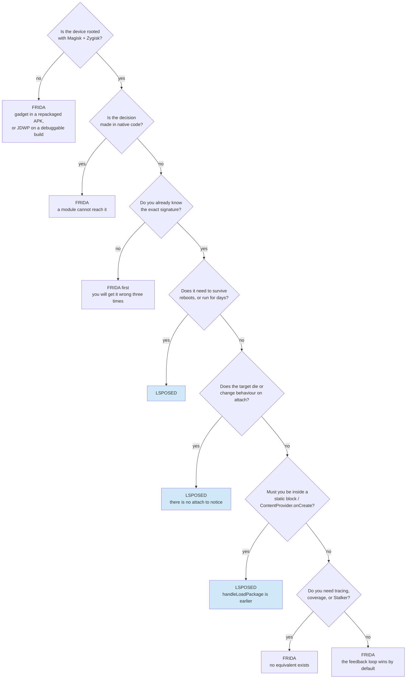
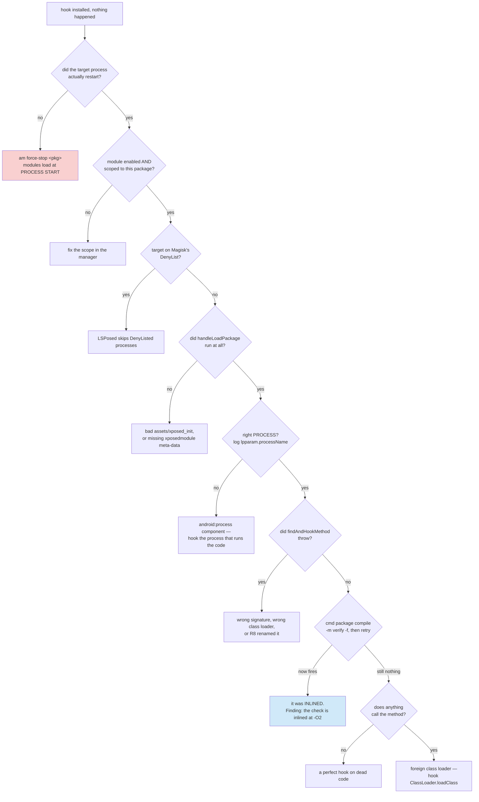
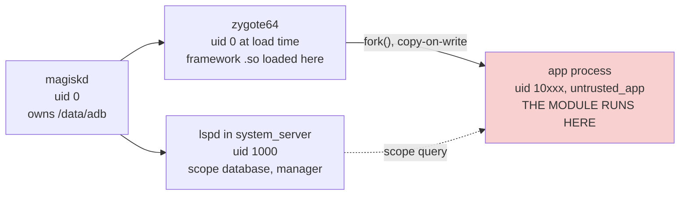

# 63 — LSPosed · Mind Map

The whole chapter as one map, plus two decision diagrams. Read
[README.md](README.md) for the prose; this file is for revision and for finding which section covers
what.

---

## The chapter

```mermaid
mindmap
  root((63 LSPosed))
    1 What it is
      Zygisk module
        loads a framework into Zygote
        62-Magisk owns the injection
      Implements the Xposed API
        de.robv.android.xposed
        ten-year-old modules still load
      Modifies NOTHING on disk
        app_process untouched
        coexists with Verified Boot
      Five names disentangled
        Xposed :: rovo89, /system, global
        Riru :: substrate, not a framework
        EdXposed :: Riru + YAHFA/SandHook
        LSPosed :: Zygisk + LSPlant
        libxposed :: the newer API
    2 Architecture
      magiskd :: uid 0, owns /data/adb
      zygote :: root at load time
      lspd in system_server :: uid 1000
        package database is a field away
        up before the first fork
        parasitic manager, often no icon
      app process :: uid 10xxx
        THE MODULE RUNS HERE
        no privilege, only earliness
      Three of 65's hook types
        type 5 RegisterNatives :: Zygisk into fork
        type 3 PLT/GOT :: Zygisk plumbing
        type 1 managed :: the module's only primitive
    3 Internals
      fork gives COW address space
        no dlopen
        no ptrace
        no new thread
        zero marginal cost per app
      Zygisk callbacks
        preAppSpecialize :: still root
        postAppSpecialize :: app uid, DEX loaded
        connectCompanion :: privilege by proxy
        getFlags :: DenyList
      Scope
        per module, per package
        shrinks blast radius and footprint
        android scope :: system_server, CRITICAL
      Class loaders
        lpparam.classLoader for app classes
        null means boot loader
        packer/plugin :: hook loadClass instead
      API surface
        IXposedHookZygoteInit
        IXposedHookLoadPackage
        IXposedHookInitPackageResources
        XC_MethodHook
          before / after
          setResult skips the original
          setThrowable clears the result
          priority wraps other hooks
        XposedHelpers
          findAndHookMethod
          get/setObjectField
          ignores private entirely
          additional instance fields
      Engines
        hookMethodNative :: classic, kAccNative + dispatcher
        YAHFA :: per-version ArtMethod offsets
        SandHook :: also true inline hooking
        LSPlant :: LSPosed's, derives offsets
      Backup method
        the trampoline of the managed world
        keeps the original entry pointer
        unhooking is cheap
        no code is modified
      Deoptimisation
        inlining is why hooks do not fire
        cmd package compile -m verify -f
    4 AOSP seams
      Zygote.java :: nativeForkAndSpecialize
      com_android_internal_os_Zygote.cpp :: the JNI table
      SpecializeCommon :: the uid drop
      ZygoteInit.forkSystemServer
      app_process/app_main.cpp :: what Xposed replaced
      art_method.h :: entry_point_from_quick_compiled_code_
      instrumentation.cc :: deoptimisation
      jit.cc :: can overwrite your entry point
      LoadedApk.getClassLoader
      ActivityThread.handleBindApplication
    5 Security
      Attacker
        borrow the app's crypto
        harvest OTPs across every scoped app
        defeat pinning, persistently
        use a KeyStore key without extracting it
        android scope :: the whole device
      Developer anti-patterns
        cached static security decision
        detect the framework not the effect
        decide in Java, consequence in native
        trust private
        self-integrity in the same address space
      Three vulnerability classes
        cached decision :: Info to Low, High if it gates a server action
        android scope :: Critical, against the DEVICE
        broken detection :: Informational, report what it gated
      Malware
        persistence and scope, not technique
        APKs unmodified, signatures valid
      Forensics
        GET THE SCOPE TABLE FIRST
        module APKs, LSPosed log, system_server maps
        acquisition needs root :: document it
    6 Reverse engineering
      Recognise a module
        assets/xposed_init :: plaintext, ALWAYS
        xposedmodule meta-data
        de.robv type refs :: obfuscation-proof
      Targets are string constants
        reflection is string based
        strings classes.dex gives the target list
      The negative measurement
        setResult :: 0 occurrences
        a compile-time flag removed the branch
        review the SOURCE for trust
      Hooked method at runtime
        dispatcher frame on the stack
        entry point outside known ranges
    7 Dynamic
      posture FIRST, and record it
        su 0 vs su -c
        Zygisk :: two independent checks
      force-stop or nothing happens
      ten-step diagnostic order
      LSPosed or Frida
        explore with Frida
        ship with LSPosed
    8 Static
      detect-xposed-module.py
      entry class, scope, API types, targets
      leads not findings
    Discipline
      observe before modifying
      reproduce without the module
      scope minimally
      remove it and evidence the removal
      instrumentation is not a finding
```

---

## Decision: which instrument?

Read the default: **Frida unless there is a reason.** Every LSPosed leaf is a specific reason —
persistence, hostility to attachment, earliness — and every other path lands on Frida because
iteration speed beats everything while you are still wrong about the target.

---

## Diagnostic: the hook did not fire

The two boxes people skip are **E** and **G**. "Never entered" and "entered but the installation
threw" have completely different fixes, and an unconditional log on the first line of
`handleLoadPackage` plus a `catch` that logs are what separate them. Everything below those two is
wasted effort until they are answered.

---

## The four privilege levels, at a glance

The shaded box has **no privilege beyond the application it landed in**. "A module runs as root" is
the most common wrong sentence about LSPosed; the framework had root, in Zygote, before the fork, and
gave it up in `SpecializeCommon` along with everything else the child inherited.
