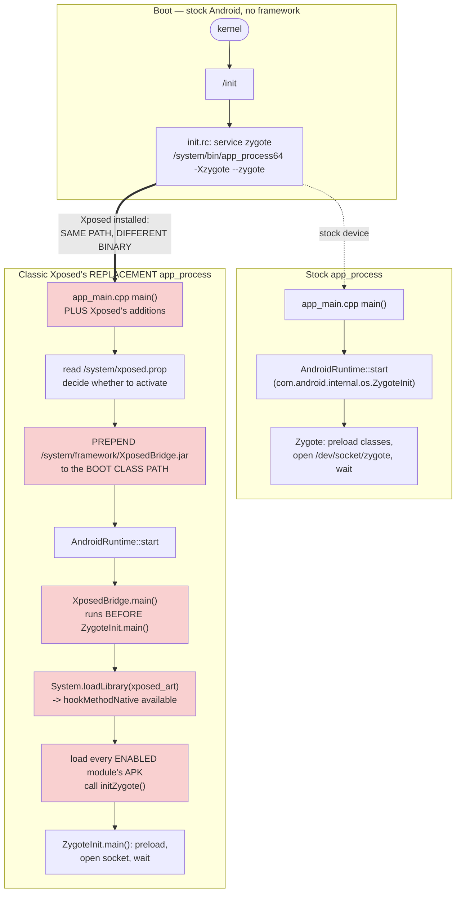
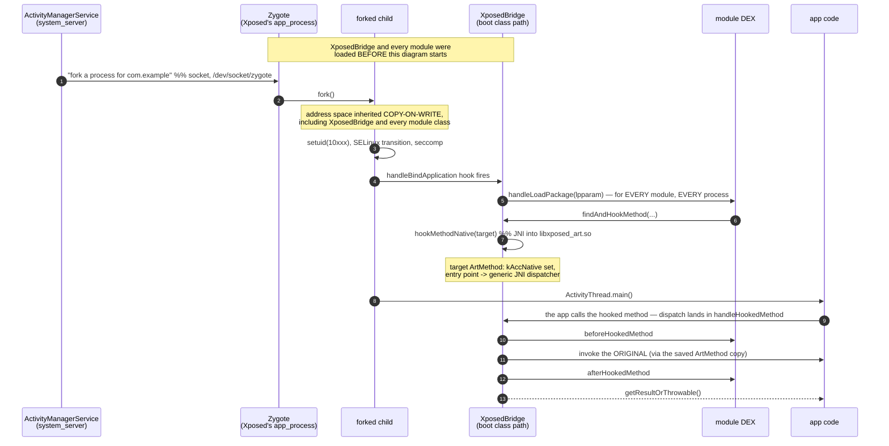
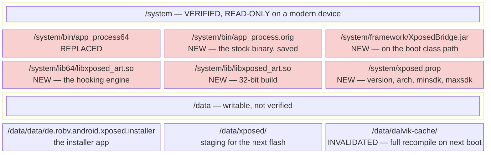
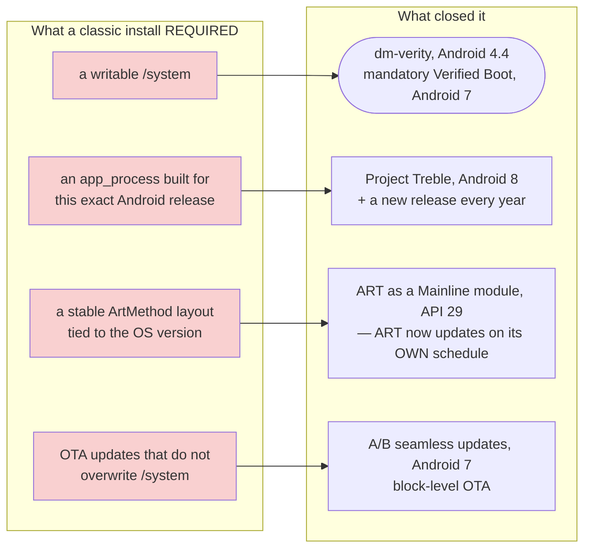
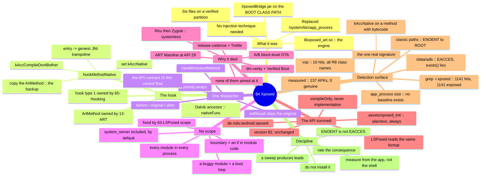

# 64 — Xposed

> After this chapter you will be able to explain exactly how a framework that no longer runs shaped
> every hooking tool that does — which file it replaced, which pointer it rewrote, and which five
> platform changes killed it — read and write a module against the API it defined and that LSPosed
> still implements, and recognise, adjudicate and correctly rate the Xposed-detection code that is
> still shipping in real applications years after the thing it looks for became unrunnable.

**Prerequisites:** [04-Java](../04-Java/README.md) · [11-Android-Runtime](../11-Android-Runtime/README.md) ·
[13-ART](../13-ART/README.md) · [14-Dalvik](../14-Dalvik/README.md) ·
[62-Magisk](../62-Magisk/README.md) · and — **out of numeric order, so read it first** —
[65-Hooking](../65-Hooking/README.md), whose taxonomy of what a hook physically *is* this chapter
uses throughout rather than restating; 65 depends on nothing after it, so reading 65 → 64 costs you
nothing.
**Applies to:** Classic Xposed itself: Android 4.0.3 (API 15) through Android 8.1 (API 27). The
**Xposed API** it defined: API 15 through Android 15 (API 35) and counting, via
[63-LSPosed](../63-LSPosed/README.md). The **detection surface** it left behind: every API level,
including ones on which the framework it detects has never been installable.
**Measured on:** an AVD, `sdk_gphone16k_x86_64` (`emu64xa16k`), **Android 15 / API 35, x86_64**,
rooted with **Magisk 30.7**, plus a corpus of **237 APKs pulled from that device**. Section 7.1
records exactly what was and was not observable, and the callout immediately below states which
claims in this chapter are measurements and which are not.

---

> ## ⚠️ Read this before you read anything else: what is measured here and what is not
>
> **Classic Xposed is functionally dead on modern Android, and it is not installed anywhere on this
> machine or on any attached device.** That is not a limitation of the write-up; it is the chapter's
> subject. Official support ended at Android 8.1 / API 27, the lineage moved
> Xposed → EdXposed → LSPosed, and the only device attached here is an **API 35 emulator**, on which
> classic Xposed cannot run at all.
>
> This repository's entire value rests on a stated measurement having actually been taken. So this
> chapter contains **no invented Xposed installation, no fabricated module-loading log, and no
> session transcript from a framework nobody ran.** Where a claim about classic Xposed's behaviour
> comes from its published design, its source layout, or the AOSP it modified rather than from a run,
> it says so.
>
> | Part of this chapter | Status |
> |---|---|
> | The absence of every classic-Xposed artefact, from **three vantages** (root, `shell`, app uid) | **Measured** on the AVD by [`scripts/xposed-artefact-probe.sh`](scripts/xposed-artefact-probe.sh) — §7.2. This is the strongest measurement in the chapter and it is a negative |
> | `app_process`'s real identity, size, mode and symlink target on a current image | **Measured** — §7.2 |
> | `/system` mounted **read-only** with `veritymode=enforcing` | **Measured** — §7.2, and it is the mechanical reason a classic install is impossible |
> | The **Xposed-detection corpus sweep**: 237 real APKs, per-signature counts, the two false-positive classes | **Measured** by [`scripts/xposed-detection-scan.py`](scripts/xposed-detection-scan.py) — §8.1–§8.3 |
> | The classic-API module and the specimen detector: compilation, DEX size, type references, string constants | **Measured** by [`scripts/build-classic-module.sh`](scripts/build-classic-module.sh), JDK 24 + build-tools 35.0.1 — §6 |
> | `hookMethodNative`'s mechanism — the `kAccNative` flip, the dispatcher, the `ArtMethod` backup | **Documentation-derived**, from the framework's published design and from the AOSP structures it manipulated. [13-ART §3.17](../13-ART/README.md)'s framework table is the repository's existing one-line statement of it; §3.5 here expands it and cites AOSP for every structure named. **Not executed** — see the note in §3.5 |
> | The Dalvik-era `dvmSetNativeFunc` form of the same trick | **Documentation-derived**, against [14-Dalvik](../14-Dalvik/README.md)'s `Method` structure |
> | The installer's flashing procedure, `xposed.prop`'s fields, the on-disk layout of an install | **Documentation-derived.** The paths are probed for and confirmed absent; their *contents* are described, not observed |
> | EdXposed / Riru / VirtualXposed / TaiChi internals | **Documentation-derived.** None is installed here |
> | Every script in [`scripts/`](scripts/) | **Executed.** Each carries an `EXECUTION STATUS` block in its own header saying so, and naming the host and device |
>
> If you have a device on which classic Xposed genuinely runs — an Android 5 to 8.1 image with an
> unlocked bootloader — and something below is wrong, that is a finding. Write it down. **This
> repository would rather ship a labelled gap than an unlabelled invention.**

---

## Table of Contents

1. [Introduction](#1-introduction)
2. [High-Level Architecture](#2-high-level-architecture)
3. [Deep Internal Working](#3-deep-internal-working)
4. [Source Code Walkthrough (AOSP)](#4-source-code-walkthrough-aosp)
5. [Security Perspective](#5-security-perspective)
6. [Reverse Engineering Perspective](#6-reverse-engineering-perspective)
7. [Dynamic Analysis](#7-dynamic-analysis)
8. [Static Analysis](#8-static-analysis)
9. [Examples](#9-examples)
10. [Common Interview Questions](#10-common-interview-questions)
11. [Common Mistakes](#11-common-mistakes)
12. [Hands-on Labs](#12-hands-on-labs)
13. [Summary](#13-summary)
14. [References](#14-references)

---

## 1. Introduction

### 1.1 The master key that was cut for a lock that no longer exists

Imagine a building where every room is furnished identically, because every room is fitted out by the
same crew from the same van. You want to change something in every room at once. There is a trick:
you do not visit the rooms. You change what is *in the van*.

That is a good trick and somebody used it for years. Then the building's owners did three things.
They welded the van's doors shut. They started checking, every morning, that the van's contents
matched a sealed manifest. And they replaced the van with a different vehicle whose interior is laid
out differently.

The trick stopped working. But the *building* did not change, the rooms are still furnished
identically, and somebody eventually worked out how to get into the new vehicle by a different door.
The new method is [LSPosed](../63-LSPosed/README.md), and almost every decision in its design is a
response to something specific that went wrong with the old one.

And here is the part that makes this a chapter rather than a footnote: **the building's security
guards are still checking for the old van.** Every morning, in applications shipping today, code runs
that looks for a vehicle that was scrapped years ago. Finding that code — and knowing what it is
worth — is a deliverable on real engagements.

That is this chapter. Three things, in order:

1. **The mechanism**, precisely, because it is the origin of everything that came after.
2. **The API**, because it did not die and you will read module source written against it this year.
3. **The detection surface**, because it outlived the framework and it is a live finding.

> **🧠 Mental Model.** Classic Xposed is to Android hooking what the Model T is to cars: nobody drives
> one, and you cannot understand why a modern car is shaped the way it is without knowing one existed.
> The difference is that Xposed left something behind that a Model T did not — **an API that is still
> running, and a detection surface that is still shipping.**

### 1.2 What problem existed before Xposed?

Before 2012, if you wanted an Android application to behave differently, you had exactly three
options and all of them were bad.

| Option | What it cost |
|---|---|
| **Ask the developer** | You are not the developer's customer, and the change you want is usually one they specifically did not make |
| **Repackage the APK** | Decompile, edit smali, rebuild, **re-sign with your own key**. The app now has a different signing certificate, so it is a different application to the system: it cannot receive its own updates, cannot share a uid with its siblings, fails every server-side signature check, and must be uninstalled and reinstalled, losing its data. And you must redo all of it on every release |
| **Build a custom ROM** | Works, applies to everything, and requires you to maintain an operating system |

The gap in the middle is obvious once it is stated: there was **no way to change one method's
behaviour, in one application, without changing that application's bytes.**

> **📖 Definition — hooking.** Arranging for your code to run when somebody else's function is
> called, without modifying the source of that function. [65-Hooking](../65-Hooking/README.md) owns
> this from first principles — what a hook physically is, the five places a call can be intercepted,
> and why each fails. This chapter does not re-derive any of it; it describes what one particular
> framework did with one of those five places.

Xposed, written by a developer known as **rovo89** and first released in 2012, filled that gap. Its
proposition was:

- **Install a framework once.** It patches the system, not any application.
- **Write a small APK — a "module" — that declares which methods it wants to intercept.**
- **Every application on the device becomes hookable**, with no repackaging, no re-signing, and no
  change to any APK on disk.

That combination had never existed on Android and it created an entire ecosystem: per-app locale
switchers, notification tweaks, ad blockers, privacy shims, and — inevitably — the tooling that
mobile security testing was built on for most of a decade.

### 1.3 What would break if Xposed had never existed?

This is the counterfactual worth taking seriously, because the honest answer is "surprisingly little,
eventually, and a great deal at the time".

- **The Xposed API would not exist**, and the module ecosystem built on it — thousands of modules,
  many still maintained — would have been written against something else, or not at all. LSPosed
  would not have had an API to re-implement, and would have had to invent one and then persuade an
  ecosystem to migrate. **The single largest thing classic Xposed contributed to the present is
  compatibility.**
- **The technique would still have been discovered.** Rewriting an ART method's entry point is not a
  clever trick that needed inventing; it is what the runtime does to itself constantly
  ([13-ART §4.3](../13-ART/README.md)). Somebody would have got there.
- **Android's defences would look different.** A meaningful fraction of what Verified Boot,
  `/system` immutability and Play Integrity are *for* is precisely this class of modification. Xposed
  was not the only pressure, but it was a visible and widely-deployed one.
- **A decade of mobile security testing methodology would have a different vocabulary.** "Hook the
  method, log the arguments, then decide whether to modify" is Xposed's working practice, inherited
  by Frida and by every tester trained on either.

### 1.4 What classic Xposed was, precisely

> **📖 Definition — classic Xposed.** A framework, installed by **replacing files on the Android
> system partition**, which (a) substituted its own build of `/system/bin/app_process` for the
> stock one, (b) had that binary add `XposedBridge.jar` to the **boot class path** before the runtime
> started, and (c) provided a native library that could redirect the dispatch of any Java method to a
> single generic dispatcher inside `XposedBridge`. Third-party **modules** — ordinary APKs declaring
> a `xposedmodule` meta-data element and naming an entry class in `assets/xposed_init` — were loaded
> into **every process on the device** and could register callbacks against arbitrary methods.

Six claims are packed into that, and §3 is organised around them because each is a separate
mechanism with a separate reason for dying:

1. **It modified the system partition.** Not a bind mount, not an overlay — actual bytes written to
   `/system`. §3.2.
2. **It replaced `app_process`.** The single binary every Java process on Android starts from. §3.1.
3. **Its jar was on the boot class path.** Which is why modules could reference framework classes
   directly, and why they needed no class-loader gymnastics. §3.3.
4. **The hook was ART entry-point replacement** (and, before that, Dalvik `nativeFunc` replacement),
   through a call named `hookMethodNative`. §3.4 and §3.5. The mechanism is
   [13-ART](../13-ART/README.md)'s and [65-Hooking](../65-Hooking/README.md)'s hook type 1; this
   chapter owns what Xposed specifically did with it.
5. **One dispatcher served every hook.** `XposedBridge.handleHookedMethod`. §3.6.
6. **There was no scope.** A module ran everywhere, always. §3.9 — and this is the design decision
   [63-LSPosed](../63-LSPosed/README.md)'s single largest feature exists to correct.

> **⚠️ Warning — the most common wrong sentence about this chapter's subject.** "Xposed hooks methods
> by injecting into Zygote" is **not** what classic Xposed did, and getting this backwards makes the
> whole lineage incomprehensible. Classic Xposed did not inject *into* Zygote at runtime; it
> **replaced the program that becomes Zygote**, so its code was there from the process's first
> instruction. Injecting a library into a running Zygote is Riru's and Zygisk's answer, invented
> precisely because replacing the binary had become impossible. See §3.1 and
> [62-Magisk §3.8](../62-Magisk/README.md).

### 1.5 The lineage, disentangled

[63-LSPosed §1.5](../63-LSPosed/README.md) has the canonical five-name table and this chapter does
not duplicate it. What belongs here is the **chronology**, because the names only make sense in
order, and because each entry exists to solve the previous entry's fatal problem.

| Era | Name | How it got its code into every process | Why the next one had to exist |
|---|---|---|---|
| 2012–2014 | **Xposed** (Dalvik) | Replaced `/system/bin/app_process`; `XposedBridge.jar` on the boot class path | ART replaced Dalvik in Android 5, and the hooking engine was Dalvik-specific |
| 2014–2018 | **Xposed** (ART) | Same, with a rewritten native engine (`libxposed_art.so`) | Verified Boot, Treble and A/B made writing to `/system` impossible for ordinary users. **Official support ends at API 27** |
| 2018–2021 | **EdXposed** | A **Riru** module — Riru replaced a native library Zygote already loaded, so the linker pulled it in for free. Systemless | Riru's mechanism was fragile across releases, and Magisk absorbed the capability |
| 2019– | **VirtualXposed**, **TaiChi** | No root at all: run the target *inside a container app*, or repackage the target with the framework stitched in | Neither can reach an app you did not put inside it, and repackaging breaks signatures |
| 2021– | **LSPosed** | A **Zygisk** module — Magisk loads a library into Zygote at runtime. Systemless, scoped, current | — |

Two facts to carry out of that table, because they are the ones that get mis-stated:

- **The break is at the *injection* layer, not the *hooking* layer.** Every row after the first two
  still rewrites an ART method's entry point. What changed, four times, is how the code that does the
  rewriting arrives. That is why [65-Hooking](../65-Hooking/README.md)'s taxonomy is stable while the
  framework names churn.
- **"Xposed" names an API as well as a framework, and the API outlived the framework by eight years
  and counting.** A module written in 2015 against `de.robv.android.xposed:api:82` loads in LSPosed
  today, unchanged. §6.1 proves that by building one.

### 1.6 Why a security professional cares about a dead framework

Three reasons, all present-tense, and the third is the one that shows up in reports.

**First, it explains why LSPosed is built the way it is.** Every design decision in
[63-LSPosed](../63-LSPosed/README.md) is a reaction to a specific Xposed limitation: systemless
because `/system` became unwritable; scoped because global was catastrophic; runtime-derived
`ArtMethod` offsets because tabulated ones broke on every release; a manager in `system_server`
because there was nowhere on the boot class path left to live. A reader who does not know the
original cannot evaluate the successor, and cannot tell which of LSPosed's properties are essential
and which are historical accident.

**Second, the API is alive and you will read code written against it.** `XposedBridge`,
`IXposedHookLoadPackage`, `XC_MethodHook`, `XposedHelpers.findAndHookMethod` — these are what a
module's source looks like in 2026, because LSPosed implements the same surface. The documentation a
module author read was written for a framework they cannot install. When you triage a module APK,
the type references you key on are `de.robv.android.xposed.*` — rovo89's package name, in somebody
else's framework, a decade later.

**Third — and this is the section of this chapter with the highest direct engagement value —
Xposed-detection code is still shipped in real applications.** Applications check for
`de.robv.android.xposed.XposedBridge`, for `XposedHelpers`, for `/system/framework/XposedBridge.jar`,
for a modified `app_process`, and for stack frames naming `handleHookedMethod`. Much of that code
was copied from advice written between 2014 and 2018 and has been reprinted ever since.

**Six of the eight checks in the specimen detector this chapter ships are dead against a device
running LSPosed, and two are dead against everything.** Measured, on the device in §7.1: every
classic-Xposed path returns `ENOENT` *to root*, so the check returns the right answer for entirely
the wrong reason and would return the same answer on a fully compromised device. §5.4 turns that into
a vulnerability class with an honest severity, and §8 automates finding it.

> **🔍 Pentester's Note.** "The application checks for Xposed" is not a finding, in either direction.
> The finding is **"the application's only control over X is a client-side check which cannot fire on
> any device shipped since 2018, therefore X is effectively unprotected"** — and then the severity is
> X's severity, not the check's. §5.4 and §5.6 develop that; §11.2 lists getting it wrong as the most
> common pentester mistake in this area.

### 1.7 Ethics, stated once

> **⚠️ Warning.** Every module in this chapter targets `com.pentest.ch64.vault`, a lab application
> you build yourself in [Lab 02](labs/lab-02-read-a-classic-module.md). Every APK scanned in §8 was
> pulled from a device the author controls. Point a module at software you do not own and are not
> explicitly authorised to test and you are, depending on jurisdiction, committing an offence — and
> in every jurisdiction breaching the terms under which that software was licensed to you.
> **Modules that defeat licensing, payment or anti-cheat controls in shipped third-party software are
> out of scope for this repository and will not be found in it.** Where an example needs a network
> endpoint it uses the `.invalid` top-level domain, reserved by RFC 2606, which can never resolve.

The professional framing that makes this practical rather than preachy: **installing a framework is a
modification to a device, and the device belongs to someone.** If it is your test device, that
someone is you. If it is a client's, the authorisation is in the rules of engagement, in writing,
before anything is flashed. Classic Xposed makes this sharper than most tools in this repository,
because its installation procedure **wrote to the system partition and broke Verified Boot** — an
irreversible-in-practice change to somebody's phone. That is why the honest modern answer to "how do
I install Xposed?" is "you almost certainly should not; use [63-LSPosed](../63-LSPosed/README.md)".

### 1.8 What this chapter owns, and what it does not

The boundary is drawn tightly, because four neighbouring chapters own mechanisms this one composes,
and re-deriving them would produce four worse copies.

| Topic | Owner | This chapter's role |
|---|---|---|
| `ArtMethod`, `entry_point_from_quick_compiled_code_`, `access_flags_`, `kAccNative`, the entry-point value table, deoptimisation, the four causes of hook failure | [13-ART §3.15–3.17, §3.20](../13-ART/README.md) | **Cite.** 13 derives the structure and the mechanism. This chapter owns **what `hookMethodNative` specifically did to it, and why that approach stopped working** |
| Dalvik's `Method` structure and `nativeFunc` | [14-Dalvik](../14-Dalvik/README.md) | **Cite.** This chapter owns the pre-ART form of the same trick |
| What a hook physically is; the five interception points; trampolines; inline hooking; PLT/GOT; `RegisterNatives` | [65-Hooking §2.1, §3.3–3.8, §3.17](../65-Hooking/README.md) | **Cite.** Classic Xposed is hook type 1 and nothing else. 65 owns all of it as mechanism |
| Systemless root, bind mounts and mount namespaces, `/data/adb/modules`, Zygisk, DenyList | [62-Magisk §1, §2.2, §3.6, §3.8](../62-Magisk/README.md) | **Cite.** This chapter owns the **contrast**: what modifying the system image cost, which is the problem systemless root exists to solve |
| The modern framework: Zygisk injection, per-application **scope**, LSPlant, the backup method, the `XposedBridge` API surface in depth | [63-LSPosed](../63-LSPosed/README.md) | **Cite, and hand over.** 63 is the successor and owns the present. This chapter owns the original it replaced |
| Root and tamper detection in general; the bypass arms race | [37-RootDetection](../37-RootDetection/README.md), [38-TamperDetection](../38-TamperDetection/README.md), [67-BypassingProtections](../67-BypassingProtections/README.md) | **Cite.** But **Xposed-specific detection signatures are this chapter's**, including the corpus measurement in §8 |
| Verified Boot, dm-verity, `vbmeta`, unlocking and flashing | [61-Fastboot](../61-Fastboot/README.md), [20-Security-Architecture](../20-Security-Architecture/README.md) | **Cite.** This chapter owns why those specific controls were fatal *to this framework* |
| Zygote as a runtime construct; `fork` and copy-on-write | [11-Android-Runtime](../11-Android-Runtime/README.md) | Cite |
| A sweep produces leads, not findings | [52-StaticAnalysis](../52-StaticAnalysis/README.md) | Cite — §8 inherits the discipline and reports its own false-positive rate |

What is left, and what you will find nowhere else in this repository:

- The `app_process` replacement, end to end: what the binary does, what Xposed's build added, and why
  that was the narrowest possible waist in the system before Zygisk existed.
- `hookMethodNative` in depth, in both its Dalvik and ART forms, and the precise reasons each stopped
  working.
- The installer, the system-modification requirement, and what a classic install physically left on
  disk — **probed for and confirmed absent, from three vantages**.
- The module format and `assets/xposed_init`, and why an obfuscated module must still publish its
  entry class in plaintext.
- The EdXposed/Riru interlude and the rootless variants, and what each traded away.
- The migration path to LSPosed, stated as a checklist rather than a slogan.
- **The detection surface that outlived the framework** — measured across 237 real APKs, with two
  independently-measured false-positive classes and an honest severity model.

---

## 2. High-Level Architecture

### 2.1 The boot chain classic Xposed inserted itself into



Read this as **one boot**, and notice four things about it.

**First, `init.rc` is unchanged.** The service definition still says `/system/bin/app_process64`. That
path is not modified; the *file at that path* is. This is the entire installation, and it is why the
change is invisible to anything that reads configuration and visible to anything that hashes files.

**Second, everything shaded is inside the process that becomes Zygote, and it happens before
`ZygoteInit.main`.** That is earlier than any modern framework gets. Zygisk's `onLoad` runs after
the runtime has started; Xposed's `XposedBridge.main` ran before Zygote had preloaded a single class.
§3.9 explains what that bought and what it cost.

**Third, `initZygote` ran once, in a root process, with every enabled module's code loaded.** There
was no filtering, because there was nothing to filter on: no package existed yet.

**Fourth, the boot class path is prepended, not appended.** `XposedBridge.jar`'s classes were
resolvable from every class loader on the device without anyone asking, which is the property that
made the whole module model work — and the property that no systemless framework can reproduce.

### 2.2 One app launch, as a sequence



The line to compare against [63-LSPosed §2.2](../63-LSPosed/README.md) is **step 6**. LSPosed's
equivalent sequence has a query to `lspd` asking *"which modules apply to this package?"*. **There is
no such step here.** Every module's `handleLoadPackage` ran in every process, and the only thing
between a module and the whole device was the module author's own `if` statement. §3.9 and §5.3
develop the consequences, which range from "a buggy module bootloops the phone" to "one module can
silently disable another's".

The second line worth staring at is **step 12**, the invocation of the original. Classic Xposed kept
a copy of the target's `ArtMethod` before it modified it, and invoked *that* to reach the original
body. [63-LSPosed §3.10](../63-LSPosed/README.md) makes the general point — that a managed hook needs
a backup method for the same reason an inline hook needs a trampoline — and it is worth recording
that **classic Xposed had this problem first and solved it the same way**, with a saved structure
rather than a synthetic generated method. §3.6 covers the difference and why it matters.

### 2.3 What a classic install physically wrote to disk



Six files on the verified partition. That is the whole framework, and it is also the whole reason it
is dead.

Compare with [62-Magisk](../62-Magisk/README.md)'s count for a systemless install: **zero**. Magisk's
answer, in its own §1's words, is that *"the real partitions should be left byte-for-byte identical
to what the manufacturer shipped"* — the boot image is patched instead, and modified files are
presented through bind mounts inside mount namespaces. 62's mental model for that is a projector
shining on an unchanged wall. **Classic Xposed is the graffiti.**

> **🔬 Under the Hood.** The last row of the second block is the one people forget, and it is why an
> Xposed install or uninstall took several minutes and a scary-looking boot. Adding a jar to the boot
> class path changes the boot class path's checksum, which invalidates every AOT-compiled artefact on
> the device — `boot.oat` and every application's `.odex`. The next boot recompiles all of it.
> [13-ART §3.7](../13-ART/README.md) owns why: the BCP checksums live in the OAT key-value store and
> a mismatch forces regeneration. That interaction is also the reason Xposed installs were fragile
> across OTAs in a way that had nothing to do with dm-verity.

Every one of those six paths was probed on the API 35 AVD, from root, from `shell` and from an app
uid. All six are `ENOENT` **from all three vantages, including root** — §7.2 has the table.

### 2.4 Classic Xposed against chapter 65's taxonomy

[65-Hooking §3.17](../65-Hooking/README.md) enumerates five hook types by what each overwrites.
[63-LSPosed §2.4](../63-LSPosed/README.md) shows LSPosed using three of them. Classic Xposed used
**exactly one**, and the difference is instructive.

| Stage | 65's hook type | What was overwritten | Why not more |
|---|---|---|---|
| Get the framework into every process | **none of the five** | Nothing was hooked. The **program on disk was replaced**, so the framework was present from `main()` | You do not need to inject into a process you *are* |
| Hook a Java method | **Type 1 — managed** | `ArtMethod`'s `access_flags_` (set `kAccNative`) and its entry point | This is the only primitive the API exposed |

That first row is the architectural claim of this whole chapter. **Classic Xposed needed no injection
technique at all**, because it owned the executable. Riru, Zygisk, `LD_PRELOAD`, `ptrace` and
`RegisterNatives` rewriting are all answers to a question Xposed never had to ask — and every one of
them appeared *after* replacing the binary stopped being possible.

> **🧠 Mental Model.** Ask "how does the framework's code get into the process?" and the whole family
> tree falls out. Xposed: *it was already there, because it is the program.* Riru: *the linker loads
> it, because it replaced a library the program already needs.* Zygisk: *a root daemon injects it.*
> Frida: *a foreign process `ptrace`s in.* Four eras, four answers, one question. The hooking itself
> — [65-Hooking](../65-Hooking/README.md)'s type 1 — is the same in all four.

### 2.5 The four things Xposed needed, and when each became impossible

This is the diagram to keep. [63-LSPosed §1.2](../63-LSPosed/README.md) lists four problems with
classic Xposed from the successor's point of view; this is the same story told forwards, with the
platform change that closed each door.



Read the right-hand column and notice that **not one of those four changes was aimed at Xposed.**
dm-verity exists because a persistent root kit on `/system` is the worst outcome for a phone. Treble
exists to decouple vendor code from the framework. ART became Mainline so security fixes could ship
without an OS update. A/B exists so an interrupted update does not brick the device.

> **🧠 Mental Model.** **Architectural changes are often better security controls than security
> features.** Nothing on the right is a "stop Xposed" feature; collectively they ended it. This is
> the same observation [63-LSPosed §10](../63-LSPosed/README.md) reaches from the other end, asking
> what happens to LSPosed if Android moves away from Zygote — and the answer is the same shape: the
> platform can remove an attacker capability without ever addressing the capability by name.

The measured form of that argument, from the AVD in §7.2:

```
/dev/block/dm-5   /   ext4   ro,seclabel,relatime      # the root/system mount is READ-ONLY
ro.boot.veritymode = enforcing
```

A classic Xposed install needed to write six files into that mount. It cannot, and unlike a Magisk
module there is no systemless path for it, because **the whole design depends on the file at
`/system/bin/app_process64` being a different file** — not on it *appearing* to be one to some
processes.

---

## 3. Deep Internal Working

### 3.1 `app_process` — the binary the whole framework hung off

Neither [13-ART](../13-ART/README.md) nor [65-Hooking](../65-Hooking/README.md) explains this file;
[62-Magisk §4.1](../62-Magisk/README.md) names it in a table and hands it here. So it starts from
first principles.

> **📖 Definition — `app_process`.** The command-line program that starts the Android runtime. It is
> an ordinary ELF executable at `/system/bin/app_process`. Given `--zygote` it becomes **Zygote**,
> the process every application is forked from. Given a class name instead, it runs that class's
> `main` as a one-shot Java program — which is what `am`, `pm`, `dumpsys` and every other Java-based
> shell command on Android actually are.

Measured on the API 35 AVD (§7.2):

```
# adb shell — the file as it actually is on a current image
lrwxr-xr-x 1 root shell    13 2025-01-23 23:03 /system/bin/app_process -> app_process64
-rwxr-xr-x 1 root shell 51616 2025-01-23 23:03 /system/bin/app_process64
```

Three facts in three lines, and each matters.

- **`app_process` is a symlink** on this image, to `app_process64`. A detector that stats the
  symlink and one that stats the target are asking different questions, and a 64-bit-only image has
  no `app_process32` at all — confirmed `ENOENT` in the same run.
- **It is 51,616 bytes.** That number is a property of *this build* of *this release* for *this
  architecture*. It is not a constant, and §5.4 shows why hard-coding it is a defect rather than a
  control.
- **It is `root:shell`, mode `0755`**, on a read-only verified mount. Replacing it requires writing
  to that mount.

What it does, from `frameworks/base/cmds/app_process/app_main.cpp`:

```cpp
// frameworks/base/cmds/app_process/app_main.cpp  (shape, abridged — no line numbers quoted)
int main(int argc, char* const argv[])
{
    AppRuntime runtime(argv[0], computeArgBlockSize(argc, argv));
    // ... parse --zygote, --start-system-server, --application, the class name ...
    if (zygote) {
        runtime.start("com.android.internal.os.ZygoteInit", args, zygote);
    } else if (!className.isEmpty()) {
        runtime.start("com.android.internal.os.RuntimeInit", args, zygote);
    }
}
```

`AndroidRuntime::start` creates the VM, and it is the point of interest: **the boot class path is
fixed at that moment.** Before it, you can change what will be on the class path. After it, you
cannot.

**What Xposed's build added, and where.** Its `app_process` is the stock source plus a block that
runs before `runtime.start`:

| Step | What it did | Why there |
|---|---|---|
| 1 | Read `/system/xposed.prop` | A kill switch and a version gate. A missing or malformed file meant "do not activate", which is how a bad install could be recovered by deleting one file |
| 2 | Check for a `disabled` marker, and for safe-mode conditions | Repeated volume-key presses at boot disabled the framework — the escape hatch from a bootlooping module |
| 3 | **Prepend `/system/framework/XposedBridge.jar` to the boot class path** | It must happen before the VM exists, because the boot class path is baked in at VM creation |
| 4 | Change the class to be run from `ZygoteInit` to `XposedBridge` | So framework code ran first and could set itself up before Zygote preloaded anything |
| 5 | `XposedBridge.main` did its work, then called `ZygoteInit.main` itself | The stock boot continued, with the framework already present |

> **🔬 Under the Hood.** Step 5 is the elegant part and the fragile part at once. `XposedBridge.main`
> was a **wrapper** around `ZygoteInit.main`: it ran, then handed control on, and from Zygote's point
> of view nothing had happened. That is why there is no "Xposed process" — there is only Zygote, with
> a different early history. It is also why an exception thrown during Xposed's setup did not produce
> an error message; it produced a device that did not boot.

**Why this was the narrowest possible waist.** Every Java process on Android — Zygote, `system_server`
(forked from Zygote), every app (forked from Zygote), and every `am`/`pm` invocation — starts at
`app_process`'s `main`. One file. One `main`. Total coverage, with no injection technique, no root
daemon at runtime, and nothing to hook.

Zygisk reaches the same coverage by hooking `nativeForkAndSpecialize` and `nativeSpecializeAppProcess`
([62-Magisk §3.8](../62-Magisk/README.md), [16-JNI](../16-JNI/README.md)'s `RegisterNatives`), which
is [65-Hooking](../65-Hooking/README.md)'s hook type 5 — two function pointers instead of one binary.
**It is a narrower waist still, and it required no write to any partition.** That comparison is the
single best one-sentence summary of the twelve years between them.

### 3.2 The installer, and the system-modification requirement

The Xposed Installer was an ordinary APK (`de.robv.android.xposed.installer`) with an extraordinary
job: get six files onto a read-only partition.

It did it in one of two ways, both of which are worth understanding because both are now closed.

**Route A — remount and copy.** With root, `mount -o rw,remount /system`, copy the files, restore the
mount. This is the "graffiti" route [62-Magisk §1](../62-Magisk/README.md) describes for old-style
`su` installs, and it is closed by exactly the same thing: on a device with dm-verity enabled, the
kernel refuses the write, and if verity is disabled to permit it, the device boots into a warning
state a remote server can see. [61-Fastboot](../61-Fastboot/README.md) measured the mechanism
precisely: `--disable-verity` sets one byte inside the region AVB hashes, invalidating the image's
own signature, so it is *"a deliberate corruption that only an unlocked bootloader will accept"*.

**Route B — a recovery-flashable zip.** The installer downloaded a zip and rebooted into a custom
recovery, which mounted `/system` read-write outside of Android and copied the files. This is why
"install a custom recovery" appeared in every Xposed guide, and it presupposes an unlocked
bootloader — which on most devices wipes the data partition, and on many enterprise or
carrier-locked devices is simply not possible.

**What the framework left, and how it could be undone.** The installer saved the stock binary as
`/system/bin/app_process.orig` before overwriting it. Uninstalling meant copying that back — which is
why the presence of `app_process.orig` was itself a detection signature, and it is in this chapter's
probe list. Measured: `ENOENT` on the AVD, from all three vantages.

| Requirement | Platform change that closed it | Chapter |
|---|---|---|
| Write access to `/system` at runtime | dm-verity (4.4), mandatory Verified Boot (7.0) | [20-Security-Architecture](../20-Security-Architecture/README.md) |
| Write access to `/system` from recovery | Unlockable bootloader; A/B images; `/system` as the root mount | [61-Fastboot](../61-Fastboot/README.md) |
| A per-release `app_process` build | One release a year; Treble; per-vendor variation | §3.10 |
| Surviving an OTA | Block-level A/B updates recompute the whole partition | [62-Magisk §1](../62-Magisk/README.md) |

> **⚠️ Warning.** Do not attempt a classic Xposed install on any device you care about, and never on
> a client device. It requires disabling Verified Boot, which is not reversible by re-enabling a
> flag — [61-Fastboot](../61-Fastboot/README.md) measured that a device left in that state and then
> relocked is a brick, and built a whole CTF around the mechanism. If you need managed-code hooking
> on a modern device, the answer is [63-LSPosed](../63-LSPosed/README.md), which modifies nothing.

### 3.3 `XposedBridge.jar` on the boot class path

> **📖 Definition — boot class path.** The list of `.jar` files whose classes the runtime loads
> before, and outside, any application's own class loader. Classes on it are visible to every process
> on the device without anyone asking for them. `java.lang.String` and `android.app.Activity` live
> there.

Putting `XposedBridge.jar` there gave classic Xposed one property that no successor has, and it is
the source of several differences that otherwise look arbitrary.

**A module could reference `de.robv.android.xposed.*` directly, from anywhere, with no class-loader
argument.** The classes were on the boot class path, so every loader in every process delegated up to
them and found them. Compare [63-LSPosed §3.5](../63-LSPosed/README.md), where a module's DEX is
loaded by a dedicated class loader *inside* the app and the class-loader question becomes a genuine
problem the module author must reason about.

Three consequences, in decreasing order of how often they are misunderstood:

| Consequence | Why |
|---|---|
| **`XposedBridge` was resolvable in *every* process, always** | Which makes `Class.forName("de.robv.android.xposed.XposedBridge")` a *device-wide* detector under classic Xposed and only a *this-process* detector under LSPosed. Same line of code, different question answered. §5.3 |
| **Adding it invalidated every AOT artefact on the device** | The boot class path's checksum is recorded in the OAT key–value store; changing the path forces a full recompile ([13-ART §3.7](../13-ART/README.md)) |
| **There is no systemless equivalent** | You cannot bind-mount a new entry onto the boot class path, because the path is a string in `init`'s environment consumed before any module's mounts exist. This is precisely why LSPosed had to solve the class-loader problem instead |

That third row is the one to carry into [63-LSPosed](../63-LSPosed/README.md). Its §3.5's two dotted
lines — *pass `lpparam.classLoader`*, and *hook the loader if the class does not exist yet* — are
work created by the loss of the boot class path. Classic Xposed had neither problem and could not
have had them.

### 3.4 `hookMethodNative` — the Dalvik form

> **⚠️ Documentation-derived.** Everything in §3.4 and §3.5 describes a mechanism that could not be
> executed here: no device attached runs Dalvik, and none runs classic Xposed.
> [13-ART §3.17](../13-ART/README.md)'s framework table is this repository's existing one-line
> statement of the ART form — *"set the method's native flag and redirected its entry to a
> dispatcher"* — and what follows expands it, naming the AOSP structures involved and citing the
> chapters that own them. Where the exact field name differed across releases, the class of change is
> described rather than a name invented.

Start with Dalvik, because the trick is clearer there and because it is where the name comes from.

[14-Dalvik](../14-Dalvik/README.md) owns the runtime. The one fact needed here is the shape of the
`Method` structure: for a **native** method, Dalvik stored a pointer to the C function that
implements it, and dispatch for a native method consisted of calling through that pointer. Registering
a JNI method — [16-JNI](../16-JNI/README.md)'s `RegisterNatives` — is the supported way of setting it.

Xposed's move was:

1. **Take a `Method` that is not native at all** — an ordinary Java method with bytecode.
2. **Set its native access flag**, so the runtime stops looking for bytecode and starts looking for a
   function pointer.
3. **Write the function pointer to point at one generic C function** provided by Xposed.
4. **Keep a copy of the original `Method` structure**, unmodified, so the original body can still be
   invoked.

The name `hookMethodNative` is a description of step 2: *make the method native*. It was exposed to
Java as a `private static native` method on `XposedBridge` and implemented in `libxposed_dalvik.so`.

> **🔬 Under the Hood.** This is why the framework's dispatcher signature looks the way it does. A
> native method receives a `JNIEnv*`, a `jobject`/`jclass` receiver, and its arguments; Xposed's
> generic function received the same, plus enough context to identify *which* Java method had been
> called, and then boxed the arguments into an `Object[]` so the Java-side callbacks could read and
> rewrite them. **The boxing is not an implementation detail — it is the whole reason
> `MethodHookParam.args` is an `Object[]` and why `param.args[0] = "x"` works.** The API's shape is a
> direct consequence of the dispatch mechanism, thirteen years later, in a framework with none of the
> same code.

### 3.5 `hookMethodNative` — the ART form, and what it did to `ArtMethod`

Android 5 replaced Dalvik with ART and Xposed's engine was rewritten as `libxposed_art.so`. The
structure changed; the idea did not.

[13-ART §3.15](../13-ART/README.md) owns `ArtMethod` and derives its layout. The three fields this
section needs, quoted from 13's own listing:

```cpp
// art/runtime/art_method.h  (abridged — 13-ART section 3.15 has the full structure)
class ArtMethod {
  GcRoot<mirror::Class> declaring_class_;
  std::atomic<std::uint32_t> access_flags_;        // Java modifiers PLUS ART-internal bits
  // ...
  struct PtrSizedFields {
    void* data_;                                    // for a NATIVE method: the JNI function pointer
    void* entry_point_from_quick_compiled_code_;    // where calls actually go
  } ptr_sized_fields_;
};
```

13-ART's field table records exactly the two properties Xposed depended on:

- `access_flags_` *"contains `kAccFastNative`, `kAccNative`, `kAccCompileDontBother`"*;
- `data_` *"for a native method, this is the **JNI function pointer** — overwrite it and you have
  redirected a native method without touching its code"*.

The ART-era `hookMethodNative` therefore did, per 13-ART §3.17's summary, **"set the method's native
flag and redirect its entry to a dispatcher"** — which unpacks into four operations:

| # | Operation | On which field | Why |
|---|---|---|---|
| 1 | **Copy the whole `ArtMethod`** into memory the framework owns | all of it | The backup. Invoking this copy reaches the original body, because it still carries the original entry point. This is [63-LSPosed §3.10](../63-LSPosed/README.md)'s backup method, in its first incarnation |
| 2 | **Set `kAccNative`** in `access_flags_` | `access_flags_` | Tells the runtime that this method has no bytecode and must be entered through the JNI path |
| 3 | **Point the entry at the generic JNI trampoline**, and set `data_` to Xposed's dispatcher | `entry_point_from_quick_compiled_code_`, `data_` | The generic JNI trampoline is one of the legitimate entry-point values 13-ART §3.16 tabulates; it marshals arguments and calls through `data_` |
| 4 | **Discourage recompilation** | `access_flags_` (`kAccCompileDontBother`) | If the JIT compiled the method it would write a *new* entry point over the framework's. [13-ART §3.14](../13-ART/README.md) owns the JIT and hotness counting |

Read operation 1 and operation 3 together and the shape of the whole thing appears: **the target's
`ArtMethod` is turned into a native method whose implementation is the dispatcher, and a pristine
copy is kept so the original can still be reached.**

> **🔬 Under the Hood — the convergence worth noticing.** An inline hook needs a *trampoline* holding
> the displaced instructions, because the function's first bytes were overwritten
> ([65-Hooking §2.3](../65-Hooking/README.md)). A managed hook needs a *backup method* holding the
> original entry pointer, because the method's dispatch slot was overwritten. Classic Xposed's backup
> is a **memcpy of a struct**; LSPlant's is a **synthetic Java method generated at runtime**. Same
> problem, same solution shape, three implementations: *if you want to call through, you must keep a
> copy of what you destroyed.* [63-LSPosed §3.10](../63-LSPosed/README.md) states this for the modern
> engine; this is where the pattern starts.

**Why the copy-the-struct approach specifically stopped working.** Two independent reasons, and the
second is the fatal one.

1. **`ArtMethod`'s layout is not stable across releases.** Copying a struct requires knowing its
   size; setting `kAccNative` requires knowing where `access_flags_` is. Every Android release could
   move both. That is a maintenance burden and it is survivable with a per-version table — which is
   what YAHFA later did and what [63-LSPosed §3.9](../63-LSPosed/README.md) records as *"needed
   per-Android-version knowledge of `ArtMethod`'s layout"*.
2. **From API 29, ART is a Mainline module.** It updates independently of the platform version
   string. **Two devices reporting the same Android release can have different ART builds with
   different field offsets** ([13-ART §3.26](../13-ART/README.md)). A per-version table is no longer
   even well-defined, because the version does not determine the layout. This is the concrete reason
   LSPlant derives offsets at runtime, and it is the reason the *table-driven* generation of engines
   ended.

> **⚠️ Warning.** Reason 2 is not a historical curiosity, it is live advice: **never hard-code an
> `ArtMethod` field offset in anything you write.** [13-ART](../13-ART/README.md) ships
> [`13-ART/scripts/artmethod-inspect.js`](../13-ART/scripts/artmethod-inspect.js), which locates the
> field without one. An engine with tabulated offsets works on the author's device and corrupts
> memory on somebody else's, silently, because a wrong offset writes a valid-looking pointer into a
> field that is not the entry point.

### 3.6 One dispatcher for every hook

Everything above installs the hook. This is what happens when the hooked method is called.

Classic Xposed had **one** dispatcher — `XposedBridge.handleHookedMethod` — reached from native code
for every hooked method on the device. Its job, in order:

```
1.  identify WHICH method was called          (from the context the native side passed)
2.  look up the sorted callback list for it   (a map keyed by the method)
3.  build a MethodHookParam: method, thisObject, args[]
4.  for each callback, highest priority first:  beforeHookedMethod(param)
5.  if no callback called setResult/setThrowable:
        invoke the ORIGINAL, through the SAVED ArtMethod copy
        record the result or the throwable into param
6.  for each callback, lowest priority first:   afterHookedMethod(param)
7.  return param.getResultOrThrowable()
```

Four properties of the API fall directly out of that listing, and every one of them is something a
module author has to know:

| API behaviour | Which step causes it |
|---|---|
| `setResult` in `before` **skips the original body** | Step 5's condition |
| `afterHookedMethod` runs **even when the original was skipped** | Step 6 is unconditional |
| `param.args[i] = v` in `before` changes what the original receives; in `after` it changes nothing | The array built at step 3 is passed to step 5; step 6 is after the call |
| Higher priority **wraps** lower: its `before` first, its `after` last | Steps 4 and 6 iterate in opposite orders |

[63-LSPosed §3.7](../63-LSPosed/README.md) documents these as the modern API's semantics, with a
state diagram and the full operation table. They are not restated here, because **they are the same
semantics** — LSPosed re-implements this contract faithfully. What belongs here is the observation
that the contract is *a description of this dispatcher's control flow*, preserved for a decade after
the dispatcher itself was replaced.

> **🔍 Pentester's Note.** The single-dispatcher design is also why a classic-Xposed stack trace has a
> recognisable shape: a frame naming `de.robv.android.xposed.XposedBridge.handleHookedMethod` sat
> between a hooked method and its caller, in every process, for every hook. That is the signature the
> stack-inspection check in [`examples/XposedDetector.java`](examples/XposedDetector.java) looks for —
> and it is why a detector that knows only that name is a detector written before 2019, because
> LSPlant generates a per-hook class whose name contains `LSPHooker` instead. §5.3 measures how many
> real applications ship the old name.

### 3.7 The API surface, and which parts are historical

[63-LSPosed §3.6–3.8](../63-LSPosed/README.md) documents the `XposedBridge`, `XC_MethodHook` and
`XposedHelpers` surfaces exhaustively, with the semantics that are not in any doc comment. That is
the reference; this table is the **provenance**, which is what this chapter can add: every one of
these was defined by classic Xposed, and the "still current?" column is the useful one.

| API element | Defined for | Still current? |
|---|---|---|
| `IXposedHookZygoteInit.initZygote` | Running once in Zygote as root, before any app | **Yes**, but it is now the *rare* entry point. Under LSPosed it requires framework scope; under classic Xposed it was free |
| `IXposedHookLoadPackage.handleLoadPackage` | Running once per process | **Yes** — the entry point essentially every module uses |
| `IXposedHookInitPackageResources` | Replacing resources before inflation | Yes, and as marginal for security work now as it was then |
| `IXposedMod` | The empty marker interface all three extend | Yes. It means nothing on its own and you will see it in a decompiled hierarchy |
| `XposedBridge.log(String)` / `log(Throwable)` | The module's output channel | Yes |
| `XposedBridge.hookMethod(Member, XC_MethodHook)` | The primitive | Yes |
| `XposedBridge.hookAllMethods` / `hookAllConstructors` | Every overload at once | Yes |
| `XposedBridge.invokeOriginalMethod` | Calling the un-hooked original from anywhere | Yes — and it is the backup method (§3.5) exposed directly |
| `XposedHelpers.findAndHookMethod` (both forms) | The readable wrapper | Yes. The varargs contract — **callback last** — is unchanged |
| `XposedHelpers.get/set*Field`, `callMethod`, `newInstance` | Reflection without the boilerplate | Yes. Still ignores access modifiers entirely |
| `XposedHelpers.get/setAdditionalInstanceField` | A weak-keyed per-object side table | Yes |
| `XC_MethodReplacement.returnConstant` / `DO_NOTHING` | Replace a body wholesale | Yes |
| `XCallback.PRIORITY_*` | Ordering between modules | Yes |
| **`XposedBridge.XPOSED_BRIDGE_VERSION`** | The API level a module declares against | Yes, and it has been **82** for years. It is an *API* number: it says nothing about Android versions or LSPosed versions |
| **`assets/xposed_init`** | Naming the entry classes | Yes — see §3.8 |
| **`xposedmodule` / `xposedminversion` / `xposeddescription` meta-data** | Making an APK a module | Yes |
| **`xposedscope` meta-data** | A hint about intended targets | **Repurposed.** Under classic Xposed it was documentation; LSPosed uses it to pre-select scope checkboxes. Still not an enforcement boundary |

The last row is the only genuine semantic change in the list, and it is a small one. **Everything
else in this table means today exactly what it meant in 2015**, which is a remarkable stability
record for any API and the practical reason this chapter is worth reading.

> **⚠️ Warning — `compileOnly`, and the failure that produces no error.** The API must be on the
> compile classpath and **must not be packaged into the module**. In Gradle that is
> `compileOnly 'de.robv.android.xposed:api:82'`, never `implementation`. A module that ships its own
> copy of `de.robv.android.xposed` ends up with the module's code calling the *module's*
> `XposedBridge` — a different class from the one the framework loaded — so every hook is installed
> into nothing. The module loads cleanly, logs nothing, hooks nothing, and no stage of the build or
> the load reports a problem. [`scripts/build-classic-module.sh`](scripts/build-classic-module.sh)
> enforces the same separation without Gradle, and §6.1 shows the measured consequence: a DEX that
> **references ten `de.robv` types and defines none of them.**

### 3.8 The module format, and the file that cannot be obfuscated

A classic Xposed module was an ordinary APK with three additions. LSPosed reads the identical format,
which is why an APK cannot tell you which framework will load it
([63-LSPosed §2.5](../63-LSPosed/README.md)).

**1. Manifest meta-data**, inside `<application>`:

| `android:name` | Required | Meaning |
|---|---|---|
| `xposedmodule` | **Yes** | Value `true`. Without it the installer will not list the APK at all |
| `xposedminversion` | **Yes** in practice | Minimum **Xposed API** version. `82` is the long-standing level |
| `xposeddescription` | Recommended | One line, shown in the installer |
| `xposedscope` | Optional | Comma-separated intended target packages. Documentation under classic Xposed; a pre-selection hint under LSPosed |

**2. `assets/xposed_init`** — a plain text file, one fully-qualified class name per line, naming the
classes that implement the entry-point interfaces. See
[`examples/xposed_init`](examples/xposed_init).

**3. The API on the compile classpath only** — §3.7's warning.

> **🔍 Pentester's Note — the permanent, structural leak.** **An obfuscated module must publish its
> entry class name in plaintext, and there is no configuration in which that is not true.** The
> framework reads `assets/xposed_init` with no knowledge of any obfuscation mapping, so R8 renaming
> the entry class breaks the module. Every module therefore carries a `-keep` on its entry classes,
> and `unzip -p module.apk assets/xposed_init` is the first command of any module triage. The same
> argument applies one level down: **class and method names in hook calls are string constants**,
> because reflection is string-based, so a module cannot hide *what* it hooks either without
> encrypting its constant pool. §6.2 measures both on this chapter's own module.

### 3.9 `initZygote`, the global model, and what having no scope actually cost

This is the design decision that defines classic Xposed, and it is worth being precise about, because
"it had no scope" undersells how strange the resulting system was.

**Every enabled module was loaded into every process.** Not "could be" — *was*. The framework loaded
each enabled module's DEX during `XposedBridge.main`, before Zygote preloaded anything, and every
module's `handleLoadPackage` was invoked for every application process the device ever forked.

Five consequences, in the order they bit people:

| Consequence | Detail |
|---|---|
| **A crash in a module was a boot loop** | Module code ran inside Zygote at `initZygote`. An exception there meant Zygote died, which meant the device restarted, which meant Zygote died. The **volume-key safe mode** in §3.1 existed because of this and was not optional |
| **Every module paid for every process** | Ten enabled modules meant ten `handleLoadPackage` invocations on every app launch on the device, forever |
| **A module could see everything** | Including `system_server`, the keyboard, the lockscreen, and any banking app on the device. **There was no user-visible decision at which this was granted** |
| **Modules interfered with each other silently** | Two modules hooking the same method compose by priority (§3.6). A high-priority `setResult` in `before` prevents every lower-priority `before` from running at all, and nothing logs it |
| **The only boundary was the module author's `if`** | `if (!TARGET.equals(lpparam.packageName)) return;` — a line of *convention*, in *somebody else's code*, enforced by nothing |

That last row is the one to sit with. [63-LSPosed §3.4](../63-LSPosed/README.md) calls scope *"the
feature classic Xposed did not have"* and *"LSPosed's single largest practical improvement and the
one people underrate"*. This is what it improved on: **a security boundary implemented as a coding
convention**.

> **🧠 Mental Model.** Under LSPosed, `android` scope — loading a module into `system_server` — is
> rated **Critical** by [63-LSPosed §5.4](../63-LSPosed/README.md), because it is unrestricted code
> execution in the platform process. Under classic Xposed, **every enabled module had it, by
> default, with no checkbox.** Read 63's §5.4 and then reread that sentence; it is the most
> compressed statement of what changed between the two frameworks.

`initZygote`'s capabilities followed from the same design. It ran **as root**, in Zygote, before
specialisation, with the framework classes loaded and no package identity in existence. A module
could hook a framework method there and affect the entire device. Under LSPosed the same entry point
exists and is gated behind the user granting framework scope — which is
[63-LSPosed §3.13](../63-LSPosed/README.md)'s timing table, with a permission bolted onto it.

### 3.10 Why it died — five forces, none of them aimed at it

§2.5 gives the diagram; this is the detail, because "Google killed Xposed" is wrong and the real story
is more useful.

**Force 1 — Verified Boot and dm-verity.** Introduced 4.4, mandatory for devices launching with 7.0.
A modified `/system` fails verification: the device refuses to boot, or boots into a state a remote
attestation can observe. [20-Security-Architecture](../20-Security-Architecture/README.md) and
[61-Fastboot](../61-Fastboot/README.md) own the mechanism. Measured here: `veritymode=enforcing`, and
the root mount `ro`.

**Force 2 — the release cadence and Project Treble.** `app_process` is compiled against a specific
platform. Every Android release needed a new port, hand-written, tested against a growing matrix of
vendor variations. Ports arrived months late and sometimes not at all. **This is what actually ended
official support**: the API 27 ceiling is the point where the maintenance cost exceeded one person's
capacity, not a point where a specific defence was deployed.

**Force 3 — ART as a Mainline module (API 29).** §3.5's reason 2. The layout of the structure the
engine manipulates stopped being determined by the OS version. A framework whose engine is a
per-version offset table has no version to index by.

**Force 4 — A/B seamless updates.** Block-level OTA replaces the whole partition. Every update
removed the framework, and re-installing re-broke Verified Boot.

**Force 5 — the successors were simply better.** Riru and then Zygisk solved the injection problem
*without* touching a partition, which meant no verity conflict, no OTA breakage, and no per-release
binary port. **Once a systemless path existed, there was no argument left for the system-modifying
one.** That is the honest reason classic Xposed has no users rather than few users.

> **⚠️ Warning — the wrong lesson.** It is tempting to read this as "Android locked things down and
> killed a useful tool". The capability did not go away: [63-LSPosed](../63-LSPosed/README.md) does
> everything classic Xposed did, better, on a current device. What went away is **the requirement to
> permanently damage the device's integrity guarantees in order to get it**. That is a strictly
> better world for a tester, and the reason this chapter's ethics note (§1.7) says the modern answer
> to "how do I install Xposed" is "don't".

### 3.11 The EdXposed / Riru interlude

Between classic Xposed and LSPosed sits a period that is easy to skip and worth two paragraphs,
because it is where the injection problem was first solved systemlessly and because you will meet its
artefacts in old detection lists.

> **📖 Definition — Riru.** A framework by RikkaW that got a native library into Zygote by
> **replacing a library Zygote already loads**, so the dynamic linker pulled Riru in as a normal
> dependency. Early versions targeted `libmemtrack`, later ones `libnative_bridge`. Riru is a
> *substrate*: it hooks nothing itself and provides no API for hooking. [62-Magisk §3.8](../62-Magisk/README.md)
> records that Zygisk *"replaced the earlier third-party Riru framework"* and names the same
> libraries.

**EdXposed** (by ElderDrivers) was a Riru module that re-implemented the Xposed API on top of a
swappable ART hooking engine — **YAHFA** or **SandHook**, selectable at install time.
[63-LSPosed §3.9](../63-LSPosed/README.md) compares the engines; the relevant point here is what the
combination proved: **the API and the injection mechanism are separable.** Once EdXposed had shown
that a systemless framework could run unmodified classic modules, the system-modifying route had
nothing left to offer.

Two things to carry forward:

- **Riru was itself a system-*less* modification but not a system-*neutral* one.** It replaced a
  library through a Magisk module — a bind mount, not a partition write — so Verified Boot was
  satisfied. That is the pivot the whole lineage turns on.
- **`com.elderdrivers.riru.edxp` and `org.meowcat.edxposed.manager` appear in detection lists to this
  day.** Both are in this chapter's specimen detector and both are in
  [`scripts/xposed-detection-scan.py`](scripts/xposed-detection-scan.py)'s STRONG tier. Measured
  across 237 real APKs: **zero occurrences of either** — §8.1.

### 3.12 The rootless variants, and what they traded away

Two projects attacked the same problem from the opposite end: keep the API, drop the root requirement.

| Project | Mechanism | What it costs |
|---|---|---|
| **VirtualXposed** (`io.va.exposed`) | A container app. The target APK is installed *inside* VirtualXposed's own sandbox, which supplies its own framework | The target runs with **VirtualXposed's** uid and permissions, not its own. Anything that depends on the real package identity — signature checks, `KeyStore` keys bound to the app, Play licensing, most attestation — behaves differently or fails |
| **TaiChi** (`me.weishu.exp`) | Repackaging. The framework is stitched into the target APK, which is then re-signed | **The signature changes**, which is exactly the cost §1.2 says Xposed existed to avoid. The app cannot receive its own updates and fails every server-side signature check |

Neither is a general answer, and it is worth being blunt about why: **both change the identity of the
thing you are testing.** A finding produced against a repackaged or containerised app carries an
immediate objection — "that is not our app" — and it is usually correct.

> **🔍 Pentester's Note.** There is one case where they are genuinely the right tool: when you have no
> root, cannot get root, and the question is about *the app's own logic* rather than about its
> platform integration. [53-Frida](../53-Frida/README.md)'s gadget-in-a-repackaged-APK route has the
> same shape and the same caveat, and [63-LSPosed §7.9](../63-LSPosed/README.md) lists it as the
> unrooted-device answer. Whichever you use, **say in the report that the app was modified**, and
> reproduce the finding on an unmodified build before you rate it.

### 3.13 The migration path, as a checklist

If you have module source written for classic Xposed and want it running today, this is the whole
job. It is shorter than people expect, which is the point.

| Step | What to do | Why |
|---|---|---|
| 1 | **Change nothing in the module's Java.** The API is the same | §3.7 |
| 2 | Confirm the dependency is `compileOnly`, not `implementation` | §3.7's warning. Old Gradle used `provided`, which was renamed |
| 3 | Keep `assets/xposed_init` exactly as it is | LSPosed reads it. Optionally *add* `META-INF/xposed/java_init.list` for the newer API |
| 4 | Add or fix `xposedscope`, and make it the **minimum** set | It now pre-selects the user's scope checkboxes. Do not list `android` unless the module genuinely hooks the framework |
| 5 | **Add the `packageName` guard if it is missing** | It used to be convention; scope now enforces it, but a module can be scoped anywhere by the user |
| 6 | Re-check `initZygote` usage | Under LSPosed it needs framework scope. A module that quietly relied on it will silently do nothing |
| 7 | Wrap every hook installation in `try`/`catch` that **logs** | Not new advice, but the failure is louder now: a throw out of `handleLoadPackage` silently loses every hook after it |
| 8 | Re-check every hard-coded target class name against the current target | The module's names are strings; the target has had eight years of releases and obfuscation |
| 9 | Expect inlining to have changed | [13-ART §3.9](../13-ART/README.md); `cmd package compile -m verify -f <pkg>` then force-stop |
| 10 | Test with `am force-stop` between every change | Modules load at **process start**. This is [63-LSPosed §11.2](../63-LSPosed/README.md)'s top pentester mistake |

Steps 1 and 8 are the two that matter and they pull in opposite directions: **the framework side needs
no work and the target side needs all of it.** A module that "stopped working" almost never stopped
because of the framework.

### 3.14 What classic Xposed could do that LSPosed cannot

Short list, stated for completeness and because it is the only place this chapter's subject wins.

| Capability | Why classic Xposed had it | Why LSPosed does not |
|---|---|---|
| **Framework classes resolvable everywhere with no class loader** | `XposedBridge.jar` on the boot class path (§3.3) | No systemless way to add a boot class path entry |
| **Code running before Zygote preloaded a single class** | It *was* the program (§3.1) | Zygisk's `onLoad` runs after the runtime is up |
| **Device-wide effect with no per-process decision** | No scope (§3.9) | Scope is the point, and is not optional |
| **Working on Android 4.x** | It was built for it | LSPosed's floor is API 27 |

Note that the first three are the same three things that killed it, described approvingly. That is not
a coincidence and it is the most useful thing in the table: **the properties that made classic Xposed
powerful are exactly the properties that made it unshippable.** A capability with no boundary is
easier to build, more useful, and impossible to defend.

### 3.15 Version matrix

| Behaviour | Version | Consequence |
|---|---|---|
| Xposed for Dalvik | Android 4.0.3 – 4.4 (API 15–19) | `libxposed_dalvik.so`; the `nativeFunc` form of the hook (§3.4) |
| Xposed for ART | Android 5.0 – 8.1 (API 21–27) | `libxposed_art.so`; the `ArtMethod` form (§3.5) |
| **Official support ends** | **Android 8.1 / API 27** | Everything above this line is unsupported and, in practice, uninstallable |
| dm-verity available | Android 4.4 | Route A (remount and copy) starts failing |
| Verified Boot mandatory for new devices | Android 7.0 | Route A closed |
| A/B seamless updates | Android 7.0 | Every OTA removes the framework |
| Project Treble | Android 8.0 | Per-release `app_process` ports become impractical |
| Riru-based EdXposed | roughly Android 6 – 11 | The first systemless framework running classic modules |
| **ART becomes a Mainline module** | **API 29** | `ArtMethod` layout no longer determined by the OS version. Per-version offset tables stop being well-defined |
| Zygisk available | Magisk 24+ | The mechanism LSPosed requires |
| LSPosed | **API 27 – 35 and current** | Same API, no partition writes, per-application scope |
| The Xposed **API** version | **82**, unchanged for years | A module's `xposedminversion`. Not an Android version and not an LSPosed version |

> **⚠️ Warning.** The row people misread is the last one. `xposedminversion="82"` in a module's
> manifest says nothing whatsoever about which Android versions the module supports, and a module
> declaring it is not "old". It is the only value anyone has used for years.

### 3.16 The artefact set, and the two different reasons a check returns `false`

This is the section a pentest repository needs, and it is where §5 and §8 get their evidence.

**Measured**, on the API 35 AVD, by [`scripts/xposed-artefact-probe.sh`](scripts/xposed-artefact-probe.sh),
from three vantages — root, `shell` (uid 2000), and an app uid via `run-as`:

| Artefact | root | shell | app | What a hit would have meant |
|---|---|---|---|---|
| `/system/framework/XposedBridge.jar` | `ENOENT` | `ENOENT` | `ENOENT` | The framework jar on the boot class path |
| `/system/xposed.prop` | `ENOENT` | `ENOENT` | `ENOENT` | The version marker and kill switch |
| `/system/lib64/libxposed_art.so` | `ENOENT` | `ENOENT` | `ENOENT` | The ART hooking engine |
| `/system/lib/libxposed_art.so` | `ENOENT` | `ENOENT` | `ENOENT` | Its 32-bit build |
| `/system/lib/libxposed_dalvik.so` | `ENOENT` | `ENOENT` | `ENOENT` | The Dalvik-era engine |
| `/system/bin/app_process` | **PRESENT** | **PRESENT** | **PRESENT** | Nothing. It is present on every device |
| `/system/bin/app_process32` | `ENOENT` | `ENOENT` | `ENOENT` | Nothing. This image is 64-bit only |
| `/system/bin/app_process64` | **PRESENT** | **PRESENT** | **PRESENT** | Nothing |
| `/system/bin/app_process.orig` | `ENOENT` | `ENOENT` | `ENOENT` | **The stock binary saved by an install** — the real signature |
| `/data/data/de.robv.android.xposed.installer` | `ENOENT` | `ENOENT` | `ENOENT` | The installer's data directory |
| `/data/xposed` | `ENOENT` | `ENOENT` | `ENOENT` | Its staging directory |
| `/data/adb/modules` | **PRESENT** | `EACCES` | `EACCES` | The *modern* module store — Magisk, therefore possibly LSPosed |
| `/data/adb/lspd` | `ENOENT` | `EACCES` | `EACCES` | LSPosed's daemon directory |

**Read the last two rows against the first five and the chapter's central detection point falls out.**
Both groups make `new File(path).exists()` return `false` from an app. They do so for **completely
different reasons**, and the difference decides whether the check is worth anything:

| | Classic-Xposed paths | `/data/adb` paths |
|---|---|---|
| Why the app sees `false` | The file **genuinely is not there** — root agrees | The app is **not permitted to look** — root sees `/data/adb/modules` PRESENT |
| Would the answer change if the framework were installed? | Yes, in principle — but it cannot be installed | **No.** `/data/adb` is mode `0700 root:root`, so the refusal happens above the leaf either way |
| So what is the check worth? | Correct answer, unreachable premise: **dead** | **Zero discriminating power**, on the only kind of device where it could matter |

The right-hand column independently reproduces [63-LSPosed §3.17](../63-LSPosed/README.md)'s finding —
that `new File("/data/adb/lspd").exists()` returns the same answer installed or not — on a second
run, and adds the left-hand column, which is this chapter's own: **`File.exists()` conflates ENOENT
with EACCES, and a detector built on it cannot tell a clean device from a locked cupboard.**

> **⚠️ Warning — read the app column precisely.** These were taken through `run-as`, whose SELinux
> domain is `runas_app` (measured: `u:r:runas_app:s0:c207,c256,c512,c768`), **not**
> `untrusted_app`. This repository's standing rule is *prove reachability from an app, not from the
> shell*, and `run-as` sits between the two: it has an application uid and MCS categories but a
> domain with its own rules. Treat the `EACCES` results as **at least** that restrictive for a real
> app. [Lab 01](labs/lab-01-the-detection-surface.md) closes the gap with a real probe app for the
> rows where it matters.

**Structural**, and therefore stated without a device number — what a *classic* install would have
left in memory, which is a different list from the on-disk one:

| Artefact | Visible to | Why |
|---|---|---|
| `libxposed_art.so` in **every** process's `/proc/self/maps` | the process itself, no permissions | The engine was loaded before the fork |
| `de.robv.android.xposed.*` resolvable in **every** process | the process itself, one `Class.forName` | Boot class path (§3.3) |
| A `handleHookedMethod` frame in a hooked method's stack | the process itself | The single dispatcher (§3.6) |
| A modified `app_process` on disk | anything that can hash a file | The install itself (§2.3) |
| Every AOT artefact regenerated at install time | anyone comparing `dalvik-cache` timestamps | The boot class path change (§2.3) |

Compare that with [63-LSPosed §3.17](../63-LSPosed/README.md)'s equivalent table for LSPosed. **The
in-process rows survive the transition and the on-disk rows do not.** That single sentence is why the
detection surface split the way it did, and §5.3 turns it into a ranking.

---

## 4. Source Code Walkthrough (AOSP)

Xposed is not part of AOSP. What *is* in AOSP is every file it replaced or manipulated, and knowing
those is what lets you reason about the framework without its source. **Paths below are stable; no
line numbers are quoted, because they are not.**

### 4.1 The file that was replaced

```
frameworks/base/cmds/app_process/app_main.cpp
frameworks/base/cmds/app_process/Android.bp
```

[62-Magisk §4.1](../62-Magisk/README.md) cites the first of these with the annotation *"What classic
Xposed replaced; see 64-Xposed"*. This is that section.

`app_main.cpp` is short — a few hundred lines — and worth reading in full once, because almost
everything about the Android boot that seems mysterious is in it. Its `main`:

1. Constructs an `AppRuntime` (a subclass of `AndroidRuntime`).
2. Parses the argument block: `--zygote`, `--start-system-server`, `--application`, `--nice-name`,
   and otherwise a class name plus arguments.
3. Calls `runtime.start(className, args, zygote)`.

The class it starts is `com.android.internal.os.ZygoteInit` for the Zygote case and
`com.android.internal.os.RuntimeInit` otherwise. **Xposed's build changed step 3's class name and
inserted a boot-class-path modification before it** (§3.1).

```
frameworks/base/core/jni/AndroidRuntime.cpp
```

`AndroidRuntime::start` is where the VM is created (`startVm`) and where the class path options are
assembled and handed to it. **After that call there is no supported way to add to the boot class
path.** That is the mechanical reason Xposed's modification had to live in `app_process` and could
not have lived anywhere later.

`AndroidRuntime::startVm` is also where `dalvik.vm.*` properties become VM options
([13-ART §3.25](../13-ART/README.md)), which is the same window and worth knowing about for a
different reason: a `resetprop`'d property is a systemless way to influence the runtime, and it is
one of the few of Xposed's early-boot capabilities that has a modern equivalent
([62-Magisk §3.7](../62-Magisk/README.md)).

### 4.2 The `init` contract Xposed relied on and did not touch

```
system/core/rootdir/init.rc                    — service zygote / zygote_secondary
system/core/init/init.cpp
```

`init.rc` names `/system/bin/app_process64` by path. Xposed changed the *file*, not the *name*. Two
consequences worth stating because they cut in opposite directions:

- **Configuration-based integrity checks saw nothing.** Nothing in any `.rc` file differed.
- **File-based integrity checks saw everything.** The binary's hash changed, and so did its size,
  its build ID, and its `mtime`.

Contrast [62-Magisk §3.2](../62-Magisk/README.md), where `magiskinit` *replaces `/init` in the
ramdisk* — a boot-image change, not a `/system` change — and then hands control to the real `init`.
**Same wrapper pattern, different partition, entirely different consequence for Verified Boot.** The
wrapper idea is not what killed Xposed; the choice of partition is.

### 4.3 Where the hook landed

```
art/runtime/art_method.h            — the structure, and the entry point field
art/runtime/art_method-inl.h        — accessors, including pointer-size handling
art/runtime/modifiers.h             — kAccNative and the other ART-internal access flags
art/runtime/class_linker.cc         — LinkCode: where an entry point is FIRST set
art/runtime/jit/jit.cc              — the JIT that can overwrite an entry point after you set it
art/runtime/entrypoints/quick/quick_trampoline_entrypoints.cc
                                    — art_quick_generic_jni_trampoline and friends
art/runtime/instrumentation.cc      — deoptimisation
```

[13-ART §3.15–3.17 and §4.3](../13-ART/README.md) derive all of this, including
[`13-ART/scripts/artmethod-inspect.js`](../13-ART/scripts/artmethod-inspect.js), which locates the
entry-point field without hard-coding an offset. What belongs here is which of those files each of
§3.5's four operations touched:

| §3.5 operation | AOSP file | Note |
|---|---|---|
| Copy the `ArtMethod` | `art_method.h` | The size of the copy is the size of the struct, which is release-dependent — §3.5's reason 1 |
| Set `kAccNative` | `modifiers.h` defines the bit; `art_method.h` holds `access_flags_` | 13-ART's field table records that `access_flags_` carries *"Java modifiers **plus ART-internal bits**"* |
| Point the entry at the generic JNI trampoline | `quick_trampoline_entrypoints.cc` | 13-ART §3.16 tabulates `art_quick_generic_jni_trampoline` as a **legitimate** entry-point value, which is why a naive "is this entry point unusual?" detector cannot simply flag it |
| Discourage recompilation | `jit.cc` reads the hotness counter; `modifiers.h` defines `kAccCompileDontBother` | Without this the JIT compiles a hot method and writes a **new** entry point over the framework's — the hook silently stops firing |

That third row is worth a callout on its own, because it is the single most useful thing an analyst
can take from this section.

> **🔬 Under the Hood.** `art_quick_generic_jni_trampoline` in a method's entry point is **normal**
> for a genuinely native method and **anomalous** for a method declared in Java with a body.
> Detecting a classic-Xposed hook is therefore not "is the entry point weird?" but *"is this method's
> entry point inconsistent with its declaration?"* — a Java method with bytecode whose `access_flags_`
> claim `kAccNative`. That is a much stronger signal than any file check in §3.16, it needs no
> permissions, and [13-ART §3.16](../13-ART/README.md)'s table is the list of legitimate values you
> compare against. §6.4 shows how to read it.

### 4.4 The Dalvik ancestor

```
dalvik/vm/oo/Object.h               — the Method structure, including nativeFunc
dalvik/vm/Native.cpp                — native method resolution and dispatch
dalvik/vm/interp/Stack.cpp          — argument marshalling
```

[14-Dalvik](../14-Dalvik/README.md) owns Dalvik. The relevant shape is in `Object.h`: a `Method`
carries its access flags and, for a native method, a `nativeFunc` pointer that dispatch calls
through. §3.4's four steps map onto it directly — set the native flag, write `nativeFunc`, keep a
copy.

The AOSP tree stopped shipping `dalvik/` after Android 5, which is a useful reminder when reading old
Xposed material: **half of it describes a runtime that has not existed in the source tree for a
decade.**

### 4.5 Where a module's code ends up

```
libcore/dalvik/src/main/java/dalvik/system/BaseDexClassLoader.java
libcore/dalvik/src/main/java/dalvik/system/PathClassLoader.java
frameworks/base/core/java/android/app/ActivityThread.java   — handleBindApplication
frameworks/base/core/java/android/app/LoadedApk.java        — getClassLoader
```

Under classic Xposed, module classes were loaded during `XposedBridge.main` — before Zygote forked
anything — and `handleLoadPackage` was invoked from a framework hook on
`ActivityThread.handleBindApplication`. `LoadedApk.getClassLoader` is where the application's own
`PathClassLoader` is created, and it is the object `lpparam.classLoader` refers to.

That last sentence is identical under LSPosed ([63-LSPosed §4.5](../63-LSPosed/README.md)) — the
*value* of `lpparam.classLoader` comes from the same AOSP code in both. What differs is where the
**module's own** classes live: on the boot class path then, behind a dedicated loader inside the app
now.

### 4.6 One complete path, from boot to a hooked method

| # | Where | What happens |
|---|---|---|
| 1 | `init.rc` | `service zygote /system/bin/app_process64 -Xzygote --zygote --start-system-server` |
| 2 | `app_main.cpp` `main()` | **This binary is Xposed's build.** Reads `/system/xposed.prop`; checks safe mode |
| 3 | Xposed's addition | Prepends `/system/framework/XposedBridge.jar` to the boot class path |
| 4 | `AndroidRuntime::start` | VM created. **The boot class path is now fixed** and contains the jar |
| 5 | `XposedBridge.main` | Runs *instead of* `ZygoteInit.main`. `System.loadLibrary("xposed_art")` |
| 6 | `XposedBridge` | Installs its own framework hooks — notably on `handleBindApplication` |
| 7 | `XposedBridge` | Loads every **enabled** module's APK; calls each `initZygote`. **Root, no package identity** |
| 8 | `XposedBridge.main` | Calls `ZygoteInit.main`. From here the boot is stock |
| 9 | `ZygoteInit` | Preloads classes and resources; forks `system_server`; opens `/dev/socket/zygote` |
| 10 | later — `Zygote.forkAndSpecialize` | An app is requested. `fork()`; child `setresuid`s, transitions SELinux domain, installs seccomp |
| 11 | `ActivityThread.handleBindApplication` | **Xposed's hook from step 6 fires**, in the child, at the app's uid |
| 12 | `XposedBridge` | Calls **every** module's `handleLoadPackage(lpparam)`. No scope check exists |
| 13 | the module | `XposedHelpers.findAndHookMethod("com.example.Gate", cl, "isUnlocked", ...)` |
| 14 | `XposedBridge` | `hookMethodNative`: copy the `ArtMethod`, set `kAccNative`, point `data_` at the dispatcher |
| 15 | the app | `ActivityThread.main()` runs. The application has no idea any of this happened |
| 16 | the app | `Gate.isUnlocked("0000")` — dispatch takes the JNI path into `handleHookedMethod` |
| 17 | `XposedBridge` | `before` → invoke the **saved** `ArtMethod` → `after` → `getResultOrThrowable()` |

Steps 2, 6 and 14 are the three interventions. **Only step 2 required a write to disk, and only step 2
is impossible today.** Steps 6 and 14 are exactly what LSPosed still does — compare
[63-LSPosed §4.6](../63-LSPosed/README.md)'s sixteen-step table, which differs from this one in its
first nine rows and converges completely after that.

---

## 5. Security Perspective

### 5.1 How attackers abused it

The techniques are [63-LSPosed §5.1](../63-LSPosed/README.md)'s and are not restated. What is
specific to classic Xposed is the **reach**, and it changes the risk calculation entirely.

| Property | Classic Xposed | LSPosed |
|---|---|---|
| Which processes a malicious module reaches | **Every process on the device**, including `system_server`, by default | Only packages the user scoped it to |
| The user decision that grants that | **None.** Enabling a module was the only decision | A per-package scope list, with `android` as a distinct and Critical entry |
| Privilege at `initZygote` | **Root** | Root, but gated behind framework scope |
| Evidence on disk of what a module could see | The list of enabled modules | The scope table — which packages, per module |

**A malicious classic Xposed module was, in effect, a system-wide implant the moment it was enabled.**
The distinction [63-LSPosed §5.4](../63-LSPosed/README.md) rates as **Critical** — a module with
`android` scope — was the *default and only* configuration here.

The corollary matters for incident response and is easy to get wrong: **on a classic-Xposed device
there is no scope table to acquire**, so the forensic question "which applications could this module
see?" has one answer, *all of them*, and the investigation must proceed on that basis. §5.7 covers
what to collect instead.

### 5.2 How developers misused it — and the specific anti-pattern this chapter owns

[63-LSPosed §5.2](../63-LSPosed/README.md) has the general table (cached decisions, trusting
`private`, deciding in Java when the consequence is native). One anti-pattern belongs here because it
is *about* classic Xposed rather than about hooking:

**Shipping a detection check whose premise expired.** Not a bug, not a vulnerability, and not
harmless either. Its costs are real and rarely counted:

- It **occupies the budget** that a working control would have used. A team that believes it has
  anti-instrumentation has stopped looking for anti-instrumentation.
- It **generates false confidence in a report**. "The application detects Xposed" is a true sentence
  that means nothing, and it will be read as a mitigation.
- It **adds attack surface for zero benefit** — every path string, every `PackageManager` query,
  every `/proc` read is code that runs on every launch.
- It **decays silently.** Nothing warns you when a check's premise expires. The check goes on
  returning `false` and looking healthy.

> **🔍 Pentester's Note.** This is the most transferable idea in the chapter, and it is not about
> Xposed. **A client-side integrity check has an expiry date and no expiry mechanism.** When you find
> one, the useful question is not "can I bypass it?" — you can — but *"on what devices can this check
> fire at all?"* Answer that with a number and you have written a finding the developer can act on.
> §5.4 does it for this case.

### 5.3 Vulnerability class: detecting the framework instead of the effect

**Vulnerable code.** This is defensive code; the vulnerability is that it does not work.
[`examples/XposedDetector.java`](examples/XposedDetector.java) ships the full eight-check specimen
with a verdict on each; this is the shape it takes in the wild.

```java
// The most-copied Xposed check in existence.
public static boolean isXposedPresent(Context ctx) {
    if (new File("/system/framework/XposedBridge.jar").exists()) return true;
    if (new File("/system/lib/libxposed_art.so").exists())       return true;
    if (new File("/system/xposed.prop").exists())                return true;
    try {
        ctx.getPackageManager().getPackageInfo("de.robv.android.xposed.installer", 0);
        return true;
    } catch (PackageManager.NameNotFoundException ignored) { }
    try {
        Class.forName("de.robv.android.xposed.XposedBridge");
        return true;
    } catch (ClassNotFoundException ignored) { }
    return false;
}
```

**Why developers write it.** Every root-detection article has this list. It is cheap, it needs no
permissions, it compiles, and it produced `true` on a 2016 test device, which felt like it worked.

**Why it fails, check by check — each of these is measured or structural, not asserted:**

| The check | Why it fails |
|---|---|
| `/system/framework/XposedBridge.jar` | **Measured `ENOENT` to root** on API 35 (§3.16). `/system` is a read-only verified mount; nothing could have written it. LSPosed never creates it and neither did EdXposed. **The check cannot return `true` on any device shipped since 2018** |
| `/system/lib/libxposed_art.so`, `/system/xposed.prop` | Same, measured, same reason |
| `getPackageInfo("de.robv.android.xposed.installer")` | The installer has not been installable since API 27. **And from API 30, package visibility makes this throw `NameNotFoundException` for a package you did not declare in `<queries>` even when it is installed** — so a negative result here is meaningless in both directions |
| `Class.forName("de.robv.android.xposed.XposedBridge")` | **The only one worth keeping**, and its meaning changed. Under classic Xposed the class was on the boot class path, so this asked *"is the framework on this device?"*. Under LSPosed the class is on a loader inside the process, so it asks *"is a module loaded into THIS process?"* — a narrower and, for an app, more useful question. Same code, different question, and nobody updated the comment |

**Detection that does work**, in ascending order of value, all of it from inside the process:

```java
// 1. Is the API resolvable in THIS process?  Cheap, and the meaning is precise:
//    something loaded a hooking framework into this process.
try {
    Class.forName("de.robv.android.xposed.XposedBridge", false, ctx.getClassLoader());
    // present
} catch (ClassNotFoundException expected) { /* clean */ }

// 2. Is a dispatcher between us and our caller?  Only fires inside a HOOKED
//    method, so where you call it matters more than what it looks for.
for (StackTraceElement e : new Throwable().getStackTrace()) {
    String c = e.getClassName();
    if (c.contains("de.robv.android.xposed")     // classic, and LSPosed's compat layer
     || c.contains("handleHookedMethod")         // classic Xposed's single dispatcher
     || c.contains("LSPHooker")) {               // LSPlant's generated hook class
        // a hook dispatcher is on our stack
    }
}

// 3. Is a method's entry point inconsistent with its declaration?
//    See section 4.3: a Java method with a body whose access flags claim
//    kAccNative is the classic-Xposed hook, structurally.  Needs native code
//    or Frida; 13-ART owns the mechanism.
```

**Exploit — how an attacker defeats even the working checks.** All three run in the attacker's address
space, so the attacker hooks *them*. [63-LSPosed §5.5](../63-LSPosed/README.md) shows the
four-line `ClassLoader.loadClass` hook that defeats check 1; check 2 falls to hooking
`Throwable.getStackTrace` and filtering; check 3 falls to hooking whatever reads the flags.

**Secure fix as code** — the only change that alters the outcome rather than the cost:

```java
// Collect signals; do not decide.  Send them somewhere the attacker is not.
public static void reportPosture(String serverNonce, Callback cb) {
    Bundle b = new Bundle();
    b.putString("integrity", PlayIntegrity.token(serverNonce));   // TEE-signed, unforgeable in-process
    b.putBoolean("xposed_api_in_process", XposedApiVisible.check());
    b.putStringArray("suspicious_mounts", MountInfo.suspicious()); // evidence, not verdict
    Api.post("https://posture.example.invalid/report", b, cb);
}
```

Two properties make this different in kind. The integrity token is signed by hardware the attacker
does not control. And the client **reports rather than blocks**, so an attacker gets no feedback to
iterate against.

**Honest severity.** A broken framework-detection check is **Informational**. It is not a
vulnerability that an application can be hooked; that is a property of the platform. The finding
worth writing is the one underneath — *"control X is enforced only by a client-side check that cannot
fire on any current device, therefore X is unprotected"* — and then the severity is X's.

> **⚠️ Warning.** Do not report "the app does not detect Xposed" as a finding at all unless the threat
> model explicitly includes a compromised device. MASVS-RESILIENCE is scoped that way in the
> standard's own words, and reporting resilience gaps against an application with no resilience
> requirement is the single most common way a mobile report loses a developer's attention.

### 5.4 Vulnerability class: an integrity baseline that cannot exist

This one is specific to classic Xposed's mechanism and it is the most common *actively wrong* check
in the family — worse than dead, because it produces false positives on clean devices.

**Vulnerable code:**

```java
// Detect a replaced app_process by comparing it against a known-good size or hash.
private static final long EXPECTED_APP_PROCESS_SIZE = 12_345L;   // from the dev's test device
private static final String EXPECTED_SHA256 = "…";               // ditto

public static boolean appProcessTampered() {
    File f = new File("/system/bin/app_process");
    return f.exists() && f.length() != EXPECTED_APP_PROCESS_SIZE;
}
```

**Why developers write it.** Because it was *correct in principle*. Classic Xposed genuinely did
replace that binary, and comparing it against a known-good value genuinely would have detected the
replacement. This is the only check in this chapter that ever had a sound design.

**Why it fails — four independent reasons, three of them measured:**

| Reason | Evidence |
|---|---|
| **There is no device-independent expected value.** The binary differs per release, per architecture, per vendor build | **Measured**: 51,616 bytes on this API 35 x86_64 AVD. Any hard-coded constant is wrong on nearly every other device |
| **`/system/bin/app_process` is a symlink on many images** | **Measured**: `lrwxr-xr-x … app_process -> app_process64`. `File.length()` on a symlink and on its target answer different questions, and there is no `app_process32` on a 64-bit-only image at all |
| **LSPosed leaves the file byte-identical** | Structural. A match proves nothing about whether the process is hooked |
| **It cannot distinguish tampering from an OTA** | A platform update changes the binary legitimately, so a fleet running this check generates a support incident on every release |

**Exploit.** No exploit is needed — the check is bypassed by not using classic Xposed, which is the
situation of every attacker since 2018.

**Secure fix as code.** There is no local fix, and that is the finding. The only correct client-side
behaviour is to *report the value and let something that has population data decide*:

```java
// Report; do not judge.  A server that sees a million devices knows what this
// value should be for THIS build.  A constant compiled into the APK does not.
b.putLong("app_process_size", new File("/system/bin/app_process").length());
b.putString("build_fingerprint", Build.FINGERPRINT);
```

That is what [`examples/XposedDetector.java`](examples/XposedDetector.java)'s
`appProcessLooksReplaced()` does, and its comment says why in the file. And the control that actually
answers the question — *is this device's system image the one the manufacturer signed?* — is
**hardware-backed attestation verified off-device**, which chapter 50 measured reporting
`verifiedBootState=Unverified` on a device whose own `getprop` claimed `green`.

**Honest severity.** As a finding against the application: **Informational**, with a note that the
check produces false positives. As a *quality* finding: it is worth raising, because a control that
fires on clean devices trains its own operators to ignore it.

### 5.5 Vulnerability class: a security boundary implemented as a coding convention

This one has no equivalent in [63-LSPosed](../63-LSPosed/README.md) because LSPosed fixed it, and it
is the clearest example in the repository of a boundary that was never a boundary.

**The vulnerable design** is §3.9: under classic Xposed, the only thing keeping a module out of an
application was this line, in the module's own code:

```java
if (!"com.example.target".equals(lpparam.packageName)) return;
```

**Why it was written that way.** There was nowhere else to put it. The framework had no notion of
which packages a module was for, so the check had to be in the module. It is the same structural
error as an access-control check inside the client — and it is worth noticing that this repository
already measures that pattern failing in two other places: chapter 28 found `getCallingUid()` in
`onBind` returning the *service's own* uid, so the check was made against the wrong identity, and
chapter 25 demonstrated that a caller cannot forge its Binder identity precisely because the kernel
stamps it rather than trusting the sender.

**The consequences, ranked:**

| Consequence | Severity |
|---|---|
| A module could read every application's data, in-process, at that application's uid | **Critical** for a malicious module |
| A module with a typo in that string ran in every process | Availability, and it is how devices bootlooped |
| A module could hook `system_server` with no additional decision | **Critical** |
| A user had no way to see, after the fact, which applications a module had touched | Forensic — §5.7 |

**Secure fix.** Not code — architecture. Move the decision out of the module and into the framework,
make it per-package, make it user-administered, and make it recorded. That is precisely
[63-LSPosed §3.4](../63-LSPosed/README.md)'s scope, and 63's §10 Staff-level answer is worth reading
next to this section, because it is honest about scope's *remaining* weaknesses: it bounds which
processes the code runs in and inside a chosen process it bounds nothing, and it inherits every
weakness of consent dialogs.

**Honest severity.** Against classic Xposed as a design: **Critical**, and it is one of the few
places in this repository where that word is used without hedging. Against a *device* running it
today: not applicable, because no device does.

### 5.6 OWASP MASVS / MASTG mapping

| Identifier | Relevance to this chapter |
|---|---|
| **MASVS-RESILIENCE-1** | Anti-tampering. Classic Xposed is the one framework in this family that **did** modify files — but the files are on `/system`, not in the app, so an *app-level* integrity check still saw nothing |
| **MASVS-RESILIENCE-2** | Anti-debugging and runtime integrity. Classic Xposed leaves no `TracerPid`; chapter 38 already measured that a JDWP debugger does not either |
| **MASVS-RESILIENCE-3** | Detection of an instrumented environment. §5.3 and §5.4 are the honest version, with numbers |
| **MASVS-RESILIENCE-4** | Obfuscation. Raises the cost of finding the method to hook; changes nothing about the hook. And §3.8: it cannot hide a module's entry class or its target strings |
| **MASVS-PLATFORM-1** | IPC. A classic module inside `system_server` sits inside the platform's IPC by default |
| **MASVS-CRYPTO-2** | Key management. A module calls the same `Cipher` with the same key handle: non-exportable is not non-usable |
| **MASTG** — Android anti-reversing test procedures | Where a module is the tool rather than the subject |

> The MASVS-RESILIENCE family is explicitly scoped to threat models that include a **compromised
> device**. A finding that an application ships dead Xposed checks belongs in that section of a
> report or in no section at all.

### 5.7 How a pentester actually uses this chapter

1. **Do not install classic Xposed.** §1.7 and §3.2. If you need managed hooking, use
   [63-LSPosed](../63-LSPosed/README.md).
2. **Scan the target for Xposed-detection code**, before you touch a device.
   `python3 -B scripts/xposed-detection-scan.py target.apk --verbose` — §8.1.
3. **Adjudicate every hit by hand.** §8.3 measures two false-positive classes that will otherwise
   inflate your findings, one of which fired **16 times** in this chapter's own detector before it
   was fixed.
4. **For each surviving check, answer "on what devices can this fire?"** Use
   [`scripts/xposed-artefact-probe.sh`](scripts/xposed-artefact-probe.sh) on a representative device
   and put the three-vantage table in the report. It is more persuasive than any prose.
5. **Rate the consequence, not the check.** §5.3's honest severity.
6. **If the target genuinely has a resilience requirement**, test the checks that work — the
   in-process ones — and say which ones it is missing rather than which ones it has.
7. **Record what you installed and remove it.** If you enabled LSPosed and a module to demonstrate a
   bypass, that is state you added to somebody's device and it belongs in the methodology section.

### 5.8 How malware abused it

The distinguishing characteristic of malicious use was never technique — it was **reach and
persistence**, and classic Xposed gave both away for free.

| Malicious pattern | Why classic Xposed was the ideal tool |
|---|---|
| One-time-passcode interception | Hook `TextView.setText` and notification posting **in every application at once**, with no per-app decision, no accessibility prompt and no SMS permission |
| Credential theft without an overlay | Hook the login `Activity`'s own field readers. Overlay detection sees nothing because there is no overlay |
| Transaction tampering | Hook the payment SDK between the UI and the network |
| Persistence | A module is an APK plus a database row. Uninstalling the trojan's visible app leaves the module |
| Evading app-level integrity | Every APK on disk is unmodified and correctly signed, so self-signature checks pass |

[38-TamperDetection](../38-TamperDetection/README.md) classifies runtime instrumentation as tamper
type T-B — *"leaves the APK alone"* — and rates the on-disk evidence in the application as
**nothing**. That is exactly right for the *application*, and it is worth pairing with the fact that
classic Xposed left plenty of evidence **on the system partition**. The two statements are
compatible and the distinction is the whole point: the framework was noisy, the tampering was silent.

> **🔍 Pentester's Note.** The realistic historical infection path was never an exploit. It was a user
> who rooted their own device, installed the Xposed Installer, and then enabled a module from a forum
> — and that module then ran in every process on the phone. That is the same supply-chain argument
> [63-LSPosed §5.4](../63-LSPosed/README.md) makes about modern modules, with the scope checkbox
> removed.

### 5.9 How a forensic analyst investigates a classic-Xposed device

You will meet these devices: old handsets in evidence, long-lived kiosk and point-of-sale hardware,
and industrial devices still running Android 6 to 8.

| Artefact | What it tells you | Where |
|---|---|---|
| `/system/bin/app_process*` hash vs the OEM's factory image | **Whether the framework was ever installed.** The single most decisive artefact | Image |
| `/system/bin/app_process.orig` | The stock binary the installer saved. Its presence is near-conclusive | Image |
| `/system/xposed.prop` | Framework version, architecture, `minsdk`/`maxsdk` — dates the install | Image |
| `/system/framework/XposedBridge.jar` | The framework. Decompile it: the build is identifiable | Image |
| The installer's data directory, `/data/data/de.robv.android.xposed.installer` | **The enabled-module list** — the closest thing to a scope table that exists | Image, root |
| Module APKs, wherever installed | Ordinary APKs. `assets/xposed_init` names the entry class in plaintext (§3.8) | Image |
| `/data/xposed/` | Staged files for the next flash — sometimes a newer framework than the one installed | Image |
| `/data/dalvik-cache` timestamps | A full regeneration clustered at one moment **dates the install** (§2.3) | Image |
| Xposed's own log | Everything every module logged | Image, root |

Two differences from a modern investigation, both consequential:

- **There is no scope table.** Every enabled module reached every process. The answer to *"what could
  this module see?"* is *everything*, and the investigation should proceed on that basis rather than
  looking for a narrowing artefact that does not exist.
- **The `dalvik-cache` timestamp cluster is a genuinely good dating primitive** and has no modern
  equivalent, because a systemless framework does not invalidate the boot class path.

> **⚠️ Warning.** Everything in that table needs either a physical image or root on a live device, and
> rooting a live device changes it. Document the acquisition method. This repository's standing
> discipline applies: **your own rooting is methodology, not a finding.**

---

## 6. Reverse Engineering Perspective

Everything in this section was produced from [`examples/ClassicXposedModule.java`](examples/ClassicXposedModule.java)
and [`examples/XposedDetector.java`](examples/XposedDetector.java), compiled and disassembled on the
host by [`scripts/build-classic-module.sh`](scripts/build-classic-module.sh). Building the fixture
rather than dissecting somebody else's module is deliberate: the provenance is checkable, the licence
is not a question, and you can change the source and watch the bytecode change.

```bash
# host — the exact command that produced every listing below
./scripts/build-classic-module.sh --with-detector --disassemble --keep \
    --ground-truth /tmp/ch64-ground-truth.txt
```

**Measured** on this host — Windows 11, Git Bash, JDK 24, build-tools 35.0.1, `--min-api 21`:

```
[*] compiling 12 source files
[+] compiled: 21 class files
[*] dexing 4 class files (17 API classes excluded, as compileOnly would)
[+] classes.dex: 10940 bytes
    (10 distinct types)
```

Read the second and third lines together, because that gap is the whole `compileOnly` story:
**21 classes compiled, 4 dexed.** The other 17 are the generated API stub, excluded from the DEX
exactly as `compileOnly` excludes the real jar (§3.7).

> **📖 Definition — a build with a hole in it.** The shipped DEX **references** ten
> `de.robv.android.xposed` types and **defines** none of them. On any ordinary Android app that is a
> broken build that would fail at first use with `NoClassDefFoundError`. On a module it is correct,
> and it is the defining structural property of the format: the framework supplies those classes at
> runtime. **A DEX with dangling `de.robv` references is a module; a DEX that defines them is a
> module built wrong.**

### 6.1 The type-reference list — the obfuscation-proof fingerprint

Measured, the complete list carried by the module's DEX:

```
Lde/robv/android/xposed/IXposedHookLoadPackage;
Lde/robv/android/xposed/IXposedHookZygoteInit$StartupParam;
Lde/robv/android/xposed/IXposedHookZygoteInit;
Lde/robv/android/xposed/XC_MethodHook$MethodHookParam;
Lde/robv/android/xposed/XC_MethodHook$Unhook;
Lde/robv/android/xposed/XC_MethodHook;
Lde/robv/android/xposed/XC_MethodReplacement;
Lde/robv/android/xposed/XposedBridge;
Lde/robv/android/xposed/XposedHelpers;
Lde/robv/android/xposed/callbacks/XC_LoadPackage$LoadPackageParam;
```

Ten types, and the list is a **capability statement** you can read without decompiling anything:

| Type present | What it tells you |
|---|---|
| `IXposedHookZygoteInit` | It wants to run **in Zygote, before any app**. Under classic Xposed that meant root and device-wide reach; under LSPosed it needs framework scope |
| `IXposedHookLoadPackage` | It runs per-process. Every module has this |
| `XC_MethodHook` + `MethodHookParam` | It installs callbacks and inspects arguments or results |
| **`XC_MethodReplacement`** | **It replaces at least one method body outright.** This is the row that separates observing from modifying |
| `XC_MethodHook$Unhook` | It (or the API surface it calls) can remove hooks |
| `XposedHelpers` | Reflection: field reads and writes, `findClass` |
| `XposedBridge` | Logging, and the lower-level hook primitives |

Compare with [63-LSPosed §6.1](../63-LSPosed/README.md)'s nine-type list from *its* module: the two
lists differ by exactly `XC_MethodReplacement`, and that difference is real — this chapter's module
pins `RootCheck.isRooted` to `false` and 63's does not. **The reference list is a low-effort, high-
signal triage primitive and it survives obfuscation**, because R8 can rename everything a module owns
and nothing it imports.

> **⚠️ Warning — what the list does NOT tell you.** It cannot tell you which framework will load the
> module. Classic Xposed, EdXposed and LSPosed all consume this identical format
> ([63-LSPosed §2.5](../63-LSPosed/README.md)). A module APK carries no evidence of its intended
> framework, and any tool claiming to distinguish them from the APK alone is guessing.

### 6.2 The target list, in plaintext, because reflection is string-based

Measured, the class-name-shaped string constants in the same DEX:

```
com.elderdrivers.riru
com.pentest.ch64.vault
com.pentest.ch64.vault.RootCheck
com.pentest.ch64.vault.VaultGate
de.robv.android.xposed
de.robv.android.xposed.IXposedHookLoadPackage
de.robv.android.xposed.XC_MethodHook
de.robv.android.xposed.XposedBridge
de.robv.android.xposed.XposedHelpers
de.robv.android.xposed.installer
io.va.exposed
me.weishu.exp
org.lsposed.manager
org.meowcat.edxposed.manager
```

Two populations in one list, and telling them apart is the analytical skill:

- **`com.pentest.ch64.vault.*`** — the module's **targets**. It hooks `VaultGate` and `RootCheck`.
- **`de.robv.*`, `org.lsposed.*`, `io.va.exposed`, `me.weishu.exp`, `com.elderdrivers.riru`** — the
  **detector's** signature list, from `XposedDetector.java`, compiled into the same DEX.

That second group is the important lesson, and it is a trap you will hit on a real APK: **a string
naming a hooking framework can mean the app is a module, or it can mean the app is looking for
modules.** The two are opposite intentions and identical constants. What disambiguates them is the
**type-reference list** in §6.1 — a *detector* references `java.io.File` and `PackageManager`; a
*module* references `de.robv.android.xposed.XC_MethodHook`.

And the absolute paths, measured from the same DEX:

```
/proc/self/maps
/system/bin/app_process
/system/framework/XposedBridge.jar
/system/lib/libxposed_art.so
/system/lib/libxposed_dalvik.so
/system/lib64/libxposed_art.so
/system/xposed.prop
```

That is the classic-Xposed artefact set (§2.3) reproduced verbatim in an application's constant pool.
**When you see that block of strings in a real APK, you have found Xposed-detection code**, and §7.2's
three-vantage table tells you what every one of those paths returns on a current device.

### 6.3 What one hook installation looks like in Smali

`hookTheDecision` — the observing hook — compiles to this, verbatim from `baksmali`:

```smali
.method private hookTheDecision(Lde/robv/android/xposed/callbacks/XC_LoadPackage$LoadPackageParam;)V
    .registers 8

    .line 134
    :try_start_0
    const-string v0, "com.pentest.ch64.vault.VaultGate"

    iget-object p1, p1, Lde/robv/android/xposed/callbacks/XC_LoadPackage$LoadPackageParam;->classLoader:Ljava/lang/ClassLoader;

    const-string v1, "isUnlocked"

    new-instance v2, Lcom/pentest/ch64/module/ClassicXposedModule$1;

    invoke-direct {v2, p0}, Lcom/pentest/ch64/module/ClassicXposedModule$1;-><init>(Lcom/pentest/ch64/module/ClassicXposedModule;)V

    const/4 v3, 0x2

    new-array v3, v3, [Ljava/lang/Object;

    const-class v4, Ljava/lang/String;

    const/4 v5, 0x0

    aput-object v4, v3, v5

    const/4 v4, 0x1

    aput-object v2, v3, v4

    invoke-static {v0, p1, v1, v3}, Lde/robv/android/xposed/XposedHelpers;->findAndHookMethod(Ljava/lang/String;Ljava/lang/ClassLoader;Ljava/lang/String;[Ljava/lang/Object;)Lde/robv/android/xposed/XC_MethodHook$Unhook;
    :try_end_19
    .catchall {:try_start_0 .. :try_end_19} :catchall_1a
```

Six things an analyst reads straight off that listing without decompiling anything:

| Line | What it tells you |
|---|---|
| `const-string v0, "com.pentest.ch64.vault.VaultGate"` | **The target class, in plain text.** Obfuscating the *module* does not touch it — it is a string naming somebody else's class |
| `iget-object p1, p1, …->classLoader:` | It hooks an **application** class, not a framework class. A framework hook passes `null` here |
| `const-string v1, "isUnlocked"` | **The target method name**, in plain text |
| `const-class v4, Ljava/lang/String;` | The signature: one `String` parameter |
| `new-array v3, v3, [Ljava/lang/Object;` … `aput-object v2, v3, v4` at index **1** | The varargs array being built by hand. **The callback is the LAST element** — §3.7's API contract, visible in the bytecode |
| `.catchall` around the whole thing | The module defends against `NoSuchMethodError`. Its **absence** in a module you are triaging means the author never tested against a version where the target changed |

Compare the same shape at [63-LSPosed §6.2.1](../63-LSPosed/README.md): the register allocation
differs, the array construction differs (63's `javac` emitted `filled-new-array`, this one emitted
`new-array` plus `aput-object`, because the argument counts differ), and **every semantically
important element is identical.** Ten years of API stability, in two listings from two chapters.

> **🔍 Pentester's Note.** That first row is the most useful fact in this section. **A module cannot
> hide what it hooks.** Class, method and field names are string constants, because reflection is
> string-based. String encryption can hide them — and then the decryption routine becomes the thing
> you attack, which is the same trade every packer makes
> ([40-Obfuscation](../40-Obfuscation/README.md)). Absent that, extracting class-name-shaped strings
> from the DEX gives you a module's entire target list in one command, and
> [`scripts/build-classic-module.sh`](scripts/build-classic-module.sh) prints exactly that.

### 6.3.1 Replacement versus observation, in the bytecode

`replaceTheAnswer` — the one that changes behaviour — is visibly different:

```smali
.method private replaceTheAnswer(Lde/robv/android/xposed/callbacks/XC_LoadPackage$LoadPackageParam;)V
    .registers 7

    .line 204
    :try_start_0
    const-string v0, "com.pentest.ch64.vault.RootCheck"

    iget-object p1, p1, Lde/robv/android/xposed/callbacks/XC_LoadPackage$LoadPackageParam;->classLoader:Ljava/lang/ClassLoader;

    const-string v1, "isRooted"

    sget-object v2, Ljava/lang/Boolean;->FALSE:Ljava/lang/Boolean;

    .line 207
    invoke-static {v2}, Lde/robv/android/xposed/XC_MethodReplacement;->returnConstant(Ljava/lang/Object;)Lde/robv/android/xposed/XC_MethodReplacement;
```

Three tells, in order of strength:

1. **`XC_MethodReplacement;->returnConstant`** — the method's body will not run at all.
2. **`sget-object … Boolean;->FALSE`** immediately before it — **the value it will return is right
   there in the bytecode.** You do not need to run anything to know what this module does to
   `isRooted`.
3. No anonymous callback class is constructed, because `returnConstant` builds its own.

That combination — a replacement call, a constant, and a target method name — is the highest-value
pattern in module triage, and it is what
[`scripts/xposed-detection-scan.py`](scripts/xposed-detection-scan.py) and
[63-LSPosed](../63-LSPosed/README.md)'s `detect-xposed-module.py` are both looking for.

> **⚠️ Warning — presence and absence are not symmetric, and 63 measured why.** Finding
> `XC_MethodReplacement` or `setResult` in a DEX is strong evidence the module changes behaviour.
> **Not** finding it is weak evidence of anything: [63-LSPosed §6.3](../63-LSPosed/README.md) measured
> a `private static final boolean` guard causing `javac` to fold the condition and eliminate an
> entire `setResult` branch — the field survived with its value, the code did not, and `grep`
> returned **0 across all nine classes**. Triaging a module APK tells you what *that build* does, not
> what the same source ships tomorrow with a one-character change, the same package name and the same
> signature. **When the question is trust, review the source and the build.**

### 6.3.2 The anonymous callback class, and the free cross-reference

Each `new XC_MethodHook() { … }` becomes its own class:

```smali
.class Lcom/pentest/ch64/module/ClassicXposedModule$1;
.super Lde/robv/android/xposed/XC_MethodHook;
.source "ClassicXposedModule.java"


# annotations
.annotation system Ldalvik/annotation/EnclosingMethod;
    value = Lcom/pentest/ch64/module/ClassicXposedModule;->hookTheDecision(Lde/robv/android/xposed/callbacks/XC_LoadPackage$LoadPackageParam;)V
.end annotation
```

Two free gifts in that header:

- **`.super Lde/robv/android/xposed/XC_MethodHook;`** — the class hierarchy names the API even if
  every identifier the module owns has been renamed.
- **`EnclosingMethod`** — a cross-reference back to the method that installed the hook. From any
  callback you can walk straight to its installation site, and therefore to the target strings.

R8 strips `EnclosingMethod` under a default configuration, which is itself a signal: **a module built
with obfuscation on is worth more attention than one built without**, because module obfuscation buys
the author nothing except making review harder.

### 6.4 Recognising a classic-Xposed hook at runtime

This is the section §4.3 promised, and it is the one genuinely Xposed-specific runtime signature.

Under LSPosed, [63-LSPosed §6.5](../63-LSPosed/README.md) has you read
`entry_point_from_quick_compiled_code_` and ask whether it points somewhere legitimate.
[13-ART §3.16](../13-ART/README.md) tabulates the legitimate values. Classic Xposed's hook is
detectable more cheaply and more decisively, because it produces a **self-inconsistent method**:

| Question | A normal Java method | A normal native method | A classic-Xposed-hooked Java method |
|---|---|---|---|
| Declared with a body in the DEX? | yes | no | **yes** |
| `kAccNative` set in `access_flags_`? | no | yes | **yes** |
| Entry point is `art_quick_generic_jni_trampoline`? | no | possibly | **yes** |

**A method that has bytecode and claims to be native is not a state the runtime produces.** That is
a much stronger statement than "this pointer looks unusual", it needs no baseline, and it is why the
stack-trace check in §5.3 was never the strongest option — only the most accessible one from pure
Java.

The Java-only observable remains the stack, and it is worth stating what it looks like:

```
at com.example.Gate.isUnlocked(Gate.java)                            <- the hooked method
at de.robv.android.xposed.XposedBridge.handleHookedMethod(XposedBridge.java)   <- THE TELL
at com.example.LoginActivity.onClick(LoginActivity.java)             <- the real caller
```

One dispatcher, one name, in every process (§3.6). Under LSPosed the middle frame instead names an
LSPlant-generated class containing `LSPHooker`. **A detector that knows only `handleHookedMethod` is
looking for a framework that has not been installable for eight years** — and §8.1 measures how many
real applications are in exactly that position.

### 6.5 What obfuscation does — to the module, and to its target

| Obfuscation applied to… | Effect |
|---|---|
| **The module**, identifier renaming | The module's own class names go. `de.robv.*` references do **not**, and neither do the target class and method name strings. Detection is unaffected |
| **The module**, string encryption | Hides the target names. Now the decryptor is the interesting function — and it must be callable before `handleLoadPackage` uses it |
| **The module**, renaming the entry class | **Breaks the module.** `assets/xposed_init` names it by string and R8 does not update assets. Every module needs a `-keep` on its entry classes, which is why an obfuscated module still tells you its entry point (§3.8) |
| **The target**, identifier renaming | The module's hard-coded `"com.example.Gate"` stops resolving on the next release. This is the main maintenance cost of shipping a module against a third-party app, and §3.13 step 8 is about it |
| **The target**, aggressive inlining | The hook installs and never fires. [13-ART §3.9](../13-ART/README.md); `cmd package compile -m verify -f` |
| **The target**, a packer | The class does not exist in `lpparam.classLoader` at all. [63-LSPosed §3.5](../63-LSPosed/README.md)'s second dotted line |
| **A detector**, any of the above | The **path strings survive** — `/system/framework/XposedBridge.jar` is a string constant, not an identifier. §8's scan works on obfuscated APKs |

That last row is why the corpus sweep in §8 is worth running at all: **the thing being detected is
named by string constants that no renamer touches.**

---

## 7. Dynamic Analysis

### 7.1 Device posture — and the honest gaps, stated first

Establish this before anything else. Every claim below is version- and configuration-gated, and this
repository has documented cases where a device whose posture was not established taught the exact
opposite of the truth.

```bash
# host — run this first, every time
adb devices -l
adb -e shell getprop ro.product.model
adb -e shell getprop ro.build.version.sdk
adb -e shell 'su 0 id' || adb -e shell "su -c 'id'" || echo "not rooted"
```

What that produced for this chapter:

```
emulator-5554  device  product:sdk_gphone16k_x86_64  model:sdk_gphone16k_x86_64  device:emu64xa16k
ro.product.model            = sdk_gphone16k_x86_64
ro.build.version.sdk        = 35            (Android 15)
ro.build.version.security_patch = 2024-09-05
ro.product.cpu.abi          = x86_64
su 0 id                     = uid=0(root) gid=0(root) … context=u:r:su:s0
run-as <debuggable pkg> id  = uid=10207(u0_a207) … context=u:r:runas_app:s0:c207,c256,c512,c768
installed packages          = 243
```

**No physical device was attached at any point during this chapter's work.** The Redmi `M2101K6P`
(API 30) and the `i9000S` (API 33) that other chapters in this repository have used were checked for
and were **not present**; `adb devices -l` listed `emulator-5554` and nothing else. Every number here
is from the AVD.

**Four honest gaps, stated up front so no reader mistakes a documentation-derived claim for a
measurement:**

1. **Classic Xposed was not installed, could not be installed, and this chapter did not try.** The
   AVD is API 35; official support ends at API 27, `/system` is a read-only verified mount
   (measured), and installing it would require disabling Verified Boot on somebody's device. Every
   claim about the framework's *runtime* behaviour in §3.4–§3.6 is therefore
   **documentation-derived**, and the top-of-chapter callout says which.
2. **LSPosed was not installed either**, and Zygisk is off — independently confirmed by
   [63-LSPosed §7.1](../63-LSPosed/README.md) on the same device. Where this chapter compares against
   LSPosed's behaviour, it cites 63 rather than claiming a fresh observation.
3. **The app-uid column in §3.16 and §7.2 was taken through `run-as`**, whose SELinux domain is
   `runas_app`, not `untrusted_app`. Treat those `EACCES` results as *at least* that restrictive for
   a real app. [Lab 01](labs/lab-01-the-detection-surface.md) builds a real probe app.
4. **The APK corpus in §8 is a stock Google emulator image.** It contains 243 packages of which only
   four are third-party. It is an excellent corpus for measuring *false positives* and a poor one for
   measuring *how many banking apps check for Xposed*. §8.4 says exactly what it can and cannot
   support, and that limit is the most important sentence in that section.

That is more hedging than most write-ups contain, and it is the point. **A chapter that says "Xposed
leaves artefact X" without saying which device it looked at is telling you what it read, not what it
saw.**

> **⚠️ Warning — `su -c` fails on this emulator in a way that reads as "not rooted".**
> ```
> $ adb -e shell 'su -c id'
> su: invalid uid/gid '-c'
> ```
> The AVD's `su` takes `su 0 <command>`. This is now the fourth chapter in this repository to hit it.
> **Try both forms before concluding anything.** And note the separate, compounding trap: even on a
> device whose `su` does take `-c`, `adb shell su -c 'cmd'` is broken, because the outer shell strips <!-- lint:allow SU-DASH-C SU-DASH-C-BARE -- the broken form, quoted as the counter-example this warning teaches -->
> the quotes and `su` then consumes the flag — write `adb shell "su -c 'cmd'"`.
> [`scripts/xposed-artefact-probe.sh`](scripts/xposed-artefact-probe.sh) tries both and reports which
> worked.

### 7.2 The artefact probe — three vantages, one command

```bash
# host
./scripts/xposed-artefact-probe.sh --serial emulator-5554 \
    --as-package <a.debuggable.package>
```

Measured output, trimmed to the parts that carry information (§3.16 has the full table with
annotations):

```
 model  : sdk_gphone16k_x86_64
 release: Android 15 / API 35   abi=x86_64
 root   : su0
 app    : uid=10207(u0_a207) … context=u:r:runas_app:s0:c207,c256,c512,c768

PATH                                           root       shell      app
---------------------------------------------  ---------- ---------- ----------
/system/framework/XposedBridge.jar             ENOENT     ENOENT     ENOENT
/system/xposed.prop                            ENOENT     ENOENT     ENOENT
/system/lib64/libxposed_art.so                 ENOENT     ENOENT     ENOENT
/system/bin/app_process                        PRESENT    PRESENT    PRESENT
/system/bin/app_process32                      ENOENT     ENOENT     ENOENT
/system/bin/app_process64                      PRESENT    PRESENT    PRESENT
/system/bin/app_process.orig                   ENOENT     ENOENT     ENOENT
/data/data/de.robv.android.xposed.installer    ENOENT     ENOENT     ENOENT
/data/adb/modules                              PRESENT    EACCES     EACCES
/data/adb/lspd                                 ENOENT     EACCES     EACCES
```

```
lrwxr-xr-x 1 root shell    13 2025-01-23 23:03 /system/bin/app_process -> app_process64
-rwxr-xr-x 1 root shell 51616 2025-01-23 23:03 /system/bin/app_process64

/dev/block/dm-5 / ext4 ro,seclabel,relatime 0 0
ro.boot.veritymode               = enforcing
ro.build.type                    = userdebug
ro.debuggable                    = 1
ro.boot.verifiedbootstate        =
ro.boot.flash.locked             =
```

Five things worth extracting, and the last one is a trap:

1. **Every classic-Xposed artefact is `ENOENT` to root.** Not forbidden — absent. This is the
   strongest form of the negative result and it is what makes the §5.3 severity call defensible.
2. **`/data/adb/modules` is PRESENT to root and `EACCES` to both unprivileged vantages.** A check
   using `File.exists()` therefore reads `false` on a device where the directory **exists**.
3. **`/data/adb/lspd` is `ENOENT` to root and `EACCES` below it** — the same `false` from an app,
   for the opposite underlying reason. §3.16's two-column comparison is this pair.
4. **The root mount is `ro` and `veritymode=enforcing`**, which is the mechanical reason (1) can
   never change on this device.
5. **`ro.boot.verifiedbootstate` is the EMPTY STRING, not `orange`.** Chapter 61 traced this on the
   same AVD to `androidboot.verifiedbootstate` being absent from `/proc/bootconfig`. It matters here
   because the widely-written check `!"orange".equals(state)` returns **`true`** — the check passes
   on the least trustworthy platform it can meet. **Any Xposed detector that also reads boot state is
   inheriting that bug**, and it is exactly the same failure shape as §5.3: absent and bad are
   different conditions, and code that conflates them gets the wrong answer.

> **🔍 Pentester's Note.** Put that table in the report. When a developer asks why their
> Xposed-detection code is being called dead, three columns of `ENOENT` from a device they can
> reproduce on ends the conversation faster than any amount of prose about Verified Boot.

### 7.3 Probing from inside an app, not from the shell

**A detection probe verified from `adb shell` has not been verified.** This repository has measured
that five separate times: root sees ~1,062 properties where the shell sees ~678 and an app ~638;
`/system/xbin/su` is visible to `shell` and `EACCES` to an app;
[63-LSPosed §3.17](../63-LSPosed/README.md) found `/data/adb` refusing both.

Three ways to get an app vantage, in increasing order of fidelity:

| Method | SELinux domain | Good for | Caveat |
|---|---|---|---|
| `run-as <pkg> sh -c '…'` | `runas_app` | Quick triage; what §7.2 used | Its own domain rules. Needs `FLAG_DEBUGGABLE` **and** an application uid — a debuggable *system* app returns `package not an application`, which is a different refusal from `package not debuggable` |
| A purpose-built probe APK | `untrusted_app` | **The real answer.** [Lab 01](labs/lab-01-the-detection-surface.md) builds one | You have to build and install it |
| Frida, in-process, against the real target | the target's own domain | Answering "what does *this* app see?" | Needs root and a working frida-server — see the warning below |

> **⚠️ Warning.** `frida-server` on this AVD does **not** load on API 35. Chapter 61 measured the
> failure precisely: `CANNOT LINK EXECUTABLE … empty/missing DT_HASH/DT_GNU_HASH … (new hash type
> from the future?)`. That is a frida-version problem, not a root problem — `su 0 id` returns uid 0
> seconds later — and confusingly `frida-ps -U` still lists processes, so the failure only appears
> when you try to attach. **No Frida script in this chapter was executed**, and
> [`scripts/detect-classic-xposed.js`](scripts/detect-classic-xposed.js) says so in its own header.

### 7.4 A Frida script for the runtime signature

The signature §6.4 derives — *a Java method with a body whose access flags claim `kAccNative`* —
needs in-process inspection, which is what
[`scripts/detect-classic-xposed.js`](scripts/detect-classic-xposed.js) does.

```bash
# host — requires root and a WORKING frida-server for the image
frida -U -f com.pentest.ch64.vault -l scripts/detect-classic-xposed.js
```

Then, in the REPL:

```
cx.scan()                 // all four signals, one report
cx.api()                  // is de.robv resolvable in this process, and by which loader
cx.stack("com.pentest.ch64.vault.VaultGate", "isUnlocked")
cx.artmethod("com.pentest.ch64.vault.VaultGate", "isUnlocked")
```

It reports four independent signals, because any one alone is weak:

| Signal | What a hit means | Framework it detects |
|---|---|---|
| `de.robv.android.xposed.XposedBridge` resolvable | Something loaded a hooking framework into **this process** | Classic **and** LSPosed |
| A dispatcher frame in a deliberately-thrown stack trace | A hook is between this method and its caller | `handleHookedMethod` → classic; `LSPHooker` → LSPosed |
| `access_flags_` claims `kAccNative` on a method with bytecode | **The classic-Xposed hook, structurally** (§6.4) | Classic only |
| Entry point outside the boot image, the app's `.odex` and the JIT cache | Something rewrote the entry point | Any |

> **⚠️ Warning — execution status.** This script was **reviewed, not executed**, for the reason in
> §7.3. Its `ArtMethod` offset handling defers to
> [`13-ART/scripts/artmethod-inspect.js`](../13-ART/scripts/artmethod-inspect.js) rather than
> hard-coding anything, which is the part most likely to be wrong in a script of this kind. Its own
> header states all of this. **An unrun script honestly marked is more useful than one implied to
> work** — the same call [61-Fastboot](../61-Fastboot/README.md) made for its `bootprop-observer.js`.

### 7.5 Reproducing the classic behaviour today

You cannot install classic Xposed. You *can* reproduce every behaviour this chapter describes, using
LSPosed and this chapter's own module, and that is what the labs do.

| Classic behaviour | How to see it today |
|---|---|
| A module written against the classic API loading and hooking | Build [`examples/ClassicXposedModule.java`](examples/ClassicXposedModule.java), install under LSPosed, scope it to the lab app. [Lab 02](labs/lab-02-read-a-classic-module.md) |
| `initZygote` running before any app | LSPosed, with framework scope. **This is `android` scope and it is rated Critical** ([63-LSPosed §5.4](../63-LSPosed/README.md)) — do it on a throwaway device or not at all |
| A module running in every process | **Do not reproduce this.** Scope the module to every package instead of enabling it globally, on a device with nothing on it, if you must |
| The `handleHookedMethod` stack frame | You cannot — LSPlant's dispatcher has a different name. Read §6.4's listing instead and note the difference |
| A replaced `app_process` | You cannot, on a verified device. [Lab 03](labs/lab-03-why-the-mechanism-broke.md) reproduces the *consequences* — the mount state, the verity flag, the missing files — rather than the modification |

### 7.6 What to record in the report

A short list, because the reporting of this material goes wrong more often than the testing does:

- **Which device**, model and API level. Not "an Android device".
- **Which vantage** produced each result. `root`, `shell`, `run-as`, or an installed probe app.
- **Whether an artefact was `ENOENT` or `EACCES`**, not whether `exists()` returned false.
- **Whether you installed anything**, and the evidence that you removed it.
- **Which framework you actually used** to demonstrate a bypass. If it was LSPosed, say LSPosed. A
  report that says "Xposed" when it means LSPosed will be read as describing a framework the
  developer can rule out on version grounds, and the finding will be dismissed for the wrong reason.

---

## 8. Static Analysis

### 8.1 The corpus sweep — 237 real APKs

This is the highest-value measurement in the chapter and the one that directly serves §1.6's third
reason. The question: **how much Xposed-detection code is actually out there, and what does a naive
sweep for it get wrong?**

```bash
# host — pull every installed APK, then scan
./scripts/pull-apk-corpus.sh --serial emulator-5554 --out /tmp/ch64-corpus
python3 -B scripts/xposed-detection-scan.py /tmp/ch64-corpus --recursive --substring-audit
```

**Measured**, against every APK installed on the API 35 AVD:

```
CORPUS SUMMARY
  APKs given                 : 237
  APKs readable as zip       : 237
  classes*.dex STORED        : 234
  classes*.dex DEFLATED      : 16
  reaching STRONG            : 1
  reaching MEDIUM (no STRONG): 94
  reaching WEAK only         : 6
  no signature at all        : 136

  Per-signature totals (APKs, not occurrences):
    [STRONG] pkg.lsposed                 1 / 237
    [MEDIUM] stack.getstacktrace        95 / 237
    [MEDIUM] pkg.magisk                  2 / 237
    [MEDIUM] path.dataadb                2 / 237
    [MEDIUM] path.appprocess             1 / 237
    [MEDIUM] path.appprocess.bare        1 / 237
    [WEAK  ] generic.classloader.enum   98 / 237
```

243 packages are installed; 237 APKs were readable. The six that were not are RRO overlay and
resource-only packages (`*.auto_generated_rro_vendor__`, `*.overlay`), which contain no DEX.

**The headline result is a negative, and it is precise: not one application on a stock Android 15
GMS image contains classic-Xposed detection code.** Zero hits for
`de.robv.android.xposed` in any form, zero for `/system/framework/XposedBridge.jar`, zero for
`libxposed_art.so`, zero for `xposed.prop`, zero for `handleHookedMethod`, zero for EdXposed.

The single STRONG hit was adjudicated by hand:

| APK | Signature | Verdict |
|---|---|---|
| `com.topjohnwu.magisk` | `pkg.lsposed` (`org.lsposed.manager`), plus `path.appprocess` | **Not detection code.** It is the Magisk manager naming a well-known module it interoperates with. Correctly flagged, correctly dismissed |

> **⚠️ Warning — what this measurement does and does not support.** It supports: *"the Android
> platform and Google's own applications do not ship Xposed-detection code"*, which is a real and
> slightly surprising finding. It does **not** support any claim about how many banking, DRM,
> gaming or enterprise applications do, because **the corpus contains four third-party apps** and
> none of those categories. §8.4 states the limit and how to close it, and the honest position is
> that this chapter measured the *false-positive behaviour* of the detector rigorously and the
> *prevalence* of the thing being detected not at all.

### 8.2 The `exposed` trap — a 100% false-positive rate, measured

Before running any sweep, do not do this:

```bash
# host — this is the WRONG command, and it is the one everybody runs first
grep -rl -i xposed /path/to/apks/
```

**Measured across the same 237 APKs:**

```
SUBSTRING AUDIT -- why `grep -i xposed` is not a check
  APKs containing the substring 'xposed' : 58
  total 'xposed' occurrences             : 1141
  accounted for by 'exposed'/'Exposed'   : 1141
  unexplained                            : 0
```

**Fifty-eight of 237 applications "match" a case-insensitive `xposed` grep. All 1,141 occurrences are
the English word "exposed" or "Exposed". The arithmetic closes exactly: 1,141 and 1,141, zero
unexplained.**

Verified independently, on-device, per application before the corpus was pulled:

```
# adb shell — counting both tokens in three real APKs
Chrome.apk          xposed: 4     exposed: 4     Exposed: 0
SettingsGoogle.apk  xposed: 113   exposed: 15    Exposed: 98
PrebuiltGmsCore.apk xposed: 30    exposed: 15    Exposed: 15
```

Three applications, 147 hits, every one accounted for, none genuine. The word appears in field names
(`isExposed`), in Compose and androidx API names, in resource strings, and in documentation comments
that survive into the constant pool.

> **⚠️ Warning.** This is not a curiosity, it is a **58-false-positives-out-of-58** result on the
> first tool anybody reaches for. A tester who runs that grep and reports "58 of 237 applications
> reference Xposed" has published a number that is wrong in every digit.
> [`scripts/xposed-detection-scan.py`](scripts/xposed-detection-scan.py) therefore **never matches a
> bare `xposed`**; every signature in it is anchored on something that cannot occur in English.

### 8.3 The second false-positive class — and my own detector produced it

The `exposed` trap is well known to anyone who has hit it once. This one is not, it is worse, and
this chapter's own scanner generated it before the scanner was fixed.

An earlier revision of `xposed-detection-scan.py` carried a STRONG-tier signature matching, among
other things, the three-character token `vxp`. It reported **16 STRONG hits across the 237-APK
corpus**. Adjudicated by hand with `--verbose`, every one looked like this:

```
=== STRONG    com.google.android.apps.maps.apk  (81.7 MiB, 8 dex)
    [STRONG] prop.xposed              x11     classes.dex,classes2.dex,…
             @7414904  Lavw;..Lavx;..Lavxc;..Lavxp;..Lavxq;..Lavxr;..Lavxs;..Lavxt;..L
             @6726089  vwp;..Lavwz;..Lavxm;..Lavxp;..Lavxq;..Lavxr;..Lavxs;..Lavxt;..L

=== STRONG    com.google.android.apps.docs.apk  (67.2 MiB, 4 dex)
             @333610   ..Lvxm;..Lvxn;..Lvxo;..Lvxp;..Lvxq;..Lvxr;..Lvxs;..Lvxt$a;..Lvx
```

**All 16 were R8-generated class names** — `Lvxp;`, `Lavxp;`, `Lbvxp;` — sitting in the middle of an
alphabetically-ordered run of minified identifiers. **Sixteen of sixteen false, and the signature was
in the STRONG tier.**

The mechanism is different from the `exposed` one in a way that matters:

| | The `exposed` trap | The `vxp` trap |
|---|---|---|
| Source of the token | An English word in strings and identifiers | **Generated by the obfuscator** |
| Trend over time | Flat | **Gets worse.** The more aggressively minified an application is, the more short lowercase identifiers exist, and the likelier any given short probe is manufactured |
| Who it hits hardest | Everyone equally | **The best-protected applications**, which is precisely the population you care about |

The fix and the rule it produced: **never put a token shorter than about eight characters in a
STRONG tier**, and the removed signature is retained as a commented block in the script so nobody
reintroduces it.

> **🔍 Pentester's Note — the general rule this belongs to.**
> [38-TamperDetection](../38-TamperDetection/README.md) reported a self-signature check in **18 of 18
> APKs** and had to split every pattern into STRONG/WEAK to reach a defensible 13/18.
> [52-StaticAnalysis](../52-StaticAnalysis/README.md) rejected **15 of 17** high-confidence hits on
> one real application by hand. This is the third independent instance in the repository. **If a
> detector agrees with you about a lot of samples, suspect the detector** — and adjudicate the
> highest-confidence band by hand *first*, because that is where a bad signature does the most damage.

### 8.4 What the corpus cannot tell you, and how to close the gap

Stated plainly, because §8.1's number is easy to over-read.

| Question | Can this corpus answer it? |
|---|---|
| Does the Android platform ship Xposed-detection code? | **Yes. No.** 237 APKs, zero hits |
| Do Google's own applications? | **Yes. No.** Including Play Store, GMS, Chrome and WebView |
| Do banking, wallet or DRM applications? | **No.** There are none in this corpus |
| Do games with anti-cheat? | **No.** None present |
| Do enterprise MDM or MAM agents? | **No.** None present |
| What fraction of *all* apps? | **No**, and no corpus of 237 stock system apps could |

To close it, build a corpus that matches the question. `scripts/pull-apk-corpus.sh` takes
`--third-party-only`, which on a real phone is the right starting point:

```bash
# host — the corpus that would actually answer the prevalence question
./scripts/pull-apk-corpus.sh --serial <a real phone> --third-party-only --out /tmp/apks
python3 -B scripts/xposed-detection-scan.py /tmp/apks --recursive --min-tier 2 --verbose
```

Then adjudicate every STRONG and MEDIUM hit by hand (§8.3), and report the denominator you used.
**A sweep produces leads, not findings** — [52-StaticAnalysis](../52-StaticAnalysis/README.md)'s
discipline, inherited here in full.

### 8.5 The device-side shortcut, and its measured blind spot

You can grep for these signatures without pulling anything, because modern APKs store `classes.dex`
**uncompressed** so Android can `mmap` it:

```bash
# device — fast, no transfer, no residue
adb shell 'pm list packages -f | sed "s/^package://" | while IFS= read -r l; do
    a=${l%=*}; p=${l##*=}
    grep -qa "de.robv.android.xposed" "$a" 2>/dev/null && echo "$p"
done'
```

That works, and it has a blind spot which this chapter **measured rather than assumed**:

```
classes*.dex STORED        : 234
classes*.dex DEFLATED      : 16
```

Sixteen DEX files, in **four** APKs, are deflated and therefore invisible to a raw grep over the
`.apk`. And here is why that matters more than 16-out-of-250 suggests — the four are:

| APK | Deflated DEX files | Where it lives |
|---|---|---|
| `com.android.chrome` | **10** | `/data/app` — updated through Play |
| `com.topjohnwu.magisk` | 2 | `/data/app` — sideloaded |
| a debuggable test app | 3 | `/data/app` |
| `org.android.cmpen` | 1 | `/data/app` |

**Every preinstalled APK on `/system`, `/product` and `/system_ext` is STORED. Every deflated one is
in `/data/app`** — that is, sideloaded or Play-updated. So the device-side shortcut is blind to
exactly the population you most want to scan, and in this corpus it would have silently skipped
**Chrome, the single largest and most interesting third-party application present.**

> **⚠️ Warning.** A device-side grep sweep that reports "no Xposed detection found" has not scanned
> the apps that matter, and nothing in its output says so. Pull and scan properly, or at minimum run
> the shortcut and then check which APKs it could not see.
> [`scripts/xposed-detection-scan.py`](scripts/xposed-detection-scan.py) prints the STORED/DEFLATED
> split on every run for this reason.

### 8.6 Finding it by hand, with standard tools

```bash
# host — is this APK a MODULE?  (63-LSPosed owns this direction in depth)
unzip -l module.apk | grep -iE 'assets/xposed_init|META-INF/xposed'
unzip -p module.apk assets/xposed_init                       # the entry class, plaintext, always
unzip -p module.apk AndroidManifest.xml | strings | grep -iE 'xposedmodule|xposedminversion'

# host — does this APK DETECT Xposed?  (this chapter's direction)
unzip -o app.apk 'classes*.dex' -d out/

# the obfuscation-proof half: type references
python3 -B -c "
import re,sys
d=open(sys.argv[1],'rb').read()
for m in sorted(set(re.findall(rb'Lde/robv/android/xposed/[A-Za-z0-9\$/_]+;', d))):
    print(m.decode())
" out/classes.dex

# the string-constant half: artefact paths and manager package names
python3 -B -c "
import re,sys
d=open(sys.argv[1],'rb').read()
pats=[rb'/system/framework/XposedBridge\.jar', rb'libxposed_(art|dalvik)\.so',
      rb'/system/xposed\.prop', rb'app_process\.orig',
      rb'de\.robv\.android\.xposed[A-Za-z.]*', rb'org\.lsposed\.[a-z]+',
      rb'org\.meowcat\.edxposed\.manager', rb'me\.weishu\.exp', rb'io\.va\.exposed',
      rb'handleHookedMethod', rb'LSPHooker']
for p in pats:
    for m in sorted(set(re.findall(p, d))):
        print(m if isinstance(m,bytes) else m)
" out/classes.dex
```

> **⚠️ Warning.** Do not use `strings` for this on Windows. The `strings` most likely to be on your
> `PATH` there is a Sysinternals-style build which **cannot open an MSYS `/c/...` path** and **emits
> CRLF**, so every anchored `grep` silently matches nothing. This repository has lost time to it
> before, and this chapter hit it again while writing
> [`scripts/build-classic-module.sh`](scripts/build-classic-module.sh) — the script now uses a Python
> extractor and says why in a comment.

### 8.7 Finding the *consumption* site, which is the better target

A path string tells you the check exists. It does not tell you whether the result is used, or what
happens when it is `true`. That is a Smali question:

```bash
# host
apktool d -f -o out app.apk

# where is the detector's RESULT consumed?
grep -rn 'XposedBridge.jar\|libxposed_art\|xposed.prop' out/smali*/ | head

# then, from the enclosing method name, find its callers
grep -rn 'invoke-static.*isXposedPresent\|invoke-.*Detector' out/smali*/ | head

# and what does the caller do with a true?
#   - if-eqz followed by a return  -> advisory, the app continues
#   - if-nez followed by System.exit / finish() -> blocking
#   - the value being put into a Bundle / JSON -> REPORTED to a server: see below
```

That last case is the one worth finding, and it inverts the usual analysis. **A detector whose result
is sent to a server rather than acted on locally is the strong design** (§5.3's secure fix). If you
find one, the finding is not "the app detects Xposed" — it is that you must now check whether the
server *acts* on the report, which is a server-side test and usually out of an application-only
scope. Say so rather than rating the client.

### 8.8 Checklist — triaging an application for Xposed-detection code

- [ ] Run the scanner; note the STORED/DEFLATED split and whether any DEX was unreadable.
- [ ] **Adjudicate every STRONG hit by hand.** §8.3.
- [ ] For each surviving check, classify it: classic-only path, package-name query, in-process class
      lookup, stack inspection, or `ArtMethod` inspection.
- [ ] For each classic-only path, run [`scripts/xposed-artefact-probe.sh`](scripts/xposed-artefact-probe.sh)
      on a representative device and record whether it can fire at all.
- [ ] For each package-name query, check whether the app declares a matching `<queries>` element. If
      not, the check is broken on API 30+ **independently** of everything else in this chapter.
- [ ] Find the consumption site (§8.7). Advisory, blocking, or reported?
- [ ] Check whether the app also detects **LSPosed** — `LSPHooker`, `org.lsposed`, foreign class
      loaders. An app that checks only for classic Xposed is checking for the wrong framework.
- [ ] Rate the **consequence**, not the check. §5.3.

---

## 9. Examples

Five, graded. Examples 1–3 build and run today; 4 and 5 are analysis workflows against real
artefacts. Everything targets `com.pentest.ch64.vault`, the lab application you build in
[Lab 02](labs/lab-02-read-a-classic-module.md), or APKs you own.

### 9.1 Simple — the module that proves the API is alive

The smallest complete classic-API module. Nothing in it is LSPosed-aware; it would have compiled in
2015 and it dexes cleanly today (§6).

```java
// The whole module. Entry class named in assets/xposed_init, one line.
package com.pentest.ch64.module;

import de.robv.android.xposed.IXposedHookLoadPackage;
import de.robv.android.xposed.XC_MethodHook;
import de.robv.android.xposed.XposedBridge;
import de.robv.android.xposed.XposedHelpers;
import de.robv.android.xposed.callbacks.XC_LoadPackage;

public class WatchOnly implements IXposedHookLoadPackage {
    @Override
    public void handleLoadPackage(XC_LoadPackage.LoadPackageParam lpparam) {
        // Under classic Xposed this guard was the ONLY boundary that existed.
        // Under LSPosed scope enforces it too -- keep it anyway, because a user
        // can scope a module anywhere.
        if (!"com.pentest.ch64.vault".equals(lpparam.packageName)) return;

        XposedBridge.log("CH64 loaded into " + lpparam.processName);

        XposedHelpers.findAndHookMethod(
                "com.pentest.ch64.vault.VaultGate", lpparam.classLoader,
                "isUnlocked", String.class,
                new XC_MethodHook() {
                    @Override protected void beforeHookedMethod(MethodHookParam p) {
                        XposedBridge.log("CH64 isUnlocked(\"" + p.args[0] + "\")");
                    }
                    @Override protected void afterHookedMethod(MethodHookParam p) {
                        XposedBridge.log("CH64   -> " + p.getResult());
                    }
                });
    }
}
```

Run it against a login screen and the PIN the user typed prints itself. **You have bypassed nothing.**
You have learned what the application receives and what it decides, which is the raw material of every
finding in the report — and it is the module you should always write first.

### 9.2 Intermediate — beat a cached decision without installing a hook

§5.5's point, as code, and the technique every anti-hooking control misses because **there is no hook
to find**: no dispatcher on the stack, no altered entry point, no `kAccNative` inconsistency.

```java
@Override
public void handleLoadPackage(XC_LoadPackage.LoadPackageParam lpparam) {
    if (!"com.pentest.ch64.vault".equals(lpparam.packageName)) return;

    // Not a hook. A field write, before the application's first line of code.
    Class<?> gate = XposedHelpers.findClassIfExists(
            "com.pentest.ch64.vault.VaultGate", lpparam.classLoader);
    if (gate == null) { XposedBridge.log("CH64 VaultGate absent"); return; }

    XposedBridge.log("CH64 sDeviceOk before = "
            + XposedHelpers.getStaticObjectField(gate, "sDeviceOk"));
    XposedHelpers.setStaticObjectField(gate, "sDeviceOk", Boolean.TRUE);
    XposedBridge.log("CH64 sDeviceOk after  = "
            + XposedHelpers.getStaticObjectField(gate, "sDeviceOk"));
}
```

Measured, from the compiled DEX (§6), this is what an analyst sees — note that no callback class is
constructed anywhere in the method:

```smali
const-string v1, "com.pentest.ch64.vault.VaultGate"
iget-object p1, p1, L…XC_LoadPackage$LoadPackageParam;->classLoader:Ljava/lang/ClassLoader;
invoke-static {v1, p1}, L…XposedHelpers;->findClassIfExists(…)Ljava/lang/Class;
…
sget-object v2, Ljava/lang/Boolean;->TRUE:Ljava/lang/Boolean;
invoke-static {p1, v0, v2}, L…XposedHelpers;->setStaticObjectField(Ljava/lang/Class;Ljava/lang/String;Ljava/lang/Object;)V
```

Two things make this worth its own example. **First, `XposedHelpers` ignores access modifiers
entirely** — `private static` is a compiler concept. **Second, `findClassIfExists` forces the class
to initialise**, and the moment a class initialises its `static` initialisers run. Touching a class
from a module is itself an observable act, and using the `IfExists` variant rather than letting a
`ClassNotFoundError` propagate into the framework is the difference between a module that degrades
and one that dies.

### 9.3 Advanced — the specimen detector, and reading its own verdicts

[`examples/XposedDetector.java`](examples/XposedDetector.java) is the full eight-check specimen with
a verdict comment on each. This is the method that matters most, and the reason is what it *refuses*
to do:

```java
// VERDICT: [MEASURED, DEAD AGAINST LSPOSED] ... measured on the API 35 AVD:
//     /system/bin/app_process -> app_process64   (a symlink)
//     /system/bin/app_process64  51616 bytes
// NOTE the deliberate absence of a hard-coded size below.
public static Signal appProcessLooksReplaced() {
    File f = new File("/system/bin/app_process");
    if (!f.exists()) {
        return new Signal("app-process-replaced", false, "not visible from this uid");
    }
    long len = f.length();
    // The only defensible statement is a relative one: report the value, let a
    // server that has population data decide whether it is odd.
    return new Signal("app-process-replaced", false,
            "size=" + len + " (reported, NOT judged -- no defensible baseline exists)");
}
```

**The example is the comment, not the code.** §5.4 shows the version everybody writes, with a
constant compiled into the APK, and gives four measured reasons it produces false positives on clean
devices. This version reports and does not judge, which is the only client-side behaviour that
survives contact with a real device fleet.

Note also that it returns a `Signal` rather than a `boolean`, and that `collect()` returns a list.
**A detector that returns one boolean cannot tell you which signal fired, and an integrity report
that cannot say which signal fired is not evidence.**

### 9.4 Real application — triaging an APK for dead integrity checks

The workflow, end to end, on an application you are assessing.

```bash
# host — 1. is there anything here at all?
python3 -B scripts/xposed-detection-scan.py target.apk --verbose

# 2. adjudicate. Section 8.3: the highest-confidence band is where a bad
#    signature does the most damage, so do it FIRST and by hand.
unzip -o target.apk 'classes*.dex' -d out/
python3 -B -c "
import re,sys
d=open('out/classes.dex','rb').read()
for p in [rb'/system/framework/XposedBridge\.jar', rb'libxposed_(?:art|dalvik)\.so',
          rb'/system/xposed\.prop', rb'app_process\.orig', rb'handleHookedMethod',
          rb'de\.robv\.android\.xposed[A-Za-z.]*', rb'LSPHooker']:
    for m in sorted(set(re.findall(p, d))):
        print(m.decode())
"

# 3. can any of it fire?  Three vantages, on a representative device.
./scripts/xposed-artefact-probe.sh --serial <device> --as-package <debuggable pkg>

# 4. where is the result consumed?  Advisory, blocking, or reported?
apktool d -f -o smali_out target.apk
grep -rn 'XposedBridge.jar\|libxposed\|xposed.prop' smali_out/smali*/ | head
```

**What the finding looks like when it is written correctly:**

> The application performs five Xposed-detection checks (`VaultGate.checkIntegrity`, smali line …).
> Four of the five test for artefacts of the classic Xposed framework, whose official support ended
> at API 27. On a representative Android 15 device those four paths return `ENOENT` **to root**
> (evidence: three-vantage probe, attached), so the checks cannot return `true` on any device the
> application currently supports. The fifth — a `PackageManager` query for
> `de.robv.android.xposed.installer` — additionally fails on API 30+ because the application declares
> no matching `<queries>` element, so it returns `false` even where the package is installed.
>
> The application performs **no** check that would detect a current managed-hooking framework. The
> `promoteToPremium()` entitlement gated by `checkIntegrity()` is therefore enforced client-side
> only, and was bypassed with a nine-line module (attached). **Severity is rated against the
> entitlement, not against the check.**

That is a finding a developer can act on. "The app can be hooked" is not.

### 9.5 Enterprise — an integrity-check inventory that does not decay

The organisational version of §5.2's point: **a client-side integrity check has an expiry date and no
expiry mechanism.** The fix is process, not code.

| Component | Why |
|---|---|
| **Every check has a recorded premise** — one sentence naming what must be true of a device for it to be able to fire | Without it, nobody can tell an expired check from a working one, and nobody ever deletes anything |
| **Every check has an owner and a review date** | The `/system/framework/XposedBridge.jar` check has been dead since roughly 2018 and is still shipping because no date ever arrived |
| **Checks report, they do not block** | §5.3. Blocking lets an attacker iterate against a visible signal in a tight loop; reporting gives the defender population data and the attacker nothing |
| **The server records the firing rate per check, per build** | A check with a **0.000%** firing rate across a million devices is either perfect or dead, and the server is the only place that can tell you which |
| **A check that fires on more than a threshold of clean devices is disabled automatically** | §5.4's `app_process` size check would trip this on its first release |
| **The CI build fails if a new check has no premise recorded** | The only control on the list that prevents the problem rather than detecting it |

```java
// The shape. Note that nothing here decides anything.
final class PostureReport {
    // Each signal carries WHAT IT SAW, not a verdict, and a premise id so the
    // server can correlate firing rates against the check's stated premise.
    void collect(String serverNonce, Bundle out) {
        out.putString("integrity", PlayIntegrity.token(serverNonce)); // hardware-signed
        out.putBundle("signals", XposedDetector.asBundle());          // evidence
        out.putString("premise_set", BuildConfig.PREMISE_SET_ID);     // which checks, which version
        Api.post("https://posture.example.invalid/report", out, NO_UI_CALLBACK);
    }
}
```

**The enterprise lesson is not technical.** Every organisation shipping the dead checks in §5.3 has a
security team that believes it has anti-instrumentation. The difference between that and a working
programme is entirely in the rows above that have nothing to do with hooking: the recorded premise,
the review date, the firing-rate telemetry, and the automatic disablement.

---

## 10. Common Interview Questions

### Beginner

**Q. What was Xposed, in one sentence?**
A framework that replaced `/system/bin/app_process` so that its own jar was on the boot class path of
every process, letting third-party module APKs hook arbitrary Java methods device-wide. Say
"replaced a system binary" and "every process"; those two phrases distinguish it from everything that
came after.

**Q. Is Xposed still used?**
The framework, no — official support ended at Android 8.1 / API 27 and it cannot be installed on a
device with Verified Boot. The **API**, yes, universally: LSPosed implements the same
`de.robv.android.xposed` surface, so modules written against Xposed's documentation run today.

**Q. Why does Xposed need root?**
It did not need root at *runtime* — it needed write access to the system partition at *install*
time, which is a stronger requirement. Once installed, the framework was simply part of the boot
path.

**Q. What is `app_process`?**
The program that starts the Android runtime. With `--zygote` it becomes Zygote, the process every
application is forked from; otherwise it runs a named Java class, which is what `am` and `pm`
actually are. Every Java process on Android starts there, which is why replacing it gave total
coverage.

**Q. What are the two entry points a module implements?**
`IXposedHookZygoteInit.initZygote`, once in Zygote before any application exists, and
`IXposedHookLoadPackage.handleLoadPackage`, once per application process before the application's own
code. There is a third for resources.

**Q. What makes an APK a module?**
An `xposedmodule` meta-data element in the manifest, an `assets/xposed_init` file naming the entry
classes, and DEX references to `de.robv.android.xposed` types that the APK does not itself define.

### Intermediate

**Q. Why did classic Xposed have to modify the system partition, when Magisk does not?**
Because its mechanism required a *different file* at `/system/bin/app_process`, not a file that
merely *appears* different. Magisk presents modified files through bind mounts inside mount
namespaces, which is enough to add a library or a CA certificate but cannot change which binary
`init` execs, and cannot add an entry to the boot class path — that string is consumed before any
module's mounts exist.

**Q. What did `hookMethodNative` actually do?**
Four things to the target's `ArtMethod`: copied it wholesale so the original body remained reachable;
set `kAccNative` in `access_flags_` so the runtime stopped looking for bytecode; pointed the entry
point at the generic JNI trampoline with `data_` set to Xposed's dispatcher; and set
`kAccCompileDontBother` so the JIT would not later overwrite the entry point. On Dalvik the same idea
used the `Method` structure's `nativeFunc`.

**Q. What is the runtime signature of a classic-Xposed hook that LSPosed does not produce?**
A method **declared in Java with a body** whose access flags claim `kAccNative`. That is not a state
the runtime produces, so it needs no baseline. LSPlant swaps the entry point without flipping the
native flag, so this check is specific to classic Xposed.

**Q. Why does a hook need a backup of the original?**
Because `XC_MethodHook` promises the original body runs between `before` and `after`, and installing
the hook destroyed the only route to it. Classic Xposed kept a `memcpy` of the `ArtMethod`; LSPlant
generates a synthetic Java method. It is structurally the same problem as an inline hook's
trampoline: **if you want to call through, you must keep a copy of what you destroyed.**

**Q. Why is there no scope in classic Xposed, and what did that cost?**
There was nowhere to put it: the framework had no notion of which packages a module was for, so the
only boundary was an `if (!TARGET.equals(lpparam.packageName)) return;` in the module's own code — a
security boundary implemented as a coding convention. It cost device-wide reach for every enabled
module including inside `system_server`, boot loops from module bugs, and silent interference
between modules.

**Q. A module built in 2015 — will it run today?**
The framework half, yes, unchanged; the API has been stable at version 82 for years. The target half
usually not: its hard-coded class and method name strings have had years of releases and obfuscation
to survive, and the compiler may since have inlined the method it hooks. **The framework side needs
no work and the target side needs all of it.**

**Q. Why must the Xposed API be `compileOnly`?**
The framework supplies `de.robv.android.xposed.*` at runtime. A module that packages its own copy
ends up with its code calling *its own* `XposedBridge` — a different class from the one the framework
loaded — so every hook installs into nothing. The module loads cleanly, logs nothing, hooks nothing,
and no stage of the build or the load reports a problem.

### Senior

**Q. Explain, mechanically, why classic Xposed is dead and be specific about which change was
decisive.**
Five forces, and the decisive one is not the obvious one. dm-verity and mandatory Verified Boot made
writing six files to `/system` impossible for an ordinary user; A/B block-level OTA removed the
framework on every update; ART becoming a Mainline module at API 29 meant the `ArtMethod` layout was
no longer determined by the OS version, so a per-release offset table stopped being well-defined. But
**support ended at API 27, before the last of those** — the decisive force was the maintenance cost
of hand-porting `app_process` to every release across a Treble-fragmented vendor matrix. And the
final one is that Riru and then Zygisk solved the injection problem *without* touching a partition,
which left no argument for the system-modifying route.

**Q. An application checks `new File("/system/framework/XposedBridge.jar").exists()`. Is that a
finding?**
The check itself is Informational at most. What makes it worth writing up is the measurement
underneath: on a current device that path is `ENOENT` **to root**, so the check cannot return `true`
on any device the application supports. That is different from the sibling failure —
`new File("/data/adb/lspd").exists()` returns `false` because an app gets `EACCES` on `/data/adb`,
and `File.exists()` maps `ENOENT` and `EACCES` alike to `false`. **Same output, two entirely
different causes**, and only one of them could ever change. The finding to write is about whatever
the check gates, not about the check.

**Q. Why is `Class.forName("de.robv.android.xposed.XposedBridge")` a better check than the file
paths, and how did its meaning change?**
It asks about the running process rather than about the filesystem, so it is not defeated by hiding
files and it is true of classic Xposed and LSPosed alike. Its meaning changed underneath everyone:
under classic Xposed the class was on the **boot class path**, so a positive meant "the framework is
installed on this device"; under LSPosed it is on a loader inside the process, so a positive means
"a module is loaded into **this** process" — narrower, and for an application more useful. Same line
of code, different question, and nobody updated the comment. It remains defeatable by hooking
`ClassLoader.loadClass` and throwing.

**Q. You are given an APK. Can you tell whether it is a classic-Xposed module or an LSPosed module?**
No, and any tool claiming otherwise is guessing. The manifest meta-data, `assets/xposed_init` and the
`de.robv` type references are identical in both worlds because LSPosed consumes the same format. What
you *can* read is the capability list from the type references — `XC_MethodReplacement` means it
replaces bodies, `IXposedHookZygoteInit` means it wants to run in Zygote — and the target list from
the string constants, because reflection is string-based.

**Q. How would you measure how much Xposed-detection code is actually shipping?**
Pull a corpus that matches the question — third-party apps from a real phone, not system apps from an
emulator — scan the DEX for anchored signatures, and adjudicate the highest-confidence band by hand.
And expect two false-positive classes: the English word "**exposed**" contains the substring
"xposed", which on one measured 237-APK corpus produced **58 matching APKs, 1,141 occurrences, and
zero genuine hits**; and short tokens are **manufactured by R8**, so a three-character probe matched
16 APKs' minified class names. Never put a token shorter than about eight characters in a
high-confidence tier.

### Staff Engineer

**Q. Design the deprecation policy for client-side integrity checks in a product you own.**
Every check carries a recorded **premise** — one sentence naming what must be true of a device for it
to fire — plus an owner and a review date, and CI fails if a new check has no premise. Checks
**report** rather than block, so the server sees a per-check, per-build firing rate; a check at
0.000% is either perfect or dead and only population data distinguishes them, and a check firing on
more than a threshold of clean devices is disabled automatically. The premise is the load-bearing
part: without it, an expired check and a working one are indistinguishable from the code, which is
exactly why `/system/framework/XposedBridge.jar` is still being tested for in 2026.

**Q. Compare classic Xposed's global model with LSPosed's scope as a security design decision.**
Scope is a least-privilege boundary applied to a capability that previously had none, and it is
plainly right — but its guarantees are narrower than they look. It bounds *which processes the code
runs in*; inside a chosen process it bounds nothing at all. It is user-administered with the module
supplying the default via `xposedscope`, so it inherits every weakness of consent dialogs. And it
includes a pseudo-target, `android`, which is categorically different from the others and is not
presented differently. The honest summary is: a genuine improvement with a UI problem, and the UI
problem is where the residual risk lives. Against classic Xposed, though, the comparison is not close
— **every enabled module had `android` scope, by default, with no checkbox.**

**Q. A vendor SDK says it "detects Xposed". How do you evaluate the claim?**
Ask which of four things they detect and what they do with the answer. Detecting classic-Xposed file
paths detects a framework that has not been installable since 2018 — measurable, and I would ask them
to demonstrate a `true`. Detecting the manager's package name detects a default configuration and is
independently broken by API 30 package visibility. Detecting **in-process** effects — API classes
resolvable, foreign class loaders, dispatcher frames, `kAccNative` on a method with bytecode — is a
real capability, and the honest framing is that it raises cost rather than creating a boundary,
because the detector runs in the same address space as the thing it detects. Then the question that
decides the product's value: does it block, or report? Blocking lets an attacker iterate against a
visible signal. Reporting gives the defender population telemetry and the attacker no feedback. The
second is worth far more and almost nobody builds it, because blocking demonstrates better in a sales
meeting.

**Q. You inherit a codebase with 40 client-side integrity checks. Where do you start?**
Not with the checks. With the **consumption sites** — for each check, find what the result gates, and
sort by the value of what is gated. Most will gate nothing, or gate a log line. The handful that gate
a server-side consequence are the entire risk, and those are the ones to move server-side. Deleting
34 dead checks is a real improvement even though it removes no vulnerability, because it makes the
remaining six visible.

### Principal Engineer

**Q. Argue both sides of "the platform should provide a supported, mediated hooking API".**
For: the capability already exists as an unsupported one, re-implemented by every debugger, profiler,
APM vendor and RASP product, each carrying its own fragile relocator or `ArtMethod` offset table. A
supported API would be safer across ART updates and would let the platform *mediate* — permissions,
logging, policy — with precedent in Java agents and eBPF. Against: it converts an attacker capability
that currently costs root into one that may not; it creates a stable, documented surface malware can
rely on across versions; and mediation only means something when the platform is not already
compromised, which is the case where hooking matters most. My position is that it should exist, gated
on developer opt-in, per-app, debuggable-only — which is what JDWP already is, and the restriction on
JDWP exists for exactly this reason. [65-Hooking §10](../65-Hooking/README.md) and
[63-LSPosed §10](../63-LSPosed/README.md) reach the same conclusion from the native and modern-
framework sides respectively; three independent routes to one answer is mild evidence it is right.

**Q. What does the Xposed story teach about designing security controls?**
That **architectural changes are more effective than security features**, and that the effect is
usually accidental. Not one of the five forces that killed Xposed was aimed at it: dm-verity exists
because a persistent `/system` rootkit is the worst outcome for a phone, Treble to decouple vendor
code, Mainline to ship security fixes without an OS update, A/B so an interrupted update does not
brick the device. Collectively they ended a widely-deployed modification framework. The generalisable
form: when you want to remove a capability, look for the *structural precondition* it depends on
rather than for a way to detect it. Detection is an arms race; removing the precondition is not.

**Q. Where does "a hooking framework in our process" belong in an application's threat model?**
In the compromised-device tier, and explicitly out of scope for every control except the ones that do
not live on the device. Once code runs in the process with the application's identity, the
application's own integrity checks, key handling and business logic are all inside the attacker's
address space; what survives is hardware-backed attestation verified off-device, server-side
authorisation that does not trust client assertions, and blast-radius limits like short-lived
credentials. I would write it in as a stated **assumption** rather than as a risk with a mitigation,
because writing a mitigation invites somebody to build a client-side detector and believe it — which
is precisely how a codebase ends up shipping a check for a file that has not existed since 2018.

**Q. Xposed's API outlived its framework by eight years. What does that tell you about API design?**
That the API was accidentally well-factored: it names *what to hook* and *what to do*, and says
nothing about *how the framework arrived* or *what rewrites the method*. Every implementation detail
that changed — `app_process` replacement to Riru to Zygisk, `hookMethodNative` to YAHFA to SandHook
to LSPlant, Dalvik `nativeFunc` to `ArtMethod` entry points — changed **below** the API surface,
because none of it had leaked into the surface. The one place the abstraction did leak is instructive:
`MethodHookParam.args` is an `Object[]` because the original dispatcher had to box arguments to pass
them to Java, and that boxing is a property of the 2012 implementation which every subsequent engine
has had to reproduce. **An API outlives its implementation exactly to the extent that the
implementation did not leak into it** — and the one leak became a permanent constraint.

---

## 11. Common Mistakes

### 11.1 Developer mistakes

| Mistake | Consequence | Fix |
|---|---|---|
| Shipping a check for `/system/framework/XposedBridge.jar` | **Measured `ENOENT` to root on API 35.** The check cannot fire on any supported device, and its presence creates false confidence that anti-instrumentation exists | Delete it, or replace it with an in-process check. Record a premise for whatever you keep (§9.5) |
| Hard-coding an expected `app_process` size or hash | **False positives on clean devices**, because the value differs per release, per architecture and per vendor — and it is a symlink on many images | Report the value; let a server with population data judge it |
| Using `File.exists()` to test for a framework artefact | It maps `ENOENT` and `EACCES` alike to `false`, so a `false` means nothing on a rooted device | Distinguish the two, and understand that even then it is bypassable |
| Querying for a manager package name | Broken by API 30 package visibility **even when the package is installed**, unless you declare a matching `<queries>` element | Prefer in-process signals; if you must query, declare `<queries>` and know it is still weak |
| Checking only for classic Xposed | Detects a framework nobody can install, and misses the one everybody uses | Check for `LSPHooker`, foreign class loaders, and entry points outside known ranges |
| Caching a security decision in a `static` field | One `setStaticObjectField` beats it forever, with **no hook installed anywhere** (§9.2) | Do not cache a security decision. Better: do not make it client-side |
| Trusting `private` | `XposedHelpers` ignores access modifiers entirely | Access modifiers are a compiler feature, not a security control |
| Making the decision in Java when the consequence is native | The managed layer is the only layer a module reaches — so you have handed it over | Keep the decision adjacent to the consequence |
| Blocking on a detection result rather than reporting it | The attacker gets a tight feedback loop against a visible signal | Report server-side against a nonce the client did not choose |

### 11.2 Pentester mistakes

| Mistake | Consequence | Fix |
|---|---|---|
| Running `grep -i xposed` over a corpus | **Measured: 58 of 237 APKs match and all 1,141 occurrences are the word "exposed".** A number wrong in every digit | Anchor every signature on something that cannot occur in English. Never match a bare `xposed` |
| Trusting your own high-confidence tier | **Measured: this chapter's own scanner produced 16 STRONG hits that were all R8-generated class names.** The best-protected apps are the worst affected | Adjudicate the top band by hand first. Never put a token under ~8 characters in a STRONG tier |
| Grepping APKs on the device instead of pulling them | **Measured: 16 DEX files across 4 APKs are deflated and invisible to a raw grep — and all 4 are in `/data/app`, including Chrome's 10.** The shortcut is blind to exactly the population you care about | Pull and scan properly, or at minimum report which APKs the shortcut could not see |
| Reporting "the app can be hooked" | Noise. Root is a precondition, not a vulnerability | Report what the hook **proved**, and rate the server-side consequence |
| Reporting "the app detects Xposed" as a mitigation | It will be read as anti-instrumentation. Usually it is dead code | State on which devices the check can fire. If the answer is none, that is the finding |
| Trying to install classic Xposed to reproduce something | It requires disabling Verified Boot, which is not reversible in practice and can brick a relocked device | Use [63-LSPosed](../63-LSPosed/README.md). §7.5 maps each classic behaviour onto a modern reproduction |
| Concluding "not rooted" from `su -c` failing | **Measured on the AVD**: `su` there takes `su 0 <cmd>`. Fourth chapter in this repo to hit it | Try both forms |
| Writing `adb shell su -c 'cmd'` | The outer shell strips the quotes and `su` eats the flag, so `adb shell su -c 'magisk -v'` prints *su's* version | Write `adb shell "su -c 'cmd'"` | <!-- lint:allow SU-DASH-C SU-DASH-C-BARE -- mistakes table: the first two cells ARE the wrong form, the third is the fix -->
| Verifying a detection probe from `adb shell` | `shell` is not an app. A signal that fires only for shell reads as a working check | `run-as`, a built probe APK, or in-process — or label it a shell measurement |
| Saying "Xposed" when you mean LSPosed | The developer rules it out on version grounds and dismisses a valid finding | Name the framework you actually used |
| Leaving a module enabled after the engagement | State you added to somebody's device, and a finding against you | Remove it, and evidence the removal |

### 11.3 Reverse engineer mistakes

| Mistake | Consequence | Fix |
|---|---|---|
| Assuming a `de.robv` string means the APK is a module | It may be a **detector** looking for modules. Opposite intentions, identical constants | Disambiguate with the **type-reference list**: a module references `XC_MethodHook`, a detector references `File` and `PackageManager` (§6.2) |
| Believing an APK reveals which framework will load it | It does not, and cannot. Classic Xposed, EdXposed and LSPosed consume an identical format | Say "an Xposed-API module". Determine the framework from the **device**, not the APK |
| Grepping a module's DEX for `XC_MethodReplacement` and concluding it only observes | **63-LSPosed measured** a `static final boolean` guard eliminating an entire `setResult` branch at compile time — absent from the DEX, one character away in the source | Presence is strong evidence; absence is weak. For a trust decision, review the source and the build |
| Assuming module obfuscation hides its targets | Class and method names are string constants, because reflection is string-based | Extract class-name-shaped constants; that is the target list |
| Assuming an obfuscated module hides its entry class | `assets/xposed_init` names it in plaintext and **must**, because the framework reads that file with no mapping | Read the asset first, every time |
| Looking for `handleHookedMethod` and stopping | That is classic Xposed's single dispatcher. LSPlant generates a class containing `LSPHooker` | Search for both, and note which you found — it dates the framework |
| Reading `entry_point_from_quick_compiled_code_` against a hard-coded offset | ART is a Mainline module from API 29; layouts differ between devices reporting the same release | Derive it — [`13-ART/scripts/artmethod-inspect.js`](../13-ART/scripts/artmethod-inspect.js) |
| Calling `art_quick_generic_jni_trampoline` in an entry point a hook | It is a **legitimate** value for a genuinely native method | Ask whether the entry point is *inconsistent with the declaration*, not whether it is unusual (§6.4) |
| Treating evidence of Magisk as evidence of a hooking framework | It is evidence of the substrate. Magisk without Zygisk cannot run LSPosed at all | Two different questions. The AVD used here is a live example: Magisk 30.7, Zygisk off, no framework |
| Using `strings` on Windows for DEX extraction | The `strings` on `PATH` is likely a Sysinternals build: it cannot open an MSYS path and emits CRLF, so anchored greps silently match nothing | Use a Python extractor. This chapter's build script does, and says why |

---

## 12. Hands-on Labs

**Every lab runs today, on a modern device, without classic Xposed.** That is a design constraint,
not a compromise: the framework cannot be installed, so a lab that required it would be a lab nobody
could do. Where a lab reproduces a classic behaviour it says which modern mechanism stands in for it
and what is lost in the substitution.

| Lab | Focus | Difficulty | Needs a device? | Needs LSPosed? |
|---|---|---|---|---|
| [Lab 01 — The detection surface that outlived the framework](labs/lab-01-the-detection-surface.md) | Build a real probe app; measure the classic artefacts from `untrusted_app`, not from the shell; then sweep a real APK corpus and adjudicate every hit by hand | Beginner → Intermediate | Yes | **No** |
| [Lab 02 — Read a classic module, then build one](labs/lab-02-read-a-classic-module.md) | Compile a 2015-style module offline, read it back out of its own DEX, and prove the API identity with LSPosed's | Intermediate | No to build | No to build |
| [Lab 03 — Why the mechanism broke](labs/lab-03-why-the-mechanism-broke.md) | Reproduce, on a current device, each of the five forces in §3.10 — and demonstrate that a classic install is impossible rather than merely inadvisable | Intermediate → Advanced | Yes | No |
| [Lab 04 — CTF: The Ghost of `app_process`](labs/lab-04-ctf-the-ghost-of-app-process.md) | An application defending itself with four checks, three of which are already dead. Four flags; the Gold solution deletes code rather than adding it | CTF | Yes | Optional |

Supporting material that ships with the chapter:

| File | Purpose |
|---|---|
| [`examples/ClassicXposedModule.java`](examples/ClassicXposedModule.java) | A module written as if it were 2015, with the three `[GLOBAL-ERA]` markers showing what scope changed |
| [`examples/XposedDetector.java`](examples/XposedDetector.java) | The eight-check specimen detector, each check carrying its measured or structural verdict |
| [`examples/xposed_init`](examples/xposed_init) | The entry-class list — the file that can never be obfuscated |
| [`examples/AndroidManifest.xml`](examples/AndroidManifest.xml) | The meta-data that makes an APK a module, annotated |
| [`examples/README.md`](examples/README.md) | How these flat files map onto a real Android project, and how to build them |
| [`scripts/build-classic-module.sh`](scripts/build-classic-module.sh) | Compile a classic-API module and the detector to DEX with no network and no Gradle; emit a ground-truth file |
| [`scripts/xposed-detection-scan.py`](scripts/xposed-detection-scan.py) | Find Xposed-**detection** code in APKs, without the two false-positive classes |
| [`scripts/pull-apk-corpus.sh`](scripts/pull-apk-corpus.sh) | Build a reproducible APK corpus off a device |
| [`scripts/xposed-artefact-probe.sh`](scripts/xposed-artefact-probe.sh) | The three-vantage artefact table |
| [`scripts/detect-classic-xposed.js`](scripts/detect-classic-xposed.js) | Frida agent: the four in-process signals, and the one that is classic-specific. **Reviewed, not executed** |

---

## 13. Summary

### 13.1 Key points

- **Classic Xposed is dead and its API is not.** Official support ended at Android 8.1 / API 27;
  `de.robv.android.xposed` is what a module written in 2026 still imports, because
  [63-LSPosed](../63-LSPosed/README.md) implements the same surface.
- **It worked by replacing `/system/bin/app_process`**, so its jar was on the **boot class path** of
  every process before the runtime existed. That is why it needed no injection technique at all —
  it *was* the program — and why nothing systemless can reproduce it.
- **The hook was `hookMethodNative`:** copy the `ArtMethod`, set `kAccNative`, point the entry at the
  generic JNI trampoline with `data_` at one dispatcher, set `kAccCompileDontBother` so the JIT does
  not overwrite it. On Dalvik the same idea used `nativeFunc`.
- **It had one dispatcher for the whole device**, `XposedBridge.handleHookedMethod`, and the entire
  `XC_MethodHook` contract — `setResult` skipping the original, `after` running anyway, priority
  wrapping — is a description of that dispatcher's control flow, preserved a decade after the
  dispatcher was replaced.
- **A managed hook needs a backup for the same reason an inline hook needs a trampoline.** Classic
  Xposed's backup is a `memcpy` of a struct; LSPlant's is a generated method. *If you want to call
  through, you must keep a copy of what you destroyed.*
- **It had no scope.** The only boundary between a module and the whole device was an `if` statement
  in the module's own code. Every enabled module had, in modern terms, `android` scope by default —
  the configuration [63-LSPosed §5.4](../63-LSPosed/README.md) rates **Critical**.
- **Five forces killed it and none was aimed at it:** dm-verity and Verified Boot, the release cadence
  plus Treble, ART becoming a Mainline module, A/B block-level OTA, and successors that solved
  injection without touching a partition. **Architectural changes are often better security controls
  than security features.**
- **Measured: every classic artefact is `ENOENT` to root on API 35**, from all three vantages, with
  `/` mounted `ro` and `veritymode=enforcing`. `/data/adb/modules` is PRESENT to root and `EACCES`
  below it — **the same `false` from `File.exists()`, for opposite reasons.**
- **Measured: `app_process` is a symlink to `app_process64`, 51,616 bytes**, and there is no
  `app_process32`. Any hard-coded baseline for it is wrong on nearly every other device.
- **Measured: not one of 237 APKs on a stock Android 15 image contains classic-Xposed detection
  code.** The single STRONG hit was the Magisk manager naming a module it interoperates with.
- **Measured: `grep -i xposed` has a 100% false-positive rate.** 58 of 237 APKs match; all **1,141**
  occurrences are the English word "exposed"; **zero unexplained.**
- **Measured: this chapter's own scanner produced 16 STRONG false positives** from a three-character
  token that **R8 manufactures** as minified class names — and the better-protected the app, the
  likelier the match. Never put a token under about eight characters in a high-confidence tier.
- **Measured: 16 of 250 `classes*.dex` are deflated, all four affected APKs live in `/data/app`, and
  ten of the sixteen are Chrome's.** A device-side `grep` over `.apk` files is blind to exactly the
  population worth scanning.
- **Measured: a classic-API module compiles and dexes cleanly today** — 21 classes compiled, 4 dexed,
  17 API classes excluded as `compileOnly` would, 10,940-byte DEX carrying **ten `de.robv` type
  references it does not define.** That dangling reference *is* the module format.
- **The one runtime signature that is classic-specific:** a method declared in Java with a body whose
  access flags claim `kAccNative`. Not a state ART produces, and not something LSPlant creates.
- **An obfuscated module must publish its entry class in plaintext** in `assets/xposed_init`, and
  cannot hide its targets, because reflection is string-based.
- **Report the consequence, not the check.** "The application detects Xposed" is a true sentence that
  means nothing. *"Control X is enforced only by a check that cannot fire on any supported device"*
  is a finding.

### 13.2 Mind map



### 13.3 Condensed cheat sheet

| Question | Answer |
|---|---|
| What classic Xposed replaced | `/system/bin/app_process` — the binary every Java process starts from |
| Where its framework lived | `/system/framework/XposedBridge.jar`, on the **boot class path** |
| Its hooking engine | `libxposed_art.so` (ART), `libxposed_dalvik.so` (Dalvik) |
| The hook, in one line | Copy the `ArtMethod`, set `kAccNative`, point `data_` at one dispatcher |
| The dispatcher | `XposedBridge.handleHookedMethod` — one, for the whole device |
| Last supported release | **Android 8.1 / API 27** |
| Xposed **API** version | **82**. Not an Android version, not an LSPosed version |
| API dependency | `compileOnly 'de.robv.android.xposed:api:82'` — **never** `implementation` |
| Makes an APK a module | `xposedmodule` meta-data + `assets/xposed_init` + dangling `de.robv` references |
| Entry class, always in plaintext | `unzip -p module.apk assets/xposed_init` |
| Module scope under classic Xposed | **None.** Every module, every process |
| Classic-specific runtime signature | A method **with bytecode** whose flags claim `kAccNative` |
| Classic-specific stack frame | `de.robv.android.xposed.XposedBridge.handleHookedMethod` |
| LSPosed's stack frame instead | a generated class containing `LSPHooker` |
| `/system/framework/XposedBridge.jar` today | **`ENOENT` to root** on API 35. The check cannot fire |
| `app_process` today | Symlink → `app_process64`, **51,616 bytes**, no `app_process32` |
| Why `File.exists()` lies | It maps `ENOENT` and `EACCES` alike to `false` |
| `grep -i xposed` false-positive rate | **100%** — 1,141 of 1,141 hits were "exposed" |
| Never put in a STRONG tier | Any token under ~8 characters. R8 manufactures short names |
| Device-side grep blind spot | Deflated `classes.dex` — **all of them in `/data/app`** |
| Root on the AVD | `su 0 <cmd>`, **not** `su -c <cmd>` |
| Correct `adb` + `su` form | `adb shell "su -c 'cmd'"` |
| Reproduce classic behaviour today | [63-LSPosed](../63-LSPosed/README.md) — §7.5 maps each one |
| What to report | The consequence of what the check gates, never the check |

### 13.4 Quick revision

- Which single file did classic Xposed replace, and why did replacing it give total coverage?
- Why did Xposed need no injection technique when Riru, Zygisk and Frida all do?
- What are the four operations `hookMethodNative` performed on an `ArtMethod`, and what does each
  achieve?
- Why does a managed hook need a backup, and what is the native-world equivalent?
- Name the four API behaviours that fall directly out of the dispatcher's control flow.
- What was the only boundary between a module and the whole device, and where did it live?
- Name the five forces that killed classic Xposed. Which was decisive, and why is it not the obvious
  one?
- Why can a systemless framework never put a jar on the boot class path?
- What does `Class.forName("de.robv.android.xposed.XposedBridge")` mean under classic Xposed, and
  what does the same line mean under LSPosed?
- Two checks both return `false` from `File.exists()`. One is `/system/framework/XposedBridge.jar`
  and one is `/data/adb/lspd`. What is the difference, in terms of `errno`?
- How many of 237 APKs matched `grep -i xposed`, and how many of those were genuine?
- What false-positive class does R8 *manufacture*, and why does it get worse on better-protected
  apps?
- Which APKs are invisible to a device-side grep, and where do they live?
- What is the one runtime hook signature that classic Xposed produces and LSPosed does not?
- Which file must an obfuscated module still publish in plaintext, and why can that never change?
- What did the module built by this chapter reference ten of, and define none of?
- Why is "the application detects Xposed" not a finding, and what is?

---

## 14. References

### AOSP source

Paths are stable; line numbers are not, and none are quoted.

| Path | Why it matters here |
|---|---|
| `frameworks/base/cmds/app_process/app_main.cpp` | **The binary classic Xposed replaced.** Its `main` decides Zygote-versus-class and calls `AndroidRuntime::start` |
| `frameworks/base/cmds/app_process/Android.bp` | How it is built, and the `app_process32`/`app_process64` split |
| `frameworks/base/core/jni/AndroidRuntime.cpp` | `start` and `startVm` — where the boot class path is fixed and after which it cannot be changed |
| `system/core/rootdir/init.rc` | The `zygote` service definition naming `app_process64` **by path**, which Xposed did not modify |
| `system/core/init/init.cpp` | What `init` does with that definition |
| `art/runtime/art_method.h` | `access_flags_`, `data_`, `entry_point_from_quick_compiled_code_` — the three fields the hook touched |
| `art/runtime/art_method-inl.h` | Accessors, and the pointer-size handling that makes the offset device-dependent |
| `art/runtime/modifiers.h` | `kAccNative`, `kAccFastNative`, `kAccCompileDontBother` |
| `art/runtime/class_linker.cc` | `LinkCode` — where a method's entry point is **first** set |
| `art/runtime/jit/jit.cc` | The JIT that overwrites an entry point, and why `kAccCompileDontBother` was necessary |
| `art/runtime/entrypoints/quick/quick_trampoline_entrypoints.cc` | `art_quick_generic_jni_trampoline` — a **legitimate** entry-point value, which is why naive entry-point checks fail |
| `art/runtime/instrumentation.cc` | Deoptimisation |
| `dalvik/vm/oo/Object.h` | The Dalvik `Method` structure and `nativeFunc` — the pre-ART form of the trick. **Not in the AOSP tree since Android 5** |
| `frameworks/base/core/java/android/app/ActivityThread.java` | `handleBindApplication` — where `handleLoadPackage` was driven from |
| `frameworks/base/core/java/android/app/LoadedApk.java` | `getClassLoader` — where `lpparam.classLoader` comes from |
| `frameworks/base/core/java/com/android/internal/os/ZygoteInit.java` | `main`, which `XposedBridge.main` wrapped |
| `libcore/dalvik/src/main/java/dalvik/system/BaseDexClassLoader.java` | How a module's DEX is loaded when it is *not* on the boot class path |

### Projects

| Project | Why |
|---|---|
| **Xposed** — rovo89's framework and `XposedBridge` | The subject. Its published API documentation is still what module authors read |
| **EdXposed** — ElderDrivers | The Riru-era successor. Proved the API and the injection mechanism are separable |
| **Riru** — RikkaW | The substrate EdXposed used; superseded by Zygisk |
| **YAHFA**, **SandHook** | The ART hooking engines EdXposed could use. Worth reading for the contrast with `hookMethodNative` |
| **LSPosed** — https://github.com/LSPosed/LSPosed | The current framework. Owned by [63-LSPosed](../63-LSPosed/README.md) |
| **LSPlant** — https://github.com/LSPosed/LSPlant | The modern engine. The best available answer to "what does a managed hook actually do?" |
| **Magisk** — https://github.com/topjohnwu/Magisk | Zygisk. Owned by [62-Magisk](../62-Magisk/README.md) |
| **VirtualXposed**, **TaiChi** | The rootless variants, and what each trades away (§3.12) |

### Official documentation

- **Android — Verified Boot and dm-verity**, the constraint that made a system-partition install
  impossible.
- **Android — A/B (seamless) system updates**, which removed the framework on every OTA.
- **Android — Project Treble**, which made per-release `app_process` ports impractical.
- **Android — ART and Mainline modules**, for why `ArtMethod`'s layout is not determined by the OS
  version.
- **Android — package visibility (API 30+)**, which independently breaks every manager-package-name
  detection check.
- **Android — process and application lifecycle**, for Zygote and when a process is created.
- **RFC 2606**, reserving `.invalid` — the TLD every network endpoint in this chapter's examples uses.

### OWASP

- **MASVS-RESILIENCE-1** — anti-tampering. Classic Xposed modified `/system`, not the app.
- **MASVS-RESILIENCE-2** — anti-debugging and runtime integrity.
- **MASVS-RESILIENCE-3** — detection of an instrumented environment. §5.3 and §5.4 are the honest
  version, with numbers.
- **MASVS-RESILIENCE-4** — obfuscation. It cannot hide a module's entry class or its target strings.
- **MASVS-PLATFORM-1** — IPC. A classic module was inside `system_server` by default.
- **MASVS-CRYPTO-2** — key management. Non-exportable is not non-usable.
- **MASTG** — Android anti-reversing test procedures.

> The MASVS-RESILIENCE family is explicitly scoped to threat models that include a **compromised
> device**. A finding that an application ships dead Xposed checks belongs in that section of a
> report or in no section at all.

### Chapters in this repository

Full annotated list, with the related-chapters tables: [`references/README.md`](references/README.md).

| Chapter | Relationship |
|---|---|
| [63-LSPosed](../63-LSPosed/README.md) | **The successor, and the chapter to read next.** Owns the modern framework: Zygisk injection, scope, LSPlant, the API surface in depth |
| [13-ART](../13-ART/README.md) | **Owns** `ArtMethod`, `access_flags_`, the entry-point value table, deoptimisation, and the four causes of hook failure |
| [14-Dalvik](../14-Dalvik/README.md) | **Owns** the `Method` structure the pre-ART form of the hook manipulated |
| [65-Hooking](../65-Hooking/README.md) | **Owns** hooking from first principles. Classic Xposed is its hook type 1 and nothing else |
| [62-Magisk](../62-Magisk/README.md) | **Owns** systemless root and Zygisk. Its §4.1 sends `app_process` here; this chapter is the contrast its §1 sets up |
| [61-Fastboot](../61-Fastboot/README.md) | **Owns** unlocking, flashing and `vbmeta`. Measured that `--disable-verity` is a deliberate corruption, which is why route B in §3.2 is closed |
| [37-RootDetection](../37-RootDetection/README.md) · [38-TamperDetection](../38-TamperDetection/README.md) | **Own** the general detection taxonomy this chapter's §5.3 specialises |
| [67-BypassingProtections](../67-BypassingProtections/README.md) | **Owns** the detection arms race and its cost model |
| [52-StaticAnalysis](../52-StaticAnalysis/README.md) | A sweep produces leads, not findings — the discipline §8 inherits, with its own numbers |
| [40-Obfuscation](../40-Obfuscation/README.md) | What obfuscation does to a module, to its target, and to a detector |
| [11-Android-Runtime](../11-Android-Runtime/README.md) | Zygote, `fork`, and copy-on-write inheritance |
| [16-JNI](../16-JNI/README.md) | `RegisterNatives` and the JNI method table — hook type 5, the mechanism Zygisk uses where Xposed replaced a binary |
| [20-Security-Architecture](../20-Security-Architecture/README.md) | Verified Boot and the integrity model that made this framework unshippable |
| [12-DEX-Internals](../12-DEX-Internals/README.md) | The DEX format §6 reads |
| [53-Frida](../53-Frida/README.md) | The other instrument, and the one that still works everywhere |
| [10-APK-Internals](../10-APK-Internals/README.md) | APK structure, and why `classes.dex` is stored rather than deflated |
| [21-App-Sandbox](../21-App-Sandbox/README.md) | Why a module inside the sandbox is not stopped by it |
