```mermaid
mindmap
  root((64<br/>Xposed))

    Three reasons to care
      It explains LSPosed's design
        every choice in 63 answers a failure here
      The API is alive
        you read module source written to it today
      Detection code still ships
        and it is a live finding

    What it was ::D
      Replaced /system/bin/app_process
        the narrowest waist before Zygisk
        NO injection technique needed
        it WAS the program
      XposedBridge.jar on the BOOT CLASS PATH
        resolvable in every process
        no class loader argument needed
        invalidated every AOT artefact
      libxposed_art.so :: the engine
      libxposed_dalvik.so :: the ancestor
      Six files on a verified partition
        systemless equivalent :: ZERO

    The hook ::D
      hookMethodNative
        1 memcpy the ArtMethod
          THE BACKUP
        2 set kAccNative
        3 entry to generic JNI trampoline
          data_ to the dispatcher
        4 kAccCompileDontBother
          or the JIT overwrites you
      Dalvik form :: Method.nativeFunc
      owned by 13-ART
        ArtMethod, access_flags_, entry points
      owned by 65-Hooking
        hook type 1, and only type 1
      backup :: trampoline of the managed world
        keep a copy of what you destroyed

    One dispatcher ::D
      XposedBridge.handleHookedMethod
      before / original / after
      the API contract IS this control flow
        setResult skips the original
        after runs anyway
        args live only in before
        priority WRAPS
      stack frame is the tell
        classic :: handleHookedMethod
        LSPosed :: LSPHooker

    No scope ::D
      every module in every process
      system_server included, by default
      the boundary was an if statement
        in the module's own code
        enforced by nothing
      a buggy module bootlooped the phone
        volume-key safe mode existed for it
      fixed by 63-LSPosed scope
        which rates that config CRITICAL

    Why it died
      dm-verity 4.4 / Verified Boot 7.0
      release cadence + Treble 8.0
        THE DECISIVE ONE
      ART Mainline at API 29
        version no longer determines layout
      A/B block-level OTA
      Riru then Zygisk
        same result, no partition write
      none of the five aimed at it
        architecture beats features

    The lineage
      Xposed Dalvik :: API 15 to 19
      Xposed ART :: API 21 to 27
      EdXposed :: a Riru module
        YAHFA or SandHook
      VirtualXposed :: a container
      TaiChi :: repackaging
        both change the app's IDENTITY
      LSPosed :: a Zygisk module
        LSPlant, per-app scope
      break is at INJECTION not HOOKING

    The API survived
      de.robv.android.xposed
      version 82, unchanged for years
      compileOnly NEVER implementation
        else hooks install into nothing
        no error at any stage
      assets/xposed_init
        plaintext, always, cannot be renamed
      LSPosed reads the same format
        you CANNOT tell from an APK

    Measured :: the module ::M
      21 classes compiled, 4 dexed
      17 API classes excluded
      classes.dex 10940 bytes
      10 de.robv types REFERENCED
      0 DEFINED
        the dangling reference IS the format
      targets in plaintext
        reflection is string-based

    Measured :: the artefacts ::M
      every classic path ENOENT TO ROOT
        not forbidden :: absent
      app_process is a SYMLINK
        51616 bytes, no app_process32
      / mounted ro, veritymode enforcing
      /data/adb/modules
        PRESENT to root, EACCES below
      File.exists lies twice
        ENOENT and EACCES both false
        opposite causes, one output

    Measured :: the corpus ::M
      237 APKs, stock Android 15
      genuine detection code :: ZERO
      grep -i xposed
        58 APKs, 1141 hits
        1141 explained by exposed
        ZERO unexplained
      the vxp trap
        16 STRONG hits, all R8 class names
        worse on better-protected apps
        never a token under 8 chars
      DEFLATED dex :: 16
        ALL in /data/app
        10 of them Chrome's
        device-side grep is blind to them

    Detection, ranked
      DEAD :: XposedBridge.jar path
      DEAD :: libxposed, xposed.prop
      DEAD twice :: manager package name
        uninstallable since API 27
        and API 30 package visibility
      WORSE THAN DEAD :: app_process size
        no baseline exists
        false-positives clean devices
      KEEP :: Class.forName XposedBridge
        meaning CHANGED underneath
        device-wide then, this-process now
      KEEP :: stack frames, both names
      STRONGEST :: kAccNative on bytecode
        not a state ART produces
        classic-specific
      ONLY REAL FIX
        attested signals, server decides

    Discipline
      measure from the app not the shell
      ENOENT is not EACCES
      a sweep produces leads not findings
      adjudicate the TOP band by hand
      rate the consequence not the check
      say which framework you actually used
      DO NOT INSTALL IT
        it breaks Verified Boot
        use 63-LSPosed
```

# 64 — Xposed · Mind Map

One diagram for the whole chapter. Prose lives in [README.md](README.md).

**⚠ Measured versus documentation-derived.** Branches marked `[M]` were measured on
`sdk_gphone16k_x86_64` (Android 15 / API 35, Magisk 30.7) or on the 237-APK corpus pulled from it.
Branches marked `[D]` are documentation-derived from the framework's published design and the AOSP it
modified — **classic Xposed was not installed anywhere and no session with it was fabricated.**
README's opening callout has the full split.

---

---

## Reading the map

**The three top branches are the chapter's argument**, and they are why a dead framework gets a
chapter. Everything below them is evidence for one of the three.

**`[D]` clusters at the mechanism; `[M]` clusters at the consequences.** That split is deliberate and
honest: the framework's internals cannot be measured here because it cannot be installed, but its
*absence*, its *artefacts*, its *API*, and the *detection code it inspired* all can be — and were.

**The two biggest measured branches are both negatives.** "Every classic path is `ENOENT` to root"
and "zero genuine detection code in 237 APKs" are the load-bearing results, and neither is a
discovery of something present. A negative measured from three vantages with a stated denominator is
a finding; an absence assumed is not.

**The `Why it died` branch has five children and none of them is "Google blocked it".** That is the
chapter's most transferable idea: when you want to remove a capability, look for the structural
precondition it depends on rather than for a way to detect it.

---

## Where the boundaries are

| Branch | Owned elsewhere | Where |
|---|---|---|
| `ArtMethod`, `access_flags_`, entry points, deoptimisation | [13-ART §3.15–3.17, §3.20](../13-ART/README.md) | Cited, not re-derived |
| `Method.nativeFunc` and the Dalvik runtime | [14-Dalvik](../14-Dalvik/README.md) | Cited |
| Hook types, trampolines, PLT/GOT, `RegisterNatives` | [65-Hooking §2.1, §3.3–3.8](../65-Hooking/README.md) | Classic Xposed is type 1 and nothing else |
| Systemless root, bind mounts, `/data/adb/modules`, Zygisk | [62-Magisk §1, §2.2, §3.6, §3.8](../62-Magisk/README.md) | The contrast this chapter draws |
| Zygisk injection, **scope**, LSPlant, the API in depth | [63-LSPosed](../63-LSPosed/README.md) | The successor. Read it next |
| Verified Boot, `vbmeta`, `--disable-verity` | [61-Fastboot](../61-Fastboot/README.md), [20-Security-Architecture](../20-Security-Architecture/README.md) | Why the install route is closed |
| Detection taxonomy, the bypass arms race | [37-RootDetection](../37-RootDetection/README.md), [38-TamperDetection](../38-TamperDetection/README.md), [67-BypassingProtections](../67-BypassingProtections/README.md) | **Xposed-specific signatures are this chapter's** |
| A sweep produces leads, not findings | [52-StaticAnalysis](../52-StaticAnalysis/README.md) | Inherited, with this chapter's own numbers |
