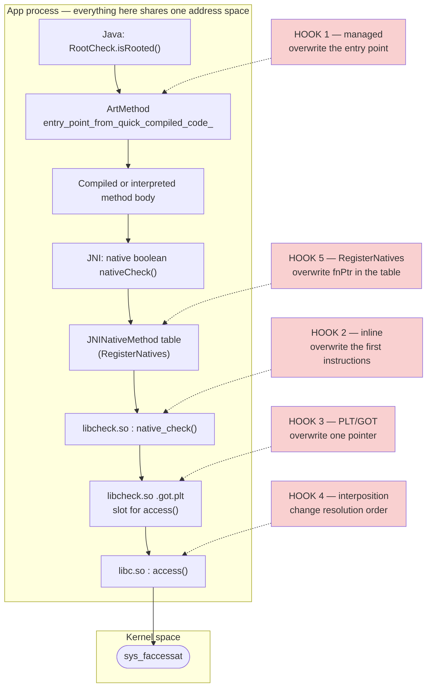
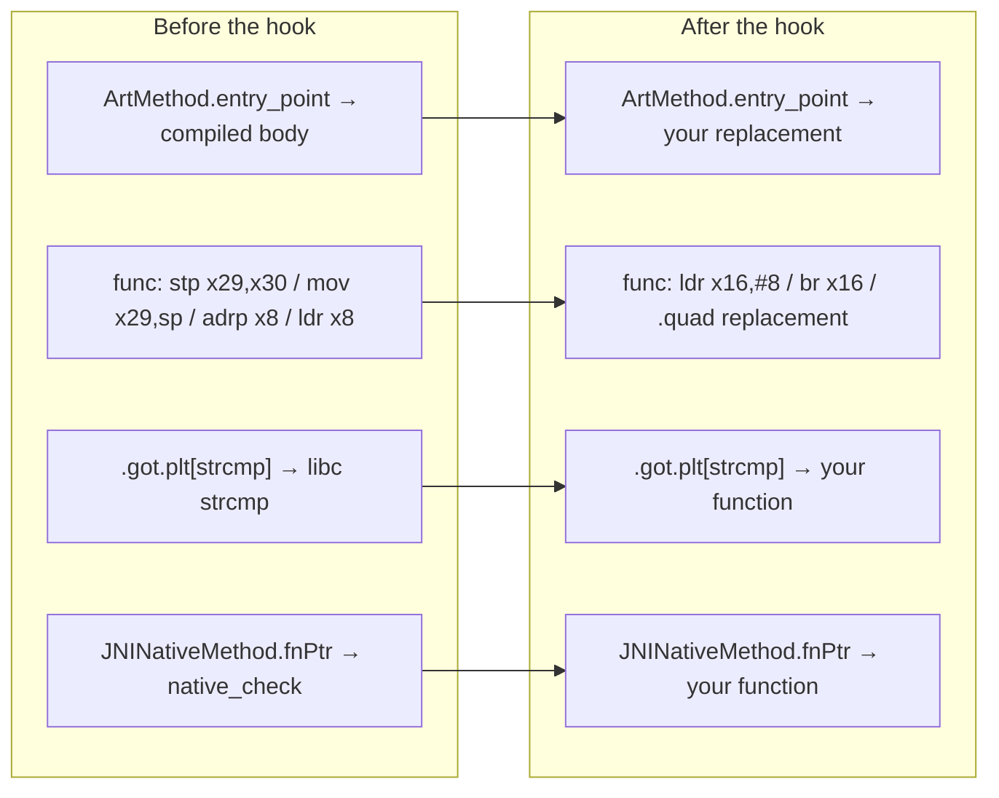
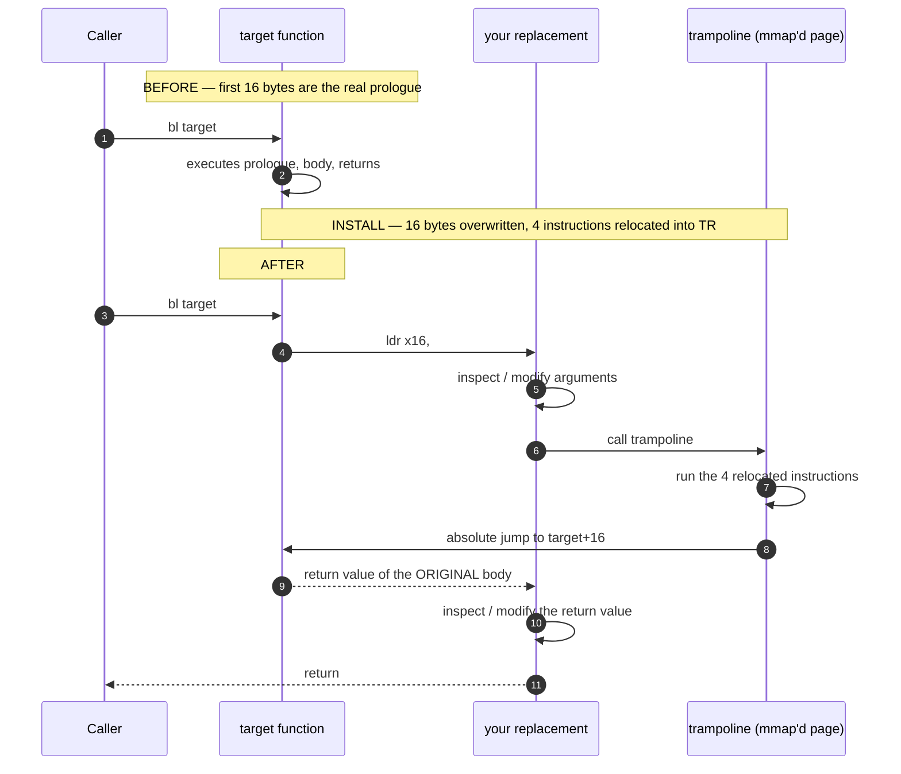
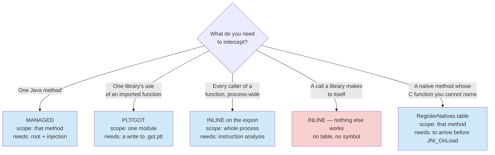
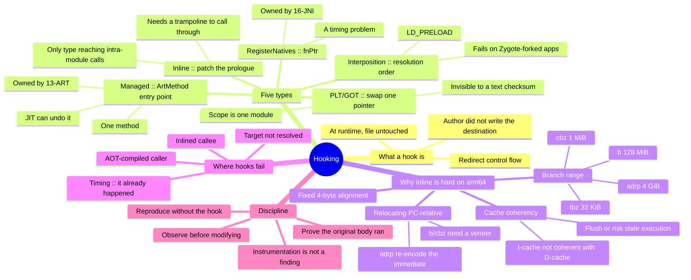

# 65 — Hooking

> After this chapter you will be able to explain what a hook physically *is* — which byte, which
> field, which pointer changes — for every layer of an Android process, write an inline hook by hand
> in C without Frida or root, and predict before you install one whether it will work.

**Prerequisites:** [01-Computer-Science-Basics](../01-Computer-Science-Basics/README.md) ·
[15-Native-Code](../15-Native-Code/README.md) · [16-JNI](../16-JNI/README.md) ·
[17-Libraries](../17-Libraries/README.md) · [18-ARM](../18-ARM/README.md) ·
[13-ART](../13-ART/README.md)
**Applies to:** Android 5.0 (API 21) through Android 15 (API 35). Everything measured here was
measured on **Android 13 / API 33, arm64, unrooted**, unless a section says otherwise.

---

## Table of Contents

1. [Introduction](#1-introduction)
2. [High-Level Architecture](#2-high-level-architecture)
3. [Deep Internal Working](#3-deep-internal-working)
4. [Source Code Walkthrough (AOSP)](#4-source-code-walkthrough-aosp)
5. [Security Perspective](#5-security-perspective)
6. [Reverse Engineering Perspective](#6-reverse-engineering-perspective)
7. [Dynamic Analysis](#7-dynamic-analysis)
8. [Static Analysis](#8-static-analysis)
9. [Examples](#9-examples)
10. [Common Interview Questions](#10-common-interview-questions)
11. [Common Mistakes](#11-common-mistakes)
12. [Hands-on Labs](#12-hands-on-labs)
13. [Summary](#13-summary)
14. [References](#14-references)

---

## 1. Introduction

### 1.1 A problem that has nothing to do with computers

Imagine a large office where every department communicates by internal post. You want to know what
the finance department is telling the legal department, and — eventually — you want to change one of
those messages before it arrives.

You have four obvious options, and they are not equally good.

You could **stand in the finance department and read every letter as it is written**. You will see
everything finance says, to everyone. You will also see an enormous amount of traffic you do not care
about, and you have to be physically present in a room where you may not be welcome.

You could **intercept the post at the legal department's in-tray**. Much less traffic, and precisely
the messages you care about — but only the ones addressed to legal. If finance also telephones, you
miss it.

You could **change legal's address book** so that letters intended for finance are delivered to your
desk instead. Nothing about the letters changes; nobody is watching you; you simply redirected a
relationship. But if finance and legal are in the same room and hand each other paper directly, there
is no address book entry to change.

Or you could **stand in the corridor between the two departments** and stop every courier. This
catches everything, including the direct handovers — and it is by far the most conspicuous, because
now there is a person in the corridor who was not there yesterday.

Those four options are, respectively: a hook at the source, a hook at the destination, a hook on the
*binding* between them, and a hook on the physical path. Every hooking technique in this chapter is
one of those four ideas expressed in machine code.

### 1.2 What problem existed before hooking?

Software makes decisions in code you did not write and cannot change. An app decides you are not
allowed in. A library decides the certificate is invalid. A native check decides the device is
rooted. You did not compile it, you often do not have the source, and the vendor is not going to
recompile it for you with a flag that turns the check off.

Before hooking existed as a discipline, you had two options:

1. **Change the file on disk.** Patch the bytes, re-sign, reinstall. This works, and
   [18-ARM §5](../18-ARM/README.md) shows exactly how — but it is permanent, it invalidates the
   signature, it requires you to find the right bytes without running anything, and if the app checks
   its own integrity you have handed it the evidence.
2. **Change the input until the decision changes.** Fuzzing, essentially. Cheap when it works,
   useless when the decision does not depend on input you control.

Hooking is the third option: **leave the program on disk exactly as it is, and change what it does
while it runs.** Nothing is re-signed. Nothing is permanent. And crucially, you can *observe* as well
as *modify* — which turns out to be the more valuable half.

### 1.3 What would break if hooking did not exist?

Most of modern software would be slower, and mobile security testing would barely function.

- **Debuggers** are hooks. A breakpoint is an instruction replaced with a trap.
- **Profilers** are hooks. Function-entry instrumentation is a hook on every function.
- **Mocking frameworks** are hooks. Mockito rewrites method dispatch; that is a managed-layer hook.
- **Crash reporters** are hooks. Installing a signal handler is a hook on the kernel's delivery path.
- **Antivirus, EDR and RASP** are hooks. They watch a process by intercepting its calls.
- **Malware** hooks, for exactly the same reasons and with the opposite intent.

And for a security tester specifically: without hooking, an app that pins its certificate is a black
box. You cannot see the traffic, you cannot see the request signature, and you cannot see what the
app sends home. With hooking, you borrow the app's own crypto and read the plaintext.

### 1.4 What a hook actually is — the definition this chapter defends

> **📖 Definition — Hook.** A *hook* is a modification to a running program that causes control to
> reach code the program's author did not write, at a point of your choosing, without changing the
> program on disk.

Every word of that matters:

- **Running program.** A hook is a runtime construct. The file is untouched. Restart the process and
  the hook is gone.
- **Control reaches code.** Not "data is read". A hook changes *where the CPU goes next*.
- **Point of your choosing.** The whole skill is choosing well.
- **Did not write.** Which is why an app can, in principle, notice.

### 1.5 The one sentence about ethics that this chapter will not repeat

Hooking is **instrumentation**. It proves behaviour; it is not itself a finding.

"I hooked the root check and it returned false" is a statement about your toolkit. "The app's entire
root defence is a single `File.exists` on `/system/bin/su`, evaluated once at launch, with the result
cached in a field that any hook can set" is a statement about the product. The first is a demo. The
second goes in the report.

This distinction is the spine of the chapter and it is why [Lab 04](labs/lab-04-ctf-the-honest-trampoline.md)
grades a bypass as Silver and reserves Gold for the solution that *learns the secret and then does not
need the hook at all*.

> **⚠️ Warning.** Only hook software you built or are explicitly authorised to test. Every fixture in
> this chapter is built from source that ships alongside it, precisely so that no third-party
> application is ever instrumented in the course of learning.

### 1.6 What this chapter owns, and what it does not

This chapter is repeatedly cited by others as *"hooking from first principles across managed and
native layers"* and *"function calls, from first principles, weaponised"*. That phrasing sets the
scope precisely: **not how to use a hooking tool, but what a hook physically is.**

| Topic | Owner | This chapter's role |
|---|---|---|
| `ArtMethod`, `entry_point_from_quick_compiled_code_` | [13-ART](../13-ART/README.md) | Cite for the managed layer; do not re-derive |
| Frida as a tool — API, CLI, agents, RPC | [53-Frida](../53-Frida/README.md) | Explain what it does underneath; never depend on it |
| AArch64 instruction encodings and patch values | [18-ARM](../18-ARM/README.md) | Reuse its verified encodings; never invent one |
| `RegisterNatives` and the JNI method table | [16-JNI](../16-JNI/README.md) | Cite as hook type 5 |
| `.init_array`, `dlopen`, load-time ordering | [17-Libraries](../17-Libraries/README.md) | Cite for the timing problem |
| Anti-hooking detection and defeating it | [67-BypassingProtections](../67-BypassingProtections/README.md) | Own the mechanism; hand over the arms race |
| Calling conventions, stack frames, ABI | [01-Computer-Science-Basics](../01-Computer-Science-Basics/README.md), [18-ARM §3.4](../18-ARM/README.md) | Put them to work |

**LSPosed** — the managed-layer hooking framework in current use — is
[63-LSPosed](../63-LSPosed/README.md). It owns the framework: injection into Zygote through Zygisk,
the `XposedBridge` API, per-application scope, and LSPlant's **backup method**, which is this
chapter's trampoline problem solved in the managed layer. Cite it rather than re-deriving the managed
side here. **Classic Xposed** — the historical framework whose `app_process` replacement 63 contrasts
against — is [64-Xposed](../64-Xposed/README.md). It owns the one case in this chapter's taxonomy
that is not in the taxonomy: a framework that needed **none** of the five hook types to reach every
process, because it replaced the program those processes start from. It also owns `hookMethodNative`
in depth and the Xposed-specific detection surface, measured.

---

## 2. High-Level Architecture

### 2.1 The five places a call can be intercepted

An Android app performing a single logical action — "check whether this device is rooted" — passes
through several layers, and each layer offers a different interception point.



Read this diagram as a **descent**. At the top, one Java method — narrow, easy to name, easy to hook,
and easy for the app to protect. At the bottom, one libc function — used by everything in the
process, catches every caller including ones you did not know about, and drowns you in noise.

The five hook points are shaded because from the app's point of view they are all attacker-controlled
modifications to its own address space. Note that **there is no trust boundary anywhere inside the
app process box.** Every layer above the kernel line is in the same address space, with the same
credentials, and any code in that space can modify any other. That single fact explains why
in-process anti-hooking checks can always, in principle, be defeated — a point
[67-BypassingProtections](../67-BypassingProtections/README.md) develops fully.

### 2.2 What each hook physically overwrites



Three of these four are a **single pointer write**. Only one — the inline hook — modifies
instructions, and that is precisely why it is the hard one and why it gets a whole lab to itself.

That asymmetry is the most useful thing in this diagram. If you can accomplish your goal with a
pointer write, do that: it is reversible, atomic-ish, needs no instruction analysis, and is invisible
to any integrity check computed over code.

### 2.3 The anatomy of an inline hook



The step people miss is **6 to 9**. A hook that merely replaces a function is easy. A hook that
*calls through* to the original needs somewhere for the displaced instructions to live, and that
somewhere is the trampoline. Without it you can observe arguments and fabricate return values, but
you cannot see what the function would have said.

In [Lab 02](labs/lab-02-write-an-inline-hook-by-hand.md) this is proved with a counter: after four
hooked calls, the target library's exported `guard_counter` reads **4**, which is only possible if
the original body executed each time.

### 2.4 The memory a hook touches

```
                 target library, mapped from the .so
   ┌──────────────────────────────────────────────────────────────┐
   │ .text        r-x     ← INLINE HOOK writes here               │
   │                        (needs mprotect to add PROT_WRITE)    │
   ├──────────────────────────────────────────────────────────────┤
   │ .rodata      r--                                             │
   ├──────────────────────────────────────────────────────────────┤
   │ .data.rel.ro r--      ← full RELRO makes this read-only      │
   │ .got                    after relocation                     │
   ├──────────────────────────────────────────────────────────────┤
   │ .got.plt     rw-      ← PLT/GOT HOOK writes here             │
   │                         (one pointer; no code changes)       │
   ├──────────────────────────────────────────────────────────────┤
   │ .data        rw-      ← RegisterNatives tables often live    │
   │ .bss                    here; also any cached baseline a     │
   │                         self-checksum compares against       │
   └──────────────────────────────────────────────────────────────┘

           anonymous mapping, allocated by you at hook time
   ┌──────────────────────────────────────────────────────────────┐
   │ trampoline   r-x     ← relocated displaced instructions,     │
   │                        then an absolute jump to target+N     │
   │                        MUST be within ±4 GiB of any adrp     │
   │                        target page you relocated             │
   └──────────────────────────────────────────────────────────────┘
```

Two constraints are visible here that a diagram of boxes and arrows would hide.

First, **the inline hook needs a permission change and the PLT hook may not.** `.got.plt` is `rw-`
under partial RELRO; `.text` is never writable without asking. Every `mprotect` call is a syscall an
observer can see.

Second, **the trampoline's address is constrained by the instructions you displaced.** This is not a
detail. Measured on the test device, a naive `mmap` hint was ignored and returned a page **10.3 GiB**
away — outside `adrp`'s ±4 GiB reach — and the hook correctly refused to install. §3.9 covers the fix.

### 2.5 Blast radius: the property that should drive your choice



The red box is the case that justifies inline hooking's existence. Every other row has a cheaper
alternative; an intra-module direct call has none, because there is no indirection to redirect.

---

## 3. Deep Internal Working

### 3.1 What a function call is, physically

Everything in this chapter is a modification to a function call, so the call has to be understood
first. [01-Computer-Science-Basics](../01-Computer-Science-Basics/README.md) cites this chapter as
where its calling-convention material *"is put to work"*; this is that section.

On AArch64, calling a function in the same module compiles to one instruction:

```
    bl   0x17b0 <strcmp@plt>          94000000 | imm26
```

`bl` — *branch with link* — does exactly two things:

1. Writes the address of the **next** instruction into `x30` (the link register, `LR`).
2. Branches to the target.

That is the entire mechanism. There is no call stack maintained by hardware, no frame pushed
automatically, no return address on the stack unless the callee puts it there. The `stp x29, x30,
[sp, #-16]!` you see at the top of almost every non-leaf function is the *callee* choosing to save
`LR` because it is about to make a call of its own and would otherwise lose it.

**Returning** is `ret`, which is `br x30` with a hint to the branch predictor. Encoding
`0xd65f03c0`, verified.

Three consequences that matter enormously for hooking:

| Fact | Consequence for hooking |
|---|---|
| `bl`'s target is encoded as a **signed 26-bit offset scaled by 4** | Reach is ±128 MiB. A hook further away than that cannot be reached by a direct branch |
| The return address lives in a **register**, not on the stack, on entry | At the first instruction of a function, `x30` holds the caller. This is why a hook installed at offset 0 can identify its caller for free |
| Arguments are in `x0`–`x7` at the moment of entry | A hook at offset 0 sees the arguments without touching the stack. A hook at offset 8 may not — the prologue may already have moved them |

> **🧠 Mental Model.** A function call is a **branch plus a promise**: the promise is the calling
> convention, which says where the arguments are, where the return value goes, and which registers
> the callee may destroy. A hook slips between the branch and the promise. Everything that goes wrong
> in hooking goes wrong because the hook broke part of the promise.

### 3.2 AAPCS64, and the two registers that make inline hooking possible

The AArch64 procedure call standard divides the registers:

| Registers | Role | Preserved across a call? |
|---|---|---|
| `x0`–`x7` | Arguments and return values | No |
| `x8` | Indirect result location | No |
| `x9`–`x15` | Temporary | No |
| **`x16`, `x17`** | **IP0, IP1 — intra-procedure-call scratch** | **No, and explicitly clobberable by a linker veneer at any call boundary** |
| `x18` | Platform register (on Android: the shadow call stack pointer) | Reserved — do not touch |
| `x19`–`x28` | Callee-saved | Yes |
| `x29` | Frame pointer | Yes |
| `x30` | Link register | Special |

The row that matters is `x16`/`x17`. The standard specifies that a linker may insert a **veneer** — a
small stub that extends the reach of a branch — at any call site, and that such a veneer may destroy
IP0 and IP1. Therefore **no correct program may hold a live value in `x16` or `x17` across a function
entry**.

That is a licence. It means a hook installed at a function's first instruction can freely use `x16`
as scratch, which is exactly what the 16-byte absolute jump does:

```
    ldr  x16, #8            58000050    load the address 8 bytes ahead into x16
    br   x16                d61f0200    branch to it
    .quad <replacement>                 8 bytes of data, never executed
```

Every production hooking engine uses this pattern or a variant of it, for this reason.

> **⚠️ Warning.** The licence applies **at the function entry boundary only**. If you install a hook
> in the *middle* of a function, `x16` may well be live — the compiler is free to use it as an
> ordinary temporary there. A mid-function hook must save and restore it.

### 3.3 Hook type 1 — the managed layer

**Owned by [13-ART](../13-ART/README.md).** This section states the interface, not the derivation.

An `ArtMethod` is the runtime's bookkeeping structure for a Java method. Among its fields is:

```cpp
// art/runtime/art_method.h
void* entry_point_from_quick_compiled_code_;
```

Every dispatch of that method reads this pointer and jumps to it. Depending on the method's state it
points at the interpreter bridge, at an AOT-compiled body in the `.odex`, at a JIT-compiled body in
the code cache, or at a resolution trampoline.

**The hook is: write a different pointer into that field.**

That is what `Java.use(X).m.implementation = f` does in Frida, what Xposed's `hookMethodNative` did,
and what LSPosed does from inside Zygote. See 13-ART's framework table.

Three properties follow directly from the mechanism and are worth carrying:

1. **Granularity is exactly one method.** Not one class, not one call site — one `ArtMethod`.
2. **The JIT can overwrite you.** If the method later gets compiled, the runtime writes a new entry
   point and your hook is silently gone. This is why hooking frameworks force deoptimisation.
3. **It is invisible to any check over code**, because no code changed. It is trivially visible to a
   check that reads the entry point back and asks whether it points into a known module.

Why hooks fail here — inlining, partial inlining, baked-in results, and class loaders — is 13-ART's
four-cause table, restated in [Lab 03 §3.2](labs/lab-03-where-hooks-fail.md) as an exercise rather
than as new material.

### 3.4 Hook type 2 — inline (trampoline) hooking

This is what the chapter owns, and 13-ART points here explicitly: *"Native inline hooking ignores
`ArtMethod` and patches the compiled code itself — see 65-Hooking."*

The idea is one sentence: **overwrite the beginning of a function with a branch to your code, keep
the instructions you displaced somewhere else, and jump back to the rest of the function when you are
done.**

Six steps:

| # | Step | What can go wrong |
|---|---|---|
| 1 | Find the target address | The symbol is not exported; the module is not loaded yet |
| 2 | Decide how many bytes to displace | The function is shorter than the patch |
| 3 | Allocate a trampoline **within range** | The allocator ignores your hint (measured: by 10.3 GiB) |
| 4 | Copy the displaced instructions, **relocating** PC-relative ones, then append a jump back | An unrelocatable form; a branch into the patch region |
| 5 | Make the page writable, write the patch, restore permissions | SELinux may refuse `W`+`X`; another thread may be executing there |
| 6 | Flush the instruction cache | The CPU may execute stale bytes |

#### 3.4.1 The patch forms

| Form | Bytes | Reach | Displaces | Verified encoding |
|---|---|---|---|---|
| Direct branch | 4 | ±128 MiB | 1 instruction | `0x14000000 \| (imm26)` |
| Absolute jump | 16 | unlimited | 4 instructions | `58000050`, `d61f0200`, `.quad` |
| Wholesale replacement | 8 | n/a | 2 instructions, **discarded** | `52800020` (`mov w0,#1`), `d65f03c0` (`ret`) |

The third row is not a hook in the strict sense — nothing calls through — but it is enormously common
in practice and worth naming, because it is the right tool when you do not care what the function
would have said. It also needs no trampoline, which makes it the fallback when the prologue cannot be
relocated at all.

#### 3.4.2 The measured patch

Before, on the device (`guard_check` at `0x71f982b714`):

```
0x71f982b714:  a9bf7bfd     stp  x29, x30, [sp, #-16]!
0x71f982b718:  910003fd     mov  x29, sp
0x71f982b71c:  b0000008     adrp x8, ...
0x71f982b720:  f944ad08     ldr  x8, [x8, #2392]
```

After:

```
0x71f982b714:  58000050     ldr x16, #8
0x71f982b718:  d61f0200     br  x16
0x71f982b71c:  8be11520     ── the replacement's address, low word
0x71f982b720:  00000074     ── high word
```

`guard_check("wrong")` returned `0` before and `1` after, and the library's exported `guard_counter`
read `4` after four calls, proving the original body executed every time.

### 3.5 Why inline hooking is hard on arm64 — the four real problems

This is the heart of the chapter. Each of these is a genuine obstacle, not a caveat.

#### 3.5.1 Problem 1 — branch range

AArch64 branch encodings are fixed-width, so their immediates are small:

| Instruction | Immediate | Scale | Reach |
|---|---|---|---|
| `b`, `bl` | 26 bits signed | ×4 | **±128 MiB** |
| `b.cond`, `cbz`, `cbnz` | 19 bits signed | ×4 | **±1 MiB** |
| `tbz`, `tbnz` | 14 bits signed | ×4 | **±32 KiB** |
| `adr` | 21 bits signed | ×1 | **±1 MiB** |
| `adrp` | 21 bits signed | ×4096 | **±4 GiB** |
| `ldr` (literal) | 19 bits signed | ×4 | **±1 MiB** |

On a 64-bit address space with ASLR, **±128 MiB is nothing.** Your replacement function lives in your
agent, which the kernel placed wherever it liked. The chance that a direct branch reaches it is not
high, which is why the 16-byte absolute jump exists at all — it pays 12 extra bytes to buy unlimited
reach.

`tbz`'s ±32 KiB is the one that surprises people. A conditional branch on a single bit cannot reach
across a medium-sized function, let alone to a trampoline.

#### 3.5.2 Problem 2 — instruction alignment and fixed width

Every AArch64 instruction is exactly 4 bytes and must be 4-byte aligned. This is a gift compared with
x86:

- You can never patch "half an instruction". Any 4-byte-aligned write replaces exactly one
  instruction.
- You never need a length-disassembler to work out where instruction boundaries are. On x86, an
  inline hook must decode instructions just to know how many bytes it is about to destroy.

But it costs you something too: **you cannot make the patch smaller.** On x86 a 5-byte `jmp rel32`
reaches ±2 GiB and often fits in the first instruction or two. On arm64 the minimum useful patch is
4 bytes with a 128 MiB leash, or 16 bytes without one.

And the alignment rule has a sharp edge: if you hook at `target + 2` because you found a byte pattern
there, you have not hooked an instruction, you have corrupted two.

#### 3.5.3 Problem 3 — relocating PC-relative instructions

This is the one that requires understanding rather than care.

> **📖 Definition — PC-relative.** An instruction is *PC-relative* when its effect depends on the
> address at which it executes. Move it and it means something different, silently.

The AArch64 PC-relative forms are: `adr`, `adrp`, `ldr` (literal), `b`, `bl`, `b.cond`, `cbz`/`cbnz`,
`tbz`/`tbnz`. Everything else — arithmetic, register-offset loads and stores, register moves — is
position independent.

Because `-fPIC` is mandatory for Android shared libraries, **`adrp` is everywhere**. Any access to a
global, a string literal, or a GOT entry begins with one. It is by far the most likely instruction to
appear in a prologue you are about to displace.

`adrp Rd, <label>` encodes as:

```
 31   30 29    28..24     23..................5    4..0
  1   immlo    1 0 0 0 0  immhi (19 bits)          Rd
```

and computes `(PC & ~0xFFF) + (SignExtend(immhi:immlo) << 12)`.

The immediate is a **signed count of 4 KiB pages**. To relocate:

```c
uintptr_t page  = (old_pc & ~0xFFF) + (adrp_imm(w) << 12);   /* where it pointed */
int64_t   delta = (int64_t)(page - (new_pc & ~0xFFF)) >> 12; /* pages from the new home */
new_word = adrp_encode(w, delta);
```

Measured, from [Lab 02](labs/lab-02-write-an-inline-hook-by-hand.md):

```
[reloc] adrp b0000008 -> f0000008   (target page 0x71f982c000, imm 1 -> 3)
```

Check it: the original sat at `0x71f982b71c`, page `0x71f982b000`, immediate 1, so it targeted
`0x71f982c000`. The copy sits at `0x71f9829008`, page `0x71f9829000`, so it needs
`(0x71f982c000 − 0x71f9829000) >> 12` = 3. Encoding 3 sets `immlo = 3`, `immhi = 0`, giving
`0xb0000008 | (3 << 29)` = `0xf0000008`. Exactly what was measured.

**Why the other forms are harder, not merely different:**

| Form | Why relocation is worse than for `adrp` |
|---|---|
| `adr` | Computes a byte address, ±1 MiB. A trampoline a few pages away is fine; one megabyte away is not, and you do not choose the distance |
| `ldr` literal | Loads *data* from PC±1 MiB. The data does not move with you, and 1 MiB is a tight leash |
| `b`, `bl` | Must still reach the **original** target from the new address. ±128 MiB usually holds, but a wrong branch fails a thousand instructions from the bug |
| `b.cond`, `cbz` | ±1 MiB, and fixing it properly requires emitting a **veneer**: rewrite `cbz x0, far` as `cbnz x0, +8; b far`, which changes the instruction count and therefore every offset after it |
| `tbz` | ±32 KiB. Almost never survives relocation |

This chapter's engine relocates `adrp` and **refuses** everything else, and the refusal is the correct
behaviour for a teaching implementation. Silently copying a `b` produces a branch to the wrong place;
the failure appears far from the cause.

> **🔍 Pentester's Note.** When Frida's `Interceptor.attach()` throws *"unable to intercept function
> at 0x…; please file a bug"*, this is what happened. Its relocator met a form it could not move.
> Run [`scripts/hookability.py`](scripts/hookability.py) on the symbol and you will usually see
> exactly which instruction, before you ever attach.

#### 3.5.4 Problem 4 — cache coherency

On AArch64 the data cache and the instruction cache are **not coherent**. Your patch is a store: it
lands in the D-cache. The CPU fetches instructions through the I-cache. Nothing automatically tells
the I-cache that its copy is stale.

The architecturally required sequence is: clean the data cache to the point of unification, invalidate
the instruction cache to the point of unification, then `dsb` and `isb`. In C:

```c
__builtin___clear_cache((char *)target, (char *)target + 16);
```

**And now the honest measurement.** An experiment was built specifically to catch the omission
failing: `mprotect` the page RWX once, call the function 2,000,000 times to warm the I-cache, then
patch with *no* `mprotect` and *no* cache maintenance, and call again.

```
run 1 (no flush):   after patch: f("wrong") = 1   (1 = new code ran, 0 = STALE)
run 2 (no flush):   after patch: f("wrong") = 1
run 3 (with flush): after patch: f("wrong") = 1
```

On this device — 8× Cortex-A53, `CPU implementer 0x41`, `CPU part 0xd03` — the un-flushed patch ran
the new code every time. **I could not make it fail.**

That is reported because it is what happened, and because the wrong lesson is easy to draw from it.
The architecture *permits* the CPU to execute the stale line; it does not *require* it to. An
in-order core with a shallow prefetch queue, a call boundary between the write and the fetch, and a
`mprotect` that already performed maintenance are all reasons this particular test was too kind. A
different microarchitecture, a hotter loop, or a second thread already executing inside the patched
range would change the answer — non-deterministically, which is the worst kind of bug to own.

> **🧠 Mental Model.** Cache maintenance is not an optimisation you can skip when it appears to work.
> It is the difference between "correct" and "happened to work on the chip I tested". This chapter
> tried to catch it failing, did not, and reports both halves rather than repeating folklore in
> either direction.

### 3.6 Hook type 3 — PLT/GOT

#### 3.6.1 Why the indirection exists at all

A shared library is loaded at an address chosen at runtime, and so is every other library. A call
from `libguard.so` to `strcmp` in `libc.so` therefore cannot encode libc's address — it does not
exist at link time.

The linker's answer is a level of indirection:

1. The call becomes `bl strcmp@plt` — a branch to a small stub inside the calling library.
2. The stub loads a function pointer from a writable table (`.got.plt`) and branches to it.
3. The dynamic linker fills the table in, either at load time (`DT_BIND_NOW`, full RELRO) or on first
   call (lazy binding).

**The table is data.** Overwrite an entry and every subsequent call from that library goes wherever
you point it. No code changes, no page permission juggling beyond the GOT's own, no instruction
relocation, no cache flush.

#### 3.6.2 Walking the tables

The relocations that populate `.got.plt` live under `DT_JMPREL`, sized by `DT_PLTRELSZ`. Each is an
`Elf64_Rela`:

| Field | Meaning |
|---|---|
| `r_offset` | The address of the GOT slot, relative to the load base |
| `r_info` | Symbol index in the high 32 bits, relocation type in the low 32 |
| `r_addend` | Unused for `JUMP_SLOT` |

Relocation type **1026** (`0x402`) is `R_AARCH64_JUMP_SLOT`. Type **1025** (`0x401`) is
`R_AARCH64_GLOB_DAT`, which lives under `DT_RELA` instead and is used when the reference goes through
`.got` rather than `.got.plt`; the technique is the same, only the table differs.

Measured on the device, walking `libguard.so`:

```
load base = 0x7cd6a76000
DT_JMPREL entries = 3
  [0] type=1026 sym=__cxa_finalize   slot=0x7cd6a78978
  [1] type=1026 sym=__cxa_atexit     slot=0x7cd6a78980
  [2] type=1026 sym=strcmp           slot=0x7cd6a78988
      -> slot currently 0x7f67aa2280 ; overwriting with 0x7f6b731164
```

#### 3.6.3 The defining property: scope

```
== AFTER (GOT slot swapped, not one instruction changed) ==
  guard_check("wrong")  = 1   <- the library's call was redirected
  host strcmp("a","b") = -1   <- this process's OWN call was not
```

Same process. Same libc. Same function. Two different answers — because a PLT hook does not hook a
function. **It hooks a relationship: "this module, calling that symbol."**

That is a feature when an app and its anti-tamper SDK both call `open()` and you want to see only
one of them. It is a trap when the call you care about comes from a module you did not patch.

#### 3.6.4 RELRO

| Mode | `.got` | `.got.plt` | Cost to a PLT hook |
|---|---|---|---|
| No RELRO | writable | writable | none |
| Partial RELRO | read-only after relocation | **writable** (for lazy binding) | none |
| Full RELRO (`-Wl,-z,relro,-z,now`) | read-only | **read-only** | one `mprotect` call |

Full RELRO does not prevent a PLT hook. It converts an accidental write into a deliberate one. That
is a real hardening benefit against memory-corruption exploits — a stray write can no longer land in
the GOT — and essentially no obstacle to an attacker who already runs code in the process. Say so
precisely; over-claiming here is a common way to lose a developer's trust.

`scripts/hook-surface.sh` reports the mode for any library.

#### 3.6.5 When a PLT hook cannot work

- **The call is intra-module.** A function calling another function in the same `.so` compiles to a
  direct `bl` with a fixed displacement. There is no slot. This is the case that requires an inline
  hook and is the only reason inline hooking is unavoidable.
- **The symbol was inlined by the compiler.** `strcmp` against a short constant is frequently
  expanded into inline comparisons; there is no call and no import.
- **The library resolved it itself.** `dlsym(RTLD_NEXT, "open")` stored in a private variable never
  goes through the PLT.
- **A different module makes the call.** Each module has its own table.

### 3.7 Hook type 4 — symbol interposition

`LD_PRELOAD` names a library the dynamic linker loads *first*, so its symbols win during resolution.
No code and no table is overwritten after the fact; the table is simply *initialised* to your
definition.

**On Android this almost never applies to app processes,** and the reason is structural: apps are not
`exec`'d. They are forked from **Zygote**, which has already started, already loaded its libraries and
already bound its symbols. There is no `execve` at which the linker would consult `LD_PRELOAD`.

| Scenario | Works? | Why |
|---|---|---|
| App process forked from Zygote | **No** | No `execve`; symbols already bound in the parent |
| Native binary launched from `adb shell` | **Yes** | You control the environment of the `execve` |
| A native helper the app spawns | Sometimes | Only if you control the launch |
| `android:isolatedProcess` | No | Separate, more restricted sandbox |

The Android-native replacement is **Zygisk**, which injects into Zygote itself so every forked app
inherits the injection. That is [62-Magisk](../62-Magisk/README.md)'s subject, and its
`hookJniNativeMethods()` API is a direct pointer at hook type 5.

> **🔬 Under the Hood.** Interposition and PLT hooking act on **the same pointer at different times**.
> Interposition decides what the GOT slot is *initialised* to during relocation; a PLT hook decides
> what it *becomes* afterwards. The last writer wins, and the last writer is whoever is still running.

### 3.8 Hook type 5 — `RegisterNatives` table rewriting

**Owned by [16-JNI §3.8](../16-JNI/README.md).** The interface, restated:

```c
static const JNINativeMethod kMethods[] = {
    { "nativeCheck", "()Z", (void *)native_check },
};
(*env)->RegisterNatives(env, cls, kMethods, 1);
```

Three properties make this a hook type in its own right rather than a footnote:

1. **The mapping exists only in memory, and only after `JNI_OnLoad` has run.** No static analysis of
   the `.so` tells you which C function backs `Foo.nativeCheck` — the name and signature are
   arguments, sometimes constructed at runtime.
2. **It is data.** Rewriting `fnPtr` changes every future dispatch with no instruction modified, so a
   code checksum sees nothing. Same category as a PLT hook, different table.
3. **It is a timing problem.** The registration happens once, early. Hook `RegisterNatives` itself
   (it is entry 215 in the JNI function table) or arrive after the fact and find only the result.

`scripts/hook-surface.sh --jni` reports both halves of the surface: `Java_*` exports mean **static**
registration, hookable by symbol name and decodable back to a Java class with
[`16-JNI/scripts/jni_mangle.py`](../16-JNI/scripts/jni_mangle.py); a `JNI_OnLoad` export means
dynamic registration is possible and everything above applies.

### 3.9 Where the trampoline can live — a measured constraint

Step 3 of an inline hook is "allocate a trampoline", and it is where the first real surprise lives.

The obvious code passes a hint to `mmap`:

```c
void *hint = (void *)(((uintptr_t)target & ~(PAGE - 1)) + 0x100000);
uint32_t *tp = mmap(hint, PAGE, PROT_READ | PROT_WRITE,
                    MAP_PRIVATE | MAP_ANONYMOUS, -1, 0);
```

Measured result on the test device:

```
trampoline page @ 0x7c9c435000  (delta from target = +11097491692 bytes)
cannot relocate instruction 2 (b0000008) - aborting
```

**10.3 GiB away.** An `mmap` hint is advisory; the kernel may ignore it entirely, and here it did.
`adrp` reaches ±4 GiB, so relocation became impossible and the engine correctly refused.

The fix is to make the request non-advisory and search outward:

```c
void *r = mmap((void *)want, PAGE, PROT_READ | PROT_WRITE,
               MAP_PRIVATE | MAP_ANONYMOUS | MAP_FIXED_NOREPLACE, -1, 0);
```

`MAP_FIXED_NOREPLACE` means "map exactly here, or fail" — unlike bare `MAP_FIXED`, which silently
unmaps whatever was already there. With the search, the trampoline landed **10,004 bytes** below the
target.

> **⚠️ Warning.** Never use bare `MAP_FIXED` for a trampoline. If a library's text, the heap, or a
> thread stack occupies the address, `MAP_FIXED` destroys it without asking, and the process dies
> later, elsewhere, for no visible reason.

This is why production engines reserve pools of pages near each loaded module rather than calling
`mmap` per hook. The range constraint is the first thing that breaks in a naive implementation.

### 3.10 Thread safety — the problem this chapter's engine does not solve

While you overwrite 16 bytes, another thread may be executing at any of the four addresses inside
them. There is no way to make a 16-byte write atomic on AArch64.

The approaches real engines use:

| Approach | How it works | Cost |
|---|---|---|
| Stop the world | Suspend every other thread, patch, resume | Needs `ptrace` or runtime cooperation; visible |
| Single-word atomic patch | Write a 4-byte `b` with one aligned store — atomic by construction | Limits you to ±128 MiB |
| Two-phase | Write a `brk` first, install a handler, patch behind it, remove the `brk` | Complex; interacts with debuggers |
| Ignore it | Patch and hope | What most demonstration code does, including this chapter's |

[`examples/trampoline-hook.c`](examples/trampoline-hook.c) is single-threaded and its header says so
explicitly rather than pretending the problem does not exist. **This is also the honest answer to
"why is a real hooking library thousands of lines?"** — the mechanism is two hundred lines; the
correctness under concurrency is the rest.

The same applies to *un*hooking: a thread may be inside your trampoline when you free it. Engines
that support unhooking generally leak the trampoline deliberately.

### 3.11 What Frida is doing underneath

[53-Frida](../53-Frida/README.md) owns Frida as a tool. This section owns the answer to "but what is
it *doing*?", because that question is this chapter's whole reason to exist.

When you write:

```javascript
Interceptor.attach(Module.findExportByName('libc.so', 'open'), {
    onEnter: function (args) { console.log(args[1].readCString()); }
});
```

frida-gum performs, in order, exactly the six steps of §3.4:

| Your line | What gum does |
|---|---|
| `Module.findExportByName` | Walks the module's `.dynsym`; returns a runtime address |
| `Interceptor.attach` | Reads the prologue and hands it to the **relocator** |
| — | The relocator decodes each instruction and decides whether it can be moved. This is `hookability.py`'s job, done at attach time instead of ahead of it |
| — | Allocates a **code slice** from a pool of pages reserved near the module — not a fresh `mmap`, precisely because of the range problem in §3.9 |
| — | Writes the relocated instructions plus a jump back, using its **writer** (the counterpart of `put_abs_jump`) |
| — | Writes the patch, having `mprotect`ed the page, and flushes the I-cache |
| `onEnter` | Your JavaScript is called from a C stub that first spills the argument registers into a structure you can index as `args[]` |

Three differences from this chapter's engine, and each is a real engineering decision rather than
polish:

1. **It relocates more forms.** Where `examples/trampoline-hook.c` refuses a `b` or a `cbz`, gum
   emits a **veneer** — rewriting `cbz x0, far` as `cbnz x0, +8; b far`, which changes the instruction
   count and so requires the writer to track offsets as it goes. That is most of the complexity in a
   production relocator.
2. **It pools code slices near each module.** A per-hook `mmap` would hit exactly the problem measured
   in §3.9.
3. **It handles concurrency**, which §3.10 explains this chapter's engine does not.

> **🔍 Pentester's Note.** This is why *"unable to intercept function at 0x…; please file a bug"* is
> a meaningful message rather than a defect. Gum's relocator met an instruction it could not move.
> Run `python3 -B scripts/hookability.py lib.so --symbol name -v` and it will usually name the exact
> word — before you attach, and without needing a device.

`Interceptor.replace` is the simpler sibling: no trampoline is needed for the *caller*, because the
original is never invoked; gum still builds one and hands it back to you as the second argument so
you can call through if you want to.

The Java side is a different mechanism entirely — `Java.use(X).m.implementation = f` replaces the
`ArtMethod` entry point, which is [13-ART](../13-ART/README.md)'s subject and involves no instruction
patching at all. **Two operations, one API surface, completely different failure modes.** Knowing
which one you invoked is the difference between a five-minute diagnosis and an afternoon.

### 3.12 Two mechanisms this chapter's taxonomy does not count as separate types

Both come up, and both are worth being able to name.

#### 3.12.1 Breakpoint-based hooking

Instead of a branch, write a **trap** and catch the resulting signal:

```
+0   d4200000    brk #0
```

Encoding verified. When the CPU executes it, the kernel delivers `SIGTRAP` to the process. A handler
installed with `sigaction` inspects the `ucontext_t`, reads and modifies registers directly, sets
`pc` to wherever it likes, and returns.

| Advantage | Cost |
|---|---|
| The patch is **4 bytes and needs no trampoline** — you can resume at the original instruction by single-stepping | Signal delivery is orders of magnitude slower than a branch |
| Works where the prologue cannot be relocated at all | Conflicts with debuggers, crash reporters, and anything else that wants `SIGTRAP` |
| A single aligned 4-byte store, so it is **atomic** — no thread-safety problem | An app that installs its own `SIGTRAP` handler sees you immediately |

This is how hardware and software breakpoints in a debugger work, and it is the right tool when you
need one hook in an awkward place rather than a thousand hooks in a hot path.

#### 3.12.2 Virtual dispatch and vtable overwriting

C++ virtual calls go through a **vtable**: the object holds a pointer to an array of function
pointers, and the call loads from it and branches indirectly.

```
    ldr  x8, [x0]           ; load the vtable pointer from the object
    ldr  x8, [x8, #16]      ; load slot 2
    blr  x8                 ; indirect call
```

Overwrite the slot and every call through that vtable follows you. Structurally this is the same idea
as a PLT hook — a pointer in a table — with three differences worth knowing:

- **Scope is per class**, not per module: every object of that class is affected, and objects of a
  subclass with its own vtable are not.
- **The vtable is usually in `.data.rel.ro`**, so full RELRO makes it read-only and you need
  `mprotect` first.
- **You must find it**, which is the hard part. There is no `DT_JMPREL` to walk; you read it out of an
  object at runtime, or recover it from RTTI, or locate it in the disassembly.

It is not counted as a sixth type here because the *mechanism* — overwrite a function pointer in a
table the program will read — is the PLT/GOT mechanism. Only the table differs.

### 3.13 Removing a hook

Uninstalling is not the reverse of installing, and treating it as such is how engines crash.

To remove an inline hook you write the saved original bytes back and flush the cache. The problem is
**what other threads are doing at that instant**:

| Where a thread might be | What happens if you restore underneath it |
|---|---|
| At `target+0`, about to execute `ldr x16, #8` | Fine — it will execute the restored instruction instead |
| At `target+4`, having already loaded `x16` | It branches to your replacement, which may now be freed |
| Inside your replacement | It will return into the trampoline |
| **Inside the trampoline** | If you free the trampoline, it executes freed memory |

The practical rule every production engine follows: **never free a trampoline.** Leak it
deliberately. A page per hook is a trivial cost next to a use-after-free in executable memory that
reproduces once a week.

There is a second, subtler reason to unhook carefully during testing: **an instrumented process
contaminates every later measurement.** If you hooked `strcmp` to always return 0 and then went on to
test something else in the same process, you are no longer measuring the application. Restart the
process rather than trusting your own cleanup.

### 3.14 BTI, PAC and shadow call stacks

Modern arm64 adds three features that interact with hooking.

**BTI — branch target identification.** With BTI enabled, an indirect branch may only land on a
`bti` landing-pad instruction (`bti c` = `0xd503245f`, verified — it is `hint #34`). A function
compiled for BTI starts with one. If your patch overwrites it, every *indirect* call to that function
faults with a Branch Target exception. Direct `bl` calls are unaffected, which makes this a
maddeningly partial failure. The fix: re-emit `bti c` as the first patched instruction, and pay four
bytes.

`scripts/hookability.py` warns when the prologue opens with a landing pad.

**PAC — pointer authentication.** Return addresses may be signed with `paciasp` at entry and verified
with `autiasp` before `ret`. Displacing a `paciasp` and executing the matching `autiasp` on a
different path produces an authentication failure and a crash. Relocating PAC prologues correctly
means understanding which key and which modifier were used.

**Shadow call stack.** Android uses `x18` as the shadow call stack pointer. A hook that clobbers
`x18` corrupts the return path of every function above it. This is why `x18` is on the "do not touch"
list and why `x16`/`x17` are the right scratch registers.

None of the fixtures in this chapter is built with BTI or PAC enabled — the measured `guard_check`
prologue starts with `stp`, not `bti c`, while the CRT stubs in the same library *do* carry `hint #34`,
which is a nice illustration that the feature is applied per translation unit.

### 3.15 Version matrix

| Feature | API level | Effect on hooking |
|---|---|---|
| ART replaces Dalvik | 21 | Managed hooks target `ArtMethod` entry points rather than Dalvik method structures |
| `dlopen` namespaces | 24 | A library you can name is not necessarily one your process may open |
| Non-SDK interface restrictions | 28 | Reflection-based managed hooking of framework internals is restricted; the native layer is unaffected |
| ART becomes a Mainline module | 29 | **`ArtMethod`'s layout can differ between devices reporting the same Android release.** Never hard-code the entry-point offset — 13-ART's script derives it |
| Scoped storage; `execve` from app-writable dirs restricted | 29–30 | Affects how you deliver a native payload, not how a hook works |
| `MAP_FIXED_NOREPLACE` available | Linux 4.17+, so most API 28+ devices | Makes trampoline placement reliable |
| BTI in platform binaries | 31+ on supporting hardware | Prologues may open with a landing pad you must preserve |

> **⚠️ Warning.** The API 29 row is the one that breaks tools. A Frida script with a hard-coded
> `ArtMethod` offset is the single largest source of "works on my phone" breakage in public tooling,
> because ART updates independently of the platform version string.

### 3.16 armeabi-v7a, and why this chapter refuses it

32-bit ARM has two instruction sets in one binary: ARM (4-byte, aligned) and Thumb (2 or 4 bytes).
Which one a function uses is encoded in **the low bit of its symbol address** — an odd address means
Thumb, and the bit is not part of the address.

Consequences:

- A fixed-size prologue patch on Thumb code can cut an instruction in half, producing bytes that
  decode to something entirely unrelated, with no error.
- You cannot know how many bytes four instructions occupy without decoding them.
- A hook must switch instruction sets correctly on both the way in and the way out (`bx`/`blx`).

[18-ARM §3.13](../18-ARM/README.md) covers the encoding. `arm64-patch.py` reads 32-bit ELF and
resolves symbols in it but **refuses to assemble patches for it**, for exactly this reason, and
`hookability.py` refuses 32-bit ELF outright. That refusal is a feature.

### 3.17 The complete taxonomy, with prerequisites and failure modes

| # | Hook type | What is overwritten | Prerequisite | Scope | Detectable by | Fails when |
|---|---|---|---|---|---|---|
| 1 | **Managed (ART)** | `ArtMethod.entry_point_from_quick_compiled_code_` | Java VM in process; root + injection | One method | Reading the entry point back | Callee inlined by AOT; JIT overwrites it; wrong ClassLoader |
| 2 | **Inline / trampoline** | The function's first 4–16 bytes | Writable code page; instruction analysis | Whole process | Reading the prologue; checksumming `.text` | Prologue not relocatable; no room; branch into the patch; function inlined away |
| 3 | **PLT / GOT** | One pointer in `.got.plt` | The symbol must be *imported* | One module | `dladdr` on the slot; checksumming the GOT | Intra-module call; symbol inlined; resolved via `dlsym` |
| 4 | **Interposition** | Nothing — resolution *order* | Control of `execve` environment | Whole process, from start | Comparing resolution to expectation | Zygote-forked app processes (i.e. almost always) |
| 5 | **`RegisterNatives`** | `JNINativeMethod.fnPtr` | Dynamic registration; arrive before/at `JNI_OnLoad` | One native method | Comparing `fnPtr` to the module's range | Static registration; you arrived late |

### 3.18 Choosing — the decision procedure

1. **Is the decision made in Java?** Try the managed layer first. It is the cheapest and the most
   legible. If it does not fire, run `cmd package compile -m verify -f` before doing anything else.
2. **Is it native, and does the call cross a module boundary?** PLT/GOT. One pointer, reversible,
   invisible to code checksums.
3. **Is it native and intra-module?** Inline. Nothing else reaches it.
4. **Is it a native method whose C function you cannot name?** `RegisterNatives`, and you must be
   early.
5. **Do you need to catch every caller in the process?** Inline, on the exported symbol — and accept
   the noise.

At every step ask the question that outranks all of them: **do I need to change behaviour, or do I
need to know what the behaviour is?** Observation is cheaper, safer and produces better findings. A
hook that prints an argument is worth more in a report than a hook that forces a return value.

---

## 4. Source Code Walkthrough (AOSP)

### 4.1 `ArtMethod` and the entry point

```
art/runtime/art_method.h
art/runtime/art_method-inl.h
art/runtime/entrypoints/quick/quick_trampoline_entrypoints.cc
```

`art_method.h` declares the structure whose entry-point field is the managed hook's target:

```cpp
// art/runtime/art_method.h  (abridged)
class ArtMethod {
  // ...
  struct PtrSizedFields {
    void* data_;
    void* entry_point_from_quick_compiled_code_;
  } ptr_sized_fields_;
};
```

The derivation — how to locate the field without hard-coding an offset, what the trampoline values
mean, and how the JIT replaces it — is [13-ART §3.15–3.17](../13-ART/README.md)'s work, with
[`13-ART/scripts/artmethod-inspect.js`](../13-ART/scripts/artmethod-inspect.js) as the working tool.

The one thing worth restating here is *why* it is a pointer and not a fixed address: a method's
execution mode changes over the process's lifetime — resolution trampoline, then interpreter bridge,
then JIT-compiled body — and the field is how the runtime expresses that. **A hook is one more state
transition using the runtime's own mechanism**, which is why it is so clean and why the JIT can
undo it.

### 4.2 `RegisterNatives`, inside the runtime

```
art/runtime/jni/jni_internal.cc          — JNI::RegisterNatives
libnativehelper/include_jni/jni.h        — JNINativeMethod, the function table
```

[16-JNI §4.4](../16-JNI/README.md) traces the implementation. What matters for hooking is that the
runtime **copies the function pointer into its own `ArtMethod` for the native method**. There are
therefore two places the mapping lives: the `JNINativeMethod` array the library passed (often in
`.data.rel.ro` and possibly discarded afterwards), and the runtime's copy. Rewriting the array *after*
registration accomplishes nothing. You must either intercept the call or reach the runtime's copy.

That is the difference between "hooking the table" and "hooking `RegisterNatives`", and it is why
16-JNI's script hooks the *call*.

### 4.3 The dynamic linker, the PLT stub, and the GOT

```
bionic/linker/linker.cpp                 — soinfo::relocate, symbol lookup
bionic/linker/linker_relocate.cpp        — the relocation loop
bionic/linker/arch/arm64/begin.S         — linker entry
```

[18-ARM §4.3](../18-ARM/README.md) shows the AArch64 PLT stub shape. Here it is measured, from this
chapter's own fixture — not described, disassembled:

```
0000000000001770 <.plt>:                    ← the lazy-resolution header
    1770: stp  x16, x30, [sp, #-16]!
    1774: adrp x16, 0x2000
    1778: ldr  x17, [x16, #2416]
    177c: add  x16, x16, #2416
    1780: br   x17

00000000000017b0 <strcmp@plt>:              ← one stub per imported symbol
    17b0: adrp x16, 0x2000
    17b4: ldr  x17, [x16, #2440]            ← THE LOAD. This is the hook point.
    17b8: add  x16, x16, #2440
    17bc: br   x17
```

And the sections those addresses fall in:

```
  [13] .text     PROGBITS  0x000016c4  size 0x0000ac  AX      ← r-x
  [14] .plt      PROGBITS  0x00001770  size 0x000050  AX      ← r-x
  [18] .got      PROGBITS  0x00002958  size 0x000008  WA      ← writable
  [19] .got.plt  PROGBITS  0x00002960  size 0x000030  WA      ← writable
```

Follow the arithmetic all the way through, because it is the clearest possible demonstration that
static and dynamic agree:

| | Value |
|---|---|
| `strcmp@plt` loads from | `adrp x16, 0x2000` then `+2440` = `0x2000 + 0x988` = **`0x2988`** |
| `.got.plt` spans | `0x2960` … `0x2990` — six 8-byte slots, the first three reserved by the ABI |
| So `0x2988` is | slot 5: reserved ×3, then `__cxa_finalize`, `__cxa_atexit`, **`strcmp`** |
| Measured at runtime, load base `0x7cd6a76000` | slot reported at **`0x7cd6a78988`** = base + `0x2988` |

The `DT_JMPREL` walk in [`examples/plt-got-hook.c`](examples/plt-got-hook.c) arrived at exactly that
address from a completely different direction — parsing relocations rather than reading a stub — and
got the same answer. When two independent derivations agree to the byte, you are reading both
correctly.

The path a call takes:

1. `bl strcmp@plt` — a direct branch into the caller's own `.plt`.
2. The stub does `adrp x16, <got page>` / `ldr x17, [x16, #off]` / `br x17`.
3. `x17` now holds whatever is in the GOT slot.

Notice that **the stub itself uses `x16` and `x17`.** That is not a coincidence and it is not a
convention someone chose for tidiness — it is the concrete reason AAPCS64 declares IP0 and IP1
clobberable at a call boundary, and therefore the reason your inline hook may use `x16` freely. The
linker needed two scratch registers to implement the PLT at all, so the ABI reserved them, and every
hooking engine since has taken the same licence.

This also means a hook that clobbers `x16` at a function's first instruction is doing **exactly what
the platform's own dynamic linker does at every cross-module call**. It is not a trick; it is the
documented contract.

Note also that step 2 is a **load, every call**. There is no caching of the resolved pointer in
registers across calls, which is what makes a GOT overwrite take effect immediately rather than at
some later point.

`bionic/linker/linker_relocate.cpp` is where `R_AARCH64_JUMP_SLOT` is processed and the slot is
written. When full RELRO is in effect, the linker then `mprotect`s the region read-only — the
`protect_relro` path in `linker.cpp`. That is the entire cost that full RELRO imposes on a PLT hook:
one `mprotect` to undo, one to redo.

### 4.4 `dlopen` and the timing window

```
bionic/linker/dlfcn.cpp                  — __loader_dlopen
bionic/linker/linker.cpp                 — do_dlopen, find_libraries, call_constructors
```

`do_dlopen` loads the library, relocates it, and then calls `call_constructors`, which runs
`DT_PREINIT_ARRAY` (for the executable) and `DT_INIT_ARRAY`. **All of that happens before `dlopen`
returns.**

[17-Libraries](../17-Libraries/README.md) measured the consequence: by the time
`System.loadLibrary("foo")` returns to Java, every `.init_array` constructor in the library has
already run. A hook installed from Java at that point is too late for anything the library chose to
do at load time.

The only way to be earlier is to be in the process before the library loads — hook
`android_dlopen_ext` and act in `onEnter`, or be injected into Zygote. That is the timing problem in
its precise form, and [Lab 03 §5](labs/lab-03-where-hooks-fail.md) works through it.

### 4.5 One complete path, from Java to a patched byte

Trace `RootCheck.isRooted()` → a hooked `access()`:

| Step | Where | What happens |
|---|---|---|
| 1 | `RootCheck.isRooted()` | Java call; dispatch reads `ArtMethod.entry_point_from_quick_compiled_code_` |
| 2 | AOT-compiled body | Calls the native method `nativeCheck()` |
| 3 | `art/runtime/jni/jni_internal.cc` | Native method dispatch reaches `ArtMethod`'s stored native pointer, placed there by `RegisterNatives` or by name resolution |
| 4 | `libcheck.so : native_check` | Ordinary C code; **inline hook lands here** |
| 5 | `bl access@plt` | Direct branch to the local stub |
| 6 | `libcheck.so .plt` | `adrp x16` / `ldr x17, [x16,#n]` / `br x17`; **PLT/GOT hook changes what `x17` gets** |
| 7 | `libc.so : access` | **Inline hook on the export lands here — and catches every module's calls** |
| 8 | `svc #0` | `sys_faccessat`; below this line you need the kernel, not a hook |

Every arrow in that table is a place to intervene, and the choice among them is the skill.
[02-Linux-Basics §](../02-Linux-Basics/README.md) makes the same point about `stat`, and states the
rule this chapter exists to teach: **hooking high is easy and easy to detect; hooking low is hard and
hard to detect.**

---

## 5. Security Perspective

### 5.1 How attackers abuse hooking

| Technique | What it achieves |
|---|---|
| Hooking `SSLContext`/`TrustManager` or a native TLS verify | Reads or modifies traffic the app believed was protected |
| Hooking the app's own signing routine | *Borrows* the crypto rather than breaking it — see [`53-Frida/scripts/sign-oracle.js`](../53-Frida/scripts/sign-oracle.js) |
| Hooking `File.exists`/`access` | Defeats root and file-presence checks |
| Hooking a licence or entitlement check | Unlocks paid functionality |
| Hooking `KeyStore` operations | Uses hardware-backed keys without extracting them — the key never leaves, and never needs to |
| `RegisterNatives` table rewriting | Redirects a native method with no code modified, invisible to a `.text` checksum |
| Hooking input methods or accessibility callbacks | Keylogging, in malware |

The KeyStore row is the one developers underestimate. Hardware-backed key material genuinely cannot
be extracted — and an attacker in the process does not need to extract it. They call the same API the
app calls, with the same authorisation, and get the same output. **Non-exportable is not the same as
non-usable.**

### 5.2 How developers misuse it — the anti-patterns that create the opportunity

| Anti-pattern | Why it fails |
|---|---|
| Evaluating a security decision once and caching the boolean | One field write beats the entire check, forever |
| Making the decision in Java when the consequence is native | The managed layer is the easiest layer to hook |
| Self-integrity checks in the same address space | The checker and the checked share a trust domain; the baseline is writable |
| Detecting *tools* (Frida ports, `frida-server` process names) rather than *effects* | Renaming a binary defeats it; the technique it detects is not the technique that matters |
| Assuming full RELRO prevents GOT modification | It costs an attacker one `mprotect` |
| Assuming a hardware-backed key prevents misuse | It prevents extraction, not use |

### 5.3 Vulnerability class: security decisions on the wrong side of the boundary

**Vulnerable code**

```java
// The whole defence, evaluated once, cached forever.
public class Security {
    private static Boolean sTrusted = null;
    public static boolean isDeviceTrusted() {
        if (sTrusted == null) sTrusted = !RootCheck.isRooted() && !Debug.isDebuggerConnected();
        return sTrusted;
    }
}
```

**Why developers write it.** The check is expensive, so it is cached. That is good engineering
advice, applied to something that is not a performance problem.

**Static detection**

```bash
# host
jadx-gui app.apk       # then search for: static Boolean, isRooted, isDeviceTrusted
grep -rn "static.*Boolean.*[Tt]rust\|static.*boolean.*[Rr]oot" sources/
```

**Dynamic detection** — one line, and it does not even need a hook:

```javascript
// Frida REPL
Java.perform(function () {
    var S = Java.use('com.example.Security');
    console.log('cached value:', S.sTrusted.value);
    S.sTrusted.value = false;                 // a field write, not a hook
});
```

**Exploit.** Set the field. The check never runs again.

**Secure fix as code**

```java
public final class Security {
    // 1. No caching of a security decision.
    // 2. The result is not a boolean anyone can flip; it is an input to a
    //    server-side decision that the client cannot make on its own.
    public static AttestationBundle collectSignals() {
        return new AttestationBundle(
            PlayIntegrity.requestToken(nonceFromServer()),   // server-verifiable
            RootCheck.evaluate(),                            // advisory only
            Debug.isDebuggerConnected());
    }
}
```

The real fix is not a better check. It is **moving the decision out of the attacker's address space**
— the client reports signals, the server decides, and the nonce comes from the server so the report
cannot be replayed.

**Honest severity.** By itself, **Low to Informational** on a device the user controls: a user who
roots their own phone and bypasses their own client-side check has attacked nothing but their own
copy. It becomes **High** when the bypassed check is the only thing standing between a client and a
server-side action — an unverified purchase, a privileged API call, an entitlement the server grants
on the client's word.

### 5.4 Vulnerability class: the client signs its own authority

**Vulnerable code**

```java
// The client computes a signature over the request and the server trusts it.
public final class ApiSigner {
    private static final byte[] SECRET = BuildConfig.API_SECRET.getBytes();

    public static String sign(String path, String body) {
        Mac mac = Mac.getInstance("HmacSHA256");
        mac.init(new SecretKeySpec(SECRET, "HmacSHA256"));
        return Base64.encodeToString(mac.doFinal((path + body).getBytes()), NO_WRAP);
    }
}
```

**Why developers write it.** It genuinely stops casual request forgery from outside the app, and every
API-security blog recommends request signing. The mistake is not the signing; it is believing the
signature proves *who* is calling rather than merely *that the app's code ran*.

**Static detection**

```bash
# host
jadx -d out app.apk
grep -rn "HmacSHA256\|SecretKeySpec\|Signature.getInstance\|X-Signature" out/sources/ | head
grep -rn "API_SECRET\|SIGNING_KEY" out/resources/ out/sources/ | head
```

**Dynamic detection and exploitation — the honest version**

You do not need the secret. Hook the signer and let the app sign whatever you want:

```javascript
// Frida REPL — a signing ORACLE, not a key extraction
var Signer = Java.use('com.example.ApiSigner');
rpc.exports = {
    sign: function (path, body) {
        return Java.performNow(function () { return Signer.sign(path, body); });
    }
};
```

This is the pattern [`53-Frida/scripts/sign-oracle.js`](../53-Frida/scripts/sign-oracle.js)
implements. **You do not break the crypto — you borrow it.** The signature is valid because the app
produced it.

Note the discipline that script's header insists on and that belongs here too: *a valid signature
proves nothing unless you also show that an invalid one is rejected.* If the server accepts unsigned
requests, the whole control was theatre and the oracle was unnecessary.

**Secure fix as code**

```java
// The signature must attest to something the client cannot choose.
public final class ApiSigner {
    // 1. Key in the KeyStore, non-exportable, and bound to user authentication
    //    so it cannot be used silently in the background.
    private static PrivateKey key() throws Exception {
        KeyStore ks = KeyStore.getInstance("AndroidKeyStore");
        ks.load(null);
        return (PrivateKey) ks.getKey("api-signing", null);
    }

    // 2. The server issues the nonce, so a captured signature cannot be replayed
    //    and an oracle must be online to be useful.
    public static String sign(String serverNonce, String path, String body) throws Exception {
        Signature s = Signature.getInstance("SHA256withECDSA");
        s.initSign(key());
        s.update((serverNonce + path + body).getBytes(UTF_8));
        return Base64.encodeToString(s.sign(), NO_WRAP);
    }
}
```

Neither change makes the oracle impossible — an attacker in the process still calls `sign()`. What
they change is the **value** of doing so: a KeyStore key cannot be lifted and reused off-device, and a
server-issued nonce means every forged request needs a live, instrumented device rather than a script
anyone can run.

> **🧠 Mental Model.** Hooking makes the difference between *secret* and *capability* concrete. A
> hard-coded HMAC key is a **secret**, and once extracted it is gone forever, for every user. A
> KeyStore key is a **capability**, usable only on the compromised device, only while the attacker has
> code running. Design so that a compromise is a capability, not a secret.

**Honest severity.** **High** if the secret is hard-coded and extractable, because the compromise is
permanent, offline and affects every user. **Low** if the key is hardware-backed and the nonce is
server-issued, because the attack no longer scales beyond a device the attacker already owns. Rate the
*scalability*, not the *possibility*.

### 5.5 Vulnerability class: an integrity check inside the thing it checks

**Vulnerable code**

```c
/* Real RASP SDKs do a more elaborate version of exactly this. */
static uint32_t g_baseline = 0;

__attribute__((constructor))
static void arm(void) { g_baseline = checksum(&protected_fn, 8); }

int protected_fn(const char *pin) {
    if (checksum(&protected_fn, 8) != g_baseline) return -2;   /* tampered */
    /* ... the real work ... */
}
```

**Why developers write it.** It is cheap, it needs no server, it genuinely catches naive patching, and
it demos beautifully — an inline hook trips it immediately. This chapter's CTF measured that:

```
before patch:            vault_open("0000") = -1
after 1-word nop at +12: vault_open("0000") = -2   (TAMPERED)
restored:                vault_open("0000") = -1
```

One `nop` inside the checked region is enough. The control works exactly as designed.

**Static detection**

```bash
# host
./scripts/hook-surface.sh libtarget.so --tamper       # mprotect, dl_iterate_phdr, dladdr
llvm-objdump -d libtarget.so | grep -B4 -A12 "adrp.*<.*checksum"
```

Look for a function that takes **its own address** as an argument, and for a constructor that runs
early and writes a global.

**Dynamic detection.** Patch one word inside the suspected region and see whether behaviour changes
before the patched code could possibly have executed. A `-2`-style sentinel return is the tell.

**Exploit — three of them, in ascending order of understanding**

1. **Patch the baseline.** `g_baseline` is an ordinary writable global in the same address space.
   Recompute the checksum after hooking and store it. The check passes forever.
2. **Hook past the check.** Install the inline hook at an address *after* the checksum comparison. The
   check runs, passes, and only then does control reach your patch.
3. **Do not touch code at all.** The checksum covers instructions. A PLT/GOT hook changes a pointer in
   a data table, so the checked bytes are byte-identical. Measured — this is the CTF's intended
   solution, and it walks past the control without engaging it:

```
    [plt] strcmp("0000", "1379-alpha")  <-- second argument is the PIN
  vault_open("0000") = 0  -> CH65{got_slot_beats_text_checksum}
```

**Secure fix as code**

There is no in-process fix, and saying so plainly is more useful than a better checksum. What
*does* help:

```java
// The client REPORTS; the server DECIDES. The nonce makes the report unreplayable.
public final class Integrity {
    public static void report(String serverNonce, Callback cb) {
        IntegrityManager im = IntegrityManagerFactory.create(ctx);
        im.requestIntegrityToken(
            IntegrityTokenRequest.builder().setNonce(serverNonce).build())
          .addOnSuccessListener(r -> cb.send(r.token()));   // opaque, server-verified
    }
}
```

And within the client, if you keep local checks at all, make them **differently shaped** so that no
single hook type defeats them all: one over `.text`, one over the GOT, one comparing a `dladdr`
resolution against the expected module. Each costs an attacker a different piece of work.

**Honest severity.** **Informational** as a finding in its own right — "your integrity check can be
bypassed" is true of every integrity check, and reporting it as a vulnerability wastes the reader's
attention. It becomes a real finding when the check is the **only** thing protecting a server-side
action, in which case the finding is the unprotected action, not the bypassable check.

### 5.6 OWASP MASVS / MASTG mapping

| Identifier | Relevance |
|---|---|
| **MASVS-RESILIENCE-1** | App implements anti-tampering and detects modification of its own code — the direct target of inline hooking |
| **MASVS-RESILIENCE-2** | App implements anti-debugging and runtime-integrity checks; hooking is the technique those checks are aimed at |
| **MASVS-RESILIENCE-3** | App detects and responds to running in an instrumented environment |
| **MASVS-RESILIENCE-4** | Obfuscation — raises the cost of finding the hook point, does not change the mechanism |
| **MASVS-CRYPTO-2** | Key management: hooking demonstrates the difference between "key cannot be extracted" and "key cannot be misused" |
| **MASTG-TEST-0083 / 0084** (Android anti-reversing) | The test procedures where hooking is the tool |

> **⚠️ Warning.** MASVS-RESILIENCE controls are explicitly **defence in depth**. The standard itself
> states they are only in scope where the threat model includes a compromised device. Reporting
> "the app can be hooked" as a finding against an app with no resilience requirement is noise. Report
> what the hook *proved*.

### 5.7 How a pentester actually tests this

1. **Enumerate the surface before touching anything.** `scripts/hook-surface.sh` on every bundled
   `.so`: imports (PLT-hookable), exports (inline-hookable), JNI surface, RELRO.
2. **Establish device posture first.** Which device, rooted or not, which API level, is the CA store
   modified. A device whose posture you have not established will teach you the opposite of the truth
   — this repository has a documented case where a modified system CA store made an API-24 trust rule
   appear not to exist.
3. **Observe before you modify.** Log arguments and return values for a full user journey. Most
   findings are visible at this stage.
4. **Modify one thing at a time**, and record what changed.
5. **Reproduce without the hook.** If a hook revealed a hard-coded PIN, show the PIN. If it revealed
   an unauthenticated endpoint, call the endpoint with `curl`. **A finding that only reproduces under
   instrumentation is weaker than one that does not.**
6. **Rate honestly.** See §5.3.

### 5.8 How malware abuses it

Malware hooks for the same reasons and with the same mechanisms, mostly at the managed layer via
Xposed-style modules because the granularity is convenient: hook `TextView.setText` to harvest
one-time passcodes, hook accessibility callbacks to read other apps' screens, hook the SMS receiver
to intercept second factors.

The distinguishing characteristic is not technique but **persistence and scope**: a tester hooks one
app in one session; malware installs a system-wide module that hooks every app on every boot. That is
why Magisk and LSPosed module installation is itself a signal worth checking during triage.

### 5.9 How a forensic analyst investigates

| Artefact | What it tells you |
|---|---|
| `/proc/<pid>/maps` | Anonymous `r-x` mappings not backed by any file — trampolines and injected agents live there |
| `/proc/<pid>/maps` vs the `.so` on disk | A text page whose contents differ from the file has been patched |
| GOT entries pointing outside any mapped library | A PLT hook, or a wild pointer |
| `dmesg` / `logcat` for `frida`, `gum-js-loop`, `gmain` thread names | Frida's own threads, if not renamed |
| Magisk / LSPosed module directories | System-wide hooking infrastructure |
| An `ArtMethod` entry point outside the boot image, the app's `.odex` and the JIT code cache | A managed hook |

The general principle: **a hook is a pointer that points somewhere it should not, or bytes that
differ from their file.** Both are comparisons against a known-good reference, which is why forensic
detection is easier than in-process detection — the analyst has the reference and the app does not.

Detection and its defeat belong to [67-BypassingProtections](../67-BypassingProtections/README.md).

---

## 6. Reverse Engineering Perspective

### 6.1 Finding hook points in JADX output

You are looking for the **decision**, not the check. In JADX:

```java
public class LoginActivity extends AppCompatActivity {
    private void onLoginClicked() {
        if (!SecurityUtils.isDeviceSecure()) {      // the CHECK
            showBlockedDialog();                    // the CONSEQUENCE
            return;
        }
        proceedToVault();                           // what you want to reach
    }
}
```

Two hook points, and they are not equivalent:

- `SecurityUtils.isDeviceSecure` → **the producer.** Hook it and every consumer changes. Also the
  most likely thing to be inlined, obfuscated, or duplicated.
- `LoginActivity.onLoginClicked` → **the consumer.** Hook it and only this path changes, but it
  *definitely* changes.

> **🔍 Pentester's Note.** When a producer hook does not work, move to the consumer. When a consumer
> hook works but there are twelve consumers, move to the producer. The oscillation between these two
> is most of practical hooking.

### 6.2 What it looks like in Smali

Smali makes the call site explicit, which is useful for deciding whether a hook can even fire:

```smali
.method private onLoginClicked()V
    .locals 1

    invoke-static {}, Lcom/example/SecurityUtils;->isDeviceSecure()Z
    move-result v0
    if-nez v0, :cond_proceed

    invoke-direct {p0}, Lcom/example/LoginActivity;->showBlockedDialog()V
    return-void

    :cond_proceed
    invoke-direct {p0}, Lcom/example/LoginActivity;->proceedToVault()V
    return-void
.end method
```

The `invoke-static` is the dispatch a managed hook intercepts. If you see `invoke-static` in the DEX
but your hook never fires, the AOT compiler inlined it — **the DEX still contains the call; the
compiled code does not.** That mismatch is precisely why 13-ART's `cmd package compile -m verify -f`
works: it throws away the compiled code and leaves only the DEX, which still dispatches.

### 6.3 Recognising an already-hooked function in a disassembler

Load a memory dump into Ghidra or IDA and look at the top of a function:

```
        ldr    x16, [pc, #8]
        br     x16
        ; the next 8 bytes disassemble as nonsense
        .byte  0x20 0x15 0xe1 0x8b
        .byte  0x74 0x00 0x00 0x00
```

Three tells:

1. **`ldr x16, #8` / `br x16` at offset 0.** Legitimate code does this in PLT stubs and in linker
   veneers — but not at the entry of an ordinary function.
2. **Eight bytes that do not disassemble sensibly**, immediately after. Those are a 64-bit address.
3. **The address points outside any mapped library** — into an anonymous `rwx` or `r-x` region.

Measured example from [Lab 02](labs/lab-02-write-an-inline-hook-by-hand.md): the two words after the
patch were `8be11520` and `00000074`, which read little-endian as `0x748be11520`. That is a heap-ish
address, not an instruction.

A 4-byte `b` patch is subtler: one plausible-looking branch at offset 0, whose target is outside the
module.

### 6.4 Recognising a PLT/GOT hook

Nothing in `.text` changes, so a disassembler shows you nothing. You must look at data:

```
# Frida REPL, or a debugger
Process.findModuleByName('libtarget.so').enumerateImports()
    .filter(i => i.slot)
    .forEach(i => {
        var p = i.slot.readPointer();
        var m = Process.findModuleByAddress(p);
        console.log(i.name, p, m ? m.name : '*** NOT IN ANY MODULE ***');
    });
```

A slot whose value does not fall inside any mapped module is a hook, or a bug. That is the whole
detection, and it is also why `dladdr` shows up in anti-tamper code — see
`hook-surface.sh --tamper`.

### 6.5 Reading a prologue and predicting the hook before you install it

This is the skill §8's tooling automates, and you should be able to do it by eye first.

```
0000000000001714 <guard_check>:
    1714: fd 7b bf a9   stp  x29, x30, [sp, #-16]!
    1718: fd 03 00 91   mov  x29, sp
    171c: 08 00 00 b0   adrp x8, 0x2000
    1720: 08 ad 44 f9   ldr  x8, [x8, #2392]
    1724: 09 01 40 b9   ldr  w9, [x8]
```

Read it as a hook analyst, in this order:

| Question | Answer here | How you saw it |
|---|---|---|
| Is there a BTI landing pad at +0? | No — `stp`, not `hint #34` | The first instruction |
| How long is the function? | 60 bytes (`llvm-readelf --syms`) | Room for a 16-byte patch |
| Which of the first four are PC-relative? | Only `+8`, the `adrp` | `b0…` / `f0…` / `90…` / `d0…` in the top byte is the `adrp` family |
| Can it be re-encoded? | Yes, ±4 GiB | `adrp`'s reach |
| Does anything branch into +0…+15? | Not visible in the first five instructions; check the whole function | Look for `b`/`cbz`/`tbz` targets in range |
| Where do the arguments live at +0? | `x0` still holds `token` — nothing has moved yet | The prologue has not touched `x0` |

That last row matters more than it looks. A hook at `+0` sees `x0` as the caller left it. A hook at
`+8` — after `stp` and `mov x29, sp` — still sees `x0` here, but in a function whose prologue shuffles
arguments into callee-saved registers it would not. **Hook at offset 0 unless you have a reason not
to**, precisely so the calling convention still tells you where the arguments are.

> **🧠 Mental Model.** A top byte of `0xb0`, `0xf0`, `0x90` or `0xd0` on an AArch64 word is almost
> always `adrp`. Learning to spot that one family by eye turns "I need to run a tool" into "that one
> needs relocating" — and `adrp` is the form you will meet in nearly every `-fPIC` prologue.

### 6.6 The address arithmetic that catches everyone

Three different numbers describe the same function and they are not interchangeable:

| Number | Where it comes from | Example |
|---|---|---|
| **File offset** | Position of bytes in the `.so` on disk | `0x714` |
| **Virtual address** | What `objdump`, Ghidra and `readelf` show | `0x1714` |
| **Runtime address** | Where it actually is in the process | `0x71f982b714` |

`runtime = load_base + virtual_address`, and `load_base` changes on every single run because of ASLR.
Measured across three runs of the same binary in this chapter: `0x71f982b714`, `0x769ab73768`,
`0x7002b6a780`.

Two rules follow:

1. **Never hard-code a runtime address.** Compute it, every time, from a base you obtained in that
   process.
2. **Never patch a file offset at a virtual address, or vice versa.** They differ by the section's
   `sh_addr − sh_offset`, which is usually non-zero.
   [`18-ARM/scripts/arm64-patch.py`](../18-ARM/scripts/arm64-patch.py) exists in large part to do this
   conversion for you, and its header calls getting it wrong *"the single most common way a patch
   silently lands in the wrong place"*.

### 6.7 What obfuscation does to all of this

| Obfuscation | Effect on hooking |
|---|---|
| Identifier renaming (R8/ProGuard) | Makes the *target* harder to find. The mechanism is unchanged; once you know the address, `a.b.c()` hooks exactly like `Security.isRooted()` |
| String encryption | Hides the constants you would grep for. A hook on the decryption routine gives you every string in one pass — often the fastest way in |
| Control-flow flattening | Destroys the "one check, one branch" shape. There may be no single hook point that means anything |
| Native-code packing | The `.so` on disk is not the `.so` in memory. Static analysis of the file is worthless; dump the mapped text instead |
| `-fvisibility=hidden` | Removes symbols from `.dynsym`, so `dlsym` fails. Hook by `module_base + offset` |
| Aggressive inlining | Removes the function you wanted to hook. See §3 and Lab 03 |

[40-Obfuscation](../40-Obfuscation/README.md) covers each in depth. The pattern across the whole
table: **obfuscation attacks target selection, not mechanism.** Once you have an address, everything
in this chapter applies unchanged.

---

## 7. Dynamic Analysis

### 7.1 Establish device posture first

```bash
# host
adb devices -l
adb shell getprop ro.product.model
adb shell getprop ro.build.version.sdk
# try BOTH root forms: Magisk's su takes -c, an AOSP emulator's su takes a uid,
# and the wrong one prints `su: invalid uid/gid '-c'`, which reads as "not rooted"
adb shell "su -c id" 2>/dev/null || adb shell "su 0 id" 2>/dev/null || echo "not rooted"
adb shell ps -A -o NAME 2>/dev/null | grep -i frida || echo "no frida-server"
```

Everything below depends on the answers. This chapter was written against:

```
model:  i9000S
sdk:    33  (Android 13)
su:     not available
frida:  not running
CPU:    8x Cortex-A53 (implementer 0x41, part 0xd03)
```

Which means **every measurement in this chapter was produced without root and without Frida.** That
is a constraint, and it turned out to be a good one: it forced the mechanisms to be implemented from
scratch, which is what the chapter is for.

### 7.2 Running a native binary on a device (the thing that will go wrong)

```bash
# host
adb push hookdemo /data/local/tmp/
adb shell chmod 755 /data/local/tmp/hookdemo
adb shell /data/local/tmp/hookdemo
```

Measured failure on this device:

```
/system/bin/sh: /data/local/tmp/hookdemo: No such device or address
rc=126
```

The file exists and is executable. `/data` is mounted `nosuid,nodev` and the vendor build refuses
direct `execve` there. The workaround:

```bash
# host
adb shell /system/bin/linker64 /data/local/tmp/hookdemo
```

```
exec-ok
rc=0
```

This is not a privilege escalation. The dynamic linker lives in `/system/bin`, which permits
execution, and loading a program is its job. Documented in
[18-ARM §7.7](../18-ARM/README.md); every lab in this chapter uses this form.

### 7.3 The complete hand-written inline hook

The chapter's spine. Build and run:

```bash
# host
cd 65-Hooking/examples
export ANDROID_NDK=$HOME/Android/Sdk/ndk/25.2.9519653
./build-hook-fixtures.sh --run
```

Measured output, abridged to the parts that matter:

```
guard_check @ 0x71f982b714

== BEFORE ==
  guard_check("wrong")        = 0
  guard_check("s3cr3t-token")  = 1

trampoline page @ 0x71f9829000  (-10004 bytes from target)

== RELOCATING the 4 displaced instructions ==
    [copy ] a9bf7bfd  (position independent)
    [copy ] 910003fd  (position independent)
    [reloc] adrp b0000008 -> f0000008   (target page 0x71f982c000, imm 1 -> 3)
    [copy ] f944ad08  (position independent)

== AFTER ==
  guard_check("wrong")        = 1
  guard_check("s3cr3t-token")  = 1

guard_counter = 4
```

The last line is the proof that this is a **hook** and not a **replacement**. Four calls, counter at
four: the original body executed every time, through the trampoline.

Full walkthrough: [Lab 02](labs/lab-02-write-an-inline-hook-by-hand.md).

### 7.4 A working Frida script — the layer comparison

[`scripts/layer-compare.js`](scripts/layer-compare.js) installs the same interception at four layers
and prints which one caught what.

```bash
# host  (requires root and frida-server — NOT the device used for this chapter)
frida -U -f com.your.own.testapp -l scripts/layer-compare.js
```

Then, in the REPL:

```
cmp.layers()                            // what installed, and what did not, and why
cmp.plt("libnative.so", "openat")       // add a module-scoped PLT hook
cmp.report()                            // the comparison table
```

The report distinguishes **not installed** from **installed, zero hits**, because they mean opposite
things:

```
LAYER     STATE           HITS    SAMPLE
------------------------------------------------------------------------
managed   installed       0
jni       NOT INSTALLED   0
plt       installed       3       libnative.so -> openat(/data/.../x.db)
inline    installed       412     openat(/apex/com.android.art/...)
```

An installed layer with zero hits is a **finding**: the call came from somewhere you did not expect.
The 412-versus-3 ratio in the last two rows is the noise cost of hooking low, in one number.

> **⚠️ Warning.** This script was **not executed** while writing this chapter, because the attached
> device is unrooted with no `frida-server`. It is reviewed code, not measured output, and its header
> says so. Everything in this chapter that *was* measured shows numbers.

### 7.5 Frida one-liners you will use constantly

```javascript
// Frida REPL — where is a symbol, really?
Module.findExportByName('libnative.so', 'checkLicense')

// dump a prologue before hooking it
hexdump(Module.findExportByName('libnative.so', 'checkLicense'), { length: 32 })

// the simplest useful hook: observe, do not modify
Interceptor.attach(Module.findExportByName('libc.so', 'strcmp'), {
    onEnter: function (a) { console.log(a[0].readCString(), '<=>', a[1].readCString()); }
});

// replace wholesale
Interceptor.replace(Module.findExportByName('libnative.so', 'checkLicense'),
    new NativeCallback(function () { return 1; }, 'int', []));

// is this GOT slot honest?
Process.findModuleByName('libnative.so').enumerateImports()
    .filter(i => i.slot && !Process.findModuleByAddress(i.slot.readPointer()))
```

The second one — dump the prologue *before* hooking — is the habit worth building. If
`Interceptor.attach` later refuses, you already have the bytes to hand to `hookability.py`.

### 7.6 `strace`, and why it sees what hooks do not

```bash
# device, root required
strace -f -e trace=openat,access,faccessat -p <pid>
```

`strace` observes at the **syscall** boundary, which is below every hook in this chapter. That gives
it two properties worth knowing:

- **It cannot be defeated by an in-process hook**, because it is not in the process. If your PLT hook
  makes `access()` lie, `strace` still shows the syscall the *unhooked* callers made.
- **It cannot see anything that does not reach the kernel.** A licence check that compares two
  strings makes no syscall and is invisible.

Use it to answer "did this actually happen?" when a hook says one thing and the app behaves as if
another.

### 7.7 The complete no-root, no-Frida workflow

Every measured result in this chapter came from this loop. It is worth writing down because most
hooking material assumes root and stops when it is unavailable.

```bash
# host — 1. build the target and the hook, outside the repository
export ANDROID_NDK=$HOME/Android/Sdk/ndk/25.2.9519653
NDK=$ANDROID_NDK/toolchains/llvm/prebuilt/*/bin
$NDK/aarch64-linux-android21-clang -shared -O2 -fPIC -o $OUT/libguard.so libguard.c
$NDK/aarch64-linux-android21-clang -O1 -Wall -Wextra -o $OUT/hook hook.c -ldl

# host — 2. analyse BEFORE you attack
$NDK/llvm-objdump -d --section=.text $OUT/libguard.so | sed -n '/<guard_check>:/,/^$/p'
python3 -B scripts/hookability.py $OUT/libguard.so --symbol guard_check

# host — 3. deploy
adb push $OUT/libguard.so $OUT/hook /data/local/tmp/
adb shell chmod 755 /data/local/tmp/hook

# host — 4. run, via the linker because /data/local/tmp refuses execve
adb shell /system/bin/linker64 /data/local/tmp/hook

# host — 5. clean up. Do not leave binaries on a daily-driver phone.
adb shell rm -f /data/local/tmp/libguard.so /data/local/tmp/hook
```

**What this buys you, and what it does not.**

| You can | You cannot |
|---|---|
| Hook any code inside a process you started | Inject into another app's process |
| Hook a library you `dlopen`ed | Hook an already-running app |
| Prove a mechanism works, end to end | Test a third-party APK this way |
| Develop and debug a hook with a real disassembler and a real device | Reach the managed layer at all — no Java VM in a bare native binary |

That last row is the honest boundary of this approach and the reason §3.3 cites 13-ART rather than
demonstrating.

**Why the constraint was useful.** Writing this chapter against an unrooted device with no
`frida-server` forced every mechanism to be implemented from scratch rather than invoked. The
consequence is that the chapter's central claims — relocation, range, cache behaviour, PLT scope,
inlining — are *measurements* rather than restatements. If a rooted device had been attached, most of
them would have been one-line Frida calls and the numbers would have been someone else's.

> **🔍 Pentester's Note.** This workflow also applies directly when the target *is* an app you can
> build: put the hook in a `JNI_OnLoad` in your own library and load it from the app. No root, no
> Frida, and the hook is inside the process from the earliest moment a library can be.

### 7.8 Verifying that a hook did what you think

Three checks, in order, every time:

```javascript
// 1. Did it install? Print the bytes.
var p = Module.findExportByName('libnative.so', 'checkLicense');
console.log('before:', hexdump(p, { length: 16 }));
Interceptor.attach(p, { onEnter: function () { console.log('FIRED'); } });
console.log('after :', hexdump(p, { length: 16 }));

// 2. Did it fire? The unconditional log above answers that.

// 3. Did the behaviour change? Find a side effect you can count,
//    not just a return value you forced.
```

Step 3 is the one that separates a demonstration from a measurement. In this chapter's fixtures that
side effect is `guard_counter`; in a real app it might be a row in a database, a request on the wire,
or a UI state.

---

## 8. Static Analysis

### 8.1 Finding the hook surface of a library

```bash
# host
cd 65-Hooking/scripts
./hook-surface.sh /path/to/libnative.so
./hook-surface.sh app.apk            # extracts lib/arm64-v8a/*.so first
```

Measured against this chapter's fixture:

```
== 1. PLT/GOT HOOKABLE IMPORTS (JUMP_SLOT relocations) ==
   __cxa_atexit
   __cxa_finalize
   strcmp
   (3 JUMP_SLOT relocations total)

== 2. RELRO / BIND_NOW ==
   FULL RELRO. The GOT is made read-only after relocation.
   A PLT hook still works; you must mprotect the slot's page first.

== 3. INLINE-HOOKABLE EXPORTS ==
SYMBOL                       ADDR         SIZE   CALLERS  VERDICT
------------------------------------------------------------------------
__on_dlclose                 0x16c4       16     0        UNSAFE
__emutls_unregister_key      0x16d4       8      0        UNSAFE
__on_dlclose_late            0x16dc       8      0        UNSAFE
__atexit_handler_wrapper     0x16e4       20     0        UNSAFE
atexit                       0x16f8       28     0        NEEDS RELOCATION
guard_check                  0x1714       60     0        NEEDS RELOCATION
guard_level                  0x1750       20     0        NEEDS RELOCATION
guard_name                   0x1764       12     0        UNSAFE

0 SAFE, 3 NEEDS RELOCATION, 5 UNSAFE
```

Note how few functions are unconditionally safe. **`SAFE` is the exception, not the rule** — because
`-fPIC` puts an `adrp` in almost every prologue.

### 8.2 Deciding whether one function is hookable

```bash
# host
python3 -B hookability.py libnative.so --symbol checkLicense -v
python3 -B hookability.py libnative.so --symbol checkLicense --patch-bytes 4
```

The four questions it answers, from the bytes:

1. **Is there room?** A 16-byte patch needs 16 bytes of function.
2. **Which displaced instructions are PC-relative?** With the reason and the reach for each.
3. **Does anything branch INTO the patch region?** The check almost nothing performs, and the failure
   it prevents is the ugliest — after patching, a back-edge into `target+8` lands in the middle of a
   64-bit address literal and executes it.
4. **Is the function called at all?** Zero callers at `-O2` usually means the compiler inlined it.

### 8.3 The one-command inlining check

```bash
# host
llvm-objdump -d libnative.so | grep "bl.*<checkLicense>"
```

No output means nothing in this file calls it. If a caller in the same file makes the decision, the
body was inlined and no hook on this symbol will ever matter.

Measured against `libinline.so`: **no output at all**, while `lic_open_feature` contains a
byte-for-byte copy of `lic_is_valid`'s body. See [Lab 03 §2](labs/lab-03-where-hooks-fail.md).

### 8.4 Grep-able signatures

```bash
# host — statically registered JNI, and the dynamic-registration tell
llvm-readelf --dyn-syms libnative.so | grep '\bJava_'
llvm-readelf --dyn-syms libnative.so | grep JNI_OnLoad

# imports that suggest the library watches its own integrity
llvm-readelf --dyn-syms libnative.so | grep -E '\b(ptrace|mprotect|dl_iterate_phdr|dladdr)\b'

# is the GOT protected?
llvm-readelf -d libnative.so | grep -E 'BIND_NOW|FLAGS'
llvm-readelf -l libnative.so | grep GNU_RELRO

# what does it import at all?
llvm-readelf --relocs libnative.so | grep JUMP_SLOT
```

> **⚠️ Warning.** An imported `mprotect` is not evidence of anti-tamper. Every JIT, every garbage
> collector and every library that ships its own allocator imports it. `hook-surface.sh`'s tamper
> section is labelled "leads, not findings" for exactly this reason. This repository has a recorded
> case of a detector that agreed with its author about 18 of 18 samples and was simply wrong; if a
> detector never disagrees with you, suspect the detector.

### 8.5 Java-side hook points from the APK

```bash
# host
jadx -d out app.apk
grep -rn "isRooted\|isDeviceSecure\|checkIntegrity\|isEmulator" out/sources/ | head -40

apktool d app.apk -o smali_out
grep -rn "invoke-static.*isRooted" smali_out/smali*/ | head
```

Find the `invoke-` at the call site, not just the method definition. A method with no `invoke-`
anywhere is either called reflectively, called from native code, or dead.

### 8.6 Checklist

- [ ] Which ABIs ship? An arm64 device may still load the `armeabi-v7a` library if that is all there
      is — and then none of this chapter's arm64 patching applies.
- [ ] Which exports exist, and what does `hookability.py` say about each?
- [ ] Which imports have `JUMP_SLOT` relocations?
- [ ] RELRO mode?
- [ ] `JNI_OnLoad` present, `Java_*` exports present, or both?
- [ ] Does anything call the function you want to hook?
- [ ] Does the prologue open with `bti c`?
- [ ] Does any branch inside the function target the first 16 bytes?

---

## 9. Examples

### 9.1 Simple — observe, do not modify

The most valuable hook you will write is the one that changes nothing.

```javascript
// Frida REPL — paste directly, no file needed.
// Every string comparison in the process, printed. No behaviour changed.
Interceptor.attach(Module.findExportByName('libc.so', 'strcmp'), {
    onEnter: function (args) {
        var a = args[0].readCString(), b = args[1].readCString();
        if (a && b && a.length < 64) console.log('strcmp("' + a + '", "' + b + '")');
    }
});
```

Run this against a licence check and the hard-coded key prints itself. You have not bypassed
anything; you have learned the secret, which is a better finding and reproduces without your tool.

### 9.2 Intermediate — the 8-byte wholesale replacement

No trampoline, no relocation, no range problem — because the displaced instructions are discarded
rather than moved.

```c
/* examples/hook-that-fails.c — force_return_1() */
static int force_return_1(void *fn) {
    void *pg = (void *)((uintptr_t)fn & ~(uintptr_t)(PAGE - 1));
    size_t span = ((uintptr_t)fn + 8) - (uintptr_t)pg;
    if (mprotect(pg, span, PROT_READ | PROT_WRITE | PROT_EXEC) != 0) return -1;
    ((uint32_t *)fn)[0] = 0x52800020u;   /* mov w0, #1 */
    ((uint32_t *)fn)[1] = 0xd65f03c0u;   /* ret        */
    mprotect(pg, span, PROT_READ | PROT_EXEC);
    __builtin___clear_cache((char *)fn, (char *)fn + 8);
    return 0;
}
```

Both encodings are round-trip verified. This is the right tool when you do not care what the function
would have said — and the wrong one when the function had side effects the caller depends on.

### 9.3 Advanced — the full inline hook with relocation

[`examples/trampoline-hook.c`](examples/trampoline-hook.c), ~250 lines, the chapter's spine. The
relocation core:

```c
static int relocate(uint32_t w, uintptr_t old_pc, uintptr_t new_pc, uint32_t *out) {
    if (is_adrp(w)) {
        uintptr_t page  = (old_pc & ~(uintptr_t)0xfff) + (uintptr_t)(adrp_imm(w) << 12);
        int64_t   delta = (int64_t)(page - (new_pc & ~(uintptr_t)0xfff)) >> 12;
        if (delta > 0xfffffLL || delta < -0x100000LL) return -1;   /* ±4 GiB */
        *out = adrp_encode(w, delta);
        return 0;
    }
    if (is_adr(w) || is_ldr_lit(w) || is_b(w) || is_bl(w) ||
        is_bcond(w) || is_cbz(w) || is_tbz(w)) {
        return -1;                       /* refuse rather than mishandle */
    }
    *out = w;                            /* position independent */
    return 0;
}
```

The `return -1` in the middle branch is the most important line in the file. A hooking engine that
guesses produces memory corruption in a location unrelated to the hook.

### 9.4 Real application — a PLT hook that reveals rather than bypasses

[`examples/plt-got-hook.c`](examples/plt-got-hook.c), applied to the CTF in
[Lab 04](labs/lab-04-ctf-the-honest-trampoline.md). Measured:

```
    [plt] strcmp("0000", "1379-alpha")  <-- second argument is the PIN
  vault_open("0000") = 0  -> CH65{got_slot_beats_text_checksum}
  captured pin = "1379-alpha"
```

Then, with **no hook at all**:

```
vault_open("1379-alpha") = 0  FLAG: CH65{got_slot_beats_text_checksum}
```

That second run is the deliverable. The hook was a means of learning the PIN; the finding is the PIN,
and it reproduces on a clean device with no instrumentation.

### 9.5 Enterprise — the layered target, and the layered answer

The CTF target `labs/libvault.c` defends itself three ways, which is roughly what a commercial RASP
SDK does:

| Defence | Beaten by | Why |
|---|---|---|
| PIN stored XOR-encoded, decoded on the stack | Observing at the moment of comparison | The plaintext must exist somewhere, at some instant |
| Check function exported **and** inlined at `-O2` | Not hooking it | Nothing calls the standalone copy |
| `vault_open` checksums its own first 8 words | Hooking **data** instead of **code** | A checksum over instructions cannot see a pointer change |

Measured, one word changed inside the checksummed region:

```
before patch:            vault_open("0000") = -1
after 1-word nop at +12: vault_open("0000") = -2   (-2 == TAMPERED)
restored:                vault_open("0000") = -1
```

And the intended solution, which changes no instruction at all, passes straight through.

The enterprise lesson is the one the flag names: **`got_slot_beats_text_checksum`.** A defence that
guards one representation of the program is blind to a change in another. Real hardening therefore
needs multiple, *differently-shaped* checks — and even then, all of them live in the attacker's
address space, which is why the only durable answer is server-side verification.

---

## 10. Common Interview Questions

### Beginner

**Q. What is a hook?**
A modification to a running program that sends control to code the author did not write, at a point
of your choosing, without changing the file on disk. Say "running" and "on disk" — those two words
distinguish hooking from patching.

**Q. Name three things a hook can do that reading the code cannot.**
Show the actual arguments at a real call site; show which of several branches was taken; show values
that are constructed at runtime and never exist in the file (decrypted strings, derived keys, server
responses).

**Q. Why would you hook rather than patch the APK?**
No re-signing, so an integrity check over the signature still passes; nothing permanent; and you can
observe, which patching cannot do.

**Q. What is a trampoline?**
A small piece of memory holding the instructions your patch displaced, followed by a jump back into
the original function past the patch. It is what lets a hook *call through* to the original instead of
merely replacing it.

### Intermediate

**Q. Why is inline hooking harder on arm64 than on x86?**
Branch range, mainly. A 4-byte `b` reaches only ±128 MiB, and `b.cond`/`cbz` only ±1 MiB, so an
absolute jump costs 16 bytes and displaces four instructions instead of one or two. Fixed-width
instructions help — you never patch half an instruction — but `-fPIC` puts an `adrp` in nearly every
prologue and those must be re-encoded, not copied.

**Q. A PLT hook and an inline hook on the same function behave differently. How?**
Scope. A PLT hook changes one module's import table, so only that module's calls are affected; the
same function called from anywhere else is untouched. An inline hook changes the function itself, so
every caller in the process is affected. Measured: after a PLT hook on `libguard.so`'s `strcmp`,
`guard_check("wrong")` returned 1 while the host binary's own `strcmp("a","b")` still returned −1.

**Q. Why do you need to flush the instruction cache?**
On AArch64 the data and instruction caches are not coherent. Your patch is a store, landing in the
D-cache; the CPU fetches through the I-cache and is not told. Without maintenance the CPU may execute
stale bytes. Worth adding: on a Cortex-A53 I could not make the omission fail, and that does not make
it safe — the architecture permits stale execution, it does not require it.

**Q. Why does `LD_PRELOAD` not work on Android apps?**
Apps are forked from Zygote, not `exec`'d. `LD_PRELOAD` is consulted by the linker at `execve`, and
for an app there is no `execve` — symbols were already bound in the Zygote parent.

### Senior

**Q. Your Frida hook installs and never fires. Walk me through the diagnosis.**
First confirm it installed — print the bytes before and after. Then log unconditionally on entry;
"fired but did nothing" and "never fired" are different problems. If it never fired and the target is
native, check whether anything calls it: `llvm-objdump -d lib.so | grep "bl.*<name>"`. Zero callers
plus a caller that makes the decision means it was inlined. If it is a Java method, run
`cmd package compile -m verify -f` and force-stop — that resolves three of ART's four documented
causes. If the target loads late, spawn rather than attach. Only then suspect the engine.

**Q. Why can a self-integrity check never be sufficient?**
The checker and the checked share an address space and credentials. Anything that can patch code can
also patch the baseline the check compares against — in the CTF fixture, `g_baseline` is an ordinary
writable global. It raises cost; it does not create a boundary. A boundary requires something the
device cannot forge, which means attestation verified off-device.

**Q. You need to intercept a call a library makes to itself. Options?**
Only an inline hook. An intra-module call is a direct `bl` with a fixed displacement — no GOT slot to
swap, no symbol to interpose on, no method table. This is the case that justifies inline hooking's
existence.

**Q. When would you choose a PLT hook over an inline hook, deliberately?**
When scope is the point: the app and its RASP SDK both call `open()` and you want only one of them.
When the target checksums its own `.text` — a GOT write is invisible to that. When you want
reversibility. When the prologue is not relocatable. And when you want to avoid the `mprotect` on an
executable page, which is a syscall an observer can notice.

### Staff Engineer

**Q. Design a hooking engine's failure policy. What does it do when it cannot relocate an
instruction?**
It refuses, loudly, naming the instruction and the reason. The alternative — copying a `b` verbatim
and hoping — produces a branch to the wrong address, and the failure surfaces far from the cause,
intermittently. The engine should also expose a *static* pre-check so callers can ask "is this
hookable?" before attaching, which is what `hookability.py` is. A secondary policy question: whether
to support veneering conditional branches. My answer is not by default, because emitting a veneer
changes the instruction count and therefore every offset after it, and that complexity buys a small
number of extra targets at the cost of a much larger correctness surface.

**Q. How would you make hook installation thread-safe?**
Three options, all with costs. Stop the world — suspend every thread, patch, resume; needs `ptrace`
or runtime cooperation and is visible. Single-word atomic patching — write a 4-byte `b` with one
aligned store, which is atomic by construction but limits you to ±128 MiB. Or a two-phase `brk`
protocol: install a breakpoint atomically, patch behind the handler, remove it. In practice I would
default to single-word atomic where range permits and fall back to stop-the-world, and I would never
free a trampoline, because a thread may still be executing in it.

**Q. An SDK vendor asks you to make their library "unhookable". What do you tell them?**
That the goal is not achievable in-process, and pursuing it will consume budget that would be better
spent elsewhere. Anything in your address space can be modified by anything else in your address
space. What is achievable: raise the cost (obfuscation, control-flow flattening, multiple
differently-shaped integrity checks so no single hook type defeats all of them), detect and report
rather than block, and — the only structural fix — move the decision server-side with an attestation
the client cannot forge. I would also warn them off detecting *tools* rather than *effects*:
detecting the string "frida" is defeated by a rename and tells you nothing about an attacker who
wrote their own 250-line hook.

### Principal Engineer

**Q. Argue for and against building hooking into a platform as a supported feature.**
For: it already exists as an unsupported feature, implemented by everyone from debuggers to profilers
to APM vendors, each carrying their own fragile relocator. A supported API would be safer, would
survive `ArtMethod` layout changes, and would let the platform *mediate* — logging, permissions,
policy. Java agents and eBPF are the precedents. Against: it converts an attacker capability that
currently requires root into one that may not; it creates a stable, documented surface that malware
can rely on across versions; and mediation is only meaningful if the platform is not already
compromised, which is the case where hooking matters most. My position is that it should exist and be
gated on a developer-enabled, per-app, debuggable-only basis — which is roughly what JDWP already is,
and the reason JDWP is restricted to `android:debuggable` apps is the same reason.

**Q. Where does hooking sit in a defensive architecture, honestly?**
As an *attacker* capability it sits inside the device trust boundary, which means anything that
defends against it is defence in depth by definition. As a *defender* capability — RASP — it is
useful for telemetry and nearly useless as an enforcement mechanism, for the trust-domain reason. The
architectural conclusion is that client-side integrity should be treated as a signal feeding a
server-side decision, never as a decision. MASVS-RESILIENCE says as much: it is explicitly scoped to
threat models that include a compromised device, and it is explicitly additive to, not a substitute
for, the other control families.

**Q. How do you evaluate a claim that a product "detects Frida"?**
By asking what it detects and what that implies. Detecting the default `frida-server` port, process
name, or the `gum-js-loop` thread is detecting a *default configuration*, and is defeated by
changing it. Detecting the *effects* — modified prologues, GOT entries outside any module, entry
points outside the boot image — is a real capability, and the right question is what the product does
with the finding. If it blocks, an attacker sees the block and iterates in a tight loop. If it
reports server-side, an attacker cannot see whether they were noticed, and the defender gets
telemetry across a population. The second is worth far more, and almost nobody builds it, because
blocking demos better.

---

## 11. Common Mistakes

### 11.1 Developer mistakes

| Mistake | Consequence | Fix |
|---|---|---|
| Caching a security decision in a field | One field write defeats it permanently, no hook required | Do not cache; better, do not decide client-side |
| Making the decision in Java when the consequence is native | The easiest layer to hook guards the hardest one | Keep the decision adjacent to the consequence |
| Self-checksumming code, with the baseline in writable memory | Patch the baseline; the check passes forever | Accept that it raises cost only; add attestation |
| Detecting tool names and ports | Defeated by a rename | Detect effects, not tools — and report rather than block |
| Assuming full RELRO stops GOT modification | It costs one `mprotect` | Correct, but do not over-claim it |
| Assuming a hardware-backed key stops misuse | An attacker in-process calls the same API you do | Bind key use to a server-verified challenge |
| Exporting every native function | Hands the attacker a symbol table | `-fvisibility=hidden`; export only the JNI entry points |

### 11.2 Pentester mistakes

| Mistake | Consequence | Fix |
|---|---|---|
| Reporting "the app can be hooked" as a finding | Noise; a rooted device is a precondition, not a vulnerability | Report what the hook *proved* |
| Not verifying that the hook installed | Hours debugging a hook that was never applied | Print the bytes before and after |
| Not distinguishing "never fired" from "fired, no effect" | Wrong branch of the diagnostic tree | Log unconditionally on entry |
| Developing against a debug build | Inlining differs; hooks that work there fail on release | Re-verify every hook on the shipping artefact |
| Attaching instead of spawning | Misses `static { }` blocks, `.init_array`, `JNI_OnLoad` | `frida -U -f`, or hook `dlopen` |
| Hooking high because it is easy | Misses native callers entirely | Confirm the layer the call actually uses |
| Not establishing device posture first | Measurements that mean the opposite of what you think | `getprop`, `su -c id`, `mount | grep cacerts` |
| Leaving the target instrumented | Contaminates every later measurement | Unhook, or restart the process |

### 11.3 Reverse engineer mistakes

| Mistake | Consequence | Fix |
|---|---|---|
| Writing an instruction encoding from memory | A patch that assembles to something else entirely | Round-trip every encoding; use [`18-ARM/scripts/arm64-patch.py --show-encodings`](../18-ARM/scripts/arm64-patch.py) |
| Confusing file bytes with instruction words | Patch lands byte-reversed | `fd 7b bf a9` in the file is the word `a9bf7bfd` |
| Copying a PC-relative instruction to a trampoline | Silent memory corruption far from the hook | Classify every displaced word; refuse what you cannot re-encode |
| Using bare `MAP_FIXED` for a trampoline | Destroys an existing mapping; the process dies elsewhere | `MAP_FIXED_NOREPLACE`, and search |
| Trusting an `mmap` hint | Measured: the kernel returned a page 10.3 GiB away | Search with `MAP_FIXED_NOREPLACE` |
| Skipping the cache flush because it worked | Non-deterministic failure on other hardware | Always flush; "it worked" is not evidence |
| Patching at a non-4-byte-aligned address | Two corrupted instructions, no error | All AArch64 instructions are 4 bytes, 4-byte aligned |
| Ignoring a `bti c` landing pad | Indirect calls fault; direct calls do not — a maddening partial failure | Re-emit `bti c` as the first patched instruction |
| Assuming a file address is a runtime address | Patch lands in the wrong place | `runtime = module_base + file_offset`, and the base changes every run |
| Patching a function nobody calls | A perfect hook with zero effect | `llvm-objdump -d lib.so \| grep "bl.*<name>"` first |

---

## 12. Hands-on Labs

| Lab | Focus | Difficulty | Runs without root? |
|---|---|---|---|
| [Lab 01 — The five hook types, on one target](labs/lab-01-the-five-hook-types.md) | Taxonomy, made concrete: what byte each hook overwrites | Beginner → Intermediate | Yes (§2, §6 partly cited) |
| [Lab 02 — Write an inline hook by hand](labs/lab-02-write-an-inline-hook-by-hand.md) | **The chapter's spine.** Patch a prologue, relocate an `adrp`, jump back, prove it | Advanced | **Yes** |
| [Lab 03 — Where hooks fail](labs/lab-03-where-hooks-fail.md) | Four correct hooks that accomplish nothing, and the diagnostic order | Intermediate → Advanced | Yes (§3 cited) |
| [Lab 04 — CTF: The Honest Trampoline](labs/lab-04-ctf-the-honest-trampoline.md) | Three layered defences; exactly one hook type walks past all of them | CTF | **Yes** |

Supporting sources that ship with the labs:

| File | Purpose |
|---|---|
| [`labs/libvault.c`](labs/libvault.c) | The CTF target. Contains the instructor notes — read after attempting |
| [`labs/vault-runner.c`](labs/vault-runner.c) | The harness you are given. No hooks, no hints |
| [`labs/build-ctf.sh`](labs/build-ctf.sh) | Builds both, outside the repository |

---

## 13. Summary

### 13.1 Key points

- A **hook** is a modification to a *running* program that sends control to code the author did not
  write, at a point of your choosing, with the file on disk untouched.
- There are **five** hook types, distinguished by what they overwrite: an ART entry pointer, a
  function's first instructions, a GOT slot, symbol resolution order, or a JNI method table.
- **Three of the five are a single pointer write.** Only inline hooking modifies instructions, which
  is why it is the hard one — and why it is the only one that reaches an intra-module call.
- **Inline hooking is hard on arm64 for four reasons:** branch range (`b` ±128 MiB, `cbz` ±1 MiB,
  `tbz` ±32 KiB), fixed 4-byte alignment, relocating PC-relative instructions (`adrp` is everywhere
  under `-fPIC`), and cache coherency.
- **Relocating `adrp` is arithmetic on its immediate**, not a copy: recover the page it targeted,
  recompute the page count from the new address, re-encode. Measured: `b0000008` → `f0000008`.
- **The trampoline's address is a constraint.** An `mmap` hint is advisory; measured, the kernel
  returned a page 10.3 GiB away, outside `adrp`'s ±4 GiB reach. Use `MAP_FIXED_NOREPLACE` and search.
- **Flush the instruction cache.** On the test device the omission never failed, across two runs with
  two million warm-up calls. That is not evidence it is safe.
- **A PLT hook's scope is a relationship**, not a function: measured, `libguard.so`'s `strcmp` call
  was redirected while the host binary's own `strcmp` was not.
- **Hooks fail for four reasons:** the callee was inlined, the caller was AOT-compiled with it
  inlined, the target does not exist yet, or you arrived after the event.
- **A hook that installs and changes nothing is a measurement, not a bug.** It measured that you
  instrumented a path that does not run.
- **Full RELRO costs an attacker one `mprotect`.** Say that precisely.
- **Hooking is instrumentation.** It proves behaviour; it is not itself a finding. Prefer the result
  that reproduces without your tool.

### 13.2 Mind map



### 13.3 Condensed cheat sheet

| Question | Answer |
|---|---|
| Managed hook target | `ArtMethod.entry_point_from_quick_compiled_code_` |
| Inline patch, 16 bytes | `58000050` `ldr x16,#8` · `d61f0200` `br x16` · `.quad dest` |
| Inline patch, 4 bytes | `0x14000000 \| imm26`, reach ±128 MiB |
| Replacement, 8 bytes | `52800020` `mov w0,#1` · `d65f03c0` `ret` |
| `ret` / `nop` / `bti c` | `d65f03c0` / `d503201f` / `d503245f` |
| PLT hook target | `.got.plt` slot from a `DT_JMPREL` `R_AARCH64_JUMP_SLOT` (type 1026) |
| `adrp` reach / relocation | ±4 GiB; `delta = (target_page − (new_pc & ~0xFFF)) >> 12` |
| Trampoline allocation | `MAP_FIXED_NOREPLACE` and search — hints are advisory |
| Cache flush | `__builtin___clear_cache(start, end)` |
| Scratch register at entry | `x16` (IP0) — AAPCS64 permits clobbering |
| Is it inlined? | `llvm-objdump -d lib.so \| grep "bl.*<name>"` — empty means no caller here |
| Managed hook not firing | `adb shell cmd package compile -m verify -f <pkg>` then force-stop |
| Run a binary on device | `adb shell /system/bin/linker64 /data/local/tmp/prog` |

### 13.4 Quick revision

- What are the five hook types, and what does each overwrite?
- Why is `x16` safe to clobber at a function's first instruction?
- What does `adrp` compute, and what must change when you move one?
- What are the reaches of `b`, `b.cond`, `tbz` and `adrp`?
- Why is `MAP_FIXED_NOREPLACE` the right flag, and what did an `mmap` hint actually return?
- Why must the instruction cache be flushed, and what did the measurement show?
- What is the defining scope property of a PLT hook?
- Why does `LD_PRELOAD` not work for Android apps?
- What are the four reasons a hook fails, and the one-command diagnostic for the first?
- Why can a self-integrity check never be sufficient?
- What does full RELRO cost an attacker?
- What is the difference between a hook that bypasses and a hook that reveals?

---

## 14. References

### AOSP source

| Path | Why it matters |
|---|---|
| `art/runtime/art_method.h` | Declares `entry_point_from_quick_compiled_code_`, the managed hook's target |
| `art/runtime/art_method-inl.h` | Accessors for the entry point, including the pointer-size handling |
| `art/runtime/entrypoints/quick/quick_trampoline_entrypoints.cc` | The trampolines an entry point can hold, and what each means |
| `art/runtime/jni/jni_internal.cc` | `JNI::RegisterNatives` — how a native method pointer is stored |
| `libnativehelper/include_jni/jni.h` | `JNINativeMethod`, and the JNI function table layout |
| `bionic/linker/linker.cpp` | `do_dlopen`, `call_constructors`, `protect_relro` |
| `bionic/linker/linker_relocate.cpp` | Where `R_AARCH64_JUMP_SLOT` is processed and the GOT slot is written |
| `bionic/linker/dlfcn.cpp` | `__loader_dlopen` — the timing window's outer edge |
| `bionic/libc/bionic/__libc_init_main_thread.cpp` | Early process setup, before anything you can hook from Java |

### Official documentation

- **Arm Architecture Reference Manual for A-profile** — the normative source for every encoding in
  this chapter, and for the cache-maintenance requirements in §3.5.4.
- **Procedure Call Standard for the Arm 64-bit Architecture (AAPCS64)** — defines `x16`/`x17` as
  intra-procedure-call scratch registers, which is the licence inline hooking depends on.
- **Android NDK — CPU features and ABI management** — which ABIs a device loads, and why an arm64
  phone may still run your `armeabi-v7a` library.
- **ELF for the Arm 64-bit Architecture** — relocation type numbering, including
  `R_AARCH64_JUMP_SLOT` (1026) and `R_AARCH64_GLOB_DAT` (1025).
- **`mmap(2)`, `mprotect(2)`** — `MAP_FIXED_NOREPLACE` semantics, and why bare `MAP_FIXED` is
  dangerous.

### OWASP

- **MASVS-RESILIENCE-1** — anti-tampering; the control inline hooking targets.
- **MASVS-RESILIENCE-2** — anti-debugging and runtime integrity.
- **MASVS-RESILIENCE-3** — detection of and response to an instrumented environment.
- **MASVS-RESILIENCE-4** — obfuscation; raises the cost of target selection, not of mechanism.
- **MASTG** — Android anti-reversing test procedures, where hooking is the tool rather than the
  subject.

### Tooling and literature

- **Frida** — `Interceptor`, `NativeCallback`, `Module.enumerateImports`. The engine underneath is a
  relocating inline hooker; this chapter implements the same mechanism by hand.
  See [53-Frida](../53-Frida/README.md).
- **frida-gum** — the C library beneath Frida; its relocator is the reference implementation of
  everything in §3.5.
- **Dobby, SHADOWHOOK, And64InlineHook** — open-source AArch64 inline hooking engines. Reading their
  relocators alongside [`examples/trampoline-hook.c`](examples/trampoline-hook.c) is the fastest way
  to see what a production implementation adds: veneering, thread safety, and per-module page pools.
- **PLT/GOT hooking on Android** — the technique this chapter's §3.6 implements from the ELF
  structures directly, without a library.

### Chapters in this repository

Full annotated list with a related-chapters table: [`references/README.md`](references/README.md).

| Chapter | Relationship |
|---|---|
| [01-Computer-Science-Basics](../01-Computer-Science-Basics/README.md) | Calling conventions and stack frames — put to work here |
| [13-ART](../13-ART/README.md) | **Owns** `ArtMethod` and entry-point patching |
| [15-Native-Code](../15-Native-Code/README.md) | Building and shipping the `.so` you will hook |
| [16-JNI](../16-JNI/README.md) | **Owns** `RegisterNatives` and the JNI method table |
| [17-Libraries](../17-Libraries/README.md) | `.init_array` and load-time ordering — the timing problem |
| [18-ARM](../18-ARM/README.md) | **Owns** the instruction set and every verified patch encoding |
| [53-Frida](../53-Frida/README.md) | **Owns** Frida as a tool; this chapter owns what it does underneath |
| [62-Magisk](../62-Magisk/README.md) | Zygisk — the Android replacement for `LD_PRELOAD` |
| [67-BypassingProtections](../67-BypassingProtections/README.md) | **Owns** anti-hooking detection and its defeat |
| [38-TamperDetection](../38-TamperDetection/README.md) | Integrity checks, and what they can and cannot buy |
| [40-Obfuscation](../40-Obfuscation/README.md) | What obfuscation does to target selection |
| [37-RootDetection](../37-RootDetection/README.md) | The most common thing people hook |
