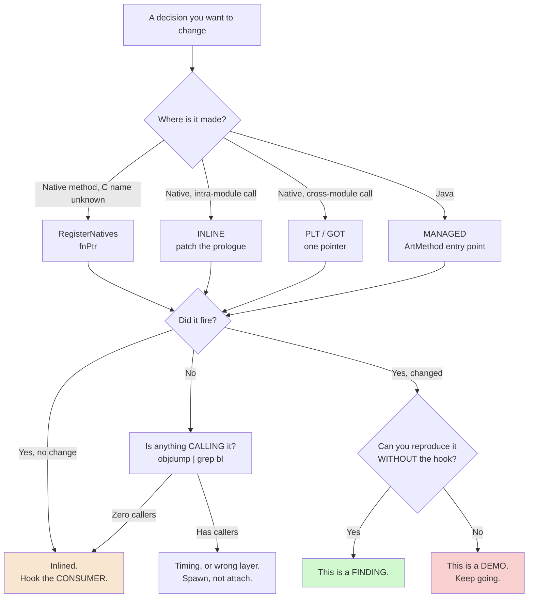

# 65 — Hooking · Mind map

A single map of the whole chapter. Read [README.md](README.md) for the prose and
[cheatsheet.md](cheatsheet.md) for the tables.

```mermaid
mindmap
  root((65 · Hooking))
    What a hook IS
      Definition
        Modification to a RUNNING program
        Control reaches code the author did not write
        At a point of your choosing
        File on disk untouched
      Not the same as
        Patching :: permanent, breaks signatures, cannot observe
        Fuzzing :: only works if you control the input
        Debugging :: same mechanism, different intent
      A function call, physically
        bl writes x30, branches
        ret is br x30
        Arguments in x0-x7 at entry
        Return address in a REGISTER, not the stack
    The five types
      1 Managed :: ART
        Overwrites ArtMethod entry_point_from_quick_compiled_code_
        Owned by 13-ART :: do not re-derive
        Granularity :: exactly one method
        JIT can silently overwrite you
        Invisible to any code checksum
      2 Inline :: trampoline
        Overwrites the first 4/8/16 bytes
        THE ONLY ONE reaching an intra-module call
        Needs a trampoline to call through
        Six steps :: find, size, allocate, relocate, patch, flush
      3 PLT / GOT
        Overwrites ONE pointer in .got.plt
        Scope is a RELATIONSHIP :: this module, that symbol
        No instructions change :: text checksums blind
        Full RELRO costs one mprotect
        Type 1026 R_AARCH64_JUMP_SLOT
      4 Interposition
        Changes resolution ORDER, overwrites nothing
        LD_PRELOAD
        Fails on Zygote-forked apps :: no execve
        Android equivalent is Zygisk
      5 RegisterNatives
        Overwrites JNINativeMethod fnPtr
        Owned by 16-JNI
        Mapping exists only in memory, only after JNI_OnLoad
        A TIMING problem
    Why inline is hard on arm64
      Branch range
        b / bl :: 128 MiB
        adrp :: 4 GiB
        adr / ldr-lit / b.cond / cbz :: 1 MiB
        tbz :: 32 KiB
      Fixed width and alignment
        Every instruction 4 bytes, 4-byte aligned
        Gift :: never patch half an instruction
        Cost :: minimum useful patch is 4 bytes
      Relocating PC-relative
        adrp is EVERYWHERE under -fPIC
        Re-encode the immediate, do not copy
        b/cbz need a veneer :: changes instruction count
        Refuse rather than mishandle
      Cache coherency
        I-cache not coherent with D-cache
        __builtin___clear_cache
        Measured :: omission did not fail on Cortex-A53
        Architecture permits stale execution, does not require it
      Trampoline placement
        mmap hint is ADVISORY
        Measured :: kernel returned a page 10.3 GiB away
        MAP_FIXED_NOREPLACE and search
        NEVER bare MAP_FIXED
      Thread safety
        16-byte write is not atomic
        Stop the world / single-word atomic / brk two-phase
        Never free a trampoline
      Modern hardening
        BTI :: preserve the bti c landing pad
        PAC :: paciasp/autiasp must stay paired
        x18 :: shadow call stack, never touch
    Where hooks FAIL
      Inlined callee
        Compiler kept the symbol AND inlined the body
        Plain -O2, not an exotic flag
        Diagnostic :: objdump | grep "bl.*<name>"
        Same finding as 18-ARM section 5.4
      AOT-compiled caller
        Managed analogue of inlining
        Reversible :: cmd package compile -m verify -f
        Native version is permanent
      Target not resolved
        Library not loaded yet
        Symbol not exported :: use base + offset
        Class in a non-default ClassLoader
      Timing
        .init_array runs INSIDE dlopen
        JNI_OnLoad runs immediately after
        static blocks run once, early
        Fix :: spawn not attach ; hook dlopen ; Zygisk
      Diagnostic order
        Did it install
        Did it fire
        Is anything calling it
        Force interpretation
        Spawn not attach
        Producer vs consumer
        Only THEN blame the tool
    Static analysis
      hook-surface.sh
        Imports with JUMP_SLOT :: PLT-hookable
        Exports :: inline-hookable
        RELRO mode
        Java_* and JNI_OnLoad
        Anti-tamper LEADS, not findings
      hookability.py
        Is there room
        Which displaced words are PC-relative
        Does anything branch INTO the patch region
        Is the function called at all
        Verdict :: SAFE / NEEDS RELOCATION / UNSAFE
      Never invent an encoding
        Round-trip clang and llvm-objdump
        18-ARM arm64-patch.py --show-encodings
    Security
      Attackers
        TLS interception
        Borrow the app's signing routine
        Root and licence checks
        KeyStore :: non-exportable is not non-usable
      Developers
        Caching a security decision in a field
        Deciding in Java, consequence in native
        Self-checksum :: checker and checked share a trust domain
        Detecting tools instead of effects
      Honest framing
        Hooking is INSTRUMENTATION
        Proves behaviour, is not itself a finding
        Prefer the result that reproduces WITHOUT the hook
        MASVS-RESILIENCE is defence in depth by definition
      Forensics
        Anonymous r-x mappings
        Text differing from the file
        GOT entries outside any module
        Entry points outside boot image / odex / JIT cache
    Boundaries
      13-ART owns ArtMethod and entry points
      53-Frida owns the tool
      18-ARM owns encodings
      16-JNI owns RegisterNatives
      17-Libraries owns load-time ordering
      67-BypassingProtections owns detection and its defeat
      This chapter owns the MECHANISM
```

---

## The one-diagram version

The bottom half of that diagram is the part most hooking material omits, and it is the part that
distinguishes an instrumentation exercise from a security finding.
