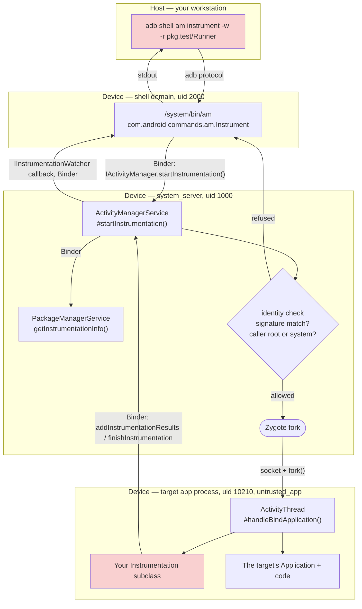
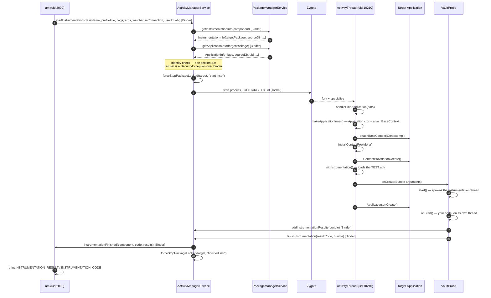
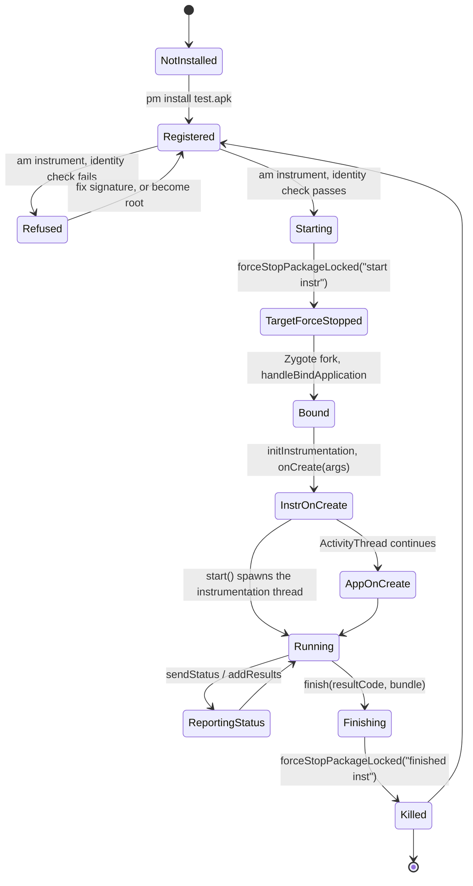
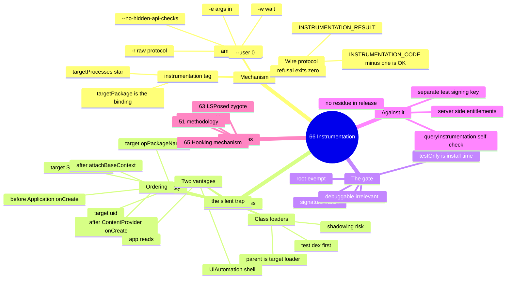

# 66 — Instrumentation

> After this chapter you can put your own code inside another application's process using nothing but
> the Android SDK — no root, no Frida, no hooking framework — and state precisely what that code can
> reach, what it cannot, and which of the two gates people believe in is the real one.

**Prerequisites:** [09 — Android App Internals](../09-Android-App-Internals/README.md) ·
[10 — APK Internals](../10-APK-Internals/README.md) ·
[21 — App Sandbox](../21-App-Sandbox/README.md) ·
[24 — IPC](../24-IPC/README.md) · [25 — Binder](../25-Binder/README.md) ·
[32 — Manifest](../32-Manifest/README.md) · [60 — ADB](../60-ADB/README.md)

**Applies to:** API 1 through API 35 for the core mechanism, which has been in the platform since
Android 1.0 and has changed remarkably little. Everything version-sensitive is called out in the
version matrix in §3.16. All measurements in this chapter were taken on **`sdk_gphone16k_x86_64`,
Android 15 / API 35, x86_64, `userdebug`** unless another device is named.

---

## Table of Contents

| § | Section | What you get out of it |
|---|---|---|
| 1 | [Introduction](#1-introduction) | Which "instrumentation" this chapter means, and why the platform ships one |
| 2 | [High-Level Architecture](#2-high-level-architecture) | Four diagrams: the command path, the Binder sequence, the process's class path, the lifecycle |
| 3 | [Deep Internal Working](#3-deep-internal-working) | The manifest binding, every `am instrument` flag, the wire protocol, and six measured results |
| 4 | [Source Code Walkthrough (AOSP)](#4-source-code-walkthrough-aosp) | One complete path from `am instrument` to `Instrumentation.onCreate()` |
| 5 | [Security Perspective](#5-security-perspective) | Abuse, misuse, CI as attack surface, MASVS mapping, honest severity |
| 6 | [Reverse Engineering Perspective](#6-reverse-engineering-perspective) | The manifest node, the Smali, and a real shipping APK that kept its tests |
| 7 | [Dynamic Analysis](#7-dynamic-analysis) | Recipes, argument passing, `UiAutomation`, and when to reach for Frida instead |
| 8 | [Static Analysis](#8-static-analysis) | Finding declared instrumentations and, harder, finding residue |
| 9 | [Examples](#9-examples) | Five graded, from a ten-line probe to an enterprise CI review |
| 10 | [Common Interview Questions](#10-common-interview-questions) | Five tiers with model answers |
| 11 | [Common Mistakes](#11-common-mistakes) | Developer, pentester, reverse engineer |
| 12 | [Hands-on Labs](#12-hands-on-labs) | Four labs, the last a CTF |
| 13 | [Summary](#13-summary) | Mind map, cheat table, quick revision |
| 14 | [References](#14-references) | AOSP paths, docs, MASTG identifiers, related chapters |

---

## 1. Introduction

### 1.1 The word means two different things, and this chapter owns one of them

If you have read [53 — Frida](../53-Frida/README.md), you have already met the phrase *dynamic
instrumentation*: attaching to a running process and rewriting its behaviour from outside. If you
have read [65 — Hooking](../65-Hooking/README.md), you have met the five mechanisms that make that
possible. Neither of those is this chapter.

**This chapter is about `android.app.Instrumentation`** — a class that has shipped in the Android
framework since version 1.0, that every Android developer uses without thinking about it, and that
is, when you look at it squarely, **a code-execution primitive the platform provides on purpose.**

The two senses share a word because they share an ambition. Both want your code running where the
target's code runs. They differ completely in how they get there, in what they cost, and in who is
allowed to use them:

| | Test instrumentation (this chapter) | Dynamic instrumentation ([53](../53-Frida/README.md), [65](../65-Hooking/README.md)) |
|---|---|---|
| Delivery | The package manager installs your APK | A binary is pushed to the device and injected into a process |
| Requires root | **No** | Usually yes, for a system-wide agent |
| Requires the target to cooperate | No, but see §3.9 | No |
| Runs as | The **target's** UID, in the target's process | The target's UID, in the target's process |
| Supported by Google | Yes. It is the official test API | No |
| Detectable by the app | Yes, trivially, and almost nobody checks | Yes, and everybody checks |
| Timing | Your code runs **before** `Application.onCreate()` | Whenever you attach, or at spawn with `-f` |
| Survives a reboot | Yes, it is an installed package | No |

The last three rows are why this chapter earns a place next to 53 and 65 rather than being folded
into them. A capability that ships in the platform, is documented by the vendor, is used by every CI
pipeline on earth, and is *not* on anybody's detection checklist is a more interesting capability
than one that is none of those things.

> **Definition**
> **Instrumentation**, in the Android platform sense, is a class the system instantiates inside an
> application's process before that application's own `onCreate()` runs, giving it the ability to
> observe and control the application's lifecycle. The system decides to do this because a *second*
> installed package — a **test APK** — declared an `<instrumentation>` component naming the first
> package as its `targetPackage`.

### 1.2 The analogy: the instrument goes inside the reaction

A chemist studying a reaction has two choices. She can stand outside the vessel with a camera and a
thermometer taped to the glass, inferring what is happening inside from what leaks out. Or she can
put a probe *into* the vessel — an electrode in the solution, reading the thing itself.

The first is [51 — Dynamic Analysis](../51-DynamicAnalysis/README.md) done from `adb shell`: you
watch `logcat`, you read files you are allowed to read, you infer. The probe in the solution is
`am instrument`. It is not a better camera. It is a different position.

And, exactly like a real probe, it is not free. Putting an electrode into the vessel perturbs the
reaction: it displaces solution, it conducts heat, and — the analogy holds unnervingly well here —
**the act of inserting it destroys and restarts the reaction**, because `am instrument` force-stops
the target process before it starts (§3.13, measured). Whatever state the user had built up is gone.
The physicists' word for this is *back-action*, and the pentester's word for it is "why did the app
log me out".

### 1.3 What problem existed before this

Android's security model, from the very first release, is that **an application is a UID**
([21 — App Sandbox](../21-App-Sandbox/README.md)). Two packages cannot read each other's files, share
a heap, or call each other's methods except through Binder ([25](../25-Binder/README.md)). That is
the whole point, and it is not negotiable.

But a *test* for an application must do all of those things. A test needs to construct the app's
`Activity`, call its private helper, read the `SharedPreferences` it wrote, and assert on a field. If
tests obeyed the sandbox, they could only ever be black-box UI tests, and Android would have no unit
or integration testing worth the name.

So the platform carved out one specific, narrow hole:

1. A second package may declare that it **targets** a first package.
2. If it does, and the system is satisfied about identity, the framework starts the *target's*
   process and loads **both APKs' code** into it.
3. The second package's class then runs, in that process, as that UID, before the target's own
   `Application.onCreate()`.

That is the entire mechanism. Everything else — JUnit, Espresso, UiAutomator, `androidx.test`,
Android Studio's green "run test" arrow, Firebase Test Lab, every device farm — is a library sitting
on top of those three sentences.

### 1.4 What would break if it did not exist

Every Android test that is not a pure JVM unit test. `./gradlew connectedAndroidTest` would have
nothing to connect to. Espresso could not reach the view hierarchy, because it reaches it by living
in the same process. `UiDevice.pressHome()` would need a permission no app can hold. Firebase Test
Lab and every commercial device farm would have no way to drive a build. Accessibility-service-based
UI automation would be the only option, and it is far weaker.

It is worth sitting with that for a moment, because it explains why the hole will never be closed:
**the ability to run arbitrary code inside an app's process is load-bearing for the entire Android
testing ecosystem.** Google cannot remove it. It can only decide who is allowed through, and §3.9
measures exactly where that line is drawn.

### 1.5 Why a pentester should care

Four reasons, in ascending order of how much they will surprise you.

**One.** It is the cheapest possible way to get code inside an app you can rebuild or re-sign. No
`frida-server` binary matched to the device's linker — a mismatched one on this very emulator fails
with `CANNOT LINK EXECUTABLE … empty/missing DT_HASH/DT_GNU_HASH (new hash type from the future?)`,
because the binary was built with a toolchain newer than the image's dynamic linker understands. That
is a frida-version problem rather than a root or device problem, and it is easy to misdiagnose:
`su 0 id` returns uid 0 on the same device seconds later, and `frida-ps -U` still enumerates
processes, so the failure only surfaces when you try to attach. No Magisk module, no Zygisk. `javac`,
`d8`, `apksigner`, `adb install`, `am instrument`. Two APKs and one command.

**Two.** It runs **before the application's own initialisation code**, and §3.6 measures exactly how
early. That places it ahead of most anti-tamper logic — and, revealingly, *behind* some of it.

**Three.** It is almost never checked for. Every hardened app on the planet greps its own maps for
`frida`, stats `/data/adb/lspd`, and looks for `XposedBridge`. Very few ask
`getPackageManager().queryInstrumentation(getPackageName(), 0)`, which is one line and answers the
question exactly.

**Four**, and this is the one that changes how you read the rest of this repository: an instrumented
process holds **two vantages at once**. It is an app UID, so it can read the app's private data —
and, through `UiAutomation`, it can execute shell commands as UID 2000. Both were measured in §3.11
in the same run. That is a genuine refinement of this repository's most-repeated rule, and it comes
with a trap attached: **a probe that runs under `am instrument` and calls `UiAutomation` has measured
the shell's vantage, not the app's, and nothing in its output says so.**

### 1.6 Where the boundary with the neighbouring chapters runs

This chapter sits in a crowded corner of the repository. The lines are drawn like this, and they are
drawn deliberately:

| Chapter | Owns | This chapter's relationship to it |
|---|---|---|
| [53 — Frida](../53-Frida/README.md) | Dynamic instrumentation as a **tool**, from outside the process | Cited, never re-derived. §7.6 compares the two honestly, including the cases where Frida is better |
| [65 — Hooking](../65-Hooking/README.md) | The **mechanism** of interception: the five hook types, trampolines, PLT/GOT | Cited. This chapter changes what a process *contains*; that one changes what a method *does*. §3.17 draws the distinction sharply |
| [63 — LSPosed](../63-LSPosed/README.md) | The Zygote-injected managed hooking framework | Cited. LSPosed needs root and a Zygote injection to reach every process; instrumentation needs neither, and reaches exactly one |
| [64 — Xposed](../64-Xposed/README.md) | The historical framework and the `app_process` replacement | Cited for the contrast in §3.17's table |
| [51 — Dynamic Analysis](../51-DynamicAnalysis/README.md) | The **methodology** of runtime analysis: the loop, coverage, evidence discipline | This chapter is one technique inside that methodology. Its evidence rules apply here unchanged |
| [04 — Java](../04-Java/README.md) · [05 — Kotlin](../05-Kotlin/README.md) · [08 — Build System](../08-Build-System/README.md) | Language and build fundamentals, Gradle source sets | Assumed. This chapter builds its APKs without Gradle precisely so the mechanism is visible |
| [60 — ADB](../60-ADB/README.md) | `adb`, the shell UID and what it can reach | Assumed throughout, and quantified again in §3.11 |

---

## 2. High-Level Architecture

### 2.1 The command path



Read this as three trust boundaries and one decision. Your command starts in the **shell domain**,
which is UID 2000 and, as [60 — ADB](../60-ADB/README.md) measured, is privileged not by the shell
GID but by the 200 permissions the `com.android.shell` package requests. It crosses into
**`system_server`** over Binder, where `ActivityManagerService` consults `PackageManagerService` for
the `InstrumentationInfo` and then makes exactly one security decision — the diamond. If the decision
is *allowed*, `system_server` forks the target's process from Zygote and hands `ActivityThread` a
binding that names your instrumentation class. Your code is coloured as attacker-controlled input
because, from the target application's point of view, that is precisely what it is.

Note what is **not** in the diagram: there is no step where the target application is consulted, no
permission it can decline, and no callback it receives saying "you are being instrumented". The only
notification the app gets is that its process was force-stopped and restarted.

### 2.2 The Binder sequence, with the ordering that matters



Steps 12 through 18 are the ones worth memorising, because they are counter-intuitive and because
§3.6 measures them on a device rather than asserting them. **Your instrumentation's `onCreate()` runs
after the target's `Application` constructor, after its `attachBaseContext()`, and after every
`ContentProvider.onCreate()` — but before `Application.onCreate()`.** The framework's own javadoc for
`Instrumentation.onCreate` says it is called *"before any application code has been loaded"*, and on
a device that is demonstrably not true.

Note also step 21: `finishInstrumentation` is not a return, it is a **kill**. The process the
diagram has been describing ceases to exist a few milliseconds later, taking the target application
with it.

### 2.3 What the process's class path looks like once both APKs are loaded

```
target app process, pid 17935, uid 10210, u:r:untrusted_app:s0:c210,c256,c512,c768
|
+-- ClassLoader chain, as measured by the probe
|   |
|   |   [ instrumentation context loader ]
|   |     PathClassLoader
|   |       dex:  <TEST apk>/base.apk
|   |             <TARGET apk>/base.apk
|   |       native: /system/lib64, /system_ext/lib64
|   |            |
|   |            v  parent
|   |   [ target app loader — also the loader of VaultProbe.class ]
|   |     PathClassLoader
|   |       dex:  <TEST apk>/base.apk        <-- the test APK is FIRST
|   |             <TARGET apk>/base.apk
|   |       native: <TEST apk>/lib/x86_64
|   |               <TARGET apk>/lib/x86_64
|   |               /system/lib64, /system_ext/lib64
|   |            |
|   |            v  parent
|   |     BootClassLoader
|
+-- filesystem view
|     /data/user/0/com.pentest.ch66.vault          <-- readable, we ARE this uid
|     /data/user/0/com.pentest.ch66.vault.test     <-- also readable, same process
|     /data/data/com.android.settings              <-- ENOENT, not EACCES
|     /data/local/tmp                              <-- EACCES (the shell CAN read it)
|
+-- privileged side channel
      UiAutomation.executeShellCommand()  ->  runs as uid 2000(shell)
```

Two things in that layout are worth more than the rest.

First, **the test APK's DEX is first on the target loader's class path**, ahead of the target's own.
That is what makes `Class.forName("com.pentest.ch66.vault.VaultStore")` resolve from your code without
any compile-time dependency — and it is also a loaded gun, because a class you ship with the same
fully-qualified name as one of the target's will **shadow** it. §11.2 has the consequence.

Second, the filesystem block shows the trade this chapter is about. You have gained
`/data/user/0/<target>`, which `adb shell` cannot read. You have *lost* `/data/local/tmp`, which
`adb shell` can. And the last line gives both back at once, which is the trap.

### 2.4 The lifecycle as a state machine



The two branches out of `InstrOnCreate` are concurrent, not sequential, and that is the single most
common source of flaky instrumentation code. `start()` returns immediately after spawning a thread;
`ActivityThread` then proceeds to `Application.onCreate()` on the main thread. Your `onStart()` and
the app's initialisation are racing. If your code reads something the app writes during startup, you
must wait for it *explicitly* — and §11.2 records the exact way that waiting goes wrong.

Note also that `Refused` is a terminal-looking state that is not terminal at all: the same
`Registered` node is reachable from it by changing your signing key or your caller identity. That
edge is the whole of §3.9.

---

## 3. Deep Internal Working

### 3.1 What an `Instrumentation` actually is

`android.app.Instrumentation` is an ordinary class with no special powers of its own. Its privilege
is entirely positional: it is the object the framework hands the application's lifecycle callbacks
to. Read the class as three groups of members.

**Group one — the lifecycle you implement.**

| Member | When the framework calls it | Thread |
|---|---|---|
| `onCreate(Bundle arguments)` | Once, from `ActivityThread.handleBindApplication()`, after providers and before `Application.onCreate()` | main |
| `onStart()` | Only if you called `start()`; on the thread `start()` spawned | instrumentation thread |
| `onException(Object obj, Throwable e)` | Whenever the framework catches an unhandled exception from app code. Returning `true` swallows it | whichever threw |
| `onDestroy()` | On the "instrument without restart" teardown path | main |

**Group two — the hooks the framework routes *through* you.** Every one of these is called by
`ActivityThread` on the app's behalf, which is why an instrumentation sees the whole lifecycle:

`newApplication`, `callApplicationOnCreate`, `newActivity`, `callActivityOnCreate`,
`callActivityOnStart`, `callActivityOnResume`, `callActivityOnPause`, `callActivityOnDestroy`,
`callActivityOnNewIntent`, `callActivityOnSaveInstanceState`,
`callActivityOnRestoreInstanceState`, `callActivityOnPictureInPictureRequested`,
`callActivityOnUserLeaving`.

> **Under the Hood**
> Search `ActivityThread.java` in the API 35 SDK sources for `mInstrumentation.` and you get 46 call
> sites. Every activity lifecycle transition in the platform goes through the instrumentation object.
> An instrumentation that overrides `callActivityOnCreate` is, in effect, a hook on
> `Activity.onCreate` for **every** activity in the process — installed by the framework itself,
> with no trampoline, no `mprotect`, and no ART internals. Compare
> [65 — Hooking §3](../65-Hooking/README.md), which has to earn the same result the hard way.

**Group three — the control surface.** `getContext()`, `getTargetContext()`, `getComponentName()`,
`getProcessName()`, `getUiAutomation()`, `startActivitySync()`, `waitForIdleSync()`,
`runOnMainSync()`, `sendKeySync()`, `sendStringSync()`, `sendPointerSync()`, `addResults()`,
`sendStatus()`, `finish()`.

The two `Context` getters are the pair people confuse, and the difference is exact:

| Call | Returns the context of | `getPackageName()` on it | Measured |
|---|---|---|---|
| `getContext()` | the **test** package | `com.pentest.ch66.vault.test` | yes, §3.8 |
| `getTargetContext()` | the **target** package | `com.pentest.ch66.vault` | yes, §3.8 |

If you want the app's `SharedPreferences`, its `getFilesDir()`, or its `ApplicationInfo`, you want
`getTargetContext()`. If you use `getContext()` by mistake you will read the *test* package's
storage, find it empty, and conclude the app stores nothing. This is the most common beginner error
in the whole subject and it fails silently.

> **Warning**
> `getTargetContext().getOpPackageName()` returns the **target's** package name, not the test's, and
> `ActivityThread.initInstrumentation()` says why in a comment: app-ops are checked against the real
> calling UID, and the UID belongs to the target. Anything you do from an instrumentation that is
> app-op-gated — location, clipboard reads on API 29+, `SYSTEM_ALERT_WINDOW` — is attributed to the
> **target application** in `appops`. On a forensic timeline your activity is the app's activity.

### 3.2 The manifest binding

An instrumentation is declared as a top-level element of the manifest — a sibling of `<application>`,
not a child of it. This trips people up because every other component lives inside `<application>`.

```xml
<!-- examples/vault-probe/AndroidManifest.xml -- the whole binding -->
<manifest xmlns:android="http://schemas.android.com/apk/res/android"
    package="com.pentest.ch66.vault.test">

    <uses-sdk android:minSdkVersion="24" android:targetSdkVersion="35" />

    <instrumentation
        android:name="com.pentest.ch66.probe.VaultProbe"
        android:targetPackage="com.pentest.ch66.vault"
        android:label="ch66 vault probe"
        android:handleProfiling="false"
        android:functionalTest="false" />

    <application android:label="ch66 vault probe" />
</manifest>
```

| Attribute | Type | Meaning | Notes |
|---|---|---|---|
| `android:name` | class | The `Instrumentation` subclass to instantiate | Loaded from the **test** APK's class loader |
| `android:targetPackage` | package | Whose process to run in | **This is the binding.** Without it there is no target and `am instrument` has nothing to start |
| `android:targetProcesses` | string | Which processes of that package | API 26+. Comma-separated names, or `*` for *any* process that runs `targetPackage` code. Absent means the main process only |
| `android:label` | string | Human name shown by tools | Cosmetic |
| `android:icon` | drawable | Icon shown by tools | Cosmetic |
| `android:handleProfiling` | boolean | If `false`, the framework starts and stops profiling for you when `-p` is passed | See `ActivityThread.initInstrumentation` |
| `android:functionalTest` | boolean | Historical hint that the test drives the whole app | The framework stores it in `InstrumentationInfo` and does nothing else with it |

> **Mental Model**
> `<instrumentation targetPackage="X">` is a **one-way declaration of intent to enter X**. It is not
> a permission request, X is never asked, and X cannot refuse it in its own manifest. What stops it
> is not consent but *identity* — the check in §3.9. Think of it as a key cut to fit a specific lock,
> which the locksmith will only hand over if you can prove you own the house.

`android:targetProcesses` deserves a second look, because `*` is stronger than it appears. A
multi-process app — one with `android:process=":push"` on a service, say — normally exposes only its
main process to an instrumentation. With `targetProcesses="*"`, the framework will load your code
into *any* process that runs the target's code, which for a large app can be five or six processes
with quite different privileges and quite different loaded state.

### 3.3 `InstrumentationInfo`: what the system knows about you

`PackageManagerService` parses the manifest node into
`android.content.pm.InstrumentationInfo`. The fields are worth reading because they are exactly the
inputs to everything that follows:

| Field | What it carries |
|---|---|
| `targetPackage` | The binding from §3.2 |
| `targetProcesses` | Process filter, or `null` |
| `sourceDir`, `publicSourceDir` | Paths to the **test** APK. `ActivityThread` puts `sourceDir` on the class path |
| `splitNames`, `splitSourceDirs`, `splitPublicSourceDirs`, `splitDependencies` | The same for split APKs |
| `dataDir`, `deviceProtectedDataDir`, `credentialProtectedDataDir` | The test package's own storage, which still exists and is still separate |
| `primaryCpuAbi`, `secondaryCpuAbi` | Compared against the target's; a mismatch is logged as a warning, not an error |
| `nativeLibraryDir`, `secondaryNativeLibraryDir` | Where the test APK's `.so` files live |
| `handleProfiling`, `functionalTest` | The manifest booleans |

> **Pentester's Note**
> `InstrumentationInfo` is readable by any app through
> `PackageManager.queryInstrumentation(String targetPackage, int flags)`. That single call is the
> complete, one-line defence an application can mount against this entire chapter — pass your own
> package name, and a non-empty list means somebody has installed a test APK aimed at you. §5.6 has
> the code. Almost nothing in the wild does it, which is a large part of why this technique is worth
> knowing.

### 3.4 `am instrument`, flag by flag

Measured from the device (`adb shell am help`), API 35:

```
instrument [-r] [-e <NAME> <VALUE>] [-p <FILE>] [-w]
        [--user <USER_ID> | current]
        [--no-hidden-api-checks [--no-test-api-access]]
        [--no-isolated-storage]
        [--no-window-animation] [--abi <ABI>] <COMPONENT>
```

| Flag | What it does | Why you care |
|---|---|---|
| `-w` | Wait for the instrumentation to finish before returning | Without it `am` returns immediately and you see nothing. Effectively mandatory |
| `-r` | Print the **raw** protocol instead of decoding `REPORT_KEY_STREAMRESULT` | Mandatory if you want machine-readable results. See §3.5 |
| `-e <NAME> <VALUE>` | Put a string into the `Bundle` handed to `onCreate(Bundle)` | The only input channel. Repeatable |
| `-p <FILE>` | Write method-tracing profiling data to `<FILE>` | Interacts with `android:handleProfiling` |
| `-m` | Emit the results as protobuf on stdout | For harnesses |
| `-f [PATH]` | Emit protobuf to a file, default under `/sdcard/instrument-logs/` | Note this writes to shared storage |
| `--user <ID>` | Which user to run in. **Defaults to `current`, which is the constant `-2`** | Critical for a non-shell caller; see §3.10 |
| `--no-hidden-api-checks` | Lift non-SDK API restrictions in the instrumented process | Measured in §3.12. Requires `DISABLE_HIDDEN_API_CHECKS`, which shell holds and an app does not |
| `--no-test-api-access` | *Disable* the test-API access that is otherwise granted | Reads backwards because the default is permissive; see §3.10 |
| `--no-isolated-storage` | Do not use the scoped-storage sandbox; mount full external storage | Changes what the instrumented process sees on `/sdcard` |
| `--no-window-animation` | Turn animations off for the run | Cosmetic, but it makes UI automation far less flaky |
| `--abi <ABI>` | Force the process to launch with a chosen ABI | Only meaningful on a multi-ABI device; on this AVD, `x86_64` and `arm64-v8a` via `libndk_translation.so` |

`<COMPONENT>` is `<TEST_PACKAGE>/<RUNNER_CLASS>`, or bare `<TEST_PACKAGE>` when the test package
declares exactly one `<instrumentation>` node. The runner class may be written relative
(`.VaultProbe`) if it sits directly under the test package's own package name; ours does not, so the
examples use the fully-qualified form.

### 3.5 The wire protocol

`am instrument -r` prints a small, line-oriented protocol. It is worth knowing byte for byte, because
CI systems parse it and get it wrong.

| Line | Meaning |
|---|---|
| `INSTRUMENTATION_STATUS: k=v` | A progress key from `sendStatus()`. May repeat many times |
| `INSTRUMENTATION_STATUS_CODE: n` | Terminates one status block |
| `INSTRUMENTATION_RESULT: k=v` | A key from the final bundle, delivered by `addResults()` or `finish()` |
| `INSTRUMENTATION_CODE: n` | The overall result code, once, at the end |
| `INSTRUMENTATION_FAILED: <component>` | The framework could not start it |
| `INSTRUMENTATION_ABORTED: ...` | The run was aborted |

> **Warning**
> `INSTRUMENTATION_CODE: -1` means **success**. The value is `android.app.Activity.RESULT_OK`, which
> is `-1`; `RESULT_CANCELED` is `0`. Every person meeting this protocol for the first time reads
> `-1` as an error. A CI gate written as "fail if the code is not zero" inverts the meaning of every
> test run it ever sees.

Two more properties of the format cost people real time:

- **Values can span lines.** A stack trace arrives as one key whose value contains newlines, and the
  continuation lines carry no prefix at all. Splitting the stream on `\n` and then on `=` truncates
  exactly the diagnostic you needed. `scripts/parse-instrumentation-results.py` accumulates
  continuations for this reason.
- **A refused start still exits zero.** `adb shell` reports the exit status of `adb`, not of the
  instrumentation, and a `SecurityException` from `ActivityManagerService` arrives as *text*. In a CI
  log, a refusal looks almost exactly like a suite that ran and asserted nothing.

### 3.6 Measured: exactly how early your code runs

This is the first of six measurements and it is the one that changes how you plan an assessment.

The target fixture (`examples/vault-target/`) logs a monotonic timestamp at four points in its own
startup; the probe (`examples/vault-probe/`) reads those markers at the instant its `onCreate()` is
entered, before it has done anything else. Both were run on the AVD.

```
# device -- logcat -s ch66seq:I, times in ns from SystemClock.elapsedRealtimeNanos()
1 Application() constructor      t=24044558...  (baseline)
2 Application.attachBaseContext  t=24044558480500
3 ContentProvider.onCreate       t=24044561300500
4 Application.onCreate           t=24044565690900
5 seed complete                  t=24044576058000
```

```
# host -- the probe's own reading, taken inside Instrumentation.onCreate()
INSTRUMENTATION_RESULT: seq.entryNs=24044562789400
INSTRUMENTATION_RESULT: seq.atInstrumentationOnCreate=attachBaseContext=24044558480500 \
    providerOnCreate=24044561300500 applicationOnCreate=0
```

Line them up and the order is unambiguous:

| Order | Event | Offset from `attachBaseContext` | Already run when your code gets control? |
|---|---|---|---|
| 1 | `Application()` constructor | — | **Yes** |
| 2 | `Application.attachBaseContext()` | 0 ms | **Yes** |
| 3 | every `ContentProvider.onCreate()` | +2.82 ms | **Yes** |
| 4 | **`Instrumentation.onCreate()`** | **+4.31 ms** | this is you |
| 5 | `Application.onCreate()` | +7.21 ms | No — you are ahead of it |
| 6 | the app's own initialisation work | +17.6 ms | No |

> **Warning — the framework's own documentation is wrong about this**
> The javadoc on `Instrumentation.onCreate` in the API 35 sources reads: *"Called when the
> instrumentation is starting, before any application code has been loaded."* Three pieces of
> application code have provably already run by then. `handleBindApplication()` calls
> `makeApplicationInner()` (constructor plus `attachBaseContext`) and `installContentProviders()`
> **above** the `mInstrumentation.onCreate(...)` call site, in the same method, in the same source
> file the javadoc lives in. Measured here to 0.1 ms resolution; readable in
> `android/app/ActivityThread.java` for anyone who wants to check.

The consequences are not academic. Three of the most common places to put anti-analysis and
initialisation logic land on the *wrong* side of the line for you:

| Where the app puts it | Runs before your `onCreate()`? | So you can pre-empt it? |
|---|---|---|
| `Application` constructor / `attachBaseContext()` — where commercial packers unpack, and where a `MultiDex.install()` or a TLS pinning bootstrap typically goes | Yes | **No** |
| A `ContentProvider` — `androidx.startup`, `FirebaseInitProvider`, crash reporters, several SDK auto-initialisers | Yes | **No** |
| `Application.onCreate()` — where most hand-written init lives | No | **Yes** |
| `Activity.onCreate()` and everything after | No | **Yes**, and you also get the framework's own `callActivityOnCreate` hook |

> **Pentester's Note**
> If the check you want to defeat lives in `attachBaseContext` or a provider, instrumentation alone
> will not get in front of it — you are reduced to observing the aftermath, or you need a technique
> that acts at process spawn: Frida's `-f` spawn-and-hold ([53 §4](../53-Frida/README.md)) or a
> Zygote-level framework ([63](../63-LSPosed/README.md)). Knowing *which* of those three slots a
> defence occupies is the cheapest way to choose your tool, and the ordering above is how you decide.

### 3.7 Measured: the class loader graph, and why your code can call the target's

The probe printed the parent chain of three class loaders. Reduced to essentials:

| Loader | DEX entries, in order | Native lib dirs | Parent |
|---|---|---|---|
| `getContext().getClassLoader()` (test context) | test APK, target APK | system only | the target loader below |
| `getTargetContext().getClassLoader()` | **test APK**, target APK | test, target, system | `BootClassLoader` |
| `VaultProbe.class.getClassLoader()` | identical to the target loader | test, target, system | `BootClassLoader` |

`cl.same` was `false`: the two contexts genuinely hand out different `ClassLoader` objects. But the
test context's loader has the target's loader as its **parent**, and — the load-bearing detail —
**the target's own loader already lists the test APK first**. `ActivityThread.initInstrumentation()`
builds the instrumentation's `LoadedApk` with `appContext.getClassLoader()` passed as the parent,
and `ActivityManagerService` had already arranged for the target's `LoadedApk` to carry
`mInstrumentationAppDir` on its path.

Three consequences follow, and only the first is obvious.

1. **You can name the target's classes and they resolve.** `Class.forName("com.example.LicenseGate")`
   works from your test code with no compile-time dependency on the app, which is exactly the
   position an assessor is in. Every measurement in `examples/vault-probe/Probes.java` is done this
   way on purpose.
2. **You can shadow the target's classes.** Your DEX is *ahead* of the target's on the same loader.
   Ship a class with a fully-qualified name the target also uses, and the target gets yours. That is
   either a devastating capability or the reason your results are all lies, depending on whether you
   did it deliberately. §11.2.
3. **Your native libraries are loadable and the target's are on the same path.** `System.loadLibrary`
   from your test APK finds your `.so`, and the ABI warning in `prepareInstrumentation()` exists
   because a mismatch here produces a link error a long way from its cause.

### 3.8 Measured: who you are once you are inside

```
# host -- selected keys from one am instrument -w -r run
id.pid                   17935
id.uid                   10210
id.processName           com.pentest.ch66.vault
id.cmdline               com.pentest.ch66.vault
id.selinux               u:r:untrusted_app:s0:c210,c256,c512,c768
id.contextPackage        com.pentest.ch66.vault.test
id.targetContextPackage  com.pentest.ch66.vault
id.opPackage             com.pentest.ch66.vault
id.targetDataDir         /data/user/0/com.pentest.ch66.vault
id.testDataDir           /data/user/0/com.pentest.ch66.vault.test
```

Read that top to bottom and the whole capability is in it. The process is **named** for the target,
runs as the **target's** UID, and sits in the target's SELinux domain with the target's MCS
categories. Only `contextPackage` remembers that a second APK is involved at all.

The MCS pair is a nice independent confirmation of
[22 — SELinux](../22-SELinux/README.md)'s formula. The UID is 10210, so the app ID is
`10210 - AID_APP(10000) = 210`; the first category is `c[appId & 0xff] = c[210]` and the second is
`c[256 + (appId >> 8)] = c[256 + 0] = c[256]`. The measured context is **`c210,c256`**, which the
formula reproduces exactly. The two further categories `c512,c768` are the additional levels current
Android images attach; the invariant that matters — the first category can never exceed `c255` —
holds, as 22 requires.

Now the reads. Three storage shapes, all of them ordinary and correct Android storage, all of them
`0600` or `0700` under `/data/data`:

```
# host -- the payload
read.prefs.api_key        ch66-APIKEY-3f9a1c
read.prefs.refresh_token  ch66-RT-8b20e5d4
read.prefsXmlBytes        READ:229
read.file.secret          ch66-file-secret-7d41
read.static.sessionToken  sess-7a9a3cf2bb6
read.static.premiumBefore false
```

`SharedPreferences` through `getTargetContext()`, the backing XML read directly as a file, a private
file under `getFilesDir()`, and a **private static field** read by reflection. None of it required a
vulnerability in the app. The app is not misconfigured. It is that the code doing the reading
is the app.

And the write:

```
# host
write.setPremium          ok
write.call.isPremiumAfter true
```

`LicenseGate.sPremium` is `private static boolean`, initialised to `false`, and the only writer the
app ships is package-private and unreachable. It was set to `true` by reflection from the test APK,
and the app's own `isPremium()` — invoked afterwards, also by reflection, so the JIT could not have
constant-folded our reading of it — returned `true`. Same process, same heap, same static field.

> **Mental Model**
> [65 — Hooking](../65-Hooking/README.md) changes what a **method does**. This chapter changes what
> the **process contains**. If the decision you care about is a value, instrumentation reaches it
> directly and no hook is needed. If the decision is computed fresh every time — a syscall, a
> network response, a JNI call into native code — a value edit does nothing and you need 65's
> machinery. Choosing wrongly here is the most common wasted afternoon in the subject.

### 3.9 Measured: the gate — and both popular answers are wrong

Here is the received wisdom, in two forms, both of which you will find repeated confidently online:

- *"You can only instrument an app that is `android:debuggable="true"`."*
- *"The test APK must be signed with the same key as the app, unless the app is debuggable."*

`scripts/am-instrument-matrix.sh` crosses three variables — target debuggable or not, test APK signed
with the same key or a different one, caller shell or root — and runs all of them against the same
two packages, where the only difference between the two target builds is the one attribute injected
by `aapt2 link`'s debug-mode flag. Measured output, AVD, API 35, `ro.debuggable=1`:

| Row | Target | Test APK key | Caller | Result |
|---|---|---|---|---|
| 1 | `DEBUGGABLE HAS_CODE ALLOW_CLEAR_USER_DATA` | A (matches target) | shell, uid 2000 | **OK**, `INSTRUMENTATION_CODE: -1` |
| 2 | `HAS_CODE ALLOW_CLEAR_USER_DATA` (no `DEBUGGABLE`) | A (matches) | shell | **OK**, full data read |
| 3 | no `DEBUGGABLE` | B (differs) | shell | **REFUSED** |
| 4 | `DEBUGGABLE` | B (differs) | shell | **REFUSED** |
| 5 | `DEBUGGABLE` | B (differs) | **root**, `su 0` | **OK** |
| 6 | no `DEBUGGABLE` | B (differs) | **root** | **OK** |
| 7 | `DEBUGGABLE` | A (matches) | app UID via `run-as` | see §3.10 |
| 8 | `android:testOnly="true"` on the test APK | A | shell | install refused, see §3.14 |

Rows 1 and 2 kill the first claim: **`android:debuggable` is not the gate.** A perfectly ordinary
release-flagged build was instrumented, its `SharedPreferences` read and its private static field
rewritten.

Rows 3 and 4 kill the second: **`debuggable` does not waive the signature check either.** The
debuggable target refused the mismatched test APK exactly as the release build did, with the same
message.

The refusal names the check by name, which is the best kind of measurement:

```
# host -- verbatim, row 4
java.lang.SecurityException: Permission Denial: starting instrumentation
  ComponentInfo{com.pentest.ch66.vault.test/com.pentest.ch66.probe.VaultProbe}
  from pid=14316, uid=2000 not allowed because package com.pentest.ch66.vault.test
  does not have a signature matching the target com.pentest.ch66.vault
    ...
Caused by: android.os.RemoteException: Remote stack trace:
    at com.android.server.am.ActivityManagerService.startInstrumentation(...)
    at android.app.IActivityManager$Stub.onTransact(...)
```

Rows 5 and 6 give the real shape of it. **Root is exempt from the signature check; the shell is not.**
UID 0 instrumented a package it had no signing relationship with, in both target configurations.

So the rule, stated correctly:

> **Definition — the instrumentation gate, as measured**
> `ActivityManagerService.startInstrumentation()` refuses unless **the test package and the target
> package are signed by the same certificate**, or the caller is privileged (root; system UID).
> `android:debuggable` plays **no part** in this decision in either direction. What `debuggable`
> gates is a different set of things — `run-as`, JDWP attach, `adb backup` of app data — which are
> covered in [51 §3](../51-DynamicAnalysis/README.md) and are frequently confused with this.

> **Warning — the honest caveat on these six rows**
> The device is `userdebug` and reports `ro.debuggable=1`. Several platform checks take a more
> permissive branch on such a build, and `ActivityManagerService.startInstrumentation()` contains at
> least one `Build.IS_DEBUGGABLE`-conditioned branch in the shipping AOSP tree. **Rows 1, 2, 5 and 6
> are therefore upper bounds** on what a `user` build permits: the signature-match path (rows 1 and
> 2) is the documented, supported path and is not in doubt, but a reader on a locked production
> device should re-run rows 5 and 6 before relying on them. Rows 3 and 4 — the refusals — are the
> ones a permissive build cannot have manufactured, and they are the rows that carry the argument.
> No second device was attached during this chapter's work: the two physical phones this repository
> measures on — the Redmi `M2101K6P` (Android 11 / API 30, rooted, frida-server running) and the
> `i9000S` (Android 13 / API 33, Enforcing, **not rooted, no frida-server**) — were both absent, and
> this gap is stated rather than papered over.

What this means operationally is simple and slightly bleak for the attacker and slightly
uncomfortable for the developer:

- Against an app you **cannot re-sign**, on a device you do **not** have root on, instrumentation is
  closed to you. Go and read [53 — Frida](../53-Frida/README.md).
- Against an app you **can** re-sign — your own, your client's, or any APK you are permitted to
  repackage — instrumentation is the cheapest code-execution primitive on the platform, and the
  target does not have to be debuggable.
- Against **any** app on a rooted device, it is open. And the interesting part is that it is open
  *quietly*: an `am instrument` run leaves no `frida-server` on disk, no injected library in
  `/proc/<pid>/maps`, and nothing that the usual detection suites look for.

### 3.10 Measured: calling it from something other than a shell

Row 7 needed three attempts, and the two failures are more instructive than the success. `run-as`
switches to the target package's UID, so this asks whether `am instrument` is a shell privilege:

```
# device -- attempt 1, as uid 10210
$ run-as com.pentest.ch66.vault am instrument -w -r <component>
Permission Denial: startInstrumentation asks to run as user -2 but is calling from uid u0a210;
  this requires android.permission.INTERACT_ACROSS_USERS_FULL
```

```
# device -- attempt 2, pinning the user explicitly
$ run-as com.pentest.ch66.vault am instrument -w -r --user 0 <component>
Permission Denial: disable hidden API checks from pid=14505, uid=10210
  requires android.permission.DISABLE_HIDDEN_API_CHECKS
```

```
# device -- attempt 3
$ run-as com.pentest.ch66.vault am instrument -w -r --user 0 --no-test-api-access <component>
INSTRUMENTATION_RESULT: read.prefs.api_key=ch66-APIKEY-3f9a1c
INSTRUMENTATION_CODE: -1
```

Neither failure is the instrumentation gate. Both are **`am`'s own defaults, written for a shell
caller**:

| Default | Why it exists | What it costs a non-shell caller |
|---|---|---|
| `--user current`, the constant `-2` | Convenience on multi-user devices | Resolving `current` requires `INTERACT_ACROSS_USERS_FULL`, which no app holds. Pass `--user 0` |
| test-API access enabled | Tests are expected to use `@TestApi` members | `ActivityManagerService` enforces `DISABLE_HIDDEN_API_CHECKS` for that flag. Pass `--no-test-api-access` |

With both cleared, an ordinary application UID started an instrumentation successfully.

> **Pentester's Note**
> `am instrument` is **not** a shell-only privilege. The signature relationship is what matters, and
> a signature relationship is something an application vendor has with *its own other packages*. An
> app suite that ships several co-signed packages, or a vendor that ships a "diagnostics" APK
> alongside the product, has therefore built a path for one of its packages to execute code inside
> another's process, at that other's UID, on an unrooted retail device. That is worth a paragraph in
> any report where you see co-signed packages, and it is invisible to a manifest review that only
> looks at exported components.
>
> **The bound on this measurement, stated plainly:** the caller here was the target package's own
> UID, so this demonstrates *self*-instrumentation from an app UID. Whether an app UID may
> instrument a *different* co-signed package was not measured, because it needs a third fixture APK.
> Do not report the stronger claim on the strength of this one.

### 3.11 Measured: an instrumented process holds two vantages at once

This repository's most-repeated finding is that **a probe verified from `adb shell` has not been
verified**: `shell` sees properties an app cannot, `/system/xbin/su` is visible to `shell` and
`EACCES` to an app, `/proc/modules` flips from readable to denied. Three chapters measured it
independently.

`am instrument` is precisely a way to *leave* the shell vantage and take the app's. The probe's
`deny.*` block confirms it, path by path, and the contrast with the same paths read from `adb shell`
seconds later is the cleanest demonstration of the rule in this repository:

| Path | From `adb shell`, uid 2000 | From the instrumented process, uid 10210 |
|---|---|---|
| `/data/user/0/com.pentest.ch66.vault/shared_prefs/vault.xml` | not readable | **read, 229 bytes** |
| `/data/data/com.android.settings` | `Permission denied` (**EACCES**) | **`ENOENT`** — different failure, same `false` from `File.exists()` |
| `/data/adb` | `Permission denied` | `EACCES` |
| `/system/xbin/su` | **readable**, `-rwsr-x--- root shell 51224` | **`EACCES`** |
| `/proc/modules` | **readable**, `-r--r--r-- root root` | **`EACCES`** |
| `/proc/1/maps` | exists, `Permission denied` | **`ENOENT`** — `/proc/1` is not even visible |
| `/data/local/tmp` | **listable**, `drwxrwx--x shell shell` | **`EACCES`** |

Two of those rows are worth stopping on. `/data/data/com.android.settings` and `/proc/1/maps` return
**`ENOENT` to the app and `EACCES` to the shell** — the app is not merely refused, the path does not
exist in its view, because of per-app data isolation and `/proc` hiding respectively. This is
[63 — LSPosed](../63-LSPosed/README.md)'s `/data/adb/lspd` finding in two more locations:
`File.exists()` returns `false` for absent, for forbidden, and for invisible, and a detector built on
it cannot tell you which.

**And now the part that complicates the rule.** `Instrumentation.getUiAutomation()` returns a handle
the *system* created on the instrumentation's behalf, and `UiAutomation.executeShellCommand()` does
not run the command in this process at all:

```
# host -- from a process whose own uid is 10210
ua.available            YES
ua.id                   UiAutomation@88406d3[id=5, displayId=0, flags=0]
ua.shell.id             uid=2000(shell) gid=2000(shell) groups=2000(shell),1004(input),1007(log),...
ua.shell.lsDataLocalTmp drwxrwx--x 4 shell shell 4096 2026-08-16 07:05 /data/local/tmp
ua.shell.lsSystemXbinSu -rwsr-x--- 1 root shell 51224 2025-01-23 23:03 /system/xbin/su
ua.shell.readProcModules virtio_snd 45056 0 - Live 0x000000000000
```

Every path in the `deny.*` block above came back through this channel. The instrumented process is
UID 10210 for its own reads and, simultaneously, has a pipe to a UID 2000 command executor.

> **Warning — this invalidates measurements silently, which is the worst kind**
> If you build a detection probe as an instrumentation and reach for `UiAutomation.executeShellCommand`
> because it is convenient, **you have measured the shell's vantage and your output will not say so.**
> The app you are assessing has no `UiAutomation`. It cannot list `/data/local/tmp`, cannot stat
> `/system/xbin/su`, cannot read `/proc/modules`. A root-detection check you "verify" this way will
> look like it works and will not work in production.
>
> The rule stands, sharpened: **run the probe with the same capabilities the app has.** Inside an
> instrumentation that means ordinary `java.io` and `android.content`, and it means treating
> `getUiAutomation()` as a different instrument that answers a different question.

`executeShellCommand` has one more property worth recording, because it is undocumented and produces
silent empty output:

```
# host -- measured
ua.shell.echoPlain   one two
ua.shell.echoQuoted  "one two"        <- the quotes came back literally
ua.shell.pipelineRaw                  <- getprop | wc -l  produced nothing at all
```

**It is not a shell.** The string is split on whitespace and executed; quoting is not honoured,
pipelines are not honoured, redirection is not honoured, and none of them produce an error. If you
need a pipeline, exec `sh` with the whole script as a single argument that you construct carefully —
and verify the output is non-empty, because a silent empty result is what failure looks like here.

### 3.12 Measured: hidden API, and why a single lookup tells you nothing

Non-SDK interface restrictions ("hidden API") are enforced by ART inside the reflection APIs
themselves. A **blocklisted** member is filtered out of `getDeclaredMethods()` and
`getDeclaredFields()` entirely, so `getDeclaredMethod()` raises `NoSuchMethodException` for something
that is plainly present in the DEX. A **greylisted** ("unsupported") member is *not* filtered — it is
returned, with a warning in logcat.

That distinction is why the obvious test is worthless. The probe first tried the obvious thing:

```
# host -- WITHOUT --no-hidden-api-checks
hidden.SystemProperties.get      OK:35
hidden.ServiceManager.getService OK:android.os.BinderProxy@ce52f36
```

Both succeeded. A reader stopping there concludes hidden-API enforcement is off. It is not; those two
members are merely greylisted. The honest measurement is a **census** — count what the runtime is
willing to show you — run twice against the same process:

| Class | Enforced (default) | `--no-hidden-api-checks` | Delta |
|---|---|---|---|
| `android.app.ActivityThread` | 30 methods, 21 fields | **289 methods, 109 fields** | +259 methods, 9.6× |
| `android.app.ActivityManager` | 89 methods, 35 fields | 155 methods, 170 fields | +66, +135 |
| `dalvik.system.VMRuntime` | 23 methods, 0 fields | 72 methods, 16 fields | +49, +16 |
| `android.os.SystemProperties` | 10 methods, 2 fields | 35 methods, 6 fields | +25, +4 |
| `VMRuntime.setHiddenApiExemptions` visible? | **false** | **true** | the flag unhides its own escape hatch |

> **Under the Hood**
> The last row is the joke the platform tells on itself. `setHiddenApiExemptions` is the method that
> lifts hidden-API enforcement for a process, and it is itself hidden — so an app cannot call it, but
> an instrumentation started with `--no-hidden-api-checks` can see and call it. This is the API
> `frida-server` and several testing tools use to unblock a process wholesale.

> **Pentester's Note**
> Generalise this past its subject. **A single positive lookup against a filtered API surface is not
> evidence about the filter.** It is the same lesson this repository learned three times over from
> detector signatures that agreed with themselves — 38's 18-of-18 self-signature claim, 52's rejected
> HIGH band, 64's `vxp` token. Count the population, and prefer a number that moves to a boolean that
> does not.

### 3.13 Measured: the process is destroyed at both ends

```
# host -- logcat from system_server during one run
I ActivityManager: Force stopping com.pentest.ch66.vault appid=10210 user=0: start instr
I ActivityManager: Killing 14796:com.pentest.ch66.vault/u0a210 (adj 0): stop ... due to start instr
   ... instrumented process is pid 14833 ...
I ActivityManager: Force stopping com.pentest.ch66.vault appid=10210 user=0: finished inst
I ActivityManager: Killing 14833:com.pentest.ch66.vault/u0a210 (adj 0): stop ... due to finished inst
```

Measured directly as well: the target was started normally and had pid 14796; after `am instrument`
the probe reported pid 14833; after the run `pidof` returned empty.

This is a hard operational constraint and it is the sharpest practical difference from Frida:

| | `am instrument` | `frida -U -n <process>` |
|---|---|---|
| Existing process state | **destroyed**, twice | preserved |
| A logged-in session | lost | kept |
| Reachability of a screen deep in the app | you must re-navigate every run | you are already there |
| Iteration speed | one full app start per run | attach once, edit script, re-run |
| Notice to the user | app visibly restarts | none |

> **Pentester's Note**
> If your target requires a login, a hardware token, or a fifteen-tap onboarding flow to reach the
> interesting screen, an instrumentation that finishes after each run will make you do that fifteen
> times. Two answers: drive the navigation *from* the instrumentation with `startActivitySync()` so
> it is scripted rather than manual, or do not call `finish()` — keep the instrumentation thread
> alive, which keeps the process alive, and treat it as a long-running agent. `finish()` is the kill;
> not calling it is the fix.

### 3.14 Measured: `android:testOnly`, and the builds that escape

Gradle stamps `android:testOnly="true"` into a manifest for builds that are not meant for
distribution. The package manager honours it as an **install-time** gate:

```
# host -- measured, row 8
plain install : Failure [INSTALL_FAILED_TEST_ONLY: Failed to install test-only apk. Did you forget to add -t?]
with -t       : Success
pm list       : instrumentation:com.pentest.ch66.vault.test/com.pentest.ch66.probe.VaultProbe (target=com.pentest.ch66.vault)
```

Two things follow. First, the flag is trivially bypassed by anyone with a shell — `adb install -t`
is one character. Second, and more usefully for a reviewer: **once installed, a `testOnly` package is
an ordinary package.** It appears in `pm list instrumentation` and instruments normally. `testOnly`
protects a distribution channel, not a device.

> **Pentester's Note**
> Play Store rejects `testOnly` APKs, so you will not find one there — but you will find them in
> enterprise MDM catalogues, in "beta" side-load links, in CI artefact buckets that are world
> readable, and attached to Jira tickets. An APK carrying `android:testOnly` plus an
> `<instrumentation>` node aimed at the production package is a complete, signed, ready-to-run code
> execution primitive against that app, and it was built by the vendor. §5.3 is about the class of
> finding this represents.

### 3.15 What the ecosystem builds on top

Everything a developer actually types sits on the three sentences from §1.3. Knowing the stack tells
you which layer to attack and which to ignore:

| Layer | What it is | Where it lives |
|---|---|---|
| `android.app.Instrumentation` | The platform primitive. This chapter | `framework.jar`, always present |
| `androidx.test.runner.AndroidJUnitRunner` | An `Instrumentation` subclass that discovers and runs JUnit tests | shipped **inside the test APK** |
| `androidx.test.platform.app.InstrumentationRegistry` | A static holder so test code can reach the `Instrumentation` and both `Context`s without plumbing | test APK |
| `androidx.test.espresso` | In-process UI driving; works because it is in the same process as the views | test APK |
| `androidx.test.uiautomator` | Cross-app UI driving; works because it uses `UiAutomation`, and therefore the shell-side accessibility connection | test APK |
| `androidx.test.orchestrator` | Runs each test in its own `am instrument` invocation, for isolation | a **second** test APK |
| `android.test.InstrumentationTestRunner` | The pre-AndroidX runner, needing `<uses-library android:name="android.test.runner"/>` | platform, deprecated |

> **Mental Model**
> `AndroidJUnitRunner` has no privilege that `VaultProbe` in this chapter's `examples/` lacks. It is
> 240 lines of platform API versus tens of thousands of lines of test-discovery machinery, and the
> platform cannot tell them apart. When you read a shipping APK and find `AndroidJUnitRunner`, what
> you have found is a convention, not a capability.

### 3.16 Version matrix

| API | Change | Consequence for this chapter |
|---|---|---|
| 1 | `Instrumentation`, `<instrumentation>`, `am instrument` all present | The mechanism is as old as the platform |
| 8 | `InstrumentationTestRunner` becomes the standard runner | Historical |
| 18 | `UiAutomation` and `UiAutomationConnection` added; `getUiAutomation()` appears | §3.11's second vantage becomes possible |
| 24 | Scoped `run-as`, tighter `/proc` visibility | The `deny.*` differences in §3.11 sharpen |
| 26 | `android:targetProcesses` added | An instrumentation can target a multi-process app's other processes, or `*` |
| 28 | Non-SDK interface restrictions ship; `--no-hidden-api-checks` becomes load-bearing | §3.12 |
| 29 | Scoped storage; `--no-isolated-storage` added | Changes what the instrumented process sees on `/sdcard` |
| 30 | Package visibility filtering (`<queries>`) | Affects an app's ability to *see* a test package aimed at it; `queryInstrumentation` for your own package is unaffected |
| 30 | App data isolation matures | `/data/data/<other>` becomes `ENOENT` rather than `EACCES` from an app — measured in §3.11 |
| 34 | Additional SELinux MCS levels appear in app contexts | The `c512,c768` in §3.8 |
| 35 | State as measured throughout this chapter | — |

Nothing in this table changes the **gate**. That is the striking part: the signature relationship in
§3.9 has been the rule for the entire history of the platform.

### 3.17 What instrumentation cannot do

An honest capability list needs its complement, and this one is longer than people expect.

| Limitation | Why | What to reach for instead |
|---|---|---|
| Cannot reach an app you cannot co-sign, without root | §3.9 | [53 — Frida](../53-Frida/README.md) |
| Cannot get in front of `attachBaseContext` or a `ContentProvider` | §3.6 ordering | Frida spawn-and-hold; [63 — LSPosed](../63-LSPosed/README.md) |
| Cannot intercept a **method** — only read and write what the process contains | It is not a hook | [65 — Hooking](../65-Hooking/README.md); or install a hook *from* the instrumentation |
| Cannot survive `finish()`, and cannot avoid the force-stop at start | §3.13 | Do not call `finish()`; or attach with Frida |
| Cannot reach a second app in the same run | One `targetPackage` per instrumentation | Install several test APKs; or use `UiAutomation` for cross-app UI only |
| Cannot escape the app sandbox by itself | It runs as the target's UID and in its SELinux domain | Root; or `UiAutomation` for the shell-side subset, with §3.11's caveat |
| Cannot be hidden from the app | `queryInstrumentation` and `pm list instrumentation` both show it | Nothing. This is a genuine cost of the technique |
| Cannot modify native code or intercept syscalls directly | It is Java-level | Load your own `.so` from the test APK, then [65](../65-Hooking/README.md)'s techniques apply normally |

That last row is the useful loophole, and it deserves stating plainly: **an instrumentation is a
delivery mechanism, and what it delivers can be anything.** Your test APK may ship a native library,
`System.loadLibrary` it in `onCreate()`, and from there every technique in
[65 — Hooking](../65-Hooking/README.md) is available — inline hooks, PLT/GOT rewriting,
`RegisterNatives` table edits — running as the target's UID, at a well-defined point in startup, with
no root and no injection. Instrumentation solves *getting in*; 65 solves *what to do once inside*.
They compose.

---

## 4. Source Code Walkthrough (AOSP)

Every file below is a real path in the AOSP tree. Where a line is quoted, it is quoted from the
Android SDK's own `sources/android-35` drop of the framework, which is the same code the AVD is
running; where a claim is about `system_server` — which is not in that drop — it is derived from
observed behaviour and from the stack traces the device itself printed, and is labelled as such.

### 4.1 The map

| File | Role |
|---|---|
| `frameworks/base/core/java/android/app/Instrumentation.java` | The class you subclass |
| `frameworks/base/core/java/android/app/ActivityThread.java` | Loads the test APK into the target's process and calls you |
| `frameworks/base/core/java/android/content/pm/InstrumentationInfo.java` | The parsed manifest node |
| `frameworks/base/core/java/android/app/IInstrumentationWatcher.aidl` | The callback interface `am` implements to receive results |
| `frameworks/base/core/java/android/app/IActivityManager.aidl` | Declares `startInstrumentation`, `addInstrumentationResults`, `finishInstrumentation` |
| `frameworks/base/services/core/java/com/android/server/am/ActivityManagerService.java` | Makes the decision, force-stops the target, starts the process |
| `frameworks/base/services/core/java/com/android/server/am/ActiveInstrumentation.java` | The server-side record of a live instrumentation |
| `frameworks/base/cmds/am/src/com/android/commands/am/Instrument.java` | The `am instrument` subcommand and the wire protocol printer |
| `frameworks/base/cmds/am/src/com/android/commands/am/Am.java` | Argument parsing; dispatches `runInstrument()` |
| `frameworks/base/core/java/android/app/UiAutomation.java` | The second vantage from §3.11 |
| `frameworks/base/core/java/android/app/UiAutomationConnection.java` | The system-side half that actually runs `executeShellCommand` |

The last two `cmds/am` paths are not guesswork: the device printed them in the refusal's own stack
trace, which named `com.android.commands.am.Instrument.run` and `com.android.commands.am.Am.onRun`.

### 4.2 Step 1 — `am` parses and calls Binder

`Am.onRun()` dispatches `instrument` to `runInstrument()`, which builds an
`Instrument` object, fills in the flags from §3.4, and calls
`IActivityManager.startInstrumentation(...)`. The observed stack frame is
`com.android.commands.am.Instrument.run(Instrument.java:541)`.

Two details of this layer explain §3.10 completely. `am` defaults `--user` to `UserHandle.USER_CURRENT`,
which is the constant `-2` and must be *resolved* by the server — resolution needs
`INTERACT_ACROSS_USERS_FULL`. And `am` sets the test-API access flag by default, because tests are
expected to use `@TestApi` members. Neither default is about instrumentation; both are about the
assumption that `am` is being typed by a human at a shell.

### 4.3 Step 2 — `ActivityManagerService.startInstrumentation()`

Not present in the SDK sources drop, so this is described from the observed behaviour and from the
error strings the service itself produced. In order:

1. Resolve the user ID. A failure here produces
   `startInstrumentation asks to run as user -2 but is calling from uid …` (§3.10, measured).
2. Look up the `InstrumentationInfo` through `PackageManagerService`. A missing component produces
   `Unable to find instrumentation info for: …`.
3. Look up the target's `ApplicationInfo`.
4. **The identity check.** Failure produces, verbatim:
   `Permission Denial: starting instrumentation … not allowed because package <test> does not have a
   signature matching the target <target>` (§3.9, measured, from `uid=2000`; not produced for
   `uid=0`).
5. Enforce `DISABLE_HIDDEN_API_CHECKS` if the corresponding flag was set —
   `Permission Denial: disable hidden API checks from pid=… uid=…` (§3.10, measured).
6. `forceStopPackageLocked(target, …, "start instr")`. Visible in logcat as
   `Force stopping com.pentest.ch66.vault appid=10210 user=0: start instr` (§3.13, measured).
7. Create an `ActiveInstrumentation` record and start the target's process with the instrumentation
   fields set on the `AppBindData`.
8. On `finishInstrumentation`, deliver the bundle to the watcher and
   `forceStopPackageLocked(…, "finished inst")` (§3.13, measured).

> **Warning**
> This repository's rule is to never fabricate an AOSP line number. The device printed
> `ActivityManagerService.startInstrumentation(ActivityManagerService.java:16513)` in the refusal's
> remote stack trace — that number belongs to *this AVD's build* of Android 15 and is quoted here as
> observed output, not as a citation. Do not carry it to another Android version.

### 4.4 Step 3 — `ActivityThread.handleBindApplication()`

Now we are in the app's process, in the SDK sources, and can quote exactly. The order of these calls
is the whole of §3.6. From `android/app/ActivityThread.java`:

```java
// Continue loading instrumentation.
if (ii != null) {
    initInstrumentation(ii, data, appContext);
} else {
    mInstrumentation = new Instrumentation();
    mInstrumentation.basicInit(this);
}
```

Then, further down the same method:

```java
app = data.info.makeApplicationInner(data.restrictedBackupMode, null);
...
// don't bring up providers in restricted mode; they may depend on the
// app's custom Application class
if (!data.restrictedBackupMode) {
    if (!ArrayUtils.isEmpty(data.providers)) {
        installContentProviders(app, data.providers);
    }
}

// Do this after providers, since instrumentation tests generally start their
// test thread at this point, and we don't want that racing.
try {
    mInstrumentation.onCreate(data.instrumentationArgs);
}
...
try {
    timestampApplicationOnCreateNs = SystemClock.elapsedRealtimeNanos();
    mInstrumentation.callApplicationOnCreate(app);
}
```

Read the comment in the middle. The framework authors placed `onCreate` after providers **on
purpose**, to stop the instrumentation thread racing provider startup — and in doing so they placed
it after every piece of provider-hosted initialisation an app might have. The javadoc claim that no
application code has loaded yet is contradicted three lines above by `makeApplicationInner`.

`makeApplicationInner` is `LoadedApk`'s factory: it instantiates the `Application` subclass and calls
`attach(context)`, which calls the protected `attachBaseContext`. So by the time the excerpt above
reaches `mInstrumentation.onCreate`, the app's constructor has run, its base context is attached, and
every provider is up.

### 4.5 Step 4 — `initInstrumentation()` builds the class path

Also quotable, and this is where §3.7's graph comes from:

```java
final LoadedApk pi = getPackageInfo(instrApp, data.compatInfo,
        appContext.getClassLoader(), false, true, false);

// The test context's op package name == the target app's op package name, because
// the app ops manager checks the op package name against the real calling UID,
// which is what the target package name is associated with.
final ContextImpl instrContext = ...
        ContextImpl.createAppContext(this, pi, appContext.getOpPackageName());

try {
    final ClassLoader cl = instrContext.getClassLoader();
    mInstrumentation = (Instrumentation)
            cl.loadClass(data.instrumentationName.getClassName()).newInstance();
} catch (Exception e) {
    throw new RuntimeException(
            "Unable to instantiate instrumentation "
                    + data.instrumentationName + ": " + e.toString(), e);
}

final ComponentName component = new ComponentName(ii.packageName, ii.name);
mInstrumentation.init(this, instrContext, appContext, component,
        data.instrumentationWatcher, data.instrumentationUiAutomationConnection);
```

Four facts fall straight out of eleven lines:

- The instrumentation's `LoadedApk` is created **with the app context's class loader as parent**.
  That is the parent link measured in §3.7.
- The op package name is deliberately the **target's**, with the reason in the comment. That is the
  `id.opPackage` measurement in §3.8 and the attribution warning in §3.1.
- Your class is instantiated with `newInstance()`, so it needs a public no-argument constructor. Get
  that wrong and you get `Unable to instantiate instrumentation`, which is the second most common
  first-run failure after a signature mismatch.
- `init()` receives the `UiAutomationConnection` the *system* supplied. Your `UiAutomation` in §3.11
  is not something your code created; it is something `system_server` handed you when it started you.

### 4.6 Step 5 — your code, and the way back out

`Instrumentation.start()` is four lines:

```java
public void start() {
    if (mRunner != null) {
        throw new RuntimeException("Instrumentation already started");
    }
    mRunner = new InstrumentationThread("Instr: " + getClass().getName());
    mRunner.start();
}
```

That thread calls `onStart()`. Everything you write happens there or on the main looper via
`runOnMainSync`.

Going back the other way, `addResults()` is a Binder call straight to the service:

```java
public void addResults(Bundle results) {
    IActivityManager am = ActivityManager.getService();
    try {
        am.addInstrumentationResults(mThread.getApplicationThread(), results);
    } catch (RemoteException ex) {
        throw ex.rethrowFromSystemServer();
    }
}
```

and `finish()` disconnects `UiAutomation`, merges any performance bundle, and calls
`mThread.finishInstrumentation(resultCode, results)` — whose javadoc states the consequence in the
first sentence: *"This will cause the application process to exit."* That is §3.13's second
force-stop, and it is documented behaviour, not a bug.

### 4.7 The complete path, end to end

| # | Where | What happens | Transport |
|---|---|---|---|
| 1 | host | `adb shell am instrument -w -r pkg.test/Runner` | adb |
| 2 | `Am.onRun` → `runInstrument` → `Instrument.run` | flags parsed, `--user` defaulted to `-2` | in-process |
| 3 | `IActivityManager.startInstrumentation` | | **Binder** |
| 4 | `ActivityManagerService.startInstrumentation` | user resolved, `InstrumentationInfo` fetched, **signature check** | Binder to PMS |
| 5 | `forceStopPackageLocked(target, "start instr")` | the target's existing process dies | signal |
| 6 | `Process.start` → Zygote | fork, specialise to the **target's** UID | socket, `fork()` |
| 7 | `ActivityThread.main` → `attach` → `bindApplication` | | Binder |
| 8 | `handleBindApplication` | `initInstrumentation` puts the test APK on the class path | in-process |
| 9 | `makeApplicationInner` | `Application()` + `attachBaseContext` | in-process |
| 10 | `installContentProviders` | every provider's `onCreate` | in-process |
| 11 | **`mInstrumentation.onCreate(args)`** | **your code** | in-process |
| 12 | `mInstrumentation.callApplicationOnCreate(app)` | the app's `onCreate` | in-process |
| 13 | `onStart()` on the instrumentation thread | your work | in-process |
| 14 | `addInstrumentationResults` / `finishInstrumentation` | | **Binder** |
| 15 | `IInstrumentationWatcher.instrumentationFinished` | `am` prints the protocol | **Binder** |
| 16 | `forceStopPackageLocked(target, "finished inst")` | the process dies again | signal |

---

## 5. Security Perspective

### 5.1 How attackers abuse it

**Repackage-and-instrument.** The strongest use, and the one that makes this chapter matter. Take an
APK you are permitted to modify, strip its signature, re-sign it with your key, build a test APK with
the *same* key and an `<instrumentation>` node aimed at it, install both, and you have arbitrary code
execution inside the app with no root, no Frida, and no injected library. §3.9 rows 1 and 2 are the
proof, and confirm that the app does **not** need to be debuggable. See
[38 — Tamper Detection](../38-TamperDetection/README.md) for what the app can do about the re-signing
half; nothing it can do stops the instrumentation half once the signature matches.

**Co-signed sibling abuse.** §3.10 measured an app UID starting an instrumentation. A vendor that
ships several co-signed packages has, without meaning to, built a channel from one to another's
process. The "diagnostics", "updater" or "companion" APK is the usual shape.

**The rooted-device path.** Rows 5 and 6: root bypasses the signature check outright. On a rooted
device, any installed app can be instrumented by a test APK you build in ninety seconds. The
interesting property is not the capability, it is the **noise floor** — no `frida-server` binary on
disk, no `TCP:27042` listener, no unexpected `.so` in `/proc/<pid>/maps`, nothing in `/data/adb`. A
detection suite tuned for [53](../53-Frida/README.md) and [63](../63-LSPosed/README.md) sees a clean
device.

**Delivering a native payload.** §3.17's loophole. The test APK ships an `.so`, loads it in
`onCreate()` before `Application.onCreate()`, and from there the whole of
[65 — Hooking](../65-Hooking/README.md) applies. Instrumentation is the delivery vehicle; the payload
is unconstrained.

**Harvesting the CI pipeline.** Not an attack on a device at all. Test APKs are built by CI, and CI
knows things: staging endpoints, test accounts, feature-flag overrides, seeded credentials, and the
internal API shapes that the shipping app hides behind an obfuscator. An artefact bucket, a Jira
attachment, or a beta-distribution link containing the `-androidTest` APK hands all of that over in a
single file. §5.4.

### 5.2 How developers misuse it

| Misuse | What it looks like | Why it happens |
|---|---|---|
| Shipping `androidTest` code in the release APK | `androidx.test`, JUnit or Espresso classes in a production build | A `keep` rule, a wrong source set, or a library that pulls test fixtures transitively. §6.4 has a real one |
| Distributing a `testOnly` build | An APK that needs `adb install -t` | Beta channels and MDM catalogues do not enforce what Play enforces |
| Leaving a debug `<instrumentation>` node in the shipping manifest | `pm list instrumentation` shows a row for a production app | Manifest merger pulling a debug manifest into the wrong variant |
| Test-only back doors reachable at runtime | `if (BuildConfig.DEBUG || isRunningUnderTest())` guarding a bypass | The guard's second half is often a system-property or class-presence check that an attacker controls |
| Hard-coding test credentials in the test APK | A staging password as a string constant | The test APK is assumed private. It is not |
| Assuming the test APK is "not really shipped" | Publishing it alongside the app for a device farm | Device farms are shared infrastructure |

That fourth row is the one that turns a hygiene problem into a vulnerability. A common pattern is:

```java
// The developer's intent: "only bypass the licence check when tests are running"
private static boolean underTest() {
    try {
        Class.forName("androidx.test.espresso.Espresso");
        return true;
    } catch (ClassNotFoundException e) {
        return false;
    }
}
```

An attacker who can add a class to the process — which is exactly what this chapter is about — makes
that return `true` for free. The class does not even have to be Espresso; it has to be *named*
Espresso. §5.5's remediation replaces the whole idea.

### 5.3 Vulnerability classes, honestly labelled

This repository does not fabricate CVE identifiers. Instrumentation is a *platform capability*
rather than a defect, so the relevant published record is mostly in two places: the platform bugs
where the identity check itself failed, and the app-level bugs where a vendor shipped a test
artefact. Rather than invent identifiers, here are the classes, each with what it looks like and how
you confirm it:

| Class | Shape | Confirm it by |
|---|---|---|
| **Instrumentation identity bypass** (platform) | A build where the signature relationship is not enforced, or is enforced against the wrong package. Historically these have been Android Security Bulletin items in the Activity Manager component | Run §3.9's matrix on the device in question. Rows 3 and 4 must refuse |
| **Test APK published to a public channel** | `-androidTest.apk` in a release bucket, an APK mirror, or an MDM catalogue | `instrumentation-surface.py` on the artefact; then read its strings |
| **`androidTest` residue in the shipping APK** | Test classes surviving R8 into production | §6.4, measured on a real APK |
| **`testOnly` build distributed** | `INSTALL_FAILED_TEST_ONLY` on a plain install | §3.14 |
| **Test back door reachable in production** | A runtime "are we under test" check gating a bypass | Grep for `Class.forName` on test packages, `BuildConfig.DEBUG` in a released build, and system-property reads |
| **Co-signed instrumentation channel** | Two production packages, one signing key, one declaring an `<instrumentation>` aimed at the other | `pm list instrumentation`, then compare signer digests with `apksigner verify --print-certs` |

> **Warning**
> Do not write "instrumentation is a vulnerability" in a report. It is a platform feature working as
> designed, and a reviewer who says otherwise loses credibility for the finding that *is* real. The
> finding is always one of the six rows above: an artefact that escaped, a residue that shipped, a
> back door that is reachable, or a signing relationship that creates a channel nobody intended.

### 5.4 Bug bounty patterns

Four shapes recur, in rough order of how often they pay:

1. **The `-androidTest` APK in a public artefact store.** Search the vendor's CDN, S3 buckets, Maven
   snapshots, and beta-distribution links for `androidTest`. It is a signed, ready-made code
   execution primitive against the production package, plus whatever the tests hard-code.
2. **Test endpoints in the shipping APK, found via test residue.** The residue names classes; the
   classes name endpoints and flags that the production code reaches only through an obfuscated
   indirection. §6.4 shows a real example where the test class names an exact command line.
3. **A test back door still reachable.** The bypass in §5.2's code block, or a
   `ContentProvider`/`BroadcastReceiver` that only tests were meant to use and that stayed exported.
   Cross-reference [27 — Content Providers](../27-ContentProviders/README.md) and
   [29 — Broadcast Receivers](../29-BroadcastReceivers/README.md).
4. **Debuggable production builds.** A separate issue from instrumentation — but the deep sweep in
   §7.2 is how you find it, and finding one usually means the release pipeline has other holes.
   Measured on the AVD: of 247 installed packages, exactly **one** carried `DEBUGGABLE`, and it was
   this chapter's own fixture. On a stock image the expected count is zero, which makes any hit
   worth chasing.

### 5.5 OWASP MASVS and MASTG mapping

| Identifier | Control | How this chapter's material tests it |
|---|---|---|
| **MASVS-RESILIENCE-1** | The app validates the integrity of its own platform | Does it call `queryInstrumentation` on itself? Almost nothing does. §5.6 |
| **MASVS-RESILIENCE-2** | The app implements anti-tampering | Re-signing plus instrumentation is the cheapest tamper path; test it |
| **MASVS-RESILIENCE-3** | The app implements anti-static-analysis | Test residue undoes obfuscation locally — un-minified test classes name minified production ones. §6.4 |
| **MASVS-RESILIENCE-4** | The app detects and responds to a compromised environment | Instrumentation is a compromise almost no detector covers |
| **MASVS-CODE-4** | The app does not contain debugging symbols / debugging code | `android:testOnly`, `android:debuggable`, and `androidTest` residue all land here |
| **MASVS-CODE-2** | The app has a mechanism to enforce updates, and ships as a release build | `testOnly` builds in distribution |
| **MASVS-STORAGE-1 / -2** | Sensitive data is not stored insecurely | §3.8 is the demonstration that "private storage" means "private to this UID", and instrumentation is that UID |
| **MASTG-TEST** — reverse engineering and tampering resilience | The MASTG's tampering tests | Add the §3.9 matrix as a step: the answer to "can this app be instrumented" is not "is it debuggable" |

### 5.6 How a pentester tests it

The full method is §7 and the labs. In brief, and in order:

1. `pm list instrumentation` — a baseline. On a stock Android 15 GMS image this returns **zero rows**
   (measured, §7.2), so anything present was put there.
2. `instrumentation-surface.py` over the installed APKs — the *residue* question, which
   `pm list instrumentation` cannot answer.
3. Signer comparison across the vendor's packages — `apksigner verify --print-certs` on each. Shared
   certificates mean §3.10's channel exists.
4. Build a test APK against the target and run the §3.9 matrix. If you can re-sign the app, you have
   code execution; if not, record the refusal as the control that held.
5. Check whether the app defends itself at all. The complete defence is one call:

```java
// The remediation a developer should ship. Put it where the answer is used,
// not in a helper that returns a boolean an attacker can overwrite.
import android.content.pm.InstrumentationInfo;
import android.content.pm.PackageManager;
import java.util.List;

static boolean instrumentationAimedAtUs(Context ctx) {
    PackageManager pm = ctx.getPackageManager();
    List<InstrumentationInfo> aimed = pm.queryInstrumentation(ctx.getPackageName(), 0);
    return aimed != null && !aimed.isEmpty();
}
```

> **Warning**
> That check tells you a test APK is *installed*, which is a real and useful signal. It does not tell
> you that you are *currently* instrumented, and it is worth knowing the difference. The direct
> question is whether `ActivityThread`'s instrumentation is a plain `Instrumentation` or a subclass —
> and any answer to it lives in the same process as the attacker, who can rewrite it. Detection
> inside the process being detected is always a delaying action; see
> [67 — Bypassing Protections](../67-BypassingProtections/README.md) for the arms race and
> [50 — Hardware-Backed Security](../50-HardwareBackedSecurity/README.md) for the only class of
> answer that leaves it.

### 5.7 How malware abuses it

Rarely, and the reason is instructive: malware wants to attack apps it did *not* build, and §3.9
closes that door without root. Where it does appear:

- **Repackaged applications.** The malware author already re-signs the app, so a matching test APK
  costs nothing. The instrumentation runs before `Application.onCreate()` and can install its own
  hooks, seed configuration, or disable a licence check without patching a single DEX instruction —
  which defeats a checksum over `classes.dex`.
- **On rooted devices, as a quiet alternative to a hooking framework.** No module directory, no
  Zygisk, nothing in `/data/adb`. It costs a visible package and a visible `pm list instrumentation`
  row, which is why it is a trade rather than a win.
- **Abusing a vendor's own test APK.** If the vendor published one, the malware does not need to
  build or sign anything at all.

### 5.8 How a forensic analyst investigates it

The artefacts are unusually good, because everything goes through the package manager and
`system_server`:

| Artefact | Where | What it proves |
|---|---|---|
| An installed test package | `pm list packages`, `/data/app/*` | A test APK exists. Its `<instrumentation>` node names its target |
| `pm list instrumentation` | live device | The binding, target and runner class |
| `Force stopping <pkg> …: start instr` | logcat, `system_server` | An instrumentation actually **ran**, with a timestamp |
| `Killing <pid>:<pkg> … due to finished inst` | logcat | And when it ended |
| `appops` entries attributed to the target | `dumpsys appops` | §3.1: the instrumentation's app-op usage is recorded against the **target** |
| `/sdcard/instrument-logs/` | shared storage | Left behind by `am instrument -f` with no path |
| The test APK's own `/data/data/<test-pkg>` | filesystem | Separate from the target's, and often forgotten by an attacker cleaning up |

> **Pentester's Note**
> Those two logcat lines are the single best indicator that this technique was used, and they are
> emitted by `system_server` rather than by the app, so an attacker inside the app cannot suppress
> them. If you are the defender, ship them to your logging backend. If you are the attacker, know
> that your "quiet" technique is loud in exactly one place.

### 5.9 Honest severity

The temptation is to rate every finding in this area HIGH because it ends in "arbitrary code
execution inside the app". Resist it. Rate the *precondition*, not the consequence:

| Finding | Precondition | Severity |
|---|---|---|
| Production `-androidTest.apk` published publicly, co-signed with the release key | none — anyone can download and install | **High** |
| `testOnly` build with an `<instrumentation>` node in an MDM catalogue | access to the catalogue | **Medium to High**, depending on who has it |
| `androidTest` residue in the shipping APK, no secrets in it | none, but it grants information only | **Low / Informational** — say so, and say what it *does* give up |
| An app can be instrumented after being re-signed | the attacker can already repackage and install | **Informational** by itself. The finding is whatever the app failed to do about repackaging |
| An app can be instrumented on a rooted device | root | **Informational.** Root is the finding |
| Two production packages share a key and one declares an instrumentation aimed at the other | none | **Medium** — and write it up as a design observation, with the concrete path from §3.10 |

The fourth row is where most reports go wrong. "The app can be instrumented" is a property of
Android, not of the app. What is assessable is whether the app noticed, whether it stored anything
that mattered where the instrumented process could read it, and whether re-signing was possible in
the first place.

---

## 6. Reverse Engineering Perspective

### 6.1 In the manifest

The `<instrumentation>` node survives into the binary manifest intact and is trivially visible:

```bash
# host
aapt2 dump xmltree --file AndroidManifest.xml probe-sigA.apk
```

```
E: instrumentation (line=36)
  A: http://schemas.android.com/apk/res/android:label(0x01010001)="ch66 vault probe"
  A: http://schemas.android.com/apk/res/android:name(0x01010003)="com.pentest.ch66.probe.VaultProbe"
  A: http://schemas.android.com/apk/res/android:targetPackage(0x01010021)="com.pentest.ch66.vault"
  A: http://schemas.android.com/apk/res/android:handleProfiling(0x01010022)=false
  A: http://schemas.android.com/apk/res/android:functionalTest(0x01010023)=false
```

`apktool d` produces the same as readable XML. Both work, and neither can be obfuscated away: the
attribute resource IDs are fixed platform constants and the class name must be resolvable at runtime,
so it cannot be renamed unless the class is renamed with it in the same build.

### 6.2 In Smali

`baksmali` on the test APK's `classes.dex` gives the recognisable shape immediately. The
`.super` line is the whole tell:

```smali
.class public Lcom/pentest/ch66/probe/VaultProbe;
.super Landroid/app/Instrumentation;
.source "VaultProbe.java"

# static fields
.field private static final TAG:Ljava/lang/String; = "ch66probe"
.field private static final TARGET_PKG:Ljava/lang/String; = "com.pentest.ch66.vault"

# ...

.method public onCreate(Landroid/os/Bundle;)V
    .registers 7

    invoke-super {p0, p1}, Landroid/app/Instrumentation;->onCreate(Landroid/os/Bundle;)V

    invoke-static {}, Landroid/os/SystemClock;->elapsedRealtimeNanos()J
    move-result-wide v0
    iput-wide v0, p0, Lcom/pentest/ch66/probe/VaultProbe;->mEntryNs:J

    # ... Log.i(TAG, "Instrumentation.onCreate reached at t=" + mEntryNs) ...

    invoke-virtual {p0}, Lcom/pentest/ch66/probe/VaultProbe;->getContext()Landroid/content/Context;
    move-result-object p1
    invoke-virtual {p1}, Landroid/content/Context;->getClassLoader()Ljava/lang/ClassLoader;
    ...
.end method
```

Grep patterns worth keeping, in descending order of confidence:

| Pattern | Confidence | Note |
|---|---|---|
| `.super Landroid/app/Instrumentation;` | very high | An `Instrumentation` subclass in this DEX |
| `Landroidx/test/runner/AndroidJUnitRunner;` | high | The standard runner. Type reference, so present even if only extended |
| `Landroidx/test/platform/app/InstrumentationRegistry;` | high | Test code that reaches for a `Context` |
| `Landroidx/test/uiautomator/` | high | Cross-app UI driving, therefore `UiAutomation` |
| `Lorg/junit/runner/RunWith;` | medium | JUnit 4 annotation; can arrive through a dependency |
| `Landroid/app/Instrumentation;` alone | **low** | Appears in any APK that touches `ActivityManager` or several support classes. On its own it is noise |

That last row is a deliberate application of this repository's standing rule that a signature which
agrees with you about everything is a broken signature.
`scripts/instrumentation-surface.py` scores `Instrumentation-ref` as informational for exactly this
reason.

### 6.3 What obfuscation does to it

Very little, and the reason is structural. R8 may rename `VaultProbe` — but the manifest's
`android:name` must still resolve, so R8 rewrites the manifest to match, and the manifest still names
*a* class that extends `Instrumentation`. It may rename the fields and shrink the methods. It cannot
remove:

- the `<instrumentation>` node, because the package manager reads it;
- the `targetPackage` attribute, because it is the binding;
- the `.super Landroid/app/Instrumentation;` relationship, because the framework casts to it.

So the *declared* form is essentially un-obfuscatable. The *residue* form — test classes inside a
shipping APK — is a different matter, and in practice it is often **less** obfuscated than the code
around it, because test frameworks need reflection and therefore attract `-keep` rules. §6.4 is a
worked example of exactly that.

### 6.4 A real shipping APK that kept its tests — adjudicated

`scripts/instrumentation-surface.py` was run over a 38-APK sample pulled from the AVD (all packages
resident in `/data/app`, plus the first thirty from the platform image). Measured:

```
scanned              38 APK(s)
  DECLARED           1   (manifest has <instrumentation targetPackage=...>)
  RESIDUE            1   (test-harness code, no <instrumentation> tag)
  CLEAN              36
  unreadable         0
classes.dex entries  19 STORED / 20 DEFLATED
```

The `DECLARED` row is this chapter's own probe. The `RESIDUE` row is the **Magisk manager
application**, `com.topjohnwu.magisk`, and it is worth walking through because it is exactly what
adjudication looks like.

The scanner reported `androidx.test=7, uiautomator=5, junit4=1, InstrumentationRegistry=1`. The
scanner's own header says every hit is a lead, so the type references were extracted by hand:

```
Landroidx/test/ext/junit/runners/AndroidJUnit4;
Landroidx/test/platform/app/InstrumentationRegistry;
Landroidx/test/uiautomator/By;  BySelector;  SearchCondition;  UiDevice;  Until;
Lorg/junit/runner/RunWith;
```

and then the classes that reference them, with `baksmali` over both DEX files:

```
com/topjohnwu/magisk/test/AdditionalTest.smali
com/topjohnwu/magisk/test/Environment.smali
com/topjohnwu/magisk/test/MagiskAppTest.smali
```

Three test classes, present in a **release, R8-minified** APK. That the build is minified is not an
assumption — the same DEX carries classes named `t4/b` and `t4/l`, and `MagiskAppTest`'s own
`.source` directive has been replaced with an R8 map identifier:

```smali
.class public final Lcom/topjohnwu/magisk/test/MagiskAppTest;
.super Ljava/lang/Object;
.source "r8-map-id-039fec256e86178dd670859e96df5324cc320cc73d91a5f1d033b360f16202ea"

.annotation runtime Lorg/junit/runner/RunWith;
    value = Landroidx/test/ext/junit/runners/AndroidJUnit4;
.end annotation
```

The whole package around it was renamed and these three classes were not, which means a `-keep` rule
kept them — the single most common cause of test residue in the wild.

And here is what residue is worth to a reviewer. `MagiskAppTest` declares
`getInstrumentation()`, `getUiAutomation()`, `getDevice()`, `getAppContext()`, `getTestContext()`,
and two test methods whose string constants are these:

```
testSuRequest():   "android.intent.action.VIEW"
                   "android.intent.category.DEFAULT"
                   "/system/xbin/su 2000 su -c id"
                   "su -c id"
                   "SuRequestActivity is not launched"
                   "Cannot grant root permission from shell"
                   "uid=0"
testZygisk():      "Zygisk should be enabled"
```

From a *minified production APK*, without decompiling a line of the product code, we now know the
exact command line that triggers the root-request UI, the activity that handles it, the assertion
text, and that a Zygisk-enabled state is expected. Note in passing that
`/system/xbin/su 2000 su -c id` independently corroborates this repository's recorded finding that
the AVD's AOSP `su` takes `su <uid> <cmd>` rather than `su -c` — the vendor's own test asserts the
`su <uid>` form.

**Severity: Informational.** Magisk is open source, the strings describe documented behaviour, and no
credential or endpoint leaks. That is the honest rating and it is the point of the example: the *class*
of finding is real and reproducible, and this particular instance is harmless. A closed-source
banking app whose kept test classes named its staging host and its feature-flag names would be the
same mechanism with a different rating.

> **Warning — and this is the load-bearing observation**
> `pm list instrumentation` on this device returned **zero rows**, including for Magisk. The manifest
> carries no `<instrumentation>` node; the test classes are present as code. **The declared
> check and the residue check are complementary, not redundant**, and the residue check is the one
> that found something. A review that runs only `pm list instrumentation` and reports "no test
> instrumentation present" has looked in the wrong place.

### 6.5 In JADX

JADX decompiles an `Instrumentation` subclass cleanly — there is nothing exotic in the bytecode. The
useful JADX workflow is not decompilation but navigation:

1. Open the APK, go to *Resources → AndroidManifest.xml*, and read the `<instrumentation>` node.
2. Jump to the `android:name` class.
3. Use *Find Usages* on `getTargetContext()` and `getInstrumentation()` to find every place the test
   code reaches into the product.
4. Search for `androidx.test` and `org.junit` in *Text search* over the whole tree.

Two cautions carried from [56 — JADX](../56-JADX/README.md), because they apply here in full: jadx
under-reports its own failure count by a large factor — count the refused methods in the output tree,
not the console summary — and decompiled Java can silently disagree with the bytecode. For a
declaration this simple, `baksmali` is the faster and safer read anyway, which is why §6.2 uses it.
Chapter 63 also recorded that jadx 1.5.3 on this machine produces no output for a bare
`classes.dex` and exits 0; `baksmali`, which ships inside apktool's `Resources/` directory, is the
working alternative and is what produced every Smali listing above.

---

## 7. Dynamic Analysis

### 7.1 The minimum viable session

```bash
# host -- build both APKs out of tree, install the debuggable target and the matching probe
cd 66-Instrumentation/examples
OUTDIR=/tmp/ch66 ./build-instrumentation-fixtures.sh --install

# host -- confirm the binding exists
adb shell pm list instrumentation

# host -- run it, raw, and wait
adb shell am instrument -w -r \
    com.pentest.ch66.vault.test/com.pentest.ch66.probe.VaultProbe

# host -- run it and get a verdict instead of a wall of text
adb shell am instrument -w -r \
    com.pentest.ch66.vault.test/com.pentest.ch66.probe.VaultProbe \
  | python3 -B ../scripts/parse-instrumentation-results.py --key read. --key deny.

# host -- clean up
./build-instrumentation-fixtures.sh --uninstall
```

### 7.2 Reconnaissance, measured

```bash
# host
cd 66-Instrumentation/scripts
./instrumentation-recon.sh          # read-only
./instrumentation-recon.sh --deep   # adds a per-package flag sweep, one dumpsys each
```

Measured on the AVD, 247 packages:

| Question | Answer |
|---|---|
| Registered instrumentations on a stock Android 15 GMS image | **0** |
| Packages carrying `DEBUGGABLE` | **1**, and it was this chapter's own fixture |
| Packages carrying `TEST_ONLY` | **0** |
| `ro.build.type` / `ro.debuggable` | `userdebug` / `1` |

Zero is a useful number rather than a disappointing one. It means that on a device that has not been
tampered with, **every row you ever see in `pm list instrumentation` was put there by somebody**, and
is worth a paragraph. Contrast this with, say, grepping for `xposed`, where chapter 64 measured a
100% false-positive rate over 237 APKs: this signal has essentially no noise floor.

### 7.3 Passing arguments in, getting results out

The only input channel is `-e`, and it arrives as the `Bundle` in `onCreate`:

```bash
# host
adb shell am instrument -w -r \
    -e target /data/user/0/com.example.app/shared_prefs/session.xml \
    -e mode dump \
    com.example.app.test/com.example.probe.Runner
```

```java
// inside your Instrumentation
@Override public void onCreate(Bundle arguments) {
    super.onCreate(arguments);
    String target = arguments != null ? arguments.getString("target") : null;
    String mode   = arguments != null ? arguments.getString("mode", "probe") : "probe";
    start();
}
```

Everything is a string; there is no typed channel. Results go back three ways:

| Mechanism | When it appears | Survives a crash? |
|---|---|---|
| `sendStatus(code, bundle)` | immediately, as `INSTRUMENTATION_STATUS` | the lines already printed do |
| `addResults(bundle)` | merged into the final result bundle | yes — this is the reason it exists |
| `finish(code, bundle)` | at the end, as `INSTRUMENTATION_RESULT` | no |
| `Log.i(TAG, …)` | immediately, in logcat | **yes**, and independently of the protocol |

> **Pentester's Note**
> Emit every finding **twice** — once into the result bundle and once to logcat. A probe that only
> uses `finish()` loses everything if the process dies before it gets there, and a process you are
> instrumenting is a process you may well crash. `examples/vault-probe/VaultProbe.java` does both, in
> one loop, for this reason.

### 7.4 Driving the app from inside

```java
// inside onStart(), on the instrumentation thread
Intent i = new Intent(getTargetContext(), Class.forName("com.example.app.MainActivity"));
i.addFlags(Intent.FLAG_ACTIVITY_NEW_TASK);
Activity a = startActivitySync(i);          // blocks until the activity is resumed
waitForIdleSync();                          // blocks until the main looper is idle

runOnMainSync(() -> {
    // Now you are on the main thread, holding the real Activity object.
    // Read a private field, call a private method, replace a listener.
});
```

`startActivitySync` returns the actual `Activity` instance, not a handle — you are in the same
process, so there is nothing to marshal. That is a capability Frida also has, but here it costs one
line and no script.

> **Warning**
> `startActivitySync`, `sendKeySync` and friends **must not** be called from the main thread; the
> framework throws if you try. That is what the instrumentation thread is for. Conversely, touching a
> `View` must happen on the main thread. `runOnMainSync` is the bridge in one direction and
> `onStart()` is the other side.

Note the device-dependent trap here, measured on a Redmi `M2101K6P` running MIUI 12.5: on some OEM
builds an activity start that **originates from an app** is refused while the keyguard is up —
including an app starting its own Activity — while `adb shell am start` still works. Half your
commands succeed and half fail and the pattern looks random. The refusal is logged at `D` and never
reaches the caller:

```
D ActivityTaskManagerServiceInjector: MIUILOG- Permission Denied Activity KeyguardLocked:
    Intent { cmp=<pkg>/.SomeActivity } pkg : <pkg> uid : 10311
```

The same lock state blocks Service starts through a different mechanism — a locked device leaves apps
in `PROCESS_STATE_TOP_SLEEPING`, which counts as background, so `startService` is refused, and
**driving it through root does not help**, because the check is made against the *target* app's uid
state rather than the caller's. If `startActivitySync` hangs or the activity never appears, check
`dumpsys trust` for `deviceLocked=1` before assuming your code is wrong — and do not disable the lock
screen to work around it.

### 7.5 Watching from the outside while it runs

```bash
# host -- the sequence markers this chapter's fixture emits
adb logcat -c && adb logcat -s ch66seq:I ch66probe:I

# host -- the system's own view: force-stops, kills, and instrumentation records
adb logcat -s ActivityManager:I | grep -iE 'instr|Force stopping'

# host -- who is instrumented right now
adb shell dumpsys activity | grep -iA6 'instrumentation'

# host -- did the process really get replaced?
adb shell pidof com.example.app
```

### 7.6 When to use this, and when to use Frida instead

Both put your code in the process. Choose on the constraints, not on preference:

| Constraint | Instrumentation | Frida | Why |
|---|---|---|---|
| No root available | **yes** | mostly no | §3.9 rows 1 and 2 |
| Cannot re-sign the target | no | **yes** | §3.9 rows 3 and 4 |
| Need to preserve a live session | no | **yes** | §3.13 |
| Need code before `Application.onCreate` | **yes** | yes, with `-f` | §3.6 |
| Need code before `attachBaseContext` | no | **yes**, with `-f` | §3.6 |
| Need to intercept a method | via a hook you install | **native** | [65](../65-Hooking/README.md) |
| Need it to survive a reboot | **yes** | no | it is an installed package |
| Need it to be quiet on disk | **yes** | no | no server binary, no injected `.so` |
| Need it to be quiet in `pm list` | no | **yes** | a package is a package |
| Need to script iteratively in seconds | no | **yes** | rebuild and reinstall per change |
| The device's linker rejects your `frida-server` | **yes** | no | measured on this AVD — `empty/missing DT_HASH/DT_GNU_HASH`; §1.5 |
| Need scriptable native memory access | via your own `.so` | **yes** | Frida's `Memory` API has no equal here |

The honest summary is that Frida is a better *interactive* tool and instrumentation is a better
*deployable* one. A useful combination that people miss: use the instrumentation to load a native
library and start a Frida gadget, and you get Frida's scripting on a device where the standalone
server will not link.

### 7.7 Objection, Drozer and the rest

[54 — Objection](../54-Objection/README.md) is built on Frida and inherits Frida's constraints, so
everything in §7.6's Frida column applies to it. Drozer exercises exported components from a separate
app UID and is therefore a different vantage again — it is *outside* the target, where this chapter
is inside. There is no instrumentation equivalent of `objection explore`, and building one is a
reasonable weekend project: you have `getTargetContext()`, reflection and the whole process, which is
everything Objection's Java surface needs.

MobSF's dynamic analyser drives apps through `am start` and Frida, not `am instrument`, so a MobSF
report will not tell you anything about this surface. Its *static* side does surface `testOnly` and
`debuggable`, which is the part worth reading.

---

## 8. Static Analysis

### 8.1 In source

```bash
# host -- Gradle source sets are the fastest read
find . -type d -name androidTest -o -type d -name test | head

# host -- the runner declaration
grep -rn 'testInstrumentationRunner' --include=build.gradle --include=build.gradle.kts .

# host -- test-only back doors: the pattern from section 5.2
grep -rn "Class.forName(\"androidx.test" --include=*.java --include=*.kt .
grep -rn "Class.forName(\"org.junit"     --include=*.java --include=*.kt .
grep -rn 'BuildConfig.DEBUG'             --include=*.java --include=*.kt . | head -40

# host -- keep rules that preserve test classes into release
grep -rn -i 'keep.*test' --include=*.pro --include=proguard-rules.txt .
```

`testInstrumentationRunner` in a module's Gradle file tells you which `Instrumentation` subclass the
build wires up. `androidx.test.runner.AndroidJUnitRunner` is the default; anything else is a custom
runner and is worth reading, because custom runners are where teams put device setup, credential
seeding and permission grants.

### 8.2 In the manifest

```bash
# host -- from an APK
apktool d -f -o out app.apk && grep -n -A4 '<instrumentation' out/AndroidManifest.xml
aapt2 dump xmltree --file AndroidManifest.xml app.apk | grep -iE 'instrumentation|testOnly|debuggable'

# host -- from a device, for everything installed
adb shell pm list instrumentation -f
```

Three attributes matter and all three are one grep away: `<instrumentation>` with its
`targetPackage`, `android:testOnly` on `<application>`, and `android:debuggable` on `<application>`.

### 8.3 In the DEX

```bash
# host -- the high-confidence marker, on extracted dex
baksmali d classes.dex -o smali && grep -rl '\.super Landroid/app/Instrumentation;' smali

# host -- the framework markers, without extracting anything
python3 -B - <<'PY'
import zipfile, re, sys
z = zipfile.ZipFile(sys.argv[1] if len(sys.argv) > 1 else 'app.apk')
blob = b''.join(z.read(n) for n in z.namelist() if re.fullmatch(r'classes\d*\.dex', n))
for tok in (b'Landroidx/test/', b'Lorg/junit/', b'Landroidx/test/uiautomator/',
            b'Landroid/app/Instrumentation;'):
    print(tok.decode(), blob.count(tok))
PY
```

> **Warning**
> Do **not** run this as a `grep` over the raw APK on the device. Chapter 64 measured 234
> `classes.dex` entries STORED against 16 DEFLATED across a 237-APK corpus on this same emulator
> image — and all 16 DEFLATED entries were in `/data/app`, ten of them Chrome's. A byte-level grep
> silently skips exactly the third-party applications you care about, and says nothing about having
> done so. This chapter's own 38-APK sample came out **19 STORED / 20 DEFLATED**, a very different
> mix, because the sample was deliberately weighted toward `/data/app`. Read through `zipfile`.

### 8.4 The scanner, and its measured output

```bash
# host -- one APK, a directory, or the whole device
python3 -B scripts/instrumentation-surface.py app.apk
python3 -B scripts/instrumentation-surface.py --dir /tmp/corpus
python3 -B scripts/instrumentation-surface.py --pull-device /tmp/corpus --json
```

It sorts each APK into three bands:

| Band | Meaning | What to do |
|---|---|---|
| `DECLARED` | The manifest has `<instrumentation>` with a `targetPackage` | Read the runner class; check the signer against the target's |
| `RESIDUE` | Test-harness code with **no** `<instrumentation>` node | Adjudicate by hand: which classes reference it, and what do their strings say? §6.4 |
| `CLEAN` | Neither | Nothing here |

Measured, 38-APK sample from the AVD: **1 DECLARED, 1 RESIDUE, 36 CLEAN, 0 unreadable.** The
`DECLARED` one was this chapter's probe. The `RESIDUE` one was adjudicated in §6.4 and is real.

Note the deliberate scoring choice inside the script: `Landroid/app/Instrumentation;` on its own does
**not** promote an APK to `RESIDUE`. It appears in ordinary APKs that never went near a test, and
promoting on it would produce the same kind of self-agreeing detector this repository has now
measured failing three separate times.

### 8.5 In the build system and CI configuration

The most valuable static analysis for this chapter is not on the APK at all:

```bash
# host -- where do test artefacts go?
grep -rn -i 'androidTest\|connectedAndroidTest\|assembleAndroidTest' \
    .github/ .gitlab-ci.yml Jenkinsfile fastlane/ 2>/dev/null

# host -- are they uploaded anywhere?
grep -rn -i 'upload-artifact\|artifacts:\|s3 cp\|gsutil cp\|firebase test' \
    .github/ .gitlab-ci.yml Jenkinsfile 2>/dev/null
```

A pipeline that runs `assembleAndroidTest` and then uploads `**/*.apk` as a build artefact has
published a signed code-execution primitive against the production package to wherever that artefact
store is readable from. That is §5.4's first pattern, and it is found here, in three lines of YAML,
not in the APK.

---

## 9. Examples

Five, graded. Every one is a real file in this chapter and every one has been built; the first three
were run on the AVD.

### 9.1 Simple — the smallest instrumentation that can exist

`examples/MinimalProbe.java`. Eleven lines of body. It proves the identity claim in §3.8 and nothing
else, which is exactly what you want the first time.

```java
package com.pentest.ch66.probe;

import android.app.Activity;
import android.app.Instrumentation;
import android.os.Bundle;
import android.os.Process;

public class MinimalProbe extends Instrumentation {
    @Override public void onCreate(Bundle arguments) {
        super.onCreate(arguments);
        start();
    }

    @Override public void onStart() {
        Bundle r = new Bundle();
        r.putString("uid", String.valueOf(Process.myUid()));
        r.putString("process", String.valueOf(getProcessName()));
        r.putString("testPackage", getContext().getPackageName());
        r.putString("targetPackage", getTargetContext().getPackageName());
        finish(Activity.RESULT_OK, r);
    }
}
```

Run it and the four values tell the whole story: you are the target's UID, in the target's process,
holding both packages' contexts.

### 9.2 Intermediate — read the target's private storage

`examples/vault-probe/VaultProbe.java`, the `read.*` block. Three storage shapes, none of which
requires a defect in the app:

```java
// SharedPreferences, through the TARGET's context -- not getContext()
SharedPreferences prefs = getTargetContext().getSharedPreferences("vault", Context.MODE_PRIVATE);
String apiKey = prefs.getString("api_key", "<absent>");

// The backing XML, as an ordinary file
File xml = new File(getTargetContext().getApplicationInfo().dataDir, "shared_prefs/vault.xml");

// A private file under getFilesDir()
File secret = new File(getTargetContext().getFilesDir(), "secret.txt");

// A private static field, by reflection, resolved through the class loader chain from section 3.7
Class<?> c = Class.forName("com.pentest.ch66.vault.VaultStore", true,
                           getContext().getClassLoader());
Field f = c.getDeclaredField("sSessionToken");
f.setAccessible(true);
String session = String.valueOf(f.get(null));
```

Measured output is in §3.8. The reflection path is the one to internalise: it needs no compile-time
dependency on the app, which is the position you are always in during an assessment.

### 9.3 Advanced — change a decision the app has not made yet

Combine §3.6's ordering with §3.8's write. The gate is read in `Application.onCreate()`, and your
`onCreate()` runs first, so you can set the value before it is consulted:

```java
@Override public void onCreate(Bundle arguments) {
    super.onCreate(arguments);

    // We are ahead of Application.onCreate(). Anything the app decides THERE,
    // we can pre-decide HERE. Anything it decided in attachBaseContext or a
    // ContentProvider is already behind us -- see section 3.6.
    ClassLoader cl = getContext().getClassLoader();
    try {
        Class<?> gate = Class.forName("com.pentest.ch66.vault.LicenseGate", true, cl);
        Field premium = gate.getDeclaredField("sPremium");
        premium.setAccessible(true);
        premium.setBoolean(null, true);
    } catch (Throwable t) {
        Log.w("ch66probe", "gate not reachable", t);
    }

    start();
}
```

Measured: `write.setPremium=ok`, and the app's own `isPremium()` returned `true` afterwards. No hook,
no trampoline, no ART internals — because the thing being changed is a *value*, not a *behaviour*. If
the app recomputed the decision on every call from a server response, this would achieve nothing and
you would need [65 — Hooking](../65-Hooking/README.md).

### 9.4 Real application — deliver a hook from an instrumentation

`examples/HookFromInstrumentation.java`. The composition from §3.17: instrumentation solves *getting
in*, and once in, the ordinary Java interception techniques are available. This example replaces an
interface-typed static field with a `java.lang.reflect.Proxy` that logs every call and forwards it —
a pure-Java interception with no native code, installed before `Application.onCreate()`:

```java
Object original = field.get(null);
Object logging = Proxy.newProxyInstance(
        cl, original.getClass().getInterfaces(),
        (proxy, method, args) -> {
            Log.i(TAG, "-> " + method.getName() + Arrays.toString(args));
            Object out = method.invoke(original, args);
            Log.i(TAG, "<- " + method.getName() + " = " + out);
            return out;
        });
field.set(null, logging);
```

That covers interface-typed collaborators, which in a modern app means Retrofit services, OkHttp
interceptor lists, analytics sinks and dependency-injection graph entries — a large fraction of the
interesting surface. For anything else — a `final` class, a static method, a native call — you need
[65](../65-Hooking/README.md)'s machinery, and the honest framing is that the instrumentation got you
to the point where you could load a native library and use it.

### 9.5 Enterprise application — reviewing a CI pipeline for this class

`examples/enterprise-ci-review.md`. At enterprise scale the interesting question stops being "can I
instrument this app" and becomes "who else can, and did anybody notice". The artefact is a review
checklist with the commands attached, covering: where `assembleAndroidTest` output goes, who can read
the artefact store, whether the test APK is signed with the release key or a separate one, whether
device-farm uploads are scoped, whether `testOnly` is set, whether the release build carries residue,
and whether the production app performs the one-line `queryInstrumentation` self-check.

The single highest-value control it recommends is also the least common: **sign test APKs with a
different key from the release key.** Doing so does not break `connectedAndroidTest` on a CI device
farm, because those pipelines install the app they build, and it removes the entire §5.1
"co-signed sibling" path against production installs at a stroke.

---

## 10. Common Interview Questions

### 10.1 Beginner

**Q. What is `android.app.Instrumentation`?**
A class the framework instantiates inside an application's process, before that application's
`Application.onCreate()` runs, when a second installed package declares an `<instrumentation>`
component naming the first as its `targetPackage`. It receives the app's lifecycle callbacks and can
observe and control them.

**Q. What is the difference between `getContext()` and `getTargetContext()`?**
`getContext()` is the **test** package's context; `getTargetContext()` is the **target** package's.
Storage, resources and `ApplicationInfo` differ. Using the wrong one is the most common beginner bug
and it fails silently — you read an empty test-package store and conclude the app stores nothing.

**Q. What does `INSTRUMENTATION_CODE: -1` mean?**
Success. It is `Activity.RESULT_OK`, which is `-1`; `RESULT_CANCELED` is `0`.

**Q. Where does `<instrumentation>` go in the manifest?**
At the top level, as a sibling of `<application>`, not inside it.

### 10.2 Intermediate

**Q. Does the target application need to be debuggable for `am instrument` to work?**
No, and this is measurable in one command pair. A release-flagged build
(`flags=[ HAS_CODE ALLOW_CLEAR_USER_DATA ]`, no `DEBUGGABLE`) was instrumented successfully; the gate
is the **signature relationship** between the test package and the target. `debuggable` gates other
things — `run-as`, JDWP attach, `adb backup` — which are frequently confused with this.

**Q. So what happens if the signatures do not match?**
`ActivityManagerService` throws a `SecurityException` whose text names the check:
*"not allowed because package X does not have a signature matching the target Y"*. Being root
bypasses it; being shell does not.

**Q. What is the relationship between `AndroidJUnitRunner` and `Instrumentation`?**
`AndroidJUnitRunner` **is** an `Instrumentation` subclass, shipped inside the test APK. It has no
privilege the platform class lacks. Everything JUnit, Espresso and `InstrumentationRegistry` do is
built on the primitive.

**Q. Why does the app restart when you run an instrumentation?**
`ActivityManagerService` calls `forceStopPackageLocked` before starting, and again when
`finishInstrumentation` arrives. Both are visible in logcat as
`Force stopping <pkg> …: start instr` and `… : finished inst`.

**Q. How do you pass data into an instrumentation and get results out?**
In: `am instrument -e NAME VALUE`, delivered as the `Bundle` in `onCreate`. Out: `sendStatus` for
progress, `addResults` for durable results, `finish` for the final bundle — plus `logcat`, which is
the only channel that survives a crash.

### 10.3 Senior

**Q. Exactly when does `Instrumentation.onCreate()` run relative to the app's own startup?**
After the `Application` constructor, after `attachBaseContext()`, and after every
`ContentProvider.onCreate()` — but before `Application.onCreate()`.
`ActivityThread.handleBindApplication()` calls `makeApplicationInner()` and
`installContentProviders()` above the `mInstrumentation.onCreate(...)` call site, with a comment
explaining that providers are deliberately brought up first so the test thread does not race them.
The framework's own javadoc says "before any application code has been loaded", and that is wrong.

**Q. What does that ordering mean for an assessment?**
Anything the app does in `attachBaseContext` — where packers unpack and where several pinning
libraries bootstrap — or in a `ContentProvider` — `androidx.startup`, Firebase, crash reporters —
has already happened. You can observe its results but not pre-empt it. Anything in
`Application.onCreate()` or later, you can.

**Q. Describe the class loader graph inside an instrumented process.**
The target's `PathClassLoader` has the **test APK first** on its DEX path, then the target's APK. The
instrumentation context gets a second `PathClassLoader` whose parent is that one. Consequences: your
code can resolve the target's classes without a compile-time dependency; your classes **shadow** the
target's if the fully-qualified names collide; and your native libraries are on the path.

**Q. Can an ordinary application, not the shell, start an instrumentation?**
Yes, measured, with two caveats that are `am`'s defaults rather than the gate: `--user current`
resolves to `-2` and needs `INTERACT_ACROSS_USERS_FULL`, and the default test-API access flag needs
`DISABLE_HIDDEN_API_CHECKS`. Pass `--user 0 --no-test-api-access` and an app UID succeeds. The
signature relationship still applies, which is why the realistic case is co-signed sibling packages.

**Q. What does `--no-hidden-api-checks` actually change?**
It lifts the non-SDK interface restriction for the instrumented process. Measured by census rather
than by a single lookup: `android.app.ActivityThread` goes from 30 visible declared methods to 289;
`dalvik.system.VMRuntime` from 23 to 72, and `setHiddenApiExemptions` becomes visible. A single
lookup is worthless as a test because greylisted members are visible either way — both
`SystemProperties.get` and `ServiceManager.getService` succeeded with enforcement on.

### 10.4 Staff engineer

**Q. Your CI publishes `app-release.apk` and `app-release-androidTest.apk` to the same artefact
bucket. Write the risk statement.**
The test APK declares an `<instrumentation>` component targeting the production package and is signed
with the release key. Anyone who can read the bucket can install both and execute arbitrary code
inside the production application's process, at its UID, with access to its private storage — with no
root and no modification to the shipping APK. Mitigations, in order of value: sign test APKs with a
separate key; scope the artefact store; do not publish the test APK at all beyond the device farm;
and add the `queryInstrumentation` self-check so the app can at least notice.

**Q. A team wants a "test mode" that bypasses licensing when tests run. Design it safely.**
Do not detect tests at runtime; that check runs in a process the attacker controls, and
`Class.forName("androidx.test…")` is satisfied by any class with that name. Instead, put the bypass
in a **separate source set** so it is not compiled into the release artefact, and verify with a
build-time assertion — a test that fails the release build if the class is present in the release
DEX. The property you want is "the code does not exist", not "the code is not reached".

**Q. How would you detect this technique in production telemetry?**
`queryInstrumentation(getPackageName(), 0)` at startup and report a non-empty result. Server-side,
correlate: an instrumented process force-stops the app twice around the session, so a fingerprint of
"process start, immediate clean shutdown, process start" is visible in your own analytics. On the
device, the `system_server` logcat lines cannot be suppressed from inside the app.

**Q. Where does this sit relative to Frida and LSPosed in a threat model?**
Different preconditions, similar outcome. Frida needs a server binary and usually root; LSPosed needs
root and a Zygote injection and reaches every process; instrumentation needs a signature relationship
or root, reaches exactly one package, and is the only one of the three that is a supported platform
feature with a stable API. In a threat model, treat "attacker can re-sign and install two packages"
as the precondition and confirm that it also implies they defeated whatever repackaging control you
have.

### 10.5 Principal engineer

**Q. Argue for or against the platform closing this hole.**
Against, and it is not close. The capability is load-bearing for the entire Android testing
ecosystem: `connectedAndroidTest`, Espresso, UiAutomator, every device farm and every CI pipeline
depend on running arbitrary code inside an app's process. The platform's answer has always been to
gate on *identity* rather than capability — the signature relationship — which is the same design as
`signature`-level permissions and `sharedUserId`. The residual risk is a key-management problem, and
key management is where it belongs. What could reasonably change is the default: making the target
opt in with a manifest attribute would break every existing test suite, but a `targetSdk`-gated
"instrumentable" flag defaulting to `false` for new apps is a coherent proposal, and would cost the
ecosystem a one-line manifest edit.

**Q. You are designing an app that genuinely must resist this. What do you do?**
Accept that in-process detection is a delaying action and move the trust decision off the device.
Concretely: attest the environment with hardware-backed key attestation
([50](../50-HardwareBackedSecurity/README.md)) and bind session tokens to attested keys, so a
compromised process cannot mint a usable session; keep secrets in the StrongBox/TEE rather than in
process memory ([49](../49-KeyStore/README.md)); make the server the authority on entitlements so a
flipped static field changes only the local UI; and add the `queryInstrumentation` check as
telemetry, not as a gate. What you do **not** do is spend the budget on a client-side detector, which
runs inside the thing being detected.

**Q. Why is this chapter separate from 65 and 53 at all?**
Because the three answer different questions. 65 owns *how interception works* — the mechanisms.
53 owns *a tool that does it from outside*. This chapter owns *a supported platform path for getting
code inside*, whose properties — no root, before `Application.onCreate`, survives reboot, invisible
to the usual detectors, gated by signatures rather than by device state — are different enough that
folding it into either would lose the parts that matter. The clearest single distinction: hooking
changes what a method **does**; instrumentation changes what the process **contains**.

---

## 11. Common Mistakes

### 11.1 Developer mistakes

| Mistake | Consequence | Fix |
|---|---|---|
| Signing the test APK with the release key "because it is easier" | Anyone who obtains the test APK has code execution inside production | Use a separate test signing key. It costs one Gradle block |
| Publishing test artefacts to a readable bucket | §5.4's first pattern | Scope the store; do not publish the test APK at all |
| `-keep class **.test.**` in `proguard-rules.pro` | Test classes survive R8 into production, un-minified, naming the minified code around them | Keep only what the runtime genuinely reflects on |
| Relying on `android:testOnly` as a security control | It is bypassed by `adb install -t` — one character | Treat it as a distribution hint only |
| A runtime "are we under test" check gating a bypass | An attacker who can add a class satisfies it | Put the bypass in a separate source set so it is absent from the release artefact |
| Believing `android:debuggable="false"` prevents instrumentation | It does not, measured | Understand what `debuggable` actually gates |
| Storing anything sensitive in `SharedPreferences` because "it is private" | Private means private *to this UID*, and the instrumented process is that UID | [49 — KeyStore](../49-KeyStore/README.md); and assume the process is readable |
| Never calling `queryInstrumentation` | The app cannot notice a technique that takes ninety seconds to deploy | One line, §5.6 |

### 11.2 Pentester mistakes

**Using `getContext()` where you meant `getTargetContext()`.** You read the *test* package's empty
storage and conclude the app stores nothing. It fails silently and looks like a real result. This is
the number one error.

**Shipping the target's classes in your test APK.** Because your DEX is *first* on the shared class
path (§3.7), a class you ship with the same fully-qualified name shadows the target's. If you added
the app's classes to your test APK's compile output rather than using them as compile-only
references, every static field you read is *your copy's*, initialised to its default, and every
result you publish is a confident lie. This is why every probe in this chapter uses reflection and has
no compile-time dependency on the target.

**Waiting on a flag that is raised at the start of the work.** Measured, in this chapter's own first
run: the probe waited for `VaultApp.sApplicationOnCreateAtNs != 0` and then read
`shared_prefs/vault.xml`, and got `ENOENT`. The marker is set on *entry* to `Application.onCreate()`;
the seeding happens inside it. The fixture now carries a second marker set on *exit*, and the probe
waits on that. **Waiting for a flag raised before the job is waiting for nothing** — and the failure
presented as "the app does not store anything", which is exactly the wrong conclusion.

**Calling `UiAutomation.executeShellCommand` inside a probe and calling the result an app-vantage
measurement.** It runs as UID 2000. §3.11 measured `/data/local/tmp`, `/system/xbin/su` and
`/proc/modules` all coming back through that channel from a process whose own reads of them were
`EACCES`. Nothing in your output says which vantage produced a line. Label it, or do not use it.

**Reading `INSTRUMENTATION_CODE: -1` as a failure.** It is success.

**Assuming a refused start is a failed test.** A `SecurityException` from AMS arrives as text and
`adb shell` still exits zero. Parse the stream; `scripts/parse-instrumentation-results.py` separates
`REFUSED` from `FAIL` from `CRASH` for this reason.

**Forgetting the force-stop.** Your login session is gone before your code runs, and gone again after.
If you did not plan for it you will spend the afternoon re-authenticating by hand.

**Reporting "the app can be instrumented" as a vulnerability.** It is a property of Android. §5.9.

**Running the probe as `adb shell su -c '…'`.** The outer shell strips the quotes and `su` eats the <!-- lint:allow SU-DASH-C SU-DASH-C-BARE -- the broken form, named as the mistake this entry documents -->
flag. On this AVD `su` takes `su 0 <command>`; where a wrapper is needed, quote the whole thing:
`adb shell "su 0 am instrument …"`.

### 11.3 Reverse engineer mistakes

**Treating `Landroid/app/Instrumentation;` as a signature.** It appears in APKs that never went near a
test. Score it informational; require a `.super` relationship or a framework type reference before
you call something a test artefact.

**Running `pm list instrumentation` and concluding there is no test surface.** It finds *declared*
instrumentations only. §6.4 found real test classes in a shipping APK on a device where that command
returned zero rows.

**Grepping the APK bytes on-device for DEX markers.** Compressed `classes.dex` entries are invisible
to it, and — measured across a 237-APK corpus — the compressed ones are disproportionately the
third-party apps you care about. Read through a zip reader.

**Believing an obfuscated APK hides its instrumentation.** The manifest node cannot be removed and its
attribute IDs are platform constants. What obfuscation reliably hides is *residue*, and even then it
often does not, because test frameworks attract `-keep` rules.

**Assuming a `RESIDUE` hit is a finding.** §6.4's example was adjudicated to Informational after
reading the actual classes and strings. The scanner says so in its own output for a reason.

---

## 12. Hands-on Labs

Four labs, increasing in difficulty, the last a CTF. Every lab states what it changes on the device
and how to undo it. All four were authored against **`sdk_gphone16k_x86_64`, Android 15 / API 35**;
lab 02's matrix will give different answers on a `user` build and says so.

| Lab | File | What you will be able to do afterwards |
|---|---|---|
| 01 | [First contact: two APKs and one command](labs/lab-01-first-instrumentation.md) | Build a target and a test APK without Gradle, run `am instrument`, and read the target's private storage and static state |
| 02 | [The gate matrix](labs/lab-02-the-gate-matrix.md) | Prove for yourself which of `debuggable`, signature and caller identity actually decides, and read the refusal messages that name each check |
| 03 | [Ordering, vantage, and the two traps](labs/lab-03-ordering-and-vantage.md) | Measure exactly how early your code runs, decide what you can pre-empt, and avoid the `UiAutomation` vantage trap |
| 04 | [CTF — Before Application](labs/lab-04-ctf-before-application.md) | Assemble a three-part flag that is only obtainable by understanding the startup ordering |

> Every fixture in `examples/` and `labs/` is a purpose-built lab application. Install them on a
> device you own. `labs/ctf-vault/` is *deliberately* built to give up its secrets; treat it the way
> you would treat any deliberately vulnerable app, and uninstall it when you are finished. Do not
> point any of this chapter's tooling at an application you do not own or are not contracted to
> assess. Every network reference in this chapter's code uses the `.invalid` TLD, which by RFC 2606
> can never resolve. See [SECURITY.md](../SECURITY.md) for authorised-testing scope.

---

## 13. Summary

### 13.1 Key points

- **`android.app.Instrumentation` is a platform-supported code-execution primitive.** A second
  installed package that declares `<instrumentation targetPackage="X">` gets its class instantiated
  inside X's process, at X's UID, in X's SELinux domain, with X's data directory.
- **The gate is the signature relationship, not `android:debuggable`.** Measured across a four-cell
  matrix: a non-debuggable release build was instrumented by a co-signed test APK; a debuggable build
  refused a differently-signed one, with a message naming the check.
- **Root bypasses the signature check; shell does not.** Two more measured rows.
- **`am instrument` is not a shell privilege.** An app UID succeeded once `am`'s shell-oriented
  defaults (`--user current`, test-API access) were cleared.
- **Your code runs after `attachBaseContext` and after every `ContentProvider.onCreate()`, and before
  `Application.onCreate()`.** Measured to 0.1 ms. The framework's own javadoc claims otherwise.
- **The test APK's DEX is first on the target's class path.** That is why reflection into the target
  works — and why a name collision silently shadows the target's class.
- **An instrumented process holds two vantages.** Its own reads are an app's, and
  `UiAutomation.executeShellCommand` runs as UID 2000. A probe that mixes them has measured the shell
  and will not say so.
- **A single hidden-API lookup proves nothing.** Count the visible members instead: `ActivityThread`
  goes from 30 declared methods to 289 with `--no-hidden-api-checks`.
- **`am instrument` force-stops the target twice**, at start and at `finish()`. Sessions do not
  survive.
- **`pm list instrumentation` finds declarations, not residue.** On a stock Android 15 image it
  returns zero rows — and a shipping APK on that same device carried three JUnit test classes.
- **The report-worthy findings are artefacts and channels**, not the capability: a published test
  APK, a co-signed sibling, residue in a release build, a reachable test back door.

### 13.2 Mind map



### 13.3 Condensed cheat table

| Question | One-line answer |
|---|---|
| What binds a test APK to an app? | `<instrumentation android:targetPackage="…">` in the test APK's manifest |
| Does the app need to be debuggable? | No |
| What is required then? | Same signing certificate, or root |
| Where does the code run? | The target's process, at the target's UID |
| When does it run? | After providers, before `Application.onCreate()` |
| How do I pass input? | `am instrument -e NAME VALUE` |
| How do I get output? | `addResults`/`finish` bundle, plus logcat |
| What does `-1` mean? | Success |
| What does it cost? | The target process is force-stopped twice |
| Can the app see me? | Yes — `queryInstrumentation(getPackageName(), 0)` |
| Can I hide? | No |
| Find declared instrumentations | `adb shell pm list instrumentation -f` |
| Find residue | `python3 -B scripts/instrumentation-surface.py --pull-device /tmp/corpus` |
| Reproduce the gate matrix | `scripts/am-instrument-matrix.sh` |

### 13.4 Quick revision

- The `<instrumentation>` element is a sibling of `<application>`, not a child.
- `getTargetContext()` for the app, `getContext()` for the test package.
- `INSTRUMENTATION_CODE: -1` is `RESULT_OK`.
- `debuggable` gates `run-as` and JDWP, not instrumentation.
- The refusal message names the signature check verbatim.
- Root is exempt from the signature check; uid 2000 is not.
- `--user 0 --no-test-api-access` is what an app UID needs to call `am instrument`.
- Ordering: constructor, `attachBaseContext`, providers, **you**, `Application.onCreate`.
- Test APK DEX is first on the class path; collisions shadow the app.
- `UiAutomation.executeShellCommand` runs as uid 2000 and is not a shell — no pipes, no quoting.
- Hidden API: count members, do not test one.
- `finish()` kills the process.
- `testOnly` is defeated by `adb install -t`.
- `pm list instrumentation` misses residue.
- The finding is the artefact, not the capability.

---

## 14. References

### 14.1 AOSP source

| Path | What to read it for |
|---|---|
| `frameworks/base/core/java/android/app/Instrumentation.java` | `onCreate`, `start`, `onStart`, `finish`, `getTargetContext`, `getUiAutomation`. Also the javadoc §3.6 contradicts |
| `frameworks/base/core/java/android/app/ActivityThread.java` | `handleBindApplication`, `initInstrumentation`, `prepareInstrumentation`, `handleInstrumentWithoutRestart`. The ordering and the class loader graph |
| `frameworks/base/core/java/android/content/pm/InstrumentationInfo.java` | Every field the system keeps about you |
| `frameworks/base/core/java/android/app/IActivityManager.aidl` | `startInstrumentation`, `addInstrumentationResults`, `finishInstrumentation` |
| `frameworks/base/core/java/android/app/IInstrumentationWatcher.aidl` | The callback `am` implements |
| `frameworks/base/services/core/java/com/android/server/am/ActivityManagerService.java` | `startInstrumentation` — the identity check and both force-stops |
| `frameworks/base/services/core/java/com/android/server/am/ActiveInstrumentation.java` | The server-side record of a live run |
| `frameworks/base/cmds/am/src/com/android/commands/am/Instrument.java` | The wire protocol printer; named by the device's own stack trace |
| `frameworks/base/cmds/am/src/com/android/commands/am/Am.java` | `runInstrument()` and the flag defaults behind §3.10 |
| `frameworks/base/core/java/android/app/UiAutomation.java` · `UiAutomationConnection.java` | The second vantage in §3.11 |

The API 35 sources for the app-side files above ship with the Android SDK under
`platforms/android-35`'s companion `sources/android-35/` tree, which is where every quotation in §4
was taken from. The `services/` and `cmds/` files are not in that drop; claims about them here are
derived from observed behaviour and from stack traces the device printed, and are labelled as such.

### 14.2 Official documentation

- Android Developers — `Instrumentation` API reference.
- Android Developers — `<instrumentation>` manifest element.
- Android Developers — "Test apps on Android", and the AndroidX Test library documentation.
- Android Developers — "Restrictions on non-SDK interfaces", for the greylist/blocklist distinction
  behind §3.12.
- Android Developers — UI Automator and Espresso guides, for what the ecosystem layers on top.
- `adb shell am help` on the device you are testing. It is authoritative for that build and the flag
  list changes between releases.

### 14.3 Standards and identifiers

- **OWASP MASVS** — RESILIENCE-1 through -4, CODE-2, CODE-4, STORAGE-1, STORAGE-2. Mapping in §5.5.
- **OWASP MASTG** — the reverse engineering and tampering test sections; add §3.9's matrix as a step.
- **RFC 2606** — reserves `.invalid`, used for every network reference in this chapter's code.

### 14.4 Related chapters

| Chapter | Relationship |
|---|---|
| [53 — Frida](../53-Frida/README.md) | **Owns** dynamic instrumentation from outside. §7.6 compares honestly, including where Frida wins |
| [65 — Hooking](../65-Hooking/README.md) | **Owns** interception mechanism. This chapter delivers the payload; 65 is the payload |
| [63 — LSPosed](../63-LSPosed/README.md) | **Owns** the Zygote-injected framework. Reaches every process and needs root; this reaches one and does not |
| [64 — Xposed](../64-Xposed/README.md) | The historical `app_process` replacement; the other end of the "how do you get in" spectrum |
| [51 — Dynamic Analysis](../51-DynamicAnalysis/README.md) | **Owns** the methodology. This chapter is one technique inside it, and its evidence rules apply unchanged |
| [54 — Objection](../54-Objection/README.md) | Frida-based, so it inherits Frida's constraints. §7.7 |
| [09 — Android App Internals](../09-Android-App-Internals/README.md) | `ActivityThread`, `LoadedApk`, the application startup path this chapter measures |
| [10 — APK Internals](../10-APK-Internals/README.md) | The APK format, signing blocks and what `apksigner verify --print-certs` reads |
| [21 — App Sandbox](../21-App-Sandbox/README.md) | Why "the target's UID" is the whole capability |
| [22 — SELinux](../22-SELinux/README.md) | The MCS formula independently confirmed by §3.8's measured context |
| [25 — Binder](../25-Binder/README.md) | Every arrow in §2.2 that is not a fork |
| [32 — Manifest](../32-Manifest/README.md) | The manifest element, and manifest merger pulling debug nodes into release |
| [37 — Root Detection](../37-RootDetection/README.md) · [38 — Tamper Detection](../38-TamperDetection/README.md) | What an app checks, and what it does not — instrumentation is in the second set |
| [40 — Obfuscation](../40-Obfuscation/README.md) · [42 — R8](../42-R8/README.md) | Why residue survives minification, and why `-keep` rules are the usual cause |
| [49 — KeyStore](../49-KeyStore/README.md) · [50 — Hardware-Backed Security](../50-HardwareBackedSecurity/README.md) | The only defences that survive an attacker inside the process |
| [56 — JADX](../56-JADX/README.md) | §6.5's cautions; and why `baksmali` is the safer read here |
| [60 — ADB](../60-ADB/README.md) | The shell UID whose vantage §3.11 measures against the app's |
| [67 — Bypassing Protections](../67-BypassingProtections/README.md) | **Owns** the detection arms race that §5.6's self-check starts |
| [71 — OWASP Mobile](../71-OWASP-Mobile/README.md) | The MASVS mapping in §5.5 |
| [80 — Appendix](../80-Appendix/README.md) | Report templates and the severity rubric §5.9 applies |

Full annotated list, including the tooling and the measured-versus-derived labelling for every claim
in this chapter: [references/README.md](references/README.md).

