# 66 — Instrumentation · mind map

One map of the whole chapter. Everything on it is either a mechanism, a measured result, a boundary
against a neighbouring chapter, or a trap.

```mermaid
mindmap
  root((66 Instrumentation<br/>android.app.Instrumentation))
    1 What it is
      A platform code execution primitive
        ships since Android 1.0
        supported, documented, stable
        load bearing for all Android testing
      Not the Frida sense
        53 owns dynamic instrumentation
        65 owns hooking mechanism
        63 owns the Zygote framework
        51 owns the methodology
      One sentence
        a second package runs code
        inside the first package's process
        at the first package's uid
    2 The binding
      instrumentation element
        sibling of application not child
        android name the Instrumentation subclass
        android targetPackage THE BINDING
        android targetProcesses API 26 comma list or star
        handleProfiling functionalTest
      InstrumentationInfo
        sourceDir goes on the class path
        primaryCpuAbi mismatch is a warning only
      No permission involved
        the target is never asked
        the target cannot refuse
    3 The gate MEASURED
      Signature match or root
        release build instrumented OK
        debuggable plus wrong key REFUSED
        root bypasses the check
        shell does not
      debuggable gates other things
        run-as
        JDWP attach
        adb backup
      Not a shell privilege
        app uid succeeded
        needs user 0
        needs no-test-api-access
      testOnly
        install time only
        adb install -t defeats it
    4 Inside the process MEASURED
      Identity
        target uid
        target process name and cmdline
        untrusted_app with target MCS
        opPackageName is the target
      Class loaders
        test dex FIRST
        parent is the target loader
        reflection into the target works
        name collision shadows the target
      Ordering
        Application constructor before you
        attachBaseContext before you
        ContentProvider onCreate before you
        YOU
        Application onCreate after you
        javadoc says otherwise and is wrong
      Two vantages
        app reads are the app's
        UiAutomation runs as uid 2000
        the silent invalidation trap
        executeShellCommand is not a shell
      Hidden API
        census not single lookup
        ActivityThread 30 to 289 methods
        setHiddenApiExemptions unhides itself
      Lifecycle
        force stop at start
        force stop at finish
        sessions do not survive
    5 What you can do with it
      Read
        SharedPreferences via getTargetContext
        private files
        private static fields
      Write
        static fields
        the app agrees, same heap
      Hook
        Proxy over interface fields
        or load a .so then chapter 65
      Drive
        startActivitySync returns the Activity
        runOnMainSync waitForIdleSync
      Cannot
        get ahead of attachBaseContext
        intercept a recomputed decision
        hide from queryInstrumentation
        escape the app sandbox alone
    6 Security
      Attacker
        repackage and instrument
        co-signed sibling channel
        rooted device quiet path
        native payload delivery
        harvest the CI pipeline
      Developer misuse
        test APK on the release key
        artefacts in a readable bucket
        keep rules preserving test classes
        runtime under test back doors
        testOnly treated as a control
      Findings are artefacts not capability
        published test APK High
        testOnly in an MDM catalogue Medium High
        co-signed sibling Medium
        residue Low or Informational
        can be instrumented is not a finding
      Defence
        separate test signing key
        queryInstrumentation as telemetry
        no residue in release
        server side entitlements
        hardware backed attestation
    7 Finding it
      Declared
        pm list instrumentation -f
        aapt2 dump xmltree
        zero rows on a stock Android 15 image
      Residue
        instrumentation-surface.py
        read the zip not the raw bytes
        adjudicate the top band by hand
        a real shipping APK kept three JUnit classes
      Smali
        super Landroid app Instrumentation
        cannot be obfuscated away
      CI
        assembleAndroidTest
        upload-artifact glob
        device farm uploads
    8 Chapter tooling
      examples build-instrumentation-fixtures.sh
      examples vault-target and vault-probe
      scripts instrumentation-recon.sh
      scripts am-instrument-matrix.sh
      scripts instrumentation-surface.py
      scripts parse-instrumentation-results.py
      labs build-ctf.sh and ctf-vault
```

## How to read the map

**Branch 3 is the one to memorise.** Two widely repeated claims about the gate are wrong, and the
correction is a single sentence: the check is the **signature relationship**, or root; `debuggable`
plays no part in either direction.

**Branch 4 is the one that changes your method.** Ordering decides which defences you can pre-empt
and which you can only observe; the class loader graph decides whether your reflection reads the
target's state or your own copy's; and the two-vantage result decides whether a probe you write is
measuring the app or the shell.

**Branch 6's last node is the one that keeps reports credible.** "The app can be instrumented" is a
property of Android. The finding is always the artefact that escaped, the residue that shipped, the
back door that stayed reachable, or the signing relationship nobody meant to create.

Full detail: [README.md](README.md). Commands only: [cheatsheet.md](cheatsheet.md). The questions
learners actually ask: [faq.md](faq.md).
