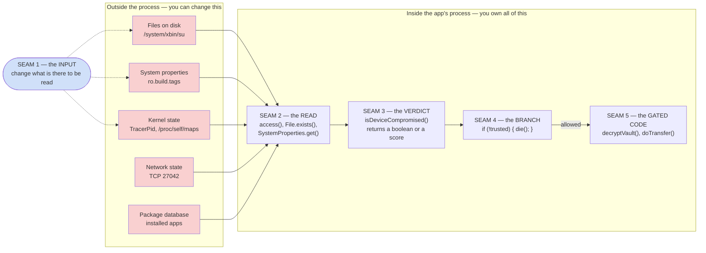
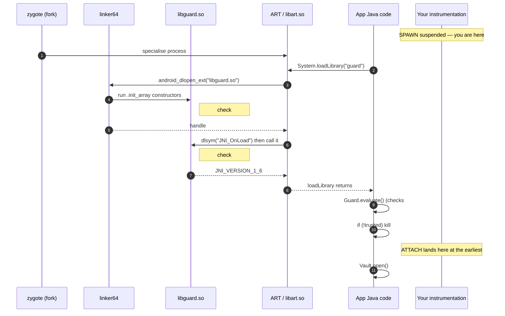
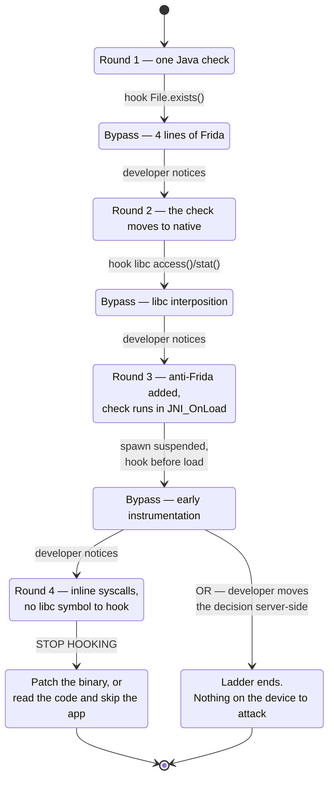
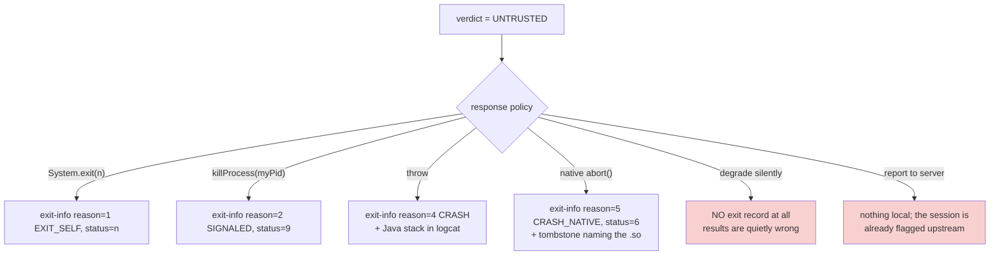
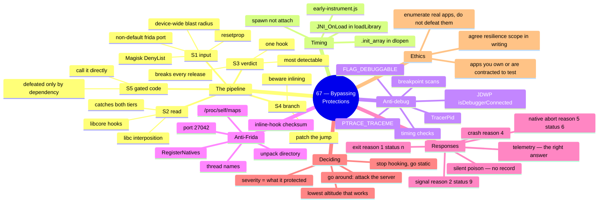

# 67 — Bypassing Protections

> After this chapter you will be able to take any client-side control an Android app can implement,
> locate the five places it can be attacked, choose the cheapest one that works, defeat it, and — the
> part almost everyone skips — decide honestly whether defeating it was worth reporting at all.

**Prerequisites:** [09-Android-App-Internals](../09-Android-App-Internals/README.md),
[15-Native-Code](../15-Native-Code/README.md), [16-JNI](../16-JNI/README.md),
[20-Security-Architecture](../20-Security-Architecture/README.md),
[37-RootDetection](../37-RootDetection/README.md),
[36-CertificatePinning](../36-CertificatePinning/README.md),
[53-Frida](../53-Frida/README.md), [56-JADX](../56-JADX/README.md),
[57-Ghidra](../57-Ghidra/README.md)

**Applies to:** API 21 through API 35. Version-dependent statements carry a matrix.
Everything measured for this chapter was measured on a physical **i9000S, Android 13 / API 33,
arm64-v8a, SELinux Enforcing, not rooted, no frida-server** — and where that device could not answer
a question, the chapter says so instead of guessing.

---

## Table of Contents

1. [Introduction](#1-introduction)
2. [High-Level Architecture](#2-high-level-architecture)
3. [Deep Internal Working](#3-deep-internal-working)
4. [Source Code Walkthrough (AOSP)](#4-source-code-walkthrough-aosp)
5. [Security Perspective](#5-security-perspective)
6. [Reverse Engineering Perspective](#6-reverse-engineering-perspective)
7. [Dynamic Analysis](#7-dynamic-analysis)
8. [Static Analysis](#8-static-analysis)
9. [Examples](#9-examples)
10. [Common Interview Questions](#10-common-interview-questions)
11. [Common Mistakes](#11-common-mistakes)
12. [Hands-on Labs](#12-hands-on-labs)
13. [Summary](#13-summary)
14. [References](#14-references)

---

## 1. Introduction

### 1.1 A lock on the inside of the door

Imagine you hire a security guard, give them a clipboard, and tell them: *check every visitor's ID,
and if anything looks wrong, refuse them entry.* Reasonable. Now imagine you do all of that inside
the visitor's own house. The guard is your employee, but they live in a building the visitor owns.
The visitor can repaint the walls, replace the clipboard, rewrite the rules on it, replace the guard
with someone who says "yes" to everything, or walk around the guard through a door the guard
was never told about.

That is what a client-side security control is. Every root check, every certificate pin, every
tamper check, every anti-debugger trap, every Play Integrity call runs **inside a process that the
person you are defending against completely controls**. It is a lock fitted to the inside of the
door, in a house belonging to the burglar.

This chapter is about how that lock is picked. Not one trick, and not a collection of scripts —
those live in the chapters that own each control. This chapter is about the **method**: the shape
that every client-side control shares, the five distinct places that shape can be attacked, how to
choose between them, and how the attack and the defence escalate against each other, round after
round, until one side runs out of moves.

### 1.2 What existed before, and what would break without this

**What problem existed before?** Applications needed to behave differently on a device they could
not trust. A bank does not want its app to run on a phone where an attacker can read its memory. A
media app has contractual obligations about playback on modified devices. A game does not want its
scoring logic edited. None of these have any way to ask the device a question and get an honest
answer, because the device is the thing under suspicion. So they ask **themselves**, using code they
shipped, running on hardware they do not control.

**What would break if client-side controls did not exist?** Slightly less than the industry
believes, and much more than a cynic assumes. They do not stop a determined attacker — that is the
central, unglamorous fact of this chapter. What they do is **raise cost**. A control that takes two
hours to defeat filters out everybody who was not willing to spend two hours. Against mass-market
fraud automation, which needs to work unattended across thousands of devices, cost is exactly the
right currency. Against a single motivated researcher with your APK and a weekend, it buys nothing
but time.

**What would break if the bypass methodology did not exist?** You could not test any of it. A
security assessment that stops at "the app has root detection" has measured a checkbox, not a
control. The only way to know what a protection is worth is to defeat it and see what was behind it.
That is why this chapter exists in an offensive-security repository, and it is why it is written for
apps you own.

### 1.3 Scope and ethics, stated once and precisely

This is the chapter where the repository's standing rules become concrete — see
[SECURITY.md](../SECURITY.md) for the canonical statement.

> **Everything in this chapter is for applications you own, or applications you have a written
> authorisation to test.** Do not point any of this chapter's tooling at software outside that
> scope. See [SECURITY.md](../SECURITY.md) for authorised-testing scope.

Three concrete rules, in the order they come up in real work:

1. **Build your own target.** This chapter ships one:
   [`examples/guarded-app/`](examples/guarded-app/). It is deliberately over-protected so that you
   can attack every seam without touching anybody else's software. Every technique in every lab here
   is demonstrated against it.
2. **On third-party apps, stop at detection.** Enumerating a real application's controls — reading
   its DEX, listing the checks, describing the seams — is analysis, and on an app you have lawfully
   obtained it is generally defensible. **Defeating** them is a different act. The repository's own
   discipline is to stop at the boundary: chapter 36 measured that 12 of 14 real apps had a pinning
   surface and only 4 actually pinned, without defeating a single one. That is the model.
3. **Inside an engagement, agree the resilience scope in writing before you start.** MASVS-RESILIENCE
   findings are the ones clients most often did not expect to buy, and the ones most likely to
   produce an argument about severity afterwards. Section 5.6 covers how to write them up.

This chapter also contains a defensive half, and it is not decoration. Every technique below is
described from both sides, because a developer who has not read the attacker's half will build the
control at the wrong seam — and, as section 5.5 argues, will often make their app *worse* by adding
it.

### 1.4 The single insight this chapter is built around

Chapter 20 states it in one sentence, and the whole of this chapter is that sentence unpacked:

> **Seam 4 — client-side verdict handling.** Play Integrity, root checks, tamper checks, and pinning
> all ultimately produce a boolean inside the app's own process.
> — [20-Security-Architecture §5](../20-Security-Architecture/README.md)

Read it again, because it does a lot of work. It says that root detection, TLS pinning, signature
verification, emulator detection, anti-debug and hardware-backed remote attestation — six things
that look completely unrelated, built by different teams with different tools at different layers —
**converge on one decision inside one process**. They differ in how they gather evidence and in how
hard that evidence is to forge. They do not differ in what they ultimately do with it.

That convergence is what makes a general method possible. You do not need a technique per control.
You need a technique per **seam**, and there are only five seams.

> **Mental Model**
> A client-side control is a pipeline, not a wall:
> **input → read → verdict → branch → gated code.**
> A wall must be climbed at its highest point. A pipeline can be cut anywhere along its length, and
> the cheapest cut is rarely at the end you were looking at.

### 1.5 What this chapter owns, and what it does not

This repository deliberately splits controls from the method that defeats them. Read this table
before you go looking for a script here that lives somewhere else.

| Topic | Owner | This chapter's role |
|---|---|---|
| What root is, how it is detected, how that specific detection is defeated | [37-RootDetection](../37-RootDetection/README.md) | Cited as the worked instance of the method |
| TLS pinning, how it is implemented and unpinned | [36-CertificatePinning](../36-CertificatePinning/README.md) | Cited as a control whose verdict is a `checkServerTrusted` that either throws or does not |
| Integrity and tamper checks — signature, checksum, repackaging | `38-TamperDetection` (being written) | Cited as controls; this chapter owns defeating them |
| Emulator detection | [39-EmulatorDetection](../39-EmulatorDetection/README.md) | Same seams, different inputs. **39 owns the signals; this chapter owns defeating them** |
| Frida itself: how it injects, how it is used | [53-Frida](../53-Frida/README.md) | This chapter owns what happens when the app fights back |
| Packers and obfuscation as an adversarial structure | [40-Obfuscation](../40-Obfuscation/README.md) | Cited for the same escalation shape applied to code rather than checks |
| Magisk, DenyList, Zygisk | [62-Magisk](../62-Magisk/README.md) | The lowest-altitude tool available for seam 1 |
| Hooking mechanics in general | `65-Hooking` | Assumed |
| **The general bypass methodology, anti-debug, anti-Frida, the escalation ladder** | **This chapter** | — |

> **Pentester's Note**
> If you arrived here from [53-Frida](../53-Frida/README.md) with the symptom *"I attach and the app
> dies instantly"*, go straight to [§3.12](#312-timing-is-the-whole-game-init_array-jni_onload-and-why-attach-loses)
> and then run [`scripts/bypass-triage.py`](scripts/bypass-triage.py). You do not need the rest of
> the chapter to fix that specific problem, and you will come back for it afterwards.

### 1.6 The honest summary, up front

Four claims that the rest of the chapter supports with evidence rather than assertion:

1. **Every client-side control can be defeated by someone with the device.** Not "most". The trust
   model permits no exception. What varies is cost, measured in hours.
2. **The right bypass is the lowest-altitude one that works** — the one that intervenes closest to
   the input the control reads, and furthest from the decision it takes. Section 3.7 gives the
   reasoning and section 3.8 gives the cost table.
3. **A bypassed control is not a finding.** The finding is what the control was protecting and
   whether the server re-verifies it. Section 5.6 is about writing that up without inflating it.
4. **The only control that survives this chapter is the one that is not on the device.** The
   [`examples/server-app/`](examples/server-app/) build is the same application with the decision
   moved server-side; every technique in this chapter still works against it and none of them gets
   the secret, because the secret is not there.

---

## 2. High-Level Architecture

### 2.1 The five seams

Everything else in this chapter is an elaboration of this one diagram. Read it slowly.



What you are looking at: on the left, the state of the world outside the process — files, properties,
kernel-exposed process metadata, open ports, the package database. That state is attacker-controlled
(shaded), because on a device you control, all of it is. In the middle, the four stages that happen
*inside* the app: the read, the verdict, the branch, and the gated code. Seam 1 is drawn as a
stadium because it is where you act on the world rather than on the process — it is the only seam
that does not require you to be inside the app at all.

The critical property: **an attack at any one of these five points defeats the control.** They are
not layers to be peeled in order. They are alternatives, with wildly different costs.

### 2.2 The same picture as a sequence, with the timing that matters



The two `Note right of Lib` boxes are the entire reason this chapter exists as something more than a
script collection. Checks 1 and 2 run **before any Java executes** and, in a warm process, before
you can possibly have attached. Everything you can do about that is decided by whether you spawned
or attached — a choice you make on the command line before you know anything about the app.

Measured on the demo app in this chapter, on the i9000S: the deciding frame in the tombstone was
`libch67guard.so (JNI_OnLoad+908)`, and the process emitted **not one Activity lifecycle event**
before it died. There was no UI, no `onCreate`, nothing to hook.

### 2.3 Seams, altitudes and the vocabulary this repository uses

[20-Security-Architecture/labs/lab-03](../20-Security-Architecture/labs/lab-03-integrity-gate-bypass.md)
introduced the word **altitude** for this idea and defeats one gate at four of them (A: falsify the
inputs device-wide; B: falsify the reads process-wide; C: falsify the verdict; D: skip the gate
entirely). This chapter uses the same vocabulary and extends it, because that lab found four
altitudes for one particular control and the general case has five.

The mapping is exact, and it is worth memorising because the two files are meant to be read
together:

| This chapter's seam | Lab 03's altitude | Where you act | Blast radius |
|---|---|---|---|
| **S1 — input** | A | Outside the process, on the device | Every process on the device |
| **S2 — read** | B | Inside the process, at the syscall or API | One process |
| **S3 — verdict** | C | Inside the process, at the aggregation function | One function |
| **S4 — branch** | (between C and D) | Inside the process, at the `if` | One decision |
| **S5 — gated code** | D | Inside the process, at the payload | One call |

> **Definition — altitude**
> How far from the raw input, and how close to the decision, an intervention sits. **Low altitude**
> means near the input: broad, durable, invisible to the app, and often heavy-handed. **High
> altitude** means near the decision: surgical, fast, fragile, and easy for the app to notice.
> "The lowest altitude that works" is this chapter's default rule, and section 3.7 explains why.

### 2.4 The escalation ladder, drawn

A control is never static. You defeat it; the developer notices; they add a check; you defeat that;
they change the response; you adapt. Here is that loop as a state machine — this is not an
illustration, it is the actual sequence you will run in
[lab-02](labs/lab-02-escalation-ladder.md), three rounds of it, end to end.



Two exits, and the difference between them is the most important thing in this diagram. The left
exit is what happens when a developer keeps escalating **on the client**: eventually they reach
inline syscalls and self-checksumming code, you stop hooking and start patching or reading, and the
ladder ends with you winning slowly. The right exit is what happens when a developer stops playing:
they move the decision off the device, and the ladder ends immediately with nothing for you to
attack. One of these is a strategy. The other is a treadmill.

### 2.5 Where the responses live

When a control decides you are hostile, it has to *do* something. The choice is invisible in source
review and extremely visible from the outside, which is what makes triage possible at all.



The two shaded outcomes are the ones that cost an attacker the most, and they are the two that
produce no crash to triage. `E5` — silent degradation — is covered in [§3.9](#39-the-response--what-the-app-does-once-it-has-decided).
`E6` — telemetry rather than enforcement — is the one competent defenders actually ship, and it is
discussed in [§5.5](#55-how-developers-make-this-worse).

Every row of that diagram was measured on the i9000S against this chapter's own app. The numbers are
in [§7.3](#73-reading-the-exit-record--measured-signatures).

---

## 3. Deep Internal Working

This is the long section. It answers **what** each seam is, **why** it exists, **when** it is
available to you, **where** in the process it sits, and **how** you act on it — and then it does the
same for the two adversarial specialities this chapter owns, anti-debug and anti-Frida, before
closing with the decision nobody teaches: when to stop.

### 3.0 Reference: the seam table everything else refers to

Keep this open. Every later subsection refers back to it, and
[`cheatsheet.md`](cheatsheet.md) is a printable version.

| Seam | You change | Typical technique | Cost to you | Detectable by the app? | Blast radius |
|---|---|---|---|---|---|
| **S1 input** | The world outside the process | Magisk DenyList, `resetprop`, mount tricks, moving frida-server's port, renaming artefacts | Low once set up; high to set up the first time | **Barely.** The app sees a consistent, honest-looking world | Device-wide — every app is affected |
| **S2 read** | What the read returns | Hook `access`/`stat`/`open` in libc; hook `File.exists`, `SystemProperties.get` in libcore | Low | Only by counter-instrumentation (inline-hook checksums, timing) | One process |
| **S3 verdict** | The computed decision | Hook `isRooted()`/`evaluate()` and change the return | Very low | Easily — the verdict is the app's own code, it can be duplicated, inlined or checksummed | One function |
| **S4 branch** | Which way the `if` goes | Hook the branch, patch the conditional jump | Very low | Easily, and patching leaves a permanent artefact | One decision |
| **S5 gated code** | Nothing — you call the payload directly | `Java.use(...).open()`, call the native function through `NativeFunction` | Low, when a reachable entry point exists | Not at all — no control was touched | One call |

> **Warning**
> The two cheapest columns to read (S3 and S4) are the two most expensive to rely on. Cost-to-you and
> robustness are not the same axis, and the table above is deliberately arranged so that you notice
> the diagonal. Section 3.7 is entirely about that diagonal.

### 3.1 Seam 1 — the input

**What it is.** The state of the world that the control reads. Files on disk, system properties, the
contents of `/proc`, the package database, open TCP ports, mount tables, SELinux mode.

**Why it exists.** Because a control must ground its judgement in *something*, and the only things
available to an unprivileged app are things the platform exposes to it. Every one of those is, on a
device you control, editable.

**How you act on it.** You do not touch the app at all. You change the device.

```bash
# device root (Magisk) — hide root artefacts from a named package.
# This is seam 1 in one command: the app's reads are honest, the world is not.
magisk --denylist add com.pentest.ch67.guarded
magisk --denylist ls
```

```bash
# device root — rewrite a read-only property in the property area, no reboot.
# resetprop is Magisk's; see ../62-Magisk/README.md.
resetprop ro.build.tags release-keys
resetprop ro.debuggable 0
getprop ro.build.tags
```

```bash
# host — the anti-Frida port check, defeated with no bypass whatsoever.
# The check asks "is 27042 open". Do not lie about the answer; change it.
adb shell "/data/local/tmp/frida-server -l 127.0.0.1:1337 &"
frida -H 127.0.0.1:1337 -f com.target.app -l agent.js --no-pause
```

That last example is the purest illustration of seam 1 in the whole chapter. A port check is not
bypassed. It is made *true*.

> **Under the Hood**
> `resetprop` writes into the properties area — a shared-memory region mapped read-only into every
> process, backed by `/dev/__properties__`. Because it is shared memory rather than a file, a
> rewritten property is visible to processes that have already started, and there is nothing in the
> reading path (`__system_property_read_callback`) that can tell a rewritten value from an original
> one. That is why seam 1 is invisible: the app is not being lied to by a hook, it is reading a
> value that genuinely is what it now says.

**When seam 1 is the right choice.** When you need the bypass to persist across app updates, when
you need it to apply to several apps at once, or when the app's own code is hostile enough that you
would rather not be inside it at all.

**When it is wrong.** On a client's loaned device, mid-engagement. Seam 1 changes affect **every
process on the phone**, including whatever you measured your baseline with. Lab 03 in chapter 20
asks precisely this question and the answer is a list of side effects you would not accept.

### 3.2 Seam 2 — the read

**What it is.** The call that turns outside state into a value inside the process. This is the
richest seam and the one you will use most.

**Why it exists.** Because there is always a boundary crossing. Even a check written entirely in
assembly must eventually issue a syscall, and a syscall is an event you can observe.

**The read stack, in full.** Understanding this is what separates a bypass that works from one that
"logs dozens of intercepted calls and the app still says the device is rooted" — chapter 37's
`native-root-bypass.js` header describes exactly that symptom, and it is caused by hooking the wrong
level of this stack:

```
  Java:   new File("/system/xbin/su").exists()
            |
            v
  libcore: java.io.UnixFileSystem.getBooleanAttributes0
            -> libcore.io.BlockGuardOs.access
              -> libcore.io.Linux.access                (JNI)
            |
            v
  native:  libjavacore.so  Java_libcore_io_Linux_access
            -> bionic libc  access()                    <-- HOOK HERE
            |
            v
  kernel:  faccessat(AT_FDCWD, path, F_OK, 0)           <-- or here, with ptrace/seccomp
```

A hook at the Java level covers the first path only. A hook in libc covers **both** the Java path
and any native code that calls `access()` directly, because libcore goes through libc too. That is
why libc interposition is the default technique and the Java hook is the convenience.

| Hook level | Catches Java checks | Catches native checks | Catches inline syscalls | Effort |
|---|---|---|---|---|
| `java.io.File` / `SystemProperties` | Yes | No | No | Minutes |
| libc (`access`, `stat`, `openat`, `fopen`) | Yes | Yes | No | Minutes, with a good script |
| syscall (seccomp-bpf, `ptrace`, kernel) | Yes | Yes | Yes | Hours to days |
| Patch the binary | Yes | Yes | Yes | Depends entirely on obfuscation |

> **Pentester's Note**
> Chapter 37 ships [`native-root-bypass.js`](../37-RootDetection/scripts/native-root-bypass.js),
> which is the reference implementation of libc interposition for root artefacts. Do not rewrite it.
> Read its design rules — surgical denials, natural-looking failures, never overwrite the caller's
> buffer, guard every symbol lookup — because those rules generalise to every seam-2 hook you will
> ever write, whatever the control.

**The three-way property trap.** There are three native ways to read a system property, and hooking
the wrong one produces a log full of successful-looking spoofs while the app reads the truth:

| Function | Used by | Hooked how |
|---|---|---|
| `__system_property_get(name, out)` | The classic API; older code and JNI | Overwrite the output buffer in `onLeave` |
| `__system_property_find(name)` | Modern first step, returns a `prop_info*` | Observe only — returning NULL is *more* suspicious than a value |
| `__system_property_read_callback(pi, cb, cookie)` | Modern second step; `libbase`, `android::base::GetProperty` | Substitute the **callback**, not the value |

Modern bionic implements `_get` in terms of `_find` + `_read_callback`, so an app calling `_get` is
caught by hooking `_get`. An app (or a library) calling `_find` and `_read_callback` directly is
**not**, because `_get` is never entered.

### 3.3 Seam 3 — the verdict

**What it is.** The function that turns readings into a decision. `isDeviceRooted()`,
`evaluate(context)`, `getIntegrityScore()`, `checkServerTrusted()`.

**Why it exists.** Good engineering. Separating "gather evidence" from "decide" is exactly what a
competent developer does, and it is exactly what gives you a single point to attack. This is worth
saying out loud to developers, because the instinct on hearing it is to un-separate them, and that
produces unmaintainable code that is barely harder to defeat.

**How you act on it.** One hook.

```javascript
// frida -U -f com.pentest.ch67.guarded -l verdict.js --no-pause
// Seam 3. Note the shape: call the original FIRST, log what the app really
// concluded, and only then change the answer.
Java.perform(function () {
    const Guard = Java.use('com.pentest.ch67.guarded.Guard');
    Guard.evaluate.overload('android.content.Context', 'java.lang.String')
        .implementation = function (ctx, simulate) {
            const v = this.evaluate(ctx, simulate);
            console.log('[real verdict] trusted=' + v.trusted.value +
                        ' score=' + v.score.value +
                        ' first=' + v.firstFired.value);
            v.trusted.value = true;
            v.score.value = 0;
            return v;
        };
});
```

The ordering is not stylistic. A hook that skips the original tells you nothing, and *what the app
really concluded* is a sentence in your report. Chapter 20's lab makes the same point about the same
shape.

**Why `public final` fields are writable.** `Verdict.trusted` in the demo is a plain field; in a real
app it is often `final`. Frida writes it anyway, because the underlying JNI `SetBooleanField` does
not check `final` — `final` is a **javac and verifier** constraint on source and bytecode, not a
runtime memory protection. Inside a process an attacker controls, `final` is documentation.

### 3.4 Seam 4 — the branch

**What it is.** The `if` that consumes the verdict.

**How you act on it.** Two ways, and they are genuinely different:

```javascript
// Dynamic: hook the consumer, not the producer.
Java.perform(function () {
    Java.use('com.pentest.ch67.guarded.Guard').enforce.implementation = function (v) {
        console.log('[branch] app wanted to enforce; suppressed');
        // deliberately do nothing
    };
});
```

```smali
# Static: invert the conditional in Smali, then rebuild.
# Before:
    invoke-static {v0}, Lcom/x/Guard;->isTrusted(Lcom/x/Verdict;)Z
    move-result v1
    if-eqz v1, :untrusted        # jump to the refusal when v1 == 0

# After — the refusal becomes unreachable:
    invoke-static {v0}, Lcom/x/Guard;->isTrusted(Lcom/x/Verdict;)Z
    move-result v1
    const/4 v1, 0x1
    if-eqz v1, :untrusted
```

> **Warning — the inlining trap**
> [18-ARM §5.4](../18-ARM/README.md) measured this and it is the most useful negative result in the
> repository: a native check function was patched to `return 1`, **verified** to return 1, and the
> gated function still refused — because clang had **inlined** the check, and the patched copy was
> called by nothing. A patch that provably works, against a function that provably no longer
> matters. Always verify the branch *after* the patch, at the branch, not at the function you
> patched.

### 3.5 Seam 5 — the gated code

**What it is.** The thing the control was protecting. The decryption routine, the transfer call, the
premium feature.

**Why this is a seam at all.** Because in a process you control, reachability is a property of the
code, not of the control flow the app intended. If `Vault.decrypt()` is a static method with no
argument derived from the verdict, then it can be called. The `if` in front of it is a suggestion.

```javascript
// frida -U -f com.pentest.ch67.guarded -l seam5.js --no-pause
// There is no bypass here and no hook. We ask for the thing.
Java.perform(function () {
    setTimeout(function () {
        Java.perform(function () {
            console.log('[vault] ' +
                Java.use('com.pentest.ch67.guarded.Vault').openUnchecked());
        });
    }, 2000);
});
```

**What defeats seam 5.** Exactly one design: make the gated code *depend on* the thing the control
was checking, rather than merely be guarded by it. If the decryption key is derived from a value
that only exists when the checks genuinely pass — a server-issued token, a Keystore key with
`setUnlockedDeviceRequired`, an attestation response — then calling `decrypt()` directly produces
garbage rather than the secret. That is the difference between a **gate** and a **dependency**, and
it is the single most useful piece of defensive advice in this chapter.

> **Mental Model**
> A gate says *"you may not pass"*. A dependency says *"there is nothing here to take"*.
> Gates are bypassed. Dependencies must be satisfied.
> The CTF in [lab-04](labs/lab-04-ctf-the-boolean-that-lied.md) turns on exactly this distinction.

### 3.6 The five seams against one real control, side by side

Take root detection, since [37-RootDetection](../37-RootDetection/README.md) documents it
exhaustively and you can compare.

| Seam | What you do | What the app experiences |
|---|---|---|
| S1 | Magisk DenyList hides the mounts and `su` from this package | Every read is honest and returns "not rooted" |
| S2 | `access("/system/xbin/su")` returns `-1`, `errno=ENOENT` | The read fails exactly as it would on a clean device |
| S3 | `RootBeer.isRooted()` returns `false` | The app's own function lies to it |
| S4 | `if (rooted) finish()` never taken | The app decided correctly and then did nothing |
| S5 | Call the protected method directly | The app never got as far as deciding |

Now read the right-hand column downwards. The further down you go, the more the app's own internal
state contradicts its behaviour — and internal contradiction is exactly what a second layer of
protection looks for. That is the argument of the next section, made concrete.

### 3.7 Why the verdict is usually the wrong seam

This is the section to read twice.

Attacking at seam 3 or seam 4 is the first thing everyone learns, because it is one line and it
works immediately. It is also, in this order:

**1. The most detectable.** The verdict is *the app's own code*. That means the app can:

- **Compute it twice** in two places and compare. Your one hook produces two different answers.
- **Compute it in native code as well**, and compare with the Java answer.
- **Checksum the function's own bytes.** An `Interceptor.attach` in Frida patches the first
  instructions of the target with a branch to a trampoline; a function that reads its own text and
  hashes it sees the change. (`Stalker` avoids this, at a heavy performance cost — see
  [53-Frida §7.9](../53-Frida/README.md).)
- **Time itself.** A hooked function is measurably slower. A check that reads
  `clock_gettime(CLOCK_MONOTONIC)` around a 200-nanosecond function and finds it took 40
  microseconds has learned something.
- **Never call it at all** on the path that matters, and use a second copy you did not find.

**2. The most brittle.** A verdict function is named, and names change. R8 renames it every release
(see [42-R8](../42-R8/README.md)). A signature change breaks your `Java.use` line. A refactor that merges two checks
breaks it. A bypass at seam 2 hooking `access()` survives all of that, because `access()` is bionic's
name and bionic does not rename it for anybody.

**3. The least informative.** Hooking the verdict tells you the app has a verdict. Hooking the reads
tells you **which signals the app cares about**, which is the actual content of your report. A
finding that says "root detection can be bypassed" is worth a fraction of one that says "the app
probes 14 paths, 3 properties and 2 packages, weights them, and refuses at a score of 50 — here is
the list, and here is the one it does *not* check".

**4. It leaves the state contradictory.** At seam 3 the app has already read the truth. Any second
consumer of that truth — a log line, a telemetry event, a field written earlier in the same object —
still holds it. Section 5.3 covers apps that deliberately record the raw signals *before* computing
the verdict, precisely to catch a seam-3 hook.

> **Definition — the lowest-altitude rule**
> *Attack at the lowest altitude that achieves your objective in the time you have.* Start at seam 1
> or 2. Move up only when the lower seam is unavailable or uneconomic, and record why you moved —
> the reason is a finding about the app's design.

**When seam 3 or 4 IS right, and this list is short but real:**

- You are triaging, not exploiting. Flipping the verdict for thirty seconds tells you what is behind
  it, which tells you whether the rest of the work is worth doing.
- The control has exactly one consumer and you have confirmed it by reading the code.
- The reads are unreachable — inline syscalls, or a check that runs in another process.
- You have a deadline. This is a legitimate reason and pretending otherwise is dishonest; just write
  down that you took the shortcut, because the next tester will need to know.

### 3.8 Cost and detectability, quantified as far as honesty allows

The numbers below are **orders of magnitude, from this chapter's own labs and from the repository's
prior measurements** — not benchmarks. They are given because "expensive" and "cheap" are useless
words without a scale, and they are labelled as estimates because that is what they are.

| Technique | Seam | First-time setup | Per-app afterwards | App can detect it | Survives app update |
|---|---|---|---|---|---|
| Magisk DenyList | S1 | 30–60 min (root the device) | ~1 min | Rarely; it is what a clean device looks like | Yes |
| `resetprop` a property | S1 | Minutes | Seconds | No | Yes, until reboot |
| Move frida-server's port | S1 | Seconds | Seconds | No | Yes |
| libc interposition (`access`, `stat`, `openat`) | S2 | 0 (script exists) | 5–15 min of tuning the deny pattern | Only via counter-instrumentation | Usually |
| Java-layer hooks (`File.exists`) | S2 | 0 | 5 min | Yes, by re-checking natively | Usually |
| Hook the verdict | S3 | 0 | 2 min, once you have the name | **Easily** | **No** — names change |
| Patch the branch in Smali/ARM | S4 | 15 min | 15–60 min per build | Signature check catches it instantly | **No** |
| Call the gated code directly | S5 | 0 | 2 min | Not at all | Sometimes |
| Early instrumentation (beat `JNI_OnLoad`) | S2, timing | 20 min the first time | ~1 min | Hard | Yes |
| Go static: read it in Ghidra and reimplement | — | Hours | Hours | Not at all | N/A |

The last row deserves its place. Reading the algorithm and reimplementing it outside the app is not
a defeat; it is frequently the **cheapest** option once a control has escalated past round three, and
[§3.13](#313-when-to-stop-bypassing-and-go-static) makes that a decision rule rather than a mood.

### 3.9 The response — what the app does once it has decided

The verdict is only half the control. What the app *does* with it determines what you see, and
therefore what you can triage.

| Response | Code | What you observe | Cost to the attacker | Cost to the defender |
|---|---|---|---|---|
| Report only | telemetry call | Nothing locally | Zero — but the session is flagged | Zero; **this is the right default** |
| Refuse the operation | `throw` caught by the caller | An error dialog; process lives | Low | Low; users see a clear error |
| Kill the process, orderly | `System.exit(n)` | Process disappears, no crash dialog | Low | Users see the app "close itself" |
| Kill the process, brutally | `Process.killProcess(myPid())` | Same, `SIGKILL` | Low | Same |
| Crash | `throw` uncaught | Crash dialog, stack in logcat | **Very low** — the stack names the branch | High; looks like a bug, hurts crash metrics |
| Native abort | `abort()` | Tombstone, `SIGABRT` | Low–medium; tombstone names the `.so` | High; a crash the user reports |
| **Degrade silently** | continue with wrong data | **Nothing** | **High** — you may not notice for hours | Medium; misfires produce silent corruption for real users |
| Delay | sleep, then fail later | Confusing; the failure is far from the cause | **High** | Medium |

> **Pentester's Note**
> Silent degradation is the response that will actually cost you an afternoon, and it is the one
> [`scripts/bypass-triage.py`](scripts/bypass-triage.py) explicitly cannot detect — it says so in its
> own output. The counter is **differential testing**: run the same flow instrumented and clean, and
> diff the *outputs*, not the *exit codes*. The demo app implements this as `Guard.Response.POISON`,
> and the measured effect is worth seeing: the vault still opens, and returns
> `ch[CLNTSDBLANSNTALCK]` instead of `CH67{cl13nt_s1d3_b00l3an_1s_n0t_a_l0ck}`. Nothing crashed,
> nothing logged an error, and if you had not known the right answer you would have believed it.

### 3.10 Anti-debug, precisely

Six mechanisms. For each: what it actually detects, what it costs to defeat, and the failure mode
that wastes your time.

#### 3.10.1 `TracerPid` in `/proc/self/status`

**What it is.** The kernel writes the PID of the process currently `ptrace`-attached to this one into
`/proc/<pid>/status`. Zero means nobody.

**What it actually detects.** A **live ptrace attachment**: `gdbserver`, `lldb-server`, `strace`, or
a Frida injection *while the injection is happening*. It is widely described as an anti-Frida check
and is a poor one, because Frida's injector ptraces briefly and then detaches; by the time the app's
own code runs, `TracerPid` is usually back to 0.

**Cost to defeat.** Low. Two options:

```javascript
// Seam 2, Java: intercept the read of the file.
Java.perform(function () {
    const FR = Java.use('java.io.FileReader');
    FR.$init.overload('java.lang.String').implementation = function (path) {
        if (path === '/proc/self/status') {
            console.log('[antidebug] redirecting /proc/self/status');
            return this.$init('/data/local/tmp/status.clean');
        }
        return this.$init(path);
    };
});
```

```javascript
// Seam 2, native: far more robust — catches both tiers at once.
// Rewrite the CONTENT rather than denying the read; a missing
// /proc/self/status is itself an anomaly.
const openPtr = Module.findExportByName('libc.so', 'open');
Interceptor.attach(openPtr, {
    onEnter: function (args) {
        const p = args[0].readUtf8String();
        if (p === '/proc/self/status') {
            this.replacement = Memory.allocUtf8String('/data/local/tmp/status.clean');
            args[0] = this.replacement;
        }
    }
});
```

**The time-waster.** Writing the clean file with `TracerPid: 0` but forgetting that the app might
read `/proc/self/task/<tid>/status` instead, or might parse the whole file and notice that your
static copy reports a `Pid:` that does not match `getpid()`. Generate the replacement at runtime
from the real file with one line substituted, not from a template.

#### 3.10.2 Self-`ptrace` (`PTRACE_TRACEME`)

**What it is.** A process may be traced by at most one tracer. An app that calls
`ptrace(PTRACE_TRACEME, 0, 0, 0)` on itself — usually from a `.init_array` constructor — occupies
that slot, and any later attach fails with `EPERM`.

**Cost to defeat.** Low **if you spawn**, impossible if you attach late. You must hook `ptrace`
before the constructor runs, which is precisely the timing problem
[§3.12](#312-timing-is-the-whole-game-init_array-jni_onload-and-why-attach-loses) is about.

```javascript
// Install before the app's libraries load. See scripts/early-instrument.js.
const ptracePtr = Module.findExportByName('libc.so', 'ptrace');
Interceptor.replace(ptracePtr, new NativeCallback(function (request) {
    // PTRACE_TRACEME == 0. Pretend it worked.
    if (request.toInt32() === 0) { return 0; }
    return -1;
}, 'long', ['int', 'int', 'pointer', 'pointer']));
```

**The variant that catches people.** A **forked watchdog**: the app forks a child which
`PTRACE_ATTACH`es to the parent and stays there. Killing the child is detected by the parent; killing
the parent is what you were trying to avoid. Defeating this needs you to be present before the fork,
which again is a spawn-only proposition.

#### 3.10.3 `Debug.isDebuggerConnected()` and `waitingForDebugger()`

**What it is.** ART's own question: is a **JDWP** debugger attached? This is unrelated to `ptrace`
and does not read `TracerPid`. An app can be JDWP-debugged with `TracerPid` at 0, and can be
`ptrace`d with `isDebuggerConnected()` returning false. Checking one and believing you have covered
the other is a real developer mistake and a real tester mistake.

**Cost to defeat.** Trivial — it is a static method with a boolean return.

**Measured on the i9000S:** with the demo app's release build, `Debug.isDebuggerConnected()` returned
`false` and `Debug.waitingForDebugger()` returned `false`, as expected. The signal is genuinely
reachable without root by pairing `adb shell am set-debug-app` with a `jdb` attach.

#### 3.10.4 The `FLAG_DEBUGGABLE` check

**What it is.** `ApplicationInfo.flags & FLAG_DEBUGGABLE`. Not a debugger check — a **tamper** check.
A release build is not debuggable; a repackaged build very often is, because whoever repackaged it
added the flag to make `jdb` and `run-as` work.

**Measured on the i9000S**, the same sources built twice:

| Variant | `ApplicationInfo.flags` | Signal |
|---|---|---|
| release | `0x38883e44` | did not fire |
| `android:debuggable="true"` | `0x38883e46` | **fired** |

The difference is bit 1 (`FLAG_DEBUGGABLE == 0x2`), exactly as documented. This is one of only two
controls in the demo app that can be made to fire honestly on a stock, unrooted phone, which is why
this chapter uses it for its headline measurements.

**Cost to defeat.** Near zero at seam 3 (hook `getApplicationInfo`), and **zero at seam 1** — do not
repackage with the flag set. The check's entire value is against lazy repackaging.

#### 3.10.5 Timing checks

**What it is.** Measure how long a function takes; a hooked function is slower.

```c
struct timespec a, b;
clock_gettime(CLOCK_MONOTONIC, &a);
int r = sensitive_check();
clock_gettime(CLOCK_MONOTONIC, &b);
long ns = (b.tv_sec - a.tv_sec) * 1000000000L + (b.tv_nsec - a.tv_nsec);
if (ns > THRESHOLD) { /* something is instrumenting us */ }
```

**Cost to defeat.** Medium. Three approaches, in increasing order of effort: minimise work inside the
hook (no `console.log`, no backtrace); move the hook body into a `CModule` so it runs as compiled
native code rather than through Frida's JS bridge; or hook `clock_gettime` itself and subtract your
own overhead — which is fiddly, because you must not distort the app's legitimate timing.

**The failure mode.** Timing checks are extremely prone to false positives on real devices — a
scheduler hiccup, a big.LITTLE core migration or a garbage collection pause all look identical to a
hook. Apps that ship them usually set the threshold so high that only a `console.log`-heavy hook
trips it. Turn your logging off before concluding you have hit a real timing check.

#### 3.10.6 Breakpoint and instruction detection

**What it is.** Native code that reads its own `.text` and looks for `BRK #0` / `0xd4200000` on
arm64, or checksums its own bytes against a value computed at build time.

**Cost to defeat.** Medium to high; this is where hooking stops being cheap. `Interceptor.attach`
writes a branch over the function prologue and **will** be seen. Options: use `Stalker` (which
rewrites a copy of the code and leaves the original alone) at a heavy performance cost; hook the
*reader* rather than avoid the write, so `read()`/`memcpy` of your own patched region returns the
original bytes; or stop hooking and patch the binary once, statically, which no runtime self-check
can distinguish from the original unless it also checks a signature.

### 3.11 Anti-Frida, precisely

Frida is loud. It listens on a port, unpacks files with recognisable names, maps a library into the
target and starts threads with distinctive names. Every one of those is a detection opportunity, and
every one has a different cost.

| Detection | What it looks at | Defeat it at | Cost | Notes |
|---|---|---|---|---|
| **Port 27042 open** | `connect("127.0.0.1", 27042)` | **S1** | Trivial | `frida-server -l 127.0.0.1:1337`. Not a bypass — a configuration change |
| **Frida handshake on the port** | Connect and look for the D-Bus `AUTH` reply | S1 | Low | Non-default port defeats the scan that finds the port in the first place |
| **`/proc/net/tcp` scan for any listener** | Enumerate listening sockets, probe each | S2 | Medium | Hook the read of `/proc/net/tcp`, or run frida-server on a unix socket |
| **`/proc/self/maps` contains `frida`/`gum`/`gadget`** | The agent is a mapped file | S2 | Medium | Hook `open`/`read` of `maps`; or rename the agent and use `--directory` |
| **Thread names** `gum-js-loop`, `gmain`, `pool-frida`, `gdbus` | `/proc/self/task/*/comm` | S2 | Medium | Hook `readdir`/`open`; or build a Frida with renamed threads |
| **`/data/local/tmp/re.frida.server` exists** | The default agent unpack path | S1 | Trivial | `frida-server --directory /data/local/tmp/.x` |
| **Named pipes** `linjector-*` | Injection artefacts under `/data/local/tmp` | S1 | Trivial | Same `--directory` change |
| **Inline-hook checksum** | The first bytes of a hooked function changed | S2/RE | High | `Stalker`, or stop hooking and patch |
| **`RegisterNatives` monitoring** | Frida's Java hooks change ART entry points | RE | Very high | Often needs a custom Frida build |
| **`dlopen` monitoring** | Sees `frida-agent.so` being mapped | S2 | Medium | Hook `dlopen` first — a timing problem, see §3.12 |
| **Timing around a hooked function** | Hooks cost microseconds | S2 | Medium | `CModule`, quiet hooks |

Two things to take from this table.

**First, five of the eleven rows are defeated at seam 1 by changing a command-line flag.** A large
fraction of "anti-Frida" in the wild is defeated without writing a single hook, by running the tools
in a non-default configuration. That is the lowest-altitude rule paying off immediately.

**Second, the two hardest rows (inline-hook checksums and `RegisterNatives` monitoring) are hard for
the same reason:** they detect the *mechanism* of hooking rather than the *identity* of the hooker.
You cannot rename your way out of them. When you meet one, the ladder has reached its top and
[§3.13](#313-when-to-stop-bypassing-and-go-static) applies.

> **Warning**
> [53-Frida §5.3](../53-Frida/README.md) carries this warning and it is repeated here because it is
> the professional heart of the matter: *bypassing every anti-instrumentation control and then
> reporting "the app is trivially instrumented" is technically true and professionally useless.* The
> finding is what you could do once inside. The resilience controls are a **separate, lower-severity**
> discussion. Report them as two different things.

### 3.12 Timing is the whole game: `.init_array`, `JNI_OnLoad`, and why attach loses

This subsection is the answer to the most common question that brings people to this chapter.

**The sequence, precisely.** When Java calls `System.loadLibrary("guard")`:

1. `Runtime.loadLibrary0` resolves the path and calls into `JavaVMExt::LoadNativeLibrary`.
2. That calls `android_dlopen_ext`, which maps the library and — **before returning** — runs every
   function in its `.init_array` section. Constructors marked
   `__attribute__((constructor))` run here.
3. `dlopen` returns a handle.
4. ART calls `dlsym(handle, "JNI_OnLoad")` and, if it exists, **calls it**.
5. Only then does `System.loadLibrary` return to Java.

A check placed at step 2 runs while `dlopen` is still on the stack. A check placed at step 4 runs
before any of the app's own Java code has seen the library. Both are before `Application.onCreate`,
which is itself before `Activity.onCreate`, which is where nearly every tutorial's Frida script
starts working.

**What this means for you, as a rule:**

| Your action | Are you before step 2? | Before step 4? | Before Java? |
|---|---|---|---|
| `frida -U -f pkg` (spawn, suspended) | **Yes** | **Yes** | **Yes** |
| `frida -U -F` / `-n` (attach to running) | No | No | No |
| `frida -U -f pkg` then `Java.perform` late | Yes for libc; **no** for the app's `.so` | Depends | Yes |
| frida-gadget embedded in the APK | **Yes** — the gadget loads first | Yes | Yes |
| Xposed/LSPosed module | Yes for Java; no for native constructors | Varies | Yes |

**The one thing you cannot fix by hooking harder.** A `.init_array` constructor runs *inside*
`dlopen`. You cannot hook a function in a library that is not yet mapped, and by the time `dlopen`
returns and you can resolve its symbols, the constructor has already executed. There are exactly two
answers:

- **(a) Hook the linker's `call_constructors`.** The symbol is
  `__dl__ZN6soinfo17call_constructorsEv` on most builds. When it resolves, this is exact.
- **(b) Hook the libc functions the constructor will call.** libc is mapped before your script runs,
  so `open`, `access`, `socket`, `connect`, `fopen` can all be hooked arbitrarily early. This does
  not stop the constructor; it changes what the constructor **sees** — which is what you wanted.

[`scripts/early-instrument.js`](scripts/early-instrument.js) implements (a) with a graceful fallback,
implements the `JNI_OnLoad` interception for step 4, and — importantly — **tells you immediately if
you attached instead of spawning**, because that single mistake accounts for more wasted hours than
any technical difficulty in this chapter.

> **Under the Hood**
> Measured on the i9000S with this chapter's demo app: the tombstone's frame `#01` was
> `libch67guard.so (JNI_OnLoad+908)`, with frame `#00` being `abort+180` inside libc. Frame `#00` is
> useless — everything that aborts goes through it. **Frame `#01` is the answer**, because it is the
> first frame belonging to the app rather than to the platform. `bypass-triage.py` extracts exactly
> that frame and reports it as "the deciding frame", turning "something killed me" into a Ghidra
> offset in one step.

### 3.13 When to stop bypassing and go static

This is a real decision point and treating it as a defeat is the mistake.
[34-Cryptography](../34-Cryptography/README.md) puts it in one line in its own troubleshooting table:
*"Anti-Frida / anti-debug: hooking blocked. Bypass first — or fall back to static analysis and memory
dumps."* Here is the decision rule that line implies.

**Stop hooking and go static when any of these is true:**

| Signal | Why hooking is now the wrong tool |
|---|---|
| The check uses inline syscalls (`svc #0`) with no libc symbol | There is nothing to attach to. No symbol-based technique can help |
| The function checksums its own bytes | Your hook *is* the modification being detected |
| You are three rounds into the ladder and each round costs more than the last | You are on the losing side of an exponential; the code is finite |
| The app dies before your first hook can install, even when spawning | You are fighting `.init_array` in a packed library ([40-Obfuscation](../40-Obfuscation/README.md)) |
| The thing you want is an **algorithm**, not a **decision** | Reimplementing it outside the app is permanent; a hook is per-session |
| You need the result to be reproducible by someone else, later | A static patch or a reimplementation is a deliverable; a Frida session is not |

**Keep hooking when:**

- You need the app's *runtime state* — a decrypted buffer, a derived key, a session token. Static
  analysis gives you the algorithm; only the running process has the values.
- The logic is enormous and you only need one branch of it.
- You are still exploring and do not yet know what you want.

> **Mental Model**
> **Hooking rents the answer. Static analysis buys it.** Rent while you are still deciding what you
> want. Buy once you know you will need it more than a few times, or once the rent starts rising
> every round.

There is a third option that people forget: **go around**. If the app's protections are strong and
its server is weak, stop attacking the app. Chapter 52's sweep of a real 17 MB application found its
best lead in a `Domain` enum listing thirteen environments — pre-production, eight QA hosts, three
staging. No bypass was involved. The lowest altitude of all is *not being in the process*.

### 3.14 The escalation ladder, round by round

This is the section title the repository has been promising: *"the adversarial back-and-forth in
full"*. It is written as a sequence because it happens as a sequence. You will run it yourself in
[lab-02](labs/lab-02-escalation-ladder.md).

#### Round 0 — no protection

The app calls `Vault.open()`. You call `Vault.open()`. Nothing to discuss.

#### Round 1 — a Java check

```java
if (new File("/system/xbin/su").exists()) { finish(); return; }
```

**Bypass (seam 2, Java, 4 lines):**

```javascript
Java.use('java.io.File').exists.implementation = function () {
    if (this.getAbsolutePath().indexOf('/su') !== -1) return false;
    return this.exists();
};
```

**Cost:** two minutes. **What the developer learns:** Java hooks are free.

#### Round 2 — the check moves to native

```c
if (stat("/system/xbin/su", &st) == 0) { return 1; }
```

The Java hook now does nothing. Your log fills with intercepted `File.exists` calls and the app still
refuses — the exact symptom chapter 37's script header describes.

**Bypass (seam 2, libc):** hook `stat`, `access`, `openat`, `fopen` and friends. Use chapter 37's
[`native-root-bypass.js`](../37-RootDetection/scripts/native-root-bypass.js).

**Cost:** ten minutes with an existing script; an hour to write one properly, mostly spent
discovering that the `*at` family takes the path at argument index **1**, not 0.

**What the developer learns:** moving down a layer costs the attacker one script, once.

#### Round 3 — anti-instrumentation, and the check moves to load time

Two changes at once, because a competent developer makes them together:

```c
__attribute__((constructor))
static void early(void) {
    if (maps_contain("frida")) abort();
}

jint JNI_OnLoad(JavaVM *vm, void *r) {
    if (port_open(27042)) abort();
    ...
}
```

Now the app dies before your script's `Java.perform` body runs. If you attached, it dies before you
can do anything at all.

**Bypass (timing, then seam 1 and 2):**

1. **Spawn, do not attach.** `frida -U -f pkg -l early-instrument.js --no-pause`.
2. **Defeat the port check at seam 1**, not seam 2: `frida-server -l 127.0.0.1:1337`.
3. **Defeat the maps scan at seam 2**, by hooking `open`/`read` on `/proc/self/maps`, or at seam 1 by
   running the agent from a renamed `--directory`.

**Cost:** twenty minutes the first time, one minute every time after.

**Measured, i9000S:** with the port check live (a device-side listener created with
`adb reverse tcp:27042 tcp:27042` — no root and no frida-server needed), the process died with
`reason=5 (CRASH_NATIVE) status=6` and **zero Activity lifecycle events**, and the triage script
attributed it to `libch67guard.so (JNI_OnLoad+908)` from the tombstone alone.

**What the developer learns:** timing buys more than any individual check.

#### Round 4 — inline syscalls and self-checksums

```
// no libc symbol is involved
mov x8, #48        // __NR_faccessat
svc #0
```

plus a routine that hashes its own `.text` and compares against a build-time constant.

**There is no hook-based bypass.** Nothing that resolves a symbol can help, and any `Interceptor`
patch is itself the thing being detected.

**Your options, in order of cost:**

1. **Patch the binary** statically: change the comparison, rebuild, re-sign. Defeated in turn by a
   signature check (chapter 38's subject) — which you then also patch, and which is defeated in turn
   by the server verifying the signature, which you cannot patch.
2. **Emulate**: run the `.so` under Unicorn or in Ghidra's emulator and read the answer out. This is
   how you extract an *algorithm* rather than defeat a *decision*.
3. **Read it and reimplement it.** Slowest to start, fastest to finish, and the only option that
   produces something another person can run next year.

#### Round 5 — the developer stops playing

They move the decision to the server. The client still runs all its checks, and now **reports** them
instead of acting on them. The secret is sent by the server or it is not sent at all.

**There is no client-side bypass, because there is no client-side decision.** You can hook every
check, forge every signal and flip every boolean, and the response body still does not contain the
secret. Your attack surface moves entirely to the wire and to the server's logic: does it trust the
client's self-report? Is the nonce single-use? Does it send a *capability* or a *permission*?

[`examples/server-app/`](examples/server-app/) is exactly this app, so that you can try every
technique in this chapter against it and watch them all fail for the right reason. Its
[`server.py`](examples/server-app/server.py) is written to be read: it records the client's
self-report as telemetry and gates on a nonce it issued, and its comments say which attack each
decision does and does not resist.

> **Pentester's Note**
> The ladder's real lesson is not "attackers always win". It is that **rounds 1 to 4 are all the same
> round** — each buys hours, none changes the outcome — and **round 5 is a different game**. When you
> write the remediation for a client, do not tell them to add a fifth check. Tell them which decision
> to move, and what to send instead of a boolean.

### 3.15 Version matrix

| Behaviour | API 21–25 | API 26–28 | API 29 | API 30–33 | API 34+ |
|---|---|---|---|---|---|
| `ApplicationExitInfo` (`dumpsys activity exit-info`) | Absent | Absent | Absent | **Present** | Present |
| Hidden-API restrictions on reflection | None | Warn (P) | Enforced | Enforced | Enforced |
| `/proc` hidepid restrictions on other processes | Loose | Tightening | Tighter | You cannot read another app's `maps` | Same |
| `execve` from `/data/local/tmp` | Generally allowed | Varies by vendor | Varies | **Often blocked** — use `/system/bin/linker64 <exe>` | Often blocked |
| System CA store location | `/system/etc/security/cacerts` | Same | Same | Same | **APEX** (`/apex/com.android.conscrypt/`) |
| `targetSdk` gate on user CAs | 23 and below trust user CAs by default | 24+ do not | 24+ do not | 24+ do not | 24+ do not |

> **Warning**
> The APEX row is measured, not assumed: on the repository's API 30 device
> `/apex/com.android.conscrypt/` exists but has **no `cacerts` directory**, and the live store was
> `/system/etc/security/cacerts` with 139 files. The move is API 34, not earlier. Check with
> `ls -d` on both rather than trusting any version table, including this one.

### 3.16 Every control in this repository, expressed in seams

The claim in [§1.4](#14-the-single-insight-this-chapter-is-built-around) is that six unrelated-looking
controls converge on one decision. Here is that claim discharged, control by control, with the seam
that each is attacked at and the chapter that owns it. Read this table when you meet a control the
chapter does not name: put it in the columns and the method follows.

| Control | S1 — its inputs | S2 — its reads | S3 — its verdict | S4 — its branch | S5 — what it gates | Owner |
|---|---|---|---|---|---|---|
| **Root detection** | `su` binaries, Magisk artefacts, root manager packages, `ro.build.tags`, mount table | `access`/`stat`, `PackageManager.getPackageInfo`, `SystemProperties.get`, reading `/proc/self/mounts` | `isRooted()` / a weighted score | `if (rooted) finish()` | Whatever the app refuses to do on a rooted device | [37](../37-RootDetection/README.md) |
| **TLS pinning** | The server's certificate chain, the trust store | `X509TrustManager.checkServerTrusted`, OkHttp's `CertificatePinner.check`, a native pin comparison | "does this throw?" — a verdict expressed as an exception | The `try`/`catch` around the request | The network request, and therefore the traffic | [36](../36-CertificatePinning/README.md) |
| **Tamper / signature check** | The APK's signing certificate, a checksum of `classes.dex`, the installer package name | `getPackageInfo(GET_SIGNING_CERTIFICATES)`, reading the APK's own bytes, `getInstallSourceInfo` | `signatureMatches()` | `if (!ok) exit()` | Everything, usually at startup | `38-TamperDetection` |
| **Emulator detection** | `ro.hardware`, `ro.product.model`, `/dev/goldfish_sync`, sensor vendor population, CPU features (`/dev/qemu_pipe` is the classic input but chapter 39 **measured it absent** on API 35) | `SystemProperties.get`, `File.exists`, `SensorManager.getSensorList` | `isEmulator()` | `if (emu) refuse()` | Usually the same thing root detection gates | [39-EmulatorDetection](../39-EmulatorDetection/README.md) |
| **Anti-debug** | `TracerPid`, JDWP state, `FLAG_DEBUGGABLE`, timing | Reading `/proc/self/status`, `Debug.isDebuggerConnected`, `ptrace`, `clock_gettime` | `beingDebugged()` | `if (dbg) abort()` | Whatever runs after the check | **This chapter** |
| **Anti-Frida / anti-hooking** | Port 27042, agent paths, thread names, mapped libraries, function prologue bytes | `connect`, reading `/proc/self/maps` and `/proc/self/task/*/comm`, self-`memcmp` | `instrumented()` | `if (hooked) die()` | Whatever runs after the check | **This chapter** |
| **Play Integrity** | A Google-signed token about the device | `IntegrityManager.requestIntegrityToken` | **The server, if you do it right.** The client, if you do not | `if (!verdict.equals("MEETS_DEVICE_INTEGRITY"))` | The feature being protected | [37 §3.15](../37-RootDetection/README.md) |
| **Licence / subscription check** | A response from a licensing server, or a local receipt | An HTTP call, or reading a preference | `isPremium()` | `if (!premium) showPaywall()` | The premium feature | — |
| **Keystore-backed key use** | **None that you can change** | `KeyStore.getKey`, `Cipher.init` | **There is no verdict** — the key either unwraps or does not | **There is no branch** | The plaintext, which never exists without the key | [49](../49-KeyStore/README.md) |

Two rows deserve attention because they break the pattern, and both breaks are instructive.

**Play Integrity** is the only row whose verdict has a **cryptographic root of trust outside the
device**. The token is signed by Google and cannot be forged inside the process. That property is
worth exactly nothing if the client verifies it: an app that calls the API, parses the JSON itself
and branches on the result has a boolean at seam 3 like everything else, and the signature it never
checked against a server-issued nonce protects nobody. The control is not weak; the *placement* is.

**Keystore-backed key use** is the only row with **empty S3 and S4 columns**, and that is the entire
point. There is no decision to hook because there is no decision — the key material is held by the
TEE or StrongBox, never enters the app's address space, and either produces correct plaintext or does
not. This is the canonical example of the gate-versus-dependency distinction from
[§3.5](#35-seam-5--the-gated-code), and it is what a defender should be aiming at.

> **Mental Model**
> Take any control you have never seen before and fill in that row. If S3 and S4 are non-empty, it is
> bypassable at one line and the only questions left are cost and detectability. If S3 and S4 are
> **empty** — if there is nothing to decide because the protected thing does not exist without
> the right input — you are looking at a dependency, and you will have to satisfy it rather than
> defeat it.

### 3.17 The defender's mirror: what actually raises cost at each seam

This chapter is offensive, but a bypass method that cannot be inverted into advice is half a method.
For each seam, here is what a defender can genuinely do, what it costs the attacker, and what it
costs the defender — because the last column is the one that gets left out of vendor material.

| Seam | Defensive move | Attacker cost added | Defender cost |
|---|---|---|---|
| **S1 input** | Use signals that are expensive to forge: hardware attestation, a server-issued nonce, TEE-backed key material | Very high — some become impossible | Integration effort; hardware and API-level dependencies |
| | Use *many* cheap signals rather than one | Low — they are defeated in one script | Low, and false positives multiply |
| **S2 read** | Read the same fact by two different routes (Java **and** native) and compare | Medium — a Java-only bypass now fails loudly | Low. **The single best value-for-effort control in this table** |
| | Issue syscalls inline rather than through libc | High — symbol hooking stops applying entirely | Medium; architecture-specific, and unmaintainable if overdone |
| **S3 verdict** | Compute the verdict twice, in two languages, and compare | Medium — one hook now produces a contradiction | Low |
| | Checksum the verdict function's own bytes | Medium — inline hooks become visible | Medium; brittle across compilers and updates |
| | **Do not produce a boolean at all** | Very high | Medium — requires redesigning what the gated code consumes |
| **S4 branch** | Remove the branch. If there is no `if`, there is nothing to invert | Very high | Medium; see the S5 row, they are the same change |
| | Have many consumers of the verdict rather than one | Low–medium — the attacker hooks the producer instead | Low, and it makes the code worse |
| **S5 gated code** | **Make the gated code depend on the check's result**: derive a key, a token or a parameter from it | **Very high — this is the only structural fix on the client** | Medium; a real design change |
| | Remove the gated code from the client entirely | **Total** | High: server work, latency, offline behaviour |
| **Response** | Report to the server rather than blocking locally | High — the attacker gets no feedback and the session is flagged anyway | Low, and it is strictly better than blocking |
| | Degrade silently instead of crashing | High — costs hours of confusion | **Medium-high risk**: a false positive silently corrupts real users' data |

Three observations that fall out of the right-hand column:

**The cheapest effective control is dual-route reading.** Reading the same fact in Java and in native
code and comparing costs a developer an afternoon, and it converts every Java-only bypass from a
success into a loud contradiction. It appears in no marketing material because it is not a product.

**The most expensive-looking control is often not the most effective.** Inline syscalls, self-checksums
and control-flow flattening are genuinely hard to defeat and genuinely hard to maintain — and they do
nothing at all about seam 5, which is where the demo app in this chapter leaks its secret regardless.

**The only two entries with "very high" or "total" attacker cost and acceptable defender cost are the
two that move the decision**: make the gated code depend on the check, or move it off the device.
Everything else buys hours.

> **Pentester's Note — how to write this into a report**
> When a client asks "what should we do", do not hand them the left column. Hand them the two rows
> above with their names: *dual-route reading* as the cheap immediate win, and *send the capability,
> never the permission* as the structural fix. Then say plainly that the rest of the table buys time
> and nothing else, and that time has a price they should choose deliberately rather than by default.

---

## 4. Source Code Walkthrough (AOSP)

Real paths from the AOSP tree. Line numbers are deliberately omitted — they move between releases,
and the repository's rule is to never invent one. Every path below is stable across the API levels
this chapter covers.

### 4.1 `File.exists()` all the way down to the kernel

The single most-hooked path in Android security testing.

**1. `libcore/ojluni/src/main/java/java/io/File.java`**

```java
public boolean exists() {
    SecurityManager security = System.getSecurityManager();
    if (security != null) { security.checkRead(path); }
    if (isInvalid()) { return false; }
    return ((fs.getBooleanAttributes(this) & FileSystem.BA_EXISTS) != 0);
}
```

**2. `libcore/ojluni/src/main/java/java/io/UnixFileSystem.java`** — `getBooleanAttributes` calls
`Libcore.os.access(path, F_OK)` (via `stat`/`access` depending on the release).

**3. `libcore/luni/src/main/java/libcore/io/BlockGuardOs.java`** — wraps the call to report disk
reads to StrictMode, then delegates to `Linux`.

**4. `libcore/luni/src/main/native/libcore_io_Linux.cpp`** — the JNI implementation:

```cpp
static jboolean Linux_access(JNIEnv* env, jobject, jstring javaPath, jint mode) {
    ScopedUtfChars path(env, javaPath);
    if (path.c_str() == NULL) { return JNI_FALSE; }
    int rc = TEMP_FAILURE_RETRY(access(path.c_str(), mode));
    if (rc == -1) { throwErrnoException(env, "access"); }
    return (rc == 0);
}
```

**5. `bionic/libc/bionic/access.cpp`** — bionic's `access` is a thin wrapper over `faccessat`:

```cpp
int access(const char* path, int mode) {
  return faccessat(AT_FDCWD, path, mode, 0);
}
```

**6. Kernel** — `fs/open.c`, `SYSCALL_DEFINE3(faccessat, ...)`.

**Where you intervene, and what each choice costs:** hooking at step 1 catches Java only; at step 5
catches everything above it **and** any native code that calls `access()` directly; at step 6 catches
literally everything, including inline syscalls, but requires `ptrace`/seccomp machinery and is a
different class of effort. This is the read stack from [§3.2](#32-seam-2--the-read) with the file
paths attached.

### 4.2 `TracerPid` — where the number comes from

`fs/proc/array.c` in the kernel builds `/proc/<pid>/status`:

```c
static inline void task_state(struct seq_file *m, struct pid_namespace *ns,
                              struct pid *pid, struct task_struct *p)
{
    ...
    seq_put_decimal_ull(m, "\nTracerPid:\t", tpid);
    ...
}
```

`tpid` is derived from `p->parent` when `p->ptrace` is set. Two consequences that matter:

- It is **generated on read**, not stored in a file. There is no file on disk to modify; the only
  places to intervene are the read (seam 2) or the tracing relationship itself (seam 1, by not
  tracing).
- It is **per-task**. `/proc/self/status` reports the main thread; `/proc/self/task/<tid>/status`
  reports that thread. An app that checks the wrong one is common; a bypass that fixes only the one
  the app *usually* reads is also common.

### 4.3 `ApplicationExitInfo` — how the triage evidence is produced

`frameworks/base/core/java/android/app/ApplicationExitInfo.java` defines the `REASON_*` constants;
`frameworks/base/services/core/java/com/android/server/am/AppExitInfoTracker.java` records them.

```java
public static final int REASON_UNKNOWN = 0;
public static final int REASON_EXIT_SELF = 1;
public static final int REASON_SIGNALED = 2;
public static final int REASON_LOW_MEMORY = 3;
public static final int REASON_CRASH = 4;
public static final int REASON_CRASH_NATIVE = 5;
public static final int REASON_ANR = 6;
...
```

The tracker learns about deaths from `ActivityManagerService`'s process observers and from
`zygote`'s SIGCHLD handling, and records the wait status. `getStatus()` therefore carries **the exit
code for `REASON_EXIT_SELF`** and **the signal number for `REASON_SIGNALED` / `REASON_CRASH_NATIVE`**
— which is why the same field means two different things depending on the reason, and why
`bypass-triage.py` interprets it conditionally.

This is API 30+. On earlier releases the section does not exist and there is no equivalent; the
script degrades to logcat evidence and says so.

> **Under the Hood**
> The label AOSP prints for reason 5 is `APP CRASH(NATIVE)` — **with parentheses inside it**. The
> obvious regex for the dumpsys line (`reason=(\d+) \(([^)]*)\)`) fails on exactly that record, and
> the failure is silent: the most interesting death you have parses as reason 0, "no information
> recorded". This was measured while writing the triage script and is why it parses the integers
> independently of the labels. The integers are API; the labels are not.

### 4.4 `System.loadLibrary` → `JNI_OnLoad`

`libcore/ojluni/src/main/java/java/lang/Runtime.java` → `loadLibrary0` →
`frameworks/base/core/jni/AndroidRuntime.cpp` and then
`art/runtime/jni/java_vm_ext.cc`:

```cpp
bool JavaVMExt::LoadNativeLibrary(JNIEnv* env,
                                  const std::string& path,
                                  jobject class_loader,
                                  jclass caller_class,
                                  std::string* error_msg) {
  ...
  void* handle = android::OpenNativeLibrary(env, target_sdk_version, path.c_str(), ...);
  ...
  void* sym = library->FindSymbol("JNI_OnLoad", nullptr);
  if (sym == nullptr) {
    VLOG(jni) << "[No JNI_OnLoad found in \"" << path << "\"]";
    ...
  } else {
    ...
    using JNI_OnLoadFn = int(*)(JavaVM*, void*);
    JNI_OnLoadFn jni_on_load = reinterpret_cast<JNI_OnLoadFn>(sym);
    int version = (*jni_on_load)(this, nullptr);
    ...
  }
}
```

Two facts fall straight out of this listing, and both are load-bearing for
[§3.12](#312-timing-is-the-whole-game-init_array-jni_onload-and-why-attach-loses):

1. `OpenNativeLibrary` (which reaches `android_dlopen_ext`) **returns before** `FindSymbol` runs.
   `.init_array` has therefore already executed by the time ART even looks for `JNI_OnLoad`.
2. `JNI_OnLoad` is called **synchronously, from the thread that called `System.loadLibrary`**. If it
   calls `abort()`, the process dies with that Java thread's native stack still on the tombstone —
   which is why the tombstone from this chapter's demo shows `JNI_OnLoad+908` sitting directly under
   `art::JavaVMExt::LoadNativeLibrary`.

### 4.5 The linker and `.init_array`

`bionic/linker/linker_soinfo.cpp`:

```cpp
void soinfo::call_constructors() {
  if (constructors_called || g_is_ldd) { return; }
  ...
  constructors_called = true;
  ...
  call_function("DT_INIT", init_func_, get_realpath());
  call_array("DT_INIT_ARRAY", init_array_, init_array_count_, false, get_realpath());
}
```

`call_constructors` is invoked from `soinfo::prelink_image`/`link_image` during `dlopen`, before
`dlopen` returns. The mangled symbol is `_ZN6soinfo17call_constructorsEv`, exported from the linker
with a `__dl_` prefix on Android (`__dl__ZN6soinfo17call_constructorsEv`).

That name is what [`scripts/early-instrument.js`](scripts/early-instrument.js) tries to resolve. When
it cannot — and on some builds it cannot, because the linker's symbol table is trimmed — the script
says so plainly and falls back to the libc-interposition strategy, which does not need the symbol at
all.

### 4.6 `Debug.isDebuggerConnected`

`frameworks/base/core/java/android/os/Debug.java`:

```java
public static boolean isDebuggerConnected() {
    return VMDebug.isDebuggerConnected();
}
```

which reaches `art/runtime/native/dalvik_system_VMDebug.cc` and, ultimately, ART's JDWP/ADBJDWP
state. This asks about **JDWP**, and nothing else. It does not consult `TracerPid`, it does not know
about `ptrace`, and it does not know about Frida. Confusing this with a ptrace check is one of the
most common errors on both sides of the fence — see [§3.10.3](#3103-debugisdebuggerconnected-and-waitingfordebugger).

### 4.7 Where the security decision *should* be, in AOSP's own design

Worth noticing, because it is the strongest argument available to a defender: AOSP itself never
enforces a security-relevant decision inside the calling process.

- **Permissions** are enforced in `system_server` (`PermissionManagerService`) and by the kernel via
  GIDs and SELinux — never by the app asking itself.
- **Binder caller identity** is stamped by the **kernel**, not by the sender.
  [25-Binder](../25-Binder/README.md) demonstrated this rather than argued it: writing a chosen UID
  into `sender_euid` and transacting anyway produced the same `SecurityException` whether the sender
  claimed uid 0, uid 1000, or nothing at all. The kernel overwrites the field.
- **Key material** in a hardware-backed Keystore never enters the app's address space at all
  ([49-KeyStore](../49-KeyStore/README.md)).

The pattern is consistent: **the decision is taken by something the caller cannot modify**. Every
control in this chapter violates that pattern by construction, which is precisely why every control
in this chapter can be defeated. Say this to a developer once and it usually lands better than any
amount of detail about Frida.

---

## 5. Security Perspective

### 5.1 How attackers abuse this

The techniques in this chapter are used offensively far more often than defensively, and by people
whose goals are not yours. Knowing what they actually do with them is what lets you rate a control
honestly.

| Actor | What they bypass | What they want |
|---|---|---|
| Game cheat vendors | Anti-cheat, integrity checks, licence checks | Sell a modified client; scale to thousands of users |
| Fraud automation | Root/emulator detection, device fingerprinting | Run thousands of "distinct devices" on one machine |
| Piracy | Licence verification, subscription checks | Remove the paywall and redistribute |
| Malware | Pinning (to intercept the victim's own traffic), root detection (to run on rooted devices) | Steal credentials and tokens |
| Adversarial researchers | Everything | Publish, or sell to whoever pays |
| **You** | Everything | Measure what a control is worth, and report it |

The distinction between the last row and the others is **authorisation**, and it is the only
distinction. The techniques are identical.

### 5.2 How developers misuse client-side controls

The five patterns that produce weak controls, in the order of how often they appear:

**1. Checking, then not depending.** The check gates the code but the code does not need the check.
This is seam 5, and it is the most common structural flaw. `if (!rooted) { showSecret(); }` where
`showSecret()` reads a constant.

**2. One verdict, one consumer, one branch.** The textbook-clean design is also a one-hook design.
The fix is not to write worse code; it is to make the gated code *depend* on the verdict — derive
something from it rather than merely branch on it.

**3. Enforcing where they should be reporting.** A hard block tells the attacker exactly which check
to defeat next, and tells the defender nothing. Reporting the signals to the server and scoring the
session tells the attacker nothing and tells the defender everything.

**4. Believing the client's self-report.** An app that sends `{"rooted": false}` and a server that
believes it has built a client-side control with extra latency.
[`examples/server-app/server.py`](examples/server-app/server.py) has a whole commented block on this
because it is the failure that most often survives into production.

**5. Crashing.** Responding to a detection with `abort()` produces a crash the user reports, ruins
crash-free-session metrics, and hands the attacker a tombstone naming the deciding library and
symbol. Measured here: `libch67guard.so (JNI_OnLoad+908)`, straight from the log, no root, no
reversing.

### 5.3 Vulnerability classes this chapter's method finds

Each of these is a genuine finding class, distinct from "the control can be bypassed":

| Class | What it looks like | Severity driver |
|---|---|---|
| **Authorisation enforced only client-side** | Flip `isAdmin()`; the server accepts the resulting request | The server's behaviour, not the flip |
| **Secret material shipped in the APK** | Seam 5 reaches a decryption routine with a hardcoded key | What the secret unlocks |
| **Signing/request integrity computable offline** | The app's own signing routine can be called via `rpc.exports` | Whether the server accepts forged requests |
| **Attestation collected but never verified** | The app calls Play Integrity and checks the verdict *itself* | High — the whole control is theatre |
| **Session tokens with excessive scope or lifetime** | Read out of memory once the process is instrumented | Reachability from a real attacker |
| **Pinning bypass leading to credential capture** | Unpin, then read the login request | What is in the traffic |
| **Silent-degradation misfire** | A false positive quietly corrupts real users' data | Availability and correctness, not confidentiality |

> **Warning**
> `53-Frida/scripts/sign-oracle.js` is the reference implementation of the third row and its header
> makes the point that this chapter should repeat: **a valid signature proves nothing unless an
> invalid one is also shown to be rejected.** Producing a signed request and having the server accept
> it is only half the experiment.

### 5.4 CVE and vulnerability classes — described, not invented

The repository's rule is to never fabricate an identifier. There are real CVEs in this space, but the
useful knowledge here is the **class**, so the classes are described and you are pointed at the
authoritative index rather than given a number this chapter is not certain of.

| Class | Description | Where to look it up |
|---|---|---|
| Root-detection library bypass | A widely used detection library has a known-weak check set; every app using it inherits the weakness | The library's own issue tracker; RootBeer's is public |
| `ptrace`-based anti-debug defeated by a public tool | Generic; not usually assigned a CVE because it is a design limitation rather than a bug | Conference talks; see §14 |
| Attestation verified on the client | Frequently reported through bug bounty as a business-logic flaw rather than a CVE | Programme disclosure pages |
| Frida detection bypass in a specific SDK version | Occasionally assigned when a commercial RASP SDK ships a defeatable check | The vendor's advisory feed |
| TLS pinning implemented but not enforced on all clients | Chapter 36 measured this shape: 12 of 14 apps had a pinning surface, only 4 pinned | [36-CertificatePinning](../36-CertificatePinning/README.md) |

Search the NVD for the specific library and version you are testing rather than repeating a number
from memory. A wrong CVE in a report is worse than no CVE.

### 5.5 How developers make this worse

Four ways to add a control and end up with a *less* secure application. All four are common.

**1. The control becomes the attack surface.** A root check that shells out to
`Runtime.exec("which su")` has introduced command execution into a codebase that did not have any.
Chapter 37 covers this properly: the detection mechanism is itself a class of vulnerability.

**2. A hard block trains users to sideload a patched build.** If a legitimately rooted power user
cannot use your banking app, some of them will install a cracked one from a forum. You have not
protected that user; you have moved them to an attacker's build.

**3. False positives corrupt real data.** Silent degradation (the `POISON` response) is the response
that costs an attacker the most — and when it misfires on a real user, it quietly produces wrong
results with no error. Measured here: the vault "opened" and returned `ch[CLNTSDBLANSNTALCK]`.
Imagine that being a transaction amount.

**4. Effort spent on resilience is effort not spent on the server.** Every hour spent on the fifth
anti-Frida check is an hour not spent making the server re-verify. The ladder in
[§3.14](#314-the-escalation-ladder-round-by-round) has one exit that ends it, and four that do not.

**The remediation that actually works, written as advice you can hand to a developer:**

> Keep the checks. Stop enforcing on them.
> Send the signals to the server as telemetry, score the session there, and take **risk-based**
> action — step-up authentication, transaction limits, review — rather than a hard local block.
> Then move the decision itself: send the *capability* (the data, the token, the signed
> authorisation), never the *permission* (a boolean saying the client may proceed).
> Derive the gated code's inputs from something only a genuinely passing device can obtain, so that
> calling the gated code directly produces nothing.

### 5.6 OWASP MASVS / MASTG mapping, and honest severity

| What you did | MASVS group | MASTG area |
|---|---|---|
| Defeated root/emulator/debugger detection | MASVS-RESILIENCE | Testing root detection; anti-debugging; emulator detection |
| Defeated anti-Frida / anti-hooking | MASVS-RESILIENCE | Reverse-engineering resilience |
| Defeated tamper/signature verification | MASVS-RESILIENCE | Testing file integrity |
| Bypassed pinning and read traffic | MASVS-NETWORK | Testing endpoint identity verification |
| Flipped a client-side authorisation decision **and the server accepted it** | MASVS-AUTH | Testing that authentication/authorisation is enforced server-side |
| Extracted a key or secret from the app | MASVS-CRYPTO, MASVS-STORAGE | Key management; sensitive data in memory |

**Now the severity conversation, which is where most reports go wrong.**

> **Pentester's Note — a bypassed control is not automatically a finding**
> Ask three questions, in this order, and let the answers set the severity:
>
> 1. **What was the control protecting?** If the answer is "a boolean that gates a screen the user
>    could reach anyway", the finding is INFO regardless of how clever the bypass was.
> 2. **Does the server re-verify?** If flipping the client's decision changes only the client's
>    behaviour and the server independently enforces the same rule, you have found a **resilience**
>    weakness, not an authorisation flaw. Say so explicitly, because a reader who does not see that
>    sentence will assume the worst.
> 3. **What could you do once inside?** *This* is the finding. Extracting a key, forging a signed
>    request, reading another user's data — those are the severities. The bypass is the method
>    section, not the result.
>
> Report the resilience weakness **separately and lower**. Two findings, honestly rated, are worth
> more than one inflated one, and a client who catches you inflating once will discount everything
> else you wrote.

The repository has three independent measurements pointing the same way, and they are worth quoting
whenever someone argues that a bypass is self-evidently severe:

- Chapter 52 swept a 17 MB commercial app: 16,836 raw hits became 168 leads; adjudicating the HIGH
  band by hand **rejected 15 of 17**, and the genuinely interesting finding sat at MEDIUM.
- Chapter 33's `leak-hunter.py` returned **132 high-confidence hits, all 132 false positives**.
- Chapter 36 found **12 of 14 apps with a pinning surface and only 4 actually pinning**.

A sweep produces leads, not findings. A bypass produces access, not severity.

### 5.7 How malware uses the same techniques

Malware on Android bypasses protections for two distinct reasons, and conflating them leads to bad
analysis:

- **To run at all.** Banking trojans defeat the *victim app's* controls — accessibility-service
  abuse, overlay attacks, and, where the target pins, an unpinning of the target's TLS inside the
  victim's own process.
- **To avoid being analysed.** The malware's own anti-analysis: emulator detection, debugger
  detection, and delayed unpacking, which is
  [40-Obfuscation](../40-Obfuscation/README.md)'s subject. The structure is identical to the
  legitimate case and the seams are the same; the sample is on the other side of the table.

The practical consequence for an analyst: your instinct will be to hook aggressively, and a sample
that detects it may behave benignly and teach you nothing. Spawn, install early, and prefer seam 1
where you can — a sample that sees an ordinary-looking device tells you the truth.

### 5.8 Forensics

If you are investigating a device suspected of running instrumentation rather than defending against
it, the artefacts are the same list, read in the opposite direction:

| Artefact | Command (root) | What it means |
|---|---|---|
| Unusual mapped libraries | `cat /proc/<pid>/maps \| grep -Ei 'frida\|gum\|gadget\|/data/local/tmp'` | An agent is or was injected |
| Threads named `gum-js-loop`, `gmain` | `ls /proc/<pid>/task/*/comm \| xargs cat` | Frida agent is live |
| Listener on an unusual port owned by root | `ss -lptn` | frida-server or similar |
| Executables under `/data/local/tmp` | `ls -la /data/local/tmp` | Staged tooling |
| `ApplicationExitInfo` history | `dumpsys activity exit-info <pkg>` | Repeated `CRASH_NATIVE` at launch is a fingerprint of a fighting app |
| Magisk / APatch presence | `mount \| grep -E 'magisk\|APatch'` | Rooting stack in use |

> **Warning**
> The repository's own device is a live example of why posture must be established first: on the
> Redmi, `mount | grep cacerts` shows **APatch has replaced `/system/etc/security/cacerts` with a
> tmpfs** containing an interception CA, while the SELinux context reports `u:r:magisk:s0`. A
> successful intercept on that device does **not** prove an app trusts user CAs, and you cannot infer
> the rooting stack from the SELinux label. Run the posture check before you believe any result.

---

## 6. Reverse Engineering Perspective

You cannot choose a seam until you can see the pipeline. This section is about recognising all five
stages in decompiled output, in Smali, and in a disassembled `.so`.

### 6.1 The five-minute triage, before any tool

Given an APK you are allowed to analyse, this is the order that gets you to a seam fastest.

```bash
# host — 1. What is even in here?
unzip -l target.apk | grep -E '\.so$|\.dex$' | head -20

# host — 2. Detection strings in the DEX and in every native library.
#    This chapter ships a script that does this properly, including the
#    seam attribution:  python3 -B scripts/bypass-triage.py -p pkg --apk target.apk
for f in $(unzip -Z1 target.apk | grep -E '\.dex$|\.so$'); do
  unzip -p target.apk "$f" | strings -a -n 5 |
    grep -Eio 'TracerPid|/proc/self/(maps|status|task)|27042|frida|gum-js|gadget|linjector|magisk|/system/xbin/su|isDebuggerConnected|SafetyNet|IntegrityManager' |
    sort -u | sed "s|^|$f: |"
done

# host — 3. Which library runs code at load time? A JNI_OnLoad or an
#    .init_array entry is where the earliest check will be.
unzip -p target.apk lib/arm64-v8a/libguard.so > /tmp/libguard.so
llvm-readelf --dyn-syms /tmp/libguard.so | grep -E 'JNI_OnLoad|_init'
llvm-readelf --dynamic  /tmp/libguard.so | grep -E 'INIT|INIT_ARRAY'
```

Measured against this chapter's own release build, step 2 returned **10 leads across 3 files**:

```
debugger.jdwp          seam=S2-read    matched isDebuggerConnected, waitingForDebugger in classes.dex
debugger.tracerpid     seam=S2-read    matched TracerPid in classes.dex, lib/arm64-v8a/libch67guard.so
frida.name             seam=S1-input   matched frida, linjector in classes.dex, lib/arm64-v8a/libch67guard.so
frida.port             seam=S1-input   matched 27042 in classes.dex, lib/arm64-v8a/libch67guard.so
frida.threadnames      seam=S2-read    matched gmain, gum-js in classes.dex, lib/arm64-v8a/libch67guard.so
maps.scan              seam=S2-read    matched /proc/self/maps in classes.dex, lib/arm64-v8a/libch67guard.so
proc.status            seam=S2-read    matched /proc/self/status in classes.dex, lib/arm64-v8a/libch67guard.so
root.magisk            seam=S1-input   matched magisk in classes.dex
root.su                seam=S1-input   matched /system/bin/su, /system/xbin/su in classes.dex
threadnames            seam=S2-read    matched /proc/self/task in classes.dex
```

Note what that output tells you before you have opened a decompiler: the same signals appear in
**both** the DEX and the `.so`, which means there are two tiers and a Java-only bypass will not be
enough. That is a five-second conclusion that saves an hour.

### 6.2 In JADX

**The verdict is usually the most-called method in the file.** Look for:

```java
public final class Guard {
    public static Verdict evaluate(Context ctx) { ... }   // <- S3
    public static void enforce(Verdict v) { ... }         // <- S4
}
```

Names like `evaluate`, `check`, `verify`, `isSecure`, `getState`, `assess`, `score`. After R8 they
will be `a.a.a(Landroid/content/Context;)La/a/b;` — the *shape* survives renaming, and the shape is:
**many callees, one return value, one caller.**

**Recognising each seam in decompiled Java:**

| Seam | What it looks like |
|---|---|
| S1 | String constants: paths, property names, package names, port numbers |
| S2 | `new File(x).exists()`, `Runtime.exec`, `SystemProperties.get`, `getPackageInfo`, `new Socket()`, `new FileReader("/proc/...")` |
| S3 | A method that calls several S2 methods and returns a `boolean`, an `int` score, or a small object |
| S4 | `if (!x) { finish(); }`, `if (v.trusted) {...} else {...}` |
| S5 | The method inside the `if` — often the only one doing anything interesting |

> **Pentester's Note**
> `jadx` under-reports its own failures by roughly 30×: on a real 17.5 MB APK its console said
> `finished with errors, count: 61` while the output tree contained **2,104 refused methods across
> 1,424 files** ([56-JADX](../56-JADX/README.md) counts the tree, not the summary). If the verdict
> function you are looking for is not in the output, check whether it was *refused* before concluding
> it does not exist.

### 6.3 In Smali

Smali is where you confirm what the decompiler guessed, and where you patch if you decide to.

**A `TracerPid` read:**

```smali
new-instance v0, Ljava/io/BufferedReader;
new-instance v1, Ljava/io/FileReader;
const-string v2, "/proc/self/status"
invoke-direct {v1, v2}, Ljava/io/FileReader;-><init>(Ljava/lang/String;)V
invoke-direct {v0, v1}, Ljava/io/BufferedReader;-><init>(Ljava/io/Reader;)V
:loop
invoke-virtual {v0}, Ljava/io/BufferedReader;->readLine()Ljava/lang/String;
move-result-object v3
if-eqz v3, :done
const-string v4, "TracerPid:"
invoke-virtual {v3, v4}, Ljava/lang/String;->startsWith(Ljava/lang/String;)Z
```

**The port-27042 check** — note the hex literal, which is the greppable part:

```smali
new-instance v0, Ljava/net/Socket;
invoke-direct {v0}, Ljava/net/Socket;-><init>()V
new-instance v1, Ljava/net/InetSocketAddress;
const-string v2, "127.0.0.1"
const/16 v3, 0x69a2                      # 27042
invoke-direct {v1, v2, v3}, Ljava/net/InetSocketAddress;-><init>(Ljava/lang/String;I)V
```

**The branch, before and after a patch.** This is the seam-4 edit from
[§3.4](#34-seam-4--the-branch), written out fully so you can copy it:

```smali
# --- original ---
.method public static enforce(Lcom/pentest/ch67/guarded/Guard$Verdict;)V
    .registers 3
    iget-boolean v0, p0, Lcom/pentest/ch67/guarded/Guard$Verdict;->trusted:Z
    if-eqz v0, :cond_untrusted
    return-void

    :cond_untrusted
    invoke-static {p0}, Lcom/pentest/ch67/guarded/Guard;->react(...)V
    return-void
.end method

# --- patched: force the trusted path ---
.method public static enforce(Lcom/pentest/ch67/guarded/Guard$Verdict;)V
    .registers 3
    return-void                      # the entire method is now a no-op
.end method
```

> **Warning**
> `.registers` must still be large enough for any remaining code, and a method that declared a
> return type must still return one. The classic beginner failure is patching
> `.method public static isRooted()Z` to `return-void`, which produces a `VerifyError` at class load
> — and a `VerifyError` at class load looks exactly like the protection working.

**A `const/4 v0, 0x1` before a comparison** is the other common patch shape, and it is the one that
[18-ARM](../18-ARM/README.md)'s inlining warning applies to: verify at the branch, not at the
function you patched.

### 6.4 In a native library (Ghidra / IDA / radare2)

**Finding the entry points that run early:**

```bash
# host — the two functions that run before any Java
llvm-readelf --dynamic libguard.so | grep -E 'INIT|INIT_ARRAY'
llvm-readelf --dyn-syms libguard.so | grep JNI_OnLoad
```

In Ghidra, the `.init_array` section is a table of function pointers; each entry is a constructor.
Chapter 57 ships [`FindJNI.py`](../57-Ghidra/scripts/FindJNI.py), which locates JNI entry points
including dynamically registered ones.

**Recognising each seam in decompiled C:**

```c
// S1/S2 — the read. String constants are the giveaway even after stripping.
if (stat("/system/xbin/su", &st) == 0)   { score += 40; }
if (access("/data/adb/magisk", 0) == 0)  { score += 60; }

// S2 — the /proc read
fp = fopen("/proc/self/maps", "r");
while (fgets(line, 512, fp)) {
    if (strstr(line, "frida")) { score += 70; break; }
}

// S3 — the verdict
return (score >= 50);

// S4 — the branch, frequently fused into the caller by the optimiser
if (is_compromised()) { abort(); }
```

**What obfuscation does to this** (chapter 40 owns the subject):

| Technique | Effect on your triage | Counter |
|---|---|---|
| String encryption | `strings` finds nothing | Hook the decryption routine once; it decrypts everything for you |
| Control-flow flattening | The `if` becomes a state machine dispatch | Attack the read, not the branch — flattening does not change what `access()` is called with |
| Symbol stripping | No `JNI_OnLoad` name in the symbol table | It must still be findable by `dlsym`, so it must still be exported; check `.dynsym`, not `.symtab` |
| Packing | The real library is decrypted at runtime and never on disk | Dump from memory once loaded ([40-Obfuscation](../40-Obfuscation/README.md) ships `frida-dexdump-lite.js`) |
| Inlining | The check function you patched is not called by anything | Verify at the branch. [18-ARM §5.4](../18-ARM/README.md) measured this exact failure |

> **Mental Model**
> Obfuscation raises the cost of seams **3, 4 and 5** — the ones that need names and structure. It
> barely touches seams **1 and 2**, because `access()` is still `access()` no matter what the caller
> is called. That is a second, independent argument for the lowest-altitude rule.

---

## 7. Dynamic Analysis

### 7.1 The methodology, before any tool

Six steps, in this order. Skipping step 1 is the single most common cause of wasted time.

1. **Establish the device posture.** What is rooted, what is mounted, what is listening, what CAs are
   trusted. `06-Android-Architecture/scripts/device-posture.sh` exists for this. A device whose
   posture you have not established will teach you the opposite of the truth — chapter 35 lost a day
   to exactly that.
2. **Run the app clean and record what "working" looks like.** You cannot detect silent degradation
   without a baseline. Save it: `bypass-triage.py --json baseline.json`.
3. **Run the static pass.** Which controls exist, in which tiers, at which seams. Two tiers means a
   Java-only bypass will not be enough, and you want to know that before you write it.
4. **Attach or spawn, and see what happens.** If the app dies, triage the death before hooking
   anything.
5. **Pick a seam.** Lowest altitude that achieves your objective.
6. **Verify at the thing you actually wanted**, not at the control. The vault opens, or it does not.

### 7.2 The triage workflow, with this chapter's script

The tool is [`scripts/bypass-triage.py`](scripts/bypass-triage.py). It needs no root, and everything
it reads is available to plain `adb` on API 30+.

```bash
# host — the normal case: launch clean, watch, classify
python3 -B scripts/bypass-triage.py --package com.pentest.ch67.guarded \
    --activity .MainActivity --extra-bool auto_open=true

# host — explain a death that already happened, without touching the app
python3 -B scripts/bypass-triage.py --package com.example.target --postmortem

# host — add the static pass so you see which controls EXIST as well as which fired
python3 -B scripts/bypass-triage.py --package com.example.target \
    --apk target.apk --postmortem

# host — record a baseline, then diff a later run against it
python3 -B scripts/bypass-triage.py -p com.example.target --json baseline.json
python3 -B scripts/bypass-triage.py -p com.example.target --baseline baseline.json
```

**A real run.** This is verbatim output from the i9000S, with the app's anti-Frida port check made to
fire honestly (see [§7.4](#74-making-a-control-fire-without-root)):

```
=== device ==============================================================
  80062527052150         device product:i9000S model:i9000S device:i9000S transport_id:1
  model=i9000S  Android 13 / API 33

=== live run ============================================================
  launching: am start -n com.pentest.ch67.guarded/.MainActivity --ez auto_open true
  no process for com.pentest.ch67.guarded after 5.0s
  activity lifecycle reached: NOTHING
  reached RESUMED (UI alive): False

=== exit records (newest first) =========================================
  #0  2026-08-12 06:33:35.243  pid=21208  reason=5 (CRASH_NATIVE) status=6
      description: crash

=== verdict =============================================================
  exit reason   : 5 (CRASH_NATIVE)
  status        : 6  (SIGABRT)
  mechanism     : abort() in native code (SIGABRT)
  protection?   : likely
  seam          : S1-input/S2-read - a load-time check; from outside the process these
                  two seams are indistinguishable - attach at the read to tell them apart
  confidence    : medium

  evidence:
    - deciding frame: libch67guard.so (JNI_OnLoad+908) - this is the library and symbol
      that called abort(); open it in Ghidra at that offset
    - tombstone header: Fatal signal 6 (SIGABRT), code -1 (SI_QUEUE) in tid 21208
    - the process died without emitting a single Activity lifecycle event - the check
      ran at library-load time, i.e. .init_array or JNI_OnLoad

  what to do next:
    1. Hooks installed after Java.perform() are too late. Spawn suspended and install
       libc hooks first: see ../scripts/early-instrument.js.
    2. `frida-trace -U -f <pkg> -i 'JNI_OnLoad' -i 'dlopen*'` shows which library took
       the decision.
    3. A tombstone exists: `adb shell ls -t /data/tombstones` (root) or `adb bugreport`
       (no root). The abort message names the calling library.
```

Three things that output gives you that a crash dialog does not: the **reason code** (a native abort,
not a Java crash and not a platform kill), the **timing** (no lifecycle event at all, so this is
load-time), and the **deciding frame** (library and symbol, ready for Ghidra).

### 7.3 Reading the exit record — measured signatures

Every row below was measured on the i9000S against this chapter's demo app, by making each response
fire and reading `dumpsys activity exit-info`. These are observations, not documentation.

| Response in the app | `reason` | `status` | Lifecycle reached | Other evidence |
|---|---|---|---|---|
| `abort()` in `JNI_OnLoad` | **5** CRASH_NATIVE | **6** SIGABRT | **nothing** | Tombstone: `libch67guard.so (JNI_OnLoad+908)` |
| `NativeGuard.abortNow()` from Java | **5** CRASH_NATIVE | **6** SIGABRT | create → start → resume | Tombstone with Java frames beneath |
| `System.exit(42)` | **1** EXIT_SELF | **42** | full | The status is the literal the developer chose |
| `Process.killProcess(myPid())` | **2** SIGNALED | **9** SIGKILL | full | No crash dialog, no stack |
| `throw new SecurityException(...)` caught by the caller | *(no record)* | — | full | Process survives; only the operation failed |
| `POISON` — silent degradation | *(no record)* | — | full | Vault returned `ch[CLNTSDBLANSNTALCK]` instead of the real flag |
| Nothing fired (clean run) | *(no record)* | — | full | Vault returned `CH67{cl13nt_s1d3_b00l3an_1s_n0t_a_l0ck}` |

> **Warning — do not read `status` without reading `reason` first**
> The same field means the **exit code** for reason 1 and the **signal number** for reasons 2 and 5.
> `status=6` after `reason=5` is SIGABRT; `status=6` after `reason=1` would be `System.exit(6)`.
> Reading it unconditionally is how people conclude that an app "aborted" when it exited cleanly.

The last two rows are the important ones. **Two different outcomes produced no exit record at all**,
and only one of them means "nothing happened". This is why the triage script, when the process is
still alive, prints three possibilities rather than declaring success.

### 7.4 Making a control fire without root

You cannot test a triage tool against a control that never fires. Two of this chapter's controls can
be made to fire honestly on a stock, unrooted device, and both techniques are worth knowing
independently of the demo app.

**1. The anti-Frida port check, via `adb reverse`.**

```bash
# host — creates a REAL listening socket ON THE DEVICE at 127.0.0.1:27042,
# inside adbd. No root, no frida-server. The app's connect() genuinely succeeds.
adb reverse tcp:27042 tcp:27042

# ... run the app; the port check now fires for real ...

# host — always remove it. A stray reverse tunnel will make every later
# measurement wrong and you will not remember why.
adb reverse --remove tcp:27042
```

This is worth pausing on: it is a **seam-1 attack in reverse**. Instead of changing the world so a
check passes, you change the world so a check fires. Anything you can do in one direction you can do
in the other, and it makes controls testable.

**2. The debuggable-flag check, by building the same sources twice.**
[`examples/build.sh`](examples/build.sh) patches `android:debuggable="true"` into one variant and
leaves the other alone, so the two APKs differ in exactly one attribute. Measured:
`flags=0x38883e44` (release) versus `0x38883e46` (debuggable) — bit `0x2`, `FLAG_DEBUGGABLE`.

For the remaining five controls the demo app provides an explicitly labelled harness
(`--es simulate <signal-id>`) that marks a named signal as fired without changing what the read
returned. It is the app lying to itself so that the death signatures can be learned on a phone that
cannot host frida-server. Every measurement in this chapter states which of the two it used.

### 7.5 Winning the timing race

```bash
# host — the ONLY invocation that gets you in front of .init_array and JNI_OnLoad
frida -U -f com.pentest.ch67.guarded -l scripts/early-instrument.js --no-pause

# host — with your own agent second; -l scripts load in the order given
frida -U -f com.pentest.ch67.guarded \
      -l scripts/early-instrument.js \
      -l scripts/kill-path-tracer.js --no-pause
```

The harness prints a hard warning when you got the timing wrong, because that mistake is invisible
otherwise:

```
!!! TIMING PROBLEM ------------------------------------------------
!!! 3 application librar(y/ies) are ALREADY MAPPED:
!!!   /data/app/~~.../lib/arm64/libch67guard.so
!!!
!!! Their .init_array constructors and JNI_OnLoad have already run.
!!! Nothing in this file can undo that. Re-run with:
!!!   frida -U -f <package> -l early-instrument.js --no-pause
```

Then, from the REPL:

```javascript
// Frida REPL — the ordered record of everything that happened at load time
ei.timeline()

// Frida REPL — run your own code the instant a library is mapped, before its
// JNI_OnLoad executes
ei.onJniOnLoad('libch67guard', function (mod, addr) {
    console.log('about to run JNI_OnLoad in ' + mod.name + ' @ ' + addr);
    // install your libc lies here, while it is still safe
});
```

### 7.6 Finding the branch: `kill-path-tracer.js`

Once you know *how* the process died, the next question is *which stack frame decided*.
[`scripts/kill-path-tracer.js`](scripts/kill-path-tracer.js) hooks every deliberate exit path — Java
and native — and prints the stack.

```bash
# host
frida -U -f com.pentest.ch67.guarded -l scripts/kill-path-tracer.js --no-pause
```

```
############################################################
# KILL PATH: java.lang.System.exit(status=42)
############################################################
java.lang.Exception: kill-path-tracer
    at java.lang.System.exit(Native Method)
    at com.pentest.ch67.guarded.Guard.react(Guard.java:246)
    at com.pentest.ch67.guarded.Guard.enforce(Guard.java:213)
    at com.pentest.ch67.guarded.MainActivity.onCreate(MainActivity.java:141)
```

Read that stack from the bottom up and you have the pipeline: `onCreate` called `enforce` (seam 4),
which called `react` (the response), which called `exit`. **`Guard.enforce` is the branch.** One
frame above it in the source — `Guard.evaluate` — is the verdict. Now you know where both are, and
[§3.7](#37-why-the-verdict-is-usually-the-wrong-seam) tells you to go *down* from there rather than
hooking either.

> **Warning**
> `kpt.block()` keeps the process alive by refusing the kill. That is **not a bypass**. The app is
> now running in a state its own author considered unsafe: half-initialised, with the gated code
> still gated, and every subsequent failure attributable to your intervention rather than to the app.
> It is a diagnostic that buys you a live process to inspect. Treating it as the fix is the mistake
> [§11.2](#112-pentester-mistakes) opens with.

### 7.7 Objection, for the fast path

[54-Objection](../54-Objection/README.md) wraps the common seam-2 and seam-3 bypasses —
and that chapter documents exactly which hooks each canned command installs, which is what
tells you when the wrapper cannot reach your target:

```bash
# host
objection -g com.pentest.ch67.guarded explore

# in the objection REPL
android root disable            # seam 2/3, the common root checks
android sslpinning disable      # seam 3, pinning — see ../36-CertificatePinning/README.md
android hooking list classes
android hooking watch class_method com.pentest.ch67.guarded.Guard.evaluate --dump-return
```

Objection is excellent for the first ten minutes and misleading after that: when it works you do not
learn which check it defeated, and when it fails you do not learn why. Use it to answer "is this
worth my time", then write the specific hook.

### 7.8 `strace`, when hooking is the problem

When you suspect inline syscalls, or when your hooks are being detected, drop below them entirely.

```bash
# device root — every path the app touches, without a single hook in its process
strace -f -e trace=openat,faccessat,access,stat,newfstatat,connect \
       -p $(pidof com.target.app) 2>&1 | grep -Ei 'su|magisk|frida|proc/self'
```

`strace` uses `ptrace`, so it sets `TracerPid` and will itself be detected by any app checking for a
debugger — the tool you reach for to defeat detection is detected by the detection. That is not a
paradox, it is the ladder: you use `strace` to *learn* which paths are probed, then you act on that
knowledge at seam 1 or in a patch, without `strace` present.

### 7.9 Memory dumps, when nothing else is available

If the app refuses to run under instrumentation but runs fine on its own, the values you want are
still in its address space.

```bash
# device root — dump the heap of a running process
cat /proc/$(pidof com.target.app)/maps
dd if=/proc/$(pidof com.target.app)/mem bs=1 skip=$((0x...)) count=$((0x...)) of=/data/local/tmp/dump.bin
```

```javascript
// Frida REPL — the same idea, from inside, when you CAN attach
Process.enumerateRanges('r--').forEach(function (r) {
    Memory.scan(r.base, r.size, '43 48 36 37 7b', {     // "CH67{"
        onMatch: function (address) { console.log('hit @ ' + address); }
    });
});
```

> **Warning**
> `adb shell` is **SELinux-denied** from reading another app's `/proc/<pid>/maps` on Android 13 —
> measured in this repository, and the reason `19-Memory/examples/fixture-app-maps.txt` is synthetic
> and labelled as such. Root is required, and root on a device with SELinux enforcing may still need
> the right context.

### 7.10 The complete session, end to end

What a real thirty minutes looks like against this chapter's own app.

```bash
# host — 0. posture and identity. Never skip this.
adb devices -l && adb shell getprop ro.product.model && adb shell getprop ro.build.version.sdk
adb shell getenforce

# host — 1. build the target (nothing is written into the repository)
export ANDROID_HOME=~/Android/Sdk
OUTDIR=/tmp/ch67 ./examples/build.sh --install

# host — 2. baseline: what does "working" look like?
python3 -B scripts/bypass-triage.py -p com.pentest.ch67.guarded -a .MainActivity \
    --extra-bool auto_open=true --json /tmp/baseline.json
adb logcat -d -s CH67Guard:V | grep SECRET
#   SECRET: CH67{cl13nt_s1d3_b00l3an_1s_n0t_a_l0ck}

# host — 3. static pass: what controls exist, and in how many tiers?
python3 -B scripts/bypass-triage.py -p com.pentest.ch67.guarded --postmortem \
    --apk /tmp/ch67/guarded-release/guarded-release.apk

# host — 4. make a control fire, and triage the death
adb reverse tcp:27042 tcp:27042
python3 -B scripts/bypass-triage.py -p com.pentest.ch67.guarded -a .MainActivity \
    --extra-bool auto_open=true --baseline /tmp/baseline.json
#   -> reason=5 CRASH_NATIVE status=6, deciding frame libch67guard.so (JNI_OnLoad+908)

# host — 5. the seam-1 answer: do not lie about the port, change it
adb reverse --remove tcp:27042

# host — 6. clean up
./examples/build.sh --uninstall
```

Step 5 is the punchline. The control that killed the process at load time, before any Java ran and
before any hook could be installed, was defeated by removing a tunnel. **The lowest altitude that
works.**

### 7.11 Differential testing — the only way to catch silent degradation

Everything in this section so far assumes the app tells you something when it detects you. The most
expensive response tells you nothing at all: it keeps running and quietly produces wrong results.
There is no exit record, no log line and no crash, so no amount of triage will find it. The only
detector is a **diff**.

**The method, in four steps:**

1. **Capture a clean run.** No instrumentation, no seam-1 changes, nothing. Record the *outputs* —
   what the app displayed, what it sent on the wire, what it wrote to storage.
2. **Capture an instrumented run** of the identical flow.
3. **Diff the outputs, not the exit codes.**
4. **If they differ and nothing failed**, you are poisoned.

```bash
# host — 1. clean baseline, output captured
adb shell am force-stop com.pentest.ch67.guarded
adb logcat -b main -b events -c
adb shell am start -n com.pentest.ch67.guarded/.MainActivity --ez auto_open true
sleep 4
adb logcat -d -s CH67Guard:V | grep SECRET > /tmp/clean.txt

# host — 2. the same flow, instrumented (or with a control made to fire)
adb shell am force-stop com.pentest.ch67.guarded
adb logcat -b main -b events -c
adb shell am start -n com.pentest.ch67.guarded/.MainActivity \
    --ez auto_open true --es simulate frida.maps
sleep 4
adb logcat -d -s CH67Guard:V | grep SECRET > /tmp/instrumented.txt

# host — 3. diff
diff /tmp/clean.txt /tmp/instrumented.txt
```

**Measured on the i9000S** (timestamps and pids elided from the real output, which differ between
the two runs and are the only other thing `diff` reports):

```
1c1
< I CH67Guard: SECRET: CH67{cl13nt_s1d3_b00l3an_1s_n0t_a_l0ck}
---
> I CH67Guard: SECRET: ch[CLNTSDBLANSNTALCK]
```

Nothing crashed. Nothing logged an error. `dumpsys activity exit-info` has no record, because nothing
exited. The `[FIRED]` line in the verdict is the *only* other hint, and in a real app you would not
have it.

**What to diff in a real engagement**, in decreasing order of usefulness:

| Signal | How to capture | Why it works |
|---|---|---|
| Request bodies on the wire | Burp, or `tcpdump` on the device | An app producing wrong data usually sends wrong data |
| Rendered text | `uiautomator dump`, or a screenshot per step | Catches degradation that never leaves the device |
| Files written | `run-as <pkg> find . -newer <marker>` on a debuggable build | Catches poisoned persistence |
| Response codes from the server | Burp | A server rejecting requests it used to accept is a strong signal |
| Timing | `am start -W`, or timestamps in logcat | The "delay" response shows up here and nowhere else |

> **Warning**
> This is also the technique that catches **your own** mistakes. A hook that corrupts an argument
> produces exactly the same signature as a poisoned session — correct-looking execution, wrong
> output. Diff a run with your script loaded but *disabled* (every script in this chapter has an
> observe-only mode) against a run with it enforcing. If the outputs differ before you have changed
> anything, the bug is yours.

---

## 8. Static Analysis

Dynamic analysis tells you what fired. Static analysis tells you what exists — including the checks
that did not fire this time, which are the ones that will surprise you later.

### 8.1 The manifest

```bash
# host
apktool d -f -o work target.apk
grep -E 'debuggable|extractNativeLibs|networkSecurityConfig|allowBackup' work/AndroidManifest.xml
```

| Attribute | What it tells you |
|---|---|
| `android:debuggable="true"` | Either a debug build or a repackaged one — and any `FLAG_DEBUGGABLE` check in the app will fire |
| `android:extractNativeLibs="false"` | The `.so` is loaded from inside the APK, uncompressed and page-aligned. Patching it means repacking with stored (not deflated) entries |
| `android:networkSecurityConfig` | Points at the file that decides trust anchors — [44-NetworkSecurityConfig](../44-NetworkSecurityConfig/README.md) |
| A `<meta-data>` naming a RASP SDK | A commercial protection product; look up its version's known weaknesses rather than reversing from scratch |

### 8.2 DEX

```bash
# host — the detection surface, from Smali
grep -rnE 'TracerPid|/proc/self/(status|maps|task)|27042|frida|gum-js|linjector' work/smali*/ | head -40
grep -rnE 'isDebuggerConnected|waitingForDebugger|FLAG_DEBUGGABLE' work/smali*/ | head -20
grep -rnE 'Ljava/lang/System;->exit|Landroid/os/Process;->killProcess|Runtime;->halt' work/smali*/ | head -20
```

That third command is the highest-value one and it is the one people forget: **find the responses
first, then walk back to the branches**. There are usually five or six exit sites in an app and
dozens of reads, so starting from the response is a much smaller search.

```bash
# host — from a jadx tree instead
jadx -d work_jadx target.apk 2>/dev/null
grep -rnE 'System\.exit|killProcess|Runtime\.getRuntime\(\)\.halt' work_jadx/sources/ | head -20
```

### 8.3 Native libraries

```bash
# host
for so in work/lib/*/*.so; do
  echo "== $so"
  strings -a -n 5 "$so" | grep -Ei 'frida|gum|gadget|27042|TracerPid|ptrace|/proc/self|magisk|/su$' | head
  llvm-readelf --dyn-syms "$so" | grep -E 'JNI_OnLoad|ptrace|system|popen'
  llvm-readelf --dynamic "$so" | grep -E 'INIT|INIT_ARRAY'
done
```

An `INIT_ARRAY` entry plus a `JNI_OnLoad` export is the fingerprint of an app that will kill you
before Java runs. Seeing both is the cue to reach for
[`scripts/early-instrument.js`](scripts/early-instrument.js) rather than a Java hook.

### 8.4 With radare2

```bash
# host
r2 -A libguard.so
[0x00000000]> is~JNI_OnLoad          # symbols
[0x00000000]> iS~init_array          # sections
[0x00000000]> axt sym.imp.abort      # everything that calls abort()
[0x00000000]> s sym.JNI_OnLoad; pdf  # disassemble it
```

`axt sym.imp.abort` is the native equivalent of grepping for `System.exit`: find the responses, then
walk back to the branches.

### 8.5 Gradle and dependencies

```bash
# host — if you have the source tree
grep -rniE 'rootbeer|freerasp|guardsquare|dexguard|promon|appdome|talsec|inapp-protection' \
    --include='*.gradle' --include='*.gradle.kts' --include='*.toml' .
```

A commercial RASP SDK changes your approach completely: the protection is a known product with a
known version, documented behaviour and — usually — a public research history. Read that history
before reversing anything.

### 8.6 What static analysis will not tell you

- **Which check runs on the path you care about.** An app may contain twenty checks and run three.
- **What the verdict threshold is**, when it is computed rather than constant.
- **Whether the server re-verifies.** This is invisible in the APK and is the single most important
  fact about the control's real severity.
- **Whether a check is dead code.** Chapter 52's numbers apply: a sweep produces leads, and
  adjudicating the high-confidence band by hand rejected 15 of 17.

---

## 9. Examples

Five graded examples. All five are real, compiling code, and the first four are excerpts from the
app in [`examples/guarded-app/`](examples/guarded-app/) so you can run them.

### 9.1 Simple — one check, one branch, one bypass

```java
// examples/guarded-app/Guard.java (simplified)
public static boolean isCompromised() {
    return new java.io.File("/system/xbin/su").exists();
}

public void onCreate(Bundle b) {
    super.onCreate(b);
    if (isCompromised()) { finish(); return; }
    showSecret();
}
```

```javascript
// frida -U -f com.example.simple -l s1.js --no-pause
// Three seams available; this is seam 3 — the fastest, the most fragile.
Java.perform(function () {
    Java.use('com.example.simple.MainActivity').isCompromised
        .implementation = function () { return false; };
});
```

**What to notice:** `showSecret()` is a method. Seam 5 is available and needs no hook at all —
`Java.use('com.example.simple.MainActivity').$new().showSecret()` — which is why this design gives
nothing away even when the check is perfect.

### 9.2 Intermediate — a scored verdict with several signals

```java
// examples/guarded-app/Guard.java — the real thing, abridged
public static Verdict evaluate(Context ctx) {
    Verdict v = new Verdict();
    v.signals.add(checkDebuggerAttached());        // weight 60, seam S2
    v.signals.add(checkDebuggableFlag(ctx));       // weight 55, seam S1
    v.signals.add(checkTracerPid());               // weight 60, seam S2
    v.signals.add(checkFridaPort());               // weight 50, seam S1
    v.signals.add(checkFridaThreadNames());        // weight 70, seam S2
    v.signals.add(checkMapsForInjectedLibraries());// weight 70, seam S2
    v.signals.add(checkSuOnDisk());                // weight 40, seam S1
    for (Signal s : v.signals) if (s.fired) v.score += s.weight;
    v.trusted = v.score < DENY_THRESHOLD;          // 50
    return v;
}
```

```javascript
// Two bypasses of the same thing, at two altitudes. Run both and compare.

// (a) SEAM 3 — one hook, no understanding required.
Java.perform(function () {
    const G = Java.use('com.pentest.ch67.guarded.Guard');
    G.evaluate.overload('android.content.Context', 'java.lang.String')
        .implementation = function (c, s) {
            const v = this.evaluate(c, s);
            console.log('[real] score=' + v.score.value + ' first=' + v.firstFired.value);
            v.trusted.value = true; v.score.value = 0;
            return v;
        };
});

// (b) SEAM 2 — seven hooks, and you learn what the app cares about.
Java.perform(function () {
    Java.use('android.os.Debug').isDebuggerConnected.implementation = function () {
        return false;
    };
    Java.use('java.io.File').exists.implementation = function () {
        const p = this.getAbsolutePath();
        if (/\/su$|magisk/.test(p)) { console.log('[lie] ' + p); return false; }
        return this.exists();
    };
    // ... and so on for the rest
});
```

**The comparison is the exercise.** (a) is one line and tells you nothing. (b) is twenty lines and
its log *is* your findings section: which paths, which properties, which packages, and — crucially —
which ones the app does **not** check.

### 9.3 Advanced — a native check that runs before Java

```c
/* examples/guarded-app/native_guard.c — the real thing, abridged */
__attribute__((constructor))
static void ctor_early(void) {
    char witness[512] = {0};
    if (maps_contain_agent(witness, sizeof(witness))) {
        note("ctor: FIRED frida.maps seam=S2-read witness=%s", witness);
    }
}

JNIEXPORT jint JNICALL JNI_OnLoad(JavaVM *vm, void *reserved) {
    if (frida_port_open(27042)) {
        LOGW("JNI_OnLoad: 127.0.0.1:27042 accepted a connection - aborting");
        abort();
    }
    return JNI_VERSION_1_6;
}
```

```javascript
// scripts/early-instrument.js does this properly; here is the core idea.
// You must SPAWN. Attaching means all of this already happened.
const connectPtr = Module.findExportByName('libc.so', 'connect');
Interceptor.attach(connectPtr, {
    onEnter: function (args) {
        // sockaddr_in: family(2) port(2, big-endian) addr(4)
        const port = args[1].add(2).readU16();
        const beport = ((port & 0xff) << 8) | (port >> 8);
        if (beport === 27042) {
            console.log('[antifrida] connect() to 27042 - failing it');
            this.block = true;
        }
    },
    onLeave: function (retval) { if (this.block) retval.replace(-1); }
});
```

**Measured, i9000S:** with the port genuinely open (via `adb reverse`), the unhooked app died with
`reason=5 CRASH_NATIVE status=6` and no lifecycle events, and the tombstone named
`libch67guard.so (JNI_OnLoad+908)`.

**The seam-1 alternative, in one command:** `frida-server -l 127.0.0.1:1337`. No hook, nothing to
detect, nothing to maintain.

### 9.4 Real application — a layered posture, and how you would work it

A representative banking-style posture. Nothing here is from a specific product; it is the union of
what [37](../37-RootDetection/README.md), [36](../36-CertificatePinning/README.md) and
[40](../40-Obfuscation/README.md) describe.

| Layer | What it does | Seam you would attack | Why |
|---|---|---|---|
| Packer | The real DEX is decrypted at runtime | — | Dump it first ([40](../40-Obfuscation/README.md)); you cannot analyse what is not there |
| `.init_array` in the packer's `.so` | `PTRACE_TRACEME` on itself | S2, at `ptrace`, **spawn only** | Nothing later can undo a taken tracer slot |
| `JNI_OnLoad` | maps scan, port scan, thread names | S1 for the port, S2 for the rest | Three of the four are configuration changes |
| Java tier | root paths, packages, properties, signature | S2 in libc | Catches the Java tier *and* the native tier at once |
| Verdict | Scored, computed in native, consumed in Java | Not here | It is duplicated; hooking one copy is detected by the other |
| Pinning | OkHttp `CertificatePinner` + a native check | S3 for OkHttp, S2 for the native one | [36](../36-CertificatePinning/README.md) owns this |
| Server | Re-verifies the transaction independently | — | This is the layer that actually holds |

**The order you would work it:** dump the DEX; spawn with early instrumentation and hook `ptrace`;
run frida-server on a non-default port and directory; install libc interposition; only then look at
the Java tier. Four of those five steps are seam 1 and seam 2. You never touch the verdict.

**And the finding you would write** is not "the protections can be bypassed". It is whichever of
these is true: *the server accepted a request whose client-side authorisation we flipped*, or *it did
not, and the resilience controls are a separate MEDIUM*.

### 9.5 Enterprise — the same app with the decision moved server-side

This is [`examples/server-app/`](examples/server-app/), and it is the control group for the entire
chapter.

```java
// examples/server-app/MainActivity.java — the client does not decide anything
private String collect() {
    StringBuilder sb = new StringBuilder();
    sb.append("debugger.jdwp=").append(Debug.isDebuggerConnected()).append(';');
    sb.append("build.debuggable=").append(dbg).append(';');
    sb.append("debugger.tracerpid=").append(tracerPid()).append(';');
    sb.append("frida.port27042=").append(portOpen(27042)).append(';');
    return sb.toString();
}
// ... POST it, and the response body either contains the secret or does not.
```

```python
# examples/server-app/server.py — the server does not believe the client
suspicious = [k for k, v in report.items() if k != "forged" and v not in ("false","0","-1")]
if suspicious:
    _log("telemetry", "client self-reports these signals: {} - recorded, NOT acted on"
                      .format(", ".join(suspicious)))
# ... the gate is a nonce THIS server issued, not anything the client said ...
payload = {"secret": SECRET, ...}
```

**Run every technique in this chapter against it.** Hook `collect()` and return a perfectly clean
report — the server logs the forgery and sends the secret anyway, because the report was never
load-bearing. Flip every boolean — nothing changes. Search the APK for the flag — it is not there.

**What *is* attackable** moves entirely to the wire and the server: is the nonce single-use? does the
endpoint require authentication at all? does it send a *capability* or a *permission*? Those are real
questions with real answers, and none of them is answered by a hook. That is the point.

> **Mental Model**
> Compare the two apps' diffs, not their features. They run the same seven checks. One of them keeps
> the secret in `Vault.BLOB` and gates it with an `if`; the other does not have the secret at all.
> Every technique in this chapter is a way of getting past an `if`.

---

## 10. Common Interview Questions

### Beginner

**Q. What is a client-side security control, and why is it fundamentally weak?**
Code inside the app's own process that decides whether the environment is trustworthy. It is weak
because the process runs on hardware the attacker controls: they can change what it reads, what the
read returns, what it concludes, what it does about the conclusion, and whether the gated code is
reached at all. There is no version of this that is strong, only versions that are expensive.

**Q. Name three things an app checks to detect root.**
Files (`/system/xbin/su`, `/data/adb/magisk`), system properties (`ro.build.tags` reading
`test-keys`), and installed packages (a root manager). [37](../37-RootDetection/README.md) has the
full list, plus mount tables, `/proc/self/maps`, SELinux state and writability tests.

**Q. What is the difference between spawning and attaching?**
Spawning starts the process suspended so your instrumentation is in place before any of the app's
code runs. Attaching joins a process that is already running, and everything that happened at load
time — `.init_array`, `JNI_OnLoad`, the app's static initialisers — has already happened. If an app
dies the moment you attach, spawning is the first thing to try.

**Q. What does `TracerPid` tell you?**
The PID of the process currently `ptrace`-attached, or 0. It detects a live debugger. It is a poor
Frida detector because Frida detaches after injection.

### Intermediate

**Q. An app has root detection. You hook `java.io.File.exists()` and it still detects root. What is
happening and what do you do?**
The check is in native code, calling `stat()` or `access()` directly. The Java hook is not on that
path at all. Hook bionic's `access`/`stat`/`openat`/`fopen`, which catches both tiers because
libcore calls libc too.

**Q. Why is hooking the verdict function usually a mistake?**
It is the most detectable (the app can compute it twice, checksum it, or time it), the most brittle
(the name changes every release), and the least informative (you learn that a verdict exists, not
which signals the app weighs). Prefer the read.

**Q. `System.exit(42)` versus `Process.killProcess(myPid())` — how do you tell them apart from
outside the process?**
`dumpsys activity exit-info`. The first records `reason=1 EXIT_SELF status=42`, the second
`reason=2 SIGNALED status=9`. The `status` field means the exit code in the first case and the signal
number in the second, so you must read `reason` before you interpret `status`.

**Q. How do you defeat a check for TCP 27042 without writing a hook?**
`frida-server -l 127.0.0.1:1337`. You do not lie about the port; you change it. Seam 1.

**Q. What is the difference between `Debug.isDebuggerConnected()` and a `TracerPid` check?**
The first asks ART whether a **JDWP** debugger is attached. The second asks the kernel whether a
**ptrace** tracer is attached. They are independent: either can be true with the other false.

### Senior

**Q. Describe the five seams of a client-side control and give the cost and detectability of each.**
Input, read, verdict, branch, gated code. Input is device-wide, nearly undetectable, expensive to set
up once and free afterwards. Read is process-scoped, survives renaming, detectable only by
counter-instrumentation. Verdict and branch are one-liners that are easily detected and break on
every release. Gated code is undetectable because no control is touched, but requires a reachable
entry point. Default to the lowest that works.

**Q. An app calls `abort()` from `JNI_OnLoad` when it sees Frida. Walk me through your response.**
Confirm the shape first: `dumpsys activity exit-info` shows `reason=5 CRASH_NATIVE status=6`, and
zero Activity lifecycle events tells you it happened at load time. Take the deciding frame from the
tombstone — the first frame belonging to the app, not `abort` itself — which names the library and
symbol. Then spawn rather than attach, install libc hooks before the library loads, and defeat the
underlying signal at the lowest available seam. If the signal is a port, change the port instead of
hooking anything.

**Q. When do you stop hooking?**
When the check uses inline syscalls with no symbol to attach to; when the function checksums its own
bytes so your hook *is* the modification being detected; when each round of the ladder costs more
than the last; or when what you want is an algorithm rather than a decision, in which case reading
and reimplementing it is permanent while a hook is per-session.

**Q. Your client says "we added root detection, are we secure now?" What do you say?**
That root detection raises cost against unattended fraud automation and buys hours against a
researcher, and that neither is the same as security. Then ask the question that matters: what does
the server do if the client lies? If the answer is "it trusts the client", the root detection is
irrelevant and that is the finding.

### Staff Engineer

**Q. Design a client-side control that is genuinely expensive to bypass, and be honest about its
limits.**
Push the decision as low and as early as possible: native, in `.init_array`, using inline syscalls
rather than libc symbols. Do not produce a boolean — derive something the gated code *needs*, so
there is no `if` to invert. Duplicate the evaluation in two places with different implementations and
compare. Respond by degrading silently rather than crashing. Report every signal to the server as
telemetry. **The honest limit:** all of this raises cost from hours to days for a competent
attacker, and buys nothing at all against one who is patient. The only structural fix is to stop
deciding on the client.

**Q. How would you build a control that resists a seam-5 attack?**
Make the protected code depend on the check's result rather than be guarded by it. Derive the
decryption key from a value that only exists when the checks genuinely pass — a server-issued token,
an attestation nonce, a Keystore key with `setUnlockedDeviceRequired`. Calling the gated function
directly then produces garbage instead of the secret. A gate is bypassed; a dependency must be
satisfied.

**Q. What is wrong with responding to a detection by crashing?**
It hands the attacker a tombstone naming the deciding library and symbol; it is a crash real users
report and it destroys crash-free-session metrics; and it tells the attacker precisely which check to
defeat next. Report and degrade instead — or, better, report and let the server decide.

**Q. Your app uses Play Integrity. Where does it go wrong in practice?**
When the verdict is verified on the device. The Google-signed attestation is meaningful only if a
server checks the signature against a nonce it issued. An app that calls the API, parses the JSON
itself and branches on the result has added latency and a boolean — and the boolean is at seam 3 like
every other.

### Principal Engineer

**Q. Argue the business case for and against spending an engineering quarter on client-side
resilience.**
**For:** against unattended, scaled fraud, cost is the correct currency; an automation pipeline that
must be re-engineered every release may move to a softer target. Some contractual and
regulatory regimes require demonstrable controls. And resilience buys detection time even when it
does not prevent.
**Against:** it is a treadmill with no terminal state; the same quarter spent on server-side
re-verification produces a control that cannot be bypassed at all; false positives lock out
legitimate users and push them toward cracked builds; and the ladder in
[§3.14](#314-the-escalation-ladder-round-by-round) has four exits that lead back to itself and one
that ends the game. **The defensible position** is a small, cheap client-side layer wired to
server-side telemetry and risk scoring, and everything else spent on the server.

**Q. How would you measure whether your resilience investment is working?**
Not by counting checks. Measure (a) time-to-first-bypass for a paid red team, per release; (b) the
proportion of fraudulent sessions your telemetry flagged *before* the loss, which is the only number
that reflects a real outcome; (c) false-positive rate against legitimate users, because that is the
cost side of the ledger; and (d) whether the server-side control would have caught it anyway — if
yes, the client-side layer is buying detection, not prevention, and should be budgeted as such.

**Q. A vendor sells you a RASP SDK that claims to be unbypassable. How do you evaluate the claim?**
The claim is false as stated, and saying so is the start of the conversation rather than the end.
What to actually evaluate: how quickly do they ship updates when a public bypass appears; is their
detection telemetry exportable into *your* risk engine, or does it only produce a local block; what
is their false-positive rate on your device population; and what happens to your app when their SDK
misfires. Then ask for the time-to-bypass number from an independent red team, and treat the absence
of one as the answer.

**Q. Where should the boundary be between what the client checks and what the server decides?**
The client is a **sensor**, never a **judge**. It may gather any signal it likes and report it. Every
decision with a security consequence belongs on the server, and the server must send the capability —
the data, the token, the signed authorisation — rather than the permission. The test for any proposed
design: *if the client is fully hostile and lies about everything, what does it get?* If the answer
is anything other than "nothing it was not already entitled to", the boundary is in the wrong place.

---

## 11. Common Mistakes

### 11.1 Developer mistakes

**1. Gating instead of depending.** `if (!compromised) { showSecret(); }` where `showSecret()` needs
nothing from the check. Seam 5 defeats it without touching the control. **Fix:** derive the gated
code's inputs from the check's result.

**2. One verdict, one branch.** The clean design is the one-hook design. **Fix:** not worse code —
duplicate the evaluation with two different implementations and compare them, and make the *consumer*
depend on the value rather than on a boolean.

**3. Checking `Debug.isDebuggerConnected()` and believing you covered `ptrace`.** They are different
mechanisms answering different questions. Either can be true with the other false.

**4. Crashing on detection.** Produces a tombstone naming your deciding library and symbol, ruins
your crash metrics, and tells the attacker which check to defeat next. Measured in this chapter:
`libch67guard.so (JNI_OnLoad+908)`, from `adb logcat`, no root and no reversing.

**5. Trusting the client's self-report on the server.** An app that POSTs `{"rooted": false}` and a
server that believes it has a client-side control with extra latency.
[`examples/server-app/server.py`](examples/server-app/server.py) has a commented block on exactly
this, because it survives into production more often than any other error here.

**6. Verifying Play Integrity on the device.** The attestation is Google-signed and meaningful; the
verification must happen somewhere the attacker cannot reach. On the client it is a boolean at seam 3
like everything else.

**7. Shipping a check that is itself a vulnerability.** `Runtime.exec("which su")` introduces command
execution into a codebase that had none. [37](../37-RootDetection/README.md) covers this class.

**8. A protection that does I/O on the main thread.** Measured while writing this chapter's own demo:
a socket probe in `Guard.checkFridaPort()` ran on the main thread and StrictMode threw
`NetworkOnMainThreadException`, killing the app at launch with `reason=4 CRASH` **before any control
had decided anything**. The protection did not fire; it crashed. Users would have seen an app that
does not start.

### 11.2 Pentester mistakes

**1. Treating "the process stayed alive" as a bypass.** Blocking `System.exit` leaves the app running
in a state its own author considered unsafe. The gated code is still gated. **Verify at the thing you
wanted**, not at the absence of a crash.

**2. Attaching when you needed to spawn, and concluding the app is heavily protected.** If the app
dies instantly, try `frida -U -f` before anything else. This is the single most common wasted hour in
the discipline, and [`scripts/early-instrument.js`](scripts/early-instrument.js) prints a hard
warning about it for that reason.

**3. Hooking the verdict and reporting "root detection bypassed".** You have not learned which
signals the app weighs, which is the actual content of the finding, and your bypass will break on the
next release.

**4. Assuming every early death is a control.** It is usually a bug — yours or theirs. Read the
stack. `NetworkOnMainThreadException`, `UnsatisfiedLinkError` and `ClassNotFoundException` all
produce `reason=4 CRASH` at launch and none of them is a protection.

**5. Believing `status` without reading `reason`.** The field is an exit code for `EXIT_SELF` and a
signal number for `SIGNALED`/`CRASH_NATIVE`.

**6. Leaving seam-1 changes in place and attributing the result to your script.** `resetprop` values,
a Magisk DenyList entry, an `adb reverse` tunnel: all of them persist and all of them silently do the
work you are crediting to your hook. Chapter 20's lab makes reboot-between-altitudes an explicit
step. This chapter's own workflow ends with `adb reverse --remove` for the same reason.

**7. Reporting the bypass as the finding.** A bypassed control is a method, not a result. Ask what it
was protecting and whether the server re-verifies. [§5.6](#56-owasp-masvs--mastg-mapping-and-honest-severity)
is the whole argument.

**8. Not detecting silent degradation.** The app kept running, so you assumed it did not notice. Diff
the *output* of an instrumented run against a clean one. Measured here: the vault opened and returned
`ch[CLNTSDBLANSNTALCK]`.

**9. Defeating a real app's controls without authorisation.** Enumerating is analysis; defeating is a
different act with a different legal character. [§1.3](#13-scope-and-ethics-stated-once-and-precisely)
is not decoration.

### 11.3 Reverse engineer mistakes

**1. Patching a function the compiler inlined.** [18-ARM §5.4](../18-ARM/README.md) measured it:
`lc_verify_signature` was patched to `return 1`, **verified** to return 1, and the gated function
still refused, because clang had inlined the check and the patched copy was called by nothing.
Verify at the branch.

**2. Trusting the decompiler.** [56-JADX](../56-JADX/README.md) built a case where a method
decompiles to clean, warning-free Java returning **100** while the bytecode returns **105**.
Decompiled Java is evidence toward a conclusion, not the conclusion.

**3. Trusting a tool's error count.** jadx reported `count: 61` while the output tree contained
**2,104 refused methods across 1,424 files**. Count the tree.

**4. Looking in `.symtab` for a stripped library's exports.** `JNI_OnLoad` must be resolvable by
`dlsym`, so it is in `.dynsym` even when the library is stripped.

**5. Grepping for `frida` and concluding there is no anti-Frida.** String encryption, a packer, or a
structural check (an inline-hook checksum) all produce zero string hits. Absence of evidence.

**6. Patching Smali without fixing `.registers`, or returning `void` from a method declared `Z`.**
Both produce a `VerifyError` at class load, which looks exactly like the protection working.

**7. Extracting the algorithm and never verifying it against the app.** Reimplementation is the right
move at round four of the ladder, and it is only finished when your implementation and the app agree
on a test vector.

---

## 12. Hands-on Labs

Four labs, increasing in difficulty, ending in a CTF. Every one of them runs against
[`examples/guarded-app/`](examples/guarded-app/) — an app you build — and none of them requires you
to touch software you do not own.

| Lab | Title | What you will be able to do afterwards | Root needed? |
|---|---|---|---|
| [01](labs/lab-01-triage-the-death.md) | **Triage the death** | Take an app that dies the instant you touch it and say, with evidence, which control fired, at which seam, and what to do next | No |
| [02](labs/lab-02-escalation-ladder.md) | **The escalation ladder, end to end** | Build a detector, bypass it, harden it, bypass again — four full rounds — and predict where the next round goes | Frida needed from round 3; a no-root path is given |
| [03](labs/lab-03-when-to-stop.md) | **When to stop bypassing** | Recognise the point where hooking stops being economic, and make the static-versus-dynamic call deliberately rather than by exhaustion | No |
| [04](labs/lab-04-ctf-the-boolean-that-lied.md) | **CTF: the boolean that lied** | Extract a flag from an app where flipping every boolean gets you nothing, because the secret is a dependency rather than a gate | Partly |

**Before you start any of them:**

```bash
# host — identify the device and record it. Two devices get swapped without warning.
adb devices -l && adb shell getprop ro.product.model && adb shell getprop ro.build.version.sdk

# host — build the targets. Nothing is written into this repository.
export ANDROID_HOME=~/Android/Sdk
OUTDIR=/tmp/ch67 ./examples/build.sh --install
```

**And when you finish, leave the device as you found it:**

```bash
# host
./examples/build.sh --uninstall
adb reverse --remove tcp:27042    # if you created one
adb forward --remove-all          # if you created any
```

---

## 13. Summary

### 13.1 Key points

- **Every client-side control is the same pipeline:** input → read → verdict → branch → gated code.
  Root detection, pinning, tamper checks, anti-debug and Play Integrity differ in how they gather
  evidence and not at all in what they do with it.
- **Five seams, five costs.** Seam 1 (input) is device-wide and nearly invisible. Seam 2 (read) is
  process-scoped and durable. Seams 3 and 4 (verdict, branch) are one-liners that are easily detected
  and break every release. Seam 5 (gated code) touches no control at all.
- **The lowest altitude that works is the right one.** Not because it is elegant, but because it is
  survives renaming, invisible to counter-instrumentation, and — most importantly — it teaches
  you what the app actually cares about.
- **Timing decides everything about the native tier.** `.init_array` runs inside `dlopen`;
  `JNI_OnLoad` runs inside `System.loadLibrary`. Both are before any Java. **Spawn, never attach**,
  when an app dies at launch.
- **Anti-Frida is mostly configuration.** Five of the eleven common detections are defeated by
  running frida-server on a different port and unpacking to a different directory. No hook required.
- **Know when to stop.** Inline syscalls, self-checksums, and a ladder whose rounds keep getting more
  expensive are all signals to patch, emulate or reimplement instead. That is a decision, not a
  defeat.
- **A bypassed control is not a finding.** The finding is what it was protecting and whether the
  server re-verifies. Report resilience separately and lower.
- **The only control that survives all of this is the one that is not on the device.** Send the
  capability, never the permission.

### 13.2 Mind map



### 13.3 Condensed cheat sheet

Full version: [`cheatsheet.md`](cheatsheet.md).

| Symptom | Most likely cause | First move |
|---|---|---|
| App dies instantly on attach | Load-time check (`.init_array` / `JNI_OnLoad`) | Spawn: `frida -U -f pkg --no-pause` |
| App dies instantly on spawn too | Packer, or `PTRACE_TRACEME` in a constructor | `early-instrument.js`; hook `ptrace` before load |
| Hooks log calls but the app still detects | Native tier you did not hook | libc interposition, not Java hooks |
| Hook installed, nothing changed | Wrong overload, wrong class loader, or a second copy of the check | `frida-trace` first; confirm the hook fired |
| `reason=5 status=6` | `abort()` in native code | Deciding frame in the tombstone names the `.so` |
| `reason=2 status=9` | `Process.killProcess(myPid())` | Hook it and print the stack — that is the branch |
| `reason=1 status=N` | `System.exit(N)` | `grep` the DEX for `const/16 vN, 0xN` near the branch |
| `reason=4 CRASH` at launch | Usually a **bug**, not a control | Read the stack before assuming anything |
| Nothing dies, results are wrong | Silent degradation | Diff instrumented output against a clean baseline |
| Everything works, server rejects it | The server re-verifies | Good. That is the control that holds — say so |

| Seam | Command / hook |
|---|---|
| S1 | `magisk --denylist add <pkg>` · `resetprop k v` · `frida-server -l 127.0.0.1:1337 --directory /data/local/tmp/.x` |
| S2 native | `Interceptor.attach(Module.findExportByName('libc.so','access'), …)` |
| S2 Java | `Java.use('java.io.File').exists.implementation = …` |
| S3 | `Java.use('…Guard').evaluate.implementation = …` |
| S4 | `Java.use('…Guard').enforce.implementation = function () {}` |
| S5 | `Java.use('…Vault').openUnchecked()` |
| Triage | `python3 -B scripts/bypass-triage.py -p <pkg> -a .MainActivity` |
| Timing | `frida -U -f <pkg> -l scripts/early-instrument.js --no-pause` |
| Branch | `frida -U -f <pkg> -l scripts/kill-path-tracer.js --no-pause` |

### 13.4 Quick revision

- Name the five seams, in order. — *input, read, verdict, branch, gated code.*
- Which seam has a device-wide blast radius? — *seam 1.*
- Which seam is the most detectable? — *seam 3, the verdict, because it is the app's own code.*
- Why does hooking `File.exists()` miss a native check? — *the native path never enters libcore; both
  paths meet in libc.*
- Which two functions run before any Java? — *`.init_array` constructors and `JNI_OnLoad`.*
- Which one runs inside `dlopen`? — *`.init_array`. `JNI_OnLoad` runs after `dlopen` returns.*
- How do you defeat a check for TCP 27042 with no hook? — *run frida-server on another port.*
- `reason=5 status=6` means? — *native `abort()`, SIGABRT.*
- `reason=1 status=42` means? — *`System.exit(42)`.*
- Which response leaves no exit record at all? — *silent degradation, and a caught exception.*
- What is the first frame in a tombstone that is worth reading? — *the first one belonging to the
  app, not `abort` itself.*
- When do you stop hooking? — *inline syscalls, self-checksums, rising per-round cost, or when you
  want an algorithm rather than a decision.*
- What turns a gate into something that cannot be bypassed? — *making the gated code depend on the
  check's result rather than be guarded by it.*
- What is the finding? — *what the control was protecting, and whether the server re-verifies.*

---

## 14. References

Annotated. See [`references/README.md`](references/README.md) for the full list with a
related-chapters table.

### AOSP source

| Path | Why it matters here |
|---|---|
| `bionic/libc/bionic/access.cpp` | Where every path probe converges; the canonical seam-2 hook point |
| `bionic/linker/linker_soinfo.cpp` | `soinfo::call_constructors` — `.init_array` runs here, inside `dlopen` |
| `art/runtime/jni/java_vm_ext.cc` | `JavaVMExt::LoadNativeLibrary` — resolves and calls `JNI_OnLoad` |
| `frameworks/base/core/java/android/app/ApplicationExitInfo.java` | The `REASON_*` constants the triage script decodes |
| `frameworks/base/services/core/java/com/android/server/am/AppExitInfoTracker.java` | Where those records are produced |
| `frameworks/base/core/java/android/os/Debug.java` | `isDebuggerConnected` — JDWP, not ptrace |
| `libcore/luni/src/main/native/libcore_io_Linux.cpp` | The JNI layer between `File.exists()` and libc |
| `fs/proc/array.c` (kernel) | Where `TracerPid` is generated, on read, per task |

### Official documentation

- [Android Developers — Play Integrity API](https://developer.android.com/google/play/integrity) —
  the only device signal with a cryptographic root of trust, and only if the **server** verifies it.
- [Android Developers — `ApplicationExitInfo`](https://developer.android.com/reference/android/app/ApplicationExitInfo) —
  the reason and status constants, API 30+.
- [Android Developers — `Debug`](https://developer.android.com/reference/android/os/Debug) —
  `isDebuggerConnected`, `waitingForDebugger`.
- [Android Developers — StrictMode](https://developer.android.com/reference/android/os/StrictMode) —
  why a protection that does I/O on the main thread crashes the app.

### OWASP

- **MASVS-RESILIENCE** — the control group every bypass in this chapter maps to.
- **MASVS-AUTH** — where a flipped client-side authorisation belongs *if the server accepts it*.
- **MASTG** — testing root detection, anti-debugging, file integrity, reverse-engineering resilience,
  and emulator detection.
- [OWASP MASVS](https://mas.owasp.org/MASVS/) · [OWASP MASTG](https://mas.owasp.org/MASTG/)

### Tooling

- [Frida](https://frida.re/docs/android/) — [53-Frida](../53-Frida/README.md) owns it.
- [Objection](https://github.com/sensepost/objection) — the fast path; use it to triage, not to
  report.
- [Magisk](https://github.com/topjohnwu/Magisk) — [62-Magisk](../62-Magisk/README.md); DenyList and
  `resetprop` are the seam-1 toolkit.
- [Ghidra](https://ghidra-sre.org/) — [57-Ghidra](../57-Ghidra/README.md), including its
  [`FindJNI.py`](../57-Ghidra/scripts/FindJNI.py).
- [jadx](https://github.com/skylot/jadx) — [56-JADX](../56-JADX/README.md), and count the tree rather
  than the summary.

### Related chapters

| Chapter | Relationship |
|---|---|
| [20-Security-Architecture](../20-Security-Architecture/README.md) | States seam 4 as one of the platform's four trust seams; its [lab-03](../20-Security-Architecture/labs/lab-03-integrity-gate-bypass.md) introduces the altitude vocabulary this chapter extends |
| [37-RootDetection](../37-RootDetection/README.md) | Owns root detection and its bypass; the worked instance of this chapter's method |
| [36-CertificatePinning](../36-CertificatePinning/README.md) | Owns pinning; a verdict expressed as "does `checkServerTrusted` throw" |
| `38-TamperDetection` | Owns integrity and signature controls; this chapter owns defeating them |
| `39-EmulatorDetection` | Same seams, different inputs |
| [40-Obfuscation](../40-Obfuscation/README.md) | The same adversarial structure applied to code rather than checks; packers are why you sometimes cannot get in early enough |
| [53-Frida](../53-Frida/README.md) | Owns the instrumentation engine; sends readers here for "attaches then dies instantly" |
| [16-JNI](../16-JNI/README.md) | The bridge; this chapter defeats the checks that live behind it |
| [18-ARM](../18-ARM/README.md) | Native patching, and the measured inlining trap in its §5.4 |
| [62-Magisk](../62-Magisk/README.md) | The seam-1 toolkit: DenyList, Zygisk, `resetprop` |
| [57-Ghidra](../57-Ghidra/README.md) · [56-JADX](../56-JADX/README.md) | Where you go when hooking stops being economic |
| [34-Cryptography](../34-Cryptography/README.md) | "Hooking blocked. Bypass first — or fall back to static." |
| [49-KeyStore](../49-KeyStore/README.md) | What a dependency looks like instead of a gate |
| [71-OWASP-Mobile](../71-OWASP-Mobile/README.md) | Where these findings are filed, and at what severity |

---

*Chapter 67 of the Android Pentesting Notes. Everything here is for applications you own or are
contracted to test. Measured on a physical i9000S, Android 13 / API 33 — every claim in this chapter
is labelled either as something that was measured on that device or as something that was not.*
