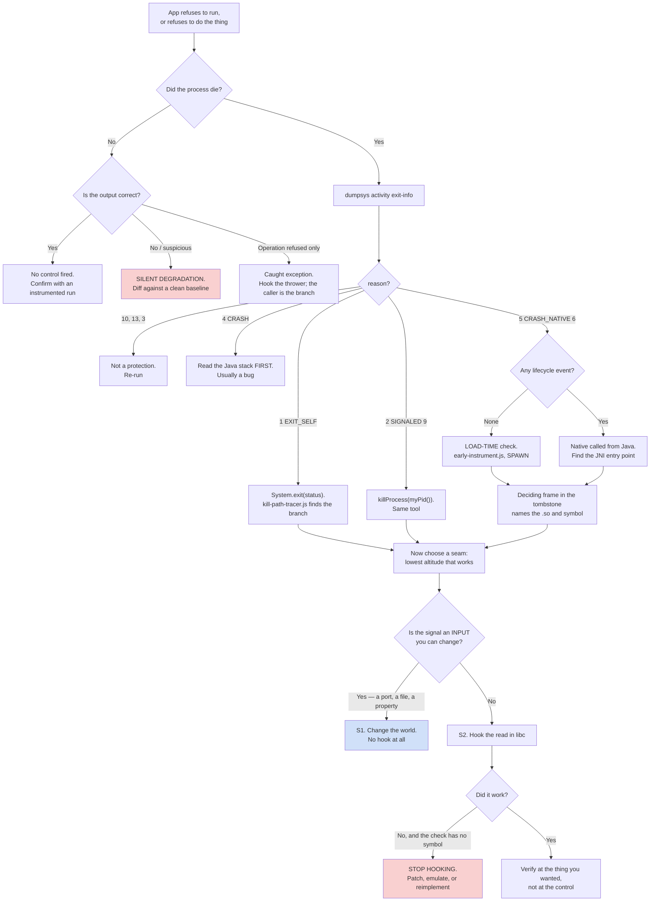

# 67 — Bypassing Protections — Mind Map

One map of the whole chapter. Read it outward from the centre: the pipeline first, then the seams,
then everything that decides which seam you choose.

```mermaid
mindmap
  root((67 — Bypassing<br/>Protections))

    (The unifying insight)
      Every client-side control is one pipeline
        input
        read
        verdict
        branch
        gated code
      Root, pinning, tamper, anti-debug,<br/>Play Integrity all converge
      They differ in evidence,<br/>not in what they do with it
      A wall is climbed;<br/>a pipeline is cut anywhere

    (S1 — the input)
      What
        files on disk
        system properties
        /proc contents
        open TCP ports
        package database
        mount table
      How
        Magisk DenyList
        resetprop
        frida-server -l 127.0.0.1:1337
        frida-server --directory
        rename the agent
      Properties
        device-wide blast radius
        nearly undetectable
        survives app updates
        wrong on a client's loaned device

    (S2 — the read)
      The read stack
        File.exists
        libcore BlockGuardOs
        libcore_io_Linux.cpp
        bionic access
        kernel faccessat
      Hook in libc
        catches Java AND native
        access, stat, openat, fopen
        readlink, opendir, realpath
        the *at family takes path at index 1
      Property trap
        __system_property_get
        __system_property_find
        __system_property_read_callback
        hook the callback, not the value
      Properties
        process-scoped
        survives R8 renaming
        detected only by counter-instrumentation

    (S3 — the verdict)
      isRooted, evaluate, getScore
      One hook, immediate result
      Most detectable
        computed twice and compared
        native copy vs Java copy
        self-checksum of the function
        timing
      Most brittle
        name changes every release
      Least informative
        you learn a verdict exists
        not which signals matter
      final is not a protection<br/>inside a hostile process

    (S4 — the branch)
      The if that consumes the verdict
      Hook the consumer
      Patch the conditional
      Inlining trap
        18-ARM measured it
        patched fn verified correct
        gated fn still refused
        verify AT the branch

    (S5 — the gated code)
      Call the payload directly
      No control is touched
      Undetectable
      Defeated only by dependency
        derive the key from the check
        server-issued token
        Keystore setUnlockedDeviceRequired
      Gate vs dependency
        a gate is bypassed
        a dependency must be satisfied

    (Timing)
      .init_array runs INSIDE dlopen
      JNI_OnLoad runs after dlopen returns
      Both are before any Java
      Spawn, never attach
        frida -U -f pkg --no-pause
      Beating .init_array
        hook __dl__ZN6soinfo17call_constructorsEv
        or hook the libc it will call
      scripts/early-instrument.js
        warns you if you attached

    (Anti-debug)
      TracerPid
        generated on read, per task
        detects live ptrace, not Frida
      PTRACE_TRACEME
        occupies the only tracer slot
        spawn-only to defeat
      forked watchdog
      Debug.isDebuggerConnected
        JDWP only, not ptrace
      FLAG_DEBUGGABLE
        a tamper signal, not a debugger signal
        0x38883e44 vs 0x38883e46 measured
      timing checks
      breakpoint and .text scans

    (Anti-Frida)
      port 27042
      D-Bus handshake
      /proc/net/tcp scan
      /proc/self/maps
      thread names gum-js-loop, gmain
      re.frida.server directory
      linjector pipes
      dlopen monitoring
      inline-hook checksum
      RegisterNatives monitoring
      Five of eleven are<br/>configuration, not hooks

    (Responses)
      report only — the right default
      refuse the operation
      System.exit n — reason 1
      killProcess — reason 2 status 9
      throw uncaught — reason 4
      native abort — reason 5 status 6
      silent poison — NO record
      delay
      Triage from ApplicationExitInfo
        read reason before status
        deciding frame in the tombstone

    (The escalation ladder)
      R1 Java check — hook File.exists
      R2 native check — hook libc
      R3 anti-Frida + load time — spawn early
      R4 inline syscalls + self-checksum — STOP
      R5 decision moves server-side — ladder ends
      R1 to R4 are the same round
      R5 is a different game

    (When to stop)
      inline syscalls, no symbol
      function checksums itself
      each round costs more
      you want an algorithm, not a decision
      someone must reproduce it later
      Then
        patch statically
        emulate
        reimplement
        or go around: attack the server
      Hooking rents the answer<br/>static analysis buys it

    (Severity, honestly)
      A bypassed control is not a finding
      Ask
        what was it protecting
        does the server re-verify
        what could you do once inside
      Report resilience separately and lower
      A sweep produces leads, not findings
      52 rejected 15 of 17 HIGH
      33 had 132 hits, 132 false positives
      36 found 12 surfaces, 4 real pins

    (Ethics and scope)
      Apps you own or are contracted to test
      Build your own target
      On third-party apps stop at detection
      Agree resilience scope in writing
      Leave the device as you found it

    (Chapters)
      37 root detection and its bypass
      36 pinning
      38 tamper controls
      40 packers and obfuscation
      53 Frida itself
      16 the JNI bridge
      18 native patching and inlining
      62 Magisk — the seam-1 toolkit
      20 seam 4 and the altitude vocabulary
      49 dependency instead of gate
      71 where the finding is filed
```

---

## The same thing as a decision tree

When you do not know where to start, walk this instead.

The two shaded outcomes are the ones that cost you the most time if you do not recognise them early:
silent degradation, which looks like success, and the point at which hooking stops being the right
tool, which looks like failure. The blue outcome is the one you should be aiming for.
