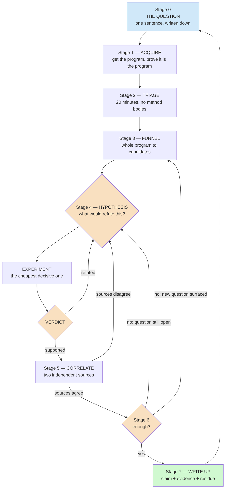
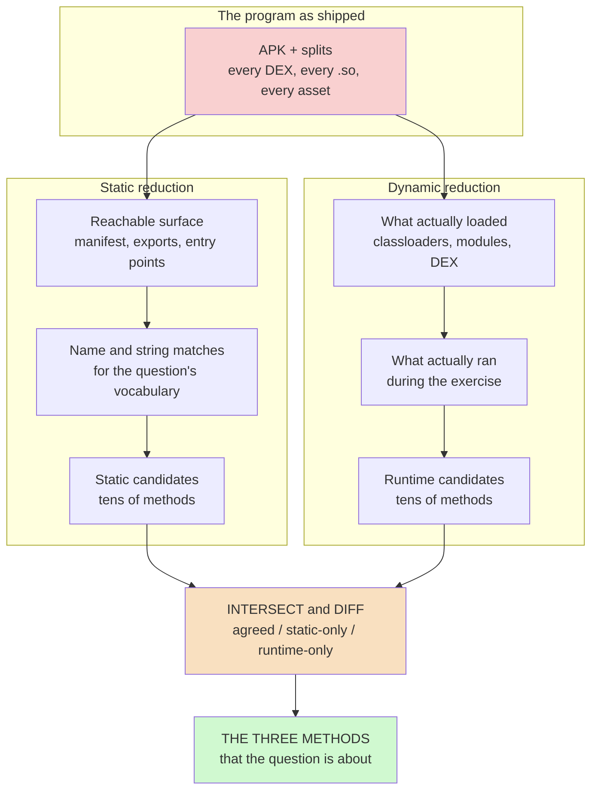
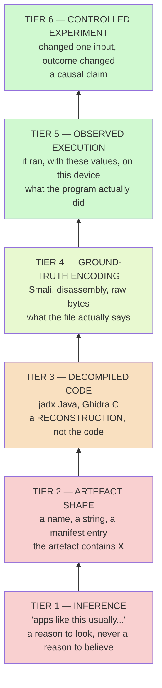
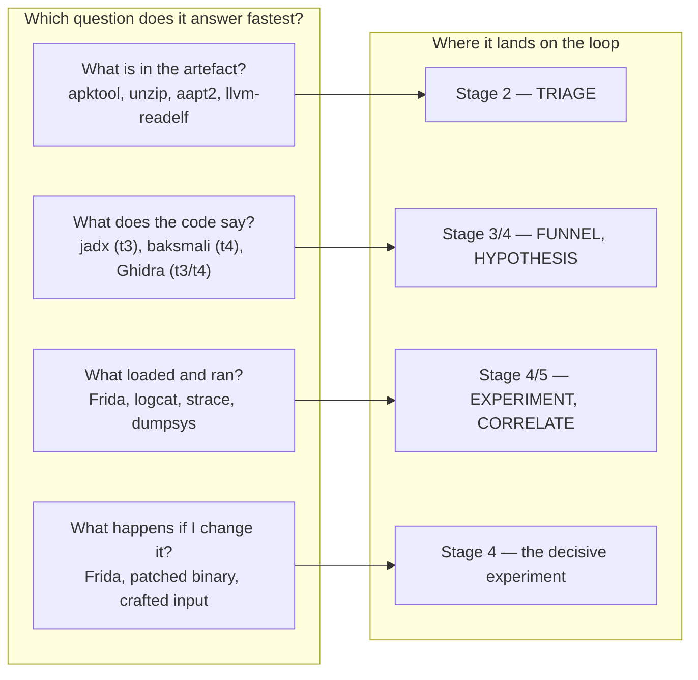
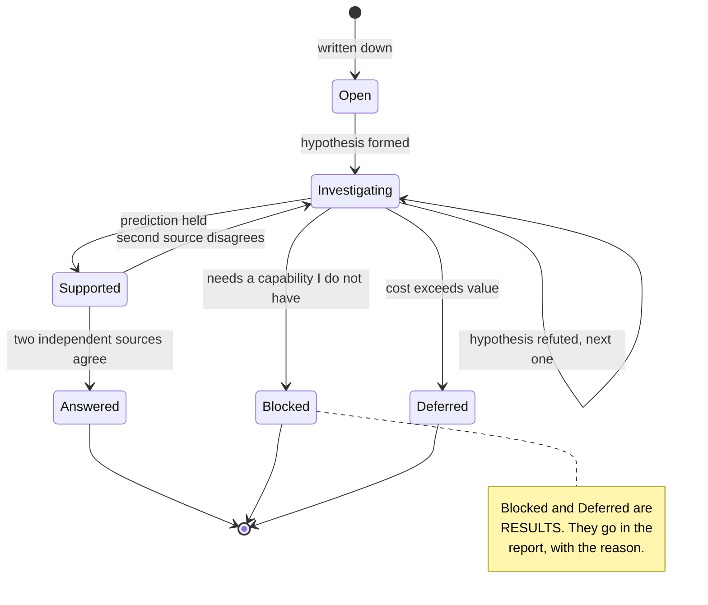
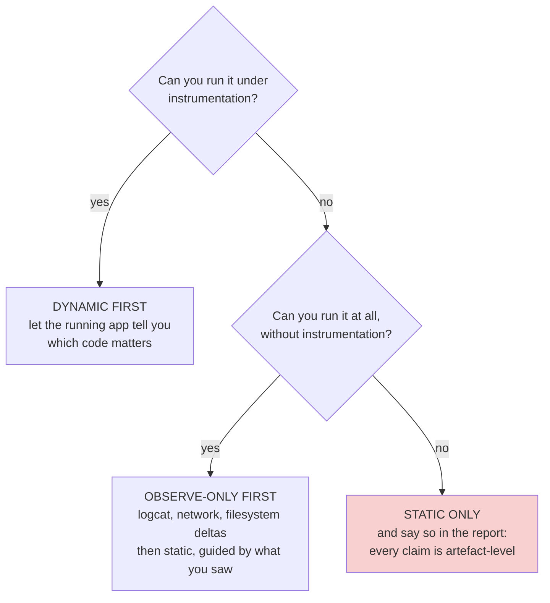
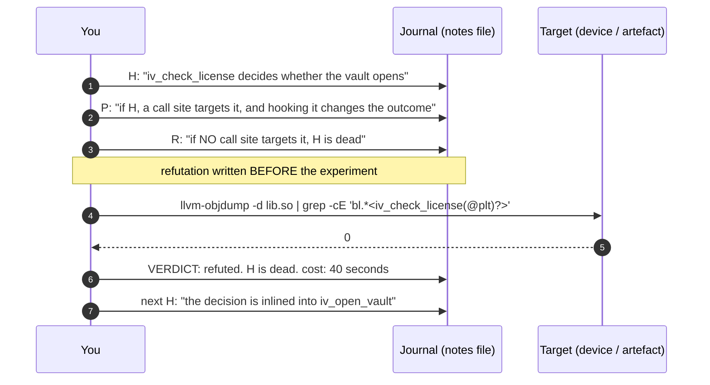
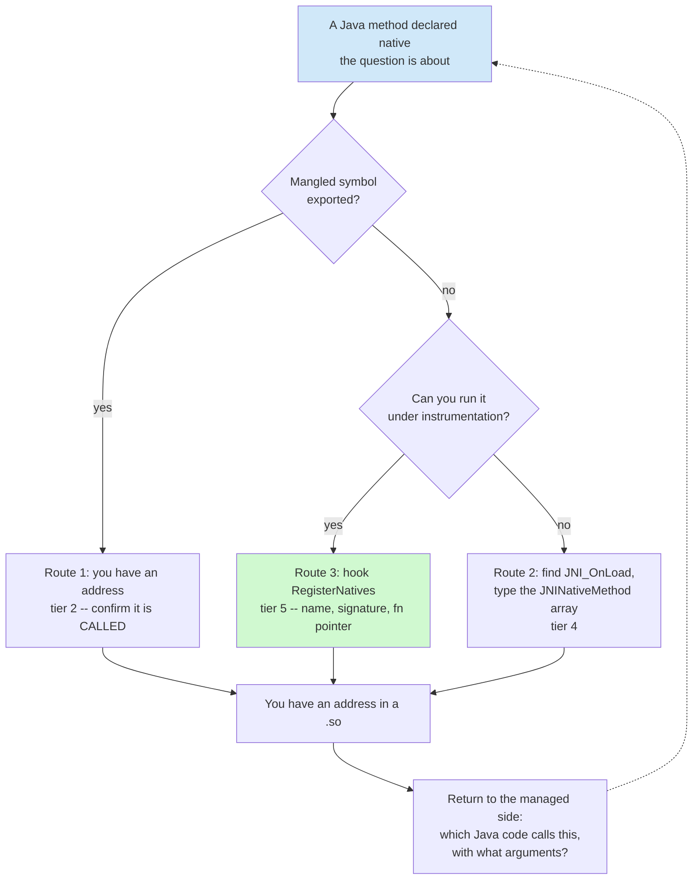
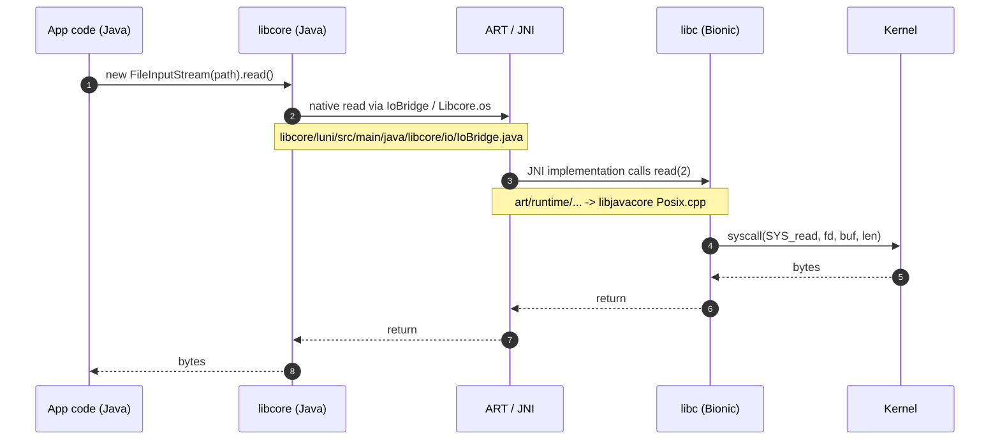
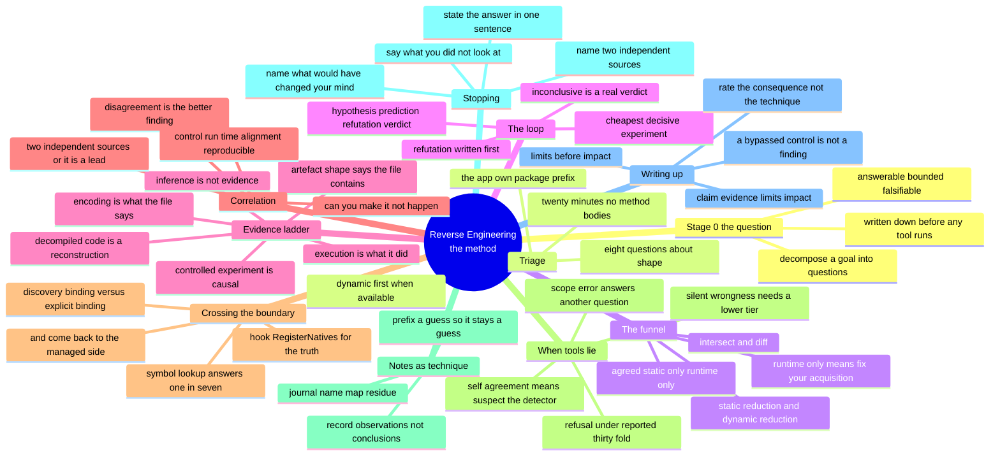

# 68 — Reverse Engineering

> After this chapter you will be able to walk into an application you have never seen, with one
> question you actually need answered, and come out with a defensible answer — knowing which of your
> evidence supports it, which does not, and what you never looked at. You will be able to run a
> hypothesis to a verdict instead of to a feeling, to move a single question across the
> managed/native boundary and back, to recognise the four ways a tool lies to you with a straight
> face, and to stop at the right time rather than at the point of exhaustion.

**Prerequisites:** [10 APK Internals](../10-APK-Internals/README.md) ·
[12 DEX Internals](../12-DEX-Internals/README.md) · [13 ART](../13-ART/README.md) ·
[15 Native Code](../15-Native-Code/README.md) · [16 JNI](../16-JNI/README.md) ·
[18 ARM](../18-ARM/README.md) · [51 Dynamic Analysis](../51-DynamicAnalysis/README.md) ·
[52 Static Analysis](../52-StaticAnalysis/README.md)

**Useful alongside:** [56 JADX](../56-JADX/README.md) · [57 Ghidra](../57-Ghidra/README.md) — the
tool chapters. This chapter is about **method**, and method is not tied to one decompiler: §7 works
with whichever tools you have, and §11 names each one's blind spots. Both 56 and 57 are hand-offs
here, not dependencies — 57 in particular *names this chapter a prerequisite* and calls itself "the
discipline this chapter is a tool within", so the dependency runs **57 → 68**, not both ways. Read
this chapter before either tool chapter if you are following the numbering.

**Applies to:** Every Android version. This chapter is about method, and method does not have an API
level. Where a *measurement* in it is version-dependent, the device and API level that produced it
are named on the spot. Everything measured here was measured on **Android 11 / API 30 (arm64,
rooted)** and **Android 15 / API 35 (x86_64 emulator)** — both identified in §1.7.

---

## Scope boundary — read this before anything else

You have arrived here on top of a stack of chapters that already taught you instruments. This
chapter is not a summary of them and does not repeat them. It is the thing none of them own: **the
investigation.**

| Chapter | Owns | This chapter assumes it and does not restate it |
|---|---|---|
| [52 — Static Analysis](../52-StaticAnalysis/README.md) | The eight-stage static pipeline, the hit→lead→finding funnel, the confidence model, the kill list | Yes |
| [51 — Dynamic Analysis](../51-DynamicAnalysis/README.md) | The eight-stage runtime pipeline, the three subtractions, coverage and its denominator | Yes |
| [56 — JADX](../56-JADX/README.md) | Decompilation as reconstruction, the failure census, the five checks before absence is evidence | Yes |
| [57 — Ghidra](../57-Ghidra/README.md) | Disassembly and decompilation of native code, `JNIEnv` retyping, P-Code | Yes |
| [53 — Frida](../53-Frida/README.md) · [65 — Hooking](../65-Hooking/README.md) | The instrumentation engine, and what a hook physically is | Yes |
| [40 — Obfuscation](../40-Obfuscation/README.md) | The deobfuscation techniques, and §6.1's nine-phase pipeline | Yes — and 40 §6.1 is the obfuscation-specialised instance of §3 here |
| [67 — Bypassing Protections](../67-BypassingProtections/README.md) | The bypass methodology, the five seams, when to stop *hooking* | Yes — this chapter owns when to stop *understanding*, which is a different question |
| [55 — MobSF](../55-MobSF/README.md) · [54 — Objection](../54-Objection/README.md) | Reading an automated tool's output as a queue of leads | Yes |

> **⚠️ Warning.** If you are here to learn a tool, you are in the wrong chapter, and there are ten
> better ones a click away. What follows contains almost no new tool syntax. It is about what you do
> between the commands: what you were trying to find out, why you ran that one, what the result
> licenses you to believe, and how you know when you are finished.

---

## Table of Contents

- [1. Introduction](#1-introduction)
  - [1.1 What reverse engineering actually is](#11-what-reverse-engineering-actually-is)
  - [1.2 The mistake that defines the beginner](#12-the-mistake-that-defines-the-beginner)
  - [1.3 A sweep produces leads, not findings](#13-a-sweep-produces-leads-not-findings)
  - [1.4 Four claims this chapter defends](#14-four-claims-this-chapter-defends)
  - [1.5 The unit of work is the hypothesis, not the file](#15-the-unit-of-work-is-the-hypothesis-not-the-file)
  - [1.6 Authorisation, licences and jurisdiction](#16-authorisation-licences-and-jurisdiction)
  - [1.7 What was measured, and on what](#17-what-was-measured-and-on-what)
- [2. High-Level Architecture](#2-high-level-architecture)
  - [2.1 The investigation loop](#21-the-investigation-loop)
  - [2.2 The triage funnel, across both halves](#22-the-triage-funnel-across-both-halves)
  - [2.3 The evidence ladder](#23-the-evidence-ladder)
  - [2.4 Where the tools sit on the loop](#24-where-the-tools-sit-on-the-loop)
  - [2.5 The state of a question](#25-the-state-of-a-question)
- [3. Deep Internal Working](#3-deep-internal-working)
  - [3.1 Stage 0 — the question, written down](#31-stage-0--the-question-written-down)
  - [3.2 Stage 1 — acquire, and prove you have the program](#32-stage-1--acquire-and-prove-you-have-the-program)
  - [3.3 Stage 2 — triage in twenty minutes](#33-stage-2--triage-in-twenty-minutes)
  - [3.4 Stage 3 — the funnel from program to candidates](#34-stage-3--the-funnel-from-program-to-candidates)
  - [3.5 Stage 4 — hypothesis, prediction, experiment, verdict](#35-stage-4--hypothesis-prediction-experiment-verdict)
  - [3.6 Choosing the cheapest decisive experiment](#36-choosing-the-cheapest-decisive-experiment)
  - [3.7 Stage 5 — correlation, and what two sources buy you](#37-stage-5--correlation-and-what-two-sources-buy-you)
  - [3.8 Crossing the managed/native boundary as one question](#38-crossing-the-managednative-boundary-as-one-question)
  - [3.9 When the artefact disagrees with the source](#39-when-the-artefact-disagrees-with-the-source)
  - [3.10 The four ways a tool lies with a straight face](#310-the-four-ways-a-tool-lies-with-a-straight-face)
  - [3.11 Symptom to root cause: the error names the wrong layer](#311-symptom-to-root-cause-the-error-names-the-wrong-layer)
  - [3.12 Note-taking and naming as an actual technique](#312-note-taking-and-naming-as-an-actual-technique)
  - [3.13 Working under obfuscation without restaging chapter 40](#313-working-under-obfuscation-without-restaging-chapter-40)
  - [3.14 Time-boxing, and the cost of the next hour](#314-time-boxing-and-the-cost-of-the-next-hour)
  - [3.15 Stage 6 — when you know enough to stop](#315-stage-6--when-you-know-enough-to-stop)
  - [3.16 Stage 7 — writing up what you found](#316-stage-7--writing-up-what-you-found)
  - [3.17 The residue: what you did not look at](#317-the-residue-what-you-did-not-look-at)
- [4. Source Code Walkthrough (AOSP)](#4-source-code-walkthrough-aosp)
  - [4.1 Why an RE chapter reads AOSP at all](#41-why-an-re-chapter-reads-aosp-at-all)
  - [4.2 `RegisterNatives`: the ground truth behind §3.8](#42-registernatives-the-ground-truth-behind-38)
  - [4.3 `ArtMethod` and what "the code that runs" means](#43-artmethod-and-what-the-code-that-runs-means)
  - [4.4 Where the DEX you are reading came from](#44-where-the-dex-you-are-reading-came-from)
  - [4.5 Tracing one question from Java to the kernel](#45-tracing-one-question-from-java-to-the-kernel)
- [5. Security Perspective](#5-security-perspective)
  - [5.1 What reverse engineering is for, on an engagement](#51-what-reverse-engineering-is-for-on-an-engagement)
  - [5.2 How developers misread the threat](#52-how-developers-misread-the-threat)
  - [5.3 Vulnerability class: the decoupled control](#53-vulnerability-class-the-decoupled-control)
  - [5.4 Vulnerability class: the secret the compiler published](#54-vulnerability-class-the-secret-the-compiler-published)
  - [5.5 Vulnerability class: the boundary nobody mapped](#55-vulnerability-class-the-boundary-nobody-mapped)
  - [5.6 OWASP MASVS and MASTG mapping](#56-owasp-masvs-and-mastg-mapping)
  - [5.7 How malware analysts and forensic analysts use this](#57-how-malware-analysts-and-forensic-analysts-use-this)
  - [5.8 Honest severity, and the finding that is not one](#58-honest-severity-and-the-finding-that-is-not-one)
- [6. Reverse Engineering Perspective](#6-reverse-engineering-perspective)
  - [6.1 The same decision seen four ways](#61-the-same-decision-seen-four-ways)
  - [6.2 Reading Smali for evidence, not for pleasure](#62-reading-smali-for-evidence-not-for-pleasure)
  - [6.3 What the four traps look like in the artefact](#63-what-the-four-traps-look-like-in-the-artefact)
  - [6.4 Recognising a compiler's fingerprints](#64-recognising-a-compilers-fingerprints)
- [7. Dynamic Analysis](#7-dynamic-analysis)
  - [7.1 The runtime half of the boundary map](#71-the-runtime-half-of-the-boundary-map)
  - [7.2 Liveness before silence means anything](#72-liveness-before-silence-means-anything)
  - [7.3 Data-flow tracking when control flow will not connect](#73-data-flow-tracking-when-control-flow-will-not-connect)
  - [7.4 Provenance: is the code you read the code that runs?](#74-provenance-is-the-code-you-read-the-code-that-runs)
  - [7.5 The device you are talking to is not the one you measured](#75-the-device-you-are-talking-to-is-not-the-one-you-measured)
- [8. Static Analysis](#8-static-analysis)
  - [8.1 The first ten commands, and what each rules out](#81-the-first-ten-commands-and-what-each-rules-out)
  - [8.2 Building the static boundary map](#82-building-the-static-boundary-map)
  - [8.3 Reading a binary you compiled yourself](#83-reading-a-binary-you-compiled-yourself)
  - [8.4 Where the tooling breaks on Windows](#84-where-the-tooling-breaks-on-windows)
- [9. Examples](#9-examples)
  - [9.1 Simple — one question, one command](#91-simple--one-question-one-command)
  - [9.2 Intermediate — the dead function](#92-intermediate--the-dead-function)
  - [9.3 Advanced — the value with no call edge](#93-advanced--the-value-with-no-call-edge)
  - [9.4 Real application — Chrome's native boundary](#94-real-application--chromes-native-boundary)
  - [9.5 Enterprise — an eighteen-APK sweep and what it did not prove](#95-enterprise--an-eighteen-apk-sweep-and-what-it-did-not-prove)
- [10. Common Interview Questions](#10-common-interview-questions)
- [11. Common Mistakes](#11-common-mistakes)
- [12. Hands-on Labs](#12-hands-on-labs)
- [13. Summary](#13-summary)
- [14. References](#14-references)

---

## 1. Introduction

### 1.1 What reverse engineering actually is

Imagine a locked room with a vending machine in it. You put in a coin and sometimes you get a
chocolate bar, sometimes you get nothing and the coin comes back. You are not allowed to open the
machine's casing and you were never given the wiring diagram. You want to answer one question: *what
decides whether I get the chocolate?*

There are, in real life, exactly three kinds of thing you can do.

You can **look at the machine's outside** — read the labels, weigh it, notice a seam, photograph the
coin slot. You learn a great deal quickly, and everything you learn is about the *surface*, which
may or may not reflect the mechanism.

You can **run experiments** — put in a coin of each denomination, put in a washer, put in a coin and
press two buttons at once, and write down what happened each time. Now you are learning about the
mechanism, but only about the parts of it your experiments happened to touch.

And you can **reason about how such machines are built** — you know that coin acceptors exist, that
they usually measure diameter and conductivity, and that a machine returning your coin has almost
certainly rejected it at the acceptor rather than at the dispenser. That reasoning is not evidence.
It is the thing that tells you which experiment to run next.

> **📖 Definition — reverse engineering.** *Reverse engineering* is the process of recovering a
> description of how a system works from the system itself, rather than from a description supplied
> by its author. In this chapter the system is an Android application: a compiled artefact plus the
> runtime behaviour it produces on a device. The recovered description is not the original source
> code and does not need to be — it needs to be *sufficient to answer a specific question, and
> defensible.*

Notice what that definition does not say. It does not say "read the decompiled Java". It does not
say "get the whole program back". Both of those are things you may end up doing; neither is the
activity. The activity is **recovering enough of a description to answer a question, and knowing how
much you have recovered.**

> **🧠 Mental Model.** Reverse engineering is not translation, it is **investigation**. A translator
> is finished when every line has been converted. An investigator is finished when the question is
> answered and the answer survives an attempt to break it. Those are different finish lines, they
> arrive at wildly different times, and mistaking the first for the second is the single most
> expensive habit in this discipline.

### 1.2 The mistake that defines the beginner

Watch someone inexperienced open an APK. The sequence is almost always the same:

1. Run `jadx` on it.
2. Open the output tree.
3. Start reading, at the top, in alphabetical order.
4. Two hours later, still reading, with eleven browser tabs open and no written question.

Nothing in that list is *wrong*. Each step is a reasonable thing to do. The failure is structural:
there was never a question, so there is no criterion for stopping, no criterion for choosing what to
read next, and no way to tell progress from motion. The person is *busy*, and busy feels like
progress, which is why the habit survives.

Now watch someone experienced. They spend the first ten minutes not looking at code at all. They
write a sentence — an actual sentence, in a file — that says what they are trying to find out. Then
they spend twenty minutes on triage that touches no method bodies. Then they run one command whose
result will eliminate about half of the remaining possibilities. They are slower for the first half
hour and finished in a fraction of the time.

The difference is not tool skill and it is not experience with this particular app. It is that the
second person is running a **loop with a termination condition**, and the first is performing a
**traversal with none**.

### 1.3 A sweep produces leads, not findings

Four independent measurements recorded in this repository arrived at the same conclusion from four
directions, and it is the sentence this chapter is built on:

| Measurement | Where | Result |
|---|---|---|
| A 17 MB commercial app swept for secrets | [52 — Static Analysis](../52-StaticAnalysis/README.md) | 16,836 raw hits → 168 leads; adjudicating the HIGH band by hand rejected **15 of 17** |
| A leak hunter run against real Chrome data | [33 — Storage](../33-Storage/README.md) | **132 high-confidence hits, 132 false positives** |
| Apps with a certificate-pinning surface | [36 — Certificate Pinning](../36-CertificatePinning/README.md) | 12 of 14 had the surface; only **4** actually pinned |
| A self-signature-check detector across 18 APKs | [38 — Tamper Detection](../38-TamperDetection/README.md) | first reported **18 of 18**; hardened, **13 of 18** — the first number was the detector agreeing with itself |

**A sweep produces leads, not findings.** That is the thesis of this chapter compressed into six
words. Everything in §3 is machinery for converting the first into the second, and the machinery
exists because the conversion never happens by itself.

There is a corollary that people find harder to accept: **confidence ranking is not severity
ranking.** In chapter 52's commercial sweep, the single most interesting thing found — a `Domain`
enum shipping thirteen environments including pre-production and eight QA endpoints — sat at MEDIUM
confidence 0.50, below fifteen HIGH-band items that were all wrong. A ranking tells you where to
look first. It does not tell you what matters.

### 1.4 Four claims this chapter defends

Everything here reduces to four claims. Each is argued in §3 and demonstrated in a lab.

**Claim 1 — The unit of work is a hypothesis, not a file.** Progress is measured in questions moved
from open to answered, not in classes read. A session that read 400 classes and closed no question
made no progress.

**Claim 2 — An observation is only evidence relative to a prediction you made first.** If you did
not say in advance what the experiment would show if your hypothesis were true, you cannot tell
confirmation from coincidence, and you will find that the app "does what you thought" essentially
always.

**Claim 3 — Every tool answers a different question, and none of them answers "what does this app
do".** Choosing the tool is choosing the question. Most wasted RE time is a tool being asked
something it structurally cannot answer, and answering anyway.

**Claim 4 — You are finished when the question is answered and you can state what you did not
look at.** Not when the app is understood — apps are never understood — and not when you are tired.

### 1.5 The unit of work is the hypothesis, not the file

> **📖 Definition — hypothesis.** A *hypothesis* here is a statement about the target that could be
> false, phrased so that some observation you can actually make would show it to be false. "The app
> checks the licence" is not a hypothesis; nothing would refute it. "The `PREMIUM` string in
> `LicenseManager` is compared against user input on the path that unlocks the export button" is a
> hypothesis, because a single breakpoint refutes it.

The word doing the work is **refute**. A hypothesis you cannot imagine refuting is a belief, and
beliefs accumulate silently. The discipline that keeps an investigation honest is that for every
hypothesis you write down, you also write down the cheapest observation that would kill it — and
then you go and make that observation, in preference to the observation that would confirm it.

This is not philosophy of science imported for decoration. It has an entirely practical consequence
on an engagement. Confirming evidence is abundant and cheap: if you believe a method is the licence
check, you will find it called, find strings near it, find it referenced from a plausible place, and
every one of those will feel like progress. Refuting evidence is scarce and decisive: one run in
which the method is never called ends the hypothesis in four seconds. The chapter's worked example
in §9.2 is exactly this — a function that every confirming signal points at, and which one `grep`
for call sites eliminates entirely.

### 1.6 Authorisation, licences and jurisdiction

Reverse engineering is **legally contextual**, and the context has three independent axes that are
easy to conflate:

- **The contract.** Most application EULAs and app-store terms prohibit reverse engineering
  outright. That is a contractual matter between you and the publisher and it binds you regardless
  of what any statute permits.
- **The statute.** Jurisdictions differ. Several legal systems carve out explicit exceptions for
  interoperability, security research, or both; several do not; several make the exception
  conditional on things like having lawfully obtained the copy. Anti-circumvention provisions are a
  separate layer again and are the reason this chapter contains no DRM material of any kind.
- **The authorisation.** On an engagement, a signed scope document naming the package and the
  permitted activities is what makes the work lawful in practice. It is also the document that
  decides whether pulling an APK off a device counts as in-scope.

Those are three different questions and a "yes" to one is not a "yes" to another. Get the
authorisation in writing, name the package and version in it, and if the licence and the statute
appear to conflict, that is a question for a lawyer and not for you. That is the whole of the
sermon; the rest of the chapter assumes you have done it.

**Legitimate targets for everything that follows:** applications you own or have written
authorisation to test; the purpose-built fixture in [`examples/`](examples/); and well-known
deliberately-vulnerable training apps. Nothing else. Every network endpoint in this chapter's code
uses the `.invalid` top-level domain, which is reserved by RFC 2606 and cannot resolve.

### 1.7 What was measured, and on what

This repository's most valuable property is that its claims are measured rather than recited. Here
is exactly what was measured for this chapter and where, so that you can discount anything that was
not.

**Devices attached while writing, both identified before use:**

| Serial | Model | Release / API | ABI | Page size | Root | frida-server |
|---|---|---|---|---|---|---|
| `84f7a024` | Redmi `M2101K6P` (`sweetin`) | Android 11 / **API 30** | `arm64-v8a` | 4096 | Yes (`su -c id` → `uid=0`, context `u:r:magisk:s0`) | **Running** |
| `emulator-5554` | `sdk_gphone16k_x86_64` | Android 15 / **API 35** | `x86_64` | **16384** | Yes, but **`su 0 <cmd>` only** — `su -c` fails with `invalid uid/gid '-c'` | **No process** |

> **⚠️ Warning — a third device is now in play.** This repository's measurements come from two
> physical phones: the Redmi `M2101K6P` above, and an `i9000S` (Android 13 / API 33, Enforcing,
> **not rooted, no frida-server**). The two get swapped without warning — chapter 52 watched the
> Redmi vanish from `adb devices` mid-session and be replaced by the `i9000S`. The API 35 emulator
> above is a **third target**, it has 16 KiB pages, and its `su` takes a different argument form from
> the phone's: any script that shells out to the `-c` form fails there with
> `su: invalid uid/gid '-c'`, which looks like "not rooted" and is not. **Identify the device before
> trusting a version-gated or root-gated claim, and record which one you used** — this chapter is the
> third to be bitten by it.
>
> ```bash
> adb devices -l && adb shell getprop ro.product.model && adb shell getprop ro.build.version.sdk
> ```

**Measurements made for this chapter:**

| # | Claim | How it was measured | Section |
|---|---|---|---|
| M1 | Only **12.9%** of declared native methods are reachable by symbol lookup | 18 real APKs, `dexdump` + `llvm-nm -D`, JNI short-form mangling | §3.8, §9.5 |
| M2 | Chrome binds **509** native methods at runtime while its base DEX declares 323, and **6** are symbol-resolvable | `RegisterNatives` traced live via the `JNIEnv` function table | §7.1, §9.4 |
| M3 | A silent `RegisterNatives` trace was **genuinely silent**, not broken | Same hook, two targets — 0 calls on one, 78 on the other | §7.2 |
| M4 | `frida.get_usb_device()` selected the **emulator** while the static corpus came from the phone | `frida.enumerate_devices()`, then `frida-ps` on each | §7.5 |
| M5 | The compiler published a secret the source deliberately hid — **twice**, for two different reasons | Built the fixture at `-O2`, ran `strings` on the result | §3.9, §5.4 |
| M6 | `dexdump.exe` cannot read a DEX from inside an APK on Windows | Reproduced on 18 APKs, then on extracted `classes*.dex` | §8.4 |
| M7 | The fixture's obvious control is **inverted** relative to the outcome | Ran it on the device with three keys | §9.2, §5.3 |
| M8 | This chapter's own call-site grep produces a **false negative** on PLT-routed calls | Built the fixture at `-O0` and `-O2` and compared both patterns | §8.3 |

**What could not be measured, stated plainly:**

- **No claim in this chapter is made about API 35 application behaviour.** The emulator was
  identified, its page size and `su` form recorded, and then it was *not* used for app measurement,
  because it has no frida-server and the corpus came from the phone. Mixing them would have produced
  exactly the correlation error §7.5 warns about.
- **The 18-APK sweep measures `base.apk` only.** Where an app ships split APKs, code and libraries
  outside `base.apk` are invisible to it. That is not a flaw in the measurement — it is the
  measurement's most important result, and §9.5 treats it as such rather than hiding it.
- **Why Frida could enumerate processes on an emulator with no visible `frida-server` process is
  unexplained.** `ps -A` and `netstat -lntp` under root both showed nothing, and enumeration worked
  anyway. The device-selection finding (M4) does not depend on the mechanism, so it stands; the
  mechanism is recorded here as unknown rather than guessed at.

---

## 2. High-Level Architecture

### 2.1 The investigation loop



What you are looking at is the whole chapter as one picture, and three features of it matter more
than the boxes.

First, **there is no arrow from Stage 3 to Stage 7.** You cannot get from a funnel to a report. That
mirrors [52 — Static Analysis](../52-StaticAnalysis/README.md)'s standing claim that there is no
arrow from sweep to report, and it is the same claim generalised: candidate lists are not
conclusions, in either half of the discipline.

Second, **the loop between HYPOTHESIS, EXPERIMENT and VERDICT is where the time goes**, and the
"refuted" edge is drawn deliberately as the shorter, more common path. In a healthy investigation
most hypotheses die. If yours mostly survive, you are writing hypotheses that are too weak to be
refuted — see §1.5 — and you are accumulating beliefs rather than knowledge.

Third, **the STOP diamond has three exits, not two.** "Not enough" splits into *the question is
still open*, which sends you back to a new hypothesis, and *a new question surfaced*, which sends you
back to the funnel with a different target set. Conflating those two is how investigations sprawl:
you answer a question you were not asked because it appeared while you were working, and nobody
notices until the report is due.

### 2.2 The triage funnel, across both halves



This is the funnel that neither 51 nor 52 owns, because it is the one that runs **both of them at
once and then compares the outputs**.

The left branch is static reduction: start from everything shipped, cut to what is reachable, cut to
what mentions the question's vocabulary, and you have tens of candidate methods. The right branch is
dynamic reduction: start from the same program, cut to what was actually loaded into the process,
cut to what actually executed while you exercised the feature, and you again have tens of candidates.

The box that does the work is **INTERSECT and DIFF**, and it produces three piles rather than one:

| Pile | Meaning | What it is worth |
|---|---|---|
| **Agreed** — in both | Present in the artefact and observed running | The strongest candidates you will get. Start here |
| **Static-only** — in the artefact, never ran | Dead code, a path you did not exercise, a feature-flagged branch, or a decoy | Ambiguous, and the ambiguity is the finding. §9.2 lives here |
| **Runtime-only** — ran, but not in your artefact | Dynamically loaded code, a split you did not pull, a library from another package | **Always investigate.** It means your artefact is not the program |

The third pile is the one beginners never generate, because they never run the right branch. It is
also the one that catches the most expensive category of error, and §9.4 is an entire worked example
of it: in Chrome, the runtime-only pile contained **more** methods than the whole static analysis had
found.

### 2.3 The evidence ladder



Read the ladder upward: each tier is a stronger kind of thing to know, and the arrow means "is
supported by, and can be overturned by". This is the chapter's answer to a question every other
chapter raises and none owns — *how much is this observation worth?*

- **Tier 1, inference**, is what you know about apps in general. It is enormously useful and it is
  not evidence. It tells you where to point tier 2.
- **Tier 2, artefact shape**, is what a name or a string tells you. A class called `LicenseManager`
  is tier 2. Note what it establishes: that the artefact contains that name. Not that it is used,
  not that it does what it says.
- **Tier 3, decompiled code**, is a *reconstruction*. [56 — JADX](../56-JADX/README.md) proved a case
  where clean, warning-free decompiled Java returns 100 and the bytecode returns 105, and
  [57 — Ghidra](../57-Ghidra/README.md) makes the same point about decompiled C. Tier 3 is where most
  people stop and where most wrong conclusions are formed.
- **Tier 4, ground-truth encoding**, is Smali or disassembly: what the file actually says, with no
  reconstruction step. Slower to read, and it does not lie.
- **Tier 5, observed execution**, is a log line, a hook firing, a value in a register. It beats every
  static tier for *what happened* and establishes nothing about what happens on paths you did not
  run.
- **Tier 6, controlled experiment**, is the only tier that supports a causal claim. You changed one
  input, the outcome changed, and you changed it back and it changed back.

> **🧠 Mental Model.** Tiers 1–3 tell you what to *believe provisionally*. Tiers 4–6 tell you what to
> *write down*. A finding that rests entirely on tier 3 is a finding that rests on a tool's
> reconstruction, and you should say so in the report rather than let the reader assume otherwise.

The ladder also gives you a precise way to talk about cost. Each rung up is roughly an order of
magnitude more expensive in time and roughly an order of magnitude more decisive. That trade is what
§3.6 turns into a rule.

### 2.4 Where the tools sit on the loop



The diagram is deliberately organised by **question**, not by tool, because that is the choice you
are actually making. Every one of the tool chapters in this repository teaches an instrument in
depth; what none of them can tell you, from inside, is when to reach for a different one.

The practical rule this produces is short: **name the question before you pick the tool, and if the
tool you reached for cannot answer that question, notice.** A decompiler cannot tell you whether a
method ran. A Frida hook cannot tell you whether a method exists on a path you never exercised.
`strings` cannot tell you whether a string is used. Each of those tools will nonetheless produce
confident output when asked, and the output will be about something adjacent to what you wanted.

| The question | Cheapest tool that actually answers it | The tool people wrongly use |
|---|---|---|
| Does this string exist in the file? | `strings`, `grep` | — (this one is fine) |
| Is this string *used*? | Smali/disassembly cross-reference | `strings`, and then assumption |
| Does this method exist? | `dexdump`, `llvm-nm`, jadx tree | — |
| Is this method *called*? | Call-site count in tier 4, or a hook | jadx's cross-reference alone |
| Did this method run *in this session*? | A hook, a log line | Static reachability |
| Can this method run *at all*? | Static reachability, honestly caveated | A hook that did not fire |
| Does this input cause that output? | Controlled experiment, both directions | Reading the code |

Two rows in that table are the same trap seen from opposite sides, and they are worth stating
explicitly because both are extremely common. **A hook that did not fire is not evidence of
unreachability** — it is evidence about your session. **A static path that you cannot find is not
evidence of unreachability either** — [52](../52-StaticAnalysis/README.md) requires you to write "no
static path found" rather than "unreachable", for exactly this reason. Neither half can supply the
other's denominator.

### 2.5 The state of a question



Every question you write down ends in one of five terminal states, and this is the discipline that
keeps an investigation from silently leaking work.

**Answered** is the one everybody expects: a claim, supported by two independent sources that agree.
**Supported** is deliberately *not* terminal — one source is a lead, and §3.7 explains why.

The two that matter for honesty are **Blocked** and **Deferred**, and the note in the diagram is the
point. A question that you could not answer because the device lacked a capability, or because the
app refused to run under instrumentation, is a *result*. It goes in the report, phrased as what you
could not establish and why. A question you dropped because the remaining cost outweighed the value
is also a result, and it is the honest form of time-boxing (§3.14). What must never happen is the
sixth state — the question that quietly stopped being worked on and was never mentioned again,
which is how a report comes to imply coverage it does not have.

This mirrors [52](../52-StaticAnalysis/README.md)'s life-of-a-lead state machine deliberately: there,
`Deferred` is a legitimate outcome for a lead. Here it is a legitimate outcome for a question. Same
principle, one level up.

---
## 3. Deep Internal Working

This section is the method itself, stage by stage. Each stage answers **what** it produces, **why**
it exists, **when** you are in it, **where** its output lives, and **how** you execute it.

### 3.1 Stage 0 — the question, written down

**What it produces:** one sentence, in a file, that some future observation could answer.

**Why it exists:** without it there is no criterion for choosing what to do next and no criterion for
stopping. Every pathology in §11 traces back to a missing Stage 0.

**How to execute it.** Write the question so that it names a *subject*, an *action*, and an
*outcome you could observe*. Then apply three tests:

| Test | Fails if | Example of a failure | Repaired |
|---|---|---|---|
| **Answerable** | No observation could settle it | "Is this app secure?" | "Does this app send the session token over a channel it did not pin?" |
| **Bounded** | Answering it requires understanding the whole program | "How does the app work?" | "What decides whether the Export button is enabled?" |
| **Falsifiable** | Every outcome confirms it | "Does the app protect its data?" | "Is the vault key derived from user input, or hard-coded in the artefact?" |

> **📖 Definition — scope, for an investigation.** The *scope* is the set of questions you have
> agreed to answer, plus the set of actions you are permitted to take while answering them. It is
> not the same as the app. An engagement scoped to "the payment flow" does not license reverse
> engineering the analytics SDK because it looked interesting.

**A worked Stage 0.** Suppose the brief is "check whether the premium features can be unlocked
without paying". That is a goal, not a question. It decomposes into:

1. What code path enables a premium feature? *(bounded, answerable)*
2. What input does that path consume to make its decision? *(bounded, answerable)*
3. Is that input under the client's control? *(falsifiable — a single experiment settles it)*
4. If the client controls it, does changing it actually change the outcome? *(tier 6)*

Four questions, each with a terminal state, each individually cheap. Compare that with the
undecomposed goal, which has no first command.

> **🔍 Pentester's Note.** Write the questions in the same file you will write the answers in, and
> timestamp them. When the report is due, the file *is* the methodology section — you will not have
> to reconstruct what you did from shell history, which is a reconstruction that is always wrong in
> the same flattering direction. [`scripts/re-journal.py`](scripts/re-journal.py) mechanises exactly
> this, and it refuses to accept a hypothesis without a refutation test.

### 3.2 Stage 1 — acquire, and prove you have the program

**What it produces:** a set of files on your disk, and a written statement of what they are and what
they are not.

**Why it exists:** because the single most expensive class of error in this discipline is analysing
something adjacent to the thing you were asked about, confidently, for a day.

The acquisition itself is mechanical and belongs to [10 — APK Internals](../10-APK-Internals/README.md)
and [60 — ADB](../60-ADB/README.md). What belongs here is the **proof obligation** that comes with it.

```bash
# host -- acquire EVERY path, not the first one
adb shell pm path com.example.target
```

That command returns one line per APK. If it returns more than one, you have a split-APK
installation, and pulling only `base.apk` means analysing a fraction of the program.

This is not a rare edge case. Measured on the Redmi while writing this chapter:

```
package:/data/app/~~TTeld3.../com.android.chrome-iwrm3.../base.apk
package:/data/app/~~TTeld3.../com.android.chrome-iwrm3.../split_chrome.apk
package:/data/app/~~TTeld3.../com.android.chrome-iwrm3.../split_config.en.apk
package:/data/app/~~TTeld3.../com.android.chrome-iwrm3.../split_dev_ui.apk
package:/data/app/~~TTeld3.../com.android.chrome-iwrm3.../split_on_demand.apk
package:/data/app/~~TTeld3.../com.android.chrome-iwrm3.../split_stack_unwinder.apk
package:/data/app/~~TTeld3.../com.android.chrome-iwrm3.../split_test_dummy.apk
```

Seven APKs. And in the same corpus, `com.vendor.professionalnet`'s `base.apk` is **334 KB** — a stub whose
entire program lives elsewhere. A sweep of that file finds nothing and is not evidence of anything.

The acquisition checklist, in full:

| Step | Command | What it rules out |
|---|---|---|
| Every APK path | `pm path <pkg>` | The split trap |
| Hash each file | `sha256sum *.apk` | Analysing a different build than you report on |
| Signer identity | `apksigner verify --print-certs base.apk` | A repackaged or store-modified copy |
| Version, recorded | `aapt2 dump badging base.apk \| grep versionName` | A report that ages into being wrong |
| Native ABIs present | `unzip -l base.apk \| grep '\.so'` | Assuming a library is absent when it is in a split or downloaded |
| Compressed or mapped | `unzip -v base.apk \| grep lib/` | Missing that libs are mapped from the APK (`extractNativeLibs=false`) |

> **⚠️ Warning.** Record the hash and version *in the notes file*, not just in your shell history.
> Every claim in your report is a claim about a specific build. Six weeks later, when the developer
> says "we fixed that", the hash is what makes the conversation short.

### 3.3 Stage 2 — triage in twenty minutes

**What it produces:** a one-page table describing the target's shape, and a decision about which
half of the discipline to lead with.

**Why it exists:** twenty minutes here routinely saves days, because it changes which questions are
even worth asking. [40 — Obfuscation](../40-Obfuscation/README.md) §6.1's Phase 1 is the
obfuscation-specialised version of this; what follows is the general form.

**When you are in it:** immediately after acquisition, before opening a single method body. The rule
that makes triage work is that **you are not allowed to read code during it.** The moment you start
reading, you stop triaging and start investigating, without having decided what to investigate.

The eight triage questions:

| # | Question | Answered by | Changes what |
|---|---|---|---|
| 1 | How big is the code, really? | class count, DEX count, `.so` count and size | Your time estimate, by an order of magnitude |
| 2 | Is it obfuscated, and how? | class/member names, string shapes, `kotlin.Metadata` | Whether names are evidence at all |
| 3 | Is it packed? | a `classes.dex` that is mostly a loader | Whether the artefact is the program |
| 4 | How much is native? | `.so` inventory, count of `native` declarations | Which toolchain you will live in |
| 5 | Are there splits or downloaded modules? | `pm path`, asset inventory, `SplitCompat` | Whether you have the program |
| 6 | What is the app's own package prefix? | manifest, largest owned package | Your single best noise filter |
| 7 | Does it resist analysis? | root/emulator/debug/tamper signals | Whether dynamic is available at all |
| 8 | What third-party SDKs dominate? | package prefixes by class count | What you can stop reading immediately |

Question 6 deserves emphasis because it is the cheapest large win available. In a typical app the
overwhelming majority of classes belong to libraries you did not write and are not testing. Chapter
52 measured a commercial app where **136 of 137 `password` hits were framework code**. Establishing
the app's own package prefix in minute three turns most subsequent greps from useless into useful.

Question 7 decides the order of everything downstream, and the decision rule is worth stating
directly:



Read the tree as a cost argument rather than a preference. Dynamic analysis is *cheaper per answered
question* when it is available, because the program does the reduction for you: instead of deciding
which of 20,000 methods matter, you exercise the feature and watch which few hundred run. Chapter 40
§6.1 Phase 2 states this as "prefer dynamic, always, when it is available", and the reasoning is
identical.

The bottom box is coloured as a hazard for a reason. A static-only engagement is entirely legitimate
and sometimes the only option — but every finding from it is a claim about the artefact, and the
report has to say so. "The app contains a hard-coded key" is defensible from static evidence alone.
"The app uses a hard-coded key" is not.

> **🔬 Under the Hood.** Triage is where you decide what *kind* of thing the artefact is, and there
> is a fast structural check most people skip. Compare the count of classes in the DEX against the
> count of files jadx produced. [56 — JADX](../56-JADX/README.md) measured jadx's console reporting
> `finished with errors, count: 61` while the output tree contained **2,104 refused methods across
> 1,424 files** — a 30× under-report. If you triage on the console summary you will believe you have
> a complete decompilation when 2,000 method bodies are missing.

### 3.4 Stage 3 — the funnel from program to candidates

**What it produces:** a short, ranked list of methods — realistically three to thirty — that the
question is plausibly about, together with the three piles from §2.2.

**Why it exists:** because the alternative is reading in file order, and no amount of diligence
rescues that.

The funnel is the diagram in §2.2 executed concretely. Run both branches; do not skip the right one
because the left one produced something.

**Left branch — static reduction.**

```bash
# host -- from a jadx output tree, the app's own code only
APP=com/example/target                 # the prefix triage question 6 gave you
grep -rn --include='*.java' -E 'premium|entitle|unlock|license' sources/$APP | wc -l
```

Whatever that number is, it is a count of *hits*, and [52](../52-StaticAnalysis/README.md) owns the
machinery for turning hits into leads. What this chapter adds is the ranking criterion, which is not
pattern precision but **distance to the question**:

| Rank | Criterion | Why it beats pattern-matching |
|---|---|---|
| 1 | On a path from an entry point named in the question | The question is about a behaviour, and behaviours have entry points |
| 2 | Reads or writes the state the question is about | Data-flow proximity survives renaming; names do not |
| 3 | Sits at a trust boundary the question crosses | IPC, JNI, network, storage — where the interesting decisions live |
| 4 | Name matches the question's vocabulary | Cheapest, weakest, and the only one obfuscation destroys |

Most people rank by criterion 4 alone, because it is the one `grep` implements. Under obfuscation it
returns nothing and they conclude the app does not do the thing — which is the error
[56 — JADX](../56-JADX/README.md) formalised as the five checks (see §3.13).

**Right branch — dynamic reduction.** Exercise the feature the question is about, and record what
loaded and what ran. The minimum viable version needs no root:

```bash
# host -- what classes did the app load while you used it? (needs the app debuggable, or root)
adb shell "logcat -c" && adb shell "am start -W -n com.example.target/.MainActivity"
# ...use the feature...
adb shell "dumpsys package com.example.target | sed -n '/declared permissions/,+20p'"
```

With Frida available, the right branch becomes far sharper, and
[`scripts/boundary-confirm.js`](scripts/boundary-confirm.js) is this chapter's contribution to it.

**Then diff the branches.** This is the step that is skipped and the step that pays:

| Pile | Action |
|---|---|
| Agreed | Rank first. These are your candidates |
| Static-only | Ask *why it did not run*. Unexercised path, dead code, or decoy — all three are informative |
| Runtime-only | **Stop and fix your acquisition.** Something ran that you do not have |

### 3.5 Stage 4 — hypothesis, prediction, experiment, verdict

This is the engine. Everything before it was preparation; everything after it is bookkeeping.



Read the sequence carefully: **three lines go into the journal before anything touches the target.**
The hypothesis, the prediction if it is true, and the refutation if it is false. Only then does the
experiment run.

That ordering is the entire difference between evidence and coincidence, and the reason is
psychological rather than technical. If you run the command first and interpret it afterwards, you
will interpret almost any result as consistent with what you already believed — a call site count of
zero becomes "it must be called through a function pointer", a hook that does not fire becomes "the
hook must be wrong". Both of those are sometimes true. Deciding *in advance* which result kills the
hypothesis is what stops them from being infinitely available excuses.

> **🧠 Mental Model.** A hypothesis without a written refutation test is a wish. You can tell the
> difference in one question: *what result would make me abandon this?* If you cannot answer, you are
> not investigating, you are looking for support.

**The four fields, and what each must contain:**

| Field | Must contain | Common failure |
|---|---|---|
| **H — Hypothesis** | A statement that could be false | "Look at the licence code" — not a statement |
| **P — Prediction** | What you will observe *if H is true* | Restating H in other words |
| **R — Refutation** | What you will observe *if H is false* | Left blank, which makes the experiment unfalsifiable |
| **V — Verdict** | `refuted` / `supported` / `inconclusive`, plus the raw observation | Recording the interpretation instead of the observation |

The last row is subtle and matters six weeks later. Record what you *saw* —
`grep -c` returned `0` — not what you *concluded*. Conclusions get revised; observations do not, and
when a later finding contradicts an earlier one, the raw observations are what let you work out
which of you was wrong.

**`inconclusive` is a first-class verdict.** An experiment that neither confirms nor refutes is
extremely common and is not a failure; it usually means the experiment was not decisive, and the
correct next move is to design a sharper one rather than to squint at the result.

### 3.6 Choosing the cheapest decisive experiment

Two properties matter when choosing what to do next, and people optimise the wrong one.

> **📖 Definition — decisive.** An experiment is *decisive* for a hypothesis if at least one of its
> possible outcomes rules the hypothesis out. An experiment whose every outcome is compatible with H
> is not an experiment, it is an activity.

The rule is: **among the decisive experiments, run the cheapest.** Not the most thorough, not the one
you are best at, not the one that produces the nicest artefact. The cheapest.

| Experiment | Typical cost | Decisive for |
|---|---|---|
| `grep` for a call site count | seconds | "Is this function called from this library?" |
| `llvm-nm -D` for a symbol | seconds | "Is this exported?" |
| Reading one Smali method | minutes | "What does this method actually do?" |
| One Frida hook printing arguments | minutes | "Does this run, with what values?" |
| Full decompilation and reading | hours | Nothing, by itself |
| Reading a whole native library in Ghidra | days | Nothing, by itself |

The bottom two rows are the ones worth arguing about. Full decompilation is not decisive for
anything on its own — it produces material you then have to form hypotheses about. That does not
make it useless; it makes it *infrastructure*, and infrastructure should be built when you know what
you need it for.

[57 — Ghidra](../57-Ghidra/README.md) says this from inside the tool: *"On a typical Android
engagement you will not read every native function. You will read three."* This chapter is where the
three get chosen.

**A worked cost comparison, from §9.2's fixture.** The hypothesis is that `iv_check_license` decides
whether the vault opens. Four experiments are available:

| Option | Cost | Decisive? | Verdict it can produce |
|---|---|---|---|
| Read `iv_check_license` carefully in Ghidra | 20 min | **No** | Tells you what it does, not whether it matters |
| Hook it with Frida and flip the return | 15 min | Yes | But requires a device, a running process, and a build |
| Count call sites targeting it | **40 sec** | **Yes** | Zero call sites kills H outright |
| Patch it to `return 1` and re-run | 30 min | Yes | And chapter 18 measured this failing *because of inlining* |

The 40-second option is decisive and 20× cheaper than the next cheapest. It is also the one that
almost nobody runs first, because reading feels like the responsible thing to do.

> **⚠️ Warning — the patching trap, already measured here.** [18 — ARM](../18-ARM/README.md) §5.4
> patched `lc_verify_signature` to `return 1`, **verified it returning 1**, and the gated function
> still refused — because clang had inlined the check and the patched copy was called by nothing.
> That is a patch that provably works against a function that provably does not matter. Counting call
> sites first would have cost forty seconds and prevented the whole exercise.

### 3.7 Stage 5 — correlation, and what two sources buy you

**What it produces:** a claim that survives, because two independent sources agree; or a discovered
error, because they do not.

> **📖 Definition — independent, for evidence.** Two sources are *independent* if an error in one
> would not produce the same error in the other. Reading jadx output and then reading the same
> method's Smali is *not* two independent sources of "what this method does" — but it is two
> independent sources of "did jadx reconstruct this correctly", which is a different question.

This is the distinction people get wrong, so here it is as a table:

| Pair | Independent for | NOT independent for |
|---|---|---|
| jadx Java + Smali | "Did the decompiler reconstruct this faithfully?" | "Is this method reachable?" — both read the same DEX |
| Static call graph + runtime hook | "Does this method run?" | — genuinely independent |
| Two greps with different patterns | Almost nothing | Both are limited by the same tree |
| Manifest + `dumpsys package` | "What components exist?" | Chapter 51 measured these **disagreeing** — 4 vs 3 |
| `getprop` + TEE attestation | "Is the device verified?" | Chapter 50 measured these disagreeing — `green` vs `Unverified` |

The last two rows are the interesting ones, because in both cases the disagreement *was the finding*.
Chapter 50 read `ro.boot.verifiedbootstate` as `green` and pulled a TEE-signed attestation from the
same device seconds later saying `verifiedBootState=Unverified`. **The property lies; the hardware
does not.** Chapter 51 found the manifest listing four components and the device's resolver tables
listing three, and the entire coverage-percentage argument falls out of which one you let define the
denominator.

> **🧠 Mental Model.** When two independent sources agree, you have a finding. When they disagree,
> you have a *better* finding — you have discovered that one of your instruments is wrong about this
> target, which is more valuable than the original question and is exactly the kind of thing that
> ends up in a report's most-read paragraph.

**The four correlation questions**, adapted from [51](../51-DynamicAnalysis/README.md) §3.7 and
generalised past the runtime case:

1. **Is there a control?** What does the same measurement show on a target where the behaviour should
   be absent? Without a control, you cannot distinguish the app's behaviour from the platform's.
2. **Are the sources time-aligned?** Static evidence from version 4.1 and runtime evidence from the
   installed 4.3 are not corroboration.
3. **Is it reproducible?** Once is an anecdote. Chapter 29 measured three snapshots of the same idle
   device giving 1,151 / 1,281 / 1,290 broadcast registrations — a number that moves is a number you
   must quote as a range.
4. **Can you make it *not* happen?** The strongest correlation available, and the only one that
   supports a causal claim. Change the input, watch the outcome change, change it back.

### 3.8 Crossing the managed/native boundary as one question

This is territory no other chapter owns. [56](../56-JADX/README.md) hands off at the `native`
declaration; [57](../57-Ghidra/README.md) picks up at the `.so`;
[16 — JNI](../16-JNI/README.md) owns the bridge mechanics. What nobody owns is walking a single
question across that gap and back — which is exactly what a real investigation has to do.

The naive mental model is that the boundary is a phone book: a Java method declared `native` has a
matching C function named after it, so you look up the name and continue reading. That model is
supported by [16 — JNI](../16-JNI/README.md)'s mangling rules, which are correct, and it is wrong
about real applications almost all of the time.

> **🔬 Under the Hood — the two binding mechanisms.** A `native` method can be bound to an
> implementation two ways. **Discovery binding** happens lazily on first call: ART looks for an
> exported symbol whose name is the mangled form of the Java method, and this is the case the phone
> book model describes. **Explicit binding** happens when native code calls `RegisterNatives`,
> handing ART an array of `{name, signature, function pointer}` triples — and in that case there is
> **no symbol to look up**, because the function can be `static` and stripped. See §4.2.

**Measured, on 18 real APKs pulled from the Redmi:**

| Quantity | Count |
|---|---:|
| Distinct methods declared `native` across all DEX in `base.apk` | **8,140** |
| `Java_*` symbols exported by bundled `arm64-v8a` libraries | 2,552 |
| Declared methods resolvable to an exported symbol | **1,049** |
| **Fraction of the boundary reachable by symbol lookup** | **12.9%** |
| APKs declaring native methods with **zero** symbol matches | 4 |
| APKs declaring native methods and shipping **no arm64 `.so` at all** in `base.apk` | 3 |

**Eighty-seven percent of the managed-to-native boundary is invisible to symbol lookup.** If your
method for crossing the boundary is "grep the `.so` for the mangled name", it fails on roughly six
of every seven methods, and it fails *silently* — you get no match and no indication that a match was
never possible.

The three APKs in the last row deserve their own note, because they are a different failure. They
declare native methods (480, 618 and 329 respectively) and ship no arm64 library in `base.apk`. The
code exists; it is in a split, or a downloaded module, or an ABI-specific APK you did not pull. A
symbol-based crossing does not merely fail there — the file you would search does not exist.

**So how do you actually cross?** Four routes, in cost order:

| Route | Cost | Works when | Establishes |
|---|---|---|---|
| 1. Mangled-symbol lookup | seconds | Discovery binding, symbol present | Tier 2 — a name exists |
| 2. `JNI_OnLoad` → find the `JNINativeMethod` array statically | hours | Explicit binding, array in `.data`/`.rodata` | Tier 4 — the file says so |
| 3. Hook `RegisterNatives` at runtime | minutes | Process runs under instrumentation | **Tier 5 — this binding happened** |
| 4. Read the `ArtMethod` for a bound native method | minutes | Root + Frida | Tier 5 — where the pointer points *now* |

Route 3 is the one this chapter reaches for first, and
[`scripts/boundary-confirm.js`](scripts/boundary-confirm.js) implements it. Route 2 is what
[57 — Ghidra](../57-Ghidra/README.md) §3.9 teaches in depth, and it is where you go when route 3 is
unavailable.

**The crossing procedure, as a loop rather than a lookup:**



The dashed return arrow is the part that gets forgotten. Arriving at a native address is not the end
of the crossing; it is the halfway point. A native function that you fully understand tells you
nothing about *when it is called and with what*, and that is usually the half the question was
actually about. Chapter 57's own §1 makes this point from the other side — you will read three
native functions, and knowing which three is a managed-side question.

> **🔍 Pentester's Note.** When you find a native method whose symbol does not exist, that is a
> *positive* observation, not a dead end. It tells you the binding is explicit, which tells you
> `JNI_OnLoad` or an `.init_array` constructor runs registration code, which tells you exactly where
> to look next and gives you a hook point that catches every binding at once. The absence of the
> symbol narrowed the search rather than ending it.

### 3.9 When the artefact disagrees with the source

You will occasionally be in the rare, luxurious position of having both the binary and the source —
when you built the fixture yourself, when a library is open source, when a symbol map leaked. It is
worth spending time there deliberately, because it is the only setting in which you can *grade* your
reverse engineering rather than merely perform it.

And the first thing you learn is that the artefact and the source disagree more than you expect. Not
because anyone lied — because a compiler is a translator with opinions.

**A measurement from this chapter's own fixture, which happened rather than being invented.**
[`examples/libinvestigate.c`](examples/libinvestigate.c) hides a string by storing it XOR-masked and
decoding it at runtime. First version:

```c
static const uint8_t kMasked[] = { /* flag ^ 0xc7 */ };
#define MASK 0xc7u
/* ... */
for (i = 0; i < n; i++)
    out[i] = (char)(kMasked[i] ^ MASK);
```

Built at `-O2` with NDK r25c, `strings` on the resulting `.so` printed the plaintext immediately.
Clang had constant-folded the entire decode loop and deposited the finished string in `.rodata`.

The obvious repair is to mask with a value that only exists at runtime — the seed derived from user
input:

```c
out[i] = (char)(kMasked[i] ^ g_state.seed);
```

**That was still folded.** The reason is the interesting part, and it took a rebuild to see it.
Control flow only reaches the decode loop after `gate_is_open(g_state.seed)` returned true, and that
function is `seed == 0xbd`. On that path the compiler has *proved* the seed's value, so it
substitutes the constant it just proved and folds the loop exactly as before.

**The check that guards the secret is what told the compiler the secret.**

Only a `volatile` read — defined as observable behaviour, so the optimiser must actually perform it —
stopped the folding:

```c
volatile uint8_t mask = g_state.seed;
for (i = 0; i < n; i++)
    out[i] = (char)(kMasked[i] ^ mask);
```

Verified after each build by running `strings` on the output; only the third version keeps the
plaintext out of the file. This is the same reason
[19 — Memory](../19-Memory/README.md) uses a `volatile` loop for secret scrubbing rather than a plain
one, arrived at independently from the opposite direction.

**Why this belongs in a chapter about method rather than a chapter about compilers.** Three
consequences, all of which change how you investigate:

1. **A construct in the source may have no counterpart in the binary.** `gate_is_open` is a function
   in the source and is not a function in the `.so` — no symbol, no call site, no single branch.
   Looking for it is looking for something that does not exist.
2. **A value the source computes at runtime may be a constant in the binary**, and vice versa. Your
   model of "where does this value come from" has to be built from the artefact, not from how a
   reasonable programmer would have written it.
3. **Therefore: never reason from what the developer must have written.** Reason from what the
   artefact says. Tier 1 inference tells you where to look; it does not tell you what is there.

> **⚠️ Warning.** Findings that depend on optimiser behaviour are **compiler-version-dependent**. The
> inlining above happened with NDK r25c clang at `-O2`. A different NDK, a different optimisation
> level, or LTO can all change it. If a finding rests on "the check is inlined", say which build you
> observed it in — and be aware that the developer's release build may differ from yours.

### 3.10 The four ways a tool lies with a straight face

Every tool in this repository produces confident output. Four distinct failure modes make that
output wrong while it still looks right, and being able to name which one you are in is most of
debugging an investigation.

| # | Failure mode | What it looks like | The check |
|---|---|---|---|
| 1 | **Refusal** | The tool says it failed | Count the refusals, do not read the summary |
| 2 | **Silent wrongness** | Clean output, wrong content | Corroborate at a lower tier |
| 3 | **Scope error** | Correct answer to a different question | Ask what the tool actually consumed |
| 4 | **Self-agreement** | The tool confirms everything you ask | Test it against a known negative |

**1 — Refusal is the honest one and is still under-reported.** jadx's console said
`finished with errors, count: 61` on a real 17.5 MB APK while the tree contained **2,104 refused
methods across 1,424 files** — a 30× under-report ([56](../56-JADX/README.md)). Refusals are fine;
believing the summary is not.

**2 — Silent wrongness is the dangerous one.** [56](../56-JADX/README.md) built a case where a method
decompiles to clean, warning-free Java returning **100** while the bytecode returns **105**, and
ships `Proof.java` which runs both and prints both numbers. There is no warning, no marker, and
nothing in the output that indicates a problem. The only defence is the evidence ladder: a tier-3
reconstruction is corroborated at tier 4 before it becomes a finding.

**3 — Scope error is the most common.** The tool is working perfectly and consumed something other
than what you think. `objection`'s `android sslpinning disable` reported **three successful hooks
against an app with no network code at all** ([54](../54-Objection/README.md)) — because the hooks
target platform classes, not the app. The message means "a hook installed", which is true, and not
"the app pinned", which is what the reader hears. The 18-APK measurement in §3.8 has a scope caveat
of exactly this kind, stated up front: it consumed `base.apk`, so it is silent about splits.

**4 — Self-agreement is the subtlest, and the tool catches itself only if you make it.**
[38](../38-TamperDetection/README.md)'s mapper first reported a self-signature check in **18 of 18**
APKs. That was a lie: `getPackageInfo` is how every SDK reads its own `versionName`, so a 0.3 MB stub
matched on that alone. Splitting every pattern into STRONG/WEAK and anchoring the regexes brought it
to a defensible **13 of 18**.

> **🧠 Mental Model.** **If a detector agrees with you about every sample, suspect the detector.** A
> tool that never says "no" has not been shown to be able to. Before trusting a detector, run it
> against something you know is negative and confirm it stays quiet.

### 3.11 Symptom to root cause: the error names the wrong layer

A large fraction of the time you lose is not spent investigating the target. It is spent
investigating your own toolchain while believing you are investigating the target. The pattern is
always the same: **an error message names the layer where the failure surfaced, not the layer where
it originated.**

Three worked examples, all measured in this repository, all initially misread:

| Symptom | What it looks like | What it was |
|---|---|---|
| `remote secure_mkdirs failed: No such file or directory` on `adb push` | A device permission or path problem | **Git Bash rewrote the device path** into `C:/Program Files/Git/data/local/tmp/...` before adb saw it. Fixed by scoping `MSYS_NO_PATHCONV=1` to the push |
| `su: invalid uid/gid '-c'` | The device is not rooted | It is rooted. Its `su` takes `su 0 <cmd>`, not `su -c <cmd>` |
| A Frida hook installs and never fires | The hook is wrong | Any of: ART inlined the method, wrong classloader, class not yet loaded, or the method genuinely does not run ([53](../53-Frida/README.md)) |

The `MSYS_NO_PATHCONV` case is worth dwelling on because it has a second half that is easy to get
wrong. Setting it globally *breaks the build*, because the Windows-hosted clang needs the path
conversion that adb must not have. The variable has to be scoped to the push and nothing else —
[`examples/build.sh`](examples/build.sh) does exactly that, with the reasoning in a comment, because
this cost real time while writing the chapter.

**The general procedure when something fails and you are not sure whose fault it is:**

1. **Establish a known-good.** Run the same command against a target you are certain works. This is
   the liveness check (§7.2) generalised: a failure and a correct negative are indistinguishable
   without it.
2. **Bisect the layers.** Host tool → transport → device shell → target process. Test each in
   isolation. `adb shell echo hi` settles two of those in one second.
3. **Read the error as a location, not a diagnosis.** "No such file or directory" tells you what the
   bottom layer saw. It does not tell you who mangled it.
4. **Suspect your own environment before the target's.** Windows path conversion, `adb shell`
   quoting, `PATH` shadowing and multiple attached devices account for more lost hours than
   anti-analysis does.

> **🔬 Under the Hood.** Chapter 09 found that `adb shell` does not preserve quoting, so
> `run su -c "ls -ldZ …"` reached the device as `su -c ls -ldZ …` and `su -c` executed only `ls`.
> Compounding it, `|| echo "(no root)"` could never fire because a pipeline's exit status is the last
> command's. **Both root sections were silently broken and looked fine.** That is the archetype:
> the tooling failed quietly and the output was plausible.

### 3.12 Note-taking and naming as an actual technique

This section is not about tidiness. Notes are a *technique* with measurable effects on what you are
able to find, and skipping them changes your results, not just your paperwork.

**Why notes change results.** Reverse engineering is a search through a space too large to hold in
your head. What your notes do is externalise the frontier: the set of things you know, the set you
have ruled out, and — critically — the set you have *not yet looked at*. Without that written down,
the frontier lives in short-term memory, which means it shrinks every time you get interrupted, and
you revisit ground you already covered while never noticing the region you never entered.

**The three artefacts to maintain.**

| Artefact | Contains | Consumed by |
|---|---|---|
| **The journal** | Questions, hypotheses, predictions, refutations, verdicts, timestamps | The report's methodology section, and future-you |
| **The name map** | Every rename you make, with the *evidence* that justified it | Your next session, and anyone reproducing your work |
| **The residue list** | Everything you noticed and did not pursue | The report's limitations section (§3.17) |

**Naming discipline.** When you rename `a.b.c` to something meaningful, you are recording an
inference, and inferences vary in strength. Encode the strength in the name so you cannot later
mistake a guess for a fact:

| Prefix | Means | Example |
|---|---|---|
| `X_` | Guess, tier 1–2 evidence | `X_LicenseManager` — the name matched, nothing more |
| (none) | Supported, tier 3–4 evidence | `LicenseManager` — read the code, it does this |
| `K_` | Known, tier 5–6 evidence | `K_LicenseManager` — observed running, values confirmed |

Two hours later, `X_LicenseManager` still tells you it was a guess. `LicenseManager` would not have,
and the difference is a report that claims something you never established. Persist the map — jadx
`.jobf` mappings, a Ghidra project, a plain CSV, anything that survives the tool being closed — and
treat it as a deliverable, because on a repeat engagement against the same app it is worth more than
the report.

> **📖 Definition — the residue.** The *residue* is everything you saw and chose not to pursue. It is
> not failure; it is the honest boundary of your coverage, and it is the difference between "I found
> no evidence of X" and "I did not look for X".

**What a journal entry actually looks like.** From this chapter's own work on the fixture, unedited
in form:

```
2026-08-13T14:22  Q3  crossing: does iv_check_license gate the vault?
  H  iv_check_license is the gate
  P  if true: >=1 call site in the .so, and flipping its return changes the outcome
  R  if false: zero call sites targeting it
  E  llvm-objdump -d libinvestigate.so | grep -cE 'bl.*<iv_check_license(@plt)?>'
  O  0
  V  REFUTED (40s). Exported, obvious, called by nothing.
  ->  new H: the decision is inlined into iv_open_vault
```

Seven lines. It takes about ninety seconds to write and it is the difference between a report that
says "the licence check is decoupled from the gate, verified by call-site analysis" and one that says
"I think the licence check might not be used". [`scripts/re-journal.py`](scripts/re-journal.py)
enforces this shape, and specifically refuses to record a hypothesis with no refutation test.

### 3.13 Working under obfuscation without restaging chapter 40

[40 — Obfuscation](../40-Obfuscation/README.md) owns the techniques and the nine-phase recovery
pipeline. What belongs here is narrower and more general: **what obfuscation does to your method**,
as opposed to what it does to the code.

Obfuscation attacks exactly one rung of the evidence ladder — **tier 2, artefact shape.** Names stop
meaning anything, strings stop being greppable, and structure stops matching intent. Every other tier
is untouched: the bytecode still says what it says, the program still does what it does, and a hook
still fires when a method runs.

| Under obfuscation | Evidence tier affected | What survives |
|---|---|---|
| Class and member renaming | Tier 2 destroyed | Structure, call graph, tier 4–6 entirely |
| String encryption | Tier 2 destroyed | The decryptor runs at runtime — tier 5 recovers everything |
| Control-flow flattening | Tier 3 degraded | Tier 4 unchanged; tier 5 shows the actual path taken |
| Reflection / API hiding | Tier 3 and static call graph degraded | Tier 5 sees the real call |
| Packing | Tier 2–4 destroyed *for the shipped artefact* | The real DEX exists in memory — tier 5 |
| Native migration | Moves the question, does not remove it | §3.8's crossing applies |

The single practical consequence is a shift in ordering: **under obfuscation, lead with tier 5.**
Chapter 40 §6.1 Phase 2 states the same conclusion in its own vocabulary — *use dynamic analysis to
understand and static analysis to be exhaustive, in that order* — and this table is why. When names
are gone, running the program is not merely easier than reading it; it is the only source that still
carries semantics.

There is a matching correction to what you may conclude, and this repository has a hard number for
it. A common belief is that `kotlin.Metadata` hands back original names wholesale.
[42 — R8](../42-R8/README.md) scanned **19 real APKs and 316,000+ classes with zero decode failures**:
ten carried no metadata at all, one carried **1,393 empty shells** — so a naive `grep` reports 1,393
false positives — and **none** yielded wholesale recovery. What does survive is **Kotlin property
names**, structurally, because R8 renames JVM members and a property is not one. Promise the reader
that and no more.

> **🔍 Pentester's Note — absence under obfuscation.** [56 — JADX](../56-JADX/README.md) established
> the rule this chapter leans on constantly: *"I grepped the decompiled output and found nothing" is
> a statement about your grep, not about the app*, and it lists **five checks** that must pass before
> absence is evidence — see its `faq.md` question 14 and README §6.10. Under obfuscation the rule is
> not merely important, it is decisive: the grep was searching for words the build removed. Run the
> five checks; do not restate them, apply them.

### 3.14 Time-boxing, and the cost of the next hour

**Why time-boxing is a technique and not project management.** The cost of reverse engineering is not
distributed evenly across a question. The first hour typically answers most of it; the fifth hour
answers a little; the twentieth answers almost nothing but feels identical from the inside. Without
an external check you cannot feel the difference, because effort and progress feel the same.

The box is therefore not "how long I am allowed" but **"how long before I am required to reassess"**.

| Unit | Box | At the boundary, ask |
|---|---|---|
| One experiment | 15 minutes | Is this experiment decisive? If not, design a better one |
| One hypothesis | 1 hour | Is this hypothesis refutable? Have I actually tried to refute it? |
| One question | Half a day | Is this question bounded? Would a partial answer serve? |
| One target | The engagement | What is the residue, and can I write it honestly? |

**The reassessment questions**, in the order that makes them useful:

1. **What have I learned in the last box?** If the answer is "more detail about something I already
   knew", you are refining, not investigating.
2. **What is the cheapest thing I have not tried?** There is almost always a tier-5 experiment
   sitting unrun while you read tier-3 output.
3. **Would a partial answer serve the brief?** "The key is derived from device state, and I have not
   established which fields" is frequently a complete enough answer to act on.
4. **Is this question still the one I was asked?** Drift is silent and constant.

> **⚠️ Warning.** The most expensive failure is not stopping too early. It is continuing on a
> question that was already answered well enough, while a question nobody has touched sits in the
> scope document. Coverage across the brief usually beats depth on one item — and the residue list
> (§3.17) is what makes that trade visible instead of accidental.

[67 — Bypassing Protections](../67-BypassingProtections/README.md) §3.13 owns the neighbouring rule —
when to stop *hooking* and go static — with its own signal table and the model that *hooking rents
the answer, static analysis buys it*. That is a question about technique selection inside a bypass.
This section is about whether to keep working on the question at all.

### 3.15 Stage 6 — when you know enough to stop

The stopping rule, stated as a test you can actually apply:

> **You are finished with a question when you can state the answer, name two independent sources
> that support it, name what would have changed your mind, and say what you did not look at.**

Four clauses, and a question fails on whichever it fails on:

| Clause | If you cannot do it | What to do |
|---|---|---|
| State the answer in one sentence | You have material, not an answer | Write the sentence; the gap becomes obvious |
| Name two independent sources | You have a lead | Get the second source — usually a tier-5 experiment |
| Name what would have changed your mind | You have a belief | Go back to §3.5 and write the refutation |
| Say what you did not look at | You have an unbounded claim | Write the residue |

**The distinction between understanding and predicting.** There is a second stopping rule underneath
the first, and it saves the most time of anything in this chapter. For any component, ask:

> *Do I need to understand this, or only to predict it?*

If a native function transforms a request into a signature and your question is "can an attacker
forge a request", you may not need the algorithm at all — you may only need to know that the
transform is deterministic, available on demand, and takes attacker-controlled input. That is a
prediction-level answer, it is often reachable in an hour, and the understanding-level answer can
cost a week.

| You need to UNDERSTAND when | You need only to PREDICT when |
|---|---|
| You must reproduce the algorithm off-device | You can call it on-device |
| The finding is "the algorithm is weak" | The finding is "the algorithm is reachable by an attacker" |
| You must write a detection signature | You must demonstrate an impact |
| A court or a standard requires the mechanism | The developer will fix it by moving the decision anyway |

Chapter 40 §6.1 Phase 5 gestures at this in a clause; here it is the rule.
[53 — Frida](../53-Frida/README.md)'s `sign-oracle.js` is the prediction-level answer made concrete —
you do not break the crypto, you *borrow* it — and its header is explicit that a valid signature
proves nothing unless an invalid one is also shown to be rejected, which is the §3.7 correlation
question 4 applied to itself.

### 3.16 Stage 7 — writing up what you found

The write-up is not a separate activity that happens after the investigation. If the journal was kept
(§3.12), most of it already exists.

**The shape of a claim.** Every finding is four things, and a finding missing any of them is not
ready:

| Part | Content | Failure if missing |
|---|---|---|
| **Claim** | One sentence, specific, falsifiable | The reader cannot tell what you are asserting |
| **Evidence** | Each source, with its tier, and the raw observation | Unverifiable; the developer cannot reproduce it |
| **Limits** | What this does not establish | Overclaiming — the most common defect in RE reports |
| **Impact** | What it means for someone who acts on it | A true statement nobody can prioritise |

**Write the limits before the impact.** In that order, deliberately. Impact is where enthusiasm
lives, and writing limits first calibrates it. Concretely:

> **Claim.** The premium-entitlement decision is made entirely on the client, in
> `com.example.target.b.a.c(int)`, from a value read out of `SharedPreferences`.
>
> **Evidence.**
> - *Tier 4* — `b/a.smali` reads `entitlement_level` from `SharedPreferences` and branches on it;
>   listing in appendix A.
> - *Tier 6* — writing `entitlement_level=3` into that file and restarting the app enabled the
>   export feature; reverting it disabled the feature again. Both directions, three times.
>
> **Limits.** Server-side enforcement was not tested; the export request may be rejected by the
> backend. The measurement is against build `4.3.1`, `sha256 3f2a…`, on Android 11 / API 30. Splits
> other than `base.apk` were not analysed.
>
> **Impact.** Any user who can write the app's private preferences — which on a rooted or backed-up
> device is the user themselves — obtains premium features. Whether that has revenue impact depends
> on the untested server-side check.

Notice that the limits paragraph contains the sentence a careless report would omit — *server-side
enforcement was not tested* — and that including it makes the finding more credible rather than less.
A reader who has to discover your limits for themselves stops trusting the parts you got right.

> **⚠️ Warning — a bypassed control is not a finding.**
> [67](../67-BypassingProtections/README.md) owns this argument and it is worth carrying: "I disabled
> root detection with Frida" describes your tooling, not the app's security posture. The finding is
> whatever the control was protecting, reached and demonstrated.

### 3.17 The residue: what you did not look at

The last deliverable, and the one that separates a professional report from a confident one.

> **📖 Definition — residue.** The *residue* is the written set of things you noticed, could have
> pursued, and did not — plus the things you were structurally unable to see.

Two categories, and both belong in the report:

**Chosen residue** — you saw it and decided against it:

- Third-party SDKs excluded by scope, named individually.
- Features not exercised during dynamic analysis, named individually.
- Questions that reached `Deferred` (§2.5), with the cost reason.

**Structural residue** — you could not have seen it with the method you used:

| Blind spot | Owned by | Why it is invisible |
|---|---|---|
| Runtime-registered broadcast receivers | [29](../29-BroadcastReceivers/README.md) | **299 of 431 actions (69%)** had zero manifest receivers anywhere on the device |
| Native methods bound by `RegisterNatives` | §3.8 | **87.1%** of the boundary, measured here |
| Code in splits or downloaded modules | §3.2 | Not in the artefact you pulled |
| Server-side logic | Everything | Never in the client at any tier |
| Paths behind feature flags | [51](../51-DynamicAnalysis/README.md) | A 13-environment `Domain` enum of which 12 never appear in a proxy log |
| Methods jadx refused | [56](../56-JADX/README.md) | **2,104** in one real APK, against a console summary of 61 |

Those numbers are the argument. A report that does not mention them implies a completeness that no
method delivers, and the implication is the dishonest part — not the gap, which is unavoidable.

> **🧠 Mental Model.** Coverage is a fraction and the numerator is the easy half.
> [51](../51-DynamicAnalysis/README.md) measured the same session at **67% or 50%** depending on
> whether the device or the artefact defined the denominator — and the flattering number came from
> letting the thing being measured choose. The residue list is what stops you doing that silently.

---
## 4. Source Code Walkthrough (AOSP)

### 4.1 Why an RE chapter reads AOSP at all

A methodology chapter looks like the last place you would read runtime source. It is in fact one of
the best, for a reason that generalises: **AOSP is the ground truth behind the claims your tools
make about the target.** When a tool tells you a method is bound to an address, the reason that is
true — and the exact circumstances in which it stops being true — are in `art/`.

Three specific claims made earlier in this chapter are cashed out below, and each one is a claim you
will be asked to defend.

> **⚠️ Warning.** AOSP **file paths** are stable across releases and safe to cite. **Line numbers are
> not**, and neither are exact function signatures across major versions. This section names files
> and functions, never line numbers — and where a structure's layout matters, it says which release
> the description is written against.

### 4.2 `RegisterNatives`: the ground truth behind §3.8

The measurement in §3.8 — that 87% of the managed/native boundary is invisible to symbol lookup —
rests on there being two binding mechanisms. Here is where each lives.

**Explicit binding.** The JNI function that native code calls is implemented in
`art/runtime/jni/jni_internal.cc`, in ART's `JNI` class template, as `RegisterNatives`. Its
signature, from the JNI specification, is:

```c
// The contract every packer, every obfuscator and every ordinary NDK library uses.
jint RegisterNatives(JNIEnv *env, jclass clazz,
                     const JNINativeMethod *methods, jint nMethods);
```

and `JNINativeMethod` — declared in the NDK's `jni.h` — is three pointers:

```c
typedef struct {
    const char *name;       // "nativeOpenVault"
    const char *signature;  // "(Ljava/lang/String;)Z"
    void       *fnPtr;      // the address, which need not be an exported symbol
} JNINativeMethod;
```

That third field is the whole story. The function pointer can point at a `static` function with no
symbol table entry, at an address computed at runtime, or at code decrypted moments earlier. ART
stores it and does not care where it came from. Nothing in the artefact needs to name it.

The implementation walks the array, resolves each `{name, signature}` pair to an `ArtMethod` on the
class, and records the pointer. That is why **hooking this one function catches every explicit
binding in the process at once**, which is what
[`scripts/boundary-confirm.js`](scripts/boundary-confirm.js) does and why route 3 in §3.8 is so much
cheaper than route 2.

**Discovery binding.** The other mechanism lives in `art/runtime/jni/java_vm_ext.cc`, in
`JavaVMExt::FindCodeForNativeMethod`. When a `native` method is called and has no registered
implementation, ART constructs the mangled name — short form first, then the long form with the
argument signature appended — and asks each loaded shared library for that symbol. This is the path
that makes `Java_com_example_Foo_bar` work without any registration code, and it is the *only* path a
symbol-based static tool can see.

> **🔬 Under the Hood.** The mangling rules that construct that name are
> [16 — JNI](../16-JNI/README.md)'s territory, and there is a correction recorded there worth
> repeating because it silently breaks home-made mangling code: `$` becomes `_00024` — an escape
> `_0` followed by **four** hex digits — not `_0024`.
> [`scripts/boundary-map.py`](scripts/boundary-map.py) implements the full escape set.

**The consequence for method.** Two mechanisms, one visible statically and one not, means the
question "what implements this native method" has no single static answer. It has a *cheap* static
answer that works 14% of the time and a *runtime* answer that works whenever the process runs. That
asymmetry is not a defect in your tooling; it is a property of the platform, and §3.8's crossing
procedure is built around it.

### 4.3 `ArtMethod` and what "the code that runs" means

`art/runtime/art_method.h` declares the structure that
[13 — ART](../13-ART/README.md) §3.15 calls the most important structure in Android security. For
this chapter only two of its fields matter, and they matter because of what they imply about
evidence.

Every `ArtMethod` carries an **entry point** — the address ART jumps to when the method is called —
and for a native method a **JNI entry point** holding the bound implementation. Both are *mutable
fields in memory*, not properties of the file.

The consequence is a statement about tiers rather than about ART:

> **The DEX tells you what a method was compiled from. The `ArtMethod` tells you what will run if you
> call it now. These are different facts, and the second one is the one an attacker changes.**

Every Java hooking framework in existence — Frida's Java bridge, Xposed, LSPosed — works by writing
to those fields ([13 — ART](../13-ART/README.md) §3.17). Which is why, on a device you do not
control, a tier-5 observation is a statement about *that process at that moment*, and why §7.4's
provenance question exists at all.

### 4.4 Where the DEX you are reading came from

Three files answer "is the code I am reading the code that runs", and they are the AOSP backing for
§7.4.

| File | Contains | Why you care |
|---|---|---|
| `libcore/dalvik/src/main/java/dalvik/system/BaseDexClassLoader.java` | The `DexPathList` holding an app's DEX files | The list of *files* the loader was constructed from |
| `libcore/dalvik/src/main/java/dalvik/system/InMemoryDexClassLoader.java` | A loader constructed from a `ByteBuffer` | **There is no file.** The packer's favourite tool |
| `art/runtime/native/dalvik_system_DexFile.cc` | The native side that maps and opens DEX data | Where a memory-only DEX becomes a real `DexFile` |

`InMemoryDexClassLoader` is the one worth naming explicitly, because
[04 — Java](../04-Java/README.md) flags it and this chapter is where the consequence lands: a class
loaded that way was never a file on disk, so it is not in the APK you pulled, and no amount of static
analysis of that APK will find it. It is the canonical generator of the **runtime-only** pile from
§2.2, and the counter-technique is to dump the DEX from memory once ART has mapped it —
[40 — Obfuscation](../40-Obfuscation/README.md) ships `frida-dexdump-lite.js`, which validates
candidates against the DEX header's structural invariants rather than carving on the magic bytes
alone.

### 4.5 Tracing one question from Java to the kernel

To make the layering concrete, here is one complete path for the question *"what does this app read
from a file, and can I see it?"*, from public API to syscall.



Five layers, and **each one is a different place you could have put an observation** — with different
cost, different coverage and different blast radius:

| Layer | Instrument it with | Sees | Misses |
|---|---|---|---|
| App Java | Frida Java hook on the app's own method | Exactly this call site | Every other reader |
| libcore Java | Frida hook on `IoBridge` | All Java file reads in the process | Native reads |
| JNI boundary | Hook the bound native implementation | Java-originated reads | Pure-native reads |
| libc | `Interceptor.attach(Module.getExportByName('libc.so','read'))` | **Everything in the process** | Nothing — but enormous volume |
| Kernel | `strace`, ftrace | Everything, system-wide | Needs root; no Java context |

This table is the general form of [67](../67-BypassingProtections/README.md)'s *altitude* idea
applied to observation rather than intervention: **the lower you go, the more you see and the less
you know about why.** A libc `read` hook cannot tell you which Java object wanted the bytes; an app
Java hook tells you exactly that and misses everything else.

Choosing a layer is choosing a trade between coverage and context, and it is the same choice §2.4
frames as choosing a question. If your question is "does this app ever read the keystore file", go
low. If it is "why does the settings screen read the keystore file", go high.

---

## 5. Security Perspective

### 5.1 What reverse engineering is for, on an engagement

Reverse engineering is not a finding and does not appear in a report as one. It is the **means of
production** for four things that do:

| Deliverable | What RE contributes |
|---|---|
| A demonstrated vulnerability | The path from attacker-controlled input to the vulnerable code |
| A refuted claim | Evidence that a control the vendor claims exists does not, or does not do what is claimed |
| An accurate attack surface | The components, endpoints and native entry points that actually exist, as opposed to those documented |
| A defensible negative | "We looked for X, here is where we looked, we did not find it" — with the residue attached |

The fourth is undervalued and is frequently the most useful thing you produce. A client who is told
"no hard-coded credentials were found in the client, in these 14 places, with these five blind spots"
has something actionable. A client told "no issues found" has nothing.

### 5.2 How developers misread the threat

Three misreadings account for most of what you will find, and all three are reasonable-sounding.

**"Obfuscation makes it safe."** Obfuscation raises cost; it does not create a boundary
([40](../40-Obfuscation/README.md)). It attacks exactly one rung of the evidence ladder (§3.13) and
leaves the rungs that support causal claims untouched. A secret in the client is in the client.

**"The check is in native code, so it is hidden."** Moving a decision into a `.so` moves the
question; it does not remove it. It also, measured in §3.8, moves it somewhere your *own* static
tooling probably cannot see either — which is a problem for the developer's security review, not
just for you.

**"Nobody would bother."** The economics are set by the highest-value target using the same SDK, not
by this app. Analysis of a shared library is amortised across every app that ships it.

### 5.3 Vulnerability class: the decoupled control

**The vulnerable pattern.** A control computes a verdict, something else acts on it, and the two are
separated far enough that neither reading nor hooking the control tells you about the outcome.

```c
/* examples/investigate-main.c -- the shape, from this chapter's fixture */
printf("license  : %s\n",
       iv_check_license(argv[1]) ? "accepted" : "rejected");   /* computed, printed */

opened = iv_open_vault(argv[1], out, sizeof(out));             /* decided elsewhere */
```

**Why developers write it.** Almost always for good reasons. The verdict is computed once and cached;
telemetry needs the result whether or not it is enforced; a feature flag decouples "did the check
pass" from "is enforcement on". Each is sensible; together they produce a control whose observable
behaviour is unrelated to its effect.

**Static detection.** Find the control, then find its consumers. The question is not "what does this
return" but "who reads what this returns, and does that reader gate anything". In tier 4:

```bash
# host -- how many call sites target the control at all?
llvm-objdump -d libinvestigate.so | grep -cE 'bl.*<iv_check_license(@plt)?>'
# 0  -> nothing in this library calls it
```

**Dynamic detection.** Flip the verdict and see whether the outcome changes. If flipping it changes
the log line and nothing else, the control is decorative.

**Exploitation.** There is nothing to exploit *in the control*, which is the point — you ignore it
entirely and attack whatever actually gates the behaviour. Measured on the fixture, on the Redmi:

```
$ investigate PREMIUM-2024-VALID
license  : accepted
result   : refused

$ investigate measure
license  : rejected
result   : CH68{ev1dence_b3ats_a_good_story}
```

**The control says "accepted" when the vault refuses, and "rejected" when it opens.** An attacker
who hooked `iv_check_license` and made it return true would have produced a very convincing log line
and no vault.

**Secure fix, as code.** Make the verdict and the effect inseparable — the value that gates the
behaviour should *be* the output of the check, not a boolean read alongside it:

```c
/* Instead of: check, then separately decide.
 * Derive the material the operation NEEDS from the check itself, so that a
 * failed check cannot produce usable output at all. */
int iv_open_vault_fixed(const char *key, char *out, size_t outlen)
{
    uint8_t mask;
    if (!derive_key_material(key, &mask))   /* fails -> no material exists */
        return 0;
    /* There is no boolean to flip. Wrong key -> wrong mask -> wrong plaintext. */
    decode_with(mask, out, outlen);
    return 1;
}
```

**Honest severity: Informational to Low, as a *finding about the app*.** A decoupled control is
usually not itself a vulnerability — the vault in the example is still shut. It matters because it
**invalidates a testing method**: any assessment that concluded "the licence check is enforced"
because the check exists and returns sensible values was wrong, in both directions. Rate the thing
the control failed to protect; rate the decoupling as a methodology note.

### 5.4 Vulnerability class: the secret the compiler published

**The vulnerable pattern.** A developer stores a secret obfuscated and decodes it at runtime,
believing the plaintext never exists in the file. The optimiser proves the inputs are constant and
writes the plaintext into `.rodata`.

```c
static const uint8_t masked[] = { /* secret ^ 0xc7 */ };
#define MASK 0xc7u
for (i = 0; i < n; i++) out[i] = masked[i] ^ MASK;   /* folded at -O2 */
```

**Why developers write it.** Because it looks like it works, and because there is no warning. The
source contains no plaintext; a code review passes; nobody runs `strings` on the release artefact.

**Static detection.** Run `strings` on the built library — not on the source:

```bash
# host -- the only detection that matters, on the RELEASE artefact
strings -a libtarget.so | grep -E 'API|KEY|SECRET|\{.*\}'
```

**Dynamic detection.** Unnecessary. If it is in `.rodata` the file already gave it up.

**Exploitation.** `strings`, in under a second, with no reverse engineering at all.

**Secure fix, as code.** Two parts, both required:

```c
/* 1. Make the mask genuinely runtime-derived AND opaque to the optimiser.
 *    volatile is defined as observable behaviour, so it cannot be folded. */
volatile uint8_t mask = runtime_derived_value();
for (i = 0; i < n; i++) out[i] = masked[i] ^ mask;

/* 2. And accept that this only raises cost. The real fix is that the secret
 *    should not be in the client at all -- see 49-KeyStore for material that
 *    can be hardware-bound, and 46-Tokens for the server-side alternative. */
```

**Honest severity: it is the severity of the secret, and nothing else.** A folded XOR that publishes
a feature-flag string is Informational. The identical defect publishing a signing key is Critical.
The obfuscation failure is never itself the finding — and note the measurement in §3.9 that makes
this class worse than it looks: masking with a *runtime* value was **still folded**, because the
guard proved the value. A developer who does the obvious repair is still exposed.

### 5.5 Vulnerability class: the boundary nobody mapped

**The vulnerable pattern.** An application's native attack surface is not enumerated by anyone —
including its own developers — because the tooling on both sides is symbol-based and 87% of the
boundary has no symbols.

**Why developers end up here.** Nobody decided this. `RegisterNatives` is what every code generator
emits: `djinni`, `flatbuffers`, gRPC bindings, most game engines and every packer. The registration
array is generated, the functions are `static`, and no human ever sees a list of the entry points.

**Static detection.** Build the map and look at the residual —
[`scripts/boundary-map.py`](scripts/boundary-map.py):

```bash
# host -- every declared native method, and whether a symbol could implement it
python3 -B scripts/boundary-map.py base.apk --report
```

**Dynamic detection.** [`scripts/boundary-confirm.js`](scripts/boundary-confirm.js) hooks
`RegisterNatives` and records the true bindings. Measured on Chrome (§9.4): **78 calls binding 509
methods**, against 6 that were symbol-resolvable.

**Exploitation.** Not directly exploitable — this is an *attack-surface* defect. Its impact is that
native entry points reachable from Java, taking attacker-influenced arguments, are absent from the
threat model. Memory-safety bugs behind them are exactly the class
[70 — Vulnerability Research](../70-VulnerabilityResearch/README.md) hunts, and its measurement that
**one defect presented three ways, two of them silent under a fuzzer graded on exit codes**, is what
those unmapped entry points are hiding.

**Secure fix, as process rather than code:**

```bash
# CI -- fail the build if the native entry-point inventory changes unreviewed
python3 -B scripts/boundary-map.py app/build/outputs/apk/release/app-release.apk \
        --json > native-surface.json
diff -u native-surface.baseline.json native-surface.json || {
  echo "Native entry-point surface changed. Review required." >&2; exit 1; }
```

**Honest severity: Informational as a finding, High as a methodology risk.** No client will pay for
"you have 400 native entry points". They will care a great deal that the previous three assessments
tested none of them.

### 5.6 OWASP MASVS and MASTG mapping

Reverse engineering sits across MASVS-RESILIENCE, and the mapping is worth stating precisely because
it is frequently misused.

| Identifier | Area | How this chapter relates |
|---|---|---|
| **MASVS-RESILIENCE-1** | Validate the integrity of the platform | The controls in [37](../37-RootDetection/README.md), [38](../38-TamperDetection/README.md); this chapter is the analysis they resist |
| **MASVS-RESILIENCE-2** | Anti-tampering and anti-static-analysis | [40](../40-Obfuscation/README.md) owns the techniques; §3.13 owns what they do to your method |
| **MASVS-RESILIENCE-3** | Anti-dynamic-analysis | [67](../67-BypassingProtections/README.md) owns the response |
| **MASVS-RESILIENCE-4** | Difficulty of comprehension | The only control this chapter's activity is directly measured against |
| **MASTG-TEST** procedures for reverse engineering | Methodology | The MASTG describes *procedures*; §3 is the decision framework for choosing among them |

> **⚠️ Warning — the resilience trap.** MASVS-RESILIENCE controls are explicitly **defence in depth
> against a client-side attacker**, and the standard says so. A resilience finding is never a
> substitute for a MASVS-AUTH or MASVS-CRYPTO finding. "The app can be reverse engineered" is not a
> vulnerability; it is a property of every application ever shipped. What you report is what the
> reverse engineering *let you do*.

### 5.7 How malware analysts and forensic analysts use this

**Malware analysis** ([69](../69-MalwareAnalysis/README.md)) inverts one assumption and keeps
everything else. The question changes from "can this be attacked" to "what does this do, and how much
of it can I not see" — and the device must be disposable, because the sample is hostile. The
hypothesis loop is unchanged; what changes is that anti-analysis is *characterised* rather than
defeated, because how a sample resists you is itself a finding.

**Vulnerability research** ([70](../70-VulnerabilityResearch/README.md)) consumes this chapter's
output as its input: the attack surface enumerated here is the surface a harness targets. The
boundary map in §3.8 is directly a list of fuzzing entry points.

**Forensic analysis** asks a third question — *what happened on this device* — and cares about the
evidence ladder more than either. A forensic conclusion may have to survive an adversarial process,
so tier 4 and tier 5 evidence with recorded provenance is the whole deliverable, and the residue
list is not optional. The measurement that **deleted rows survive in the SQLite WAL**
([33](../33-Storage/README.md)) — four secrets readable in a 61,832-byte `-wal` file while SQL
reported them gone — is a forensic finding produced by exactly the habit §3.7 describes: two
independent sources, one of which was the file rather than the query.

### 5.8 Honest severity, and the finding that is not one

The single most common defect in reverse-engineering reports is not a wrong finding. It is a true
observation rated as though it were an impact.

| Observation | Frequently rated | Honest rating | Why |
|---|---|---|---|
| "The app can be decompiled" | Medium | **Not a finding** | True of every Android app |
| "Root detection can be bypassed" | High | **Not a finding by itself** | Report what the bypass reached |
| "Obfuscation is weak" | Medium | **Informational** | Cost, not a boundary |
| "A hard-coded string that looks like a key" | High | **Depends entirely on the key** | Chapter 52 rejected 15 of 17 HIGH-band items by hand |
| "400 unmapped native entry points" | High | **Informational + methodology risk** | Surface, not impact |
| "Client-side entitlement, demonstrated both ways" | Medium | **As high as the entitlement is worth** | Tier 6 evidence, real impact |

Two rows carry the general rule. **Rate the consequence, not the technique.** And when the
consequence depends on something you did not test — a server-side check, the value of a key — say
so in the limits and let the client rate it, rather than guessing high to be safe. Guessing high is
how a report loses the reader's trust on the one finding that mattered.

---

## 6. Reverse Engineering Perspective

The standard content of this section — how a construct appears in jadx, in Smali, in a native library
— is, for this chapter, the whole subject. What follows is the part that generalises: how the *same
decision* looks at each tier, and how to read each representation for evidence rather than for
comprehension.

### 6.1 The same decision seen four ways

Take one decision — "open the vault only if the derived seed is `0xbd`" — and look at it through four
instruments.

**Tier 3, decompiled C (what a decompiler reconstructs):**

```c
/* Ghidra, typical output for iv_open_vault at -O2, names invented by the tool */
undefined8 FUN_00101818(char *param_1, char *param_2, ulong param_3)
{
  if (param_1 == 0 || param_2 == 0 || param_3 == 0) return 0;
  FUN_001017cc(param_1);                 /* iv_derive_seed */
  if (DAT_00104011 != 0xbd) return 0;    /* <- the whole gate, inlined */
  ...
}
```

Everything a beginner wants is here and three things are missing. There is no function named
`gate_is_open`, because there is no such function in the binary. `DAT_00104011` is a raw address, not
a field named `seed`. And `undefined8` is Ghidra being *honest* that it could not determine the
return type — not Ghidra being broken.

**Tier 4, disassembly (what the file says):**

```
; the gate, as it actually exists -- a load, a compare, a branch
adrp    x8, #0x104000
ldrb    w8, [x8, #0x11]        ; load g_state.seed
cmp     w8, #0xbd              ; the constant the source called gate_is_open
b.ne    <refuse>
```

Three instructions. No call, no symbol, nothing to hook. This is the representation in which the
`static inline` in the source is visibly absent, and it is the representation you cite in a report.

**Tier 2, the symbol table (what a name-based tool sees):**

```
0000000000001818 T iv_open_vault
00000000000017f0 T iv_check_license      <- the decoy, exported and dead
00000000000017cc T iv_derive_seed
```

The map a symbol-based tool hands you contains the wrong function prominently and the real decision
not at all.

**Tier 5, runtime (what happened):**

```
$ investigate measure
license  : rejected
result   : CH68{ev1dence_b3ats_a_good_story}
```

One line of output settles what four hours of reading would have argued about.

> **🧠 Mental Model.** The four representations do not disagree — they answer different questions.
> Tier 2 says what is named. Tier 3 says what a tool thinks the code means. Tier 4 says what the code
> is. Tier 5 says what it did. When two of them appear to conflict, one of them was answering a
> question you did not ask.

### 6.2 Reading Smali for evidence, not for pleasure

[14 — Dalvik](../14-Dalvik/README.md) owns Smali syntax. What belongs here is the *reading strategy*,
because you are not reading Smali to understand a method — you are reading it to settle one question
that the decompiled Java left ambiguous.

Read Smali when, and only when, one of these is true:

| Trigger | What you are checking |
|---|---|
| jadx emitted a `JADX WARN` on the method | Whether the reconstruction is trustworthy here |
| The Java has a construct that looks impossible | Whether it is real or an artefact of reconstruction |
| You are about to write a finding | Corroborating tier 3 with tier 4, per §3.7 |
| The method is refused entirely | There is no Java; Smali is all there is |
| The control flow looks flattened | Whether it is obfuscation or just a big `switch` |

A worked example of the fourth. Here is a gate in Smali, decoupled exactly as §5.3 describes:

```smali
# The verdict is computed, stored, and NOT branched on here.
.method private checkEntitlement(Ljava/lang/String;)Z
    .locals 2
    invoke-static {p1}, Lcom/example/target/b/a;->c(Ljava/lang/String;)Z
    move-result v0
    # v0 is the verdict. Watch what happens to it.
    iput-boolean v0, p0, Lcom/example/target/Gate;->lastVerdict:Z
    const/4 v1, 0x1
    return v1                      # <- returns TRUE unconditionally
.end method
```

The last two instructions are the finding. `checkEntitlement` computes a verdict, files it in a
field, and returns `true` regardless. A reader skimming decompiled Java sees a method called
`checkEntitlement` returning a boolean and moves on. In Smali the `const/4 v1, 0x1` immediately
before `return v1` is impossible to misread.

**What to look at, in order, when reading a method for evidence:**

1. **The `return` instructions.** What can this method actually return? A method with a single
   `const/4 v0, 0x1` before its only `return` has one behaviour regardless of its body.
2. **The `invoke-*` instructions.** What does it call? This is the call graph, and it is exact.
3. **`iget`/`iput`, `sget`/`sput`.** What state does it touch? Data-flow proximity (§3.4) is computed
   from these.
4. **The branches.** Last, not first. Control flow is what obfuscation attacks and what your
   intuition over-weights.

### 6.3 What the four traps look like in the artefact

The fixture in [`examples/`](examples/) contains four deliberate traps. Here is the recognisable
signature of each, so you can spot the pattern in a target you did not build.

| Trap | Signature in the artefact | The check that catches it |
|---|---|---|
| **Dead decoy function** | Exported, well-named, contains a plausible literal, zero call sites | `grep -cE 'bl.*<name(@plt)?>'` on the disassembly — see §8.3 for why `(@plt)?` is mandatory |
| **Inlined decision** | A source-level function with no symbol; the logic appears as a bare `cmp`/`b.ne` in a caller | Look for the *constant*, not the function |
| **Producer/consumer split** | A write to a global in one function, a read in another, no call edge between | Cross-reference the *address*, not the name |
| **Decoy string** | A flag-shaped literal in `.rodata` that no code path returns to the user | Ask what reads it — `iv_banner` returns it and nothing gates on it |

The second row is the one worth internalising, because it generalises far beyond this fixture. **When
a function you expect does not exist, look for its constant.** An inlined comparison against `0xbd`
leaves the `0xbd` behind even though it destroyed the function. Constants survive inlining; names do
not.

### 6.4 Recognising a compiler's fingerprints

Most of what you read in a decompiler was not written by a human, and telling the two apart is a
skill that saves hours. [56 — JADX](../56-JADX/README.md) §6.1 owns the managed-side artefact table —
synthetics, `$default` methods, `access$000`, the orphan `str.hashCode()` from a `switch` on strings.
The native-side equivalents worth recognising:

| What you see | Who wrote it | Do not report it as |
|---|---|---|
| `__stack_chk_fail`, `__stack_chk_guard` | The compiler's stack protector | An integrity check |
| A large `switch` lowered to a jump table | The compiler | Control-flow flattening |
| A function that is one `b` to another | The linker's thunk, or ICF folding identical functions | A wrapper with meaning |
| `memcpy` inlined as a run of `ldp`/`stp` | The compiler at `-O2` | Hand-written optimisation |
| Repeated identical constants near a string | Compiler-materialised immediates | An encryption key |
| `.init_array` entries | C++ static constructors | Necessarily anti-analysis — though it *is* where anti-analysis lives ([67](../67-BypassingProtections/README.md) §3.12) |

The last row is the honest one. `.init_array` runs before `JNI_OnLoad` and before any Java, which
makes it both the natural home of a C++ static initialiser and the natural home of an anti-debug
check. Seeing an entry there tells you *when* code runs, not *why*.

---

## 7. Dynamic Analysis

[51 — Dynamic Analysis](../51-DynamicAnalysis/README.md) owns the runtime pipeline and
[53 — Frida](../53-Frida/README.md) owns the engine. This section covers only the runtime work that
belongs to the *investigation*: the experiments that settle a hypothesis, and the traps that make a
runtime observation mean something other than what it appears to.

### 7.1 The runtime half of the boundary map

The single highest-value runtime experiment in this chapter, and the one that produced §3.8's
measurement. Hook `RegisterNatives` and every explicit binding in the process announces itself.

`RegisterNatives` is **not an exported symbol of `libart.so`** — this was checked while writing the
chapter and the export enumeration returns nothing. It is reached through the `JNIEnv` function
table, at index **215** of `JNINativeInterface`:

```javascript
// frida -D <serial> -f com.example.target -l scripts/boundary-confirm.js
// The JNIEnv handle points at a table of function pointers; slot 215 is RegisterNatives.
var env = Java.vm.getEnv();
var fn  = env.handle.readPointer().add(215 * Process.pointerSize).readPointer();
Interceptor.attach(fn, { onEnter: function (a) { /* a[1]=jclass a[2]=array a[3]=count */ } });
```

Each element of the array is three pointers — name, signature, function pointer — exactly as §4.2
describes. The complete, runnable version is
[`scripts/boundary-confirm.js`](scripts/boundary-confirm.js); it resolves the class name, walks the
array, maps each function pointer back to its module, and can diff its result against the static map
from [`scripts/boundary-map.py`](scripts/boundary-map.py).

**Measured on `com.android.chrome` 147.0.7727.111, Redmi, Android 11 / API 30:**

```
[*] RegisterNatives @ 0x758af36f40
RN  com.google.android.libraries.elements.interfaces.DataSourceDelegate$CppProxy
    nativeDestroy  (J)V  .../base.apk!/lib/arm64-v8a/libelements.so+0x125680
...
SUMMARY calls=78 methods=509 distinct=509
```

Three things in that output are worth reading carefully.

**The module path contains `!`.** `base.apk!/lib/arm64-v8a/libelements.so` means the library is
mapped *directly out of the APK* rather than extracted to disk — the `extractNativeLibs="false"`
case. If you were looking for the file under `/data/app/.../lib/arm64/`, it is not there, and its
absence would have looked like evidence.

**509 methods were bound; the base DEX declares 323.** The runtime bound **more** native methods than
the entire static artefact declares, because Chrome ships seven APKs and only `base.apk` was pulled.
This is the runtime-only pile from §2.2, at scale, and it is the cleanest demonstration in this
chapter that **the artefact you have is not the program.**

**All 509 landed in one library.** A single `.so` accounts for the entire observed boundary. That is
your target list, produced in ninety seconds, without reading a line of code.

### 7.2 Liveness before silence means anything

The most important runtime discipline in this chapter, and the one that nearly cost this chapter a
wrong claim.

The same `RegisterNatives` hook, run against a different app, produced this:

```
[*] RegisterNatives @ 0x7...
SUMMARY calls=0 methods=0 distinct=0
```

Zero. There are two entirely different explanations — the app genuinely performs no explicit binding
during startup, or the hook does not work — and **the output is identical in both cases.** Until you
can distinguish them, that measurement means nothing and must not be reported.

The resolution is a **liveness check**: run the *same instrument* against a target where you know the
signal exists. Chrome produced 78 calls and 509 bindings with the identical script, so the hook
works, so the silence was real.

> **🧠 Mental Model.** **A void run and a clean negative produce identical reports.**
> [51](../51-DynamicAnalysis/README.md)'s most valuable result was a failure of exactly this kind —
> `am start` was absorbed by a pending permission dialog, all nine capture channels went silent, and
> the report looked exactly like a well-behaved app doing nothing wrong. Every dynamic session needs a
> liveness check before its silence means anything.

**The three liveness questions**, to be answered before any negative result is recorded:

1. **Did the instrument install?** Print something unconditional from inside the hook's installer.
   `[*] RegisterNatives @ 0x758af36f40` is that line.
2. **Does the instrument fire on a known positive?** Run it against a target where the signal is
   certain.
3. **Was the target alive for the window?** A process that exited at second two produces the same
   silence as one that ran quietly for thirty. [51](../51-DynamicAnalysis/README.md) treats a
   vanished pid as its single most important signal after logcat.

### 7.3 Data-flow tracking when control flow will not connect

[37 — Root Detection](../37-RootDetection/README.md)'s lab 04 defers a technique to this chapter, and
this is it. The problem it names precisely: *when detection is decoupled from consequence, the
general tool is data-flow tracking, not control-flow tracking. Your instinct to look for branches is
what the pattern defeats.*

**The situation.** A value is produced in one place and consumed somewhere else, with no call edge
between them. Hooking the producer tells you the value; hooking every plausible consumer is
guesswork; reading the code does not connect them because the connection is a memory location, not a
call.

**The technique.** Hook the producer, capture the *address* it writes to, then watch that address:

| Approach | Mechanism | Works for | Cost |
|---|---|---|---|
| Read-back polling | Read the address on a timer | Confirming the value changes | Trivial, no backtrace |
| `MemoryAccessMonitor` | Frida marks pages inaccessible and traps | Native reads, with a backtrace | Page-granular, noisy |
| Hardware watchpoint | Debug registers | Exact address, low noise | Limited count, needs support |
| Java field hooks | Hook the getter, or all readers of the field | Managed side | Only where a getter exists |

[`scripts/dataflow-watch.js`](scripts/dataflow-watch.js) implements the first two and falls back
gracefully. The essential loop:

```javascript
// frida -D <serial> -f com.example.target -l scripts/dataflow-watch.js
// 1. hook the producer, learn WHERE the value lives
// 2. arm a watch on that address
// 3. on the first read, capture a backtrace -- that is the consumer you could not find
```

**What you get and what you do not.** You get the consumer's address and a backtrace, which is
exactly the thing control-flow analysis could not give you. You do not get a guarantee of
completeness: page-granular monitoring produces false positives from unrelated accesses on the same
page, and any consumer that reads the value before you arm the watch is missed. Both belong in the
residue.

> **⚠️ Warning.** `MemoryAccessMonitor` works by making pages inaccessible and handling the fault. On
> a page that also holds hot data this is extremely slow and can change timing enough to alter the
> app's behaviour — which makes it, briefly, a different program. If a result only appears under the
> monitor, treat it as inconclusive until reproduced another way.

### 7.4 Provenance: is the code you read the code that runs?

Every static finding rests on an assumption that is almost never checked: that the class you read in
the decompiler is the class that executes. §4.3 and §4.4 give the mechanism by which that can be
false. The runtime check is cheap.

**Three provenance questions, in increasing strength:**

| Question | How to answer | Catches |
|---|---|---|
| Which ClassLoader loaded this class? | `Java.enumerateClassLoaders`, or the class's own loader | Dynamically loaded code, plugin frameworks |
| Which DEX file did it come from, and does that file exist on disk? | The loader's `DexPathList` | `InMemoryDexClassLoader` — the packer's case |
| Does the method's current entry point still point where it should? | Read the `ArtMethod` | Another hook, or the app hooking itself |

The second is the one that matters most often. A class loaded from a `ByteBuffer` has no file, which
means it is not in the APK you analysed, which means every static conclusion about it is a conclusion
about something else. [40 — Obfuscation](../40-Obfuscation/README.md) ships both
`frida-classloader-dump.js` and `frida-dexdump-lite.js` for recovering that code, and the latter's
header explains why validating candidates against the DEX header's structural invariants matters:
a bare search for `dex\n` in a live process returns hundreds of false positives.

> **🔍 Pentester's Note.** The third question has an adversarial edge. If your hook reports a value
> that contradicts everything else you know, consider that something else is hooked — including by the
> app itself. Self-hooking as an anti-analysis measure is real, and the tell is a method whose
> entry point does not point into its own OAT or into the JIT cache.

### 7.5 The device you are talking to is not the one you measured

A correlation trap that produced a real near-miss while writing this chapter, and that gets worse
every time you add a target.

Two devices were attached: the Redmi phone (`84f7a024`) from which the 18-APK corpus was pulled, and
an Android 15 emulator (`emulator-5554`). The static analysis was entirely about the phone's apps.
Then:

```python
>>> import frida
>>> for d in frida.enumerate_devices(): print(d)
Device(id="local",         name="Local System",         type='local')
Device(id="socket",        name="Local Socket",         type='remote')
Device(id="barebone",      name="GDB Remote Stub",      type='remote')
Device(id="emulator-5554", name="Android Emulator 5554", type='usb')
Device(id="84f7a024",      name="M2101K6P",             type='usb')
>>> frida.get_usb_device()
Device(id="emulator-5554", name="Android Emulator 5554", type='usb')
```

**`frida -U` selected the emulator.** Confirmed independently: `frida-ps -U` returned five
emulator-only (`ranchu`) processes; `frida-ps -D 84f7a024` returned zero. Every runtime measurement
taken with `-U` would have been about a different device, a different ABI (`x86_64` versus
`arm64-v8a`), a different API level (35 versus 30) and a different page size (16 KiB versus 4 KiB) —
and would have been silently correlated against static evidence from the phone.

> **⚠️ Warning.** `-U` is not target selection; it means "the first USB-type device Frida
> enumerates". With one device attached it is correct by accident. **Always pass `-D <serial>`**, and
> record the serial in the journal next to the measurement. The same applies to `adb`: with two
> devices attached, an unqualified `adb shell` fails loudly, which is *better* behaviour than
> Frida's, because Frida picks one and proceeds.

Two more device facts worth carrying, both measured here:

- The emulator is rooted, but **`su -c <cmd>` fails on it** with `invalid uid/gid '-c'`. Its `su`
  takes `su 0 <cmd>`. A script that probes for root with `su -c id` will conclude "not rooted" and be
  wrong, which is exactly the §3.11 pattern — the error names the wrong layer.
- The emulator reports `getconf PAGESIZE` = **16384**; the phone reports 4096. This repository has
  already recorded that **NDK r25c binaries segfault on a 16 KiB-page emulator**
  ([70](../70-VulnerabilityResearch/README.md)), verified by segfaulting a three-line `main`. A
  fixture built for the phone is not a fixture that runs on the emulator, and every error message
  will point somewhere other than the cause.

---

## 8. Static Analysis

[52 — Static Analysis](../52-StaticAnalysis/README.md) owns the pipeline and the funnel. This section
covers the static work specific to the investigation: the commands whose purpose is to *rule things
out*, and the boundary map.

### 8.1 The first ten commands, and what each rules out

Every one of these runs in seconds and each eliminates a class of possibility. The point is not the
commands — it is that each has a *purpose stated in advance*, which is what separates triage from
poking.

```bash
# host -- 01. every APK, not the first one. Rules out: the split trap
adb shell pm path com.example.target

# host -- 02. identity of what you are about to analyse. Rules out: reporting on the wrong build
sha256sum base.apk && aapt2 dump badging base.apk | grep -E 'package:|versionName'

# host -- 03. who signed it. Rules out: a repackaged copy you pulled from elsewhere
apksigner verify --print-certs base.apk | head -5

# host -- 04. how much code. Rules out: an unrealistic time estimate
unzip -l base.apk | grep -cE 'classes[0-9]*\.dex'

# host -- 05. native inventory, WITH the compression flag. Rules out: "the library is missing"
unzip -v base.apk | grep 'lib/' | head -20

# host -- 06. the app's own package prefix. Rules out: 99% of your future grep noise
aapt2 dump badging base.apk | sed -n 's/^package: name=.\([^.]*\.[^.]*\).*/\1/p'

# host -- 07. is it packed? A tiny primary DEX with a loader is the tell
unzip -l base.apk | grep -E 'classes\.dex'

# host -- 08. declared native surface. Rules out: assuming there is no native code
python3 -B scripts/boundary-map.py base.apk --summary

# host -- 09. did decompilation actually complete? Rules out: trusting the console summary
jadx -d out base.apk 2>&1 | tail -3 ; grep -rl 'JADX WARN' out/sources | wc -l

# host -- 10. what jadx refused outright. Rules out: an absence claim you cannot support
grep -rc 'Method not decompiled\|JADX ERROR' out/sources | awk -F: '$2>0' | wc -l
```

Commands 09 and 10 are the pair people skip, and they are the ones that make every later "I found
nothing" statement defensible or worthless. [56 — JADX](../56-JADX/README.md) measured the console
under-reporting refusals by **30×**; counting the tree rather than reading the summary is the fix.

### 8.2 Building the static boundary map

[`scripts/boundary-map.py`](scripts/boundary-map.py) produces the static half of §3.8. What it does,
in five steps:

1. Extract every `classes*.dex` from the APK to real files (see §8.4 for why this is not optional).
2. Enumerate every method whose access flags include `ACC_NATIVE` (`0x0100`).
3. Extract every bundled `.so` for the chosen ABI and read its exported symbols.
4. Compute the JNI short-form mangled name for each declared method and look for it.
5. Report three sets: **resolvable**, **unresolvable**, and **exports with no declaration** (usually
   a library shipping entry points for classes that live in a split).

```bash
# host -- the summary line, for triage
python3 -B scripts/boundary-map.py base.apk --summary
# host -- the full list of unresolvable methods, which is your RegisterNatives target list
python3 -B scripts/boundary-map.py base.apk --unresolved
# host -- machine-readable, for a CI baseline (see 5.5)
python3 -B scripts/boundary-map.py base.apk --json > native-surface.json
```

> **⚠️ Warning — what this measurement does NOT establish.** An unresolvable method is not proof of
> `RegisterNatives`. It has four possible causes and the script says so rather than picking one: the
> binding is explicit; the library lives in a split or is downloaded; the library is for a different
> ABI; or the method belongs to a class that is never loaded. Distinguishing them requires §7.1.
> This is the scope-error failure mode from §3.10 applied to my own tool.

### 8.3 Reading a binary you compiled yourself

The most under-used exercise in reverse engineering, and the only one that lets you *grade* your
work. [`examples/build.sh`](examples/build.sh) builds the fixture and immediately reports what the
build produced:

```
-- exported symbols (the map a symbol-based tool gets)
00000000000018ac T iv_attempts
00000000000018a0 T iv_banner
00000000000017f0 T iv_check_license
00000000000017cc T iv_derive_seed
0000000000001818 T iv_open_vault

-- call sites targeting iv_check_license (TRAP 1)
   0  (if this is 0, nothing in the library calls it)

-- is gate_is_open a symbol at all? (TRAP 2)
   absent -- inlined into iv_open_vault, as the source predicted

-- flag-shaped strings in the file (TRAP 4)
CH68{n0t_th3_r3al_0ne_keep_going}
```

Read the gap between the source and that output. The source contains six functions; the symbol table
contains five, and the missing one is the only one that makes a decision. The source contains one
flag; the file contains a different one.

**The three static commands that produced those lines**, worth memorising because they answer the
three most common native questions:

```bash
# host -- what does a symbol-based tool see?           (tier 2)
llvm-nm -D --defined-only libtarget.so | grep ' T '

# host -- is this function actually called?            (tier 4, and decisive)
llvm-objdump -d libtarget.so | grep -cE 'bl.*<function_name(@plt)?>'

# host -- what constants does this function compare against?  (finds inlined checks)
llvm-objdump -d libtarget.so | sed -n '/<iv_open_vault>:/,/^$/p' | grep -E 'cmp|movk|mov.*#'
```

The third is the practical form of §6.3's rule that constants survive inlining while names do not.

> **⚠️ Warning — the `(@plt)?` is not decoration, and leaving it out breaks this chapter's own
> showcase experiment.** `llvm-objdump` renders a call routed through the Procedure Linkage Table as
> `bl 0x1ac0 <iv_derive_seed@plt>`. The obvious pattern `bl.*<iv_derive_seed>` requires the `>`
> immediately after the name and therefore **reports zero for a function that is definitely called.**
> Measured on the fixture, both builds:
>
> | Function | Build | `bl.*<name>` | `bl.*<name(@plt)?>` | Truth |
> |---|---|---:|---:|---|
> | `iv_derive_seed` | `-O0` | **0** | **1** | Called. The bare pattern is a **false negative** |
> | `iv_derive_seed` | `-O2` | 0 | 0 | Inlined; genuinely no call site |
> | `gate_is_open` | `-O0` | 1 | 1 | Called directly, not through the PLT |
> | `gate_is_open` | `-O2` | 0 | 0 | Inlined; no symbol at all |
> | `iv_check_license` | both | 0 | 0 | **Genuinely dead**, confirmed both ways |
>
> The conclusion in §9.2 survives — `iv_check_license` scores zero under both patterns, at both
> optimisation levels — but it survives by luck rather than by method, and that is worth saying
> plainly. **The forty-second decisive experiment has a failure mode, and it fails in the direction
> that feels like a finding.** Always corroborate a zero by listing every call target in the library
> and confirming the name is absent from the whole list, which is what
> [`examples/build.sh`](examples/build.sh) now prints:
>
> ```bash
> # host -- the cross-check that does not depend on getting a regex right
> llvm-objdump -d libtarget.so | grep -oE 'bl[[:space:]]+0x[0-9a-f]+ <[^>]+>' | sort | uniq -c
> ```
>
> This is §3.10's self-agreement failure aimed at my own tooling, and it is the second time in this
> chapter that a clean, plausible zero turned out to be a defect in the instrument rather than a fact
> about the target — the first being `dexdump` reporting `native=0` for every APK in §8.4.

### 8.4 Where the tooling breaks on Windows

Measured while building this chapter's corpus, and recorded because both cost real time and neither
error message points at its cause.

**`dexdump.exe` cannot read a DEX from inside an APK.** Every invocation against an APK on Windows
fails:

```
$ dexdump.exe base.apk
E dexdump.exe: mem_map_windows.cc:96 Couldn't get file size.: Bad file descriptor
E dexdump.exe: dexdump.cc:2012 Failed to extract 'classes.dex' from 'base.apk':
    Failed anonymous mmap(00000000, 5718016, 0x3, 0x22, -1, 0): Invalid argument.
Processing 'base.apk'...
```

The same binary works perfectly on an extracted `classes.dex`. The failure is in the Windows port's
anonymous-mmap path for in-archive extraction, and the practical consequence is that **any
DEX-scanning script must unzip first.** This was found by a corpus run reporting `native=0` for all
18 APKs — a result that was clean, uniform, plausible and completely wrong, which makes it a
textbook §3.10 self-agreement failure. A detector returning zero for every sample has not been shown
capable of returning anything else.

**Git Bash rewrites device-side paths.** Covered in §3.11: `adb push x /data/local/tmp/y` becomes a
push to `C:/Program Files/Git/data/local/tmp/y`, and the error is
`remote secure_mkdirs failed: No such file or directory`. `MSYS_NO_PATHCONV=1` fixes it and **must be
scoped to the adb invocation**, because exporting it globally breaks the Windows-hosted clang, which
needs the conversion.

> **🔍 Pentester's Note.** Both of these are environment defects that masquerade as target
> properties. Before concluding anything surprising about an app, run the same command against a
> target whose answer you already know. That is the liveness check from §7.2, applied to static
> tooling — and it is why the corpus run was caught in minutes rather than published.

---
## 9. Examples

Five investigations, graded. Every one is real: the fixture examples were built and run on the Redmi,
and the last two are measurements over installed applications on that device.

### 9.1 Simple — one question, one command

**The question.** *Does this library contain a hard-coded flag-shaped secret?*

This is a Stage 0 question that passes all three tests in §3.1: answerable, bounded, falsifiable.

```bash
# host -- the whole investigation
strings -a libinvestigate.so | grep -E 'CH68\{'
CH68{n0t_th3_r3al_0ne_keep_going}
```

**Verdict: supported.** The artefact contains a flag-shaped string.

And now the discipline that makes this an example rather than a mistake. That result is **tier 2**:
it establishes that the file contains the string. It does not establish that the string is the
secret, that it is used, or that anything returns it to a user. The very next question must be *what
reads it*:

```bash
# host -- who references the string's address?
llvm-objdump -d libinvestigate.so | grep -B4 -A4 'adrp.*0x1' | grep -A2 '<iv_banner>'
```

`iv_banner` returns it, `iv_banner` gates nothing, and running the program shows it printed on
**every** invocation including failures. The string is a decoy.

> **🧠 Mental Model.** The value of this example is the gap between a true observation and a useful
> one. "The binary contains `CH68{...}`" is true, took two seconds, and is wrong as a finding. One
> more question — *what reads it* — converts it into the correct finding, which is that the visible
> secret is not the secret.

### 9.2 Intermediate — the dead function

**The question.** *Does `iv_check_license` decide whether the vault opens?*

**The journal entry, written before any command ran:**

```
H  iv_check_license is the gate
P  if true: >=1 call site targets it, and flipping its return changes the outcome
R  if false: zero call sites targeting it
```

**Every confirming signal points at yes.** It is exported. Its name is exactly what you would grep
for. It contains a plausible literal, `PREMIUM-2024-VALID`. It returns a boolean. The runner prints
its verdict. A reasonable investigator would spend an hour on it.

**The refutation, in forty seconds:**

```bash
# host -- decisive, and 20x cheaper than the next cheapest experiment
llvm-objdump -d libinvestigate.so | grep -cE 'bl.*<iv_check_license(@plt)?>'
0
```

**Verdict: refuted.** Nothing in the library calls it.

**The confirmation from the other side**, measured on the device — and this is the part that makes
the example memorable:

```
$ investigate PREMIUM-2024-VALID
license  : accepted
result   : refused

$ investigate measure
license  : rejected
result   : CH68{ev1dence_b3ats_a_good_story}
```

The control reports **accepted** when the vault refuses and **rejected** when it opens. It is not
merely decoupled from the outcome — it is anti-correlated with it, which is what a decoy looks like
from the outside.

**What the beginner does instead.** Hooks `iv_check_license`, forces `return 1`, observes
`license : accepted`, and reports a successful licence bypass. The hook worked. The log line changed.
The vault is still shut. This is the same failure [18 — ARM](../18-ARM/README.md) §5.4 measured with a
patch that provably worked against a function that provably did not matter, and
[54 — Objection](../54-Objection/README.md) measured with a pinning bypass reporting three successful
hooks against an app with no network code.

### 9.3 Advanced — the value with no call edge

**The question.** *What determines whether the vault opens?* — asked after §9.2 eliminated the
obvious answer.

**Static approach, and where it stalls.** `iv_open_vault` is the entry point. Disassembling it shows
the gate:

```
adrp    x8, #0x104000
ldrb    w8, [x8, #0x11]      ; a byte at a fixed global address
cmp     w8, #0xbd            ; compared against a constant
b.ne    <refuse>
```

There is the decision — three instructions, no function, no symbol. §6.3's rule paid off: the
function `gate_is_open` does not exist in the binary, but its constant `0xbd` survived inlining.

The remaining question is *what writes that byte*, and control-flow analysis will not answer it.
Nothing in `iv_open_vault`'s call graph obviously produces it; the write happens in
`iv_derive_seed`, which returns a status nobody checks and does not return the seed at all.

**Data-flow approach.** Hook the producer, learn the address, watch the address:

```javascript
// frida -D 84f7a024 -f com.example.host -l scripts/dataflow-watch.js
// producer: iv_derive_seed   -- capture where it writes
// consumer: unknown          -- let the watch tell us
```

The backtrace from the first read lands inside `iv_open_vault`, at the `ldrb`. The connection between
producer and consumer is a memory address, and the only instrument that follows a memory address is
a data-flow one.

**The verdict, and the arithmetic.** The seed is `acc = (acc << 1) ^ key[i]` over the key, starting
at `0x3f`, and the gate wants `0xbd`. That is a tier-4 reading of the loop, and it is
*prediction-level* knowledge in the sense of §3.15 — enough to compute a key without understanding
anything else about the program:

```python
# host -- solve for a key, from the tier-4 reading alone
def seed(k, a=0x3f):
    for c in k.encode(): a = ((a << 1) ^ c) & 0xff
    return a
print(seed("measure") == 0xbd)   # True
```

**This is the section [37 — Root Detection](../37-RootDetection/README.md) lab 04 defers here**, and
its framing was right: when detection is decoupled from consequence, the general tool is data-flow
tracking, not control-flow tracking, and your instinct to look for branches is what the pattern
defeats.

### 9.4 Real application — Chrome's native boundary

**The target.** `com.android.chrome`, version 147.0.7727.111, on the Redmi (Android 11 / API 30).
An application nobody would call under-engineered, chosen precisely because it is not a toy.

**The question.** *What is the native attack surface reachable from Java?*

**Static answer:**

| Measurement | Value |
|---|---:|
| `base.apk` size | 12.6 MB |
| `classes*.dex` in `base.apk` | 1 |
| Methods declared `native` | **323** |
| Real `arm64-v8a` libraries in `base.apk` | 2 (`libelements.so`, `libchromium_android_linker.so`) |
| `Java_*` symbols exported by those libraries | 11 |
| Declared methods resolvable to an exported symbol | **6** |
| **Static coverage of the boundary** | **1.9%** |

A symbol-based crossing answers six questions out of 323 and gives no indication that it failed at
the other 322.

**Runtime answer**, from [`scripts/boundary-confirm.js`](scripts/boundary-confirm.js):

| Measurement | Value |
|---|---:|
| `RegisterNatives` calls observed | **78** |
| Methods bound | **509** |
| Bound into `libelements.so` | **509** (all of them) |
| Module path | `.../base.apk!/lib/arm64-v8a/libelements.so` |

Identical across two consecutive spawns, which is the reproducibility check from §3.7 question 3
applied to my own measurement. It was worth running: an earlier draft of this table said "490 of
509", a number produced by reading the `-o` capture file rather than the in-process counter. Frida's
`-o` had silently dropped 19 lines to buffering, and the missing lines were read as a second module.
**The instrument reporting the measurement was itself the thing that needed a control.**

**Now correlate the two, and read what falls out.**

1. **The runtime bound more methods (509) than the static artefact declares (323).** That is
   impossible if `base.apk` is the program. `pm path` shows **seven APKs**; only `base.apk` was
   pulled. The runtime-only pile from §2.2 is not a rare edge case here — it is the majority of the
   evidence.
2. **The library is mapped from inside the APK** (`base.apk!/lib/...`), so it never appears as a
   file under `/data/app/.../lib/arm64/`. Looking for the file and not finding it would have been
   read as "the library is not present".
3. **The entire observed surface is one library.** That is the target list, produced in ninety
   seconds, and it is what §3.6's "you will read three functions" looks like when the funnel works.
4. **Neither method alone is close to right.** Static saw 323 methods and could resolve 6. Runtime
   saw 509 bindings and knows nothing about paths not exercised in a 25-second window. The union is
   larger than either and is still not the whole program.

> **🔍 Pentester's Note.** The honest write-up of this is *"at least 509 native entry points are bound
> at startup, of which 6 were discoverable by symbol lookup in `base.apk`; six further APKs were not
> analysed"*. Every clause is load-bearing, and the last one is the residue.

### 9.5 Enterprise — an eighteen-APK sweep and what it did not prove

**The question.** *Across a realistic corpus, how much of the managed/native boundary can static
symbol lookup actually see?*

**Method.** 18 APKs pulled from the Redmi — a mix of commercial applications, Google system apps and
two deliberately-vulnerable training apps. For each: extract every `classes*.dex`, enumerate
`ACC_NATIVE` methods, extract every `arm64-v8a` library, read exported symbols, compute the JNI
short-form mangled name for each method, and match.

**Result:**

| Quantity | Count |
|---|---:|
| APKs analysed | 18 |
| Distinct methods declared `native` | **8,140** |
| `Java_*` symbols exported by bundled arm64 libraries | 2,552 |
| Methods resolvable to an exported symbol | **1,049** |
| **Boundary visible to symbol lookup** | **12.9%** |
| APKs with native methods and zero matches | 4 |
| APKs with native methods and no arm64 `.so` in `base.apk` | 3 (480, 618 and 329 methods respectively) |

**What this proves.** That a symbol-based method for crossing the managed/native boundary fails on
roughly six of every seven methods, across a corpus that was not selected to make the point.

**What this does not prove, stated as plainly as the result.** This is the part of an enterprise-scale
measurement that gets omitted, and omitting it is how a true number becomes a misleading one:

- **It does not prove those 7,091 methods are bound by `RegisterNatives`.** Four causes produce an
  unresolvable method — explicit binding, the library being in a split or downloaded, a different ABI,
  or the class never being loaded — and this measurement cannot distinguish them. Chrome's runtime
  trace distinguishes them for *one* app; the corpus figure is a statement about **static
  visibility**, not about binding mechanism.
- **It measures `base.apk` only.** Three APKs in the corpus have no arm64 library at all in the file
  analysed. For those, the measurement is not "the boundary is invisible" but "the library is
  somewhere else".
- **`com.vendor.professionalnet`'s `base.apk` is 334 KB** and yields zero of everything. Included in the
  corpus deliberately: it is a stub, a sweep of it finds nothing, and "nothing" is not a result.
- **It is one device, one ABI, one point in time.** Version numbers were not pinned per-app.

> **⚠️ Warning.** A corpus figure of "12.9%" is quotable and therefore dangerous. Quote it with its
> denominator — *of methods declared native in `base.apk`, matched against symbols exported by arm64
> libraries in the same file* — or do not quote it. This is [51](../51-DynamicAnalysis/README.md)'s
> denominator argument arriving in a static measurement, and the discipline is identical: **refuse to
> let the thing you are measuring choose the denominator.**

---

## 10. Common Interview Questions

### Tier 1 — Beginner

**Q. What is reverse engineering, in one sentence?**
Recovering a description of how a system works from the system itself rather than from its author's
documentation — and, on an engagement, recovering only as much of that description as answers a
specific question.

**Q. You are handed an APK and told "see what you can find". What do you do first?**
Push back for a question, then acquire properly. "See what you can find" has no termination
condition. Concretely: `pm path` for every APK because splits are common; hash and record the
version; twenty minutes of triage that touches no method bodies; then write down one bounded,
falsifiable question.

**Q. Why is `strings` not enough?**
It tells you a byte sequence exists in the file. It says nothing about whether the string is used,
reached, or meaningful. §9.1 is a worked case where the only flag-shaped string in the binary is a
decoy and the real one is never in the file at all.

**Q. What is the difference between static and dynamic analysis here?**
Static reads the artefact; dynamic observes the program running. Static over-approximates — it sees
paths that may never execute. Dynamic under-approximates — it sees only what ran in your window.
Neither can supply the other's denominator.

### Tier 2 — Intermediate

**Q. jadx produced clean Java for a method. Is that enough to write a finding?**
No. Decompiled Java is a reconstruction (tier 3). Chapter 56 built a case where warning-free Java
returns 100 and the bytecode returns 105. Corroborate at tier 4 — Smali or bytecode — before the
claim goes in a report, and say in the report which tier each piece of evidence came from.

**Q. You grepped the whole decompiled tree for `checkRoot` and found nothing. Can you report that the
app has no root detection?**
Not yet. That is a statement about your grep. Chapter 56 lists five checks that must pass first: did
decompilation complete; what was refused; is code loaded dynamically; is it native; do you have every
split APK. Under obfuscation the grep was searching for words the build deleted.

**Q. How do you find the native implementation of a `native` method?**
Try the mangled symbol first — it costs seconds and works about 14% of the time. When it fails, that
is informative rather than fatal: it means the binding is explicit, so hook `RegisterNatives` if you
can run the process, or find `JNI_OnLoad` and type the `JNINativeMethod` array if you cannot.

**Q. Your Frida hook installed and never fired. What does that tell you about the app?**
By itself, nothing. It has at least five explanations: ART inlined the method, wrong classloader,
class not loaded yet, the method genuinely did not run, or the process died. Run a liveness check
before treating silence as data.

### Tier 3 — Senior

**Q. You have a hypothesis and two possible experiments. How do you choose?**
Take the cheapest one that is *decisive* — that has at least one outcome ruling the hypothesis out.
People choose the most thorough, which is usually not decisive at all: reading a function tells you
what it does, not whether it matters. Counting call sites costs forty seconds and can end the
hypothesis outright.

**Q. Two of your sources disagree. What do you do?**
Treat it as the more valuable finding. It means one of your instruments is wrong about this target,
and that is worth more than the original question. Chapter 50 read `verifiedbootstate=green` from a
property and `verifiedBootState=Unverified` from a TEE-signed attestation on the same device seconds
apart. The property lies; the hardware does not.

**Q. How do you decide when you have done enough?**
Four clauses: you can state the answer in one sentence, name two independent sources that support it,
name what would have changed your mind, and say what you did not look at. Failing any one names your
next action.

**Q. When do you need to understand an algorithm rather than merely predict it?**
When you must reproduce it off-device, when the finding is about the algorithm's strength, or when
you need a detection signature. If the question is only "can an attacker reach this", a callable
oracle on the device answers it in an hour and the algorithm can cost a week.

### Tier 4 — Staff Engineer

**Q. Design a way to measure an app's native attack surface at scale, and tell me what your
measurement will get wrong.**
Extract every `classes*.dex`, enumerate `ACC_NATIVE` methods, extract libraries per ABI, mangle and
match. Measured over 18 APKs that yields 12.9% resolvable. It gets four things wrong and the design
must state them: an unresolvable method may be explicitly bound, in a split, for another ABI, or in a
class never loaded. Distinguishing requires a runtime `RegisterNatives` trace. A measurement that
does not publish its confusion classes is a number people will misuse.

**Q. Your detector matched 18 of 18 samples. React.**
Suspect the detector. Chapter 38's mapper reported a self-signature check in 18 of 18; the pattern was
matching `getPackageInfo`, which is how every SDK reads its own `versionName`, so a 0.3 MB stub
matched. Splitting patterns into STRONG/WEAK and anchoring the regexes gave a defensible 13 of 18. A
detector that never says no has not been shown able to.

**Q. How do you keep an investigation reproducible by someone else six months later?**
The journal is the deliverable: question, hypothesis, prediction, refutation, raw observation,
verdict, timestamp, device serial and artefact hash. Record observations rather than conclusions —
conclusions get revised and the raw observation is what lets a later reader work out who was wrong.
Persist the rename map, and encode inference strength in the names so a guess cannot be promoted to a
fact by the passage of time.

**Q. A junior reports "root detection bypassed" as a High. How do you handle it?**
Two corrections. A bypassed control is not a finding — the finding is whatever the bypass reached, and
if it reached nothing there is nothing to report. And "bypassed" needs evidence that the control was
doing anything: chapter 54 measured `objection android root disable` influencing one of five checks in
a purpose-built app, and its pinning bypass reporting three successful hooks against an app with no
network code.

### Tier 5 — Principal Engineer

**Q. What is the epistemology of a reverse-engineering finding? What licenses the claim?**
Findings are built on an evidence ladder from inference, through artefact shape and tool
reconstruction, to ground-truth encoding, observed execution and controlled experiment. Only the top
rung supports a causal claim, and each rung is roughly an order of magnitude more expensive and more
decisive than the one below. A finding must name the tier of each piece of evidence, because a
reader's ability to discount it correctly depends on knowing whether it rests on a decompiler's guess
or on a two-directional experiment.

**Q. Where is the field's methodology weakest?**
Denominators. Every tool reports what it found; almost none report what they could not have found.
Chapter 51 measured the same session as 67% or 50% covered depending on which source defined the
total, and the flattering number came from letting the measured thing choose. The corresponding
static defect is the absence claim: "I grepped and found nothing" is published constantly and is a
statement about the grep. A discipline that cannot state its blind spots cannot calibrate its
confidence.

**Q. How would you build tooling that makes analysts better rather than faster?**
Make it report the shape of its own ignorance. A sweep should print its confusion classes next to its
hits; a decompiler should count refusals in the tree rather than in a console summary that
under-reports by 30×; a binding map should enumerate the four reasons a method is unresolvable rather
than pick one. Automation that hides its limits transfers the analyst's judgement into a number
nobody can audit — and the measurable outcome, seen repeatedly here, is a HIGH band that is 88%
wrong.

**Q. Argue against your own method. When is a disciplined loop the wrong approach?**
When the cost of formalising exceeds the cost of the question — a five-minute question does not need
a journal entry. When exploration is the goal, as in early vulnerability research, where the value is
in the surprising thing you were not looking for and a tight hypothesis loop prunes exactly that.
And when the target is small enough to hold entirely in your head, where the ceremony is pure
overhead. The loop is a scaling technique; below a certain size, scaffolding costs more than it
saves.

---

## 11. Common Mistakes

### 11.1 Developer mistakes

| Mistake | Why it happens | Consequence |
|---|---|---|
| Treating obfuscation as a boundary | It is sold that way | A secret in the client is in the client; cost rises, the boundary does not exist |
| Assuming native code is hidden | It is harder to read | It also becomes invisible to the developer's own review — §5.5 |
| Hiding a secret with a foldable transform | It looks like it works, with no warning | The optimiser publishes the plaintext in `.rodata` — §3.9 |
| Caching a security verdict for telemetry | Entirely reasonable in isolation | Produces a decoupled control that misleads every subsequent assessment — §5.3 |
| Never enumerating native entry points | `RegisterNatives` arrays are code-generated | An attack surface nobody has threat-modelled |
| Trusting `getprop` for integrity | It is easy to read | Chapter 50 measured `green` from the property and `Unverified` from the TEE, same device, seconds apart |

### 11.2 Pentester mistakes

| Mistake | The tell | The fix |
|---|---|---|
| Starting without a written question | Reading in alphabetical order | Stage 0. One sentence, in a file |
| Pulling only `base.apk` | Zero results in a large app | `pm path` returns every APK; Chrome returns seven |
| Reporting a bypassed control as a finding | "Root detection bypassed — High" | Report what the bypass reached |
| Rating confidence as severity | The HIGH band is full of doc links | Chapter 52 rejected 15 of 17 by hand; the best lead sat at MEDIUM |
| Publishing an absence claim from one grep | "The app does not pin" | The five checks from chapter 56 |
| Trusting `-U` with two devices attached | Results that do not match the artefact | `frida.get_usb_device()` selected the emulator here. Always `-D <serial>` |
| Recording conclusions instead of observations | Notes that cannot be re-adjudicated | Record `grep -c` returned 0, not "it is not called" |
| Never writing the residue | A report implying coverage it does not have | §3.17 |

### 11.3 Reverse engineer mistakes

| Mistake | Why it is seductive | The corrective |
|---|---|---|
| Reading before triaging | Reading feels like work | Twenty minutes of triage changes which questions are worth asking |
| Chasing the obvious function | Every confirming signal points at it | Count call sites first — 40 seconds, decisive. §9.2 |
| Looking for a function that was inlined | The source had one | Look for its **constant**. Constants survive inlining; names do not |
| Following control flow when the link is data | Branches are what we are trained to read | §7.3 — the connection is a memory address |
| Treating decompiled output as the code | It is readable and looks authoritative | Tier 3. Chapter 56's `Proof.java` prints 100 and 105 for the same method |
| Believing a hook that did not fire | Silence looks like an answer | Liveness check first — §7.2 |
| Explaining away a refutation | "It must be called by a function pointer" | Write the refutation *before* the experiment, so the excuse is not available afterwards |
| Optimising the tool instead of the question | Tool work is tractable and fun | Ask which question the tool answers, and whether it is yours |
| Continuing past the answer | It is never *completely* understood | Apps are never understood. Questions are answered |

---

## 12. Hands-on Labs

Four labs. The middle two are the chapter, and the fourth grades something no other CTF in this
repository grades: not whether you got the answer, but whether you know which of your evidence
supports it.

| Lab | What you do | Why it is here | Root needed? |
|---|---|---|---|
| [01 — The first twenty minutes](labs/lab-01-the-first-twenty-minutes.md) | Triage a target you have never seen and produce a written question plus three ranked candidates, reading no method bodies | Stage 0–3, and the discipline of not reading | No |
| [02 — The hypothesis loop](labs/lab-02-the-hypothesis-loop.md) | Run a full investigation on the fixture, in the open, including the dead ends | **The chapter's spine.** Do this one if you do only one | No (device optional) |
| [03 — Across the boundary](labs/lab-03-across-the-boundary.md) | Take one question from Java into native and back, on a real app, and build both halves of the boundary map | The crossing nobody owns — §3.8 | Yes, for the runtime half |
| [04 — CTF: The confident conclusion](labs/lab-04-ctf-the-confident-conclusion.md) | Answer four questions about a target, and **grade your own evidence**; points are deducted for confident claims you cannot support | Overclaiming is the field's characteristic failure | Partly |

**Before you start**, you need: the Android NDK (r21+) to build the fixture, `jadx`, the Android SDK
build-tools for `dexdump`/`aapt2`/`apksigner`, Python 3.8+, and — for labs 03 and 04's runtime halves
— a device you own with `frida-server`. Lab 02 runs entirely on the host if you have no device.

Build the fixture first:

```bash
# host -- from the chapter directory
cd examples && ./build.sh
```

> **⚠️ Warning — scope and ethics.** Labs 01 and 03 ask you to analyse a real application. Use an
> application **you own** — one you installed, on your own device — or a well-known
> deliberately-vulnerable training app. Do not analyse an app you were not authorised to analyse
> because a lab suggested it. §1.6 covers the licence, statute and authorisation axes; they are three
> separate questions and the lab answers none of them for you.

---

## 13. Summary

### 13.1 Key points

- **Reverse engineering is investigation, not translation.** A translator finishes when every line is
  converted; an investigator finishes when the question is answered and survives an attempt to break
  it. Those finish lines are very far apart.
- **The unit of work is the hypothesis.** A session that read 400 classes and closed no question made
  no progress.
- **Write the refutation before the experiment.** A hypothesis without a written refutation test is a
  wish, and after the fact any result can be explained away.
- **A sweep produces leads, not findings** — four independent measurements in this repository agree —
  and **confidence ranking is not severity ranking.**
- **Every observation has a tier.** Inference, artefact shape, decompiled code, ground-truth
  encoding, observed execution, controlled experiment. Only the top supports a causal claim.
- **Two independent sources or it is a lead.** When they disagree you have found something better
  than what you were looking for.
- **The managed/native boundary is 87% invisible to symbol lookup** — measured over 18 APKs — and
  Chrome bound 509 native methods at runtime while its base DEX declares 323.
- **A void run and a clean negative look identical.** Liveness-check every instrument before its
  silence means anything.
- **The compiler is a party to the investigation.** It inlines the function you are looking for, and
  it will publish a secret the source hid — twice over, if the guard proves the value.
- **Notes are a technique.** They externalise the frontier, and encode whether a name is a guess or a
  fact.
- **You are finished when** you can state the answer, name two sources, name what would have changed
  your mind, and say what you did not look at.

### 13.2 The chapter as one picture



### 13.3 Condensed cheat-sheet

| Situation | Do this |
|---|---|
| Handed an APK with no question | Refuse to start. Write one bounded falsifiable sentence |
| About to open a decompiler | Triage first, twenty minutes, no method bodies |
| A large app returns nothing | `pm path` — you probably have one of seven APKs |
| Hypothesis formed | Write the refutation before running anything |
| Two experiments available | Cheapest one that is *decisive* |
| The obvious function looks right | `llvm-objdump -d x.so \| grep -cE 'bl.*<fn(@plt)?>'` — 40 seconds |
| The function you want has no symbol | It was inlined. Look for its **constant** |
| Native method, no exported symbol | Explicit binding. Hook `RegisterNatives` |
| A value appears from nowhere | Data-flow, not control-flow. Watch the address |
| A hook did not fire | Liveness check before you call it a negative |
| Two devices attached | `-D <serial>`, always. `-U` picked the emulator here |
| A detector matched everything | Suspect the detector |
| jadx says 61 errors | Count the tree; it was 2,104 |
| About to write "the app does not X" | The five checks from chapter 56 |
| Finding is ready | Claim, evidence with tiers, limits, impact — limits first |
| Report is ready | Where is the residue? |

### 13.4 Quick revision

- What is the unit of work? *A hypothesis, not a file.*
- What makes an experiment worth running? *It is decisive, and it is the cheapest such.*
- What must be written before the experiment? *The refutation.*
- What does a sweep produce? *Leads.*
- How many tiers on the evidence ladder, and which is causal? *Six; only the controlled experiment.*
- Two sources agree — what do you have? *A finding.* They disagree? *A better one.*
- What fraction of the native boundary does symbol lookup see? *12.9%, over 18 APKs.*
- Chrome: methods declared native, methods bound at runtime? *323 and 509.*
- What do a void run and a clean negative have in common? *Identical output.*
- What survives inlining — the name or the constant? *The constant.*
- What does `X_` mean in front of a renamed class? *It is a guess, and it stays a guess.*
- Four clauses of the stopping rule? *Answer, two sources, what would have changed your mind,
  residue.*
- Is a bypassed control a finding? *No. What it reached is.*

---

## 14. References

### AOSP source

| Path | Contains |
|---|---|
| `art/runtime/jni/jni_internal.cc` | `RegisterNatives` — explicit binding, the hook point in §7.1 |
| `art/runtime/jni/java_vm_ext.cc` | `JavaVMExt::FindCodeForNativeMethod` — discovery binding by mangled symbol |
| `art/runtime/art_method.h` | `ArtMethod`, its entry points — "the code that runs now" |
| `art/runtime/class_linker.cc` | Class loading and method resolution |
| `art/runtime/native/dalvik_system_DexFile.cc` | Where a memory-only DEX becomes a `DexFile` |
| `libcore/dalvik/src/main/java/dalvik/system/BaseDexClassLoader.java` | `DexPathList` — provenance, §7.4 |
| `libcore/dalvik/src/main/java/dalvik/system/InMemoryDexClassLoader.java` | The loader with no file behind it |
| `libcore/luni/src/main/java/libcore/io/IoBridge.java` | The Java-side layer in §4.5's trace |
| `frameworks/base/core/jni/AndroidRuntime.cpp` | The framework's own `registerNativeMethods` helper |

> AOSP **file paths** are stable and safe to cite; **line numbers are not.** Name the function.

### Official documentation

| Source | Why |
|---|---|
| Java Native Interface Specification — `RegisterNatives`, `JNINativeMethod` | The contract §4.2 describes |
| Android NDK documentation — JNI tips | Binding, mangling, and the discovery path |
| Dalvik bytecode reference | Tier 4 for the managed side |
| Arm Architecture Reference Manual (A-profile) | Tier 4 for the native side |
| Android developer docs — Play Feature Delivery / split APKs | Why `pm path` returns seven lines |

### Standards

| Identifier | Relevance |
|---|---|
| **MASVS-RESILIENCE-1..4** | The controls this activity meets; §5.6 for the mapping and the trap |
| **MASTG** reverse-engineering procedures | Procedures; §3 is the framework for choosing among them |
| **OWASP Mobile Top 10 — M7 Insufficient Binary Protections** | Where "the app can be decompiled" belongs, and why it is not a finding on its own |
| **RFC 2606** | Reserves `.invalid`, used for every endpoint in this chapter's code |

### This chapter's own tooling

| File | Purpose |
|---|---|
| [`scripts/re-journal.py`](scripts/re-journal.py) | The hypothesis ledger. Refuses a hypothesis with no refutation test |
| [`scripts/boundary-map.py`](scripts/boundary-map.py) | Static managed/native boundary map from an APK |
| [`scripts/boundary-confirm.js`](scripts/boundary-confirm.js) | Runtime truth via `RegisterNatives`; diffs against the static map |
| [`scripts/dataflow-watch.js`](scripts/dataflow-watch.js) | Producer-to-consumer tracking when control flow will not connect |
| [`examples/libinvestigate.c`](examples/libinvestigate.c) | The fixture: four deliberate traps, all verified at build time |
| [`examples/investigate-main.c`](examples/investigate-main.c) | The runner that makes the fixture experimentable |
| [`examples/build.sh`](examples/build.sh) | Out-of-tree build; reports what the build actually produced |
| [`examples/worked-journal.md`](examples/worked-journal.md) | A real journal from this chapter's own work, dead ends included |

### Tooling from other chapters this method calls

| File | From | Used for |
|---|---|---|
| `40-Obfuscation/scripts/frida-dexdump-lite.js` | [40](../40-Obfuscation/README.md) | Recovering a DEX that never was a file — §7.4 |
| `40-Obfuscation/scripts/frida-classloader-dump.js` | [40](../40-Obfuscation/README.md) | Provenance: which loader holds what |
| `52-StaticAnalysis/scripts/static-sweep.py` | [52](../52-StaticAnalysis/README.md) | The hit→lead funnel §3.4 delegates to |
| `52-StaticAnalysis/scripts/validate-lead.sh` | [52](../52-StaticAnalysis/README.md) | Stage 7 validation on one lead |
| `51-DynamicAnalysis/scripts/blindspot-recorder.js` | [51](../51-DynamicAnalysis/README.md) | The structural residue in §3.17 |
| `53-Frida/scripts/sign-oracle.js` | [53](../53-Frida/README.md) | The prediction-level answer of §3.15 |
| `12-DEX-Internals/scripts/dex-diff.py` | [12](../12-DEX-Internals/README.md) | Comparing two builds of the same app |

### Related chapters

#### Prerequisites — the instruments this chapter assumes

| Chapter | Why |
|---|---|
| [10 — APK Internals](../10-APK-Internals/README.md) | What you are acquiring in §3.2 |
| [12 — DEX Internals](../12-DEX-Internals/README.md) | The encoding tier 4 reads on the managed side |
| [13 — ART](../13-ART/README.md) | `ArtMethod`, entry points — **13 owns the runtime; this chapter owns what it implies about evidence** |
| [14 — Dalvik](../14-Dalvik/README.md) | Smali syntax. §6.2 owns the reading *strategy*, not the syntax |
| [15 — Native Code](../15-Native-Code/README.md) · [16 — JNI](../16-JNI/README.md) · [18 — ARM](../18-ARM/README.md) | The native side of §3.8 and §6.1 |

#### The two analysis modes this chapter runs at once

| Chapter | Boundary |
|---|---|
| [51 — Dynamic Analysis](../51-DynamicAnalysis/README.md) | **51 owns the runtime pipeline and coverage.** This chapter owns choosing which runtime experiment settles a hypothesis |
| [52 — Static Analysis](../52-StaticAnalysis/README.md) | **52 owns the static pipeline and the hit→lead funnel.** This chapter owns the funnel that runs both branches and diffs them |

#### The tools — instruments, not method

| Chapter | Boundary |
|---|---|
| [53 — Frida](../53-Frida/README.md) | **53 owns the engine.** This chapter owns when a hook is the right experiment |
| [54 — Objection](../54-Objection/README.md) | **54 owns the envelope of a canned tool.** Its "one of five" measurement is §3.10's scope error |
| [55 — MobSF](../55-MobSF/README.md) | **55 owns reading a scanner report as a queue of leads** |
| [56 — JADX](../56-JADX/README.md) | **56 owns decompilation and the five checks before absence is evidence.** Cited throughout; never restated |
| [57 — Ghidra](../57-Ghidra/README.md) | **57 owns native decompilation** and names this chapter a prerequisite — §3.6 is where its "you will read three functions" gets chosen |
| [65 — Hooking](../65-Hooking/README.md) | **65 owns what a hook physically is** |

#### What has been done to the code

| Chapter | Boundary |
|---|---|
| [40 — Obfuscation](../40-Obfuscation/README.md) | **40 owns the techniques and §6.1's nine-phase recovery.** This chapter is the general method 40 §6.1 specialises; §3.13 covers only what obfuscation does to your *method* |
| [41 — ProGuard](../41-ProGuard/README.md) · [42 — R8](../42-R8/README.md) | Why names are not evidence, and the 19-APK Kotlin-metadata measurement §3.13 quotes |

#### The controls you will meet, and the response

| Chapter | Boundary |
|---|---|
| [37 — Root Detection](../37-RootDetection/README.md) | Its lab 04 defers data-flow tracking here; §7.3 and §9.3 discharge that |
| [38 — Tamper Detection](../38-TamperDetection/README.md) | **38 owns the controls, 67 owns the bypass** — this chapter owns the investigation either produces |
| [67 — Bypassing Protections](../67-BypassingProtections/README.md) | **67 owns the bypass methodology, the five seams, and when to stop *hooking*.** §3.14–3.15 own when to stop *understanding*, which is a different question |

#### What consumes this chapter's output

| Chapter | Boundary |
|---|---|
| [69 — Malware Analysis](../69-MalwareAnalysis/README.md) | Same loop, hostile sample, disposable device; anti-analysis characterised rather than defeated |
| [70 — Vulnerability Research](../70-VulnerabilityResearch/README.md) | Consumes §3.8's boundary map as a list of fuzzing entry points |
| [71 — OWASP Mobile](../71-OWASP-Mobile/README.md) | Where findings are classified once they are findings |

Chapters this one refers to that have since been written, and are now linked rather than named:
[58-IDA](../58-IDA/README.md), [59-radare2](../59-radare2/README.md),
[72-RealWorldFindings](../72-RealWorldFindings/README.md) and
[74-CaseStudies](../74-CaseStudies/README.md). Still referenced by directory name because their
READMEs do not yet exist: `73-Labs`, `76-CheatSheets`, `78-Diagrams`.
