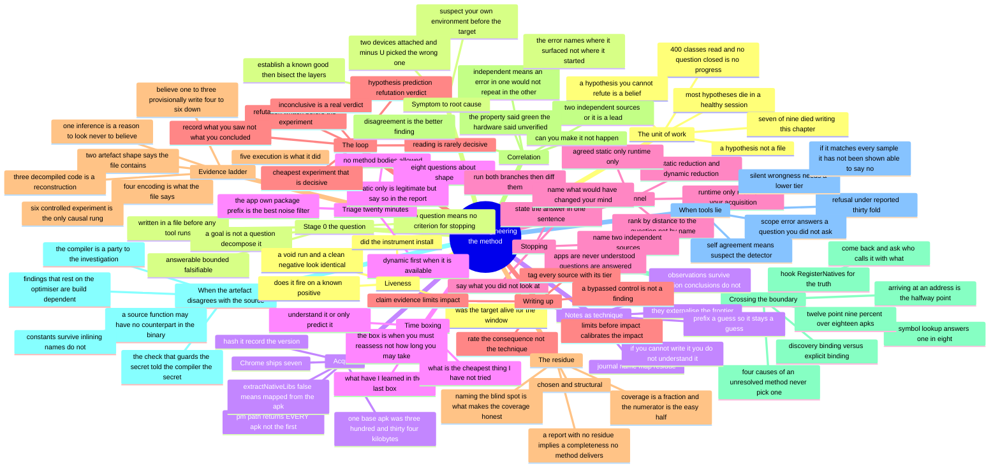

# 68 — Reverse Engineering · Mind Map

One picture of the whole chapter. Read it outward from the centre.

The single organising idea is that **reverse engineering is investigation, not translation**. A
translator is finished when every line has been converted; an investigator is finished when a
question is answered and the answer survives an attempt to break it. Every branch below is a
consequence of taking that distinction seriously, and the branches correspond to the README's
sections: the loop is §2.1 and §3, the ladder is §2.3, the crossing is §3.8, the tool failures are
§3.10, notes are §3.12, stopping is §3.15 and the residue is §3.17.

---

## The one-sentence version of each branch

| Branch | The sentence |
|---|---|
| **The unit of work** | Progress is questions closed, not files read — and in a healthy session most of your hypotheses die. |
| **Stage 0 the question** | Without a written, falsifiable question there is no criterion for what to do next or when to stop. |
| **Acquire** | Prove you have the program before analysing it; `pm path` returns every APK and Chrome ships seven. |
| **Triage** | Twenty timed minutes with no method bodies, because reading is how you spend the budget triage exists to allocate. |
| **The funnel** | Reduce from both ends and diff the results; the pile that is in the runtime and not the artefact means your acquisition is wrong. |
| **The loop** | Write the refutation before the experiment, then run the cheapest experiment that could produce it. |
| **Evidence ladder** | Every observation has a strength, only the controlled experiment is causal, and a finding must say which rung it stands on. |
| **Correlation** | One source is a lead; two independent sources are a finding; two that disagree are a better one. |
| **Crossing the boundary** | Symbol lookup answers about one native method in eight, so the crossing is a runtime question, and it is not finished until you come back to the managed side. |
| **When the artefact disagrees with the source** | The compiler inlines the function you are looking for and will publish a secret the source hid — twice, if the guard proves the value. |
| **When tools lie** | Four named failure modes, and the most dangerous is the one that produces clean confident output. |
| **Liveness** | Silence means nothing until the same instrument has been shown to speak. |
| **Symptom to root cause** | An error message names the layer where the failure surfaced, and your own environment is the likelier culprit. |
| **Notes as technique** | Notes externalise the frontier and record whether a name is a guess or a fact; skipping them changes your results, not just your paperwork. |
| **Time boxing** | The box is a forced reassessment, and the cheapest reassessment is asking whether you need to understand this or only predict it. |
| **Stopping** | Answer, two sources, what would have changed your mind, and what you did not look at. |
| **Writing up** | Claim, evidence with tiers, limits, impact — and writing the limits first is what keeps the impact honest. |
| **The residue** | Naming your blind spots is the only thing that stops a report implying coverage no method delivers. |

---

## Related chapters

- [51-DynamicAnalysis](../51-DynamicAnalysis/README.md) and
  [52-StaticAnalysis](../52-StaticAnalysis/README.md) — the two pipelines this chapter runs at once
  and then diffs.
- [56-JADX](../56-JADX/README.md) — decompilation as reconstruction, and the five checks before
  absence is evidence.
- [57-Ghidra](../57-Ghidra/README.md) — names this chapter a prerequisite; §3.6 is where its "you
  will read three functions" gets chosen.
- [40-Obfuscation](../40-Obfuscation/README.md) — its §6.1 is the obfuscation-specialised instance of
  §3 here.
- [67-BypassingProtections](../67-BypassingProtections/README.md) — owns when to stop *hooking*;
  this chapter owns when to stop *understanding*.
- [69-MalwareAnalysis](../69-MalwareAnalysis/README.md) and
  [70-VulnerabilityResearch](../70-VulnerabilityResearch/README.md) — what consumes this chapter's
  output.
