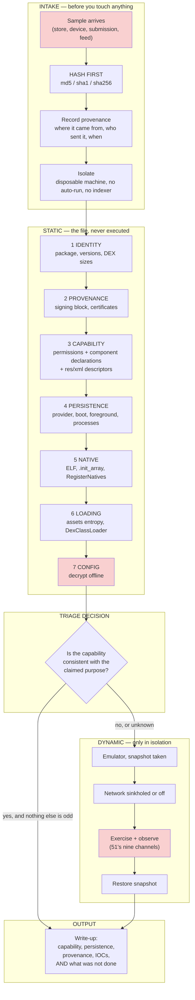
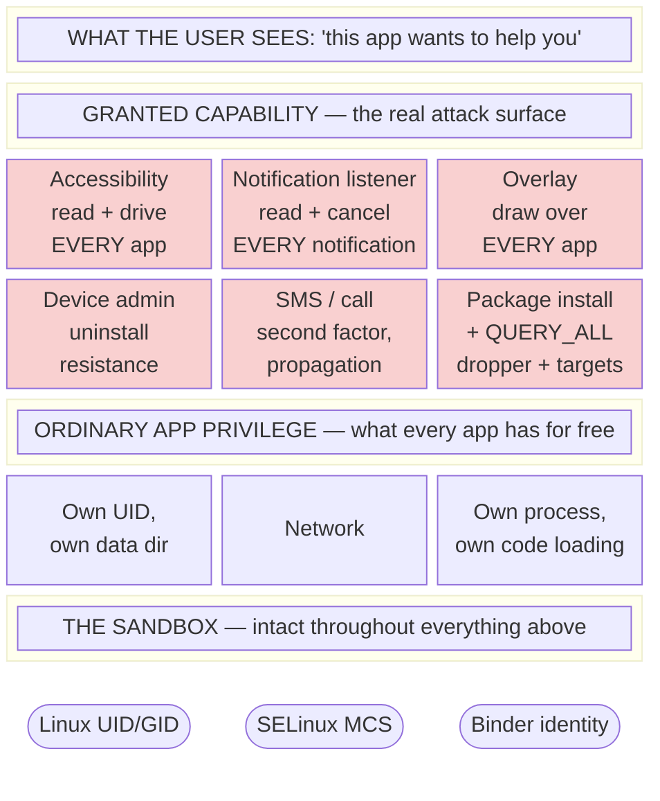
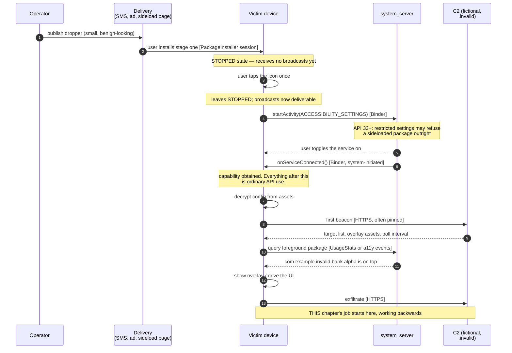
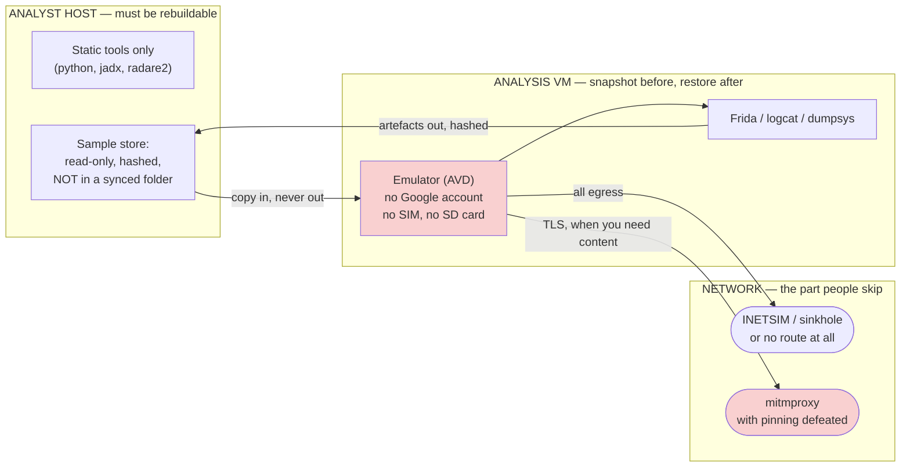
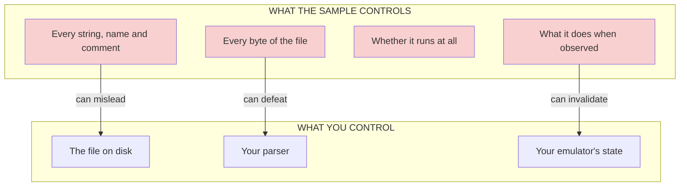
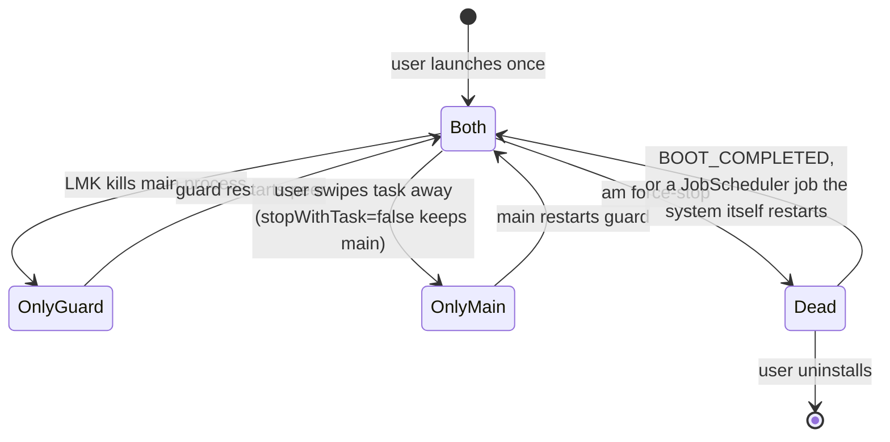
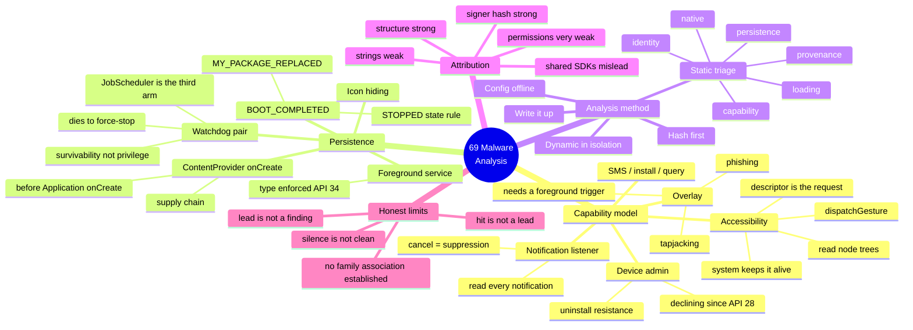

# 69 — Malware Analysis

> After this chapter you will be able to take an APK you have been handed, work
> out what it is capable of, how it survives, where it came from and how much of
> it you cannot see — and write that up as a defensible analysis that says what
> it does not know as plainly as what it does.

**Prerequisites:** [09-Android-App-Internals](../09-Android-App-Internals/README.md),
[10-APK-Internals](../10-APK-Internals/README.md),
[15-Native-Code](../15-Native-Code/README.md),
[21-App-Sandbox](../21-App-Sandbox/README.md),
[23-Permissions](../23-Permissions/README.md),
[32-Manifest](../32-Manifest/README.md),
[34-Cryptography](../34-Cryptography/README.md),
[40-Obfuscation](../40-Obfuscation/README.md),
[51-DynamicAnalysis](../51-DynamicAnalysis/README.md),
[52-StaticAnalysis](../52-StaticAnalysis/README.md)

**Applies to:** API 21 through API 35. Every version-dependent statement carries
a matrix.

**Measurement environment.** Everything measured for this chapter was measured
on a host machine — Windows 11, Python 3.13.3, Android SDK build-tools 35.0.1,
NDK 25.2.9519653, JDK 24 — against an APK this chapter builds from its own
sources. A physical device was attached (`i9000S`, Android 13 / API 33, arm64,
SELinux Enforcing, **not rooted, no frida-server**) and was used **only** to
confirm its own identity. **Nothing sample-shaped was installed on it, and the
chapter says so rather than quietly implying a runtime pass it did not do.**

---

> ## READ THIS FIRST — what this chapter is, and what it deliberately is not
>
> **This is a defensive analysis chapter.** It teaches you to take a suspicious
> APK apart and describe it. It does not teach you to build one, and it does
> not ship one.
>
> **Every artefact in this directory is inert, was written from scratch for
> this chapter, and carries no working capability.** The teaching sample in
> [`examples/inert-sample/`](examples/inert-sample/) has the *shape* of a
> persistent Android sample — provider persistence, a boot receiver, a
> two-process service pair, three declared granted-capability components, two
> encrypted config blobs, a native library with an `.init_array` entry — and
> the *function* of none of them. Every capability path terminates in a call to
> `Log.i()`. The removals are marked in the source by a constant named `INERT`
> which is `true`, `final`, and set to nothing else anywhere.
>
> **Every indicator is fictional and unresolvable.** All hostnames are under
> `.invalid`, which [RFC 2606](https://www.rfc-editor.org/rfc/rfc2606) reserves
> permanently so that no such name can be registered or resolved by anybody.
> All package names are under `com.example.invalid.*`. No real malware family
> is attributed here, no hash of a real sample is quoted, and no indicator of
> compromise is invented.
>
> **Where writing a section honestly would have required producing an offensive
> capability, this chapter writes the detection side instead and says why.**
> There is no working accessibility abuse primitive here, no overlay, no
> exfiltration routine, no C2 client and no evasion code. Section 3 describes
> those mechanisms precisely — you cannot detect what you cannot describe — and
> sections 7 and 8 implement the detection.
>
> **The reader's deliverable is a write-up, not a capability.** The chapter
> ends where a real engagement ends: at a document that another person can act
> on. [`examples/triage-writeup-inert-sample.md`](examples/triage-writeup-inert-sample.md)
> is the model.
>
> **Handling real samples is a separate discipline with its own rules**, and
> section 7.1 states them. The shortest version: a sample runs on a machine you
> can rebuild, on a network that goes nowhere, or it does not run.

---

## Table of Contents

1. [Introduction](#1-introduction)
2. [High-Level Architecture](#2-high-level-architecture)
3. [Deep Internal Working](#3-deep-internal-working)
4. [Source Code Walkthrough (AOSP)](#4-source-code-walkthrough-aosp)
5. [Security Perspective](#5-security-perspective)
6. [Reverse Engineering Perspective](#6-reverse-engineering-perspective)
7. [Dynamic Analysis](#7-dynamic-analysis)
8. [Static Analysis](#8-static-analysis)
9. [Examples](#9-examples)
10. [Common Interview Questions](#10-common-interview-questions)
11. [Common Mistakes](#11-common-mistakes)
12. [Hands-on Labs](#12-hands-on-labs)
13. [Summary](#13-summary)
14. [References](#14-references)

---

## 1. Introduction

### 1.1 The burglar who was handed the keys

Picture a house with an extremely good lock. The door is steel, the frame is
reinforced, the windows are laminated, and the alarm is monitored. A burglar
studying that house from the pavement has a hard problem.

Now picture the same house, and the same burglar, arriving at the front door
dressed as a home-help worker. They ring the bell. They explain, politely and
plausibly, that they are here to help — they can read the post aloud for
someone whose eyesight is failing, and they can press the buttons on the
microwave for someone whose hands shake. The householder thinks about it,
decides it sounds reasonable, and hands over a key.

Nothing about the lock has failed. The steel door is still steel. The alarm
still works. And the burglar is now inside, with permission, able to read
everything and touch everything, because that is exactly what the job they
described requires.

**That is Android malware.** Not, overwhelmingly, an attack on the sandbox —
an attack on the *user's decision about the sandbox*. The single most
important sentence in this chapter is this one:

> **Android malware works *around* the sandbox rather than *through* it.**

Chapter 21 spends thirteen thousand lines establishing that the sandbox is
real: separate UIDs, separate SELinux categories, separate data directories,
a kernel that enforces all of it. Chapter 22 shows the policy. Chapter 20 puts
it in context. And then, in the field, the malware that actually steals money
from actual people uses none of it. It asks the user for an accessibility
service, and the user says yes.

### 1.2 What problem existed before this discipline, and what breaks without it

**What existed before.** Desktop antivirus grew up in a world of file
infectors and exploit-driven worms, and its instincts came from there:
signature the bytes, watch for shellcode, detect the exploit. Ported directly
to Android, those instincts fail almost completely, because:

- There is usually **no exploit**. The code does nothing the platform forbids.
- **Byte signatures are cheap to break.** Repackaging, renaming and repacking
  an APK is a build step, and the same behaviour ships under ten thousand
  hashes.
- The **behaviour is indistinguishable from a legitimate app's** at the API
  level. An accessibility service reading a screen is a screen reader. A
  notification listener reading notifications is a smartwatch companion. The
  difference is intent, and intent is not an API.

So Android malware analysis had to become something else: a discipline of
**capability and provenance** rather than one of signatures and exploits. What
can this app do? How did it get here? What is it going to do with what it
asked for? Those are the questions, and answering them is what this chapter is
about.

**What breaks without this discipline.** Three things, and each of them is a
real failure mode you can see in published work:

1. **Over-reporting.** An analyst reads a permission list, sees `READ_SMS` and
   `SYSTEM_ALERT_WINDOW`, and writes "banking trojan". The app is a dual-SIM
   management utility. Chapter 52 measured the general form of this problem:
   **15 of 17 high-confidence static leads were rejected on inspection, 88%.**
   The malware version is worse, because the consequence of a false positive
   is somebody's app removed from a store and somebody's business closed.
2. **Under-reporting.** An analyst decompiles `classes.dex`, sees a hundred
   lines of nothing, and writes "no malicious functionality identified". The
   real code was in an asset, decrypted at runtime by a native library, and
   loaded through `InMemoryDexClassLoader` where it never touched disk.
3. **Wrong attribution.** An analyst sees a string that also appears in a
   published report about a named family and writes the family name into a
   document that someone else will cite. The string came from a shared
   advertising SDK. Section 3.15 is about exactly this, and it is the section
   most likely to save you from professional embarrassment.

### 1.3 A vocabulary, defined before it is used

The field's terms are used loosely in blog posts and precisely in reports. Use
them precisely.

> **Definition — Sample**
> One artefact under analysis, identified by its hash. Not "the malware", not
> "the family". A sample. When you say "the sample does X", you have made a
> claim about one file and you can be held to it.

> **Definition — Dropper**
> A sample whose purpose is to obtain the delivery of a *second* sample. It is
> usually small, usually benign-looking, and usually the only thing a store or
> a scanner ever sees. Its capability set is narrow and recognisable:
> `REQUEST_INSTALL_PACKAGES`, a launcher Activity, and often accessibility so
> that it can press "Install" on the user's behalf.

> **Definition — Stager / loader**
> The component that fetches, decrypts and executes the next stage. A dropper
> installs a *package*; a stager loads *code* into the current process, through
> `DexClassLoader`, `InMemoryDexClassLoader` or `dlopen`. The distinction
> matters because a dropper produces a second package on the device that you
> can find, and a stager does not.

> **Definition — Payload**
> The code that performs the actor's actual objective. It is frequently not in
> the file you were given.

> **Definition — C2 (command and control)**
> The channel by which the sample receives instructions. It is not always
> HTTP: push messaging (FCM), SMS, a Telegram bot API, a DNS tunnel and a
> hard-coded schedule with no channel at all are all in use.

> **Definition — Overlay**
> A window drawn on top of another app's window, using
> `TYPE_APPLICATION_OVERLAY` and the `SYSTEM_ALERT_WINDOW` special access. The
> classic use is to draw a fake login form on top of a real banking app.

> **Definition — Family**
> A set of samples an analyst believes share an origin — the same codebase,
> the same author, the same builder. It is a *judgement*, not a measurement,
> and section 3.15 explains why it is much harder than it looks.

> **Definition — Campaign**
> A set of deliveries of samples toward one objective in one period. A family
> can run many campaigns; a campaign can use several families.

> **Definition — IOC (indicator of compromise)**
> An observable that, if present, suggests this sample or its operator touched
> a system: a hash, a hostname, a certificate, a package name, a filesystem
> path. **An IOC is a claim about the past.** It never means "this is
> malicious"; it means "this was associated with that".

> **Definition — TTP (tactic, technique, procedure)**
> A description of *how* rather than *what*. "Uses accessibility to auto-grant
> its own runtime permissions" is a TTP. TTPs survive repackaging; IOCs do
> not. This is why MITRE ATT&CK for Mobile is organised around them and why a
> report full of TTPs ages better than one full of hashes.

> **Definition — Triage**
> The pass that decides what a sample *deserves*, not what it *is*. It ends in
> one of exactly three outcomes: close it, escalate it, or hand it to someone
> with a capability you do not have. Anything else is not a finished triage.

> **Definition — Defanging**
> Rewriting an indicator so that it cannot be accidentally activated:
> `https://evil.example` becomes `hxxps://evil[.]example`. It exists because
> reports get pasted into chat clients that auto-fetch links, and because a
> reader clicking an indicator out of curiosity has just contacted the
> operator from their corporate IP address.

### 1.4 What would break if malware could not be analysed

It is worth being concrete, because "we need malware analysis" is the sort of
statement that gets nodded at and not examined.

- **Detection would be purely reactive.** Play Protect, endpoint products and
  bank fraud systems all need to know what to look for. Somebody has to look
  at a sample and turn it into a rule. A rule written from a hash covers one
  file; a rule written from a TTP covers a technique.
- **Incident response would be guesswork.** When a customer's phone has
  drained an account, the question is not "is there malware" but "what did it
  have access to, for how long, and is it still there". Only analysis answers
  that, and the answer determines whether the bank resets one password or
  every credential the phone ever held.
- **Platform hardening would be unguided.** Restricted settings (API 33),
  background activity-start restrictions (API 29), foreground service types
  (API 34) and the package visibility rules (API 30) are all direct responses
  to observed abuse. Someone observed it.
- **Attribution and prosecution would be impossible.** Not the glamorous
  nation-state kind — the ordinary kind, where a signing key links forty
  samples to one operation and that link is what makes an investigation
  tractable.

### 1.5 Why this chapter exists separately from 51, 52, 40, 15 and 67

This is the chapter that has the most neighbours, so its boundary needs to be
stated crisply. **This chapter owns the discipline. It does not own the
methods.**

| What | Owned by | What 69 does with it |
|---|---|---|
| The static pipeline: acquire, unpack, decompile, enumerate, sweep, triage, validate, report | [52-StaticAnalysis](../52-StaticAnalysis/README.md) | Runs it, with the emphasis moved: stage 2 dominates, the blind-spot list becomes the analysis plan |
| The dynamic pipeline: prepare, baseline, instrument, exercise, observe, correlate, validate, report | [51-DynamicAnalysis](../51-DynamicAnalysis/README.md) | Runs it, with stage 1 inverted: the device must be *disposable* |
| Obfuscation, packers, string encryption, runtime DEX loading | [40-Obfuscation](../40-Obfuscation/README.md) | Meets all of it constantly; cites the unpacking method rather than restaging it |
| ELF, JNI, `.init_array`, native triage | [15-Native-Code](../15-Native-Code/README.md), [16-JNI](../16-JNI/README.md) | The discipline where this is not optional |
| Disassembly and decompilation of native code | [57-Ghidra](../57-Ghidra/README.md) | Hands over when the answer is in a `.so` |
| Root, tamper and emulator detection; defeating them | [37](../37-RootDetection/README.md), [38](../38-TamperDetection/README.md), [67](../67-BypassingProtections/README.md) | **Characterises** anti-analysis rather than merely defeating it — which checks a sample performs is a classification signal |
| The sandbox and the permission model | [21-App-Sandbox](../21-App-Sandbox/README.md), [23-Permissions](../23-Permissions/README.md) | What malware does with *granted* capability |
| Manifest audit | [32-Manifest](../32-Manifest/README.md) | Cites `manifest-audit.py`; does not restage it |
| Container attacks | [10-APK-Internals](../10-APK-Internals/README.md) | Cites `apk-container-triage.py`; does not restage it |
| Crypto primitives | [34-Cryptography](../34-Cryptography/README.md) | Cryptography as the *attacker's* tool |
| Pinning | [36-CertificatePinning](../36-CertificatePinning/README.md) | Pinning as the *attacker's* tool — a C2 channel you have to open |
| Report templates and severity rubric | [80-Appendix](../80-Appendix/README.md) | Produces the evidence; 80 formats it |

> **Warning — if you are here to learn a tool, you are in the wrong chapter.**
> There is no Frida tutorial here, no jadx tutorial, no Ghidra tutorial. There
> are two scripts, both written for this chapter, both of which exist because
> no other chapter's tool answers the *malware* questions: what can it do, how
> does it survive, where did it come from.

### 1.6 The one idea, stated once

Everything below follows from a single observation, so it is worth isolating.

> **Mental Model**
> On a desktop, the interesting question is usually **"how did the attacker get
> code execution?"**
>
> On Android, the attacker *starts* with code execution. Installing an app
> gives you code execution by definition. The interesting question is
> therefore **"what capability did the code execution get, and who gave it?"**
>
> Every section of this chapter is an elaboration of that swap.

The consequence for tooling is direct and it is why
[`scripts/apk-triage.py`](scripts/apk-triage.py) is organised the way it is:
its six sections are **identity, provenance, capability, persistence, native,
loading** — not "vulnerabilities". There is no vulnerability. There is an
application that asked for a great deal and was given it.

---

## 2. High-Level Architecture

### 2.1 The triage pipeline



**What you are looking at.** Three things in this diagram are deliberate and
worth naming.

**First, `HASH FIRST` is the entry point and it is not decoration.** The hash
is the only identifier in the whole process that nobody can forge, and it is
the key you use to ask the rest of the world whether this file is already
known. Hashing before you do anything else also means that if you later
accidentally modify the file — and analysts do, constantly, by unzipping in
place or letting a tool rewrite it — you can tell.

**Second, there is no arrow from STATIC straight to OUTPUT that skips the
triage decision.** Chapter 52 makes the same point about its own pipeline and
calls the missing arrow the most important line in the chapter. The malware
version is the same: a list of signals is not a conclusion. Somebody has to
decide whether the capability is consistent with what the app claims to be,
and that decision is a human act that requires knowing what the app claims to
be.

**Third, DYNAMIC is enclosed by isolation on both sides.** `Y1` takes a
snapshot and `Y4` restores it. That is not a nicety. Chapter 51's stage 1
"inverts" for malware: for a pentest the device should be *representative*, and
for malware analysis it should be *disposable*. Those are different
requirements and they cannot both be satisfied by your phone.

### 2.2 The capability stack — what an installed app can actually reach



**What you are looking at.** The bottom row is the kernel-enforced sandbox: a
per-app UID, an SELinux MCS category pair, and Binder's unforgeable caller
identity. Chapter 25 demonstrated the last of those rather than arguing it —
writing a chosen UID into `sender_euid` and sending the transaction anyway
produced the same rejection three times, because the kernel overwrites the
field.

**None of the red boxes touch that bottom row.** Not one of the six granted
capabilities is a sandbox bypass. Accessibility does not escape the sandbox;
it is a service the *system* runs on the app's behalf, and the system is
allowed to read every window because the system owns every window. Overlay
does not escape the sandbox; `WindowManager` draws the window, in the system's
compositor, because the app asked and the user agreed.

**That is the whole thesis in one picture.** The security architecture is not
bypassed. It is used, exactly as designed, by an application the user
installed and trusted.

### 2.3 The lifecycle of a mobile malware campaign



**What you are looking at.** Read the arrow numbering: **the only step that
involves anything unusual is step 7, the user toggling a switch.** Every other
arrow is an ordinary, documented Android API call that thousands of legitimate
apps make.

Two details in this diagram are the ones analysts most often miss.

**Steps 3 and 4 — the STOPPED state.** An app installed and never launched
receives no broadcasts at all, including `BOOT_COMPLETED`. This is why
essentially every real dropper ships a launcher Activity even when it has
nothing to show. A launcher Activity with an empty layout is a *signal*, not an
oversight.

**The note over step 6 — restricted settings.** From API 33, a package that
was not installed through a session-based installer is blocked in the Settings
UI from being granted accessibility or notification access until the user
explicitly chooses "Allow restricted settings" in App info. This is the single
most effective mitigation the platform has shipped against this whole class,
and it is why droppers moved to `PackageInstaller` sessions.

### 2.4 The analysis environment — what "isolation" means concretely



**What you are looking at.** Four rules that this diagram encodes and that are
worth stating as sentences, because a diagram is easy to nod at.

1. **The sample store is not in a synced folder.** Dropbox, OneDrive and
   Google Drive will happily upload a malware sample to a corporate account
   and get somebody suspended. This has happened to more analysts than will
   admit it.
2. **The VM has no account and no SIM.** An account means the sample can reach
   a real contact list, a real mail store and a real cloud backup. A SIM means
   it can send premium-rate SMS that somebody pays for.
3. **All egress goes somewhere you control.** Either nowhere at all, or an
   `INETSIM`-style sinkhole that answers everything. Letting a sample reach a
   live C2 from your address tells the operator that they are being analysed,
   from where, and when.
4. **Artefacts come out hashed.** A file that came out of the analysis VM is
   itself a sample until proven otherwise.

### 2.5 The trust boundary you are standing on



**What you are looking at.** This is the diagram that separates malware
analysis from application security testing, and it is the reason the tone of
this chapter is more careful than chapter 52's.

When you test a client's app, the app is not trying to deceive you. It has
bugs; it does not have intent. A malware sample **does** have intent, and one
of its intentions is to be misunderstood.

The consequences are concrete:

- **Your parser is attacker-controlled input.** Chapter 10 builds a manifest
  that a naive AXML parser reads differently from the platform, by widening
  `attributeSize`. `apk-triage.py` honours the declared stride specifically
  because of that lab, and says so in a comment at the parser.
- **A sample that does nothing may have detected you.** Chapter 51's most
  valuable result was a session where all nine channels went silent and the
  report looked exactly like a well-behaved app. For malware, silence has an
  extra possible cause: it looked at your environment and declined.
- **Names and comments are marketing.** A class called `SecurityManager` means
  nothing. A comment in Russian means nothing about who wrote it. Strings are
  evidence about the *file*, not about the *author*.

---

## 3. Deep Internal Working

This is the longest section. It works through the capability model first,
because that is what the whole discipline is organised around, then
persistence, then the supporting mechanisms — loading, crypto, C2, native,
anti-analysis — and finally attribution and triage discipline.

### 3.1 The Android malware capability model

**What it is.** A structured answer to the question *"what could this
application do if every request it makes were granted?"* Not what it does —
what it *could* do. That is the right question for triage because it is
answerable from the file, and because on Android the gap between "requested"
and "used" is where all the interesting judgement lives.

**Why it replaces a vulnerability model.** A vulnerability model asks "where
is the flaw". For the overwhelming majority of Android malware there is no
flaw. The application is well-formed, the platform behaves correctly, the
sandbox holds, and the user's data leaves anyway. A capability model asks the
question that has an answer.

**The model, as a table.** This is the core reference of the chapter, and
[`cheatsheet.md`](cheatsheet.md) carries a condensed version.

| Capability | Obtained by | What it enables | Platform friction | Weight alone |
|---|---|---|---|---|
| **Accessibility** | User toggle in Settings, after the app declares a service with `BIND_ACCESSIBILITY_SERVICE` | Read the node tree of every window in every app; synthesise taps, swipes and global actions; be restarted by the system | Warning dialog (API 26+); Play policy (API 30+); **restricted settings for sideloads (API 33+)** | **Very high** |
| **Notification access** | User toggle, after declaring `BIND_NOTIFICATION_LISTENER_SERVICE` | Read every notification's title, text, actions and extras from every app; cancel any notification | Restricted settings (API 33+); redaction on some API 34+ builds | **Very high** |
| **Overlay** | `SYSTEM_ALERT_WINDOW` special access, granted in a Settings screen | Draw a window on top of any other app; tapjacking; credential phishing | Special-access screen since API 23; obscured-touch filtering on sensitive screens; API 31+ restrictions | **High** |
| **Device admin** | User activates a `DeviceAdminReceiver` | Uninstall resistance; lock; (historically) wipe and password reset | Most policies deprecated API 28–29; DO/PO needs provisioning a sideload cannot reach | **Medium and falling** |
| **SMS** | Runtime permissions `RECEIVE_SMS` / `READ_SMS` | Second-factor interception; propagation | Runtime prompt; Play's SMS/Call Log policy; default-SMS-app restrictions since API 19 | **High** |
| **Package install** | `REQUEST_INSTALL_PACKAGES` plus a per-app "install unknown apps" toggle | Deliver stage two | Per-source toggle since API 26 | **High** |
| **Package visibility** | `QUERY_ALL_PACKAGES` | See what is installed — target selection, security-product detection | Play policy restricts it; irrelevant to a sideload | **Medium** |
| **Usage stats** | `PACKAGE_USAGE_STATS` special access | Know which app is in the foreground — the overlay trigger | Special-access screen | **Medium** |
| **Battery exemption** | `REQUEST_IGNORE_BATTERY_OPTIMIZATIONS` | Survive Doze and App Standby | Prompt; Play policy | **Medium** |
| **Boot** | `RECEIVE_BOOT_COMPLETED` | Restart after reboot | None — it is a normal permission | **Low alone** |
| **Foreground service** | `FOREGROUND_SERVICE` (+ typed permission API 34+) | Escape background execution limits | Must post a notification; type enforced from API 34 | **Low alone** |
| **Network** | `INTERNET` | Everything | None | **None alone** |

> **Pentester's Note**
> The right-hand column is the one that stops a report being noise, and it is
> the column most tools omit. `RECEIVE_BOOT_COMPLETED` appears in a very large
> fraction of all Android apps ever written. Reporting it as an indicator
> produces a document nobody reads to the end. Report the **combination**, and
> report the **inconsistency with the claimed purpose**, which is the actual
> signal.

**The combination rule, stated precisely.** Individually these are all
legitimate. What is not legitimate is a *coherent set aimed at one outcome*.
Three sets worth memorising:

| Set | What it is aimed at |
|---|---|
| Accessibility + overlay + `PACKAGE_USAGE_STATS` + `QUERY_ALL_PACKAGES` | Device-takeover fraud: know what is on screen, draw over it, drive it |
| Notification access + `RECEIVE_SMS` + `READ_SMS` | Second-factor interception, with suppression |
| `REQUEST_INSTALL_PACKAGES` + accessibility + a launcher Activity with no UI | A dropper that installs and grants stage two by itself |

### 3.2 Accessibility — the master capability

**What it is.** `AccessibilityService` is a service in *your* app that the
*system* binds and drives. It exists so that a person who cannot see or cannot
touch accurately can still use the device, and to do that job the framework
must be able to describe and manipulate every window on the screen.

**How it works internally.** The chain is worth knowing precisely because it
explains why the capability is so complete.

1. The app declares a `<service>` with
   `android:permission="android.permission.BIND_ACCESSIBILITY_SERVICE"`. That
   permission is *signature*-level and is held by the **system**, not by the
   app. The declaration means "only the system may bind me".
2. The declaration carries `<meta-data android:name="android.accessibilityservice">`
   pointing at an XML resource. **That XML is the actual request.** Section
   3.2.1 below.
3. The user enables the service in Settings.
   `AccessibilityManagerService` — part of `system_server` — binds it.
4. From then on, `AccessibilityManagerService` pushes
   `AccessibilityEvent` objects to the service over Binder, and the service can
   call back to fetch `AccessibilityNodeInfo` trees and to dispatch actions.

The critical structural point: **the app never reads another app's memory and
never crosses a UID boundary.** `system_server` reads the window content — it
is allowed to, it owns the window manager — and hands a description across
Binder to the accessibility service. The sandbox is not violated at any step.

#### 3.2.1 The descriptor is the request

The manifest tells you a service exists. The XML resource tells you what it
wants. Four attributes carry nearly all of the signal:

| Attribute | Meaning | Triage reading |
|---|---|---|
| `android:canRetrieveWindowContent` | May fetch `AccessibilityNodeInfo` trees | **This is the one that crosses the app boundary.** Without it the service sees that a window changed, not what it says |
| `android:canPerformGestures` | May call `dispatchGesture()` (API 24+) | Synthesised taps and swipes at arbitrary coordinates |
| `android:accessibilityEventTypes` | Which events to receive | `typeAllMask` (`0xffffffff`) means "everything". A purpose-built tool names two or three |
| `android:packageNames` | Which packages to serve | **Its ABSENCE is the strongest single signal.** Absent means every app on the device |

Additional flags worth reading:

| Flag | Meaning |
|---|---|
| `flagReportViewIds` | Events carry the resource id of each view — lets a sample match on `com.bank/id/password` rather than on a label that changes with locale |
| `flagRetrieveInteractiveWindows` | Access to all interactive windows, not only the focused one |
| `flagIncludeNotImportantViews` | Views marked `importantForAccessibility="no"` are still delivered |
| `flagRequestFilterKeyEvents` | Key events are delivered to the service |

> **Warning — a measured trap, found while writing this chapter.**
> `aapt2` **split the sample's single accessibility descriptor into two
> resource variants**, because `canPerformGestures` was added at API 22:
>
> ```text
> res/xml/accessibility_config.xml       canRetrieveWindowContent=true
> res/xml-v22/accessibility_config.xml   canRetrieveWindowContent=true
>                                        canPerformGestures=true
> ```
>
> A tool that reads only `res/xml/` **under-reports the capability**, because
> the variant a modern device actually loads is the `-v22` one. This was not
> planned; it appeared the first time `apk-triage.py` walked `res/xml*` and
> printed two descriptors where the source has one file. The same applies to
> `-v21`, `-v24`, `-v31` and every other qualifier. `apk-triage.py` enumerates
> all of them and prints each separately, rather than merging, so the
> discrepancy is visible.

#### 3.2.2 What the capability is used for

Described generically. This repository does not attribute samples it has not
analysed, and does not print indicators it has not verified.

| Use | Mechanism | Detection |
|---|---|---|
| Credential harvesting | Read node text on a login screen | `getSource()`, `findAccessibilityNodeInfosByViewId`, string constants naming bank package ids |
| One-time-code theft | Read the code from an event or a notification | Combination with notification access |
| Auto-granting own permissions | Find the "Allow" button in the system permission dialog and `performAction(ACTION_CLICK)` | String constants naming `com.android.permissioncontroller`, `com.android.packageinstaller` |
| Uninstall prevention | Watch for `com.android.settings` app-info screen, `performGlobalAction(GLOBAL_ACTION_BACK)` | String constants naming `com.android.settings` |
| Transaction automation | Drive a legitimate, already-authenticated banking app | Hardest to detect statically; server-side behavioural analytics is the real control |

> **Mental Model**
> Accessibility is not "a permission that reads the screen". It is **a
> general-purpose remote control for the device, operated by code the user
> installed**. Once you internalise that, every design decision the platform
> has made since API 26 makes sense, and so does every mitigation's
> limitation: they all reduce to *making a human read a dialog carefully*.

#### 3.2.3 Restricted settings — the mitigation that actually worked

From **API 33**, the Settings UI refuses to expose the accessibility and
notification-access toggles for a package whose install did not use the
session-based `PackageInstaller` API. The user sees a dialog explaining that
restricted settings are unavailable, and must go to App info, open the
overflow menu, and choose "Allow restricted settings" before the toggle
becomes usable.

Two consequences for analysis:

1. **A modern dropper uses `PackageInstaller` sessions, not
   `ACTION_VIEW` on an APK file.** Seeing `android.content.pm.PackageInstaller`
   in a dropper's string pool is a sign the author is current.
2. **The mitigation is a UX speed bump, not a boundary.** A user who is being
   talked through the process by a "support agent" on the phone will complete
   it. Say that in a report rather than "API 33 prevents this".

### 3.3 Overlays

**What it is.** A window drawn on top of other applications, using window type
`TYPE_APPLICATION_OVERLAY` (API 26+; the older `TYPE_SYSTEM_ALERT` and
`TYPE_PHONE` were removed for third-party apps at the same release).

**Why it exists.** Chat heads, screen recorders, blue-light filters,
accessibility magnifiers and password-manager prompts all need it.

**How it is obtained.** `SYSTEM_ALERT_WINDOW` is not an ordinary runtime
permission. It is *special access*: the app fires
`Settings.ACTION_MANAGE_OVERLAY_PERMISSION` and the user grants it in a
Settings screen. Since API 23 that is the only path — and this is where
accessibility and overlay combine, because an app that *already* has
accessibility can drive that Settings screen itself.

**What it enables, in two distinct attacks that are often conflated:**

| Attack | Mechanism | What it steals |
|---|---|---|
| **Overlay phishing** | Draw a full-screen fake login on top of the real bank app when it comes to the foreground | Credentials typed into the *attacker's* window |
| **Tapjacking** | Draw a mostly-transparent window over a *system* dialog; the user aims at your bait and the tap lands on the dialog underneath | A tap the user did not intend to give — historically used to accept permission grants |

**The trigger problem, and why `PACKAGE_USAGE_STATS` appears.** An overlay is
useless unless it appears at the right moment. The sample must know which app
is in the foreground. Three ways, in order of how modern they are:

1. `getRunningTasks()` — dead. Deprecated at API 21 and now returns only the
   caller's own tasks. A sample that still uses it is old or copied.
2. `UsageStatsManager` with `PACKAGE_USAGE_STATS` special access — works, and
   is the reason that special access shows up in overlay-capable samples.
3. **Accessibility events** — `TYPE_WINDOW_STATE_CHANGED` carries the package
   name. Free, if you already have accessibility. This is why the two
   capabilities cluster.

**Platform friction, honestly.** `FLAG_WINDOW_IS_OBSCURED` and
`filterTouchesWhenObscured` let an app refuse touches delivered through an
overlay, and the system permission dialogs use it. `HIDE_OVERLAY_WINDOWS`
(API 31) lets an app hide non-system overlays over its own windows. Both are
**opt-in by the victim app**, which means their coverage in the field is
partial. Do not write "Android prevents overlay attacks".

### 3.4 Notification access

**What it is.** `NotificationListenerService`, bound by the system after a
per-app toggle in Settings, receives `onNotificationPosted()` for every
notification posted by every app, and can cancel any of them.

**Why it is under-rated.** For one very common fraud, it is *sufficient on its
own*:

- The bank sends a one-time code by SMS or push.
- The listener reads it out of the notification — **without holding any SMS
  permission at all**, which defeats detection rules built around SMS
  permissions.
- The listener cancels the notification, so the user never sees the code
  arrive and has no cue that a transaction is running.

**What the analyst looks for.** The declaration, and then two specific calls:

| Static signal | Meaning |
|---|---|
| `<service android:permission="…BIND_NOTIFICATION_LISTENER_SERVICE">` | The declaration |
| `onNotificationPosted` override | Reads notifications |
| `cancelNotification` / `cancelAllNotifications` | **Suppresses** them — this is the line that turns "reads" into "hides", and it belongs in the report |
| `ACTION_NOTIFICATION_LISTENER_SETTINGS` string | Drives the user to the toggle |

### 3.5 Device admin and uninstall resistance

**What it is.** The API an MDM product uses to enforce policy. A
`DeviceAdminReceiver`, activated by the user, becomes an *active admin*.

**The property that mattered.** An active admin **cannot be uninstalled**.
`pm uninstall` refuses and the Settings button is greyed out, because the
platform will not let a policy enforcer be removed while its policy is
supposed to apply. To remove it the user must deactivate the admin first.

> **Warning — the counter-intuitive part, and the one reports get wrong.**
> **Uninstall resistance comes from being an active admin *at all*, not from
> any policy it requested.** An admin whose `<uses-policies>` element is empty
> — like the one in this chapter's inert sample — still resists uninstall.
> So "requests no policies, therefore harmless" is wrong, and so is treating
> the policy list as a proxy for severity. Read the policy list to know what
> *else* it can do, not to know whether it persists.

**Why it is a declining signal.** This is a genuine platform success story and
it should be stated as one:

| API | Change | Effect on this technique |
|---|---|---|
| 24 | Settings filters obscured touches on the deactivation screen | Overlay-based deactivation blocking is harder |
| 26 | Several policies deprecated for non-DO/PO admins | Less capability per activation |
| 28–29 | Most legacy device-admin policies deprecated or ignored for ordinary admins | The API remains callable and does much less |
| 29+ | Device owner and profile owner require provisioning a sideload cannot reach (NFC bump, QR at setup, `dpm set-device-owner` on an account-free device) | The powerful modes are out of reach of social engineering |
| 33 | Restricted settings | Harder for a sideload to reach the toggles at all |

**Consequence for triage.** `BIND_DEVICE_ADMIN` in a sample from the mid-2010s
is a strong indicator. In a modern sample it is often legacy code the author
never removed, or a genuine MDM agent. Weight it **medium and falling**, and
read the policy XML before saying anything.

### 3.6 Persistence hook 1 — the ContentProvider

**This is the persistence mechanism this chapter owns**, and the repository
names it three separate times as belonging here.

**What it is.** A `<provider>` declared in the manifest is instantiated, and
its `onCreate()` called, during process startup — **before**
`Application.onCreate()`.

**Why that ordering exists.** Providers must be publishable before anything
can query them, and the framework must be able to answer a
`ContentResolver.query()` that *caused* the process to start. So
`ActivityThread.handleBindApplication()` installs providers before it hands
control to the application.

**The measured ordering.** Chapter 09 did not assert this; it measured it
twice. From its §9.2 logcat capture:

```text
09-04 11:20:31.101 I/StartupOrder: APPLICATION attachBaseContext
09-04 11:20:31.118 I/StartupOrder: PROVIDER onCreate  uid=10234 pid=4821
09-04 11:20:31.141 I/StartupOrder: APPLICATION onCreate  <-- providers already ran
```

`attachBaseContext` to provider `onCreate` is **17 ms**; provider `onCreate` to
`Application.onCreate` is **23 ms**. And from its §7.3 Frida trace, showing
what that gap contains in a real app with a few SDKs: two third-party
providers, one `System.loadLibrary` and ninety milliseconds of vendor code, all
before the app's own `Application.onCreate()`.

**Why malware wants it.** Six consequences, and each one is independently
useful:

| Consequence | Why it matters to a sample |
|---|---|
| Runs before the app's own code | Any "initialise security first" logic in `Application.onCreate()` is already too late |
| Runs in every process | Including `:worker` processes the developer never thought about |
| Runs with no UI | A provider query, a broadcast or a job is enough to start the process |
| Invisible in the app's own source | It comes from the *merged* manifest, not from `src/main` |
| Inherits the host's UID and permissions | A hostile SDK runs as the host, with the host's grants |
| Survives an app update | It is part of the dependency, not the app's own code |

**The supply-chain framing.** Chapter 09 puts it exactly right and it is worth
quoting: adding a dependency to `build.gradle` is equivalent to granting that
dependency arbitrary code execution at process start. `androidx.startup` is
this mechanism used deliberately and benignly. A hostile SDK is the same
mechanism.

**What it looks like in triage.** A provider used purely as an execution hook
has a recognisable shape, and it is the shape of this chapter's
[`BootstrapProvider.java`](examples/inert-sample/BootstrapProvider.java):

- `android:exported="false"` — it is not for anyone else
- no `android:grantUriPermissions`, no `<path-permission>`
- `query()`, `insert()`, `update()`, `delete()` and `getType()` all return
  `null` or `0`
- `onCreate()` is the only method with a body

`initOrder` orders providers **relative to each other only**. It cannot move a
provider after the `Application`. A high `initOrder` in a sample means "before
the *other* providers", which is a competitive signal in a supply-chain context
and nothing more.

> **Under the Hood — the ANR that names the wrong app.**
> `installContentProviders()` is subject to a **10-second provider-publish
> timeout**. A provider whose `onCreate()` blocks — for example one that makes
> a synchronous network call because a well-meaning SDK "initialises" itself
> there — can ANR the app **before the app has any UI**, and the resulting
> crash report names the host app, not the SDK. For an analyst, an ANR trace
> in `/data/anr/` naming a provider you do not recognise is a lead.

### 3.7 Persistence hook 2 — broadcasts

**`BOOT_COMPLETED`.** The oldest mechanism and still the most common. Four
things about it that an analyst must get right:

1. **It is a protected broadcast.** Only the system can send it. Chapter 29
   measured that root can send it and shell (uid 2000) cannot, so triggering a
   boot receiver in a sandbox means rebooting the emulator or using root — not
   `am broadcast` as shell.
2. **A STOPPED app receives nothing.** Since API 26 (and in weaker form much
   earlier), an app that has never been launched gets no broadcasts at all.
   The way out is one user tap on an icon. **This is why droppers have
   launcher Activities.**
3. **`MY_PACKAGE_REPLACED`** fires only for the app's own package, after it is
   upgraded. It is how a component re-arms after its own update, and it is far
   less watched than `BOOT_COMPLETED`.
4. **`QUICKBOOT_POWERON` is not AOSP.** Several OEMs send it instead of, or in
   addition to, `BOOT_COMPLETED`. An app filtering for it is targeting those
   OEMs — a weak geographic and vendor signal that many benign SDKs also carry
   because it was copied from a forum answer.

**What is invisible here, quantified.** Chapter 29 parsed the live
registration table in `ActivityManagerService` and subtracted
`cmd package query-receivers`: **299 of 431 distinct actions (69%) registered
by third-party processes had zero manifest-declared receivers anywhere on the
device.** Chapter 51 re-measured on a different device at a different API level
and got **214 of 321 (67%)**. Two measurements, an OS version apart, agreeing.

**The consequence for malware analysis is severe:** a manifest-based reading of
a sample's broadcast surface misses most of it, because `registerReceiver()` is
code, not manifest. `apk-triage.py` reports what the manifest declares and says
explicitly that this is not the whole surface.

### 3.8 Persistence hook 3 — services, watchdogs and the platform's counter-moves

**The foreground service.** Since API 26 a background app cannot start a
background service. A *foreground* service is exempt, at the cost of posting a
notification. Samples minimise that cost:

- `IMPORTANCE_MIN` or `IMPORTANCE_NONE` on the channel
- `setShowBadge(false)`
- a generic title borrowed from a system string
- on API 31+, deferred notification behaviour so it does not appear for the
  first ten seconds
- since API 33 `POST_NOTIFICATIONS` is a runtime permission — and note
  carefully: **a foreground service whose notification the user denied still
  runs.** The notification is suppressed, not the service.

**Foreground service types.** From API 34 the declared
`android:foregroundServiceType` is enforced: the service must hold the matching
permission and must actually be doing that kind of work. This makes the
declared type a **claim the sample is making about itself**, and comparing the
claim with the code is a cheap, high-value check. `dataSync`, `specialUse` and
`shortService` are the types most often claimed dishonestly, because they are
the vaguest.

**The watchdog pair.** Two components in two processes, each holding a
reference to the other, at least one of them foreground.



**What you are looking at.** The pair defeats *casual* termination — the
task-manager swipe, the low-memory killer reclaiming one process, a battery
optimiser. It does **not** defeat `am force-stop`, which kills every process of
the package atomically, cancels its alarms and jobs, and returns the package to
the STOPPED state. Note the `Dead --> Both` transition: the arm that actually
matters is usually a **JobScheduler job**, because the system itself restarts
those after a reboot, and because `dumpsys jobscheduler` is where analysts
forget to look.

> **Warning — what a second process does NOT buy.**
> A second process has the **same UID, the same SELinux label, the same data
> directory and the same granted permissions**. It is not a sandbox escape and
> it is not a privilege escalation. Writing "the sample spawns a second process
> to escalate privileges" in a report is wrong and a reviewer will catch it.
> Write "the sample runs a second process so that a single kill does not stop
> it", which is true and is the actual finding.

**Detecting a pair statically.** Three signals, and any two together are
conclusive:

1. `android:process=":name"` on a component. A benign app has zero or one such
   component — usually a crash reporter or a media service.
2. A class in process A whose only reference to process B is a component name,
   with no data flowing between them. *A supervisor references its supervisee
   and asks it nothing.*
3. `android:stopWithTask="false"` on both halves. Legitimate on a music
   player; not on a utility app with no long-running user-visible work.

**Detecting it dynamically, on an emulator.** The three-way kill test:

```bash
# emulator only
adb shell ps -A | grep <pkg>              # note both pids
adb shell kill <pid-A>                    # does it come back?
adb shell kill <pid-B>                    # does it come back?
adb shell am force-stop <pkg>             # both should die
adb shell dumpsys jobscheduler | grep -A 20 <pkg>   # if it survives, look here
```

**The trend line, stated honestly.** Every release since API 26 has made the
naive watchdog worse, and every release has made **accessibility relatively
more attractive** — because an enabled accessibility service is a bound
service that the system itself keeps alive and restarts. The platform did not
eliminate persistence; it concentrated it into the one mechanism that a user
explicitly authorised.

### 3.9 Hiding: the icon, the recents entry, and the label

Four techniques, all documented API use:

| Technique | Mechanism | Detection |
|---|---|---|
| Disable the launcher icon | An `<activity-alias>` carrying the `LAUNCHER` filter, disabled at runtime with `setComponentEnabledSetting(…, COMPONENT_ENABLED_STATE_DISABLED, DONT_KILL_APP)` | `<activity-alias>` in the manifest plus `setComponentEnabledSetting` in the DEX; on a device, `cmd package resolve-activity --brief <pkg>` returns nothing and `dumpsys package <pkg>` lists it under disabled components |
| Never appear in recents | `android:excludeFromRecents="true"` | Manifest attribute |
| Impersonate a system app | Label and icon copied from a plausible system component ("System Update", "Play Services") | Compare the label with the package name; a package under `com.random.abc` labelled "Google Play Services" is the finding |
| No launcher entry at all | No `LAUNCHER` intent-filter | Then ask how it leaves the STOPPED state — usually it does not need to, because it was started by whatever installed it |

### 3.10 Configuration and payload encryption — cryptography as the attacker's tool

Chapter 34 teaches cryptography as a defence. Here it is the attacker's tool,
and the interesting thing is that **it is always a weak one**, for a structural
reason the attacker cannot escape.

> **Mental Model**
> The sample must decrypt its own config **on a device you control, with
> nothing but what is in the file**. There is no user to type a passphrase and
> no server to ask before the first connection. So the key, or everything
> needed to derive it, ships in the artefact. **That is not a mistake the
> author made; it is a constraint they cannot get out of.** Config encryption
> buys hours, not security.

**The four shapes, in descending order of how often you meet them:**

| Shape | Form | How you break it | Cost |
|---|---|---|---|
| **A. Repeating-key XOR** | Key as a string literal, or built from a char array so no literal exists | Recover it from the ciphertext alone by frequency analysis, or crib-drag a known plaintext prefix | Milliseconds |
| **B. AES with an embedded key** | A 16/24/32-character ASCII string passed straight to `SecretKeySpec`; CBC with a prefixed IV, or ECB | Harvest key-shaped strings from the DEX pool and try them all | Seconds |
| **C. AES with a derived key** | Key derived at runtime from the package name, the signing certificate hash, `ANDROID_ID` or a build property | **Read the derivation.** No amount of string harvesting helps. Also makes the sample fragile: a repackaged copy cannot decrypt its own config | Minutes to hours |
| **D. Key fetched from the network** | Config encrypted at rest, key delivered on first contact | The only shape that genuinely defeats offline analysis — and it is rare, because it makes the sample useless whenever the server is down | Often unrecoverable offline |

**Shape A is worth dwelling on, because analysts assume it is hard.** Repeating-key
XOR is a Vigenère cipher, and the textbook break applies unchanged:

1. Guess a key length *k*.
2. Split the ciphertext into *k* columns — bytes 0, *k*, 2*k*, … are column 0.
   Every byte in a column was XORed with the *same* key byte, so each column is
   a single-byte XOR problem.
3. Solve each column by trying all 256 values and keeping the one that
   produces the most plausible characters.
4. Reassemble, decrypt, score. Repeat for every *k*, preferring the shortest
   length that scores near the top — every multiple of the true length also
   decrypts correctly and would otherwise tie.

[`scripts/config-decrypt.py`](scripts/config-decrypt.py) implements exactly
that. Run against this chapter's inert sample it recovers **twelve of the
fourteen key bytes with no key material at all**:

```text
key      : statistically recovered len=14 'ch69/inert-xop'
score    : 0.61   (printable=1.00 json_markers=2)

{
   campaign : "CJ69-INERT/DEMO ,
  "kiln_swivch": "NO/OP: vhis builf convains no gxecuvion path ,
  "next]stagg_url": "jttps8//stage2,c2-ezample.intalid-p/loader,bin",
   poll]seconds"8 900.
  "requkre_skm": falsg,
}
```

The next-stage URL, the poll interval and the campaign tag are all readable
through the errors, and the two wrong bytes are fixable by eye in seconds
(`CJ69` is plainly `CH69`, so that key byte is off by one bit).

> **Under the Hood — a genuine bug, and the fix that mattered.**
> The first version of the column solver scored each candidate key byte by
> *membership*: "does this produce a printable character". That ties for dozens
> of wrong keys, because most wrong keys still produce *some* printable text.
> Against the 441-byte JSON config it recovered a 15-byte key of garbage.
>
> Replacing the membership test with a **frequency weighting** — space 9,
> quote 7, lowercase 5, digits 3, uppercase 2, other printable 1,
> non-printable −20 — made the correct byte win by a wide margin, and the same
> input then yielded the true 14-byte key. The lesson generalises: **breaking a
> classical cipher is a statistics problem, and a binary test is not
> statistics.**

**Shape B and a second measured result.** Running `--auto` against the sample's
AES blob returned **two answers at the identical score of 0.82** — one with the
IV read from the first 16 bytes, one with an all-zero IV. Both look right,
because the tool prints 4,000 bytes and the difference is 16 of them. That is
CBC behaving exactly as specified: **a wrong IV corrupts exactly one block, the
first**, because every later block is XORed with the previous *ciphertext*,
which is correct in both cases. When two candidates tie, read the first sixteen
bytes.

**Where config blobs hide.** Section 8.6 has the full list; the summary is:
`assets/` with a harmless extension, `res/raw/`, appended past the ZIP central
directory, inside a `.so` as a data section, in `strings.xml`, or split across
several of those. Chapter 40's rule governs: **check entropy, not extension.**

> **Warning — high entropy is not evidence of encryption.**
> A PNG, a JPEG and a nested zip are all incompressible. The signal is entropy
> **plus context**: a compression ratio near 1.0, a magic number that does not
> match the extension, and a size in a plausible range. `apk-triage.py` prints
> all three side by side for exactly this reason.

### 3.11 C2 channels, and pinning as the attacker's tool

**The channels, and what each costs the operator:**

| Channel | Mechanism | Analyst's problem |
|---|---|---|
| HTTPS to a hardcoded host | The default | Easiest. Decrypt the config, then intercept |
| HTTPS with **pinning** | The sample pins its own C2 certificate | Your interception proxy is refused. **You must break the malware's pinning** |
| Push (FCM) | The operator sends through Google's infrastructure | No direct connection to observe; the topic or token is the artefact |
| SMS | Commands arrive as text | Invisible to a network capture entirely |
| Telegram / Discord / Pastebin | A legitimate service as dead drop | Blends into normal traffic; takedown is someone else's process |
| DNS | Encoded in queries | Missed by HTTP-only capture |
| Domain generation algorithm (DGA) | Host computed from the date | There is no single host to block; you must reverse the algorithm |
| No channel at all | Fully autonomous, fixed logic | Nothing to intercept — and this is why "no C2 traffic observed" is not a clean result |

**Pinning as the attacker's tool.** Chapter 36 exists to teach you how apps
pin so you can test whether they do it properly. Here the polarity flips: the
sample pins, and **you have to break it** to see its traffic. Everything in
chapter 36 §5 and chapter 67 applies unchanged, with two differences worth
noting:

1. **Malware pins badly, usually.** A hardcoded SPKI hash in a config, checked
   by a hand-rolled `TrustManager`, is the norm. Frida's universal-unpinning
   scripts handle most of it.
2. **The environment is the trap, not the pin.** Chapter 44 recorded that on
   the repository's rooted test device, an APatch `trustusercerts` module had
   **promoted the interception CA into the *system* store** — 139 certificates
   in a tmpfs over `/system/etc/security/cacerts`. A successful intercept on
   that device proves nothing about whether the app trusts user CAs. Before any
   trust-store claim: `adb shell mount | grep cacerts`.

### 3.12 The native surface — where RE stops being optional

Chapters 15 and 57 both name this chapter as *the discipline where native
reverse engineering is not optional*. Here is why, in three specific
mechanisms.

**Mechanism 1: `.init_array` runs before you can observe it.**

```text
dlopen("libfoo.so")
  -> the dynamic linker processes relocations
  -> DT_INIT runs, then every DT_INIT_ARRAY entry in order
  -> dlopen RETURNS
  -> ART looks up "JNI_OnLoad" with dlsym and calls it
  -> System.loadLibrary() returns to Java
```

Everything on the third line has finished before ART knows the library exists.
A Frida script that **attaches** to a running process has missed it. A hook on
`JNI_OnLoad` has missed it. You must spawn-gate, or hook
`android_dlopen_ext`. Chapter 15 §3.12 owns this; `apk-triage.py` reports
`DT_INIT_ARRAY` presence precisely so that you know to change technique before
you waste an hour.

What lives in that window, per chapter 15 §5.9: unpacking (`mprotect` a region
executable and jump into it), anti-debugging (`ptrace(PTRACE_TRACEME)`,
`TracerPid`), anti-Frida (scan `/proc/self/maps`), integrity checks, and
licence or root checks.

**Mechanism 2: `RegisterNatives` destroys the Java-to-native mapping.**

There are two ways a `native` Java method reaches C:

- **Static**: the C function is named `Java_<pkg>_<Class>_<method>` and the
  runtime finds it by `dlsym`. The name is in the ELF dynamic symbol table, so
  a static read recovers the whole mapping.
- **Dynamic**: `JNI_OnLoad` calls `RegisterNatives()` with a table of
  `{name, signature, function pointer}`. The C function can be `static` and
  therefore absent from every symbol table. **Nothing on disk records which
  Java method it serves.**

Chapters 15, 51 and 52 all name this as the same blind spot. Recovery is
either hooking `art::JNI::RegisterNatives` at runtime — which is what
[`52-StaticAnalysis/scripts/blindspot-recorder.js`](../52-StaticAnalysis/scripts/blindspot-recorder.js)
does — or reading the `JNINativeMethod` table out of `JNI_OnLoad` in a
disassembler, which is chapter 57's job.

This chapter's [`jni/inert_stub.c`](examples/inert-sample/jni/inert_stub.c)
ships one method registered each way so that you can run both readings against
the same library and see the gap. The measured result from `apk-triage.py`:

```text
lib/arm64-v8a/libinertstub.so            6.8 KiB
    ELF64 aarch64  entropy 3.80  has .symtab
    DT_INIT=False DT_INIT_ARRAY=True DT_NEEDED=3
    JNI_OnLoad=True  Java_* symbols=2  RegisterNatives=True
```

**Mechanism 3: the code may not be Java.** A sample can implement its
entire logic in C, expose one `JNI_OnLoad`, and leave a DEX that does nothing
but `System.loadLibrary`. Chapter 15's `so-triage.sh` answers the five
ninety-second questions; this chapter hands over to it rather than restaging
them.

**A calibration figure worth remembering.** Chapter 38 swept 18 real APKs:
13/18 performed a self-signature check, 8/18 called `isDebuggerConnected`,
7/18 had a `JNI_OnLoad`, 5/18 used remote attestation — but **only 1/18
imported `ptrace`**. Native anti-debug is rarer than folklore claims. Do not
assume it; measure it.

### 3.13 Runtime code loading, and the limit of any static reading

**The APIs, and what each costs the analyst:**

| API | Since | Source | Analyst's problem |
|---|---|---|---|
| `DexClassLoader` | API 3 | A file on disk | The file exists; you can pull it |
| `PathClassLoader` | API 3 | An installed APK's path | Ordinary |
| `InMemoryDexClassLoader` | API 26 | A `ByteBuffer` | **Nothing touches disk.** There is nothing to pull |
| `System.load` | API 1 | An arbitrary `.so` path | The library may be written at runtime |
| Reflection | always | A name computed at runtime | The call graph is not in the file |

`InMemoryDexClassLoader` is the packer's favourite for exactly the reason in
the table. The counter is chapter 40's: **the real DEX must be plaintext in
memory before any of the app's real code can run; therefore be in the process
and copy it out.**
[`40-Obfuscation/scripts/frida-classloader-dump.js`](../40-Obfuscation/scripts/frida-classloader-dump.js)
hooks every DEX-entry constructor and writes the buffer to disk;
`frida-dexdump-lite.js` scans memory for DEX magic and validates candidates
against header invariants.

**Recognising a packer statically.** Chapter 40 §3.7.2 gives the checklist; the
two that a triage tool can compute are:

1. **A stub-sized DEX inside a large file.** A stub is typically 20–150 KB
   against a real app's several megabytes. `apk-triage.py` computes the code
   fraction and raises a signal when a small DEX sits inside a large container.
2. **A high-entropy asset with a benign extension and a compression ratio near
   1.0.**

Named products, from chapter 40 §3.7: DexProtector (Licel), Jiagu / 360
Reinforce (`libjiagu`), Bangcle / SecNeo (`libsecexe`, `libsecmain`,
`libDexHelper`), Tencent Legu (`libshell`, `libshella`), Ijiami (`libexec`,
`libexecmain`), Virbox. The library names are the fastest identification.

> **Pentester's Note — the economics, and why you should not despair.**
> Chapter 40 records that a packer is a **one-time cost**: days to weeks for
> the first analyst, **hours for the second**, because the unpacking method
> generalises across every app protected by that product. Identify the packer
> before you start reversing it; someone has probably published the method.

### 3.14 Attribution and provenance — what each artefact is actually worth

This is the section where reports go wrong most expensively, so it is written
as a table of what you may and may not conclude.

| Artefact | Where it lives | Legitimate conclusion | Illegitimate conclusion |
|---|---|---|---|
| **SHA-256 of the file** | The file | "This exact file." The only unforgeable identifier in the whole process | "This family" — repackaging changes it |
| **SHA-256 of `classes.dex`** | Inside the file | "This exact code." Survives re-signing | Still changes under any recompilation |
| **Signing certificate SHA-256** | The signing block | "Signed by whoever held that private key." The cheapest strong corpus link there is | "Same actor" — keys leak, are sold, and are reused by shared build infrastructure. `CN=Android Debug` links nothing |
| **Certificate subject / issuer** | The certificate | "Whoever ran `keytool` typed this." Worth recording | Anything at all about identity. It is free text |
| **Certificate validity dates** | The certificate | "Whoever ran `keytool` chose these" | A build date |
| **`installerPackageName`** | The **device**, not the file | "The installer claimed to be this" | "Installed from Play." `adb install -i com.android.vending` sets it to anything |
| **`installInitiator`** | The device | "The system recorded this UID as opening the install session." Much harder to forge | Still not proof of a *user's* intent |
| **`packageSource`** | The device | The `SessionParams` source hint the installer supplied | Anything authoritative |
| **`firstInstallTime` / `lastUpdateTime`** | The device | Timeline anchors | Absolute truth — a restore rewrites them |
| **Strings and comments** | The DEX | Evidence about the *file* | Evidence about the *author*. Language, timezone and style are all copyable |
| **Native build id** | The ELF `.note.gnu.build-id` | Links a library on a device to a sample in a corpus | Identity |
| **`.comment` section** | The ELF | Dates the toolchain | Dates the sample |

**The installer-attribution result, from chapter 09.** The naive check —

```kotlin
// VULNERABLE, and a control not a boundary
if (packageManager.getInstallerPackageName(packageName) != "com.android.vending") {
    finishAffinity()
}
```

— is defeated by one flag:

```bash
# host — the APK Play never saw now claims Play installed it
adb install -i com.android.vending app.apk
```

The stronger API is `getInstallSourceInfo()` (API 30+), which returns a triple.
The **initiating** package is recorded by `PackageInstallerService` from the UID
that actually opened the session, so the caller cannot set it. Chapter 09 rates
the naive check **Low to Informational** as a *finding* and is right to; it is
an anti-abuse control, not a security boundary.

**For an analyst, the direction of interest is reversed.** You are not
reporting the weak check as a vulnerability — you are *using* the recorded
attribution as evidence about how the sample arrived:

```bash
# host — the device's record. Ask the DEVICE; the file cannot tell you.
adb shell dumpsys package <pkg> \
  | grep -E 'installerPackageName|installInitiator|originating|packageSource|firstInstallTime'
```

**Provenance anomalies worth flagging**, from chapter 09 §5.13:

| Anomaly | What it may mean |
|---|---|
| `installer` is `null` on a user-installed app | Sideloaded with no attribution at all |
| `firstInstallTime` predates `lastUpdateTime` by years | Long-lived, or restored from a backup |
| `codePath` carries a random segment | Normal — the package manager randomises it |
| A package with no launcher entry and a recent install time | Worth asking how it got there |

> **Warning — appIds are recycled.**
> Chapter 09 states this and it belongs in any forensic write-up: a file owned
> by UID 10234 does **not** by itself identify a package on a device where
> anything has ever been uninstalled. Correlate against install timestamps
> before asserting attribution in a document that might end up in front of a
> court.

### 3.15 The honest limits of family attribution

**Why it is hard.** Four mechanisms produce false family links, and all four
are common:

1. **Shared SDKs.** Two unrelated samples both bundle the same advertising,
   analytics or crash-reporting SDK. Every string, class name and endpoint from
   that SDK is shared. Chapter 42 measured the general shape of this: one app
   carried **1,393 classes with an empty `@kotlin.Metadata` annotation**, so a
   naive `grep` reports 1,393 hits and every one is a false positive.
2. **Shared builders.** Malware-as-a-service means dozens of unrelated
   operators ship code from one builder. They *are* the same code and they are
   not the same actor.
3. **Copied code.** Public proof-of-concept code, Stack Overflow answers and
   leaked source get pasted into everything.
4. **Deliberate false flags.** An operator who wants to be mistaken for someone
   else can arrange it cheaply — strings in another language, a stolen
   certificate, a reused C2 pattern.

**What is actually strong, in descending order:**

| Evidence | Strength | Caveat |
|---|---|---|
| Identical signing certificate across samples | **Strong** | Keys leak and are sold |
| Identical uncommon *structure* — same unusual class layout, same custom protocol, same bespoke crypto construction | **Strong** | Builders |
| Same C2 infrastructure (host, path, protocol quirk) | **Medium** | Shared hosting; sinkholes |
| Same distinctive strings | **Weak** | Shared SDKs |
| Same permission set | **Very weak** | Thousands of apps share it |
| Same packer | **Very weak** | It is a commercial product |

> **Mental Model**
> **Attribution is a chain of inference, and a report should show the chain.**
> "Samples A and B share signing certificate `e434de…`, therefore they were
> signed by the same key holder" is a defensible sentence. "Sample B belongs
> to family X" is a *claim about the world*, and it needs the chain written out
> so that a reader can disagree with a specific link rather than with your
> judgement as a whole.

**The sentence to use when you are not sure**, borrowed from chapter 51's
discipline about coverage: *"No family association was established."* Not "this
is a new family". Not "possibly related to X". The first is a fact about your
analysis; the other two are guesses that become citations.

### 3.16 Triage discipline: hash, static, then dynamic in isolation

**The order is not arbitrary.** Each step is chosen because it is *cheap and
irreversible-proof*: it cannot damage the artefact, cannot alert the operator,
and cannot be undone by a later step.

| Step | Cost | Why it is in this position |
|---|---|---|
| 1. **Hash** | Seconds | The only identifier nobody can forge, and the key to every corpus lookup. Also proves later that you did not modify the file |
| 2. **Record provenance** | Seconds | Where it came from is evidence and it is lost within a day if not written down |
| 3. **Static triage** | Minutes | Zero risk, zero signal to the operator, and answers most questions |
| 4. **Decrypt config offline** | Minutes | Often the highest-value single artefact, and still zero risk |
| 5. **Decompile and sweep** | Tens of minutes | Chapter 52's pipeline |
| 6. **Dynamic, in isolation** | Hours | The first step that can be *seen* by the operator and the first that can damage something |
| 7. **Corpus pivot** | Varies | Needs infrastructure a lone analyst may not have |

**Never on a device you care about.** This is the rule the chapter repeats
because it is the one that gets broken under time pressure. Stated as a
checklist in section 7.1.

**The blind-spot list is the analysis plan.** Chapters 51 and 52 both say that
for malware the list of things you could not see stops being a caveat and
becomes the plan. Concretely: if static analysis says "there is an
`InMemoryDexClassLoader` call and a 400 KB high-entropy asset", the analysis
plan is *dump the DEX from memory*, and everything else waits.

### 3.17 What anti-analysis tells you, rather than what it costs you

Chapters 37, 38, 39 and 67 own detection and defeat. This chapter's
contribution is a change of stance:

> **Mental Model**
> A pentester meets anti-analysis as an **obstacle** and asks "how do I get
> past it".
>
> An analyst meets it as **evidence** and asks "what does the fact that they
> bothered tell me". Which checks a sample performs, in which order, with which
> thresholds, is a fingerprint — and often a better one than any string,
> because it reflects the builder rather than the campaign.

Record, in this order:

| What to record | Why |
|---|---|
| Which checks exist | The set is a fingerprint |
| Where they run — Java, `.init_array`, `JNI_OnLoad` | Placement is a builder signature |
| What happens on detection — exit, crash, behave benignly, report home | Behaving benignly is the interesting one, and it means your dynamic pass is worthless without defeating it |
| Whether the checks are *reachable* | Chapter 18 measured a patched check that provably worked against a function the compiler had inlined, so the patch changed nothing. Chapter 65 measured a perfectly installed hook on a function that zero `bl` instructions target |

**And a specific correction to folklore, measured in chapter 38:** a JDWP
debugger does **not** set `TracerPid`. `jdb` was attached, threads enumerated,
and `TracerPid: 0` read throughout. Many published anti-debug tables list
`TracerPid` as *the* debugger check; it detects `ptrace`-based attachment, not
a Java debugger.

### 3.18 Version matrix — what changed, and what it did to malware

| API | Release | Change | Effect |
|---|---|---|---|
| 23 | 6.0 | Runtime permissions; `SYSTEM_ALERT_WINDOW` becomes special access | Permissions are asked for in context, not at install |
| 24 | 7.0 | User CAs no longer trusted by default; Settings filters obscured touches | Interception needs a system CA or a config; overlay-blocked deactivation is harder |
| 26 | 8.0 | Background execution limits; `TYPE_APPLICATION_OVERLAY` replaces older types; per-source install toggle; STOPPED-state broadcast rules tighten | Watchdogs need a foreground service; droppers need a per-source grant; droppers need a launcher icon |
| 28 | 9 | Cleartext off by default; most device-admin policies deprecated; foreground services need a permission | Device admin declines sharply |
| 29 | 10 | Background activity starts restricted; scoped storage; DO/PO provisioning tightened | An overlay can no longer be replaced by starting an Activity |
| 30 | 11 | **Package visibility** — `QUERY_ALL_PACKAGES` needed to see the installed list; `getInstallSourceInfo()` | Target enumeration becomes a declared, visible capability |
| 31 | 12 | `exported` must be explicit; background foreground-service starts restricted; `HIDE_OVERLAY_WINDOWS` | The naive restart path closes |
| 33 | 13 | **Restricted settings** for sideloaded packages; `POST_NOTIFICATIONS` runtime permission | The single most effective mitigation against accessibility abuse |
| 34 | 14 | Foreground service **types enforced**; restricted settings extended | The declared type becomes a checkable claim |
| 35 | 15 | Further foreground-service and background-start tightening | Continues the trend |

> **Warning — do not turn this table into "modern Android is safe".**
> Every mitigation in it depends on either a user reading a dialog or a
> developer opting in. The trend is real and it has raised cost substantially.
> It has not removed the capability, and a report that says "API 33 prevents
> this" will be wrong the next time somebody is talked through the App-info
> menu by a caller claiming to be from their bank.

---

## 4. Source Code Walkthrough (AOSP)

Real paths, short excerpts, and one complete trace from a manifest attribute to
the code that acts on it. Line numbers are deliberately not quoted; they move
between releases and paths do not.

### 4.1 The bootstrap ordering that makes provider persistence work

**`frameworks/base/core/java/android/app/ActivityThread.java`**

The method to read is `handleBindApplication()`. In sequence it:

1. builds the `LoadedApk`, which constructs the `ClassLoader` over `base.apk`
   plus every split;
2. creates the `Instrumentation`;
3. calls `LoadedApk.makeApplication()`, which invokes
   `Application.attachBaseContext()`;
4. calls `installContentProviders()`;
5. calls `Instrumentation.callApplicationOnCreate()`.

That is the whole ordering guarantee, in one method. The shape of step 4 and
step 5:

```java
// frameworks/base/core/java/android/app/ActivityThread.java  (abridged)
if (!ArrayUtils.isEmpty(data.providers)) {
    installContentProviders(app, data.providers);
}
// ...
mInstrumentation.callApplicationOnCreate(app);
```

`installContentProviders()` iterates the `ProviderInfo` list the system sent in
`bindApplication()`, instantiates each provider class, calls
`ContentProvider.attachInfo()` — which is what calls `onCreate()` — and then
publishes them to the `ActivityManagerService`.

**Trace it to the kernel.** The full path from a user tapping an icon to a
hostile provider's first instruction:

```text
Launcher taps icon
  -> ActivityTaskManagerService.startActivity()            [Binder]
  -> ProcessList.startProcessLocked()
  -> ZygoteProcess.start()                                 [socket to zygote]
  -> Zygote fork()                                         [kernel: clone()]
  -> setuid/setgid to the app's UID                        [kernel: setresuid]
  -> SELinux context transition to untrusted_app           [kernel: LSM hook]
  -> ActivityThread.main() -> Looper.loop()
  -> attachApplication()                                   [Binder]
  -> bindApplication()                                     [Binder, oneway]
  -> handleBindApplication()
  -> LoadedApk.makeApplication() -> attachBaseContext()
  -> installContentProviders() -> ContentProvider.onCreate()   <-- FIRST APP CODE
  -> callApplicationOnCreate() -> Application.onCreate()
```

**Note what has already happened by the time the provider runs**: the fork, the
UID drop, and the SELinux transition. The sandbox is fully established before
the sample's first instruction. It is not bypassed later; it is not the
thing standing in the way.

### 4.2 Accessibility: where the binding is decided

**`frameworks/base/services/accessibility/java/com/android/server/accessibility/AccessibilityManagerService.java`**

The service reads the enabled-services list from
`Settings.Secure.ENABLED_ACCESSIBILITY_SERVICES` and binds each named
component. The path worth knowing:

```text
Settings toggle
  -> Settings.Secure.putString(ENABLED_ACCESSIBILITY_SERVICES, "<pkg>/<cls>")
  -> AccessibilityManagerService observes the setting
  -> AccessibilityServiceConnection.bindLocked()
  -> Context.bindServiceAsUser(..., BIND_AUTO_CREATE)      [Binder]
  -> the app's AccessibilityService.onServiceConnected()
```

Two things follow directly from this being a *bind*:

- **The system holds the binding**, so the process is kept alive at a high
  `oom_score_adj` and is restarted when it dies. That is the free
  supervised-process property section 3.8 refers to.
- **The setting is the ground truth**, not the manifest. On an emulator:

```bash
# emulator — what is actually enabled, from the platform's own record
adb shell settings get secure enabled_accessibility_services
adb shell settings get secure accessibility_enabled
adb shell dumpsys accessibility
```

The capability flags come from
**`frameworks/base/core/java/android/accessibilityservice/AccessibilityServiceInfo.java`**,
which parses the `<accessibility-service>` XML —
`canRetrieveWindowContent`, `canPerformGestures`, `packageNames`,
`accessibilityEventTypes` — into the object the service manager consults on
every event.

### 4.3 Overlay: the window type and the app-op

**`frameworks/base/services/core/java/com/android/server/wm/WindowManagerService.java`**

`addWindow()` validates the requested window type. For
`TYPE_APPLICATION_OVERLAY` it checks the `OP_SYSTEM_ALERT_WINDOW` app-op rather
than only the permission, which is what makes the grant revocable from the
Settings screen without uninstalling the app.

**`frameworks/base/services/core/java/com/android/server/appop/AppOpsService.java`**
holds the op state. On a device:

```bash
# emulator — the actual grant, not the request
adb shell cmd appops get <pkg> SYSTEM_ALERT_WINDOW
adb shell dumpsys window windows | grep -A 5 <pkg>
```

The obscured-touch protection lives in
**`frameworks/base/core/java/android/view/View.java`**
(`onFilterTouchEventForSecurity`) and in `MotionEvent`'s
`FLAG_WINDOW_IS_OBSCURED` / `FLAG_WINDOW_IS_PARTIALLY_OBSCURED`. It is opt-in
per view via `android:filterTouchesWhenObscured`.

### 4.4 Installer attribution: where the initiating package is recorded

**`frameworks/base/services/core/java/com/android/server/pm/PackageInstallerService.java`**

`createSession()` records the calling UID into the session. That recorded UID is
what later becomes `initiatingPackageName`, and it is why the initiator is much
harder to forge than `installerPackageName`, which is a string the
installer supplies.

**`frameworks/base/core/java/android/content/pm/InstallSourceInfo.java`** is the
object returned by `getInstallSourceInfo()`, carrying the triple: installing,
initiating, originating.

### 4.5 Device admin: where uninstall is refused

**`frameworks/base/services/devicepolicy/java/com/android/server/devicepolicy/DevicePolicyManagerService.java`**

`isAdminActive()` and the active-admin list are consulted by the package
manager's uninstall path. The refusal is not a UI decision — the delete call
itself returns a failure for a package with an active admin.

On a device:

```bash
# emulator
adb shell dumpsys device_policy
adb shell dpm list-owners
```

### 4.6 Notification access: the listener registry

**`frameworks/base/services/core/java/com/android/server/notification/NotificationManagerService.java`**

`NotificationListeners` (a `ManagedServices` subclass) reads
`Settings.Secure.ENABLED_NOTIFICATION_LISTENERS` and binds each component,
exactly as the accessibility manager does. Every posted notification is then
fanned out to every bound listener.

```bash
# emulator
adb shell settings get secure enabled_notification_listeners
adb shell dumpsys notification --noredact | head -60
```

### 4.7 The linker: where `.init_array` runs

**`bionic/linker/linker.cpp`** — `soinfo::call_constructors()` calls `DT_INIT`
and then walks `DT_INIT_ARRAY`. This happens inside `dlopen`, before it returns.

**`art/runtime/jni/java_vm_ext.cc`** — `JavaVMExt::LoadNativeLibrary()` calls
`dlopen`, and only *afterwards* does `dlsym(handle, "JNI_OnLoad")`.

Those two files, read together, are the whole of section 3.12's first
mechanism: the constructor has finished before ART has even looked for
`JNI_OnLoad`.

---

## 5. Security Perspective

### 5.1 How attackers abuse the mechanisms

Summarised as a table, because each row has been covered in depth above.

| Mechanism | Abuse | Section |
|---|---|---|
| Accessibility | Read and drive every app; auto-grant permissions; block uninstall | 3.2 |
| Notification listener | Second-factor interception with suppression | 3.4 |
| Overlay | Credential phishing; tapjacking | 3.3 |
| Device admin | Uninstall resistance | 3.5 |
| ContentProvider | Execution before the app's own code; supply-chain delivery | 3.6 |
| Boot / `MY_PACKAGE_REPLACED` | Restart after reboot and after self-update | 3.7 |
| Multi-process services | Survive casual termination | 3.8 |
| `activity-alias` | Hide the icon | 3.9 |
| `InMemoryDexClassLoader` | Keep the payload out of the shipped file | 3.13 |
| `.init_array` | Run before any observation is possible | 3.12 |
| Installer attribution | Look store-installed | 3.14 |

### 5.2 How developers make this worse

Malware analysis has a defensive half, and it is not decoration. The behaviours
below are things ordinary app developers do that either enable abuse or make it
harder to detect.

| Developer behaviour | Consequence | Fix |
|---|---|---|
| Shipping an SDK you did not audit | It runs before your code, as you, with your permissions | Pin dependency versions and hashes; review merged manifests, not source manifests |
| Requesting `QUERY_ALL_PACKAGES` "to be safe" | Normalises the request; trains users to accept it | Use `<queries>` with specific packages or intents |
| Declaring an accessibility service for a convenience feature | Trains users that ordinary apps ask for it | Use the platform APIs intended for the feature |
| Relying on `getInstallerPackageName()` as an anti-sideload control | Defeated by one flag | `getInstallSourceInfo()`, and treat it as anti-abuse, not security |
| Not opting into obscured-touch filtering on sensitive screens | Tapjacking works against your app | `android:filterTouchesWhenObscured="true"`; `setHideOverlayWindows(true)` on API 31+ |
| Putting credentials or codes in notification text | A notification listener reads them | Use `setVisibility(VISIBILITY_PRIVATE)`; do not put the code in the text |
| Treating client-side integrity checks as a boundary | Chapter 67's entire argument | Server-side behavioural analytics |

### 5.3 Vulnerability class 1 — trusting installer attribution

**Vulnerable code.**

```kotlin
// Android app code — VULNERABLE
val installer = packageManager.getInstallerPackageName(packageName)
if (installer != "com.android.vending") {
    finishAffinity()          // "sideloaded, refuse to run"
}
```

**Why developers write it.** It is the first API that appears when you search
for "detect sideloading", it is one line, and it appears to work.

**Static detection.**

```bash
# host
jadx -d out sample.apk
grep -rn "getInstallerPackageName\|getInstallSourceInfo" out/sources/
```

**Dynamic detection and exploit.**

```bash
# host — one flag defeats it
adb install -i com.android.vending app.apk
adb shell dumpsys package <pkg> | grep -E 'installer|Initiator|originating|packageSource'
```

**Secure fix.**

```kotlin
// Android app code — better, API 30+.
val info = packageManager.getInstallSourceInfo(packageName)
val initiator  = info.initiatingPackageName   // recorded from the session UID
val originator = info.originatingPackageName
val installer  = info.installingPackageName   // the weak one, kept for compat
```

**Honest severity.** **Low to Informational.** It is an anti-abuse control, not
a security boundary, and an attacker with the APK can patch the check out. Name
the correct API and resist inflating it.

### 5.4 Vulnerability class 2 — the unfiltered accessibility declaration

This one is a *finding against a legitimate app*, which is where it most often
appears in real work.

**Vulnerable declaration.**

```xml
<!-- res/xml/accessibility_config.xml — OVER-BROAD -->
<accessibility-service
    android:accessibilityEventTypes="typeAllMask"
    android:canRetrieveWindowContent="true"
    android:canPerformGestures="true" />
```

**Why developers write it.** Copied from a sample project; the narrower
declaration required understanding which event types the feature needs.

**Static detection.** Read every `res/xml*` variant, not only `res/xml/`; see
the measured trap in section 3.2.1. `apk-triage.py` does this.

**Dynamic detection.**

```bash
# emulator
adb shell dumpsys accessibility
adb shell settings get secure enabled_accessibility_services
```

**Secure fix.**

```xml
<accessibility-service
    android:accessibilityEventTypes="typeViewFocused|typeViewTextChanged"
    android:canRetrieveWindowContent="true"
    android:packageNames="com.vendor.ourownapp" />
```

**Honest severity.** **Medium** for a legitimate app: it is an over-broad
capability request, not an exploitable defect, and its impact is that a
compromise of that app becomes a device-wide compromise. Rate it as an
attack-surface finding.

### 5.5 Vulnerability class 3 — notification text carrying the secret

**Vulnerable code.**

```kotlin
// Android app code — VULNERABLE
NotificationCompat.Builder(ctx, CH)
    .setContentTitle("Your verification code")
    .setContentText("Your code is 419233. Do not share it.")   // readable by any listener
    .build()
```

**Why developers write it.** It is the most usable design: the user sees the
code without opening the app.

**Detection.** On an emulator, any bound listener sees it. Statically, look for
notification builders whose text is formatted from a value that also appears in
an authentication flow.

**Secure fix.**

```kotlin
NotificationCompat.Builder(ctx, CH)
    .setContentTitle("Verification code")
    .setContentText("Open the app to see your code")
    .setVisibility(NotificationCompat.VISIBILITY_PRIVATE)
    .build()
```

**Honest severity.** **Medium to High** for an authentication flow, **Low**
elsewhere. The prerequisite is a granted notification listener, which is a real
prerequisite — so this is a defence-in-depth finding, not a standalone
critical.

### 5.6 Vulnerability class 4 — supply-chain execution at process start

**Vulnerable configuration.** Any dependency that declares a
`ContentProvider`, including through `androidx.startup`. This is not a defect;
it is the mechanism working as designed, and the finding is about *governance*.

**Static detection.**

```bash
# host — the MERGED manifest is the only source of truth
aapt2 dump xmltree base.apk --file AndroidManifest.xml | grep -A 8 'E: provider'
jadx -d out base.apk && grep -rn "androidx.startup\|implements Initializer" out/sources/
```

**Dynamic detection.**

```bash
# emulator — watch the ordering live
adb logcat -c
adb shell am force-stop <pkg>
adb shell am start -n <pkg>/.MainActivity
adb logcat -v time | grep -iE 'onCreate|Initializer|provider'
```

Or use [`09-Android-App-Internals/scripts/trace-app-startup.js`](../09-Android-App-Internals/scripts/trace-app-startup.js),
which timestamps `attachBaseContext`, every provider `onCreate` and
`Application.onCreate`.

**Exploit.** For an attacker the exploit is *becoming a dependency*.

**Fix.** There is no code fix, only process: pin versions and hashes, review
the merged manifest in CI, and treat a new `<provider>` appearing in a
dependency update as a change requiring review.

**Honest severity.** **Informational to Medium** as an app finding; **critical**
as an incident, if it has actually happened.

### 5.7 MITRE ATT&CK for Mobile mapping

The framework is organised around techniques rather than indicators, which is
exactly right for this material. The mapping below covers what this chapter
teaches; consult [attack.mitre.org/matrices/mobile/](https://attack.mitre.org/matrices/mobile/)
for current identifiers, because they are revised.

| Chapter section | ATT&CK tactic | Technique family |
|---|---|---|
| 3.2 accessibility | Collection, Credential Access, Defense Evasion | Input Capture; Abuse Elevation Control Mechanism |
| 3.3 overlay | Credential Access, Collection | Input Injection; Input Prompt |
| 3.4 notifications | Credential Access, Collection | Access Notifications |
| 3.5 device admin | Persistence, Defense Evasion | Abuse Elevation Control Mechanism; Impair Defenses |
| 3.6 provider persistence | Persistence, Execution | Event Triggered Execution |
| 3.7 boot receiver | Persistence | Event Triggered Execution — Broadcast Receivers |
| 3.8 watchdog services | Persistence | Foreground Persistence |
| 3.9 icon hiding | Defense Evasion | Hide Artifacts — Suppress Application Icon |
| 3.11 C2 | Command and Control | Application Layer Protocol; Web Service; Encrypted Channel |
| 3.10 config crypto | Defense Evasion | Obfuscated Files or Information |
| 3.13 runtime loading | Defense Evasion, Execution | Download New Code at Runtime |
| 3.17 anti-analysis | Discovery, Defense Evasion | Software Discovery; Virtualization/Sandbox Evasion |

### 5.8 OWASP MASVS and MASTG mapping

| MASVS control | Relevance here |
|---|---|
| **MASVS-STORAGE** | What the sample can read from other apps' storage, and what a compromised device leaks |
| **MASVS-CRYPTO** | Config encryption as the attacker's tool — section 3.10 |
| **MASVS-AUTH** | Second-factor interception via notifications and SMS — sections 3.4, 5.5 |
| **MASVS-NETWORK** | C2 channels and the sample's own pinning — section 3.11 |
| **MASVS-PLATFORM** | The whole of section 3: this is the platform-interaction category, and overlay, accessibility, IPC and WebView all sit in it |
| **MASVS-CODE** | Runtime code loading, third-party dependency governance — sections 3.13, 5.6 |
| **MASVS-RESILIENCE** | Anti-analysis, both the sample's and the defender's — section 3.17 |

MASTG's testing procedures for platform interaction and for resilience are the
closest published analogue to sections 8 and 7 respectively.

### 5.9 Bug bounty patterns

Malware analysis is not a bounty discipline, but three findings that come out
of it *are* payable against legitimate apps:

| Pattern | Typical severity | Why it pays |
|---|---|---|
| Over-broad accessibility declaration in a widely installed app | Medium | The app becomes a device-wide capability if compromised |
| Notification content carrying an authentication secret | Medium | Directly enables a known attack chain |
| An exported component that lets any app trigger a privileged action | High | This is ordinary IPC work — chapters 24–30 |

And two that do **not** pay, which is worth knowing before you spend a weekend:

- "The app can be repackaged" — client-side integrity, chapter 67's territory,
  and almost universally out of scope or Informational.
- "The app requests dangerous permissions" — a permission request is not a
  vulnerability.

### 5.10 How forensic analysts investigate a compromised device

Static analysis of the APK is half the job. The other half is the device, and
the artefacts below are the ones that survive.

| Artefact | Where | What it answers |
|---|---|---|
| `packages.xml` `it` / `ut` attributes | `/data/system/packages.xml` | First install and last update times |
| `installer`, `installInitiator`, `originating` | `dumpsys package <pkg>` | How it arrived |
| `codePath`, `resourcePath`, splits | `dumpsys package <pkg>` | What is actually installed |
| Per-user state | `dumpsys package <pkg>` | Work profile, secondary users |
| CE and DE directory mtimes | `/data/user/0/<pkg>`, `/data/user_de/0/<pkg>` | When it last wrote |
| `oat` / `vdex` files | `/data/app/…/oat/` | **Derived from the REAL DEX** — so they survive as evidence even when the shipped DEX was a stub |
| `primary.prof` | `/data/misc/profiles/cur/0/<pkg>/` | A compact answer to "what did this app really execute" |
| ANR traces | `/data/anr/` | A provider you do not recognise, blocking at startup |
| `usagestats` | `/data/system/usagestats/` | When it ran, and for how long |
| `dumpsys deviceidle whitelist` | live | Whether it obtained a battery exemption |
| `settings get secure enabled_accessibility_services` | live | Whether it obtained accessibility |
| Leftovers from `pm uninstall -k` | `/data/user/0/<pkg>` | Data kept after an apparent removal |

> **Warning — collect the live state before you reboot.**
> `dumpsys` output, the enabled-services settings and the running process list
> are the volatile half. Rebooting to "clean up" destroys the record of what
> was enabled.

### 5.11 Writing the report

The structure that survives review, and the model is
[`examples/triage-writeup-inert-sample.md`](examples/triage-writeup-inert-sample.md):

1. **Metadata** — analyst, date, sample hash, where it came from, analysis
   type (static / dynamic / both), tooling.
2. **Identity** — hashes, package, versions, DEX facts.
3. **Provenance** — signing block, certificates, and *explicitly* what each is
   and is not worth.
4. **Capability** — the model from section 3.1, with the descriptors read.
5. **Persistence** — every hook, with the mechanism named.
6. **Native surface** — and what it changes about your method.
7. **Configuration** — decrypted, with indicators defanged.
8. **What was not done, and why** — the section reviewers read first.
9. **Conclusion** — one of three outcomes: close, escalate, hand over.

**Three sentence patterns to use, and three to avoid:**

| Use | Avoid |
|---|---|
| "No family association was established." | "Possibly related to <family>." |
| "No static path was found from an exported component to this method." | "The method is unreachable." |
| "No attributable change was observed on the exercised paths." | "The app is clean." |

### 5.12 Honest severity for malware findings

Malware work does not use CVSS well, because there is no vulnerability. Use a
three-axis description instead:

| Axis | Question | Example |
|---|---|---|
| **Capability** | What could it do? | "Read and drive every app; read and cancel every notification" |
| **Confidence** | How sure are you? | "The declaration is present; no evidence the capability is exercised" |
| **Exposure** | Who is affected, and how many? | "Sideload only; no store distribution observed" |

A statement carrying all three is actionable. "Critical" on its own is not.

---

## 6. Reverse Engineering Perspective

### 6.1 One capability, four views

Take the accessibility declaration and follow it through every representation.

**View 1 — the manifest, decoded.**

```xml
<service
    android:name=".InertAccessibilityBridge"
    android:exported="true"
    android:permission="android.permission.BIND_ACCESSIBILITY_SERVICE">
    <intent-filter>
        <action android:name="android.accessibilityservice.AccessibilityService" />
    </intent-filter>
    <meta-data
        android:name="android.accessibilityservice"
        android:resource="@xml/accessibility_config" />
</service>
```

**View 2 — `aapt2 dump xmltree`, the platform-adjacent read.**

```text
E: service (line=...)
  A: android:name(0x01010003)="com.pentest.ch69.inert.InertAccessibilityBridge"
  A: android:permission(0x01010006)="android.permission.BIND_ACCESSIBILITY_SERVICE"
  A: android:exported(0x01010010)=(type 0x12)0xffffffff
  E: intent-filter
    E: action
      A: android:name(0x01010003)="android.accessibilityservice.AccessibilityService"
  E: meta-data
    A: android:name(0x01010003)="android.accessibilityservice"
    A: android:resource(0x01010025)=@0x7f010000
```

`android:resource` is a **resource ID**, not a filename. That is why
a manifest-only reading cannot tell you what the service asked for.

**View 3 — the DEX string pool.** The class name appears as a type descriptor,
not a dotted name:

```text
Landroid/accessibilityservice/AccessibilityService;
Lcom/pentest/ch69/inert/InertAccessibilityBridge;
```

> **Under the Hood — a bug this chapter's own tool had.**
> `apk-triage.py`'s marker list was written in dotted form
> (`android.accessibilityservice.AccessibilityService`) and therefore matched
> **nothing**, silently, while correctly reporting the manifest declaration.
> Two independent readings disagreeing is what caught it. The fix is a
> normalisation pass that also searches the pool with `/` rewritten to `.`, and
> the comment in the source records the bug so nobody removes the
> normalisation as redundant.

**View 4 — Smali.** The class itself:

```smali
.class public Lcom/pentest/ch69/inert/InertAccessibilityBridge;
.super Landroid/accessibilityservice/AccessibilityService;

.method public onAccessibilityEvent(Landroid/view/accessibility/AccessibilityEvent;)V
    .registers 2
    return-void
.end method
```

An **empty** `onAccessibilityEvent` is what an inert sample looks like. A live
one calls `getSource()` and walks the node tree, and that walk is the shape you
learn to recognise:

```smali
# What a LIVE sample's method opens with. Recognise it; do not write it.
invoke-virtual {p1}, Landroid/view/accessibility/AccessibilityEvent;->getSource()
    Landroid/view/accessibility/AccessibilityNodeInfo;
move-result-object v0
invoke-virtual {v0, v1},
    Landroid/view/accessibility/AccessibilityNodeInfo;->findAccessibilityNodeInfosByViewId(
        Ljava/lang/String;)Ljava/util/List;
```

`getSource()` followed by `findAccessibilityNodeInfosByViewId` or
`findAccessibilityNodeInfosByText` is the tell. This repository does not ship
the rest of that method in any form.

### 6.2 The provider persistence hook in Smali

```smali
.class public Lcom/pentest/ch69/inert/BootstrapProvider;
.super Landroid/content/ContentProvider;

# The INERT flag, folded to a constant by javac. Note what is NOT here:
# the dead branch was removed entirely, which is why a decompiled view of
# this class looks smaller than the source.
.field public static final INERT:Z = true

.method public onCreate()Z
    .registers 4
    invoke-static {}, Ljava/lang/System;->nanoTime()J
    move-result-wide v0
    sput-wide v0, Lcom/pentest/ch69/inert/BootstrapProvider;->providerOnCreateNanos:J
    ...
    const/4 v0, 0x1
    return v0
.end method

# The tell of an execution-hook provider: every data method is a stub.
.method public query(Landroid/net/Uri;[Ljava/lang/String;Ljava/lang/String;
        [Ljava/lang/String;Ljava/lang/String;)Landroid/database/Cursor;
    .registers 6
    const/4 p1, 0x0
    return-object p1
.end method
```

> **Pentester's Note**
> Read that shape as a sentence: *a provider that publishes an authority,
> serves no data, and does all of its work in `onCreate()`*. Benign providers
> exist that look like this — `androidx.startup`'s `InitializationProvider` is
> exactly it — so the shape is a **lead**, and the question it opens is "what
> does `onCreate()` actually do".

### 6.3 What obfuscation does to each signal

This is the practical value of the section: knowing which of your signals
survive R8 and a packer, and which do not.

| Signal | Survives renaming? | Survives packing? | Why |
|---|---|---|---|
| Manifest permission names | **Yes** | Yes | The platform parses them by name; they cannot be renamed |
| `<service android:permission="…BIND_ACCESSIBILITY_SERVICE">` | **Yes** | Yes | Same |
| `res/xml` descriptor attributes | **Yes** | Yes | Parsed by the framework by name |
| `android:process=":guard"` | **Yes** | Yes | The platform uses the literal string |
| Intent-filter actions | **Yes** | Yes | Matched by string |
| Class and method names | No | No | Renamed to `a.a.b` |
| String constants | Partly | **No** | String encryption is standard in packed samples |
| Call graph | Yes, but renamed | **No** | The real DEX is not in the file |
| ELF exports | Partly | Partly | Stripped, but `JNI_OnLoad` must remain findable |
| `DT_INIT_ARRAY` presence | **Yes** | Yes | Structural — the linker needs it |

> **Mental Model**
> **The manifest and the resources are the part of an APK that cannot lie
> about its own names**, because the *platform* is the consumer and the
> platform matches by name. That is why the capability model in section 3.1 is
> built on manifest and resource evidence rather than on code: it is the only
> layer that survives everything.

This is also the honest answer to "what do you do about a packed sample": you
still get the entire capability profile, the entire persistence profile and the
provenance, from a file you cannot decompile at all. What you lose is the
*behaviour* — and that is what the dynamic pass is for.

### 6.4 String encryption, in the shape you meet it

Chapter 40 owns this. The two forms worth being able to recognise on sight:

**Form 1 — a literal key.**

```java
// decompiled, deobfuscated by hand
private static String d(String s) {
    byte[] b = Base64.decode(s, 0);
    byte[] k = "ch69-inert-xor".getBytes();
    for (int i = 0; i < b.length; i++) b[i] ^= k[i % k.length];
    return new String(b);
}
```

**Form 2 — no literal at all**, the key assembled from a char array so that no
single string constant exists in the DEX:

```smali
# The key never appears as a string literal. It does not help the author:
# the plaintext is still recoverable from the ciphertext by section 3.10's
# statistical method.
const/16 v0, 0xe
new-array v0, v0, [C
fill-array-data v0, :key_data
invoke-direct {v1, v0}, Ljava/lang/String;-><init>([C)V
```

The counter, when the key is derived rather than literal, is runtime: chapter
40's `frida-string-decryptor.js` hooks `java.lang.String.<init>([B)` and
`([C)`, which catches every decryptor **regardless of cipher**, then
`annotate-smali-strings.py` writes the recovered strings back into the Smali at
the call sites that produced them.

### 6.5 The packer, seen from the static side

Chapter 40 §6.6 covers this fully. The four-line summary an analyst needs:

1. `<application android:name>` points at a class you cannot find meaningful
   code for.
2. `classes.dex` is a stub — tens of kilobytes against a multi-megabyte file.
3. There is a `.so` whose name matches a known product (`libjiagu`,
   `libDexHelper`, `libshella`, `libsecmain`, `libexecmain`).
4. There is a high-entropy asset with a compression ratio near 1.0.

**Any two together is conclusive.** Identify the product before reversing
anything: the unpacking method is almost certainly published, and chapter 40
records that the second analyst spends hours where the first spent weeks.

---

## 7. Dynamic Analysis

### 7.1 The isolation rules — the part that is not optional

> **Warning — THE RULE THIS CHAPTER EXISTS TO ENFORCE.**
> **A sample runs on a machine you can rebuild, on a network that goes
> nowhere, or it does not run.**
>
> This was applied to the writing of this chapter. The device attached to the
> host — `i9000S`, Android 13 / API 33, arm64, not rooted — is a daily-driver
> phone. **Nothing sample-shaped was installed on it.** Every measurement in
> this chapter is static, host-side, against an APK built from this chapter's
> own sources. The build script deliberately has **no `--install` flag**. Where
> a runtime answer would have helped, this chapter says it did not get one.

The checklist, in order:

| # | Rule | Why |
|---|---|---|
| 1 | **Emulator, not a phone** | Snapshots. Nothing else gives you a restorable baseline, and chapter 51 names this the one job an emulator does better than any phone |
| 2 | **Snapshot before, restore after** | Every run starts from a known state; nothing accumulates |
| 3 | **No Google account signed in** | An account is a real contact list, a real mail store and a real cloud backup |
| 4 | **No SIM, no phone number** | Premium-rate SMS costs somebody money |
| 5 | **No shared folder, no clipboard sharing, no drag-and-drop** | These are the standard VM-escape-adjacent paths and they are also how a sample reaches your host by accident |
| 6 | **All egress to a sinkhole, or no route at all** | Reaching a live C2 tells the operator they are being analysed, from where, and when |
| 7 | **Sample store not in a synced folder** | Dropbox and OneDrive will upload it to a corporate account |
| 8 | **Nothing comes out unhashed** | A file produced by the analysis VM is a sample until proven otherwise |
| 9 | **Never on a device you care about** | Restated because this is the rule that breaks under time pressure |

**A note on emulator detection.** Some samples refuse to run in an emulator.
That is a *result*, not a dead end: what it checked and how is a classification
signal. Chapter 39 owns emulator detection; chapter 67 owns defeating it. Do
not respond by moving the sample onto a physical phone you use.

### 7.2 The nine observation channels, and what silence means

Chapter 51 defines the channels; this table records what a **silent** channel
means when the subject is malware, which is different.

| Channel | Command | Silence means (pentest) | Silence means (malware) |
|---|---|---|---|
| Process list | `ps -A` | Nothing started | It did not start — or it detected you |
| logcat | `logcat -v time` | No logging | It suppressed logging, which is normal for a sample |
| `dumpsys package` | `dumpsys package <pkg>` | No state change | Same |
| `dumpsys activity services` | | No services running | The watchdog has not been triggered yet |
| `dumpsys jobscheduler` | | No jobs | Check again after a reboot |
| Private filesystem | `run-as` or root | Nothing written | The payload is in memory |
| Network counters | `/proc/net/xt_qtaguid` or `dumpsys netstats` | No traffic | The C2 is unreachable, or the trigger has not fired |
| Runtime receivers | AMS registration table | None | Same |
| Accessibility / listener settings | `settings get secure …` | Not granted | The user step has not been performed |

> **Warning — the liveness check.**
> Chapter 51's most valuable result was a session where `am start` was absorbed
> by a pending permission dialog, all nine channels went silent, and the report
> looked exactly like a well-behaved app doing nothing wrong. **Every dynamic
> session needs a liveness check before its silence means anything.** For
> malware, add a second question: silence may mean the sample looked at your
> environment and declined.

### 7.3 A capability tripwire — Frida

This script **observes**. It hooks the APIs that carry the capabilities in
section 3.1 and reports when they are called. It grants nothing, enables
nothing and bypasses nothing.

```javascript
// scripts/capability-tripwire.js
// frida -U -f <pkg> -l scripts/capability-tripwire.js --no-pause
//
// Reports when the sample REACHES for a capability. Read-only.
Java.perform(function () {
    function tag(what, detail) {
        console.log('[cap] ' + what + (detail ? '  ' + detail : ''));
    }

    // 1. Driving the user to a capability toggle.
    var Intent = Java.use('android.content.Intent');
    Intent.setAction.overload('java.lang.String').implementation = function (a) {
        if (a && (a.indexOf('ACCESSIBILITY') >= 0 ||
                  a.indexOf('NOTIFICATION_LISTENER') >= 0 ||
                  a.indexOf('MANAGE_OVERLAY') >= 0 ||
                  a.indexOf('IGNORE_BATTERY') >= 0 ||
                  a.indexOf('ADD_DEVICE_ADMIN') >= 0)) {
            tag('settings-intent', a);
        }
        return this.setAction(a);
    };

    // 2. Overlay windows actually being added.
    var WM = Java.use('android.view.WindowManagerImpl');
    WM.addView.overload('android.view.View',
                        'android.view.ViewGroup$LayoutParams')
      .implementation = function (v, p) {
        try {
            var lp = Java.cast(p, Java.use('android.view.WindowManager$LayoutParams'));
            if (lp.type.value >= 2000) {
                tag('overlay-addView', 'type=' + lp.type.value +
                    ' flags=0x' + lp.flags.value.toString(16));
            }
        } catch (e) { /* not a WM.LayoutParams */ }
        return this.addView(v, p);
    };

    // 3. Accessibility node access -- the sandbox-crossing read.
    try {
        var AE = Java.use('android.view.accessibility.AccessibilityEvent');
        AE.getSource.implementation = function () {
            tag('a11y-getSource', 'pkg=' + this.getPackageName());
            return this.getSource();
        };
    } catch (e) { tag('note', 'AccessibilityEvent not loaded yet'); }

    // 4. Notification reads and, more importantly, cancels.
    try {
        var NLS = Java.use('android.service.notification.NotificationListenerService');
        NLS.cancelNotification.overload('java.lang.String').implementation = function (k) {
            tag('notification-CANCEL', k);   // suppression, not just reading
            return this.cancelNotification(k);
        };
    } catch (e) { /* not a listener */ }

    // 5. Runtime code loading -- the blind spot becoming visible.
    ['dalvik.system.DexClassLoader',
     'dalvik.system.InMemoryDexClassLoader'].forEach(function (cn) {
        try {
            var C = Java.use(cn);
            C.$init.overloads.forEach(function (o) {
                o.implementation = function () {
                    tag('code-load', cn);
                    return o.apply(this, arguments);
                };
            });
        } catch (e) { /* absent */ }
    });

    // 6. Package installation -- the dropper's whole purpose.
    try {
        var PI = Java.use('android.content.pm.PackageInstaller');
        PI.createSession.implementation = function (p) {
            tag('installer-session', 'mode=' + p.toString());
            return this.createSession(p);
        };
    } catch (e) { /* absent */ }

    console.log('[cap] tripwire armed. This script only OBSERVES.');
});
```

> **Warning — this script was not run.** No emulator was used for this
> chapter and no sample was installed on the attached device. The script is
> written against documented API shapes and is presented as *untested against a
> live sample*, which is the honest label. Its hooks follow the same pattern as
> chapter 09's `watch-identity-and-files.js` and chapter 52's
> `blindspot-recorder.js`, both of which have been run.

### 7.4 Watching the startup order

Do not write a new script for this. Chapter 09 ships one:

```bash
# emulator
frida -U -f <pkg> -l ../09-Android-App-Internals/scripts/trace-app-startup.js --no-pause
```

It timestamps `attachBaseContext`, every `ContentProvider.onCreate` and
`Application.onCreate`, plus every `System.loadLibrary`. For a sample, the
provider entries in that trace **are** the persistence finding.

### 7.5 Getting in front of `.init_array`

Attaching is too late. Two options, both from chapter 15:

```bash
# emulator — spawn-gate, so Frida owns the process before the linker runs
frida -U -f <pkg> --no-pause -l hook-dlopen.js
```

```javascript
// Hook the loader, not the library. android_dlopen_ext is called before
// constructors run; JNI_OnLoad is called after.
Interceptor.attach(Module.findExportByName(null, 'android_dlopen_ext'), {
    onEnter: function (args) {
        console.log('[dlopen] ' + args[0].readCString());
    }
});
```

### 7.6 Opening the C2 channel when the sample pins

The sample pins; you must break its pinning. Chapter 36 and chapter 67 own the
techniques. The order that works:

1. **Decrypt the config first.** You may not need the traffic at all — the
   hostnames, the poll interval and the target list are usually in the config.
2. **Try the universal unpinning scripts.** Malware pins badly.
3. **Check your own environment before believing a success.**
   `adb shell mount | grep cacerts` — chapter 44 recorded a device where an
   interception CA had been promoted into the *system* store, which makes a
   successful intercept prove nothing about the app's trust configuration.
4. **If the channel is not HTTP, stop looking at HTTP.** FCM, SMS and DNS
   channels produce nothing in a proxy.

### 7.7 The three-way kill test for a watchdog

```bash
# emulator only
adb shell ps -A | grep <pkg>
adb shell kill <pid-main>   ; adb shell ps -A | grep <pkg>
adb shell kill <pid-guard>  ; adb shell ps -A | grep <pkg>
adb shell am force-stop <pkg> ; adb shell ps -A | grep <pkg>
adb shell dumpsys jobscheduler | grep -A 20 <pkg>
adb shell dumpsys alarm | grep -A 10 <pkg>
```

**Reading it.** Survives one kill and not `force-stop`: a process pair.
Survives `force-stop`: there is a system-scheduled arm — a job or an alarm —
and the last two commands find it.

### 7.8 What a dynamic pass cannot give back

| Cannot answer | Why | Where it goes |
|---|---|---|
| What the sample would have done on a different date | Time bombs | Static reading of the trigger |
| What the C2 would have replied | The server is down or sinkholed | Static reading of the parser |
| Whether the code you did not exercise is malicious | Coverage | Chapter 52 supplies the denominator |
| Whether the sample detected you | Absence of evidence | Characterise the checks statically first |

---

## 8. Static Analysis

### 8.1 The five-minute pass

```bash
# host — in this order, and stop when you have enough
sha256sum sample.apk
python3 -B scripts/apk-triage.py sample.apk
python3 -B scripts/config-decrypt.py --apk sample.apk --auto
apksigner verify -v --print-certs sample.apk
```

That is the whole of triage for most samples. Everything below is what to do
when it is not enough.

### 8.2 The manifest, and what to read in what order

| Order | What | Why first |
|---|---|---|
| 1 | `package`, `versionCode`, `versionName` | Identity |
| 2 | `minSdkVersion`, `targetSdkVersion` | Every version-gated behaviour depends on the target |
| 3 | `<uses-permission>` | The capability model's input |
| 4 | `<service android:permission>` values | Component declarations are stronger than permissions |
| 5 | `<meta-data>` pointing at `res/xml` | Then read **every** variant of the descriptor |
| 6 | `<provider>` | Persistence hook 1 |
| 7 | `<receiver>` intent-filter actions | Persistence hook 2 |
| 8 | `android:process` values | Watchdog shape |
| 9 | `<activity-alias>` | Icon hiding |
| 10 | `application android:name` | Packer stub, or a real Application class |

```bash
# host — the platform-adjacent read
aapt2 dump xmltree sample.apk --file AndroidManifest.xml | less

# host — the deep audit, which this chapter does NOT restage
apktool d -f sample.apk -o work/
python3 ../32-Manifest/scripts/manifest-audit.py work/AndroidManifest.xml
```

### 8.3 The grep catalogue

Run against a decompiled tree (`jadx -d out sample.apk`). Every one of these is
a **lead**, not a finding.

**Capability**

```bash
grep -rn "AccessibilityNodeInfo\|performGlobalAction\|dispatchGesture" out/sources/
grep -rn "onNotificationPosted\|cancelNotification\|cancelAllNotifications" out/sources/
grep -rn "TYPE_APPLICATION_OVERLAY\|SYSTEM_ALERT_WINDOW" out/sources/
grep -rn "DevicePolicyManager\|wipeData\|lockNow\|ACTION_ADD_DEVICE_ADMIN" out/sources/
grep -rn "UsageStatsManager\|queryUsageStats\|queryEvents" out/sources/
```

**Persistence**

```bash
grep -rn "BOOT_COMPLETED\|MY_PACKAGE_REPLACED\|QUICKBOOT_POWERON" out/
grep -rn "startForegroundService\|setComponentEnabledSetting" out/sources/
grep -rn "JobScheduler\|androidx.work\|setExactAndAllowWhileIdle" out/sources/
grep -rn "REQUEST_IGNORE_BATTERY_OPTIMIZATIONS" out/
```

**Loading and evasion**

```bash
grep -rn "DexClassLoader\|InMemoryDexClassLoader\|System.load" out/sources/
grep -rn "getDeclaredMethod\|Class.forName\|setAccessible" out/sources/
grep -rn "generic_x86\|goldfish\|ranchu\|Build.FINGERPRINT" out/sources/
grep -rn "/system/bin/su\|TracerPid\|/proc/self/maps\|frida" out/
```

**Attribution**

```bash
grep -rn "getInstallerPackageName\|getInstallSourceInfo\|com.android.vending" out/sources/
grep -rn "GET_SIGNING_CERTIFICATES\|signingCertificateHistory" out/sources/
```

Then run chapter 52's sweeper, which does all of this with confidence scoring
and validators:

```bash
python3 ../52-StaticAnalysis/scripts/static-sweep.py out/
```

> **Pentester's Note — the arithmetic, so you know what to expect.**
> Chapter 52 measured a commercial app at **16,836 raw hits, 13,220 validator
> kills, 168 leads** — 100:1 — and then rejected **15 of 17** high-confidence
> leads by hand. Chapter 33's `leak-hunter.py` returned **132 high-confidence
> hits, all 132 false positives.** Chapter 36 found **12 of 14 apps with a
> pinning surface and only 4 actually pinning.** Expect the same ratios here.
> **A hit is not a lead and a lead is not a finding.**

### 8.4 The DEX

```bash
# host — string pool, with a proper MUTF-8 decoder
python3 ../04-Java/scripts/dump-strings.py classes.dex

# host — is this the same code as another sample?
python3 ../12-DEX-Internals/scripts/dex-diff.py a/classes.dex b/classes.dex

# host — the header facts apk-triage.py prints
#   version, checksum, class count, method count, string count
```

**The code fraction check.** `dex_total / apk_size`. A stub is a small DEX in a
large file. `apk-triage.py` computes it; against this chapter's sample it
reported **53.9%**, which is a small app rather than a stub.

### 8.5 The native libraries

```bash
# host — ninety seconds, before any GUI
../15-Native-Code/scripts/so-triage.sh --apk sample.apk

# host — the full ELF read, no readelf required
python3 ../15-Native-Code/scripts/elf-inspect.py lib/arm64-v8a/libfoo.so --init
python3 ../15-Native-Code/scripts/elf-harden-check.py sample.apk
```

The four facts that change what you do next, all of which `apk-triage.py`
prints:

1. `DT_INIT_ARRAY` present → spawn-gate, do not attach.
2. `RegisterNatives` present with few or no `Java_*` exports → the mapping is
   not in the file.
3. Entropy above ~7.5 over the first 256 KiB → packed or compressed.
4. Which ABIs are present → what the sample expects to run on.

### 8.6 Where config blobs and payloads hide

| Location | How to find it |
|---|---|
| `assets/` with a harmless extension | Entropy plus compression ratio, not extension |
| `res/raw/` | Same |
| `strings.xml` / `resources.arsc` | `aapt2 dump strings`; chapter 52 §4.5 calls these the easiest secrets in the APK |
| Appended past the ZIP central directory | `10-APK-Internals/scripts/apk-container-triage.py` |
| Inside an unknown signing-block ID-value pair | Same tool — unknown IDs are a documented smuggling channel |
| A data section inside a `.so` | `elf-inspect.py --sections`, then entropy per section |
| Split across several assets | The sizes will be suspiciously regular |

```bash
# host — every entry, ranked by entropy, with the ratio beside it
python3 -B scripts/apk-triage.py sample.apk --only loading
```

### 8.7 The one-page runbook

```text
 0. HASH.                sha256sum, and write it down.
 1. RECORD PROVENANCE.   Where did this come from? Written down, now.
 2. TRIAGE.              apk-triage.py sample.apk
 3. CONFIG.              config-decrypt.py --apk sample.apk --auto
 4. SIGNER.              apksigner verify -v --print-certs
 5. DECIDE.              Consistent with the claimed purpose? If yes and
                         nothing else is odd -> close, with the reasoning.
 6. IF NOT:              jadx -d out; static-sweep.py out
 7. NATIVE, if any:      so-triage.sh --apk
 8. PACKED?              Identify the product; look for the published method.
 9. DYNAMIC, in isolation only. Snapshot, sinkhole, restore.
10. WRITE IT UP,         including what you did not do.
```

### 8.8 When the sweep is empty

An empty sweep has five possible causes and only one of them is "benign":

1. It is benign.
2. It is **packed** — check the code fraction and the asset entropy.
3. The capability is **native** — check the ELF.
4. The capability is **loaded at runtime** — check for `DexClassLoader`.
5. Your patterns are wrong — this chapter's own tool had exactly that bug (see
   §6.1) and reported a clean string pool for a sample whose manifest it was
   correctly flagging.

**Write "no static evidence of X was found", never "X is absent".**

---

## 9. Examples

Five graded examples. All code is real, all of it is inert, and all indicators
are RFC 2606 reserved names.

### 9.1 Simple — read a capability declaration and say what it means

The complete declaration, from
[`examples/inert-sample/AndroidManifest.xml`](examples/inert-sample/AndroidManifest.xml):

```xml
<service
    android:name=".InertAccessibilityBridge"
    android:exported="true"
    android:permission="android.permission.BIND_ACCESSIBILITY_SERVICE">
    <intent-filter>
        <action android:name="android.accessibilityservice.AccessibilityService" />
    </intent-filter>
    <meta-data android:name="android.accessibilityservice"
               android:resource="@xml/accessibility_config" />
</service>
```

and the descriptor it points at:

```xml
<accessibility-service
    android:accessibilityEventTypes="typeAllMask"
    android:accessibilityFlags="flagReportViewIds|flagRetrieveInteractiveWindows|flagIncludeNotImportantViews"
    android:canRetrieveWindowContent="true"
    android:canPerformGestures="true"
    android:notificationTimeout="100" />
```

**The reading, as a sentence you could put in a report:**

> The application declares an accessibility service that subscribes to every
> accessibility event type, requests window-content retrieval and gesture
> dispatch, requests view resource identifiers, and specifies **no
> `packageNames` filter**. If enabled, the service can read the contents of
> every window in every application on the device and synthesise input into
> them. The declaration is not scoped to any application.

**Why `exported="true"` here is not a finding.** The service is exported so
that `system_server` can bind it, and the `android:permission` attribute
restricts binding to holders of `BIND_ACCESSIBILITY_SERVICE`, which is a
signature permission held only by the system. This is the correct declaration.
Flagging it as "exported service" is a false positive that generic manifest
scanners produce constantly.

### 9.2 Intermediate — recover a config with no key material

```bash
# host
python3 -B scripts/config-decrypt.py --results 1 \
    --apk "$OUTDIR/inert-sample.apk" --entry assets/cfg-xor.bin xor --recover
```

Measured output:

```text
key      : statistically recovered len=14 'ch69/inert-xop'
score    : 0.61   (printable=1.00 json_markers=2)
entropy  : 5.09 bits/byte
plaintext:
  {
     campaign : "CJ69-INERT/DEMO ,
    "kiln_swivch": "NO/OP: vhis builf convains no gxecuvion path ,
     min_battgry_pat": 15,
    "next]stagg_url": "jttps8//stage2,c2-ezample.intalid-p/loader,bin",
     poll]seconds"8 900.
    "requkre_skm": falsg,
  }
indicators (defanged):
  host     c2-ezample[.]intalid
```

**How to finish it.** Twelve of fourteen key bytes are right. `CJ69` must be
`CH69`, and `J` (0x4A) versus `H` (0x48) differs in one bit, so key byte 1 is
off by 0x02. Correct it and re-run with `--key`:

```bash
python3 -B scripts/config-decrypt.py --apk "$OUTDIR/inert-sample.apk" \
    --entry assets/cfg-xor.bin xor --key 'ch69-inert-xor'
```

**The lesson, which is not about this sample.** Repeating-key XOR is not an
obstacle. If a report says "the configuration is encrypted and could not be
recovered", and the cipher was XOR, the analysis was not finished.

### 9.3 Advanced — the full triage of the inert sample

The complete measured output is in
[`examples/triage-writeup-inert-sample.md`](examples/triage-writeup-inert-sample.md).
The signal summary:

```text
SIGNALS, ranked -- 15 total
  [***] capability   res/xml/accessibility_config.xml asks for the whole device
  [***] capability   res/xml-v22/accessibility_config.xml asks for the whole device
  [***] capability   SYSTEM_ALERT_WINDOW -> overlay (draw over other apps)
  [***] capability   REQUEST_INSTALL_PACKAGES -> install other packages (dropper)
  [***] capability   READ_SMS -> read SMS
  [***] capability   RECEIVE_SMS -> receive SMS in the background
  [***] capability   accessibility service DECLARED: .InertAccessibilityBridge
  [***] capability   notification listener DECLARED: .InertNotificationRelay
  [** ] capability   device admin receiver DECLARED: .InertAdminReceiver
  [** ] persistence  .BootReceiver listens for MY_PACKAGE_REPLACED
  [** ] persistence  components run in 1 additional process(es): :guard
  [** ] native       libinertstub.so has DT_INIT_ARRAY
  [*  ] capability   res/xml/device_admin.xml declares device admin, EMPTY policy list
  [*  ] persistence  .SentinelService declares stopWithTask=false
  [*  ] persistence  .GuardService declares stopWithTask=false
```

**The judgement.** Fifteen signals is not fifteen findings. The five that
justify escalation are: the unfiltered accessibility descriptor; notification
access alongside SMS; `REQUEST_INSTALL_PACKAGES` in a 21 KB app; provider
persistence plus a two-process pair; and an encrypted config naming three
target packages. The other ten are context.

### 9.4 Real application — the false-positive arithmetic

You will run this tooling against real applications, and it is worth knowing
what the noise looks like before you do.

**A photo-editing app** that legitimately requests `SYSTEM_ALERT_WINDOW` (for a
floating colour picker), `QUERY_ALL_PACKAGES` (for a share sheet it builds
itself), `RECEIVE_BOOT_COMPLETED` (for an upload scheduler) and
`FOREGROUND_SERVICE` (for the upload). `apk-triage.py` will produce four
capability rows and at least two signals. **None of them is a finding.**

The discriminators, in the order you should apply them:

| Question | Photo app | Sample |
|---|---|---|
| Is there a plausible feature behind each request? | Yes, and you can find the UI | No |
| Is the capability *scoped*? | `<queries>` would be better, but the share sheet is real | `packageNames` absent entirely |
| Does it hide? | No icon hiding, no alias | Look for `activity-alias` |
| Does it persist beyond its function? | Upload scheduler stops when uploads stop | Provider + boot + pair + `stopWithTask=false` |
| Where did it come from? | Play, with the initiating package recorded | Ask the device |
| Is the config encrypted? | No | Yes, and it names target packages |

**The last row is usually the decisive one.** Legitimate apps very rarely
encrypt a configuration file that names other applications by package name.

### 9.5 Enterprise — triage at corpus scale

One sample is a craft problem. Forty thousand is an engineering problem, and
the shape changes:

```bash
# host — one line per sample, into a ledger
python3 -B scripts/apk-triage.py corpus/*.apk --quiet > ledger.txt
```

```text
bd123b446b378f64  com.pentest.ch69.inert              signer=e434de8c3032b342  signals=8/4
```

**What the pipeline needs that a single-sample workflow does not:**

| Need | Why |
|---|---|
| Cluster by **signer hash** first | It is the cheapest strong link and it collapses repackaging noise |
| Cluster by **`classes.dex` hash** second | Catches re-signing |
| Store the **capability vector**, not the report | A 20-dimension boolean vector per sample is what you can actually cluster on |
| Record the **tool version** with every result | When you fix a detector bug, you need to know which results predate the fix |
| **Never auto-classify** | Chapter 38's mapper first reported a self-signature check in 18 of 18 APKs; splitting patterns into STRONG and WEAK brought it to a defensible 13 of 18. **If a detector agrees with you about every sample, suspect the detector** |
| Sample the output by hand, weekly | The only way to catch a detector that has started lying |

**The `--json` mode exists for this**, and it emits every section plus the
signal list, so a corpus pipeline can compute over the structure rather than
scraping the text report.

---

## 10. Common Interview Questions

### Beginner

**Q. How is Android malware different from desktop malware?**
It rarely uses an exploit. The app is installed by the user, runs inside an
intact sandbox, and obtains its capability by asking for it. The analysis
question is therefore "what capability did it get and who gave it", not "how
did it get code execution".

**Q. What is a dropper?**
A sample whose job is to deliver a second sample. It is small, looks benign,
and typically holds `REQUEST_INSTALL_PACKAGES`, a launcher Activity and often
accessibility so it can press Install by itself.

**Q. Why does malware ask for an accessibility service?**
Because it grants three things nothing else does: read the content of every
window in every app, synthesise input into every app, and be kept alive and
restarted by the system.

**Q. What is the first thing you do with a suspicious APK?**
Hash it, and write down where it came from. Both take seconds and both are
irrecoverable if skipped.

**Q. Is it safe to install a sample to look at it?**
Not on a device you care about, and not ever as a substitute for static
analysis. Emulator, snapshotted, no account, no SIM, egress sinkholed.

### Intermediate

**Q. Why does `ContentProvider.onCreate()` matter for persistence?**
It runs inside `ActivityThread.installContentProviders()`, which
`handleBindApplication()` calls **before**
`Instrumentation.callApplicationOnCreate()`. So a provider from a dependency
executes with the host app's UID and permissions before the host's own code
runs. Chapter 09 measured a 23 ms gap between the two on a real device.

**Q. What does a second process buy a sample?**
Survivability, not privilege. Same UID, same SELinux label, same data
directory, same grants. It is killed independently, which is what makes a
watchdog pair possible.

**Q. Why is `getInstallerPackageName()` weak, and what replaces it?**
It is a string the installer supplies, settable with
`adb install -i com.android.vending`. `getInstallSourceInfo()` (API 30+)
returns a triple whose *initiating* package is recorded by the system from the
UID that opened the install session.

**Q. A sample's config is AES-encrypted. Where is the key?**
Almost certainly in the file, because the device must decrypt it with nothing
but what it was shipped. Look for a `static final String` of length exactly 16,
24 or 32 that is never compared and never displayed. If there is none, the key
is derived — read the derivation.

**Q. What is `RegisterNatives` and why does it matter to an analyst?**
It binds a Java `native` method to a C function at runtime, so the C function
can be `static` and absent from every symbol table. The Java-to-native mapping
then exists nowhere in the file, and is recoverable only at runtime or by
reading the table out of `JNI_OnLoad` in a disassembler.

### Senior

**Q. You have a 40 MB APK with a 90 KB `classes.dex`. What is your next step?**
Treat it as packed. Identify the product from the `.so` names, look for a
published unpacking method, and plan to dump the real DEX from memory rather
than to decompile the stub.the *capability profile* is still fully
available from the manifest and resources, which do not lie about their own
names.

**Q. A sample does nothing when you run it. What are the possible causes?**
It failed to start; it was absorbed by a dialog; the trigger has not fired; the
C2 is down; it is time-gated; or it detected your environment. The last one is
a *result* — characterise the checks statically before concluding anything.

**Q. How much is a shared signing certificate worth for attribution?**
It is the cheapest strong corpus link there is: two samples with the same
certificate SHA-256 were signed by whoever held that private key. It is not
proof of a shared actor — keys leak, are sold, and are reused by shared build
infrastructure, and `CN=Android Debug` links nothing at all.

**Q. Why does a dropper have a launcher Activity when it has no UI?**
Because an app that has never been launched is in the STOPPED state and
receives no broadcasts, including `BOOT_COMPLETED`. One user tap is what leaves
that state. A launcher Activity with an empty layout is a signal.

**Q. How do you decide whether a capability request is malicious?**
By consistency with the claimed purpose, by scoping, by whether the app hides,
by whether it persists beyond its function, and by provenance. No single
permission answers it.

### Staff Engineer

**Q. Design a triage pipeline for forty thousand samples a day.**
Hash and deduplicate first. Extract a fixed-width capability vector plus
signer hash and DEX hash per sample — this is the only thing that clusters
cheaply. Cluster by signer, then by DEX. Route only cluster *representatives*
to expensive analysis. Version every detector and store the version with every
result. Sample the output by hand weekly, because a detector that starts lying
is otherwise invisible.

**Q. Your detector agrees with your analysts on every sample. What do you do?**
Suspect the detector. Chapter 38 measured exactly this: a mapper reported a
self-signature check in 18 of 18 APKs, which was a lie caused by
`getPackageInfo` being how every SDK reads its own version name. Splitting
patterns into STRONG and WEAK and anchoring the regexes brought it to a
defensible 13 of 18.

**Q. How would you detect provider-based supply-chain execution across an
organisation's app portfolio?**
Diff the merged manifest between releases in CI and fail the build on a new
`<provider>` that no first-party module declares. This is a governance control,
not a code fix, and it is the only one that works — see chapter 09's
`ci-manifest-gate.sh` for the shape.

**Q. What is the right severity language for a malware finding?**
Three axes: capability (what could it do), confidence (how sure are you),
exposure (who is affected). CVSS does not apply because there is no
vulnerability.

### Principal Engineer

**Q. Argue for and against the claim that Android's security model has failed
against malware.**
*Against the claim:* the sandbox has held. Essentially no mass-market Android
malware in the last decade has needed a kernel or sandbox exploit. Each release
has closed a specific abuse path — background execution limits, package
visibility, restricted settings, foreground service types — and each has
measurably raised cost.
*For the claim:* the model delegates the final decision to a human reading a
dialog under social pressure, and that decision is the whole of the security
boundary for the highest-value capabilities on the device. A model whose last
line of defence is a user's judgement under adversarial conditions has, in a
real sense, moved the failure rather than removed it.
*The synthesis:* the model succeeded at what it was designed for — containing
apps from each other — and the attack moved to the layer the model deliberately
does not govern, which is consent. That is not a failure of the sandbox; it is
a demonstration that a sandbox is not a complete answer.

**Q. Where should detection actually live?**
Not on the client. Chapter 67's argument applies at full strength: every
client-side control runs in a process the adversary controls. The controls that
work against device-takeover fraud are server-side behavioural — transaction
velocity, device-binding anomalies, input-timing signatures that distinguish a
synthesised gesture from a human one. Client-side signals are inputs to that,
never conclusions.

**Q. What is the honest state of Android malware attribution?**
Weak, and honestly reported as weak by good practitioners. Signing keys and
distinctive structural code are the strong evidence; strings, permission sets
and packers are not. Shared SDKs, shared builders, copied code and deliberate
false flags all manufacture false links. The professional answer is to publish
the *chain of inference* so a reader can disagree with a specific link, and to
write "no family association was established" when that is the truth.

**Q. If you could change one thing about the platform to reduce this class of
malware, what would it be?**
The honest answer is that most of the high-impact changes have already
shipped, and they are all versions of the same idea: make the *granting* of a
device-wide capability require more than a toggle. Restricted settings (API 33)
is the most effective single change in the platform's history for this class,
and its remaining weakness is that it is a UX speed bump that a determined
social engineer can talk a user through. The next increment is probably making
that grant time-bounded and re-confirmed, rather than permanent.

---

## 11. Common Mistakes

### 11.1 Developer mistakes

| Mistake | Consequence | Fix |
|---|---|---|
| Adding a dependency without reviewing its merged manifest | It runs before your code, as you | Diff the merged manifest in CI |
| Declaring an accessibility service for convenience | Normalises the request for everyone | Use the intended API |
| `QUERY_ALL_PACKAGES` "to be safe" | Same | `<queries>` with specific entries |
| Putting an authentication code in notification text | Any listener reads it | `VISIBILITY_PRIVATE`; do not put the code in the text |
| Not filtering obscured touches on sensitive screens | Tapjacking works | `android:filterTouchesWhenObscured="true"` |
| Trusting `getInstallerPackageName()` | Defeated by one flag | `getInstallSourceInfo()` |
| Treating client-side integrity as a boundary | It is not | Server-side behavioural analytics |

### 11.2 Pentester and analyst mistakes

| Mistake | Why it is wrong |
|---|---|
| **Installing a sample on a phone you use** | The one rule that breaks under time pressure. Emulator, snapshot, sinkhole |
| Reporting a permission as a finding | A permission request is not a vulnerability |
| "The app is clean" | You mean "no attributable change was observed on the exercised paths" |
| "This is family X" from a shared string | Shared SDKs manufacture exactly that link |
| Reading only `res/xml/` | Measured in this chapter: the `-v22` variant carried the stronger capability |
| Concluding from `classes.dex` alone | The code may be packed, native, or loaded at runtime |
| Believing an intercept proves the app trusts user CAs | Chapter 44's APatch trap: check `mount \| grep cacerts` first |
| Reporting `exported="true"` on an accessibility service | It must be exported so the system can bind it; the `permission` attribute is the control |
| Letting a sample reach a live C2 | Tells the operator they are being watched, from where |
| Pasting live indicators into a report | Defang them |
| "The second process escalates privileges" | Same UID, same label, same grants. It survives; it does not escalate |
| Treating an empty device-admin policy list as harmless | Uninstall resistance comes from being an active admin at all |

### 11.3 Reverse engineer mistakes

| Mistake | Why it is wrong |
|---|---|
| Hooking `JNI_OnLoad` to catch early native code | `.init_array` has already run. Spawn-gate, or hook `android_dlopen_ext` |
| Attaching to a running process | Same problem, one step earlier |
| Assuming zero `Java_*` exports means no JNI surface | It means dynamic registration |
| Patching a check that the compiler inlined | Chapter 18 measured a patched function returning the right value while the caller used an inlined copy |
| Assuming a hook that installs is a hook that fires | Chapter 65 measured a perfect hook on a function zero `bl` instructions target |
| Trusting jadx's error count | Chapter 56 measured the console reporting 61 errors against 2,104 refused methods in the tree — a 30× under-report |
| Trusting decompiled Java over bytecode | Chapter 56 built a case where clean, warning-free Java returns 100 and the bytecode returns 105 |
| Assuming `TracerPid` detects every debugger | Chapter 38 attached `jdb` and read `TracerPid: 0` throughout |
| Grepping for `Lkotlin/Metadata;` and trusting the count | Chapter 42 found 1,393 hits on one app, every one an empty shell, every one a false positive |

---

## 12. Hands-on Labs

Four labs, in order. The first three build on each other; the fourth is a
CTF-style challenge with a flag.

| Lab | Title | Difficulty | Time | What you produce |
|---|---|---|---|---|
| [01](labs/lab-01-first-triage.md) | Your first complete triage | Beginner | 90–150 min | An annotated reading of a full triage report |
| [02](labs/lab-02-config-and-capability.md) | Configuration recovery and capability adjudication | Intermediate | 2–3 h | Two decrypted configs and a defended capability judgement |
| [03](labs/lab-03-attribution-and-its-limits.md) | Full triage, ending in a written analysis | Intermediate–Advanced | 3–4 h | **A complete write-up in the shape of the model** |
| [04](labs/lab-04-ctf-the-quiet-sample.md) | CTF: the quiet sample | Advanced | 3–6 h | A flag, and the reasoning that found it |

> **Every lab is performed against the inert sample this chapter ships, or
> against applications you own.** No lab requires or suggests obtaining a real
> malware sample, and none requires installing anything on a physical device.

---

## 13. Summary

### 13.1 Key points

- **Android malware works around the sandbox, not through it.** The sandbox
  holds. The capability was granted.
- **The right first question is "what could it do if every request were
  granted", not "where is the flaw".** There is usually no flaw.
- **Accessibility is the master capability**: read every window, drive every
  window, and be kept alive by the system.
- **Notification access alone is enough for second-factor interception**, with
  no SMS permission at all, and it can suppress the evidence.
- **`ContentProvider.onCreate()` runs before `Application.onCreate()`** —
  measured at a 23 ms gap in chapter 09 — which makes it the persistence and
  supply-chain hook of choice.
- **A second process buys survivability, never privilege.**
- **Uninstall resistance comes from being an active device admin at all**, not
  from any policy it requested.
- **Config encryption is always weak**, because the device must decrypt it with
  nothing but what it shipped. Repeating-key XOR falls to frequency analysis in
  milliseconds.
- **The manifest and resources cannot lie about their own names**, so the
  capability profile survives obfuscation and packing when nothing else does.
- **Attribution is a chain of inference.** Signing keys and distinctive
  structure are strong; strings, permission sets and packers are not.
- **Triage ends in one of three outcomes**: close, escalate, hand over.
- **Never on a device you care about.**
- **Write down what you did not do.** It is the section reviewers read first.

### 13.2 Mind map



### 13.3 Condensed cheat-sheet

| Question | Command |
|---|---|
| What is this file? | `python3 -B scripts/apk-triage.py sample.apk` |
| What is in the config? | `python3 -B scripts/config-decrypt.py --apk sample.apk --auto` |
| Who signed it? | `apksigner verify -v --print-certs sample.apk` |
| Where did it come from? | `adb shell dumpsys package <pkg> \| grep -E 'installer\|Initiator\|originating'` |
| Deep manifest audit | `python3 ../32-Manifest/scripts/manifest-audit.py work/AndroidManifest.xml` |
| Container attacks | `python3 ../10-APK-Internals/scripts/apk-container-triage.py sample.apk` |
| Native triage | `../15-Native-Code/scripts/so-triage.sh --apk sample.apk` |
| Static sweep | `jadx -d out sample.apk && python3 ../52-StaticAnalysis/scripts/static-sweep.py out` |
| Startup order, live | `frida -U -f <pkg> -l ../09-Android-App-Internals/scripts/trace-app-startup.js` |
| Runtime blind spots | `frida -U -f <pkg> -l ../52-StaticAnalysis/scripts/blindspot-recorder.js` |
| Accessibility, granted? | `adb shell settings get secure enabled_accessibility_services` |
| Notification access? | `adb shell settings get secure enabled_notification_listeners` |
| Overlay granted? | `adb shell cmd appops get <pkg> SYSTEM_ALERT_WINDOW` |
| Device admin? | `adb shell dumpsys device_policy` |
| Battery exemption? | `adb shell dumpsys deviceidle whitelist` |
| Jobs and alarms | `adb shell dumpsys jobscheduler`, `adb shell dumpsys alarm` |
| Icon hidden? | `adb shell cmd package resolve-activity --brief <pkg>` |

### 13.4 Quick revision

- What runs first in an app process, and why does malware care?
- Why does a dropper need a launcher Activity?
- Name three things an accessibility service can do that nothing else can.
- What does a second process buy a sample?
- Where does uninstall resistance actually come from?
- Why must a sample's config key ship inside the sample?
- Which two artefacts survive obfuscation with their names intact?
- What is the difference between `installerPackageName` and `installInitiator`?
- What are the three legitimate outcomes of a triage?
- Why is `DT_INIT_ARRAY` presence a reason to change your instrumentation
  technique?
- What does `RegisterNatives` destroy?
- Name three mechanisms that manufacture false family links.
- What does an empty dynamic session mean when the subject is malware?
- Which single platform change did the most against accessibility abuse?

---

## 14. References

### AOSP source

| Path | What is there |
|---|---|
| `frameworks/base/core/java/android/app/ActivityThread.java` | `handleBindApplication()`, `installContentProviders()` — the ordering guarantee |
| `frameworks/base/services/accessibility/java/com/android/server/accessibility/AccessibilityManagerService.java` | Reads the enabled-services setting and binds each service |
| `frameworks/base/core/java/android/accessibilityservice/AccessibilityServiceInfo.java` | Parses the `<accessibility-service>` descriptor |
| `frameworks/base/services/core/java/com/android/server/notification/NotificationManagerService.java` | The listener registry and fan-out |
| `frameworks/base/services/core/java/com/android/server/wm/WindowManagerService.java` | `addWindow()` and overlay window types |
| `frameworks/base/services/core/java/com/android/server/appop/AppOpsService.java` | `OP_SYSTEM_ALERT_WINDOW` and the special-access model |
| `frameworks/base/services/core/java/com/android/server/pm/PackageInstallerService.java` | Records the initiating UID at `createSession()` |
| `frameworks/base/core/java/android/content/pm/InstallSourceInfo.java` | The installing/initiating/originating triple |
| `frameworks/base/services/devicepolicy/java/com/android/server/devicepolicy/DevicePolicyManagerService.java` | Active admins and the uninstall refusal |
| `bionic/linker/linker.cpp` | `call_constructors()` — `DT_INIT` and `DT_INIT_ARRAY` |
| `art/runtime/jni/java_vm_ext.cc` | `LoadNativeLibrary()` — `dlopen`, then `dlsym("JNI_OnLoad")` |

### Official documentation

- [AccessibilityService](https://developer.android.com/reference/android/accessibilityservice/AccessibilityService)
- [NotificationListenerService](https://developer.android.com/reference/android/service/notification/NotificationListenerService)
- [Device administration overview](https://developer.android.com/work/device-admin)
- [Package visibility filtering](https://developer.android.com/training/package-visibility)
- [Background execution limits](https://developer.android.com/about/versions/oreo/background)
- [Foreground service types](https://developer.android.com/about/versions/14/changes/fgs-types-required)
- [Restricted settings](https://developer.android.com/privacy-and-security/security-best-practices)
- [APK Signature Scheme v2 / v3](https://source.android.com/docs/security/features/apksigning/v2)
- [Google Play Protect](https://developers.google.com/android/play-protect)

### Frameworks and standards

- [MITRE ATT&CK for Mobile](https://attack.mitre.org/matrices/mobile/) — the
  technique taxonomy this chapter maps to in §5.7
- [OWASP MASVS](https://mas.owasp.org/MASVS/) and
  [MASTG](https://mas.owasp.org/MASTG/)
- [RFC 2606 — reserved top-level domain names](https://www.rfc-editor.org/rfc/rfc2606)
  — why every indicator in this chapter is under `.invalid`
- [RFC 6761 — special-use domain names](https://www.rfc-editor.org/rfc/rfc6761)

### Where public malware-analysis writeups live

Named as *sources*, not as attributions. This chapter does not cite a specific
report as evidence for a specific claim, because it has not independently
verified any of them.

- Vendor threat-intelligence blogs (ESET, Kaspersky, Check Point, Zimperium,
  Lookout, Cleafy, ThreatFabric) — the most detailed public Android banking
  malware analyses.
- Google's Android Security Bulletins and the annual Android Security and
  Privacy Year in Review.
- Conference proceedings: Virus Bulletin, Black Hat, DEF CON, REcon, Botconf.
- Academic: the Pileup paper (IEEE S&P 2014) on privilege escalation through
  updates remains the reference for that class.

> **Read vendor reporting as a primary source about the sample and a
> secondary source about the actor.** The technical detail is usually excellent
> and reproducible. The naming and attribution are commercial products, and two
> vendors will give the same code two names.

### Related chapters

| Chapter | Why |
|---|---|
| [09-Android-App-Internals](../09-Android-App-Internals/README.md) | Provider startup ordering, installer attribution, forensic artefacts. **The mechanism; 69 owns the abuse** |
| [10-APK-Internals](../10-APK-Internals/README.md) | Container attacks, signing block, AXML confusion |
| [12-DEX-Internals](../12-DEX-Internals/README.md) | DEX structure and diffing |
| [15-Native-Code](../15-Native-Code/README.md) | `.init_array`, ELF triage. **The discipline where native RE is not optional** |
| [16-JNI](../16-JNI/README.md) | `RegisterNatives` and the mapping blind spot |
| [20-Security-Architecture](../20-Security-Architecture/README.md) | Why capability abuse is *within* the model, not a bypass |
| [21-App-Sandbox](../21-App-Sandbox/README.md) | **How malware works around the sandbox rather than through it** |
| [23-Permissions](../23-Permissions/README.md) | The grant model this chapter's capabilities ride on |
| [27-ContentProviders](../27-ContentProviders/README.md) | Provider mechanics |
| [29-BroadcastReceivers](../29-BroadcastReceivers/README.md) | Protected broadcasts; the 69% invisible surface |
| [32-Manifest](../32-Manifest/README.md) | The deep manifest audit this chapter does not restage |
| [34-Cryptography](../34-Cryptography/README.md) | **Cryptography as the attacker's tool: config and payload decryption** |
| [36-CertificatePinning](../36-CertificatePinning/README.md) | **Pinning as the attacker's tool: C2 channels you have to open** |
| [37-RootDetection](../37-RootDetection/README.md) | Anti-analysis, characterised rather than only defeated |
| [38-TamperDetection](../38-TamperDetection/README.md) | Self-integrity checks, and the 18-APK measurements |
| [40-Obfuscation](../40-Obfuscation/README.md) | Packers, string encryption, runtime DEX loading |
| [42-R8](../42-R8/README.md) | What survives minification; the Kotlin metadata measurement |
| [51-DynamicAnalysis](../51-DynamicAnalysis/README.md) | The runtime pipeline, with stage 1 inverted for malware |
| [52-StaticAnalysis](../52-StaticAnalysis/README.md) | The static pipeline; the hit/lead/finding discipline |
| [53-Frida](../53-Frida/README.md) | The instrumentation tool |
| [56-JADX](../56-JADX/README.md) | Decompilation, and how it under-reports its own failures |
| [57-Ghidra](../57-Ghidra/README.md) | Native disassembly, for the `JNI_OnLoad` table |
| [60-ADB](../60-ADB/README.md) | The device-side commands throughout |
| [67-BypassingProtections](../67-BypassingProtections/README.md) | Defeating the sample's anti-analysis |
| [71-OWASP-Mobile](../71-OWASP-Mobile/README.md) | MASVS mapping |
| [80-Appendix](../80-Appendix/README.md) | Report templates and severity rubric |

Referenced as directories when this chapter was written; **every one of them now exists** and is
linked here: [39-EmulatorDetection](../39-EmulatorDetection/README.md),
[55-MobSF](../55-MobSF/README.md), [66-Instrumentation](../66-Instrumentation/README.md),
[68-ReverseEngineering](../68-ReverseEngineering/README.md),
[70-VulnerabilityResearch](../70-VulnerabilityResearch/README.md),
[72-RealWorldFindings](../72-RealWorldFindings/README.md) and
[74-CaseStudies](../74-CaseStudies/README.md).
