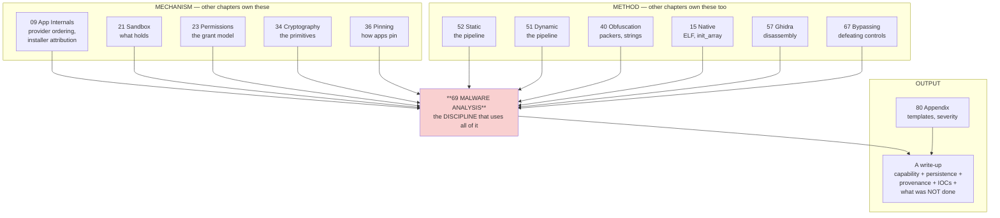
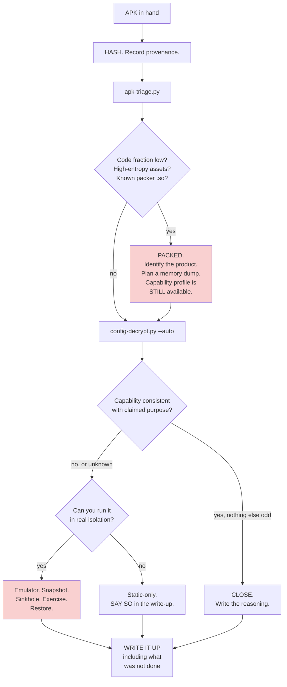

# 69 — Malware Analysis: Mind Map

> One map of the whole chapter. Full text in [README.md](README.md), commands
> in [cheatsheet.md](cheatsheet.md).
>
> **Everything in this chapter is defensive.** No live malware is shipped, all
> indicators are RFC 2606 `.invalid` names, and the reader's deliverable is a
> write-up, not a capability.

```mermaid
mindmap
  root((69<br/>Malware<br/>Analysis))

    ((THE THESIS))
      Works AROUND the sandbox
        not through it
        no exploit needed
        capability was GRANTED
      Right question
        not "where is the flaw"
        but "what could it do
        if every request
        were granted"
      Sandbox holds throughout
        UID / GID
        SELinux MCS
        Binder identity unforgeable

    ((CAPABILITY MODEL))
      Accessibility
        read every window
          AccessibilityNodeInfo tree
          crosses the app boundary
        drive every window
          dispatchGesture API 24+
          performGlobalAction
        system restarts it
          free supervised process
        THE DESCRIPTOR IS THE REQUEST
          canRetrieveWindowContent
          canPerformGestures
          typeAllMask
          packageNames ABSENT = every app
          read EVERY res/xml variant
        mitigated API 26 / 30 / 33
          restricted settings is the big one
      Notification listener
        reads every notification
          OTP codes without READ_SMS
        cancelNotification
          suppression not just reading
      Overlay
        TYPE_APPLICATION_OVERLAY
        phishing
        tapjacking
        needs a foreground trigger
          UsageStatsManager
          or accessibility events
      Device admin
        uninstall resistance
          from being ACTIVE
          NOT from any policy
        declining API 28 / 29 / 33
      SMS
        second factor
        propagation
      Package install
        dropper
        session installer since API 33
      QUERY_ALL_PACKAGES
        target selection
        security product detection

    ((PERSISTENCE))
      ContentProvider onCreate
        BEFORE Application onCreate
          measured 23 ms gap ch09
          installContentProviders
        supply chain
          a dependency runs as you
        stub data methods = the tell
      Broadcasts
        BOOT_COMPLETED
          protected, root can send
        MY_PACKAGE_REPLACED
          re-arm after self update
        QUICKBOOT_POWERON
          OEM only
        STOPPED state rule
          why droppers have icons
      Foreground service
        escapes API 26 limits
        quiet notification
        type ENFORCED API 34
      Watchdog pair
        two processes
        stopWithTask false
        survivability NOT privilege
        dies to am force-stop
        third arm = JobScheduler
      Hiding
        activity-alias disabled
        excludeFromRecents
        system app impersonation

    ((SUPPORTING MECHANISMS))
      Config crypto
        key MUST ship in the file
        A repeating XOR
          frequency analysis
          crib dragging
        B AES embedded key
          16 / 24 / 32 char literal
        C derived key
          read the derivation
        D network key
          rare, actually works
        CBC wrong IV
          corrupts ONE block
      Runtime loading
        DexClassLoader
        InMemoryDexClassLoader
          nothing on disk
        reflection
        packers
          stub DEX in a big file
          identify the product first
      Native
        init_array before JNI_OnLoad
          spawn gate, do not attach
        RegisterNatives
          mapping not in the file
        entropy over 7.5
      C2 channels
        HTTPS
        HTTPS PINNED
          you break their pinning
        FCM push
        SMS
        dead drop services
        DGA
        no channel at all

    ((ATTRIBUTION))
      Strong
        signing certificate sha256
        distinctive structure
      Medium
        C2 infrastructure
      Weak
        strings
        shared SDKs mislead
      Very weak
        permission sets
        packer identity
      False links from
        shared SDKs
        shared builders
        copied code
        deliberate false flags
      Say it
        "No family association
        was established"

    ((METHOD))
      Isolate first
        emulator not a phone
        snapshot / restore
        no account, no SIM
        egress sinkholed
        NEVER a device you care about
      Hash first
        only unforgeable identifier
      Static triage
        identity
        provenance
        capability
        persistence
        native
        loading
      Config offline
      Decompile and sweep
        ch52 pipeline
      Dynamic in isolation
        ch51 pipeline
        stage 1 INVERTS
      Three outcomes
        close
        escalate
        hand over

    ((HONEST LIMITS))
      hit is not a lead
      lead is not a finding
      silence is not clean
        may have detected you
      an IOC is about the PAST
      attribution is a CHAIN
        publish the chain
      write down what you
      did NOT do
      manifest cannot lie
      about its own names
        survives obfuscation
```

---

## How the chapters connect

**Reading it.** 69 sits downstream of everything. It contributes two things
that none of its inputs supply: **the capability model** — the structured
answer to "what could this do if every request were granted" — and **the
discipline of honest limits**, which is what turns a pile of signals into a
document somebody can act on.

---

## The one-page decision tree

**The branch people skip is `I`.** "Can you run it in real isolation" has a
legitimate answer of **no**, and the correct response to that answer is to
finish a static analysis and label it, not to run the sample somewhere
unsuitable. This chapter took that branch itself: no emulator was used, nothing
was installed on the attached physical device, and section 7.3's Frida script
is labelled as untested against a live sample.
