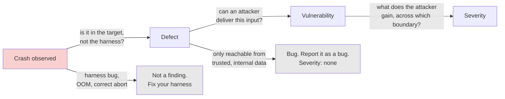
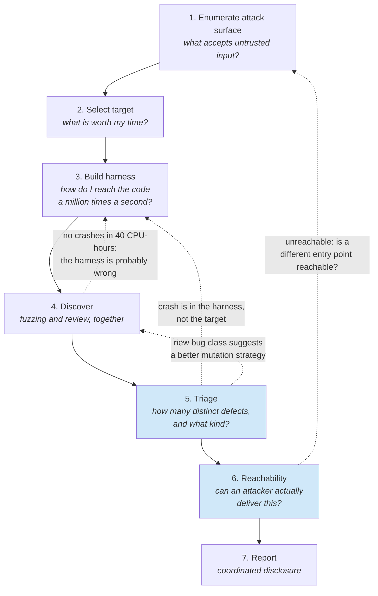
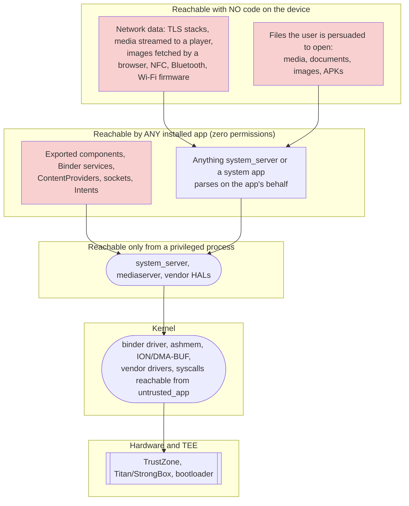
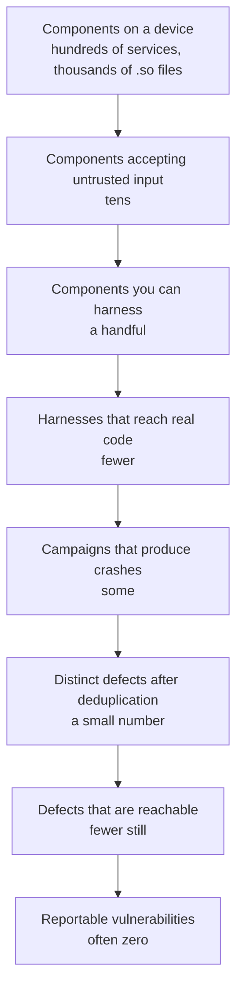
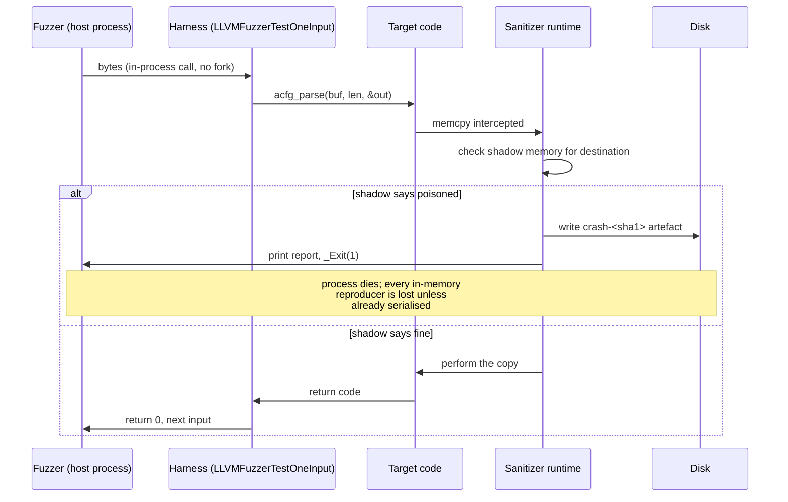
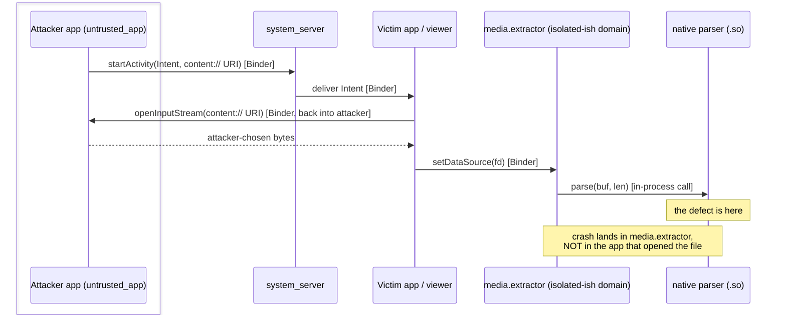
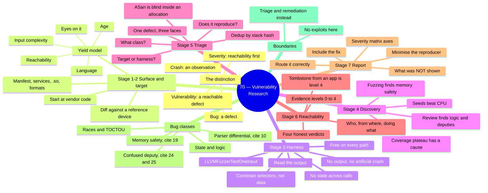

# 70 — Vulnerability Research

> After this chapter you will be able to enumerate the attack surface of an Android platform
> component, choose a target that is worth your time, build a fuzzing harness for it, run a campaign
> that produces reproducible crashes, triage those crashes into distinct defects with a defensible
> exploitability *assessment*, decide honestly whether each one is reachable by an attacker, and
> write the report that a vendor can act on — including through the Android Security Bulletin
> process.

**Prerequisites:** [01-Computer-Science-Basics](../01-Computer-Science-Basics/README.md) (bits,
bytes, pointers, the stack), [02-Linux-Basics](../02-Linux-Basics/README.md) (processes, `/proc`,
building software), [15-Native-Code](../15-Native-Code/README.md) (ELF, the build-time hardening
set), [19-Memory](../19-Memory/README.md) (the allocator, the memory-safety defect classes, the
detectors) — **19 is the hard prerequisite; this chapter assumes every word of its §3.9 and does not
repeat it**. Helpful: [18-ARM](../18-ARM/README.md), [57-Ghidra](../57-Ghidra/README.md),
[24-IPC](../24-IPC/README.md), [22-SELinux](../22-SELinux/README.md).

**Applies to:** Android 5.0 (API 21) through Android 16, with the caveat that the *yield* of every
technique here is strongly version-dependent and the chapter says so at each point. The host tooling
(clang, libFuzzer, the sanitizers, AFL++) is version-independent. The Android Security Bulletin
process described in §5.8 is the one in effect at the time of writing; the Bulletin index is the
authority and is linked in §14.

**Scope boundary.** This chapter sits on top of four that own the ground it walks over. It cites
them; it does not restage them.

| Chapter | Owns | This chapter assumes you have read it |
|---|---|---|
| [19-Memory](../19-Memory/README.md) | The allocator, the address space, the eight native memory-safety defect classes with their CWE numbers, HWASan, MTE, GWP-ASan, `malloc_debug`, and the mitigation cost table | Yes — this is the hard prerequisite |
| [15-Native-Code](../15-Native-Code/README.md) | The ELF container, the build-time hardening checklist, how a `.so` gets into an app | Yes, for §7.5 onward |
| [24-IPC](../24-IPC/README.md) and [25-Binder](../25-Binder/README.md) | The IPC attack surface, the confused-deputy problem, `clearCallingIdentity` | Yes, for §5.3 |
| [10-APK-Internals](../10-APK-Internals/README.md) | The APK container, its known parser-differential bug families, the three-way manifest comparison | Yes, for §5.4 |

**What this chapter is.** It is a *method*. Chapter 19 teaches you to recognise a use-after-free when
you are looking at one. This chapter teaches you how to arrange your working life so that
use-after-frees end up in front of you, how to tell the one that matters from the four that do not,
and what to do with it once you are sure. The centre of gravity is **triage and reachability**,
because that is the step at which a crash becomes a finding and where almost all the bad work in this
field happens.

> Everything in this chapter targets work you are authorised to do: your own code, code you
> have permission to test, targets inside a published bug bounty programme's scope, or your own
> device that you own outright and can afford to brick. Do not fuzz a service on a device you do
> not own. §1.6 and §5.12 treat the boundaries properly rather than as a disclaimer. See
> [SECURITY.md](../SECURITY.md) for authorised-testing scope.

---

## Table of Contents

1. [Introduction](#1-introduction)
2. [High-Level Architecture](#2-high-level-architecture)
3. [Deep Internal Working](#3-deep-internal-working)
4. [Source Code Walkthrough (AOSP)](#4-source-code-walkthrough-aosp)
5. [Security Perspective](#5-security-perspective)
6. [Reverse Engineering Perspective](#6-reverse-engineering-perspective)
7. [Dynamic Analysis](#7-dynamic-analysis)
8. [Static Analysis](#8-static-analysis)
9. [Examples](#9-examples)
10. [Common Interview Questions](#10-common-interview-questions)
11. [Common Mistakes](#11-common-mistakes)
12. [Hands-on Labs](#12-hands-on-labs)
13. [Summary](#13-summary)
14. [References](#14-references)

---

## 1. Introduction

### 1.1 The problem that vulnerability research exists to solve

Software is written by people who are trying to make it work. That is not a criticism; it is the job.
A developer writing a media parser is thinking about the files that exist — the ones their test suite
contains, the ones the format specification describes, the ones a camera produces. They are not
thinking about the file that says it contains eight thousand frames and then stops after two, because
no camera produces that file and no specification describes it.

An attacker produces that file. That is the whole asymmetry.

Now consider who else is *not* thinking about that file. The person testing the app is running through
a checklist: is the traffic encrypted, is the token stored safely, is the exported activity guarded.
Those questions are answerable by inspection, they have known answers, and a competent tester will
find the issues in a day. None of them will find the media parser bug, because the media parser bug
is not visible by inspection. It is visible only to someone who *builds the wrong file and watches
what happens*.

That activity — deliberately constructing inputs and states the developer never considered, in order
to discover a defect nobody knew about — is vulnerability research. The output is not a test result.
The output is **new knowledge about a defect that did not previously exist as knowledge**, plus
enough evidence that somebody else can act on it.

> **Definition — vulnerability research.** The systematic discovery, validation and reporting of
> previously unknown software defects that have security consequences. "Systematic" is doing real
> work in that sentence: poking at things until something breaks is not research, because it does not
> generalise, does not produce a second finding, and cannot be handed to anyone else.

### 1.2 The one-sentence difference from penetration testing

A penetration test asks: **is this system correctly built and configured, according to what we know?**
Vulnerability research asks: **what do we not know about this system?**

The consequences of that difference run through everything:

| | Penetration test | Vulnerability research |
|---|---|---|
| Question | Are the known controls present and correct? | What defect exists that nobody has found? |
| Input | A checklist, a standard, a scope document | A target, a hypothesis, and time |
| Coverage claim | "We tested the following surfaces" | Coverage is a measured quantity, and usually low |
| Typical duration | Days per application | Weeks to months per component |
| Success rate | High — findings are expected | Low — most campaigns find nothing |
| Failure mode | Missing a known issue | Spending six weeks on an unreachable bug |
| Deliverable | A report of findings against a standard | A report of one defect, with a reachability argument |
| Who reads it | The development team | The vendor's security response team, and possibly a CVE database |
| The hard part | Being thorough | Knowing when to stop |

[20-Security-Architecture](../20-Security-Architecture/README.md) puts "platform vulnerabilities"
last on its engagement-yield table, marked "rarely, and usually out of scope — requires different
skills and a different engagement type", and points here. That is the correct call for an app
engagement and it is worth understanding *why*: on a two-week app test, the expected value of two
days spent fuzzing a bundled `.so` is far lower than two days spent on the server-side authorisation
model. Research is a different economic activity with a different risk profile, not a more advanced
version of the same one.

### 1.3 A crash is not a bug, and a bug is not a vulnerability

This is the sentence the chapter is built on, so it goes early and it gets the space it deserves.

Three distinct things get confused, constantly, by people who ought to know better:

**A crash** is an observation. Your process stopped. Something happened that the runtime or a
sanitizer decided was fatal. That is all it is. A crash can be caused by a defect in the target, by a
defect in *your harness*, by the target correctly rejecting input in a way that calls `abort()`, by
running out of memory, or by the sanitizer catching something that is technically undefined behaviour
and practically harmless.

**A bug** is a defect in the target: the code does something other than what it should. Every bug is a
real thing that a developer should fix. Most bugs have no security consequence whatsoever.

**A vulnerability** is a bug that an attacker can *reach* and that gives them something they should
not have. Reachability is the whole game. A heap overflow in a parser that is only ever fed files
generated by the same program, in the same process, from data the program itself just wrote, is a
bug. Move that same parser behind a `ContentProvider` that any installed app can call, and it is a
vulnerability — the code did not change, the reachability did.



Reading the diagram: two of the five terminal states are not findings, and in a real campaign they
are where most of your crashes end up. An honest researcher's ratio of crashes to reported
vulnerabilities is not close to one. §3.6 and §3.9 are the two filters in that diagram, written out
in full, and they are the most valuable part of the chapter.

> **Mental Model — the three questions.** For every crash, in this order:
> **(1) Is the defect in the target or in my harness?**
> **(2) Can an attacker deliver the input that triggers it?**
> **(3) If they do, what do they get, and whose security boundary does it cross?**
> A finding is a crash that survives all three. Most do not survive the first.

### 1.4 What "systematic" buys you

[01-Computer-Science-Basics](../01-Computer-Science-Basics/README.md) points here with the phrase
"the bug classes of section 5, found **systematically**", and the emphasis is the point.

Consider two researchers. The first reads code until something looks wrong. Over a month they find
one bug. If you ask how they found it, the answer is "I noticed it". They cannot tell you what they
looked at and did not find anything in, they cannot tell you how much of the component they covered,
and if you ask them to do it again on a different component they will take another month with the
same odds.

The second researcher enumerated the component's inputs, wrote down which ones cross a trust
boundary, built a harness for the three that do, ran each one for a measured amount of CPU time, and
recorded the coverage each achieved. They also found one bug. But they can tell you that the fourth
input was not harnessed because it requires a signed blob they cannot generate, that harness two
plateaued at 31% line coverage because a checksum gate rejects almost every input, and that harness
three has never found anything in 40 CPU-hours. That is *knowledge*, and it is what makes the second
month better than the first.

The difference is not talent. It is that the second researcher's process produces a **record of where
they have been**, and that record is what turns luck into method.

> **Pentester's Note.** Coverage vocabulary in this field is borrowed from
> [51-DynamicAnalysis](../51-DynamicAnalysis/README.md) §3.9 and §7.7 for a reason. The discipline
> is identical: an observation is worthless until you can state what you observed *and what you did
> not*. Chapter 51's rule that "a void run and a clean negative produce identical reports" is exactly
> the fuzzing problem — a campaign that found nothing and a campaign whose harness never actually
> called the target produce the same output file.

### 1.5 The position this chapter takes on exploitation

This chapter does not contain a working exploit, a ROP chain, or privilege-escalation code, and that
is not squeamishness. It is the honest professional position, for three reasons that are worth
stating plainly because the reader will meet people who disagree.

**First, it is what the job actually is.** On a real engagement — a bug bounty submission, a vendor
disclosure, an internal security review — the deliverable is "here is a defect, here is proof it is
reachable, here is my assessment of what it would give an attacker, here is a reproducer". Vendors
triage on reachability and impact assessment. The overwhelming majority of accepted, high-severity,
well-paid platform findings are reported without a working exploit, because building one takes weeks
and adds nothing the vendor needs to fix the code. A researcher who cannot write a
convincing reachability argument but can write a ROP chain has the rare skill and is missing the
common one.

**Second, the skills do not transfer downward.** Someone who can write an exploit can already
triage. But the reverse is not true, and far more people are held back by not being able to *judge*
a crash than by not being able to weaponise one. Teaching the judgement is the higher-value lesson.

**Third, weaponised code is a liability the moment it leaves your machine.** A working
privilege-escalation chain for a current Android version is, functionally, a weapon; it does not care
who runs it. Published in a learning repository it has one certain effect (it gets copied) and one
uncertain one (someone learns from it).

So where a section cannot be written without producing an offensive capability, this chapter writes
the **triage and remediation** side instead, and says so at that point. You will see that sentence
several times. It is not a hand-wave — each time, the material that replaces the exploit is the
material a vendor's response team would actually want.

> **Mental Model.** The exploit answers "can I do it?" The triage answers "should the vendor drop
> everything and fix this?" Only one of those questions is asked of you on a Tuesday afternoon.

Chapter [19-Memory](../19-Memory/README.md) §1.5 takes the same position for the same reasons and
states it as an engineering one: it teaches recognition, location, detection and reachability
judgement, and ships no exploit. This chapter is the continuation of that policy, not an exception to
it.

### 1.6 Authorisation, in practice rather than as a disclaimer

"Get permission" is useless advice because it does not say permission *for what*, *from whom*, or
*how you know when you have it*. Here is the practical version.

**Things you may fuzz without asking anyone.**

- Software you wrote. The ACFG parser in `examples/` exists so that the first thing you fuzz is
  something you own outright.
- Open-source libraries, on your own machine, where the licence permits use. Fuzzing `libpng` on your
  laptop harms nobody.*finding* a bug there immediately creates a disclosure obligation
  (§5.8) even though the fuzzing itself was unremarkable.
- An emulator image, on your own computer.
- A device you personally own, that carries none of your data, and that you are prepared to have to
  re-flash. This is a real category and it is what the "research phone" in every researcher's drawer
  is for.

**Things that need explicit written scope.**

- Any third-party application, even installed on your own phone. The app is licensed to you, not
  sold; most EULAs prohibit reverse engineering, and while that clause is unenforceable in some
  jurisdictions you should not be discovering which one you are in from a lawyer.
- Any vendor service on a device, if you intend to report it. Check the vendor's published programme
  first — most large OEMs have one, and the programme text *is* your scope document.
- Anything touching a server. Fuzzing a network endpoint is unauthorised access, full stop, unless a
  programme says otherwise in writing.

**Things you should not do at all.**

- Fuzz on a phone you depend on. This is a practical rule, not an ethical one, and it is the one
  people break. A fuzzing campaign is millions of executions of code designed to misbehave; it will
  fill storage with crash artefacts, wedge system services, thermally throttle the device, and
  occasionally require a reboot to recover. **Every measured result in this chapter was produced on a
  host machine or an emulator. Nothing was fuzzed on either physical phone attached to this
  workstation, deliberately.** See §7.6.
- Test on infrastructure belonging to other users of a shared service.

> **Warning — the scope document is the finding's foundation.** A finding discovered outside scope
> is often unreportable and always awkward: you cannot show the vendor how you found it without
> admitting how you found it. Researchers routinely lose real bugs this way. Establish scope before
> you write the harness, not after the crash.

### 1.7 What you will be able to do, concretely

By the end of this chapter, given an Android device and a target component, you will be able to:

1. Enumerate every input to that component and mark which ones cross a trust boundary (§3.2).
2. Decide whether the component is worth your time, with reasons you could defend to a colleague
   (§3.3).
3. Write a fuzzing harness for a C or C++ entry point and build it with the correct sanitizer flags
   (§3.4, §7.2, `scripts/make-fuzz-harness.sh`).
4. Run a campaign, keep the corpus, and know what its coverage number does and does not mean (§7.3).
5. Take a heap of crash artefacts and reduce them to a list of distinct defects (§3.7,
   `scripts/triage-asan.py`).
6. Say, for each defect, whether it is a read or a write, whether the address is attacker-influenced,
   and how much of the written data the attacker controls — without writing an exploit (§3.8).
7. Produce a reachability verdict with a stated confidence and the evidence behind it (§3.9).
8. Write the report, and route it correctly to AOSP, to an OEM, or to Google Play (§5.8, §5.9).

---

## 2. High-Level Architecture

### 2.1 The pipeline

Vulnerability research has a shape. It is not a linear pipeline in practice — you will go backwards
constantly — but the stages are real, they happen in this order, and skipping one always costs more
later than it saved.



The two shaded stages are where this chapter spends most of its length, and the dashed lines are the
ones that matter. Every backward arrow is a *normal* event, not a failure:

- **Discovery back to harness.** Forty CPU-hours with no crashes and no coverage growth means your
  harness is not reaching the code. It is far more often a harness problem than a
  "the code is secure" result. §7.5 gives the checks.
- **Triage back to harness.** A large fraction of first-campaign crashes are in the harness itself —
  a buffer you sized wrong, a global you forgot to reset. §3.6 puts this first for that reason.
- **Reachability back to enumeration.** The most valuable outcome of an "unreachable" verdict is the
  question *what would make it reachable?*, and the answer is usually another entry point you had not
  enumerated.

### 2.2 The Android attack surface, drawn by who can reach what

The single most important structural fact about Android for a researcher is that it is not one trust
boundary but a stack of them, and a bug's value is determined almost entirely by which one it lets
you cross.



The three red boxes are attacker-controlled input. Read the diagram outside-in, because that is the
order of decreasing value and increasing accessibility:

- **The outermost layer is where the money is and where the competition is.** A bug reachable from a
  network stream or a downloaded file, with no user interaction beyond opening something, is the most
  valuable class of Android finding there is. It is also the layer with the most eyes on it: AOSP
  fuzzes its media stack continuously, and the components have been rewritten in Rust or moved into
  Mainline modules precisely because of the historical bug density there.
- **The "any installed app" layer is where a newcomer should start.** It is enormous, much of it is
  vendor code rather than AOSP code, and the barrier is a manifest read rather than an exploit.
  [21-App-Sandbox](../21-App-Sandbox/README.md) §5.12 and
  [20-Security-Architecture](../20-Security-Architecture/README.md) §5.8 both make this point and
  both point here: *vendor system apps with exported components, and vendor SELinux policy more
  permissive than AOSP's, are the realistic entry points*. Not the AOSP core.
- **The kernel and TEE layers** are where full chains end up, and they are out of this chapter's
  scope by the policy in §1.5. The reachability reasoning still applies to them and §3.9 is written
  to be usable there.

> **Warning — "trust boundary 3" means three different things in this repository, and you must
> name the source.** [24-IPC](../24-IPC/README.md) §2.4 numbers *its* boundary 3 as
> "framework to kernel"; [25-Binder](../25-Binder/README.md) §2.3 numbers *its* boundary 3 as "the
> service process"; [20-Security-Architecture](../20-Security-Architecture/README.md) §2.2 numbers
> *its* boundary 3 as "kernel vs user space". They are different maps of overlapping territory and
> all three are correct within their own chapter. When you write "boundary 3" in a report, name the
> model you are using, or draw it. This chapter always names it.

24-IPC hands this chapter a specific piece of territory, and the sentence is worth quoting because it
defines the split: *"Boundary 3 is where platform and kernel vulnerabilities live. Crossing it means
privilege escalation to `system` or root. That is the subject of 70-VulnerabilityResearch, not this
chapter."* So: 24 owns the app-to-framework surface and how to enumerate it. This chapter owns what
you do when the thing on the other side of that surface turns out to be broken.

### 2.3 The funnel, with real numbers

Research is a funnel with brutal ratios, and the reason to internalise them early is that a newcomer
who does not know the ratios concludes they are bad at this after their first month.



The numbers on this repository's own measurements are consistent with that shape, and three
independent ones are worth carrying over because they were all measured, not asserted:

| Measurement | Where | What it tells a researcher |
|---|---|---|
| 16,836 raw static hits reduced to 168 leads; 15 of the top 17 rejected by hand | [52-StaticAnalysis](../52-StaticAnalysis/README.md) | Automated output is leads, not findings, and the confidence ranking is not the severity ranking |
| 132 high-confidence secret-scanner hits, **132 false positives** | [33-Storage](../33-Storage/README.md) | A detector that agrees with you every time is broken |
| 12 of 14 apps had a pinning surface, only 4 actually pinned | [36-CertificatePinning](../36-CertificatePinning/README.md) | Presence of the machinery is not evidence of the behaviour |

The equivalent number in this chapter, measured in §7.8: **one planted bug in a 200-line parser
produced one ASan abort, one silent UBSan report, and one completely invisible outcome, depending
purely on two attacker-controlled header fields.** One defect, three faces. The funnel's narrowing is
not only about discarding rubbish; it is also about *not double-counting the same defect*, and about
*not missing the two faces of it that your sanitizer did not shout about.*

### 2.4 Where a crash comes from and where it goes



Three things in this diagram are the source of most beginner confusion, and each is a rule:

1. **The fuzzer, the harness and the target are all in one process.** libFuzzer does not fork per
   input; it calls your function in a loop, millions of times. That is what makes it fast, and it is
   why a harness that leaks memory or keeps state across calls will destroy a campaign — see §3.4.
2. **The sanitizer, not the target, decides what is fatal.** The `memcpy` in the ACFG parser would
   have "worked" without ASan: it would have written 58 bytes into a 56-byte allocation, corrupted
   whatever came next, and returned successfully. The crash exists *because you built with a
   detector*. This is the single most important reason to build with sanitizers rather than fuzz a
   release binary: without them, the overwhelming majority of memory-safety bugs are silent.
3. **`_Exit(1)` runs no cleanup.** Nothing you registered with `atexit` runs, no destructor runs, no
   buffer flushes. Any reproducer that exists only in your harness's memory at that instant is gone.
   libFuzzer solves this by writing the artefact from inside its own crash path; a hand-written
   driver must serialise the input *before* executing it, which is exactly what
   `examples/fuzz-acfg.c` does and comments at length.

> **Under the Hood.** ASan's check is a shadow-memory lookup: every 8 bytes of application memory
> maps to 1 byte of shadow that records how many of those 8 are addressable. [19-Memory](../19-Memory/README.md)
> owns this mechanism in full and this chapter does not restage it. What matters *here* is a
> consequence of it that changes how you fuzz: **shadow memory has no concept of a struct field.**
> Two structs inside one allocation have no redzone between them, so an overflow from one into the
> next is invisible to ASan. §3.7 measures exactly this, and it is why UBSan belongs in your build
> alongside ASan rather than instead of it.

---

## 3. Deep Internal Working

This is the method. Each stage answers *what* it produces, *why* it exists, *when* you are done with
it, *where* the evidence lives, and *how* to execute it.

### 3.1 The seven stages, and what each one produces

| # | Stage | Input | Output artefact | You are done when |
|---|---|---|---|---|
| 1 | Enumerate attack surface | A device, an APK, a source tree | A list of entry points, each marked with who can reach it | Every input to the component is written down, including the ones you cannot test |
| 2 | Select target | That list | One component, and a written reason | You can defend the choice against "why not the other one?" |
| 3 | Build harness | The component | A binary that executes the target on arbitrary bytes | Coverage grows when you feed it new inputs |
| 4 | Discover | The harness plus seeds | Crash artefacts, a grown corpus, a coverage number | Time budget exhausted, or coverage has plateaued and you know why |
| 5 | Triage | Crash artefacts | A list of *distinct defects*, each classified | Every artefact maps to a defect or is explained away |
| 6 | Reachability | Each defect | A verdict with a confidence and evidence | You could answer a vendor's "how would an attacker do this?" |
| 7 | Report | The verdict | A disclosure, correctly routed | The vendor has acknowledged, or your timeline has expired |

Two of these are routinely skipped and both skips are expensive. Skipping stage 1 means you fuzz the
component you already knew about rather than the one nobody has looked at. Skipping stage 6 means you
send a vendor a crash report with no impact argument, which is the single most common reason a
genuine finding is closed as "won't fix".

### 3.2 Stage 1 — Enumerate the attack surface

**What it is.** A written list of every place data enters the component, annotated with where the
data comes from and who controls it.

**Why it exists.** Because "attack surface" is otherwise a slogan. You cannot decide what to fuzz
until you know what accepts input, and you cannot make a reachability argument later without this
list — stage 6 is mostly a lookup into stage 1.

**How to build it, on Android.** There are four sources and you want all four.

**(a) The manifest, for app and system-app components.** This is
[32-Manifest](../32-Manifest/README.md)'s territory and the mechanics live there. What a researcher
does differently from a tester: you run it across *every* package on the device, not one, and you
diff against a reference.

```bash
# adb shell -- every package that exports something, on the device
for p in $(pm list packages -f | sed 's/.*=//'); do
  dumpsys package "$p" | grep -q "exported=true" && echo "$p"
done
```

**(b) The service list, for Binder services.** [24-IPC](../24-IPC/README.md) §3.22 owns the full
enumeration methodology; use it. The research-specific twist is the diff:

```bash
# adb shell -- what services exist here
service list > /sdcard/services-thisdevice.txt
```

[21-App-Sandbox](../21-App-Sandbox/README.md) §5.12 states the technique exactly: *"Enumerate them
with `service list` and `dumpsys -l` on the target device, diff against a Pixel running the same
Android version, and investigate the difference."* The services present on the OEM device and absent
from the Pixel are, by definition, vendor code. Vendor code is written by fewer people, reviewed by
fewer people, and fuzzed by nobody. That difference list is the single highest-yield artefact a
newcomer to Android platform research can produce, and it takes twenty minutes.
`scripts/surface-enum.sh` in this chapter produces it.

Measured while writing this chapter, read-only, on the Redmi `M2101K6P` (Android 11 / API 30, MIUI):
**217 Binder services registered.** The first five in the list are `DockObserver`, `MiuiBackup`,
`MiuiInit`, `MiuiWifiService` and `ProcessManager` — and three of those five are visibly vendor
services that exist on no AOSP build. You do not need the diff to see the shape of the answer; the
diff tells you which of the other 212 are also vendor, and that is the list you work.

> **Warning — an inventory with an off-by-one is worse than no inventory.** The first version of
> `surface-enum.sh` reported **218** services on that device, because the `sed` that extracts names
> used `[0-9]*` (which matches zero digits) and therefore captured the header line
> `Found 217 services:` as a service in its own right. 218 is exactly as plausible-looking as 217.
> Every count you publish should be reproducible from a command someone else can run, precisely so
> that this class of error is findable.

**(c) The native libraries, for parsers.** Every `.so` on the device is a candidate; almost none of
them are reachable with untrusted input. The filter is: does anything hand this library bytes that
came from outside the process?

```bash
# adb shell -- native libraries, vendor first
ls /vendor/lib64/ /system/lib64/ 2>/dev/null | head -50
```

```bash
# host -- which of an app's own libraries export something that smells like a parser
llvm-nm --defined-only --demangle lib/arm64-v8a/libfoo.so \
  | grep -iE ' T .*(parse|decode|load|read|unpack|inflate|deserial)'
```

[15-Native-Code](../15-Native-Code/README.md) owns what a `.so` is and how to read its exports; this
grep is a research filter on top of that.

**(d) The file formats and protocols.** Every format the component parses is an entry point, and the
list is longer than anyone expects: the obvious media and image formats, plus configuration blobs,
serialised state, cached indices, protobufs, and the format-inside-a-format cases that produce the
best bugs (an ID3 tag inside an MP3 inside a ZIP inside an APK).

**The output.** A table. Actually write it down; the discipline is the point.

| Entry point | Format / protocol | Who can reach it | Requires user interaction? | Harnessable? |
|---|---|---|---|---|
| `com.vendor.assist/.CmdReceiver` | Intent extras | Any installed app | No | Yes, via an attacker app |
| `libvendorimg.so:vimg_decode` | Proprietary image container | Any app that can get the gallery to render a file | Yes — user opens the file | Yes, direct harness |
| `IVendorTelemetry` transaction 7 | Parcel | Any app (no permission check found) | No | Yes, via Binder client |
| Boot-time config parse in `/vendor/etc/x.cfg` | Custom TLV | Nobody without root | No | Yes, but pointless |

Note the last row. It is on the list *because it is on the list* — the value of an enumeration is
partly the things it lets you rule out with a reason instead of forgetting about them.

> **Pentester's Note.** Chapter 29's measurement is the warning here:
> **299 of 431 distinct broadcast actions registered by third-party processes had zero
> manifest-declared receivers anywhere on the device.** A manifest-only enumeration is blind to 69%
> of that surface. Enumerate from the *running system* as well as from the package, always.

### 3.3 Stage 2 — Choose a target

**What it is.** Picking one component, and being able to say why.

**Why it exists.** Because you have finite time and the yield differences between targets are not
small — they are two or three orders of magnitude. Choosing well is worth more than any technique in
this chapter.

**The yield model.** Five factors, and you can score a target on each in about ten minutes:

| Factor | High yield | Low yield | Why |
|---|---|---|---|
| **Eyes on it** | Vendor code, a niche library, a new feature | AOSP media stack, OpenSSL, libpng | Everything heavily fuzzed already has had its shallow bugs removed. You are competing with continuous fuzzing infrastructure |
| **Language** | C, C++ | Rust, Java/Kotlin | Memory-safety bugs need a language that permits them. AOSP's move of new parsers to Rust is deliberate and it works |
| **Age of the code** | Very new, or very old and unmaintained | Actively maintained and mature | New code has not been fuzzed. Old unmaintained code was written before the techniques existed |
| **Input complexity** | A format with nested, length-prefixed, self-describing structures | A fixed-size struct, a single integer | Complexity is where the arithmetic goes wrong |
| **Reachability** | Any app, or no app at all | Requires root or a signature permission | A bug you cannot reach is a bug, not a vulnerability (§1.3) |

**Where a newcomer should actually start.** Both
[20-Security-Architecture](../20-Security-Architecture/README.md) §5.8 and
[21-App-Sandbox](../21-App-Sandbox/README.md) §5.12 give the same answer and it is right: **vendor
system apps with exported components, vendor SELinux policy more permissive than AOSP's, and vendor
HALs.** Not the AOSP core. The reasoning is the "eyes on it" row above — AOSP's core has Google's
continuous fuzzing pointed at it and yours will not out-compete that. A Tier-2 OEM's telemetry
service has had approximately nobody looking at it.

> **Mental Model — the competition question.** Before you start, ask: *who else has fuzzed this,
> with what, for how long?* If the answer is "Google, continuously, for six years", your marginal
> CPU-hour is worth close to nothing. If the answer is "nobody, ever", it is worth a great deal. This
> single question will save you more time than every optimisation in §7.

**When the answer is "review, not fuzz".** Fuzzing is the right tool when the input is bytes and the
target is fast and stateless. It is the wrong tool for logic bugs, permission bugs, and confused
deputies, which have no crash to find. §5.3 and §5.5 cover those, and they are found by reading.

### 3.4 Stage 3 — Build the harness

**What it is.** A program that calls the target function on a buffer of arbitrary bytes, as fast as
possible, with no state carried between calls.

**Why it exists.** A fuzzer generates bytes. Your target does not take bytes; it takes a file
descriptor, or a `Parcel`, or a constructed object graph. The harness is the adapter, and its quality
determines the entire campaign's value. **The harness is the part of fuzzing that is actually
engineering.** Everything else is a command line.

**The interface.** One function, and every modern fuzzer consumes it:

```c
// The entire libFuzzer / AFL++ / honggfuzz / OSS-Fuzz interface.
int LLVMFuzzerTestOneInput(const uint8_t *data, size_t size);
```

**The five rules.** Each of these has cost real projects real weeks.

1. **No state across calls.** The function is invoked millions of times in one process. Any global
   that survives a call makes crashes depend on execution *order*, which means the saved reproducer
   replays clean and you conclude the crash was a fluke. It was not; you just cannot reproduce it.
   Reset or avoid everything.
2. **Free everything, on every path.** A harness that leaks 40 bytes per call will exhaust memory in
   an hour and report an OOM that looks like a target bug. `examples/fuzz-acfg.c` calls `acfg_free`
   unconditionally, including on error paths — which also happens to *test* the promise that freeing
   a failed parse is safe.
3. **No output per iteration.** A single `printf` per execution costs more than most parses and drops
   throughput by an order of magnitude or more.
4. **No artificial crashes.** Never `abort()` because the input was malformed. Rejecting bad input is
   correct behaviour; a harness that treats it as a crash generates thousands of false findings that
   a human then triages by hand. Every negative return code from `acfg_parse` is treated as success.
5. **Read the output.** A harness that parses and immediately frees exercises only the parser. Many
   real bugs are in the accessors, and a missing NUL terminator is *completely invisible* unless
   something calls `strlen`. `examples/fuzz-acfg.c` reads every field of every record into a
   `volatile` sink for exactly this reason.

**Rule 5 has a subtlety worth its own paragraph**, because it bit this chapter during writing. The
sink must be `volatile` or the optimiser deletes the reads and the coverage they generate disappears
— a harness that tests *less* the harder you optimise it. But a *function-local* `static volatile`
that is only ever written triggers clang's `-Wunused-but-set-variable`, and a harness built with
`-Werror` then does not compile at all. Measured here: **gcc 11.4 accepts the local form, clang 14
(NDK r25c) rejects it.** The portable answer is a file-scope volatile that is assigned once at the
end. Two toolchains, one file — this is precisely the class of thing that makes a harness "work on my
machine" and fail in a vendor's CI.

**Structure awareness.** The naive harness passes the fuzzer's bytes straight through. That is right
for a byte-oriented format like ACFG. For an API with several arguments, you carve them out of the
input:

```c
// A harness for a function that takes a mode flag and a buffer.
int LLVMFuzzerTestOneInput(const uint8_t *data, size_t size)
{
    if (size < 1) return 0;              // need at least the mode byte
    uint8_t mode = data[0] % 4;          // constrain to the valid range,
                                         // or you spend the campaign in the
                                         // "invalid mode" error path
    target_process(mode, data + 1, size - 1);
    return 0;
}
```

The `% 4` is the important line. Without it, 252 of 256 possible first bytes hit an early rejection
and the campaign spends most of its executions proving that invalid modes are rejected. **Constrain
the parts of the input that select behaviour; leave the parts that are data unconstrained.** Getting
this wrong is the most common reason a harness plateaus at low coverage.

**The checksum problem.** If your target rejects any input whose CRC does not match, a byte-oriented
fuzzer will never get past the check — every mutation invalidates the checksum. Three answers, in
order of preference:

1. Recompute the checksum in the harness before calling the target. This is legitimate and standard;
   you are testing the parser, not the checksum.
2. Patch the check out of the build you fuzz. Note this in your findings, because a bug behind a
   checksum still needs a reachability argument that accounts for the attacker being able to compute
   the checksum — which they usually can, since the algorithm is in the binary.
3. Use a structure-aware mutator that maintains the checksum. Highest effort, best fidelity.

> **Warning — the harness is where you introduce your own bugs.** In a first campaign, expect a
> significant fraction of crashes to be in your harness rather than the target. That is not
> embarrassing; it is the normal ratio, and §3.6 puts "is this my bug?" as the first triage question
> for that reason. What *is* embarrassing is reporting one to a vendor.

### 3.5 Stage 4 — Discovery: fuzzing and review are two halves of one thing

**What it is.** Actually running the campaign, and actually reading the code.

**Why both.** They find different bugs and they are not substitutes.

| | Fuzzing finds | Code review finds |
|---|---|---|
| Best at | Memory safety on byte-oriented input; the arithmetic case you did not think of | Logic errors, missing authorisation, confused deputies, race windows |
| Blind to | Anything with no crash: a permission check in the wrong place, a wrong comparison, a TOCTOU that needs precise timing | The 400-byte input with 6 fields set to values you would never have thought to try |
| Scales with | CPU hours | Your attention, which does not scale |
| Evidence produced | A reproducer — irrefutable | An argument — arguable |
| Fails silently when | The harness is wrong | You get tired |

The productive pattern is to alternate, and to let each inform the other. Reading the code tells you
which fields the parser trusts, which tells you what to put in your seed corpus and your dictionary.
Fuzzing tells you which code paths are actually reachable, which tells you which parts of the code
are worth reading closely.

**The one-hour review pass**, before any fuzzing, is almost always worth it. You are looking for the
shapes in §8.1, not for the bug. Its real output is a *map*: this function is the entry point, this
one does the arithmetic, this one is a wrapper, this state machine has four states and the interesting
one is state 3.

**Coverage plateaus.** A campaign that stops finding new coverage has hit a wall, and the wall has a
cause. Find it before adding CPU:

- A magic value or checksum the mutator cannot guess. Add it to a dictionary or handle it in the
  harness.
- A length field that must match the actual length. Fix it up in the harness.
- Code that is genuinely unreachable through this entry point. Harness a different entry point.
- The mutator does not know the format is nested, and never produces a valid inner structure. This is
  where structure-aware fuzzing earns its keep.

§7.3 covers the mechanics of measuring coverage. The judgement above is what to do with the number.

### 3.6 Stage 5 — Triage: from a heap of artefacts to a list of defects

**This is the centre of the chapter.** Discovery produces artefacts. Triage produces knowledge. The
gap between "I have 400 crash files" and "there are three distinct defects, and one of them matters"
is where research is actually done, and it is almost entirely absent from public material about
fuzzing, which tends to stop at the moment the first crash appears.

**What triage produces.** For each distinct defect:

1. A **stable identity**, so you can talk about it and know when you have seen it before.
2. A **classification**: read or write, heap or stack or global, near-null or wild, and how much of
   it the attacker controls.
3. A **minimal reproducer** — the smallest input that still triggers it.
4. A **provenance**: which harness, which corpus, which build, which flags, which commit.
5. A **verdict on whether it is even in the target**.

**The order of the questions matters**, because each one lets you discard work:

**Question 1: is the defect in the target or in my harness?**

Read the stack trace from the bottom up. If every frame between `main` and the fault is in your
harness file, it is your bug. Fix it and requeue every artefact, because a harness bug can mask
target bugs behind it. Do this first, always.

The ACFG campaign's report reads:

```text
    #2 0x... in acfg_parse   /home/harsh/vr70/acfg-vulnerable.c:258
    #3 0x... in LLVMFuzzerTestOneInput /home/harsh/vr70/fuzz-acfg.c:104
    #4 0x... in main         /home/harsh/vr70/fuzz-acfg.c:334
```

Frame 2 is in the target, frames 3 and 4 are the harness doing nothing but calling it. That is a
target bug. Had frame 2 also been in `fuzz-acfg.c`, it would not be.

**Question 2: does it reproduce?**

Run the saved artefact against a fresh process. If it does not reproduce, you have one of:

- **State dependence** — the crash needed the preceding N inputs. Your harness has state it should
  not (§3.4 rule 1).
- **Non-determinism** — ASLR, a hash seed, a race. Set `ASAN_OPTIONS=detect_leaks=0` and disable
  randomisation to check; a crash that only happens at one address in a thousand is usually
  uninitialised memory.
- **Wrong build** — you are replaying against a binary built with different flags. Provenance exists
  to stop this.

A crash you cannot reproduce is not yet a finding, and telling a vendor about one is how you lose
credibility.

**Question 3: what kind of memory error is it?**

The ASan report line tells you, and the vocabulary is worth being precise about because your report
will be read by someone who triages fifty of these a week. The taxonomy itself belongs to
[19-Memory](../19-Memory/README.md) §3.9 — CWE numbers, mechanism, why developers write each one —
and is not repeated here. What belongs *here* is how to extract the classification from the report
mechanically, which is what `scripts/triage-asan.py` does:

| Report says | Reads as | First question to ask |
|---|---|---|
| `heap-buffer-overflow ... WRITE` | Out-of-bounds write on the heap | How far past the end, and how much of the data is controlled? |
| `heap-buffer-overflow ... READ` | Out-of-bounds read | Does the read value reach an output the attacker sees? If so it is an info leak, not just a crash |
| `heap-use-after-free` | Freed memory used | How long is the window between free and use? Can the attacker allocate in it? |
| `double-free` / `attempting free on address which was not malloc()-ed` | Allocator metadata corruption | Is the pointer attacker-controlled? |
| `stack-buffer-overflow` | OOB write on the stack | Does it reach the return address, and is the canary in the way? |
| `SEGV on unknown address 0x000000000000` | Null dereference | Almost always a denial of service only. Say so |
| `SEGV on unknown address 0x6161616161` | Wild pointer, and the address looks like input | Very different from the above. This is controlled |
| `dynamic-stack-buffer-overflow` | Variable-length array overflow | The length is almost always attacker-supplied |
| UBSan `runtime error: index N out of bounds` | Out-of-bounds access ASan may not see | See §3.7 — this one is easy to miss entirely |

**Question 4: is this the same defect as one I already have?**

That is deduplication, and it is important enough to get its own section.

### 3.7 Deduplication, and why the crash count is never the bug count

A campaign produces artefacts, not defects, and the mapping between them is many-to-many in *both*
directions. Most people know about the first direction. The second is what catches them out.

**Many artefacts, one defect.** The usual case. A hundred inputs all reach the same broken `memcpy`.
The standard remedy is a **stack hash**: take the top N frames of the stack trace, normalise them
(drop addresses, drop the sanitizer's own interceptor frames, keep function names and source lines),
and hash the result. Artefacts with the same hash are presumed to be the same defect.

`scripts/triage-asan.py` implements this, and its choices are worth understanding because each is a
trade-off:

- **How many frames?** Too few and you merge distinct bugs that share a common callee — everything
  that overflows through `memcpy` collapses into one. Too many and one bug reached by three call
  paths becomes three bugs. Three to five *meaningful* frames is the usual compromise.
- **Which frames are meaningful?** Not `__interceptor_memcpy`, not
  `sanitizer_common_interceptors.inc`, not `_start`, not libc. The script drops the sanitizer's own
  frames and any frame with no source file, because those are noise that varies between runs.
- **Line numbers or function names?** Line numbers distinguish two bugs in one function, and change
  when anyone edits the file. The script keeps them and records the build, which is the honest
  version.

**One artefact, several defects.** Rarer, and it bites hard: an input triggers bug A, the process
dies, and bug B — which the same input would also have triggered two lines later — is never seen.
Fixing A and re-running the corpus is not optional busywork; it is how B is found. Fuzzing engineers
call this *bug shadowing*, and it is why a fix must always be followed by a replay of the entire
corpus rather than the single crashing input.

**One defect, several completely different reports.** This is the case nobody expects, and this
chapter measured it rather than asserting it.

The ACFG parser (`examples/acfg-vulnerable.c`) has exactly one planted defect: a `memcpy` into a
32-byte field with an attacker-controlled length of 0 to 255, with no destination-size check. Built
with `gcc 11.4.0 -fsanitize=address,undefined -O1` and run, that one defect produces three different
outcomes depending on two header fields the attacker also controls:

| `count` | `nlen` | What the sanitizer says | Exit code | Would a campaign notice? |
|---|---|---|---|---|
| 1 | 58 | `AddressSanitizer: heap-buffer-overflow ... WRITE of size 58` | 1 | Yes — loud, obvious, saved artefact |
| 1 | 32 | `runtime error: index 32 out of bounds for type 'char [32]'` (UBSan only) | **0** | **Only if you read the log.** UBSan is non-fatal by default and the process continues |
| 4 | 40 | `runtime error: index 40 out of bounds for type 'char [32]'` (UBSan only) | **0** | Same — and ASan is completely silent |

The mechanism behind rows two and three is the one flagged in §2.4's Under-the-Hood note.
`sizeof(acfg_record)` is 56 bytes: one byte of type, 32 of name, seven of padding, an eight-byte
pointer, a two-byte length, six of tail padding. When `count` is 1, the allocation is exactly 56
bytes and an overflow past the name field runs off the end of it, where ASan's redzone is waiting.
When `count` is 4, the allocation is 224 bytes and the overflow lands on the *next struct inside the
same allocation* — and **ASan places no redzone between two structs in one allocation**, so it sees
nothing at all. The write is still undefined behaviour, it is still the same defect, and on a
different compiler or a different struct layout it would be a serious bug. Here it is invisible.

The `nlen == 32` row is subtler still: the 32 name bytes fit exactly, and only the terminator at
`name[32]` is out of bounds — landing at struct offset 33, comfortably inside the 56-byte allocation.
ASan silent. UBSan's `array-bounds` check catches it *because it knows the static type is
`char [32]`*, which is information the shadow map does not have.

> **Warning — the practical consequence, and it is severe.** If the corpus that found this bug had
> happened to carry `count = 4` rather than `count = 1`, and if the campaign had been graded on exit
> codes rather than on log contents, **the campaign would have reported "no findings" against a
> parser with a live out-of-bounds write in it.** This is the honest answer to "we fuzzed it and it
> was clean": that is a statement about the corpus, the sanitizer set and the grading criteria, and
> only very indirectly about the code.

**And the automated deduplicator gets this wrong, measurably.** Running
`scripts/triage-asan.py` over the five reports produced by those inputs gives:

```text
reports parsed : 5
distinct buckets: 2   (stack hash over 3 meaningful frames)

BUCKET         COUNT  CLASS                      TOP FRAME
cf09c9723d6d   3      heap-buffer-overflow WRITE acfg_parse   acfg-vulnerable.c:258
e38adc13ef0f   2      ubsan-array-bounds         (unnamed)    acfg-vulnerable.c:259
```

Five artefacts, two buckets, **one defect**. The tool split it because the `memcpy` is on line 258
and the terminator store is on line 259, and a stack hash that includes line numbers cannot know they
are the same missing check. That is not a bug in the tool; it is the documented limit of the
heuristic, and it is why the bucket count is a first approximation a human corrects rather than an
answer. It is the same relationship [52-StaticAnalysis](../52-StaticAnalysis/README.md) describes
between a sweep and a finding, one layer further down the pipeline.

> **Warning — do not expect those bucket identifiers to match yours.** The hash covers function
> names, file basenames and **line numbers**, so it changes whenever anyone edits the file above the
> bug — including adding a comment, which is how these two values changed once while this chapter was
> being written. A hash is an identity *within one build*, and that is why the tool records the build
> beside it rather than pretending the identity spans releases.

The tool does, however, extract something a human reading one report would miss. Because three
reports landed in one bucket, it can compare them:

```text
  size varies   : 58, 200 across this bucket -- the access length is a VARIABLE
                  the input controls, not a constant.
  region varies : 56, 112 -- the allocation being overflowed is also
                  input-influenced, so the attacker chooses the size class.
```

Neither line is derivable from a single report. `56` and `112` are one and two records of 56 bytes,
which is the `count` field showing up in the *allocation size* — evidence that the attacker chooses
which size class they overflow out of, which is a materially stronger claim than "there is an
overflow". **Deduplication is not only about reducing noise; comparing the members of a bucket is a
source of evidence in its own right.**

Three rules follow, and they are cheap:

1. **Build with ASan *and* UBSan.** They see different things. ASan has byte granularity but no
   concept of a struct field; UBSan's `array-bounds` has the type information but only for accesses
   the compiler can reason about statically. Neither is a superset.
2. **Set `UBSAN_OPTIONS=halt_on_error=1`** — or at minimum `print_stacktrace=1` — if you want UBSan
   findings to stop the process and produce an artefact. By default UBSan prints a line and carries
   on, which means your campaign's exit code is 0 and your log contains the bug.
3. **Grade on log content, not exit status.** `grep -c "runtime error"` over the campaign log is a
   thirty-second habit that would have caught two of the three rows above.

> **Under the Hood — why ASan cannot fix this.** Intra-object redzones would require ASan to
> insert padding between struct members, which changes `sizeof`, breaks every ABI the program
> participates in, and makes the instrumented build structurally different from the shipped one.
> There is an opt-in (`-fsanitize-address-field-padding`) that does exactly this and it is unusable
> on anything that talks to uninstrumented code — which on Android is everything. The limitation is
> a design consequence, not an oversight, and knowing that is the difference between working around
> it and filing a bug against ASan.

### 3.8 Exploitability assessment, which is not exploitation

**What it is.** A structured judgement about what a defect would give an attacker, made from the
crash report and the source, without building an exploit.

**Why it exists.** Because the vendor needs a severity to prioritise the fix, and you need a severity
to decide whether to spend another week on it. Neither of you needs a working exploit to get there.

**Why the automated tools are not enough.** Historic tools that classify crashes automatically
(`!exploitable` and its descendants, and the `EXPLOITABLE`/`PROBABLY_NOT` verdicts you sometimes see
in triage output) apply pattern rules to the register state at the fault. They are useful as a first
sort of a thousand crashes and they are wrong often enough that no verdict of theirs should appear in
a report. In particular they systematically over-rate near-null writes and under-rate reads.

**The questions, in order.** Chapter [19-Memory](../19-Memory/README.md) §3.10 states the severity
rubric — reach, what is next door, whether the attacker controls what is next door, whether anything
reads or calls the corrupted value, and whether mitigations still stop it. This section is how you
*answer* those questions from a crash report.

**(1) Read or write?** A write is worth vastly more than a read, because a write changes program
state. But a read is not zero: if the read value reaches something the attacker can observe — a
returned string, an error message, a rendered image, a length field in a response — it is an
information disclosure, and information disclosure is what defeats ASLR. The question to ask of a
read is *does this value ever leave the process?*

**(2) How far out of bounds, and is the distance controlled?** "Zero bytes to the right of a 56-byte
region" means the write starts exactly at the end of the allocation — adjacent, which is the most
useful case for an attacker because the next chunk is predictable. A write 4,000 bytes past the end
lands in unmapped memory and produces a reliable crash and nothing else. The report gives you this
directly:

```text
0x506000000058 is located 0 bytes to the right of 56-byte region [0x506000000020,0x506000000058)
```

**(3) How much of the written data does the attacker control?** This is the question that separates a
denial of service from a serious bug, and it is answered from the source, not the report. In the ACFG
case, the answer is *all of it*: the bytes copied are `buf + off`, straight from the input, and the
length is `nlen`, also straight from the input. Full control of both the length and the contents of
an out-of-bounds write is the most valuable primitive class there is. Contrast a bug that writes a
fixed zero byte at a controlled offset (much weaker but still real — an off-by-one NUL is a famous
bug class) or a bug that writes attacker data at a fixed offset (weaker again).

**(4) What is next door?** In a heap overflow, whatever the allocator would place after your chunk.
This is where [19-Memory](../19-Memory/README.md)'s Scudo material is the reference, and where a
measured fact from that chapter changes the analysis: **Scudo on Android has no quarantine, and a
freed block comes straight back at the same address.** That makes heap grooming easier than the
textbook answer implies, and it belongs in your assessment.

**(5) Do the mitigations still stop it?** §3.11.

**Writing the verdict.** The output is a paragraph, not a word. Here is the one for the ACFG defect,
in the form it would appear in a report:

> The defect is a heap out-of-bounds write. Both the length (0–255, from the `nlen` byte) and the
> contents (copied verbatim from the input) are fully attacker-controlled, and the write begins
> exactly at the end of a `calloc` allocation whose size is also attacker-influenced through the
> `count` field — an attacker can therefore choose the size class of the chunk they overflow out of,
> and by extension influence what is placed after it. Nothing in the demonstrated crash reaches a
> function pointer or a freed-chunk header, so **no control-flow hijack is demonstrated and none is
> claimed**. The assessment is that this is a strong linear heap-overflow primitive whose eventual
> impact depends entirely on the heap state of the hosting process, and that determination requires
> the hosting process to be identified — see the reachability section.

Note what that paragraph does not do. It does not say "exploitable". It does not say "not
exploitable". It says what is controlled, what is not, what was demonstrated, and what would have to
be established next. That is a paragraph a vendor's response team can act on, and it is honest.

> **Pentester's Note — the two failure modes, and both are common.** Over-claiming ("this gives
> remote code execution") destroys your credibility the first time a vendor's engineer tries it and
> it does not. Under-claiming ("just a crash") gets a serious bug closed as low severity, which is
> worse because it leaves users exposed. The defence against both is the same: state what you
> measured, state what you inferred, and mark which is which.

### 3.9 Stage 6 — Reachability: the step that decides whether you have anything

A defect is a vulnerability if and only if an attacker can reach it. Everything else in this chapter
is preliminary to this section.

**What "reachable" means, precisely.** There exists a sequence of actions available to a defined
attacker, from a defined starting position, that causes the defective code to execute with input the
attacker controls.

Every word in that sentence does work:

- **"A defined attacker."** Who? A remote server the user visits? Any installed app with no
  permissions? An app with a specific permission? A physically present person? A malicious SD card?
  The answer changes the severity by several bands and it must be stated.
- **"A defined starting position."** Does the attack need the app already installed? The device
  unlocked? A prior compromise?
- **"Causes the defective code to execute."** Not "the library is on the device". Not "the function
  is exported". *Executes.*
- **"With input the attacker controls."** The code may run constantly on data the attacker cannot
  influence, in which case the defect is unreachable in the sense that matters.

**How to establish it, in increasing order of strength:**

| Level | Evidence | Strength |
|---|---|---|
| 0 | "The library is present on the device" | None. This is not evidence of anything |
| 1 | "The function is exported and its name suggests it parses the format" | Weak. A hypothesis |
| 2 | "A static call path exists from an exported component to the function" | Moderate. Static paths are frequently dead |
| 3 | "I traced the call at runtime, from the entry point, with a hook" | Strong |
| 4 | "I sent the input from an unprivileged app and observed the target process crash" | Conclusive |

Level 4 is the goal and it is often achievable *without any exploitation at all* — the demonstration
is that the target process died, not that you got a shell. A tombstone in `/data/tombstones` with
your input's fingerprint in it is the single most persuasive artefact in Android platform research,
and producing one requires no offensive capability whatsoever.

**The tools for levels 3 and 4** are the ones this repository already covers.
[53-Frida](../53-Frida/README.md) is how you confirm a function is actually called and with what;
[51-DynamicAnalysis](../51-DynamicAnalysis/README.md) §3.5 is how you choose the altitude to
instrument at; [60-ADB](../60-ADB/README.md) is how you observe the result.

A minimal reachability probe — this is instrumentation, not exploitation, and it is the highest-value
twenty lines of Frida a researcher writes:

```javascript
// frida -U -n com.vendor.target -l scripts/reachability-probe.js
// Confirm that the function we found statically is ACTUALLY called at runtime,
// and record what it is called with. Presence is not reachability.
const lib = "libvendorimg.so";
const sym = "vimg_decode";
const addr = Module.findExportByName(lib, sym);
if (addr === null) {
    console.log(`[-] ${sym} not exported from ${lib} in this process`);
} else {
    Interceptor.attach(addr, {
        onEnter(args) {
            this.len = args[1].toUInt32();
            console.log(`[+] ${sym}(buf=${args[0]}, len=${this.len})`);
            // The first 16 bytes tell you whether the caller is passing our
            // input or something internal. That distinction IS the finding.
            console.log(hexdump(args[0], { length: Math.min(this.len, 16) }));
        }
    });
    console.log(`[+] hooked ${lib}!${sym} at ${addr}`);
}
```

> **Pentester's Note — this repository's own standing rule applies here with full force.**
> [60-ADB](../60-ADB/README.md) measured that `com.android.shell` holds 200 permissions, 16 of them
> pre-granted `SYSTEM_FIXED`, which is why things work from `adb shell` that no app can do. The rule
> it derives is exactly this chapter's stage 6: **prove reachability from an app, not from the
> shell.** A crash you can only trigger by running your reproducer as the shell user proves nothing
> about what an installed app can do, and a vendor will say so.

**The honest verdicts.** There are four, and three of them are not "vulnerability":

| Verdict | Meaning | What you do |
|---|---|---|
| **Reachable, demonstrated** | Level 4 evidence | Report it. This is a vulnerability |
| **Reachable, argued** | Level 2 or 3 evidence, no demonstration | Report it, with the evidence level stated explicitly and the gap named |
| **Not reachable from the surface I tested** | You looked and could not find a path | Report it as a bug, to the maintainer, at low severity. Say what you tested |
| **Unknown** | You have not established it | **Do not report it as a vulnerability.** Either do the work or say the work is not done |

The fourth row is the one that gets skipped. "I found a heap overflow in `libfoo`" with no
reachability work behind it is a statement about a library, not a finding about a device, and a
vendor triage team will treat it accordingly.

> **Mental Model — the sentence test.** If you cannot complete this sentence with specifics, you
> do not have a finding yet: *"A **[who]** with **[what starting position]** can **[do what]**, which
> causes **[which process]** to execute **[which code]** on data they control, giving them
> **[what]**."* Every blank has to be filled from evidence.

### 3.10 Stage 7 — The report

Covered in full in §5.8 and §5.9, because coordinated disclosure is a security topic in its own right
and not an appendix to the technical work. What belongs here is the one structural point: **the
report is written from the reachability verdict, not from the crash.** A report that opens with a
stack trace has buried its own conclusion. A report that opens with the sentence from the Mental
Model above has led with the only thing the reader needs in the first ten seconds.

### 3.11 What the mitigations cost an attacker

[11-Android-Runtime](../11-Android-Runtime/README.md) §1854 promises that this chapter "covers
working around them" after 15 and 19 cover the mitigation set. Here is the honest version of that
promise, consistent with §1.5: this section covers **what each mitigation costs an attacker and
therefore how it changes your severity assessment**, which is the part a researcher actually needs.
It does not provide bypass code, because a mitigation bypass is a weapon and because the cost
analysis is what determines a severity band, not the bypass itself.

[19-Memory](../19-Memory/README.md) §3.11 has the full thirteen-row table of what each mitigation
stops and does not stop. It is the reference and this does not duplicate it. What follows is the
*research* layer: given a defect, what does each present mitigation do to your assessment?

| Mitigation | What it does to a linear heap overflow | What it costs an attacker | Effect on your severity |
|---|---|---|---|
| **ASLR / PIE** | Nothing directly | An information leak, or a heap-relative technique | Lowers severity *unless* you also have an infoleak. Two bugs that are each medium can be a chain that is critical — say so if you have both |
| **Stack canary** | Nothing (it is a heap bug) | On a *stack* overflow: the canary must be leaked or the overflow must jump over it | Substantially lowers severity of contiguous stack overflows. Does nothing for a write to a chosen offset |
| **`_FORTIFY_SOURCE`** | May turn the overflow into a controlled abort at the `memcpy` | Finding a copy the compiler could not bound | Turns some memory-corruption bugs into denial-of-service bugs. Check whether the shipped build has it — [15-Native-Code](../15-Native-Code/README.md) §8.2's checker tells you |
| **Full RELRO + `BIND_NOW`** | Removes the GOT as an overwrite target | A different write target | Historically the easiest target; now usually gone. Do not assume it is there |
| **CFI** | Constrains indirect calls to valid targets of the right type | A target within the permitted set, or a data-only attack | Significantly raises the cost of turning a write into execution. Often the difference between "code execution" and "corruption with unclear impact" |
| **Shadow Call Stack** | Protects the return address on AArch64 | A non-return-based technique | Removes the simplest control-flow path |
| **PAC / BTI** | Signs pointers, constrains indirect branch targets | Hardware-backed; a signing oracle or a data-only path | On devices that have it, this is the largest single change to the difficulty |
| **MTE** | Detects the overflow at the moment it happens | Defeating a probabilistic tag check | Where MTE is on, a large fraction of the classes in 19 §3.9 become detected crashes rather than silent corruption |
| **SELinux** | Does not stop the corruption at all | Nothing, for the corruption. Everything, for what you do next | This is the one people forget. A code-execution primitive inside a domain that can do nothing is worth far less. [22-SELinux](../22-SELinux/README.md) §5.9 is the reference, and its rule — *an AVC denial is not a finding* — has an inverse that matters here: **an unconstrained domain is not a finding either, but it is a severity multiplier** |
| **seccomp-bpf** | Nothing to the corruption | Restricts which syscalls are reachable afterwards | Same shape as SELinux. Narrows the post-exploitation surface |

**The practical procedure**, and it takes ten minutes:

```bash
# host -- what is actually on in the binary you are assessing?
# 15-Native-Code/scripts/elf-harden-check.py is the tool; this is the manual version.
llvm-readelf --dynamic  libtarget.so | grep -E 'BIND_NOW|FLAGS'
llvm-readelf --headers  libtarget.so | grep -E 'GNU_RELRO|GNU_STACK'
llvm-nm --undefined-only libtarget.so | grep -E '__stack_chk_fail|_chk$'
```

Then check what the *device* provides, since half the list is a platform property rather than a
binary one:

```bash
# adb shell -- MTE and pointer-tagging state on this device
getprop ro.arm64.memtag.bootctl
getprop ro.product.cpu.abilist
cat /proc/cpuinfo | grep -o 'mte'
```

> **Warning — a mitigation you did not check is a mitigation you cannot reason about.** The single
> most common error in severity assessment is assuming the shipped build has the hardening that the
> AOSP build has. Vendor builds routinely differ. Chapter 15's checker "deliberately prints
> `MISSING`, never `VULNERABLE`" for exactly this reason: absence of a mitigation is a fact, and
> whether it matters is a separate judgement that depends on the bug.

### 3.12 Timeboxing, and knowing when to stop

The hardest skill in this field, and the one nobody teaches, is stopping.

**Set the budget before you start.** "I will spend two days enumerating, three days building
harnesses, and one week of wall-clock fuzzing while I do other things." Written down, in advance,
because a budget set after you are emotionally invested in a target is not a budget.

**The stop conditions, each of which is a legitimate end to a campaign:**

- Budget exhausted, coverage plateaued, no crashes. **Write this up.** A negative result with a
  coverage number and a harness that someone else can pick up is genuinely valuable, and it is what
  makes your second campaign against the same target cheaper than your first.
- Crashes found, all triaged to unreachable. Report them as bugs to the maintainer, record the
  reachability analysis, move on.
- A finding. Report it, then decide separately whether to keep going.
- The target turns out to be uninteresting for a structural reason — it is Rust, it is not reachable
  by anyone, the input is not attacker-controlled. Stop immediately and write down why, so you do not
  rediscover it in six months.

**The sunk-cost trap** is specific and recognisable: you have spent three weeks, you have a crash,
the crash is not reachable, and you begin looking for a way to make it reachable rather than asking
whether it is. That is the moment to stop. The bug is real, the write-up is a bug report, and the
next target is better than this one.

> **Mental Model.** A campaign that ends with "nothing found, here is the harness, here is the
> coverage, here is what would need to change to do better" is a *successful* campaign. A campaign
> that ends with a report a vendor rejects because it has no reachability argument is a failed one,
> even though it found a bug. Judge the work by the quality of the conclusion, not by whether the
> conclusion was exciting.

---

## 4. Source Code Walkthrough (AOSP)

Android is one of the few large platforms whose own fuzzing infrastructure is open. That is a
research asset in two directions: it tells you what has *already* been fuzzed (and is therefore a bad
target), and it gives you production-quality harnesses to read and copy.

> **Warning — verify every path before you rely on it.** AOSP moves directories between releases,
> and the media stack in particular has been reorganised more than once. The paths below are cited
> because they are stable enough to teach from; check them against the release you are working on
> with a code search rather than trusting this page. This chapter cites no line numbers, for the same
> reason.

### 4.1 Where AOSP keeps its fuzzers

AOSP's fuzz targets are not in a central directory. They live **next to the code they test**, which
is deliberate: a fuzzer that lives with its target gets updated when the target changes.

The build-system entry point is Soong's `cc_fuzz` module type, implemented in
`build/soong/cc/fuzz.go`. A fuzz target in an `Android.bp` looks like this:

```python
// Android.bp -- the shape of an AOSP fuzz target. Read build/soong/cc/fuzz.go
// for the full property set.
cc_fuzz {
    name: "example_parser_fuzzer",
    srcs: ["example_parser_fuzzer.cpp"],
    static_libs: ["libexampleparser"],
    host_supported: true,          // build it for the host too -- this is the
                                   // property that lets you fuzz without a device
    fuzz_config: {
        cc: ["security-team@example.com"],
        componentid: 123456,
        // fuzz_on_haiku_device / fuzz_on_haiku_host select which of Google's
        // fuzzing fleets pick this target up.
    },
}
```

Three properties are worth understanding as a researcher:

- **`host_supported: true`** is the one that matters most to you. It means the same target builds and
  runs on your laptop. When you are choosing what to work on, a component whose fuzzers are
  `host_supported` is one you can iterate on quickly; one that is device-only is far more expensive.
- **`static_libs`** tells you the dependency the fuzzer is actually exercising, which is a shortcut
  to "what is the interesting library here".
- **`fuzz_config`** names the owning team. If you find something, that is a routing hint — though the
  disclosure process in §5.8 is still the correct channel, not a direct email.

**Directories worth reading**, all of which contain real, production fuzz targets:

| Area | Where to look | Why it is instructive |
|---|---|---|
| Media codecs | `external/libavc/fuzzer/`, `external/libhevc/fuzzer/`, `external/libmpeg2/fuzzer/` | The canonical "parse a byte stream" harness. Short, readable, and directly transferable to any codec |
| Binder / Parcel | `frameworks/native/libs/binder/` and its `tests/` subtree | Fuzzing a *serialisation* surface rather than a file format. The interesting problem is generating structurally valid transactions |
| Media framework | `frameworks/av/media/` | The historically highest-bug-density area in Android, and therefore the one with the most existing coverage |
| HALs | `hardware/interfaces/` | Vendor-facing interfaces. The AOSP fuzzers here define the *shape*; the vendor implementations behind them are where the bugs are |
| Bluetooth | `packages/modules/Bluetooth/` | A large attack surface reachable proximally, with a long history |

### 4.2 Reading a real fuzz target

Strip an AOSP codec fuzzer to its skeleton and you get almost exactly the shape of
`examples/fuzz-acfg.c`:

```cpp
// The shape of external/libXXX/fuzzer/XXX_dec_fuzzer.cpp, reduced.
extern "C" int LLVMFuzzerTestOneInput(const uint8_t *data, size_t size) {
    if (size < kHeaderSize) {
        return 0;                       // too small to be meaningful; not a crash
    }
    Codec codec;
    if (!codec.initDecoder()) {
        return 0;                       // init failure is not a finding
    }
    codec.decode(data, size);           // the target
    codec.deInitDecoder();              // free everything, every path
    return 0;
}
```

Four things a beginner should take from it:

1. **The early return on short input is not a bounds check on the target.** It is an efficiency
   measure — there is no point running the decoder on three bytes a million times. But it must be
   *conservative*: if you return early on inputs the target would have accepted, you have silently
   excluded a code path from the campaign forever. This is the most common way a harness quietly
   loses coverage.
2. **Init failure returns 0, not abort.** Same rule as §3.4's rule 4.
3. **De-init is unconditional.** Same as rule 2.
4. **There is no output.** Same as rule 3.

The real files are longer than this because they also parse a small header out of the fuzzer's input
to choose decoder parameters — the `data[0] % 4` pattern from §3.4, done properly.

### 4.3 The parser surfaces worth knowing about

You do not need to memorise AOSP's structure, but you should know which *kinds* of code sit where,
because that is what stage 1 enumeration turns into.

| Surface | Typical location | Reachable by | Note for a researcher |
|---|---|---|---|
| Media extractors and decoders | `frameworks/av/`, `external/lib*` | Anything that can get a file rendered — a browser, a messaging app, a gallery | Historically the highest-yield area, now the most heavily fuzzed. Much of it is behind Mainline updates |
| `Parcel` deserialisation | `frameworks/native/libs/binder/` | Any app that can reach any Binder service | A bug here is reachable from every app on the device. Correspondingly well audited |
| Resource / manifest parsing | `frameworks/base/libs/androidfw/` | Anything that installs or inspects an APK | [10-APK-Internals](../10-APK-Internals/README.md) owns the format and its known differential families |
| DEX verification and compilation | `art/` | **Install time, before the app ever runs** | See below — this is the reachability point that makes it interesting |
| Fonts, images, graphics | `external/`, `frameworks/base/libs/hwui/` | Rendering untrusted content | Classic remote surface |
| Vendor HAL implementations | `/vendor/lib*` on the device, source usually unavailable | Varies; often any app through a framework service | **The highest-yield surface for an independent researcher.** No public fuzzing, no public source, usually C++ |

The ART row deserves the emphasis that [11-Android-Runtime](../11-Android-Runtime/README.md) gives
it, because the reachability argument is unusual and strong: *"the verifier and `dex2oat` are
reachable at install time, before the app has ever run, by any app the user installs — and in some
flows by a file a browser merely downloaded."* A parser bug reachable at install time does not
require the malicious app to be *run*, only installed. That is a materially better position for an
attacker than "the user must open the app", and it is the kind of distinction that moves a severity
band. Chapter 11 also states plainly that this chapter "treats it as a fuzzing target" — and the
honest note to add is that `dex2oat` and the verifier are heavily fuzzed by Google precisely because
of that reachability, so the yield model in §3.3 applies with full force.

### 4.4 Tracing one path from untrusted input to a parser

The skill stage 6 depends on is following a concrete path from an attacker-reachable entry point down
to the code you are interested in. Here is the shape of that trace for the most common Android case —
an app hands a file to a system component — with the framework classes named so you can follow it in
a real tree.

1. **The attacker's app** builds an `Intent` with a `content://` URI and calls `startActivity`, or
   writes a file and shares it. [26-Intent](../26-Intent/README.md) owns this step.
2. **The system resolves it** and delivers to a handler in another process. Whether a permission is
   checked, and against whom, is [23-Permissions](../23-Permissions/README.md) and
   [25-Binder](../25-Binder/README.md).
3. **The handler opens the URI** through `ContentResolver.openInputStream`, which crosses back into
   the attacker's provider — or reads the file directly.
   [27-ContentProviders](../27-ContentProviders/README.md) owns this.
4. **The bytes reach a framework parser** — `BitmapFactory`, `MediaMetadataRetriever`,
   `MediaExtractor`, `Typeface`, an XML parser.
5. **The framework parser calls into native code** through JNI ([16-JNI](../16-JNI/README.md)),
   frequently in a *different process* (`media.extractor`, `media.codec`) reached over Binder.
6. **The native parser reads the attacker's bytes.** This is your target.

The security-relevant question at every step is *which process am I in now, and what is its
privilege?* A bug at step 6 inside `media.extractor` is worth less than the same bug inside
`system_server`, because `media.extractor` is deliberately a low-privilege, tightly-confined domain —
that split was itself a response to the media-parser bug wave, and [21-App-Sandbox](../21-App-Sandbox/README.md)
§3.15 covers the reasoning. Knowing where the process boundaries are *is* the severity analysis.



That last note is the practically important one and it is where beginners get confused: **the process
that crashes is not the process that opened the file.** If you are testing this and watching logcat
for your victim app to die, you will see nothing. Watch `/data/tombstones` and the whole device's
crash stream instead.

### 4.5 What AOSP's own hardening did to the yield

Three structural changes have moved the bug-finding economics substantially, and knowing them stops
you from working a target the platform already solved:

| Change | What it did | Consequence for a researcher |
|---|---|---|
| **Scudo as the default native allocator** | Replaced jemalloc/dlmalloc with a hardened allocator | Some heap metadata corruption classes became detected aborts. [19-Memory](../19-Memory/README.md) §3.8 has the measured behaviour — including that **there is no quarantine on Android**, which is the opposite of the usual assumption |
| **Splitting `mediaserver`** | One privileged process became several confined ones | The same parser bug is worth far less than it was, because the domain it lands in can do far less. This is a severity change, not a discovery change |
| **Mainline / APEX modules** | Core components update through Play rather than a full OTA | A bug in a Mainline module is fixed faster and reaches devices faster. It also means the version on a device may not match the platform version — check the module version, not just the build. [20-Security-Architecture](../20-Security-Architecture/README.md) §3.8 owns this |
| **Rust in new components** | New parsers and services written in a memory-safe language | Memory-safety fuzzing of these is close to pointless. Logic bugs remain, and `unsafe` blocks and FFI boundaries remain. This is where to look if you must look |

> **Under the Hood — why "the media stack" stopped being the answer.** The 2015-era media
> vulnerabilities were catastrophic because one process parsed attacker media *and* had extensive
> privileges. AOSP's response was three-pronged: split the process, confine the pieces with SELinux,
> and fuzz the parsers continuously. None of those three fixed a single bug. All three changed the
> *value* of the bugs. That is the most important structural lesson in Android platform security, and
> it is why §3.11 is framed as "what mitigations cost an attacker" rather than "what mitigations
> prevent".

---

## 5. Security Perspective

### 5.1 The bug classes, organised by where they live

[57-Ghidra](../57-Ghidra/README.md) points here twice for "memory-safety bug classes — what you are
hunting once the code is readable". The *taxonomy* of those classes, with CWE numbers, mechanism, and
why developers write each one, belongs to [19-Memory](../19-Memory/README.md) §3.9 and is not
repeated. What this chapter owns is the hunting layer: for each class, **where on Android it lives,
what makes it findable, and which technique finds it.**

| Class | Where it lives on Android | Found by | Cheapest signal |
|---|---|---|---|
| Buffer overflow (read or write) | Native parsers: media, images, fonts, vendor blob formats | Fuzzing with ASan | ASan `heap-buffer-overflow` |
| Integer overflow into an undersized allocation | Any `malloc(a * b)` or `malloc(len + hdr)` where the operands come from input | Review, then fuzzing to confirm | A multiplication or addition between an input-derived value and anything, with no width check |
| Use-after-free | Object lifetimes across asynchronous boundaries: callbacks, Binder death recipients, media buffer pools | Fuzzing with ASan; review of ownership | ASan `heap-use-after-free`, or a `delete` in one path and a use in another |
| Double free / invalid free | Error paths that free a pointer the success path also frees | Fuzzing that *exercises error paths*, which most harnesses do not | `attempting free on address which was not malloc()-ed` |
| Uninitialised memory | Structs filled field-by-field where an early `return` skips some | MSan on the host; hard on Android | Non-deterministic behaviour between runs |
| Type confusion | JNI boundaries; `Parcel` readers that trust a type tag; C++ downcasts | Review. Fuzzing rarely finds these | A cast whose validity depends on a value from input |
| Stack overflow | Fixed-size local buffers with an input-derived length | Fuzzing with ASan; grep | `stack-buffer-overflow`, or `char buf[N]` near a `memcpy` |
| **Confused deputy** | The IPC boundary — §5.3 | **Review only. No crash exists** | A privileged operation performed on behalf of a caller whose identity was never checked |
| **Parser differential** | Two implementations of one format disagreeing — §5.4 | Differential testing | Two tools that print different things about the same bytes |
| **State / logic** | State machines, retry paths, "impossible" transitions — §5.5 | Review, and modelling | A state variable set in more places than it is checked |
| **Race / TOCTOU** | Anything checked then used across a boundary — §5.6 | Review plus targeted stress; sometimes TSan | A check and a use separated by anything |

The bold rows are the ones fuzzing does not find, and they are half of Android platform research.
A researcher who only fuzzes is working half the surface.

### 5.2 Memory safety in native code and parsers

The parser is the archetype: it takes bytes from someone who is not you, and it has to be right about
every one of them.

**The shape of the bug, stated once.** Almost every parser memory-safety bug is one of these three
sentences:

1. *A length from the input was used without being checked against the destination.*
2. *A length from the input was checked, but the arithmetic on it overflowed first.*
3. *A length from the input was checked against the wrong thing.*

The ACFG defect in `examples/acfg-vulnerable.c` is a pure case of the third, and it is written that
way because it is the one that survives code review. The parser *does* check the length — it verifies
the bytes are present in the input:

```c
/* Truncation check: are the name and value bytes actually present in the input?
   This one is CORRECT. Both lengths are widened to size_t. */
if (off + (size_t)nlen + (size_t)vlen > len) {
    acfg_free(out);
    return ACFG_E_TRUNC;
}
```

Three lines later it copies those bytes into a 32-byte field, having never asked whether they fit:

```c
memcpy(rec->name, buf + off, nlen);   /* nlen is 0..255. rec->name is 32 bytes. */
rec->name[nlen] = '\0';
```

A reviewer skimming for "is there a bounds check?" finds one immediately above the copy and moves on.
That is why this shape survives, and it is why the review question in §8.2 is not "is there a check?"
but **"is there a check against the destination?"**

**Why developers write it.** The source check is the one that produces an obvious symptom when you
forget it — an out-of-bounds *read* of your own input buffer, garbage in your output, a test that
fails. The destination check produces no symptom at all in testing, because your test inputs have
short names. The bug is invisible precisely to the extent that your test data is reasonable.

**Detecting it statically.** §8.1's grep catalogue. **Detecting it dynamically.** ASan, and §3.7's
warning that ASan alone would have missed two of the three faces of this one defect.

**The fix, as code.** `examples/acfg-fixed.c`, and the two things it gets right that a hasty fix
would not:

```c
/* >= and not >, because one byte of the destination is reserved for the
   terminator. Fixing this with > leaves a one-byte NUL overflow behind, and a
   one-byte NUL overflow into an adjacent heap chunk is not a lesser bug --
   it is a famous one. */
if (nlen >= ACFG_NAME_MAX) {
    acfg_free(out);
    return ACFG_E_NAME;
}
```

And it *rejects* rather than clamping. `if (nlen > 31) nlen = 31;` also stops the overflow, and it is
the wrong fix: it silently accepts a malformed blob and produces a truncated name that the rest of
the system treats as legitimate. That converts a memory-safety bug into a parser differential — see
§5.4 — which is a real pattern in shipped "fixes".

**Honest severity for this defect, as it stands in the example:** none, because it is not reachable
by anybody. Nothing on any device parses ACFG. It is a bug in a teaching artefact. Said plainly
because the discipline is the point: the same code inside a `ContentProvider`'s native backend would
be a serious finding, and the difference is entirely reachability.

### 5.3 IPC and the confused deputy at the platform boundary

[24-IPC](../24-IPC/README.md) §3.20 owns the confused deputy — the definition, Norm Hardy's 1988
origin, the three-part structure, and the Android worked example. [25-Binder](../25-Binder/README.md)
§3.12 owns the mechanism by which one is born, which is `clearCallingIdentity` misuse across a thread
pool. **Neither is restaged here.** What this chapter adds is the research method: how you *find* one
when nobody has told you it is there, at the platform rather than the app boundary.

**Why this is the platform researcher's bread and butter.** The app-level version of this bug gives
an attacker another app's data. The platform version gives an attacker `system` — because the deputy
is `system_server` or a vendor system app, and it holds permissions no app can request.

**The hunting procedure**, and it is entirely code review; there is no crash:

1. **Enumerate the services**, per §3.2(b), and diff against a reference device. Work the vendor
   delta first.
2. **For each service, list the transactions.** [25-Binder](../25-Binder/README.md) §5.2.2 covers
   sweeping transaction codes, and its measured result is worth carrying: a *refused* Binder call
   leaks more than a successful one, because the exception message names the checking function.
3. **For each transaction, ask three questions:**
   - Does it perform a privileged operation? (Writes a file, sends a broadcast, starts a component,
     changes a setting, grants a URI permission.)
   - Does it check the caller's identity *before* doing so?
   - Does the check happen in the right place? [28-Services](../28-Services/README.md) measured that
     `getCallingUid()` inside `onBind` returns the *service's own UID*, not the caller's, because
     `onBind` is dispatched by the system. **Any access check placed in `onBind` is checking the
     wrong identity.** That single fact is a finding generator: grep for permission checks in
     `onBind`.
4. **Look for `clearCallingIdentity` without a preceding check.** The pattern is: the service clears
   the caller's identity so it can do privileged work, and never established that the caller was
   allowed to ask for it. That is the confused deputy in one line.
5. **Look for Intent forwarding.** A component that receives a `Parcelable` extra and passes it to
   `startActivity`, `sendBroadcast` or `startService` is performing an action chosen by its caller
   with its own authority. 24-IPC's worked example is exactly this shape.

**What makes it a *platform* finding rather than an app one.** The deputy must hold privilege the
caller does not. Establish that explicitly: which permission does the deputy hold, which does the
caller not hold, and what does the operation achieve that the caller could not do directly? If the
caller could have done it anyway, there is no finding — and this is the single most common false
positive in this class.

**The evidence you need**, and this is where [25-Binder](../25-Binder/README.md)'s measurement
matters: **Binder caller identity is unforgeable.** Chapter 25 wrote a chosen UID into `sender_euid`
and sent the transaction anyway; claiming uid 0, claiming uid 1000 and claiming nothing all produced
the same rejection, because the kernel overwrites the field. So a confused-deputy report can never be
"I forged my UID". It must be "the deputy never *asked*". That distinction is what a vendor's triage
engineer will check first.

> **Pentester's Note.** This is the bug class where an unrooted device is not a limitation. You
> need an attacker app and logcat. No exploitation, no memory corruption, no fuzzing — a well-written
> confused-deputy report is one paragraph of argument plus a twenty-line proof-of-concept app that
> demonstrates the privileged action happening on your behalf. That proof-of-concept is *not* a
> weaponised exploit; it is the minimum evidence the vendor needs.

### 5.4 Parser differentials

**What they are.** Two implementations of one format disagree about what a given byte sequence means.
Neither has crashed. Both believe they are correct. Security follows from the disagreement: one
component makes a decision (this APK is signed by X, this manifest requests no permissions) and a
second component acts on different content.

[10-APK-Internals](../10-APK-Internals/README.md) §18 owns the APK case in full — the Janus class
(CVE-2017-13156), the Master Key class (CVE-2013-4787), signing-block smuggling, signature downgrade
— and its §12 owns the **three-way manifest comparison** that detects them. Its conclusion is quoted
here because it is the method, not just a result: *"If the three disagree, the platform is right and
your tools are wrong — and the disagreement itself is a high-value finding."*

**What this chapter adds: differential testing as a discovery technique**, applicable to any format,
not just APKs.

The technique is mechanically simple and underused:

1. Obtain two or more independent implementations of the format. For APK: `apktool`, `aapt2 dump
   xmltree`, and what the platform actually did (`dumpsys package`). For a media format: two
   decoders. For a vendor format: the device's parser, and one you wrote.
2. Feed both the same input.
3. Compare the *interpretation*, not the exit code. Two parsers that both succeed but produce
   different field values is exactly the finding.
4. Mutate and repeat. This is fuzzing, but the oracle is "the outputs differ" rather than
   "the process crashed".

```bash
# host -- the skeleton of a differential harness, in shell.
# The oracle is disagreement, not a crash.
for f in corpus/*.bin; do
  a=$(./parser_a "$f" 2>/dev/null | sha256sum)
  b=$(./parser_b "$f" 2>/dev/null | sha256sum)
  [ "$a" != "$b" ] && echo "DIFFERENTIAL: $f"
done
```

**Why differentials are a distinct discipline.** Sanitizers cannot help you: nothing is out of
bounds. Coverage guidance helps less than usual, because the interesting inputs are structurally
*valid* in both parsers rather than malformed. And the severity argument is different — you are not
arguing about memory corruption, you are arguing that a security decision was made about content that
was never used.

**Where they live on Android beyond the APK:** anywhere a value is validated by one component and
consumed by another. Manifest parsing versus runtime behaviour. A signature check over a canonical
form versus the form that is actually loaded. A URI parsed by a permission check and re-parsed by a
file open — path canonicalisation differentials are a large family and
[33-Storage](../33-Storage/README.md) has the relevant measurement that `/data/user/0/<pkg>` is a
*bind mount, not a symlink*, which changes how canonicalisation reasoning works.

> **Warning — do not confuse a differential with a tool bug.** Most disagreements between two
> tools are one tool being wrong in a way nobody can exploit. The finding requires that a *security
> decision* depends on one reading while the *effect* depends on the other. Establish which component
> makes the decision and which performs the action before you call it a vulnerability.

### 5.5 State and logic bugs

Fuzzing finds none of these, which is why they are consistently under-explored and consistently
productive.

**The shape.** A component has states. The developer reasoned about the transitions they intended.
An attacker takes a transition they did not intend, or takes an intended one at an unintended time.

**Where they are on Android:**

| Pattern | Example shape | How to find it |
|---|---|---|
| Initialisation order | A check that reads a field set later in the sequence | Enumerate what is set where, and what is read where |
| Error paths | The success path frees the object; the error path frees it again, or leaves it half-built | Read every `return` in the function and ask what state it leaves |
| Reentrancy | A callback invoked during an operation calls back into the same object | Look for calls out to attacker-influenced code in the middle of a state change |
| Cancellation and retry | Cancel is handled in three places; one forgets to reset a flag | Model the states, then look for a variable set in more places than it is checked |
| "Impossible" transitions | A state machine with a `default:` that does nothing rather than failing closed | Grep for `default:` in switch statements over a state enum |

**The technique that works: build the state table.** Literally write the states down the rows and the
events across the columns, and fill in every cell. The bugs are in the cells the developer left
blank, because a blank cell in your table corresponds to code that does something unexamined.

`acfg_parse`'s own error paths are an instance of the second row, and the example files handle it
explicitly with the `built` counter, which is incremented *after* the last allocation in each
iteration:

```c
/* Record i is now fully initialised, so acfg_free may release it. This counter
   is incremented AFTER the last allocation in the iteration, never before.
   Getting that order wrong is how "free of an uninitialised pointer" bugs are
   written. */
out->built = (uint16_t)(i + 1);
```

Notice this is a bug the parser does *not* have, discussed anyway. That is deliberate: in review you
spend most of your time confirming that things are correct, and knowing what "correct" looks like is
what lets you spot the one that is not.

### 5.6 Race conditions and TOCTOU

**The shape.** A property is checked, and then acted on, and between the two the property changes.

**Why Android has plenty.** Binder is multi-threaded by design — [25-Binder](../25-Binder/README.md)
§3.12.2 makes the point that the thread pool is exactly what makes `clearCallingIdentity` dangerous.
Any service handling concurrent transactions on shared state has the ingredients. So does any code
that checks a file and then opens it, in a directory an attacker can influence.

**The classic Android instances:**

- **Check a path, then open it.** The attacker replaces the path with a symlink in between. The fix
  is to open first and check the file descriptor (`fstat`), never the path.
- **Check a caller's permission, then perform the action.** If the caller's state can change (they
  are uninstalled, the permission is revoked), the window matters. Usually low severity but real.
- **A `Parcel` read twice.** Read a length, validate it, then read the data using a *second* read of
  the same field from a shared buffer that the other side can still write to. This is the shape
  behind a whole family of Binder bugs and it is worth understanding: the fix is to copy the value
  once and use the copy.
- **Object lifetime across threads.** One thread frees, another uses. This *is* found by ASan, but
  only if your harness is multi-threaded, which most are not — and this is a real limitation of
  fuzzing that people rarely state.

**Finding them.** Review, primarily: look for a gap between a check and a use, and ask what could
change in the gap. ThreadSanitizer exists and is genuinely useful on the host; it is impractical for
most Android work. Targeted stress — hammer the transaction from N threads while a second process
mutates the state — is crude and effective.

**Proving them.** This is the hardest class to demonstrate, because the window may be microseconds.
The honest report says "the window exists, here is the code, here is my estimate of its width, I
could not win it reliably in N attempts". That is a legitimate and reportable finding. Claiming a
race you never won is not.

### 5.7 Honest severity, and the reachability verdict as the deliverable

This section is the whole chapter compressed, so it is worth reading even if you skip others.

**The severity of a defect is a function of reachability first and everything else second.** The same
heap overflow can be:

| Reachability | Severity | Why |
|---|---|---|
| In a parser fed only by the same process's own generated data | **None.** It is a bug | No attacker input reaches it |
| In a library used by one app, parsing files that app downloads over TLS from its own server | **Low** | Requires compromising the server, at which point there are easier attacks |
| In a library in an app, parsing a file any other app can supply through a `ContentProvider` | **Medium to high** | Any installed app, no permissions |
| In a system service parsing data from any app | **High** | Crosses the app-to-system boundary |
| In a component parsing data from a website or a message with no user interaction | **Critical** | Remote, no interaction |

Nothing about the code changed across those five rows.

**Two disciplines this repository has measured repeatedly, and they both apply here:**

- **A sweep produces leads, not findings.** 52-StaticAnalysis reduced 16,836 hits to 168 leads and
  then rejected 15 of the top 17 by hand. 33-Storage's leak hunter returned 132 high-confidence hits
  and 132 false positives. **Confidence ranking is not severity ranking.** A crash bucket count is
  exactly the same kind of number.
- **Rate the finding you can prove, not the one you can imagine.** 33-Storage found an ordinary app
  with zero permissions reading another package's private file on a stock Enforcing device, and rated
  it **Informational** — because the contents were SDK flags. The reachability was excellent and the
  impact was nil. Both facts went in the report.

**The verdict format.** Every finding in your report carries this block. It is short on purpose:

```text
Reachability : Any installed application, no permissions required.
Evidence     : Level 4 -- attacker app sent the input over Binder; target
               process crashed; tombstone attached (tombstone_07).
Impact       : Out-of-bounds heap write, length and contents attacker-controlled,
               in a process running as system.
Not shown    : No control-flow hijack demonstrated. No exploit developed.
Mitigations  : CFI enabled in the shipped build (verified with readelf);
               SELinux domain is <name>, which permits <list>.
Confidence   : High on reachability, medium on impact.
```

The "Not shown" line is the one that separates a professional report from an amateur one. Stating
what you did not establish is not weakness; it is what makes the rest of the report believable.

### 5.8 Coordinated disclosure

Disclosure is a skill with its own failure modes, and it is where a good technical finding most often
turns into a bad outcome. It belongs in the chapter, not in a footnote.

> **Definition — coordinated disclosure.** Reporting a vulnerability privately to the party that
> can fix it, giving them a reasonable period to do so, and publishing afterwards. The alternatives
> are full disclosure (publish immediately) and non-disclosure (never publish); coordinated
> disclosure is the norm because it produces a fix while limiting the window in which the issue is
> known and unpatched.

**Step one is routing, and getting it wrong wastes months.** Android is not one vendor. Establish
which of these you have before you write anything:

| Where the defect is | Who owns the fix | Where it goes | How the fix reaches users |
|---|---|---|---|
| AOSP code — the framework, ART, the media stack, `libbinder` | Google, Android Security team | The Android VDP (Vulnerability Reward Program) intake | Monthly Android Security Bulletin, then OEM OTA |
| A Mainline / APEX module | Google | Same intake | Play system update — much faster than an OTA |
| Google's own apps and services (GMS, Play Services) | Google | Google VRP intake (a different programme from the Android one) | App update |
| **OEM-specific code** — a vendor system app, a vendor HAL, a vendor kernel driver | The OEM | The OEM's own programme. Most large OEMs publish one | The OEM's bulletin and OTA |
| A third-party app on Play | The app developer | The developer first; Google Play's own reporting channel if unresponsive or if it is a policy issue | App update |
| An open-source library used by Android | The upstream project | Upstream security contact | Upstream release, then it propagates |

**The commonest routing error** is reporting an OEM bug to Google or an AOSP bug to an OEM. Test on a
Pixel or an AOSP build if you can: if it reproduces there, it is probably AOSP; if it only reproduces
on the OEM device, it is probably theirs. Say which you tested in the report — that one sentence
saves a triage round-trip.

**The severity matrix.** Android publishes a severity classification that drives both the bulletin
and any reward. Do not guess at it and do not invent a rating; read the published matrix (linked in
§14) and map your finding onto it. Its axes are the ones you already produced in §3.9 and §5.7:

- **The attack vector.** Remote (no physical proximity, no app installed), proximal (Bluetooth, NFC,
  Wi-Fi range), local (requires an app on the device), or physical.
- **The impact.** Remote code execution, elevation of privilege, information disclosure, denial of
  service, and whether the denial is temporary or permanent.
- **The context it lands in.** The privilege of the affected process, and whether a bypass of a
  security boundary (the sandbox, verified boot, the TEE) is involved.

Two consequences worth internalising because they surprise people:

1. **The same memory-corruption bug can be Critical or Moderate depending only on the process it is
   in.** This is the §4.5 point in operational form: splitting `mediaserver` did not fix bugs, it
   changed their severity band.
2. **A denial of service is usually rated far lower than researchers expect**, unless it is permanent
   or affects a boot path. A crash you can trigger repeatedly is often the lowest-value real finding
   there is, which is exactly why §3.8's "read or write, and how much is controlled" matters so much.

**Timelines.** The vendor's published policy is the authority and it is what you agree to when you
submit. Beyond that, the industry norms are worth knowing because they inform what "reasonable"
means:

- **90 days** is the widely-adopted default deadline before publication, established by Project Zero
  and now common across the industry, often with a short grace period if a fix is imminent.
- **Android's own cadence is monthly.** Fixes land in a bulletin, and the security patch level string
  on a device tells you which bulletin it has. That cadence means a fix accepted in one month may be
  public in the next, or may be held for a coordinated release.
- **The gap between "fixed in AOSP" and "on the user's phone" is the patch gap**, and it can be
  months. This is itself a research area — see §6.2 — and it is why the bulletin publishes the issue
  after OEMs have had the patch, not before.

**What you commit to when you submit.** Read the programme terms; they usually include not disclosing
before the vendor's timeline, not accessing other users' data, and not degrading service. Violating
them can void a reward and, more importantly, remove your safe-harbour protection.

**When it goes wrong.** It does. The vendor does not respond; the vendor says it is not a bug; the
vendor fixes it silently and does not credit you; the vendor asks for a 12-month extension. The
professional responses, in order: follow up on a schedule and keep the record; escalate through the
programme's published escalation path; if there is none and the deadline passes, publish the
*minimum* that lets users protect themselves. What you do not do is publish a working exploit out of
frustration, and you do not sell it to someone who will.

> **Warning — never fabricate an identifier.** Do not put a CVE number in a report until one has
> been assigned, do not cite a bulletin entry you have not read, and do not claim a bug is "the same
> as CVE-XXXX-YYYY" without checking. This repository holds itself to the same rule: it describes bug
> *classes* and points at the Bulletin index for real identifiers rather than inventing them.

### 5.9 What a good report contains

Vendors triage a lot of reports. Yours competes for attention with a queue. The structure below is
what a triage engineer needs, in the order they need it.

| Section | Content | Common failure |
|---|---|---|
| **One-line summary** | The §3.9 sentence: who can do what to which component, with what result | Opening with a stack trace |
| **Affected versions and build** | Exact build fingerprint, patch level, module versions, device model | "Latest Android" |
| **Reachability** | The verdict block from §5.7, with the evidence level | Omitted entirely — the single most common reason a real bug is closed |
| **Reproduction steps** | Numbered, from a clean device, with every command | Steps that only work from `adb shell` when the claim is about an app |
| **The reproducer** | The minimised input file, and the exact harness or app that delivers it | A 40 MB corpus |
| **Crash evidence** | The sanitizer report or the tombstone, in full, as text | A screenshot |
| **Analysis** | Which line is wrong and why, from the source if you have it | Speculation presented as fact |
| **Impact assessment** | §3.8's paragraph, including what was *not* demonstrated | "This is critical RCE" with nothing behind it |
| **Suggested fix** | The corrected code, if you can write it | Nothing — and this is the cheapest way to add value |
| **Your disclosure intent** | The date you intend to publish, if any | Leaving it implicit and then surprising them |

**Minimise the reproducer.** A 12-byte input that triggers the bug is worth ten times a 4 KB one,
because the engineer can see the cause by looking at it. libFuzzer does this for you:

```bash
# host -- reduce a crashing input to the smallest that still crashes
./fuzz_target -minimize_crash=1 -runs=100000 crash-a1b2c3d4
```

**Include the fix.** [STYLE-GUIDE.md](../STYLE-GUIDE.md) makes "write the remediation the developer
should apply, as code" part of what senior means in this repository, and it is equally true in a
disclosure. A patch attached to a report converts a triage decision into a code review, which is
faster and much more likely to end well.

**Do not include a weaponised exploit.** It is not required, it raises the handling burden on the
vendor (now they have a weapon in their ticketing system), and if the report leaks so does the
exploit. If a programme explicitly asks for one, that is a different conversation and a considered
decision, not a default.

### 5.10 Bug bounty patterns, and the money question

The realistic picture, because the unrealistic one wastes years.

**Where independent researchers actually get paid on Android:**

| Pattern | Why it works | Effort |
|---|---|---|
| Vendor system apps with exported components | Written fast, reviewed lightly, not fuzzed by anyone, and reachable by any app | Low. A manifest read and an attacker app |
| Vendor SELinux policy more permissive than AOSP's | Diffable mechanically against AOSP. [22-SELinux](../22-SELinux/README.md) §8.6 owns the diffing | Low |
| Vendor HAL implementations | C++, no public source, reachable through framework services | Medium. Needs harnessing |
| Third-party SDKs embedded in many apps | One bug, many affected apps | Medium |
| Patch-gap / n-day analysis | The fix is public; the device is not patched | Medium, and see §6.2 |
| Chained low-severity issues | Two mediums that compose into a high | High, and requires excellent write-up skill |

Both [20-Security-Architecture](../20-Security-Architecture/README.md) §5.8 and
[21-App-Sandbox](../21-App-Sandbox/README.md) §5.12 arrive at the top two rows independently, and
they are right. The AOSP core is not where a newcomer's first bounty comes from.

**The honest economics.** Platform research has a long tail of unpaid work. Most campaigns find
nothing. Most findings are duplicates or out of scope. The people who make a living at it have
usually specialised deeply in one narrow surface — one vendor's HALs, one codec family, one driver —
where their accumulated context makes them faster than everyone else. Breadth is how you start;
depth is how it becomes viable.

**Duplicates.** You will get them. A duplicate means you found a real bug, which is the hard part;
you were just not first. The lesson is usually about target selection (§3.3): if you are finding
duplicates, you are working a surface other people are also working.

### 5.11 OWASP MASVS / MASTG mapping

[71-OWASP-Mobile](../71-OWASP-Mobile/README.md) owns the standard and how to scope against it. The
honest mapping for this chapter is short, and the shortness is the point:

| MASVS area | Relationship to this chapter |
|---|---|
| **MASVS-CODE** — code quality, memory safety in native code, dependency management | The closest fit. A native memory-safety defect found by this chapter's method is a MASVS-CODE failure |
| **MASVS-PLATFORM** — platform interaction, IPC, WebViews | §5.3's confused deputies land here |
| **MASVS-RESILIENCE** | Not this chapter. That is [67-BypassingProtections](../67-BypassingProtections/README.md) |
| Everything else | Not applicable |

**The important caveat**, and it is worth saying to a client who asks for "an OWASP-compliant test":
MASVS/MASTG is a *verification standard for applications*. It tells you whether known controls are
present. It is not a research methodology and it does not have a control that says "discover an
unknown defect in a vendor HAL". A MASTG-complete test can pass while the device carries a
platform-level privilege escalation, and that is not a criticism of the standard — it is a statement
about what it is for. Do not let a compliance framework define a research scope.

### 5.12 How this goes wrong: the ethics, stated concretely

Vague ethics sections get skipped. Here are the specific ways researchers get themselves into
trouble, each with the thing to do instead.

| The mistake | What actually happens | Do this instead |
|---|---|---|
| Testing on production infrastructure "just to check" | Unauthorised access, regardless of intent | Reproduce locally; ask for a test account or environment |
| Fuzzing a service on someone else's device | Same, plus you may destroy evidence or data | Your own device, an emulator, or the host |
| Publishing before the vendor's timeline | Users are exposed with no fix available; you lose safe harbour | Follow the published policy; negotiate extensions in writing |
| Selling to a broker instead of reporting | Legal exposure that varies wildly by jurisdiction, and a bug that gets used against people | If you would not put your name on it publicly, do not do it |
| Accessing real user data to "prove impact" | You have now committed the harm you were reporting | Prove impact against your own account or synthetic data |
| Reporting a bug found outside scope | Often unreportable; may reveal a violation | Fix your scope before you start (§1.6) |
| Publishing a working exploit for an unpatched issue | It is used before the fix ships | Publish the analysis, withhold the weapon |
| Threatening disclosure to extract a payment | This is extortion, and it is prosecuted | Reward negotiations happen inside the programme, or not at all |

> **Mental Model — the newspaper test, and its better version.** The usual advice is to ask whether
> you would be comfortable seeing your action reported. The better version for this field: **would
> you be comfortable explaining it, in detail, to the users of the affected device?** Not the vendor
> — the users. That question resolves nearly every ambiguous case correctly.

### 5.13 How malware and forensic analysts intersect with this work

**Malware.** The classes in this chapter are the supply side of the exploit market. Commodity Android
malware very rarely carries a memory-corruption exploit; it uses permissions, accessibility services
and social engineering, because those are cheaper. What does carry exploits is targeted surveillance
tooling, and the chain shape is consistent: a remote parser bug for initial code execution, a sandbox
escape, then a kernel or TEE bug for persistence. Each link is a separate finding of exactly the type
this chapter teaches you to produce, which is the uncomfortable symmetry at the heart of the field
and the reason §1.5 exists. [69-MalwareAnalysis](../69-MalwareAnalysis/README.md) owns the analysis
side — what the payload does once a chain like that has landed.

**Forensics.** The artefacts that matter are the ones a crash leaves behind. `/data/tombstones/`
holds native crash records with registers, backtraces and memory near the fault; `dropbox` and
`logcat` hold the framework's view. A researcher and a forensic analyst read the same tombstone and
ask different questions: the researcher asks *what is the defect*, the analyst asks *was this
exploitation or a bug*. The distinguishing signal is usually repetition and shape — a legitimate bug
crashes in one way; an exploitation attempt often produces a sequence of crashes as the attacker
grooms the heap, followed by silence.

> **Pentester's Note.** A tombstone is also the cleanest reachability evidence you can produce
> (§3.9 level 4). Learn to read one properly; [19-Memory](../19-Memory/README.md)'s CTF lab is built
> around exactly that skill and it is the right place to practise.

---

## 6. Reverse Engineering Perspective

Most Android platform research happens without source. This section is about the parts of the method
that change when the code is a `.so` rather than a `.c`.

[57-Ghidra](../57-Ghidra/README.md) owns the decompiler and its workflow;
[18-ARM](../18-ARM/README.md) owns the instruction set; [15-Native-Code](../15-Native-Code/README.md)
owns the ELF container. This section owns the *research questions* you ask while using them.

### 6.1 Finding the parse loop without source

You have a stripped `.so` and a hypothesis that it parses something. Four moves, in order of cost:

**(1) Read the exports.** The cheapest possible filter, and often sufficient:

```bash
# host
llvm-nm --defined-only --demangle libtarget.so | grep -iE ' T .*(parse|decode|read|load|unpack)'
```

**(2) Read the strings.** Error messages are the best map in a stripped binary. A string like
`"bad magic"` or `"invalid chunk size"` sits next to the code that checks it, and that code is the
parser.

```bash
# host
llvm-strings libtarget.so | grep -iE 'invalid|malformed|unsupported|truncat|magic|version'
```

**(3) Find the magic-byte comparison.** Every container format starts with one. In a decompiler it
looks like a comparison against a 4-byte constant, or a `memcmp` against a short literal. That
function is the entry point, and its callers are your reachability path.

**(4) Recognise the loop.** A TLV parser has an unmistakable shape once you have seen it: a cursor
variable, a bounds comparison against a total length, reads of a small header, an addition to the
cursor, and a branch back. `examples/acfg-vulnerable.c` compiles to exactly that shape and is worth
compiling and decompiling once, purely to learn the visual pattern with the source in front of you.

> **Pentester's Note.** Compile the example, decompile it, and compare. That exercise — reading a
> decompilation whose source you already have — is the single fastest way to calibrate what the
> decompiler does and does not preserve. `examples/build.sh` produces the binaries; 57-Ghidra
> produces the decompilation.

### 6.2 Reading a bounds check that is not one

This is the specific reverse-engineering skill this chapter needs, and it is a narrow one.

In decompiled C, the ACFG defect looks approximately like this:

```c
// Decompiler output, cleaned up. The variable names are the decompiler's.
if (uVar3 + (ulong)bVar1 + (ulong)uVar2 <= param_2) {
    memcpy(pcVar4 + 1, param_1 + uVar3, (ulong)bVar1);
    pcVar4[(ulong)bVar1 + 1] = 0;
    ...
}
```

The reviewer's question is not *"is there a check?"* — there plainly is one, on the line above. The
question is **"what is the check comparing against, and is it the destination?"**

- `param_2` is the input length. The check is against the *source*.
- `pcVar4` is a pointer into a heap allocation, and nothing in that `if` mentions its size.
- `bVar1` is a byte — so its range is 0 to 255 — and it is both the copy length and the index of the
  terminator store.

Three observations, none of which needs the source. That is the whole finding.

**The generalisation, and it is the most useful single heuristic in native code review:** for every
copy, identify **(a)** the length, **(b)** where the length came from, **(c)** the destination, and
**(d)** the destination's size. If you cannot state (d), you have not finished reading.
[01-Computer-Science-Basics](../01-Computer-Science-Basics/README.md)'s stack-frame lab sets exactly
this exercise, and [57-Ghidra](../57-Ghidra/README.md) §5.1 lists the shape as a finding class.

**What obfuscation does to this.** Control-flow flattening moves the check into a dispatch loop but
does not remove it; the comparison and the `memcpy` still exist and are still findable by working
backwards from the call. String encryption removes the error-message map from §6.1(2), which is the
larger loss. [40-Obfuscation](../40-Obfuscation/README.md) owns the transformations.

### 6.3 Patch diffing and patch-gap research

This is a distinct research activity with a much better success rate than fresh discovery, and it is
where a lot of practical Android work happens.

**The idea.** A fix is published — in AOSP, in an upstream project, in a vendor release. The fix
tells you where a bug was. Devices that have not received the fix still have it. The research is
(a) working out what the bug was from the patch, and (b) establishing which devices are still
exposed.

**Why Android is particularly susceptible.** The distance between "fixed in AOSP" and "on the user's
device" runs through Google's release, the SoC vendor's integration, the OEM's build, and the
carrier's approval. Mainline and APEX shortened that path for some components
([20-Security-Architecture](../20-Security-Architecture/README.md) §3.8 owns this), but it remains
long for vendor code — which is the same vendor code §3.3 already told you to target.

**The method:**

1. Read the bulletin entry and the linked fix. The commit message is often deliberately terse; the
   *diff* is not.
2. Work out the bug from the diff. A bounds check added is an overflow. A `null` check added is a
   null dereference. A lock added is a race. An ordering change is usually a use-after-free.
3. Determine the affected versions from the fix's placement in history.
4. Check the target device. `ro.build.version.security_patch` gives the claimed patch level, and the
   Mainline module versions give the rest.
5. **Verify rather than trust the property.** A device claiming a patch level has not necessarily
   received every fix in it, especially for vendor components — this is a finding in itself when it
   is wrong.

```bash
# adb shell -- what does this device claim, and what does it actually have?
getprop ro.build.version.security_patch
getprop ro.build.fingerprint
pm list packages --apex-only -showVersionCode
```

**Binary diffing** is the version of this for closed vendor code, where you have two firmware images
and no source. [57-Ghidra](../57-Ghidra/README.md) §3.14 owns version tracking and binary diffing and
is the reference. The research skill on top of it is knowing that **a function that changed between
two releases, in a parser, with no feature-release note, is very often a silently-fixed security
bug** — and a silently-fixed bug is still live on every unpatched device.

> **Warning — n-day work has its own ethics.** Deriving a bug from a public patch is legitimate
> research. Deploying it against unpatched devices is not, and "the fix was public" is not consent.
> The output of patch-gap research is *"these devices are exposed, here is the evidence"*, which is a
> reportable finding in its own right and is what pressures the update pipeline to improve.

### 6.4 From decompiler output to a harness

The bridge between §6 and §7, and it is the step most people find hardest.

You have identified `sub_1A240` as the parser and you want to fuzz it. You have three options,
in increasing order of fidelity and effort:

**(a) Call the exported function directly.** If the parser is exported, `dlopen` the library and
`dlsym` the symbol. This is the cheapest harness there is and it works more often than people expect:

```c
/* Harness for a function inside a prebuilt .so, called by name.
   Build for the same ABI as the .so. */
#include <dlfcn.h>
#include <stdint.h>
#include <stddef.h>

typedef int (*parse_fn)(const uint8_t *, size_t);
static parse_fn g_parse;

int LLVMFuzzerInitialize(int *argc, char ***argv)
{
    (void)argc; (void)argv;
    void *h = dlopen("libtarget.so", RTLD_NOW);
    if (!h) __builtin_trap();            /* fail loudly at startup, not per-input */
    g_parse = (parse_fn)dlsym(h, "vimg_decode");
    if (!g_parse) __builtin_trap();
    return 0;
}

int LLVMFuzzerTestOneInput(const uint8_t *data, size_t size)
{
    g_parse(data, size);
    return 0;
}
```

Note `LLVMFuzzerInitialize`: one-time setup belongs there, not in `TestOneInput`, or you pay for it
a million times.

**(b) Call an unexported function by offset.** Compute the address as base plus offset and cast it to
a function pointer. This works, and it is fragile: the offset is specific to one build, and if you
get the calling convention or the argument count wrong you will produce crashes that are entirely
your own. **Every crash from an offset-called function must be re-validated through a real entry
point before you believe it.**

**(c) Reach it through the real entry point.** The most faithful and the most work: drive the actual
component, on a device or emulator, with your inputs. Slow, but it is the only version whose crashes
come with reachability evidence for free.

> **Warning — the prebuilt-library trap.** A `.so` fuzzed in isolation is missing everything its
> real caller does: initialisation, allocator state, threading, and the checks the *caller* performs
> before handing over the buffer. A crash found this way may be unreachable because the caller
> validates the input first. This is not a reason to avoid the technique — it is the reason stage 6
> exists, and why option (a) findings need level 3 or 4 evidence before they are reported.

---

## 7. Dynamic Analysis

Everything in this section was run. Where something could not be run on this machine, the section
says so and says why, rather than presenting a plausible transcript.

### 7.1 libFuzzer in one page

**What it is.** A coverage-guided, in-process fuzzing engine built into clang. You give it a
function; it calls that function with mutated inputs, watches which code the input reached, and keeps
inputs that reached something new.

**The whole build command:**

```bash
# host
clang -g -O1 -fsanitize=fuzzer,address,undefined \
      -fno-omit-frame-pointer \
      fuzz-acfg.c acfg-vulnerable.c -o fuzz_acfg
```

`-fsanitize=fuzzer` does three things at once: it links libFuzzer's `main`, it adds coverage
instrumentation (`-fsanitize-coverage=inline-8bit-counters,pc-table` and friends), and it enables the
value-profiling that lets the mutator solve comparisons.

**Running it:**

```bash
# host
mkdir -p corpus
./fuzz_acfg corpus/ -max_len=512 -artifact_prefix=./findings/ -print_final_stats=1
```

**The flags that matter**, and only these to begin with:

| Flag | What it does | When you need it |
|---|---|---|
| `corpus/` (positional) | Directory of seed inputs; new interesting inputs are written back here | Always. This is the corpus and it is the campaign's memory |
| `-max_len=N` | Cap input size | Always. Unbounded inputs waste enormous time. Set it near your format's realistic maximum |
| `-artifact_prefix=DIR/` | Where crash artefacts are written | Always, or they land in the current directory |
| `-runs=N` | Stop after N executions | For reproducible experiments and CI |
| `-max_total_time=N` | Stop after N seconds | For scheduled campaigns |
| `-jobs=N -workers=N` | Run N parallel processes | When you have cores. Corpus is shared |
| `-dict=file` | Token dictionary | When the format has magic values or keywords |
| `-seed=N` | Fix the PRNG seed | **For reproducibility.** Without it, two campaigns are not comparable |
| `-minimize_crash=1` | Shrink a crashing input | During triage |
| `-merge=1` | Corpus minimisation: keep the smallest set with the same coverage | When the corpus has grown unwieldy |
| `-print_final_stats=1` | Coverage and execution summary at exit | Always. This is your evidence of what you did |

**Reading the output line:**

```text
#8192  NEW    cov: 61 ft: 94 corp: 12/243b lim: 64 exec/s: 4096 rss: 34Mb L: 22/76 MS: 2 ChangeByte-InsertByte-
```

| Field | Meaning | What to watch |
|---|---|---|
| `#8192` | Executions so far | |
| `NEW` / `pulse` / `REDUCE` | Why this line was printed | `NEW` means coverage grew |
| `cov: 61` | Coverage points hit | **Plateau here means stop and think** (§3.5) |
| `ft: 94` | Features — coverage plus value-profile signals | Grows after `cov` stops; still progress |
| `corp: 12/243b` | Corpus entries and total size | Bloat means run `-merge=1` |
| `exec/s: 4096` | Throughput | Below a few hundred, something is wrong with the harness |
| `rss: 34Mb` | Memory | Steady growth means your harness leaks |
| `L: 22/76` | Length of this input / max | |
| `MS: 2 ...` | Which mutations produced it | Occasionally diagnostic |

### 7.2 The sanitizer matrix

A campaign is only as good as its detector. This is the operational table; the mechanisms belong to
[19-Memory](../19-Memory/README.md) §2.4, §3.12 and §3.13.

| Sanitizer | Flag | Catches | Misses | Slowdown | Use it when |
|---|---|---|---|---|---|
| **ASan** | `-fsanitize=address` | Heap/stack/global out-of-bounds, use-after-free, double free, invalid free, memory leaks | **Anything inside one allocation** — see §3.7. Uninitialised reads. Integer bugs | ~2x, ~3x memory | Always, for memory-safety fuzzing |
| **UBSan** | `-fsanitize=undefined` | Signed overflow, shifts, misaligned access, **`array-bounds` with static type info**, null deref of a typed pointer | Anything the compiler cannot reason about statically | Small | Always, alongside ASan. §3.7 measured why |
| **MSan** | `-fsanitize=memory` | Uninitialised memory reads | Everything ASan catches | ~3x | When you suspect uninitialised use. Requires *all* code instrumented, which is why it is rare on Android |
| **TSan** | `-fsanitize=thread` | Data races | Non-racy logic bugs | ~5-15x, large memory | Multi-threaded targets, host only |
| **HWASan** | `-fsanitize=hwaddress` | Same classes as ASan, tag-based | Same structural blind spot | ~2x, much lower memory than ASan | AArch64 and Android. 19 §3.13.2 owns it |
| **MTE** | Hardware + platform config | Same classes, hardware-assisted | Probabilistic on 4-bit tags | Small | Where the device supports it. 19 §3.13.3 |

**The combinations that are legal and the ones that are not:**

| Combination | Legal? | Note |
|---|---|---|
| `address,undefined` | **Yes** | The default pairing. Use this |
| `fuzzer,address,undefined` | **Yes** | The full host build |
| `address,memory` | No | Mutually exclusive; MSan needs its own shadow |
| `address,thread` | No | Mutually exclusive |
| `thread,undefined` | Yes | For race hunting with arithmetic checks |
| `hwaddress,address` | No | Two address sanitizers |
| `fuzzer-no-link,...` | Yes | Instrument a translation unit without linking libFuzzer's `main`. Use when you supply your own driver |

**The environment variables you will actually use:**

```bash
# host -- the settings that change what a campaign reports
export ASAN_OPTIONS=abort_on_error=1:detect_leaks=1:allocator_may_return_null=0:detect_stack_use_after_return=1
export UBSAN_OPTIONS=halt_on_error=1:print_stacktrace=1
```

`UBSAN_OPTIONS=halt_on_error=1` is the one from §3.7 and it is not the default. Without it, UBSan
prints one line and the process continues, so a UBSan-only defect produces exit code 0 and no
artefact. **Two of the three faces of this chapter's planted bug are invisible without that setting.**

### 7.3 Corpus, coverage, and what the numbers mean

**The corpus is the campaign's memory.** Keep it, version it, and hand it over with the harness. A
corpus that took 200 CPU-hours to grow is worth more than the harness that grew it, because the next
campaign starts where this one finished.

**Seeds matter more than CPU.** A fuzzer starting from an empty file must rediscover the four magic
bytes before it executes a single line of the record loop. Starting from a valid blob, it is past the
header on execution one. `examples/build.sh` generates five seeds for ACFG, including a zero-record
blob and an empty file, because the interesting behaviour is at the boundaries.

**Corpus minimisation:**

```bash
# host -- keep the smallest set of inputs with the same coverage
mkdir -p corpus-min
./fuzz_acfg -merge=1 corpus-min/ corpus/
```

**Measuring coverage properly.** libFuzzer's `cov:` number is a count of instrumented edges, useful
for watching progress and useless for reporting. For a real coverage figure, build a separate binary
with source-based coverage and replay the corpus through it:

```bash
# host -- a coverage build, then a report
clang -g -O0 -fprofile-instr-generate -fcoverage-mapping \
      fuzz-acfg.c acfg-vulnerable.c -DACFG_STANDALONE -o cov_acfg
LLVM_PROFILE_FILE=acfg.profraw ./cov_acfg corpus/*
llvm-profdata merge -sparse acfg.profraw -o acfg.profdata
llvm-cov report ./cov_acfg -instr-profile=acfg.profdata
llvm-cov show  ./cov_acfg -instr-profile=acfg.profdata acfg-vulnerable.c
```

`llvm-cov show` is the one that changes how you work: it prints the source with each line annotated
by execution count, and **the lines showing zero are your to-do list.** A zero-count line in a parser
is either unreachable through this entry point (interesting — why?) or reachable and unexercised
(a gap in your corpus, and the thing to fix next).

> **Warning — coverage is not correctness and it is not safety.** 100% line coverage of a parser
> means every line ran at least once. It says nothing about whether the *combination* of field values
> that breaks it was ever tried. The ACFG defect needs one specific relationship between two fields
> (`nlen > 32`), and every line of the parser can be covered without it. Coverage tells you where you
> have *not* been; it cannot tell you that where you have been is fine. Chapter
> [51-DynamicAnalysis](../51-DynamicAnalysis/README.md) §7.7's discipline on writing a coverage
> statement applies verbatim.

### 7.4 What coverage feedback actually buys

Worth being concrete about, because "coverage-guided" is used as a magic word.

A blind mutator picks an input at random, changes some bytes, and runs it. It has no idea whether it
made progress. Its chance of building a structurally valid input with N interdependent constraints
falls off exponentially in N.

A coverage-guided fuzzer keeps every input that reached new code, and mutates *those*. That turns an
exponential search into something closer to a hill climb: to get past four nested checks it must
solve them one at a time, and each solution is saved and built upon. libFuzzer additionally
instruments comparisons (value profiling), so a check like `if (magic == 0x47464341)` is solved by
observing how close the current value is, rather than by guessing four bytes.

**The measured contrast in this chapter is instructive precisely because it is a *bad* comparison, and
saying so is the point.** The standalone driver in `examples/fuzz-acfg.c` has no feedback at all —
five mutation operators, no corpus scheduling, no dictionary. It found the planted bug at execution
143,121. That number sounds respectable until you notice that the bug requires exactly one byte to
exceed 32, from a seed that already contains a valid header: a one-in-eight chance per mutation of
that byte. A blind mutator finds it because the bug is trivially shallow. On a real format with a
checksum and four nested length fields, the same mutator would find nothing in a year, and libFuzzer
would find something in an afternoon. **Do not generalise from a planted bug to a real one.**

### 7.5 Harnessing a real Android `.so`

The practical sequence, on a library you have pulled off a device.

```bash
# host -- 1. get it and see what is in it
adb pull /vendor/lib64/libvendorimg.so .
llvm-readelf --dynamic libvendorimg.so | grep NEEDED    # what it depends on
llvm-nm --defined-only --demangle libvendorimg.so | grep ' T '   # what it exports
```

```bash
# host -- 2. generate the harness skeleton
../scripts/make-fuzz-harness.sh --lib libvendorimg.so --func vimg_decode \
    --sig 'int(const uint8_t*, size_t)' --out /tmp/vimg-harness
```

```bash
# host -- 3. build it for the ABI the library uses, and run on an emulator
cd /tmp/vimg-harness && ./build.sh && ./run-on-emulator.sh
```

**The problems you will hit, in the order you will hit them:**

| Problem | Symptom | Fix |
|---|---|---|
| ABI mismatch | `dlopen` fails, or the linker refuses | Build the harness for the same ABI as the `.so`. An arm64 library needs an arm64 harness |
| Missing dependencies | `dlopen` fails with "library not found" | Pull the whole dependency closure from the device, or stub the missing ones |
| The function needs initialisation | Immediate crash on every input, including valid ones | Find and call the init function first, in `LLVMFuzzerInitialize` |
| The function needs a context object | Signature takes a pointer you do not have | Construct a minimal one, or find the constructor and call it. This is where most of the work is |
| It needs a device service | Crashes inside a Binder call | Run on the device or emulator, not the host — or stub the call |
| No sanitizer | Crashes are silent | You cannot rebuild a prebuilt library with ASan. Options: `malloc_debug` and GWP-ASan on-device ([19-Memory](../19-Memory/README.md) §3.12 and §3.14 own both), or accept that only gross corruption is visible |

**That last row is the fundamental limitation of fuzzing prebuilt vendor code**, and it deserves to be
stated plainly rather than glossed: **without recompilation you have no ASan, and without ASan most
memory-safety bugs are silent.** The available substitutes are the always-on ones from chapter 19 —
`malloc_debug`'s guard pages, and GWP-ASan's sampled guarded allocations — and both are far less
sensitive than ASan. A campaign against an uninstrumented `.so` that finds nothing has told you very
little.

### 7.6 On-device fuzzing, and why it is usually the wrong first move

**The case against, and it is strong:**

| Reason | Detail |
|---|---|
| Throughput | A phone is one to two orders of magnitude slower than a workstation, and thermally throttles under sustained load |
| Iteration cost | Every rebuild is a cross-compile, a push and a restart |
| Detector availability | ASan on Android needs a shared runtime pushed alongside the binary; some configurations need a rebuilt system image |
| Damage | Crash artefacts fill storage; wedged system services need a reboot; a genuinely bad bug can require a re-flash |
| Reproducibility | The device has other things running. The host does not |

**The case for, and it is narrow but real:** the code you want only exists on the device, only runs
in a device process, or only misbehaves against real hardware. Vendor HALs are the canonical case.

**The rule this chapter follows: fuzz on the host, confirm on the device.** Discovery on the host
where it is fast; reachability confirmation on a device you own, once, per finding.

> **Warning — not on a phone you depend on.** This is not the ethics rule from §1.6; it is a
> practical one. **No fuzzing was performed on either physical phone attached to this workstation
> while this chapter was written, deliberately.** Both are daily-driver devices. The device
> identification at the top of the session recorded an `i9000S` (Android 13, API 33); by the time the
> Android build work ran, that device had been swapped for a Redmi `M2101K6P` (Android 11, API 30) —
> the same mid-session swap that chapter 52 recorded. Neither was used for anything beyond `getprop`.

**What was used instead**, and what happened, is §7.7.

### 7.7 What ran on this machine, and what did not

Reported in full, including the failures, because a fuzzing environment is a thing that breaks
silently and the failure modes are worth more than a clean transcript.

**The host.** There is **no clang on this Windows machine** — not in `PATH`, not in
`C:\Program Files\LLVM`, and not in the Visual Studio 2022 installation. The only clang present is
the one inside **Android NDK 25.2.9519653** (`clang 14.0.7`), which is a cross-compiler. WSL2 is
available with Ubuntu and Kali distributions; **Ubuntu has `gcc 11.4.0` but no clang**, and installing
one was not attempted because `sudo` requires a password on that installation.

**Consequence:** `-fsanitize=fuzzer` is unavailable for the host target. libFuzzer is a clang feature
and gcc has no equivalent. The campaign was therefore run with the **standalone driver** in
`examples/fuzz-acfg.c` — the same `LLVMFuzzerTestOneInput` function, driven by a hand-written
mutation loop instead of libFuzzer — under **gcc 11.4.0 with `-fsanitize=address,undefined`**. That
is a real ASan campaign against a real target; it is not a coverage-guided one, and §7.4 says exactly
what that costs.

**The libFuzzer build was still verified**, because the flags being right matters independently of
where it runs. Cross-compiled with the NDK for `x86_64-linux-android24`:

```bash
# host -- this LINKS a genuine libFuzzer binary
$NDK/bin/x86_64-linux-android24-clang -std=c11 -Wall -Wextra -Werror -g -O1 \
    -fno-omit-frame-pointer -fsanitize=fuzzer,address \
    fuzz-acfg.c acfg-vulnerable.c -lm -o afuzz_vulnerable
```

> **Under the Hood — the `-lm` is not optional, and this is a measured finding.** Without it the
> link fails with `undefined symbol: ceilf` and `undefined symbol: sqrt`, referenced from
> `FuzzerDataFlowTrace.cpp.o` inside `libclang_rt.fuzzer-x86_64-android.a`. libFuzzer is C++ and uses
> libm; the C driver does not link libm by default on Android. Linking the objects with
> `x86_64-linux-android24-clang++` instead works equally well. Neither the error nor the fix is
> mentioned in the obvious places, and the error message points at a file inside the sanitizer
> runtime rather than at your code — which is exactly the kind of thing that stops a first attempt
> dead.

Both binaries built: 1,422,400 bytes for the vulnerable variant, 1,421,432 for the fixed one.

**Running them failed, and the reason is worth more than the run would have been.** The available
emulator is a Pixel 6 Pro AVD, **API 35, x86_64, `google_apis_ps16k`** — the *16 KB page size* system
image. On it:

```text
$ adb shell getconf PAGE_SIZE
16384

$ ./afuzz_vulnerable corpus -runs=1
Segmentation fault

$ ./hello                       # int main(void) { return 42; }, NDK r25c, no sanitizers
Segmentation fault

$ ./afuzz_nofuzzasan corpus     # -fsanitize=fuzzer only, no ASan
CANNOT LINK EXECUTABLE: empty/missing DT_HASH/DT_GNU_HASH in
"libc++_shared.so" (new hash type from the future?)
```

**A three-line `main` that does nothing but `return 42`, built with NDK r25c, segfaults on this
image.** That rules out libFuzzer, ASan, the harness and the target as causes. NDK r25c predates
Android's 16 KB page-size support; its binaries and prebuilt shared libraries are 4 KB-aligned and do
not load correctly on a 16 KB-page image. NDK r27 or newer is required. The fix is a newer NDK or a
4 KB-page system image, and neither was available without downloading one.

> **Warning — this is the methodology trap, not a footnote.** Every error message above points
> somewhere other than the cause. The linker complains about a hash table "from the future". The
> fuzzer binary reports a segmentation fault, which any reasonable person reads as a bug in their own
> code. Nothing anywhere says "page size". A researcher who did not test with a trivial binary would
> have spent hours debugging a harness that was correct all along. **When a fuzzing environment
> misbehaves, prove the toolchain works before you debug anything you wrote** — compile
> `int main(void){return 42;}` and run it. Thirty seconds, and it converts an unbounded debugging
> session into a bounded one.

**Summary of what is claimed from measurement:**

| Claim | Basis |
|---|---|
| The ASan campaign, crash, reproducer, exec index, and fix verification in §7.8 | **Run.** gcc 11.4.0 under WSL2, `-fsanitize=address,undefined` |
| The three-outcome deduplication result in §3.7 | **Run.** Same build, four hand-built inputs |
| `-fsanitize=fuzzer,address` links for Android with `-lm` | **Run.** NDK r25c, `x86_64-linux-android24` |
| libFuzzer campaign output format in §7.1 | **Not run here.** Documented from the tool's specification, and labelled as such |
| NDK r25c binaries do not run on a 16 KB-page image | **Run.** Reproduced with a trivial `main` |

### 7.8 The measured campaign

Every number below came out of the run described above.

**Build.**

```bash
# WSL2 Ubuntu 22.04, gcc 11.4.0
gcc -std=c11 -Wall -Wextra -Werror -g -O1 -fsanitize=address,undefined \
    -fno-omit-frame-pointer -DACFG_STANDALONE \
    fuzz-acfg.c acfg-vulnerable.c -o fuzz_vulnerable_standalone
```

Clean, no warnings, with `-Werror`.

**Campaign.**

```bash
# 200,000 executions, PRNG seed 1234, from a 20-byte valid seed blob
./fuzz_vulnerable_standalone -m 200000 1234 corpus/seed-one-record.bin findings/
```

**Result, in the order it appeared:**

1. **Before execution 20,000**, UBSan printed and the process *continued*:

   ```text
   acfg-vulnerable.c:259:18: runtime error: index 32 out of bounds for type 'char [32]'
   ```

2. **At execution 143,121**, ASan aborted:

   ```text
   ==911==ERROR: AddressSanitizer: heap-buffer-overflow on address 0x5060000178d8
   WRITE of size 58 at 0x5060000178d8 thread T0
       #0 in __interceptor_memcpy
       #1 in memcpy /usr/include/x86_64-linux-gnu/bits/string_fortified.h:29
       #2 in acfg_parse /home/harsh/vr70/acfg-vulnerable.c:258
       #3 in LLVMFuzzerTestOneInput /home/harsh/vr70/fuzz-acfg.c:104
       #4 in main /home/harsh/vr70/fuzz-acfg.c:334

   0x5060000178d8 is located 0 bytes to the right of 56-byte region
       [0x5060000178a0,0x5060000178d8)
   allocated by thread T0 here:
       #0 in __interceptor_calloc
       #1 in acfg_parse /home/harsh/vr70/acfg-vulnerable.c:148

   SUMMARY: AddressSanitizer: heap-buffer-overflow in __interceptor_memcpy
   ```

3. **The reproducer**, 76 bytes, recovered from `findings/current.bin` because the driver serialises
   every candidate before executing it (§2.4):

   ```text
   41434647 0100 0100 01 3a 0300 68656c6c6f 616263 3baca4ce...
   ^magic   ^ver ^cnt ^t ^n ^vlen ^name      ^value ^mutator junk

   magic  = "ACFG"     version = 1     count = 1
   type   = 0x01       nlen    = 0x3a = 58     vlen = 3
   ```

**The triage, worked.**

| Question (§3.6) | Answer | Evidence |
|---|---|---|
| Target or harness? | **Target.** Frame 2 is `acfg_parse`; frames 3 and 4 are the harness doing nothing but calling it | Stack trace |
| Reproduces? | **Yes**, deterministically, in a fresh process | Replay of `findings/current.bin` produced the identical report |
| Class? | Heap out-of-bounds **write** | `heap-buffer-overflow ... WRITE of size 58` |
| Distance? | **Adjacent.** Zero bytes past the end of a 56-byte allocation | "0 bytes to the right of 56-byte region" |
| Length controlled? | **Fully.** `nlen` is a byte from the input, range 0-255 | Source line 236, and the reproducer's `nlen = 58` |
| Contents controlled? | **Fully.** The copy source is `buf + off`, verbatim input | Source line 236 |
| Allocation size influenced? | **Yes.** `count` selects `calloc(count, 56)`, so the attacker chooses the size class | Source line 148 |
| Distinct defects? | **One.** See §3.7 — three outcomes, one defect | Four targeted inputs |

**Exploitability assessment (§3.8), stated as it would be in a report:** a fully-controlled linear
heap overflow, adjacent to the source chunk, with attacker choice of the source chunk's size class.
No control-flow hijack demonstrated and none claimed. Impact depends entirely on the heap state of a
hosting process that does not exist.

**Reachability verdict (§3.9): not reachable. Severity: none.** Nothing on any device parses ACFG.
This is a defect in a teaching artefact, and saying so is the point of including it — the technical
analysis above is identical to what a real finding would carry, and the verdict is still nothing.

**Fix verification (§5.9).** The corrected parser was built with identical flags and:

| Test | Result |
|---|---|
| The 76-byte campaign reproducer | No fault |
| `count=1, nlen=58` (the loud case) | No fault, no sanitizer output |
| `count=1, nlen=32` (the UBSan-only case) | No fault, **no UBSan line** |
| `count=4, nlen=40` (the silent case) | No fault, **no UBSan line** |
| A full 200,000-execution campaign, identical PRNG seed and seed file | Completed. **Zero sanitizer lines** in the log |

The last row is the one that matters. Replaying the single crashing input proves you patched that
input; re-running the whole campaign from the same seed proves the *class* is gone. A fix that
special-cased `nlen == 58` would have passed the first test and failed the last.

**Throughput, and a lesson in it.** 50,000 executions took **10.6 seconds wall clock — 0.60 s user,
3.46 s system**, about 4,700 executions per second. The system time dominates because the driver
writes two small files per execution (the candidate input and the execution index) so that a crash
leaves a reproducer behind. That is a deliberate trade of five-to-tenfold throughput for
reproducibility, and it is exactly why real fuzzers keep the reproducer in memory and serialise it
from inside their crash handler instead. If your harness is slow, look at your I/O before you look at
your target.

### 7.9 AFL++, and when to reach for it

libFuzzer is in-process and requires source. AFL++ covers the cases it does not:

| Situation | Tool |
|---|---|
| You have source and the target is fast and stateless | libFuzzer |
| You have source but the target cannot be run in-process (it forks, calls `exit`, uses globals you cannot reset) | AFL++ in fork mode |
| You have **no source** | AFL++ with QEMU or Frida mode |
| You want a custom, structure-aware mutator | AFL++ custom mutators, or libFuzzer's `LLVMFuzzerCustomMutator` |
| You want to fuzz a whole binary from the command line | AFL++, with `@@` for the input file |

AFL++ consumes the same `LLVMFuzzerTestOneInput` entry point through its libFuzzer-compatibility
mode, so a harness written once works with both. That is a good reason to write every harness to
that interface even when you plan to use something else.

### 7.10 Verifying that your harness actually works

Before a campaign, three checks. They take five minutes and they routinely save days.

**(1) Does the toolchain work at all?** Build and run `int main(void){return 42;}` for the target.
§7.7 exists because this check was skipped for exactly as long as it took to write it.

**(2) Does the harness reach the target?** Plant a temporary crash in the target's entry point,
rebuild, run one input, confirm it dies. Then remove it. A harness that does not reach the target is
the most common cause of a "clean" campaign, and this check is the only reliable way to rule it out.

**(3) Does coverage grow?** Feed it a seed with a valid header and one without. If `cov:` does not
change, the fuzzer is not seeing your target's code — the instrumentation did not apply, usually
because the target's translation unit was compiled without the coverage flags.

> **Pentester's Note.** Check (2) is the fuzzing equivalent of the liveness check chapter
> [51-DynamicAnalysis](../51-DynamicAnalysis/README.md) insists on: *"a void run and a clean negative
> produce identical reports"*. A campaign log showing 40 million executions and no crashes looks
> identical whether your harness is exercising the parser or returning immediately. Only a planted
> crash tells them apart.

---

## 8. Static Analysis

Fuzzing finds what it can execute. Reading finds what it cannot. This section is the reading half.

### 8.1 The grep catalogue for parser bugs

Start here. These are the shapes, and they are dense enough to be worth running against any native
source you can get.

```bash
# host -- unbounded copies into a destination whose size is not in the expression
grep -rnE '\b(strcpy|strcat|sprintf|gets|vsprintf)\s*\(' --include=*.c --include=*.cpp .

# host -- bounded copies where the bound is NOT sizeof(destination): the shape from 5.2
grep -rnE '\b(memcpy|memmove|strncpy|strlcpy|snprintf)\s*\([^,]+,[^,]+,[^)]*\)' \
     --include=*.c --include=*.cpp . | grep -v sizeof

# host -- allocation sizes computed by arithmetic on an input-derived value
grep -rnE '\b(malloc|calloc|realloc|new\s*\[)\s*\(?[^;]*[*+][^;]*\)' \
     --include=*.c --include=*.cpp .

# host -- fixed-size stack buffers, which is where the destination lives
grep -rnE '\b(char|uint8_t|BYTE)\s+\w+\s*\[[0-9]+\]' --include=*.c --include=*.cpp .

# host -- signed/unsigned mixing on length variables
grep -rnE '\b(int|short|signed)\s+\w*(len|size|count|num|n)\w*\s*[;=]' \
     --include=*.c --include=*.cpp .

# host -- the alloca / VLA family: attacker-controlled stack allocation
grep -rnE '\balloca\s*\(|\[\s*\w*len\w*\s*\]' --include=*.c --include=*.cpp .
```

**The second one is the highest-value line in the list** and it deserves explaining. It finds every
three-argument copy whose call does not mention `sizeof`. That is not a bug by itself — plenty of
correct code computes a length elsewhere — but it is exactly the shape from §5.2, and the ACFG defect
matches it precisely while the fix does not.

> **Warning — grep produces leads, not findings, and the ratio is brutal.** Chapter 52 turned
> 16,836 raw hits into 168 leads and then rejected 15 of the top 17 by hand; chapter 33's leak hunter
> produced 132 high-confidence hits that were 132 false positives. Expect the same here. The value of
> the catalogue is that it *orders* your reading, not that it finds bugs.

### 8.2 Reading for the missing check

The grep gets you to a line. This is what to do when you are looking at one.

**The four-question protocol**, applied to every copy, every allocation, and every index:

1. **What is the length?** Name the variable.
2. **Where did it come from?** Trace it back to its origin. If the origin is the input, it is
   attacker-controlled and everything downstream is suspect. If the origin is a constant or a
   `sizeof`, move on.
3. **What is the destination, and what is its size?** If you cannot state the size, you have not
   finished. This is the question that catches the ACFG shape.
4. **Is the length checked against the destination's size, on every path that reaches this line?**
   Not "is there a check somewhere" — on *every path*.

Question 4's "every path" clause is where the second-commonest parser bug lives: a check that exists
in the normal path and is skipped by an early `goto`, a `continue`, or a second entry point into the
same buffer-filling code.

**The arithmetic checklist**, for question 2:

| Shape | Why it is wrong | The correct form |
|---|---|---|
| `if (off + len > total)` where all are 32-bit and `len` is attacker-controlled | The addition can wrap, making the check pass | `if (len > total - off)` — subtraction on an already-validated `off` cannot wrap |
| `malloc(count * size)` | The multiplication can wrap | `calloc(count, size)`, which checks; or check `count > SIZE_MAX / size` first |
| `uint16_t total = a + b + 1` | Truncation before the comparison | Compute in `size_t` |
| `int len = read_length(); if (len > max) return;` then `memcpy(dst, src, len)` | A *negative* `len` passes the check and becomes huge as `size_t` | Use an unsigned type, or check `len < 0` too |
| `if (n <= cap) ...` where one operand promotes | Integer promotion changes the comparison's signedness | Make both operands the same explicit type |

[19-Memory](../19-Memory/README.md) §3.9.2 owns the mechanism of the integer-overflow-to-undersized-
allocation class and gives the canonical safe idiom, `if (n > cap - len) return -1;`. Use it.

### 8.3 Compiler and analyser output as a first pass

Free, fast, and routinely skipped.

```bash
# host -- the warnings that find real bugs, and are off by default
clang -Wall -Wextra -Wconversion -Wsign-conversion -Wshadow \
      -Wcast-align -Wformat=2 -c target.c
```

`-Wconversion` and `-Wsign-conversion` are noisy and are exactly the pair that flags the implicit
narrowing that produces truncation bugs. On a legacy codebase they will produce thousands of
warnings; the productive approach is to enable them on the parser translation unit only.

```bash
# host -- clang's static analyser over a whole build
scan-build --use-analyzer=$(command -v clang) make
```

```bash
# host -- clang-tidy, with the checks that matter for this work
clang-tidy target.c -checks='-*,clang-analyzer-*,bugprone-*,cert-*' -- -I.
```

**What they find and what they miss.** Static analysers are good at intra-procedural reasoning — a
buffer and its length used inconsistently inside one function. They are poor across function
boundaries, and they cannot know that a value came from attacker-controlled input, which is the fact
that turns a warning into a finding. Treat their output as a reading list ordered by suspicion.

### 8.4 Finding the shape in a binary

For prebuilt code, the static pass is §6.1 and §6.2, plus one mechanical check worth running on every
`.so` you consider:

```bash
# host -- does this library still import the classic unbounded functions?
llvm-nm --undefined-only libtarget.so | grep -E 'strcpy|strcat|sprintf|gets'
```

An import of `strcpy` is not a bug. It is a lead, and a cheap one — and its *absence* is mildly
informative too, since a modern build with `_FORTIFY_SOURCE` will show `__strcpy_chk` instead, which
tells you the build has fortification on and therefore that some overflows will abort rather than
corrupt. [15-Native-Code](../15-Native-Code/README.md) §8.2's checker automates the whole hardening
survey and is the right tool.

### 8.5 Diffing releases

The static half of §6.3. Two versions of the same APK or firmware image, and you are looking for what
changed in a parser with no corresponding feature note.

```bash
# host -- which native libraries changed between two builds of the same app?
for f in old/lib/arm64-v8a/*.so; do
  b=$(basename "$f")
  if ! cmp -s "$f" "new/lib/arm64-v8a/$b"; then
    echo "CHANGED: $b  $(stat -c%s "$f") -> $(stat -c%s "new/lib/arm64-v8a/$b")"
  fi
done
```

[00-Introduction](../00-Introduction/README.md)'s first-hour lab points at this technique explicitly
as "the core skill behind patch-gap research", and it is right: the diff is the cheapest source of
"where should I look?" that exists.

---

## 9. Examples

Five, graded. Every one is runnable with what is in `examples/` and `scripts/`.

### 9.1 Simple — the missing destination check, end to end

The whole loop in five commands, on a target you own.

```bash
# host, from 70-VulnerabilityResearch/examples/
./build.sh
OUT=${TMPDIR:-/tmp}/acfg-build
$OUT/fuzz_vulnerable_standalone -m 200000 1234 $OUT/corpus/seed-one-record.bin $OUT/findings
```

Expected: a UBSan line early, an ASan `heap-buffer-overflow` at execution 143,121 (with this PRNG
seed and this seed file — a different seed gives a different number), and a 76-byte reproducer in
`$OUT/findings/current.bin`.

Then triage it mechanically:

```bash
# host
$OUT/fuzz_vulnerable_standalone $OUT/findings/current.bin 2> crash.txt
python3 -B ../scripts/triage-asan.py crash.txt
```

And verify the fix:

```bash
# host
$OUT/fuzz_fixed_standalone $OUT/findings/current.bin        # expect: no fault
$OUT/fuzz_fixed_standalone -m 200000 1234 $OUT/corpus/seed-one-record.bin $OUT/findings
```

**What to take from it.** Not the crash — the crash is planted and trivially findable. Take the
*shape of the loop*: build with detectors, run, get an artefact, replay it in a fresh process,
classify it, patch, replay the whole campaign. That loop is identical whether the target is a
teaching parser or a vendor HAL.

### 9.2 Intermediate — a harness for a function you did not write

Take any C function with a byte-buffer interface and wrap it. The generator does the boilerplate:

```bash
# host
../scripts/make-fuzz-harness.sh \
    --name pngparse \
    --header /usr/include/png.h \
    --func my_png_parse \
    --sig 'int(const uint8_t*, size_t)' \
    --out /tmp/pngparse-harness
cd /tmp/pngparse-harness && ./build.sh
```

The generated harness is deliberately minimal, and the work is what you add to it:

```c
/* The generated skeleton, with the two lines that matter added by you. */
int LLVMFuzzerTestOneInput(const uint8_t *data, size_t size)
{
    if (size < 2) return 0;                 /* need the mode byte and something */
    uint8_t mode = data[0] % 3;             /* CONSTRAIN behaviour selectors */
    my_png_parse_ex(mode, data + 1, size - 1);
    return 0;                               /* never abort on rejected input */
}
```

**What to take from it.** The generator writes the plumbing; the judgement is which bytes of the
fuzzer's input are *data* and which are *behaviour selectors*, and constraining only the second kind
(§3.4). Get that wrong and the campaign spends its life in an error path.

### 9.3 Advanced — triage a report you did not produce

Take the ASan report in §7.8 (or generate your own) and answer, without running anything else:

1. Is the defect in the target or the harness?
2. Is it a read or a write, and of what size?
3. How far out of bounds is it, and is that distance controlled?
4. How much of the written data is attacker-controlled?
5. Which allocation was overflowed, and who chose its size?
6. What would you need to know about the hosting process to assign a severity?

Then check yourself against §7.8's triage table. `scripts/triage-asan.py` answers 1–4 mechanically —
run it *after* you have answered by hand, so you find out whether you agree with it and, where you do
not, which of you is wrong.

**What to take from it.** Question 6 is the one with no answer in the report. Every real triage ends
with a question the crash cannot answer, and knowing which question it is *is* the skill.

### 9.4 Real application — enumerate a device's attack surface and pick a target

No fuzzing, no crash, and it is the single highest-value exercise in the chapter.

```bash
# host -- runs entirely read-only against a connected device
../scripts/surface-enum.sh --out /tmp/surface-$(date +%F)
```

The script collects the package list, the exported components, the Binder service list, the native
library inventory and the platform posture (patch level, ABI, MTE state, SELinux mode). Then you do
the part no script can:

1. Diff the service list against a reference device of the same Android version. The delta is vendor
   code.
2. For each vendor service, find its implementing package and pull its APK or its `.so`.
3. Score each one against §3.3's five-factor yield model. Write the scores down.
4. Choose one, and write a paragraph defending the choice.

**What to take from it.** The paragraph. A researcher who cannot defend their target selection is
choosing at random, and target selection dominates every other decision in this chapter.

> **Warning.** `surface-enum.sh` is read-only and touches nothing on the device beyond `dumpsys`,
> `pm`, `service list` and `getprop`. It does not install, it does not fuzz, and it does not write to
> the device. That is deliberate and you should read the script before running it against any device
> you care about.

### 9.5 Enterprise — running a research programme rather than a campaign

What changes when this is a team's continuing job rather than one person's month.

| Concern | One person, one month | A programme |
|---|---|---|
| **Harnesses** | Written, used, discarded | Version-controlled, built in CI, kept working as the target changes |
| **Corpora** | A directory | Versioned artefacts, minimised regularly, shared between harnesses |
| **Continuous running** | A laptop overnight | A fleet, with per-target CPU budgets and a scheduler |
| **Triage** | By hand | Automated bucketing (§3.7) feeding a human queue. Machines dedupe; humans decide |
| **Regression** | Replay the corpus | Every fixed bug's reproducer becomes a permanent test case |
| **Coverage** | A number you looked at once | Tracked over time. A drop means a harness broke |
| **Disclosure** | You write the email | A defined process, a legal review path, and a tracked timeline per finding |
| **Measuring success** | Did I find a bug? | Bugs per CPU-hour per target; time-to-triage; and the negative results, which are what stop the fleet re-fuzzing dead ground |

**The structural insight** is that a programme's most valuable asset is not its findings — those get
fixed and stop mattering. It is the **harness and corpus library**, because that is what makes the
next version of the target cheap to test. AOSP's `cc_fuzz` targets living next to their code (§4.1)
is exactly this idea expressed in a build system.

**The organisational trap** is measuring researchers on findings. A month that produces a good
harness, a grown corpus, a coverage report and no bugs is a productive month, and a programme that
cannot say so will get the behaviour it measures: shallow work on targets already known to be buggy.

---

## 10. Common Interview Questions

### Beginner

**Q. What is the difference between a bug and a vulnerability?**
A bug is a defect. A vulnerability is a defect an attacker can reach that gives them something they
should not have. The difference is reachability, and it is not a technicality — the same code is a
bug in one process and a critical vulnerability in another. State the attacker, their starting
position, and what they gain.

**Q. What does a fuzzer actually do?**
Generates inputs, runs the target on them, and watches for something bad. A coverage-guided fuzzer
additionally observes which code each input reached and keeps the ones that reached something new, so
the search builds on its own progress rather than restarting.

**Q. Why do you need a sanitizer? Won't the program just crash?**
Mostly no. An out-of-bounds write of 58 bytes into a 56-byte allocation usually succeeds — it
corrupts the next chunk and the program carries on. A sanitizer adds the bookkeeping that turns
silent corruption into an immediate, diagnosable abort. Without one, most memory-safety bugs are
invisible.

**Q. What is a harness?**
The adapter between the fuzzer's bytes and the target's real interface. It is the part of fuzzing
that is engineering, and its quality determines the campaign's value.

**Q. Where would you even start on a new Android device?**
Enumerate: packages with exported components, the Binder service list, the native libraries. Diff the
service list against a reference device of the same version. Work the vendor delta, because that is
the code nobody has fuzzed.

### Intermediate

**Q. You have 400 crash files. What now?**
Deduplicate by stack hash on the top few *meaningful* frames — dropping sanitizer interceptors and
frameless entries. Then for each bucket: is it in the target or my harness; does it reproduce in a
fresh process; what class is it; what is controlled. Expect the 400 to collapse to a handful, and
expect some of that handful to be harness bugs.

**Q. Your campaign has run for 40 CPU-hours with no crashes. What do you conclude?**
Nothing about the target, yet. First establish that the harness reaches the target — plant a
temporary crash and confirm it fires. Then check whether coverage grew or plateaued immediately. A
flat coverage curve from execution one means the instrumentation did not apply or the target is
rejecting everything early. Only after those does "no crashes" mean anything, and even then it is a
statement about the corpus and the detector set.

**Q. ASan reports nothing but you are sure there is an overflow. What could be going on?**
Several things, and one of them is structural: ASan places no redzone between two structs inside a
single allocation, so an overflow from one struct into the next is invisible. Build with UBSan
alongside — its `array-bounds` check has the static type information ASan lacks. Also check that the
translation unit containing the bug was actually instrumented, and that `UBSAN_OPTIONS` is not
letting findings pass silently with exit code 0.

**Q. What is the difference between `-fsanitize=fuzzer` and `-fsanitize=fuzzer-no-link`?**
Both add coverage instrumentation. The first also links libFuzzer's `main`; the second does not, so
you can supply your own driver. Use `fuzzer-no-link` when compiling library objects that will be
linked into a differently-driven binary.

**Q. Why fuzz on the host rather than the device?**
One to two orders of magnitude more throughput, faster iteration, better detector availability, and
no risk to the device. Fuzz on the host; confirm reachability on the device.

### Senior

**Q. Walk me through turning a crash into a severity rating without writing an exploit.**
Read or write; how far out of bounds and whether that distance is controlled; how much of the written
data is controlled; what the allocator would place next door and whether the attacker can influence
that; whether anything reads or calls the corrupted value; which mitigations are actually present in
the shipped build; and which SELinux domain and seccomp filter the process runs under. Then the
reachability verdict, with an evidence level. The output is a paragraph that states what was
demonstrated, what was inferred, and what was not established.

**Q. A vendor closes your report as "not reproducible". What went wrong and what do you do?**
Usually a provenance failure: they built with different flags, ran on a different build, or your
reproducer depended on harness state. Re-check that your artefact reproduces in a *fresh* process on
a *clean* device, send the exact build fingerprint and flags, minimise the input, and give steps that
work from an app rather than from `adb shell` — because a repro that needs the shell user proves
nothing about what an app can do, and a good triage engineer will say so.

**Q. How do you decide between fuzzing and code review for a given target?**
Input shape and bug class. Byte-oriented input, fast and stateless target, memory-safety classes:
fuzz. Authorisation logic, state machines, confused deputies, races: read. Most real targets need
both, alternating — reading tells you what to seed and constrain, fuzzing tells you which paths are
live and therefore worth reading closely.

**Q. What is a parser differential and why is it hard to fuzz for?**
Two implementations of one format disagreeing about the same bytes. It is hard to fuzz because
nothing crashes and no sanitizer fires — the oracle is "the two outputs differ", not "the process
died", and the interesting inputs are structurally valid rather than malformed. You need two
implementations and a comparison harness.

**Q. When do you stop?**
At a budget set in advance. Legitimate endings: budget exhausted with a plateau and a written-up
negative result; crashes found and triaged to unreachable; a finding reported; or a structural reason
the target is uninteresting. The failure mode is the sunk-cost spiral — an unreachable crash after
three weeks, and you start looking for a way to make it reachable instead of asking whether it is.

### Staff Engineer

**Q. Design a fuzzing programme for a company shipping an Android device.**
Inventory the attack surface by trust boundary. For each surface, decide harness or review. Get
harnesses into CI so they build with every change — a harness that stops compiling is a harness that
silently stops finding. Version the corpora and minimise them on a schedule. Automate bucketing so
humans see distinct defects rather than artefacts. Make every fixed bug's reproducer a permanent
regression test. Track coverage per target over time, because a drop is a broken harness. Budget CPU
per target from measured yield rather than from intuition, and publish the negative results
internally so nobody re-fuzzes dead ground. Measure the programme on time-to-triage and coverage
trend, not on bug count.

**Q. Your fuzzing fleet's bug rate has collapsed. Diagnose it.**
Three possibilities and they need different responses. **The targets got better** — plausible, and
testable by checking whether coverage is still growing and whether new code is being reached.
**The harnesses broke** — a dependency changed, a target's interface moved, instrumentation stopped
applying. Testable by the planted-crash check. **The corpora went stale** — coverage plateaued long
ago and the mutator is exploring a solved space. Testable by the coverage trend. Check the harnesses
first; it is by far the commonest and the cheapest to rule out.

**Q. How do you handle a finding in a third-party component you ship?**
Route it upstream, because you cannot fix it and they can. Simultaneously assess your own exposure
and decide whether you need a mitigation while upstream works. Track the upstream timeline against
your own release cycle. If upstream is unresponsive, you have a decision to make about patching
locally versus waiting, and it should be made explicitly rather than by default.

### Principal Engineer

**Q. Argue for or against publishing a working exploit alongside a fixed vulnerability.**
For: it lets defenders test detections, it proves severity claims that vendors sometimes dispute, and
it advances the field's shared understanding. Against: it is directly usable against the large
population of devices that have not received the fix — and on Android that population is enormous and
persists for months, because the patch gap runs through Google, the SoC vendor, the OEM and the
carrier. The considered position for most Android work is to publish the *analysis* — the defect, the
mechanism, the reachability, and enough for a defender to detect it — and withhold the reliable
weapon. The asymmetry that decides it is that defenders can act on analysis, while attackers need the
weapon.

**Q. How should memory-unsafe code be phased out of a platform, and what does that do to your
research programme?**
Rewrite the highest-exposure parsers first, in a memory-safe language, at the boundaries where
untrusted input arrives — which is what AOSP has done with Rust in new components. The research
consequence is that memory-safety fuzzing of those components stops paying, and your programme should
follow the surface: the remaining memory-safety risk concentrates in `unsafe` blocks, FFI boundaries,
and the older components that have not been rewritten. Meanwhile logic bugs, confused deputies and
parser differentials are entirely unaffected by the language change, and they become a larger fraction
of what is left. A programme that only fuzzes will look like it is declining when it is really
becoming mis-aimed.

**Q. Is a 90-day disclosure deadline right for Android specifically?**
It is a reasonable default and it is a poor fit for the hardest cases. Ninety days is enough for a
software fix in AOSP or a Mainline module, which can ship through Play. It is often not enough for a
fix that must traverse an SoC vendor, an OEM and a carrier, and for firmware or hardware issues it can
be badly short. The defensible position is a default deadline with a published, principled extension
process — extensions granted for demonstrated progress and a concrete ship date, not for silence —
plus a hard cap so that "we need more time" cannot run indefinitely. The reason to have any deadline
at all is that without one, a meaningful fraction of reports are never fixed.

---

## 11. Common Mistakes

### 11.1 Developer mistakes

| Mistake | Why it happens | The fix |
|---|---|---|
| Validating that input bytes are *present* but not that they *fit* | The presence check has an obvious failure mode in testing; the fit check does not | Check the destination size at every copy. §5.2 |
| Clamping a length instead of rejecting the input | It looks defensive and it stops the crash | Reject. Clamping converts a memory-safety bug into a parser differential (§5.4) |
| Doing arithmetic on lengths before checking them | It reads naturally | Check first, in a width that cannot wrap. §8.2's table |
| Placing an access check in `onBind` | It looks like the entry point | Chapter 28 measured that `getCallingUid()` there returns the service's own UID. Check in the transaction |
| `clearCallingIdentity` without a preceding authorisation check | The privileged work does not compile otherwise, and the check feels redundant | Establish the caller may ask, *then* clear. Chapters 24 §3.20 and 25 §3.12 |
| Assuming "we fuzzed it" means "it is safe" | Fuzzing produces a clean log, which reads like a pass | A clean campaign is a statement about the corpus, the detector set and the grading criteria. §3.7 |
| Fixing the reported input rather than the defect class | The reproducer is what the report contained | Replay the whole corpus and re-run the campaign after the fix. §7.8 |
| Trusting a type tag read from the same untrusted buffer | The tag is right there in the struct | Validate the tag against the enumerated set before using it to select a cast |

### 11.2 Pentester mistakes

| Mistake | Why it happens | The fix |
|---|---|---|
| Reporting a crash with no reachability argument | The crash felt like the finding | The crash is evidence; the reachability verdict is the finding. §3.9 |
| Proving a bug from `adb shell` and claiming an app can do it | The shell is the convenient place to test | Chapter 60 measured that `com.android.shell` holds 200 permissions, 16 pre-granted `SYSTEM_FIXED`. Prove it from an app |
| Reporting a harness bug to a vendor | The stack trace looked plausible at a glance | Read the trace bottom-up first. If every frame is yours, it is yours. §3.6 |
| Treating crash count as bug count | The directory has 400 files in it | Deduplicate first, in both directions — many artefacts per defect, and multiple defects hidden behind one. §3.7 |
| Over-claiming impact | It gets attention | It gets attention once. Then you have a reputation. State what you demonstrated and what you did not |
| Under-claiming impact | Caution feels safe | It gets a serious bug closed as low, which leaves users exposed. Caution is not free |
| Fuzzing on a phone you depend on | It is the device that is plugged in | Host or emulator for discovery. §7.6 |
| Fuzzing something out of scope and then wanting to report it | The target was interesting | Fix your scope before the harness. §1.6 |
| Assuming the shipped build has AOSP's hardening | The AOSP build has it | Check the binary. Vendor builds differ. §3.11 |
| Chasing a crash you cannot reproduce | It felt real | A crash you cannot reproduce is not yet a finding. Fix the state dependence first. §3.6 |

### 11.3 Reverse engineer mistakes

| Mistake | Why it happens | The fix |
|---|---|---|
| Seeing a bounds check and stopping | There *is* a check, right above the copy | Ask what it is checking *against*. The ACFG defect has a correct check three lines above the bug. §6.2 |
| Calling an unexported function by offset and trusting the crashes | It is the fastest way to reach the code | Wrong argument count or convention manufactures crashes. Re-validate every finding through a real entry point. §6.4 |
| Fuzzing a `.so` in isolation and reporting what falls out | It is easy and it produces results | The real caller may validate first. Isolation findings need level 3 or 4 reachability evidence. §6.4 |
| Assuming the crashing process is the one you were driving | You were watching that app's logcat | The parse often happens in a different process entirely. Watch `/data/tombstones` and the whole crash stream. §4.4 |
| Concluding "no imports of `strcpy`, so it is safe" | Absence of the classic functions feels reassuring | `__strcpy_chk` means fortification, not absence of bugs; and `memcpy` with a bad length is the commoner defect anyway |
| Believing the decompiler's types | They are printed with confidence | They are inference. A `uint` that is really a `uint8_t` changes the entire overflow analysis |
| Trusting a patch's commit message about what it fixed | It is the vendor's own description | Read the diff. Terse or misleading commit messages on security fixes are routine. §6.3 |

---

## 12. Hands-on Labs

Four labs. The first needs a device (read-only); the second and third need only a host with a C
compiler; the last needs nothing but the artefacts in this chapter.

| Lab | What it builds | Time |
|---|---|---|
| [Lab 01 — Attack surface enumeration and target selection](labs/lab-01-attack-surface-enumeration.md) | The stage-1 and stage-2 skills: enumerate a real device read-only, build the surface table, score targets against the yield model, and defend a choice in writing | 90–120 min |
| [Lab 02 — Write a bug, harness it, fuzz it, triage it](labs/lab-02-harness-and-triage.md) | **The end-to-end lab.** You plant your own bug in a parser you write, harness it, run a campaign, recover the reproducer, triage it to a classification, and produce a reachability verdict — entirely on the host | 3–4 hours |
| [Lab 03 — Triage at scale, and the report](labs/lab-03-triage-at-scale-and-disclosure.md) | Deduplication by stack hash across a generated crash corpus, the three-outcome measurement from §3.7 reproduced by hand, and a full disclosure report written to §5.9's structure | 2–3 hours |
| [Lab 04 — CTF: The Reachability Verdict](labs/lab-04-ctf-the-reachability-verdict.md) | Six flags. You are handed four crash reports and a set of artefacts and must produce correct verdicts — including for the two that are not vulnerabilities | 2–3 hours |

**The supporting files:**

| File | What it is |
|---|---|
| [`examples/acfg.h`](examples/acfg.h) | The ACFG wire format and the parser interface, documented |
| [`examples/acfg-vulnerable.c`](examples/acfg-vulnerable.c) | The parser with one planted, measured defect |
| [`examples/acfg-fixed.c`](examples/acfg-fixed.c) | The same parser, remediated, with the reasoning for `>=` rather than `>` |
| [`examples/fuzz-acfg.c`](examples/fuzz-acfg.c) | The libFuzzer harness, plus a standalone driver for toolchains without libFuzzer |
| [`examples/build.sh`](examples/build.sh) | Builds every variant the local toolchain supports and reports which it cannot |
| [`scripts/triage-asan.py`](scripts/triage-asan.py) | Parses ASan and UBSan reports, deduplicates by stack hash, classifies read/write, near-null and controllability |
| [`scripts/make-fuzz-harness.sh`](scripts/make-fuzz-harness.sh) | Generates a libFuzzer harness and build script for a C function, with the sanitizer flags set correctly |
| [`scripts/surface-enum.sh`](scripts/surface-enum.sh) | Read-only attack-surface inventory of a connected device |
| [`scripts/reachability-probe.js`](scripts/reachability-probe.js) | Frida probe that confirms a function is actually called at runtime, and with what |

---

## 13. Summary

### Key points

- **A crash is not a bug and a bug is not a vulnerability.** Reachability is what separates them, and
  it is the deliverable.
- **The method has seven stages** — enumerate, select, harness, discover, triage, reachability,
  report — and the two that decide whether you have anything are triage and reachability.
- **Target selection dominates every other decision.** Vendor code, C or C++, complex input, reachable
  by any app, and nobody has fuzzed it. Not the AOSP core.
- **The harness is where the engineering is.** No state across calls, free everything, no output, no
  artificial crashes, and read the output so missing terminators are observable.
- **Build with ASan *and* UBSan.** They have different blind spots. Measured here: one defect produced
  a loud ASan abort at `count=1`, a UBSan-only line at `nlen=32`, and a completely silent outcome at
  `count=4` — and the last two exit with status 0.
- **Grade campaigns on log content, not exit status.** Two of the three faces of this chapter's
  planted bug are invisible to a campaign that checks exit codes.
- **Crash count is not bug count, in either direction.** Many artefacts collapse to one defect; one
  defect can hide behind another; one defect can wear three faces.
- **Assess exploitability; do not build the exploit.** Read or write, distance, control of length and
  contents, what is next door, which mitigations are actually present. The output is a paragraph that
  says what was demonstrated and what was not.
- **Prove reachability from an app, not from `adb shell`.** A tombstone triggered by an unprivileged
  app is the strongest artefact you can produce, and it needs no offensive capability.
- **Route the disclosure correctly.** AOSP, Mainline, Google apps, OEM and third-party developer are
  five different destinations with five different fix pipelines.
- **A negative result is a result.** A harness, a corpus, a coverage number and "nothing found, here
  is why" is a successful campaign.
- **Mitigations change severity, not existence.** Splitting `mediaserver` fixed no bugs and changed
  what they were worth.

### The chapter as a map



### Condensed cheat-sheet

| Situation | Do this |
|---|---|
| New device, no idea where to start | `scripts/surface-enum.sh`, then diff the service list against a reference device |
| Choosing between two targets | Score both on §3.3's five factors; pick the one nobody has fuzzed |
| Writing a harness | Copy `examples/fuzz-acfg.c`'s shape; obey the five rules in §3.4 |
| Building it | `-fsanitize=fuzzer,address,undefined -fno-omit-frame-pointer -g -O1` |
| Android cross-build with libFuzzer | Add `-lm`, or link with `clang++`. Undefined `ceilf`/`sqrt` otherwise |
| Campaign about to start | Plant a crash in the target and confirm the harness reaches it |
| Environment misbehaving | Build and run `int main(void){return 42;}` before debugging anything you wrote |
| No crashes in 40 CPU-hours | Check the harness reaches the target; check coverage grew at all |
| Coverage plateaued | Magic value, checksum, length field, or unreachable code. Diagnose before adding CPU |
| 400 crash files | Dedup by stack hash on 3–5 meaningful frames; then triage each bucket |
| ASan silent but you expect an overflow | Add UBSan; the overflow may be inside one allocation |
| UBSan findings not stopping the run | `UBSAN_OPTIONS=halt_on_error=1:print_stacktrace=1` |
| Classifying a crash | `python3 -B scripts/triage-asan.py report.txt` |
| Crash will not reproduce | State across calls in your harness; wrong build; non-determinism |
| Assessing exploitability | Read/write, distance, length control, content control, what is next door, mitigations present |
| Establishing reachability | Aim for level 4: unprivileged app in, tombstone out |
| Reachability unknown | **Do not report it as a vulnerability.** Say the work is not done |
| Shrinking a reproducer | `./fuzz_target -minimize_crash=1 -runs=100000 crash-file` |
| Verifying a fix | Replay the whole corpus *and* re-run the campaign from the same seed |
| Where to send it | AOSP → Android VDP; OEM code → OEM programme; Play app → developer |
| Tempted to write an exploit | Write the triage and the remediation instead, and say why |

### Quick revision

- What are the three terms that must never be confused, and what separates them?
- Name the seven stages. Which two decide whether you have a finding?
- What are the five harness rules, and which one makes a missing NUL terminator visible?
- Why must UBSan be built alongside ASan? Give the measured example.
- What is ASan structurally unable to see, and why can it not be fixed?
- What exit code does a UBSan-only finding produce by default?
- Give the five questions of an exploitability assessment.
- What are the five evidence levels for reachability, and which one is conclusive?
- What are the four honest reachability verdicts?
- Why is proving a bug from `adb shell` not proof that an app can do it?
- Name the five disclosure destinations for an Android finding.
- What does "0 bytes to the right of a 56-byte region" tell you?
- Which bug classes does fuzzing never find?
- What does a mitigation change: the bug, or its value?
- What makes a campaign that found nothing a successful campaign?

---

## 14. References

### 14.1 Coordinated disclosure and the Android Security Bulletin

- **Android Security Bulletins** — <https://source.android.com/docs/security/bulletin> — the index of
  monthly bulletins. **This is the authority for real CVE identifiers and for what has already been
  fixed.** Read the current month's before you start work on any AOSP component; it tells you where
  people have recently been looking.
- **Android severity classification** — <https://source.android.com/docs/security/overview/updates-resources> —
  the published matrix that maps a defect's attack vector and impact onto Critical / High / Moderate /
  Low. Map your finding onto this rather than inventing a rating.
- **Android Vulnerability Reward Program** — <https://bughunters.google.com/about/rules/android-friends> —
  scope, rules, and the intake path for AOSP and Android findings. The programme text *is* your scope
  document.
- **Google Bug Hunters** — <https://bughunters.google.com/> — the single intake point for Google's
  programmes, including the separate Google VRP that covers GMS and Play services.
- **Google Play Security Reward Program / App Security Improvement** —
  <https://developer.android.com/google/play/asi> — the route for issues in third-party apps
  distributed through Play, when the developer is unresponsive.
- **Project Zero's disclosure policy** — <https://googleprojectzero.blogspot.com/p/vulnerability-disclosure-policy.html> —
  the origin of the 90-day norm, and worth reading for the *reasoning*, not just the deadline.
- **CERT/CC Guide to Coordinated Vulnerability Disclosure** —
  <https://vuls.cert.org/confluence/display/CVD> — the standard reference for the multi-party case,
  which is exactly what Android is: Google, SoC vendor, OEM, carrier.
- **CVE Program** — <https://www.cve.org/> — how identifiers are assigned and by whom. Never write a
  CVE number in a report before one exists.

### 14.2 Fuzzing engines and the sanitizers

- **libFuzzer** — <https://llvm.org/docs/LibFuzzer.html> — the complete flag reference and the
  semantics of `LLVMFuzzerTestOneInput`, `LLVMFuzzerInitialize` and `LLVMFuzzerCustomMutator`. The
  output-line format in §7.1 is documented here.
- **Fuzzing with libFuzzer: the tutorial** — <https://github.com/google/fuzzing/blob/master/tutorial/libFuzzerTutorial.md> —
  the best short introduction, and it is where the "no state across calls" rule is stated best.
- **AddressSanitizer** — <https://clang.llvm.org/docs/AddressSanitizer.html> — flags, the runtime
  options, and the report format. The `ASAN_OPTIONS` list is here.
- **AddressSanitizer algorithm and shadow mapping** —
  <https://github.com/google/sanitizers/wiki/AddressSanitizerAlgorithm> — why there is no redzone
  between two structs in one allocation, which is §3.7's whole mechanism.
- **UndefinedBehaviorSanitizer** — <https://clang.llvm.org/docs/UndefinedBehaviorSanitizer.html> —
  the check list, including `array-bounds`, and `UBSAN_OPTIONS=halt_on_error=1`.
- **MemorySanitizer** — <https://clang.llvm.org/docs/MemorySanitizer.html> — and the requirement that
  *all* code be instrumented, which is why it is rare on Android.
- **ThreadSanitizer** — <https://clang.llvm.org/docs/ThreadSanitizer.html>.
- **SanitizerCoverage** — <https://clang.llvm.org/docs/SanitizerCoverage.html> — what
  `-fsanitize=fuzzer` actually enables under the hood.
- **Source-based code coverage in clang** — <https://clang.llvm.org/docs/SourceBasedCodeCoverage.html> —
  the `llvm-profdata` / `llvm-cov` workflow in §7.3.
- **AFL++** — <https://aflplus.plus/> and <https://github.com/AFLplusplus/AFLplusplus> — fork mode,
  QEMU mode for binary-only targets, Frida mode, and custom mutators.
- **honggfuzz** — <https://github.com/google/honggfuzz> — the third engine, and the one with the best
  support for persistent fuzzing of stubborn targets.
- **OSS-Fuzz** — <https://google.github.io/oss-fuzz/> — how a continuous fuzzing programme is actually
  operated, including its ideas about corpus management and regression testing. §9.5 is a summary of
  what this documents at length.
- **The Fuzzing Book** — <https://www.fuzzingbook.org/> — the academic treatment, free online.
  Strongest on grammar-based and structure-aware fuzzing, which §3.4's checksum problem points at.

### 14.3 Android platform security and AOSP

- **AOSP security documentation** — <https://source.android.com/docs/security> — the index. The
  sections on the application sandbox, SELinux and verified boot are the reachability context for
  every finding.
- **Android fuzzing with `cc_fuzz`** — <https://source.android.com/docs/core/tests/debug/fuzz-sanitize> —
  how AOSP's own fuzz targets are built and run, and the `Android.bp` properties in §4.1.
- **Soong `cc_fuzz` implementation** — `build/soong/cc/fuzz.go` in an AOSP checkout — the source of
  truth for the property set.
- **Android platform hardening and mitigations** — <https://source.android.com/docs/security/enhancements> —
  the per-release list of what was added and when, which is what §3.11's assessment depends on.
- **HWASan on Android** — <https://source.android.com/docs/security/test/hwasan> — including how to
  get a HWASan-enabled build. [19-Memory](../19-Memory/README.md) §3.13.2 owns the mechanism.
- **GWP-ASan** — <https://source.android.com/docs/security/test/gwp-asan> — sampled, always-on, and
  the only realistic detector for a prebuilt library (§7.5).
- **Scudo** — <https://source.android.com/docs/security/test/scudo> — the default native allocator.
  Read [19-Memory](../19-Memory/README.md) §3.8's *measured* behaviour alongside it, especially the
  finding that there is no quarantine on Android.
- **`malloc_debug`** — <https://source.android.com/docs/core/tests/debug/native-memory> — guard pages
  and fill patterns on a stock device, with nothing but a property. 19 §3.14 owns it.
- **Android NDK downloads and revision history** — <https://developer.android.com/ndk/downloads> and
  <https://developer.android.com/ndk/downloads/revision_history> — the reference for which NDK
  supports 16 KB page sizes, which is the failure in §7.7.
- **16 KB page size support** — <https://developer.android.com/guide/practices/page-sizes> — the
  alignment requirement that NDK r25c's prebuilts do not meet.

### 14.4 Bug classes and secure coding

- **CWE list** — <https://cwe.mitre.org/> — the taxonomy identifiers used in reports. The ones that
  matter here are CWE-787 (out-of-bounds write), CWE-125 (out-of-bounds read), CWE-416
  (use-after-free), CWE-415 (double free), CWE-190 (integer overflow), CWE-843 (type confusion),
  CWE-362 (race condition) and CWE-441 (confused deputy). [19-Memory](../19-Memory/README.md) §3.9
  maps each to its Android form.
- **CERT C Coding Standard** — <https://wiki.sei.cmu.edu/confluence/display/c> — the rules whose
  violation *is* the bug in most of §5.2, particularly the integer and array-bounds sections.
- **The confused deputy problem**, Norm Hardy, 1988 — the original paper. Cited by
  [24-IPC](../24-IPC/README.md) §3.20, which owns the Android treatment.
- **OWASP MASVS and MASTG** — <https://mas.owasp.org/> — MASVS-CODE and MASVS-PLATFORM are the two
  areas this chapter touches. [71-OWASP-Mobile](../71-OWASP-Mobile/README.md) owns the mapping and
  the scoping guidance.

### 14.5 Tooling referenced in this chapter

- **LLVM binutils** (`llvm-nm`, `llvm-readelf`, `llvm-strings`, `llvm-objdump`, `llvm-cov`,
  `llvm-profdata`) — shipped with the NDK, and used throughout §6 and §8.
- **clang-tidy** — <https://clang.llvm.org/extra/clang-tidy/> — the `bugprone-*` and `cert-*` check
  groups are the useful ones for this work.
- **scan-build / clang static analyzer** — <https://clang-analyzer.llvm.org/>.
- **Frida** — <https://frida.re/> — used in §3.9 for reachability probes.
  [53-Frida](../53-Frida/README.md) owns it.

### 14.6 Related chapters

| Chapter | Relationship |
|---|---|
| [19 — Memory](../19-Memory/README.md) | **Owns the memory-safety defect taxonomy** (§3.9, with CWE numbers), the allocator, HWASan/MTE/GWP-ASan/`malloc_debug`, the mitigation cost table and the corruption-primitive rubric. Cited throughout; **not restaged**. This chapter owns the *method that finds* those defects |
| [15 — Native Code](../15-Native-Code/README.md) | Owns the ELF container and the build-time hardening checklist. §3.11's "is the mitigation actually present?" step is its `elf-harden-check.py` |
| [18 — ARM](../18-ARM/README.md) | Owns the instruction set. Needed when a decompilation is not enough and you are reading the disassembly |
| [57 — Ghidra](../57-Ghidra/README.md) | Owns the decompiler and binary diffing (§3.14), which §6.3's patch-gap work depends on |
| [24 — IPC](../24-IPC/README.md) | **Owns the IPC attack surface and the confused deputy** (§3.20). It hands this chapter "trust boundary 3 — platform and kernel"; §5.3 is the research method for finding one, not a re-derivation |
| [25 — Binder](../25-Binder/README.md) | Owns the transport and `clearCallingIdentity` (§3.12). Its measurement that Binder caller identity is unforgeable is what makes a confused-deputy report an argument about a *missing check*, not about forgery |
| [10 — APK Internals](../10-APK-Internals/README.md) | **Owns the APK parser-differential families** and the three-way manifest comparison. §5.4 generalises the *technique* to other formats; the APK cases stay there |
| [20 — Security Architecture](../20-Security-Architecture/README.md) | Owns the trust-boundary map, Verified Boot, Mainline/APEX, and the engagement-yield table whose last row points here. Its §5.8 supplies §3.3's target-selection advice |
| [21 — App Sandbox](../21-App-Sandbox/README.md) | Owns the sandbox-escape class taxonomy (§3.15) and the vendor-service targeting advice this chapter builds on |
| [22 — SELinux](../22-SELinux/README.md) | Owns policy, AVC reading and policy diffing (§8.6). Its rule that *an AVC denial is not a finding* has the inverse this chapter needs: a permissive domain is a severity multiplier, not a finding |
| [11 — Android Runtime](../11-Android-Runtime/README.md) | Owns ART and the verifier. Supplies the install-time reachability argument in §4.3 and asks this chapter to cover what mitigations cost an attacker (§3.11) |
| [51 — Dynamic Analysis](../51-DynamicAnalysis/README.md) | Owns the runtime methodology and the coverage-statement discipline that §7.3 and §7.10 apply to fuzzing |
| [52 — Static Analysis](../52-StaticAnalysis/README.md) | Owns the static pipeline and the false-positive arithmetic. §8.1's grep catalogue is a research-shaped subset of its §8.2 |
| [53 — Frida](../53-Frida/README.md) | The instrumentation behind §3.9's reachability probes |
| [60 — ADB](../60-ADB/README.md) | Owns the shell's privilege, and the measurement behind the standing rule: prove reachability from an app, not from the shell |
| [71 — OWASP Mobile](../71-OWASP-Mobile/README.md) | Owns MASVS/MASTG. §5.11 maps this chapter's output onto it and states where the standard does not reach |
| [67 — Bypassing Protections](../67-BypassingProtections/README.md) | Owns defeating an app's own defences, which is a different activity from finding a defect in them |
| [01 — Computer Science Basics](../01-Computer-Science-Basics/README.md) | Owns the stack-frame and overflow fundamentals, and sets the "is the destination statically bounded?" exercise that §6.2 formalises |
| [00 — Introduction](../00-Introduction/README.md) | Its first-hour lab names release diffing as the core skill behind patch-gap research (§6.3) |
| [69 — Malware Analysis](../69-MalwareAnalysis/README.md) | Owns the other side of §5.13: what a payload does once a chain built from findings like these has landed |

**Named as plain text in the body above, and since landed.** These were unwritten when this
chapter shipped and now exist: [58-IDA](../58-IDA/README.md),
[59-radare2](../59-radare2/README.md),
[68-ReverseEngineering](../68-ReverseEngineering/README.md),
[75-InterviewQuestions](../75-InterviewQuestions/README.md).

**Since written, and now linked:** [72-RealWorldFindings](../72-RealWorldFindings/README.md) —
where a verdict like §9's becomes a finding class with a base rate — and
[74-CaseStudies](../74-CaseStudies/README.md). Still referenced as plain text because their
directories exist and their READMEs do not: `73-Labs`, `76-CheatSheets`, `78-Diagrams`.

---

*Every measured claim in this chapter is labelled at the point it is made. The fuzzing campaign,
the crash, the reproducer, the execution index, the three-outcome deduplication result and the fix
verification were produced with **gcc 11.4.0 under WSL2 (Ubuntu 22.04, kernel
6.18.33.2-microsoft-standard-WSL2)** with `-fsanitize=address,undefined`. The Android libFuzzer
build was produced with **NDK 25.2.9519653 (clang 14.0.7)** targeting `x86_64-linux-android24`; it
links, and it could not be executed because the only available emulator image (Pixel 6 Pro, API 35,
`google_apis_ps16k`) uses a 16 KB page size that NDK r25c prebuilts do not support — verified by
segfaulting a three-line `main`. **No fuzzing of any kind was performed on either physical phone
attached to this workstation.** The device attached at the start of the session was an `i9000S`
(Android 13 / API 33); by the end it had been swapped for a Redmi `M2101K6P` (Android 11 / API 30).
Neither was used for anything beyond `getprop`.*


