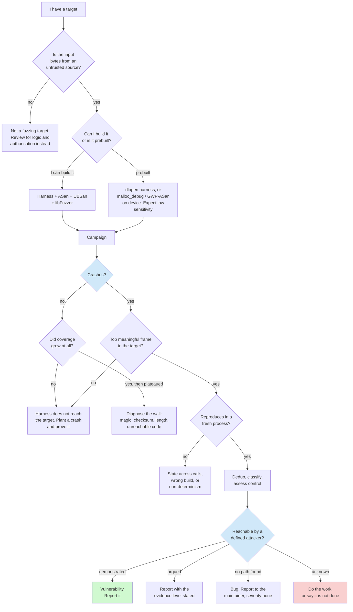

# 70 — Vulnerability Research — Mind Map

One map of the whole chapter. The spine is the seven-stage method; everything else hangs off it.

```mermaid
mindmap
  root((70 — Vulnerability<br/>Research))
    1 What it is
      Discovery of UNKNOWN defects
        vs pentest: known controls
        low success rate, long timeboxes
        deliverable is a reachability verdict
      The three terms
        Crash: an observation
        Bug: a defect
        Vulnerability: a REACHABLE defect
        most crashes are neither
      Systematic beats talented
        a record of where you have been
        turns luck into method
      No exploits here
        it is what the job actually is
        judgement does not transfer downward
        weaponised code is a liability
        triage and remediation instead
      Authorisation first
        fuzz: your code, OSS, emulator, a phone you can lose
        scope: any third-party app, any vendor service
        never: a phone you depend on
    2 The attack surface
      Remote, no code on device
        network, media, images, fonts
        highest value, most competition
      Any installed app
        exported components
        Binder services
        ContentProviders
        START HERE
      Privileged process only
      Kernel
      TEE and hardware
      Boundary numbering differs per chapter
        20 six boundaries
        24 three boundaries
        25 three boundaries
        always name the model
    3 The method
      S1 Enumerate
        manifest across EVERY package
        service list, diff vs reference
        native libraries, vendor first
        formats and protocols
        write the table down
      S2 Select target
        eyes on it
        language: C/C++ vs Rust
        age of the code
        input complexity
        reachability
        vendor code, not AOSP core
        ask who else has fuzzed this
      S3 Harness
        LLVMFuzzerTestOneInput
        no state across calls
        free on every path
        no output per iteration
        no artificial crashes
        READ the output
        constrain selectors not data
        checksum: recompute in harness
      S4 Discover
        fuzzing finds memory safety
        review finds logic and deputies
        seeds beat CPU
        plateau always has a cause
      S5 Triage
        target or harness?
        does it reproduce?
        which class?
        dedup by stack hash
          3 to 5 meaningful frames
          drop interceptors and libc
          drop fortify wrappers
        one defect, three faces
        compare bucket members for evidence
      S6 Reachability
        who, from where, doing what
        levels 0 to 4
        tombstone from an app = level 4
        four honest verdicts
        prove from an app not adb shell
      S7 Report
        route it correctly
        lead with the verdict
        state what was NOT shown
    4 AOSP
      cc_fuzz in Android.bp
        host_supported is the one to look for
      fuzzers live beside their code
      media, Parcel, androidfw, ART, HALs
      dex2oat reachable at INSTALL time
      hardening changed the yield
        Scudo, no quarantine on Android
        mediaserver split changed VALUE not bugs
        Mainline ships fixes faster
        Rust removes the class
    5 Bug classes
      Memory safety
        taxonomy owned by 19
        three sentences
          length not checked vs destination
          arithmetic overflowed first
          checked against the wrong thing
      Confused deputy
        owned by 24 and 25
        review only, no crash
        deputy must hold privilege caller lacks
        Binder identity is unforgeable
        check in onBind is the WRONG identity
      Parser differential
        owned by 10 for APK
        oracle is disagreement
        sanitizers cannot help
      State and logic
        build the state table
        blank cells are the bugs
      Races and TOCTOU
        Binder thread pool
        check-then-open
        Parcel read twice
        prove it or say you could not
    6 Reverse engineering
      exports, strings, magic, loop shape
      the check that is not one
        what is it comparing AGAINST?
        four questions per copy
      patch diffing
        the diff tells you the bug
        patch gap is the finding
      decompiler to harness
        dlopen by name
        by offset: fragile, revalidate
        through the real entry point
    7 Dynamic
      libFuzzer
      sanitizer matrix
        ASan blind inside an allocation
        UBSan has the type information
        address+memory illegal
      corpus is the campaign's memory
      coverage is where you have NOT been
      host first, device to confirm
      verify the toolchain with a 3-line main
    8 Static
      grep catalogue
      four-question protocol
      arithmetic checklist
      compiler warnings, clang-tidy
      release diffing
    Disclosure
      AOSP vs Mainline vs Google vs OEM vs Play
      severity axes
        vector: remote proximal local physical
        impact: RCE EoP infoleak DoS
        privilege of the landing process
      90 days is a norm not a law
      never fabricate a CVE
      ethics
        no production infrastructure
        no real user data
        no extortion
        publish analysis, withhold the weapon
    Honest severity
      unreachable crash = a bug
      sweep gives leads not findings
      confidence rank is not severity rank
      rate what you can prove
      a negative result is a result
```

---

## The same thing as a decision flow

When you are in the middle of it and need to know what to do next:

Two nodes are shaded because they are the decisions the chapter exists to teach. The red node is the
one people skip, and skipping it is how a genuine bug becomes a rejected report.
