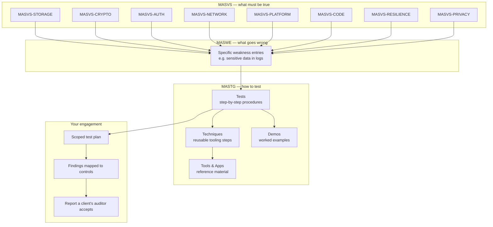
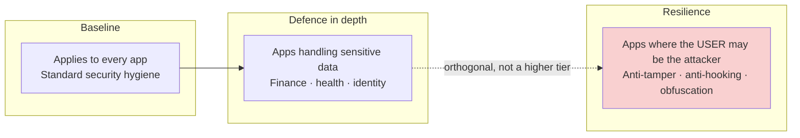
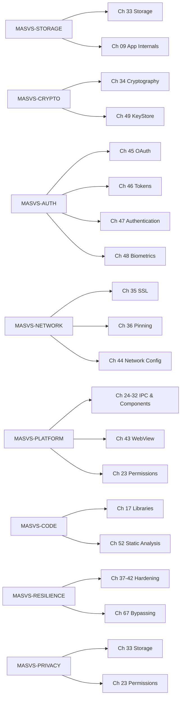
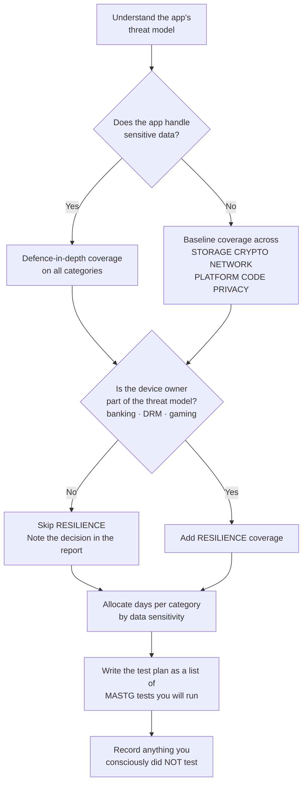
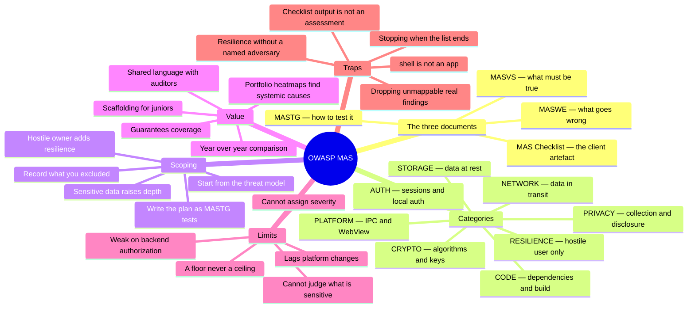

# 71 — OWASP Mobile (MASVS, MASTG, MASWE)

> After this chapter you will be able to scope an assessment against a recognised standard, map every
> finding you produce to a control a client's auditor will accept, and explain honestly where the
> standard is silent or wrong.

**Prerequisites:** [51-DynamicAnalysis](../51-DynamicAnalysis/README.md), [52-StaticAnalysis](../52-StaticAnalysis/README.md)
**Applies to:** MASVS v2.x, MASTG v1.x/v2.x — verify current versions at https://mas.owasp.org/

---

## Table of Contents

1. [Introduction](#1-introduction)
2. [High-Level Architecture](#2-high-level-architecture)
3. [Deep Internal Working](#3-deep-internal-working)
4. [Source Code Walkthrough](#4-source-code-walkthrough)
5. [Security Perspective](#5-security-perspective)
6. [Reverse Engineering Perspective](#6-reverse-engineering-perspective)
7. [Dynamic Analysis](#7-dynamic-analysis)
8. [Static Analysis](#8-static-analysis)
9. [Examples](#9-examples)
10. [Common Interview Questions](#10-common-interview-questions)
11. [Common Mistakes](#11-common-mistakes)
12. [Hands-on Labs](#12-hands-on-labs)
13. [Summary](#13-summary)
14. [References](#14-references)

---

## 1. Introduction

Imagine two building inspectors examining the same house. The first walks through, notices some
things, and writes a letter describing what struck them. The second works from a checklist that every
inspector in the country uses, ticks each item, and produces a report the bank, the insurer and the
next inspector can all read.

Both may be equally skilled. Only the second produces something anyone can *act on with confidence*,
compare against last year's inspection, or use to prove compliance.

Security testing has the same divide, and OWASP's Mobile Application Security project is the
checklist that made the second kind possible for mobile.

### The problem it solves

Before a shared standard existed, three things went wrong constantly.

**Scope was undefined.** A client asked for "a security test of our app". The tester spent four days
on the areas they personally found interesting. Whether the app's biometric implementation was
examined depended entirely on whether that tester happened to care about biometrics.

**Reports were incomparable.** Two firms tested the same app and produced findings with no overlap in
structure, naming or severity philosophy. The client could not tell whether the second firm had found
more issues or used different words.

**"Secure" meant nothing.** Without a stated bar, "the app passed the security test" is an assertion
about the tester's mood, not the app.

> **Definition**
> **MASVS** (Mobile Application Security Verification Standard) states *what* must be true for an app
> to be considered secure, at a chosen level of rigour. **MASTG** (Mobile Application Security Testing
> Guide) explains *how* to test each of those requirements. **MASWE** (Mobile Application Security
> Weakness Enumeration) catalogues the *specific weaknesses* that violate them.

Think of it as three layers: MASVS is the law, MASWE is the list of offences, and MASTG is the police
procedure manual.

### Why a standard is not a substitute for skill

This chapter would be dishonest if it stopped there, so let us be clear about the limits.

A standard is a **floor, not a ceiling**. Every genuinely interesting finding I have seen in a decade
of mobile work — the intent redirection chain that reached a non-exported admin activity, the OAuth
implementation whose server never verified PKCE, the biometric gate that protected a token also
sitting in plaintext in SharedPreferences — was found by someone reasoning about the specific
application, not by ticking a box. The standard tells you where to look. It does not tell you what
you will see.

A standard also **lags the platform**. Android ships behaviour changes annually. A control written
against Android 11 assumptions may be irrelevant, or actively misleading, on Android 15.

And a standard **cannot rate your finding**. MASVS tells you a control was violated. Whether that
violation is Critical or Informational depends on a threat model the standard knows nothing about.

> **Mental Model**
> Use the standard to guarantee **coverage** — that you did not forget to test an entire category.
> Use your own judgement to find the things the standard could not anticipate. A report that is only
> checklist output is a compliance artefact. A report that is only intuition is unrepeatable. You owe
> the client both.

### What would happen without it

If the standard vanished tomorrow, three things would degrade immediately. Clients would lose the
ability to compare vendors or track improvement across years. Regulated industries — finance,
healthcare, government — would lose the mapping that lets them demonstrate due diligence to auditors.
And junior testers would lose the scaffolding that stops them from testing only what they already
know how to test, which is the single biggest cause of shallow reports.

---

## 2. High-Level Architecture

### How the three documents relate



Read the diagram top to bottom. You start from a MASVS control ("sensitive data must not be exposed
through unintended mechanisms"), find the MASWE weaknesses that would violate it ("sensitive data
written to the system log"), and then follow the MASTG test that tells you exactly how to check for
that weakness on Android. Your engagement plan is the set of tests you selected; your report maps each
finding back up the chain to the control it violates.

The upward direction is what makes a report defensible. When a client asks "why does this matter?",
you can answer with a control they have already agreed to be measured against, rather than with your
opinion.

### The verification levels

MASVS historically defined tiers of rigour. The current structure separates the *category* of control
from the *depth* of verification you apply to it.



The critical structural insight — and the one people most often get wrong — is that **resilience is
not a higher security level**. It is an *orthogonal* concern. An app can be perfectly compliant with
every storage, crypto, network and authentication control and have zero resilience measures, and that
may be entirely correct for its threat model. Resilience controls only matter when the device owner
is part of your threat model: banking, DRM, gaming, licensing.

> **Warning**
> Recommending obfuscation and root detection for an app whose threat model does not include a hostile
> user is bad advice. It costs the client engineering effort, complicates their crash reporting and
> support, and buys nothing. Only recommend resilience controls when you can name the adversary they
> defend against.

### Where each control area maps in this repository



This is the practical value of the mapping: when a client asks for "MASVS-NETWORK coverage", you now
know that means chapters 35, 36 and 44 of this repository, and you can scope the time accordingly.

---

## 3. Deep Internal Working

### The control categories, explained

Each MASVS category is a *theme*, not a checklist item. Here is what each actually asks, what a tester
must produce as evidence, and where this repository teaches the underlying mechanism.

#### MASVS-STORAGE — data at rest

**What it asks:** sensitive data must not be stored where it can be recovered by another app, by
someone with the device, or by a backup mechanism — and must not leak through incidental channels
like logs, caches and screenshots.

**Why it exists:** the device is not a trusted environment. Phones are lost, stolen, resold, backed up
to clouds, and shared. Anything written to disk should be assumed recoverable by someone eventually.

**What you must produce as evidence:** a complete inventory of what the app writes, where, and in what
form — obtained by snapshotting the data directory before and after exercising every feature, not by
reading the source and assuming.

**Common violations:** session tokens in plaintext `SharedPreferences`; credentials in SQLite; PII in
external storage; `allowBackup="true"` on an app with sensitive local state; sensitive values passed
to `Log.d`; screenshots in the recents thumbnail without `FLAG_SECURE`; WebView caches and cookies on
disk.

**Chapters:** [33-Storage](../33-Storage/README.md), [09-Android-App-Internals](../09-Android-App-Internals/README.md)

#### MASVS-CRYPTO — cryptography

**What it asks:** cryptography must use current algorithms, correct modes and parameters, properly
generated randomness, and keys managed so that compromise of the app's storage does not compromise the
keys.

**Why it exists:** cryptography fails silently. An app using ECB mode with a hardcoded key looks
exactly like an app using AES-GCM with a hardware-backed key, from the outside. Only inspection
reveals the difference.

**What you must produce as evidence:** the actual algorithm, mode, key source, IV source and key
storage for every cryptographic operation the app performs — obtained by hooking the JCA at runtime,
not by grepping for `"AES"`.

**Common violations:** hardcoded keys; ECB mode; static or zero IVs; IV reuse under GCM;
`java.util.Random` for key or token generation; MD5 or SHA-1 for integrity; a key derived from a
constant; `SecretKeySpec` built from a byte array in the code, which never touches the KeyStore at
all.

**Chapters:** [34-Cryptography](../34-Cryptography/README.md), [49-KeyStore](../49-KeyStore/README.md)

#### MASVS-AUTH — authentication and authorization

**What it asks:** authentication must be enforced server-side, sessions must be managed correctly,
and local authentication (biometrics, PIN) must be cryptographically bound rather than decorative.

**Why it exists:** the client is attacker-controlled. Every check performed only on the device can be
removed by someone with the device.

**What you must produce as evidence:** proof that the *server* enforces each authorization decision —
obtained by replaying every captured request with a downgraded or absent session, not by reading the
app's UI logic.

**Common violations:** an `isLoggedIn` boolean in `SharedPreferences` gating access; logout that only
clears local state while the server-side session stays valid; OTP returned in the API response; a
biometric prompt whose success callback is a plain boolean with no `CryptoObject`; IDOR on the
backend.

**Chapters:** [45-OAuth](../45-OAuth/README.md), [46-Tokens](../46-Tokens/README.md),
[47-Authentication](../47-Authentication/README.md), [48-Biometrics](../48-Biometrics/README.md)

#### MASVS-NETWORK — data in transit

**What it asks:** all network traffic must be encrypted with correctly validated TLS, and the app must
not weaken validation.

**Why it exists:** mobile devices roam across untrusted networks by design — cafés, airports, hotels,
cellular networks in jurisdictions with interception mandates.

**What you must produce as evidence:** a full traffic capture showing every endpoint the app contacts,
including non-HTTP protocols, plus the result of deliberately presenting an invalid certificate.

**Common violations:** cleartext HTTP endpoints; an empty `checkServerTrusted`; a `HostnameVerifier`
returning `true`; `onReceivedSslError` calling `handler.proceed()`; a debug trust configuration
shipped to production; an expired `<pin-set>`, which silently disables pinning entirely.

**Chapters:** [35-SSL](../35-SSL/README.md), [36-CertificatePinning](../36-CertificatePinning/README.md),
[44-NetworkSecurityConfig](../44-NetworkSecurityConfig/README.md)

#### MASVS-PLATFORM — platform interaction

**What it asks:** the app must use platform features safely: IPC exposed deliberately and guarded,
WebViews configured safely, permissions minimal and justified.

**Why it exists:** Android is a multi-app operating system where every exposed component is reachable
by every other app on the device.

**What you must produce as evidence:** an exported-component inventory and the result of invoking each
one **from an unprivileged app**, not from `adb shell`.

**Common violations:** unintentionally exported components; intent redirection; SQL injection or path
traversal in a `ContentProvider`; a `FileProvider` with `root-path`; `addJavascriptInterface`
exposing sensitive methods; `setAllowUniversalAccessFromFileURLs(true)`; mutable `PendingIntent`s;
task hijacking; over-broad permissions.

**Chapters:** [24-IPC](../24-IPC/README.md) through [32-Manifest](../32-Manifest/README.md),
[43-WebView](../43-WebView/README.md), [23-Permissions](../23-Permissions/README.md)

#### MASVS-CODE — code quality and dependencies

**What it asks:** the app must be built with current tooling and dependencies, free of known
vulnerable components, and must not ship debug artefacts or handle untrusted input unsafely.

**Why it exists:** most of the code in a modern app was not written by the team that ships it.

**What you must produce as evidence:** a dependency inventory with versions, obtained by fingerprinting
the shipped APK when build files are unavailable.

**Common violations:** outdated libraries with known issues; `android:debuggable="true"` in release;
`setWebContentsDebuggingEnabled(true)`; a shipped `<instrumentation>` tag; a mapping file included in
the APK; unvalidated deserialization.

**Chapters:** [17-Libraries](../17-Libraries/README.md), [52-StaticAnalysis](../52-StaticAnalysis/README.md),
[08-Build-System](../08-Build-System/README.md)

#### MASVS-RESILIENCE — defence against a hostile user

**What it asks:** where the threat model includes the device owner, the app should raise the cost of
tampering, instrumentation, and reverse engineering.

**Why it exists:** for banking, payments, DRM and gaming, the person holding the device may be the
adversary.

**What you must produce as evidence:** the set of protections present, the effort required to defeat
each, and — critically — whether anything server-side depends on them.

**Common violations:** no obfuscation on an app with meaningful client-side logic; root detection that
a single Frida hook defeats; integrity checks whose result is only used locally; reliance on Play
Integrity verdicts checked on the client rather than the server.

**Chapters:** [37-RootDetection](../37-RootDetection/README.md) through
[42-R8](../42-R8/README.md), [67-BypassingProtections](../67-BypassingProtections/README.md)

> **Pentester's Note**
> Resilience is the category where honest reporting matters most. You *will* bypass the protections —
> that is your job, and it proves nothing by itself. The finding is never "I bypassed root detection".
> The finding is either "these protections are absent or trivially defeated, and here is the
> business risk that creates" or "having bypassed them, here is what I found". Say which.

#### MASVS-PRIVACY — user data handling

**What it asks:** the app must minimise collection, be transparent about it, and handle user data
according to stated policy and applicable law.

**Why it exists:** regulation (GDPR, CCPA and their equivalents) and platform policy now make privacy
a compliance obligation, not a courtesy.

**What you must produce as evidence:** an inventory of what leaves the device, to whom, and whether
the user was told — obtained from traffic capture, including third-party SDK traffic.

**Common violations:** identifiers collected without disclosure; analytics SDKs transmitting more than
the privacy policy states; location collected at higher precision than needed; data shared with
third parties not named in the policy; sensitive data in crash reports.

**Chapters:** [33-Storage](../33-Storage/README.md), [23-Permissions](../23-Permissions/README.md),
[17-Libraries](../17-Libraries/README.md)

### Scoping an engagement against the standard

The practical question is always: given N days, what do you test?



That last step is the professional one and it is almost always skipped. A report that says "we did not
assess the resilience controls because the agreed threat model did not include a hostile device owner"
is far more valuable than one that silently omits them, because the client can revisit the decision.

---

## 4. Source Code Walkthrough

The MAS project is itself open source, and reading it is worthwhile.

| Resource | What it contains |
|---|---|
| `OWASP/owasp-mastg` on GitHub | The full testing guide, tests, techniques, and demos in Markdown |
| `OWASP/owasp-masvs` on GitHub | The standard itself, plus translations |
| MASTG *Tests* | Individual, referenceable procedures with an ID you cite in reports |
| MASTG *Techniques* | Reusable tool procedures (e.g. how to bypass pinning) referenced by many tests |
| MASTG *Demos* | Worked examples against real sample apps, with expected output |
| MASTG *Apps* | The deliberately vulnerable apps, including the UnCrackable series |
| MAS Checklist | A spreadsheet mapping every MASVS control to its MASTG tests — the artefact clients actually want |

> **Under the Hood**
> The MASTG restructured significantly between v1 and v2, moving from long narrative chapters to
> atomic, individually-identified tests. If you inherit an older report citing chapter-style
> references, or a client's compliance team is working from an older checklist, expect the identifiers
> not to line up. State which version you tested against in the report's methodology section.

### Reading a MASTG test

Each test follows a consistent shape, and knowing the shape lets you consume them quickly:

1. **Overview** — what weakness this detects and why it matters
2. **Steps** — the exact procedure, usually with specific tooling
3. **Observation** — what output you should collect
4. **Evaluation** — how to decide whether the app passes or fails

The **Evaluation** section is the one to read carefully, because it is where the standard states the
pass criterion. It is also where you will most often disagree with it for a specific app — and where
you should say so explicitly rather than silently deviating.

---

## 5. Security Perspective

### How the standard is misused

**As a substitute for thinking.** A tester runs MobSF, maps its output to MASVS controls, and ships
it. The report is structurally correct and worthless: it contains no finding that required a human.

**As a shield.** "The app is MASVS-compliant" said as though it means "the app is secure". It means
the app satisfies a set of controls that a committee considered a reasonable baseline in a particular
year. It says nothing about the business logic flaw in the payment flow.

**As a ceiling.** A tester stops when the checklist is complete, with two days left in the engagement,
instead of spending those days on the app's actual novel functionality.

**Selectively.** Claiming coverage of a category after testing one control in it.

### How the standard genuinely helps

It stops you forgetting whole categories, which is the most common cause of a shallow report. It gives
you language a client's compliance team already understands. It makes year-over-year comparison
possible. It gives a junior tester a defensible structure while they build judgement. And it gives you
something to point at when a client disputes that a finding matters.

### The relationship to other standards

| Standard | Relationship |
|---|---|
| OWASP Mobile Top 10 | The awareness-level list. Useful for communicating with executives; too coarse for testing. MASVS superseded it for actual verification work. |
| OWASP ASVS | The web/API equivalent. Use it for the app's **backend**, which is where most high-severity findings actually live. |
| PCI MPoC / PCI DSS | Payment-specific requirements. Overlaps heavily with MASVS-CRYPTO, AUTH and RESILIENCE, with additional mandatory controls. |
| NIST SP 800-163 | US federal mobile app vetting. More process-oriented. |
| ISO 27001 / SOC 2 | Organisational, not application-level. Your report becomes evidence within them. |

> **Pentester's Note**
> On most mobile engagements the highest-severity findings are on the **API**, not in the app. The app
> is a convenient way to discover the API's endpoints and expected requests. Scope ASVS coverage for
> the backend explicitly, or state explicitly that it was out of scope — otherwise a client will
> reasonably assume "you tested our mobile product" included it.

### Forensic and defensive uses

Defenders use MASVS as a design checklist during development rather than after it, which is where it
delivers the most value per unit effort. A development team that reads MASVS-STORAGE before choosing
where to put the session token avoids the finding entirely.

---

## 6. Reverse Engineering Perspective

The standard shapes what you look for when reading an app, and gives you a systematic sweep rather
than an opportunistic one.

| While reading in JADX, look for… | Violating control |
|---|---|
| `SharedPreferences` / `SQLiteDatabase` writes near login code | MASVS-STORAGE |
| `SecretKeySpec`, `IvParameterSpec`, `Cipher.getInstance` | MASVS-CRYPTO |
| `new Random()` used near key or token generation | MASVS-CRYPTO |
| `checkServerTrusted` with an empty body, `HostnameVerifier` | MASVS-NETWORK |
| `onReceivedSslError` calling `proceed()` | MASVS-NETWORK |
| `addJavascriptInterface`, `setAllowUniversalAccessFromFileURLs` | MASVS-PLATFORM |
| `getIntent().getParcelableExtra(...)` passed to `startActivity` | MASVS-PLATFORM |
| `PendingIntent.getActivity` without `FLAG_IMMUTABLE` | MASVS-PLATFORM |
| `onAuthenticationSucceeded` with no `CryptoObject` | MASVS-AUTH |
| `isLoggedIn` boolean read from preferences | MASVS-AUTH |
| `Log.d`/`Log.v` with variables named token, key, password | MASVS-STORAGE / PRIVACY |
| Absence of any name mangling in a release build | MASVS-RESILIENCE |
| Known-vulnerable library versions in `strings` or class signatures | MASVS-CODE |

Running that table as a search list against a decompiled app is a solid first hour, and it maps every
hit directly to a control.

---

## 7. Dynamic Analysis

The MASTG's practical value is that most controls can only be verified at runtime. Static reading
tells you what the code *can* do; only execution tells you what it *does*.

### A control-driven dynamic pass

```bash
# host — MASVS-STORAGE: snapshot, exercise, snapshot, diff
adb shell "su -c 'tar czf /sdcard/before.tgz -C /data/data/$PKG .'"
# ...log in, use every feature...
adb shell "su -c 'tar czf /sdcard/after.tgz -C /data/data/$PKG .'"
adb pull /sdcard/before.tgz && adb pull /sdcard/after.tgz
mkdir -p b a && tar xzf before.tgz -C b && tar xzf after.tgz -C a && diff -rq b a
```

```bash
# host — MASVS-STORAGE / PRIVACY: log leakage during the same session
adb logcat -c
adb logcat --pid=$(adb shell pidof -s $PKG) -v threadtime \
  | grep -iE "token|password|secret|key|auth|session|jwt|email|phone"
```

```bash
# host — MASVS-CRYPTO: what cryptography actually runs
frida -U -f $PKG -l ../34-Cryptography/scripts/frida-jca-universal-hook.js
```

```bash
# host — MASVS-PLATFORM: exported surface, exercised from an unprivileged context
adb shell dumpsys package $PKG | grep -n "exported=true"
# then invoke each from a test app, NOT from adb shell — see section 11
```

```bash
# host — MASVS-NETWORK: full capture including non-HTTP
adb shell "su -c 'tcpdump -i any -s 0 -w /sdcard/cap.pcap'" &
# ...exercise the app...
adb pull /sdcard/cap.pcap && wireshark cap.pcap
```

Each command produces the *evidence* a control requires, not merely an opinion about it. That
distinction is what makes a report defensible.

---

## 8. Static Analysis

Static analysis maps cleanly onto the categories, and the triage sweep in
[52-StaticAnalysis](../52-StaticAnalysis/README.md) can be organised by control:

| Artefact | Controls it informs |
|---|---|
| `AndroidManifest.xml` | PLATFORM, CODE, STORAGE (`allowBackup`), NETWORK (`usesCleartextTraffic`) |
| `network_security_config.xml` | NETWORK |
| `res/values/strings.xml`, `assets/` | CRYPTO, CODE (embedded secrets) |
| Gradle files, when available | CODE (dependencies), RESILIENCE (`minifyEnabled`) |
| `classes*.dex` | all categories |
| `lib/*/*.so` | CRYPTO, RESILIENCE, CODE |
| `META-INF/` signature block | CODE (signing scheme), RESILIENCE |
| `mapping.txt` if present | RESILIENCE (a finding in itself) |

> **Warning**
> Automated tools that claim to "check MASVS compliance" produce a mapping, not a verdict. A tool
> cannot determine whether the data an app stores is *sensitive*, which is the entire question for
> MASVS-STORAGE. Treat automated MASVS mapping as a coverage tracker and nothing more. See
> [55-MobSF](../55-MobSF/README.md) for the false-positive discussion.

---

## 9. Examples

### Simple — using the checklist to scope

A client asks for a three-day assessment of an internal expense-reporting app. No payments, no
sensitive personal data beyond names and receipts, corporate-managed devices.

Reasoning: the device owner is an employee on a managed device, not an adversary, so RESILIENCE is out
of scope — and you say so in the report. Baseline coverage across STORAGE, CRYPTO, NETWORK, PLATFORM,
CODE and PRIVACY. Weight the days towards PLATFORM (it is an internal app, likely with rough IPC
hygiene) and AUTH (it talks to an internal API).

### Intermediate — mapping a finding

You find that the app writes the OAuth refresh token to `SharedPreferences` in plaintext.

```markdown
**Finding:** Refresh token stored unencrypted in SharedPreferences
**MASVS:** MASVS-STORAGE-1 (sensitive data must not be stored unprotected)
**MASWE:** the corresponding weakness entry for insecure local storage of credentials
**MASTG:** the test covering local storage of sensitive data on Android
**Severity:** Medium — requires device access or root, but the refresh token has a 30-day
  lifetime and no device binding, so it yields persistent account access from any device.
**Evidence:** /data/data/com.example/shared_prefs/auth.xml, key "refresh_token"
```

the severity argument does the real work. The control violation is a fact; the severity
comes from the token's lifetime and the absence of device binding, which no standard could have told
you.

### Advanced — where the standard is silent

You discover that the app's server accepts an OAuth authorization code exchange **without** the PKCE
`code_verifier`, even though the app always sends one. No MASVS control states "the authorization
server must reject requests lacking a verifier" — it is a server-side behaviour, and the app is
technically doing everything right.

The finding is real and serious: PKCE provides no protection whatsoever if the server does not
enforce it, so an attacker who intercepts an authorization code can redeem it.

Report it under MASVS-AUTH as the closest fit, state plainly that it is a server-side control outside
the strict letter of the mobile standard, and cross-reference OWASP ASVS and RFC 7636. **Do not drop a
real finding because it does not map cleanly.** A note in the report explaining the gap is more
professional than silence.

### Real application — a full engagement plan

Ten days on a retail banking app.

| Days | Focus | Categories |
|---|---|---|
| 1 | Recon, static triage, manifest audit, environment setup | CODE, PLATFORM |
| 2 | Storage sweep across full feature exercise | STORAGE, PRIVACY |
| 3 | Interception setup, pinning bypass, full traffic capture | NETWORK, RESILIENCE |
| 4–5 | Authentication, session, OAuth, token handling, biometrics | AUTH |
| 6 | Cryptography and KeyStore audit via runtime hooks | CRYPTO |
| 7 | IPC and component surface, from a test app | PLATFORM |
| 8 | Backend authorization testing across every captured endpoint | AUTH (+ASVS) |
| 9 | Resilience assessment and native code review | RESILIENCE |
| 10 | Verification, severity review, reporting | — |

Day 8 is deliberately a full day, because it is reliably where the highest-severity findings are.

### Enterprise — programme-level use

A large organisation with forty mobile apps does not want forty independent reports; it wants to know
where its systemic weaknesses are.

Test every app against the same subset of controls, record pass/fail per control per app, and produce
a heatmap. What emerges is almost always a small number of *systemic* issues — a shared internal
networking library with weak TLS defaults, an internal SDK that logs verbosely, a copy-pasted
authentication pattern. Fixing the shared component fixes twenty apps at once.

> **Mental Model**
> At programme scale, the standard's real value is not per-app assurance. It is that a **consistent
> measurement across many apps reveals the shared causes**, which is where remediation effort actually
> pays off.

---

## 10. Common Interview Questions

### Beginner

**Q: What is the difference between MASVS and MASTG?**
MASVS is the standard stating what must be true; MASTG is the guide explaining how to test it. MASVS
defines requirements, MASTG defines procedures. MASWE catalogues the specific weaknesses that violate
the requirements.

**Q: What are the MASVS control categories?**
Storage, Crypto, Auth, Network, Platform, Code, Resilience and Privacy. Be able to give a one-sentence
description and an example violation for each.

**Q: Is the OWASP Mobile Top 10 the same thing?**
No. The Top 10 is an awareness list, useful for communicating risk categories to non-specialists.
MASVS is a verification standard used for actual testing. They serve different audiences.

### Intermediate

**Q: An app has no obfuscation and no root detection. Is that a MASVS failure?**
Only if the threat model includes a hostile device owner. Resilience controls are orthogonal to the
other categories, not a higher tier. For an internal enterprise app on managed devices, recommending
them is bad advice — it costs engineering effort and buys nothing. State the threat model in your
report and justify the scoping decision either way.

**Q: How would you handle a real finding that does not map to any MASVS control?**
Report it anyway, under the closest category, and state explicitly that it falls outside the strict
letter of the standard. Cross-reference another standard where one fits — ASVS for backend issues, an
RFC for protocol issues. Dropping a real finding because of a taxonomy gap is a failure of judgement,
not of rigour.

**Q: A client says "make us MASVS compliant". What is your response?**
Clarify what they actually need. Compliance with which categories, at what depth, and against which
threat model? And be honest that satisfying the controls is a floor, not a guarantee of security —
business logic flaws and novel attack chains live outside any checklist.

### Senior

**Q: Where does MASVS mislead a tester, and how do you compensate?**
Several places. It cannot rate severity, because it knows nothing about the threat model — so you must
supply that reasoning yourself. It lags platform changes, so a control may be irrelevant on current
Android. It says little about backend authorization, which is where most high-severity mobile findings
actually live. And it can create a false sense of completion that stops a tester from investigating
the app's novel functionality. Compensate by treating it as a coverage guarantee, scoping ASVS for the
backend explicitly, and reserving deliberate unstructured time for the application's actual business
logic.

**Q: How would you use MASVS across a portfolio of forty apps?**
Consistent per-control measurement across all apps, producing a heatmap rather than forty reports. The
value is identifying systemic causes — a shared library, an internal SDK, a copy-pasted pattern —
because fixing the shared component remediates many apps at once. Also track control pass rates over
time as a programme health metric.

### Staff Engineer

**Q: Design a process that embeds MASVS into a development lifecycle rather than bolting it on.**
Expect: MASVS-derived requirements in the definition of done for relevant features; automated checks in
CI for the mechanically checkable controls (manifest flags, cleartext config, dependency versions,
`minifyEnabled`); a threat-model review at design time that decides the resilience scoping once, at
the product level; secure defaults provided as internal libraries so developers get compliance without
thinking about it; and periodic deep manual assessment for the controls automation cannot judge —
which is most of the important ones.

**Q: Argue against over-reliance on the standard.**
The controls describe known failure modes. Every novel attack, by definition, is not in the list. An
organisation optimising purely for control pass rates will systematically underinvest in the
adversarial thinking that finds novel issues, and will get a false assurance signal. The standard
should be the floor of the assurance programme and never its ceiling.

### Principal Engineer

**Q: MASVS controls are largely binary. Real risk is continuous. How would you reconcile that?**
A strong answer discusses that binary controls exist because they are auditable and comparable, and
that the loss of nuance is the price of those properties. It proposes layering a risk model on top —
weighting control failures by data sensitivity, exposure and compensating controls — while keeping the
underlying binary measurement intact so comparability survives. It acknowledges the failure mode of any
weighted model: the weights become the thing people game.

**Q: What would you change about the standard?**
Reasonable answers include: stronger and more explicit treatment of backend authorization, since that
is where the severe findings concentrate; faster tracking of platform behaviour changes; clearer
guidance on scoping resilience by threat model rather than leaving it as an implicit judgement; and
explicit acknowledgement in the document itself that the standard is a floor. A good answer also
notes that OWASP is volunteer-driven and that "someone should" is not a plan — contributing is.

---

## 11. Common Mistakes

### Developer mistakes

- Treating MASVS as a post-hoc audit rather than a design input, so violations are discovered when
  they are expensive to fix.
- Implementing resilience controls (obfuscation, root detection) while leaving baseline controls
  (plaintext token storage) unaddressed — hardening the door of an unlocked building.
- Assuming a control is satisfied because a library claims it. "We use EncryptedSharedPreferences"
  means nothing if the sensitive value is also written to a plain preferences file elsewhere.
- Reading the control text without reading the *evaluation* criterion in the corresponding test.

### Pentester mistakes

- **Reporting checklist output as an assessment.** If every finding came from a tool mapped to a
  control, you have produced a compliance artefact, not a security assessment.
- **Stopping when the checklist is complete** while engagement days remain.
- **Claiming category coverage after testing one control in it.**
- **Reproducing platform findings only from `adb shell`.** `shell` is UID 2000 with developer
  privileges an app does not have. A MASVS-PLATFORM finding requires reproduction from an
  unprivileged app UID. This is the single most common false positive in mobile reports.
- **Recommending resilience controls without naming the adversary** they defend against.
- **Dropping a real finding because it does not map cleanly** to a control.
- **Not stating which version of MASVS/MASTG you tested against**, making the report
  non-reproducible once the standard moves.
- **Not recording what you deliberately did not test.**

### Reverse engineer mistakes

- Concluding a control is satisfied from static reading alone. The code path you read may never
  execute; the one that does may be in a native library.
- Assuming an unused vulnerable code path is not a finding — it may be reachable through a component
  you have not enumerated.
- Missing that a value found encrypted on disk is plaintext in memory, and reporting the storage
  control as satisfied.

---

## 12. Hands-on Labs

Full lab material lives in [`labs/`](labs/).

| Lab | Objective | Difficulty |
|---|---|---|
| Lab 01 — Build the checklist | Take the current MAS Checklist and produce a scoped test plan for a given app and threat model, justifying every inclusion and exclusion | Beginner |
| Lab 02 — Map a known app | Run a full MASVS-mapped assessment against a deliberately vulnerable app (OVAA or InsecureBankv2) and produce a control-by-control result table | Intermediate |
| Lab 03 — Find the gap | Deliberately locate one real finding in a target app that does *not* map cleanly to any MASVS control, and write it up defensibly | Advanced |
| Lab 04 — Portfolio heatmap | Assess three different vulnerable apps against the same control subset and produce a heatmap identifying systemic themes | Advanced |

**Assignment.** Take a report you have written previously — or a public sample report — and map every
finding to a MASVS control. Then answer two questions honestly: which categories did you not cover at
all, and which findings did you produce that no checklist would have led you to? The first tells you
your blind spots; the second tells you your actual value.

---

## 13. Summary

### Key points

- MASVS states what must be true, MASTG explains how to test it, MASWE catalogues the weaknesses.
- The categories are Storage, Crypto, Auth, Network, Platform, Code, Resilience and Privacy.
- **Resilience is orthogonal, not a higher tier.** It applies only when the device owner is part of
  the threat model.
- The standard guarantees **coverage**; it does not produce **insight**. You must supply the second.
- The standard cannot assign severity, because severity depends on a threat model the standard does
  not know.
- Most high-severity mobile findings are on the **backend**. Scope ASVS for it explicitly or state
  that it is out of scope.
- Reproduce every MASVS-PLATFORM finding from an unprivileged app UID, never from `adb shell` alone.
- Record what you deliberately did not test, and why.
- State which version of the standard you tested against.

### Mind map



### Condensed cheat sheet

| Category | Test it by | Chapters |
|---|---|---|
| STORAGE | Data-dir diff across a full feature exercise; log sweep | [33](../33-Storage/README.md) |
| CRYPTO | Runtime JCA hook; key property dump | [34](../34-Cryptography/README.md), [49](../49-KeyStore/README.md) |
| AUTH | Replay every endpoint with a downgraded session; check CryptoObject | [45](../45-OAuth/README.md)–[48](../48-Biometrics/README.md) |
| NETWORK | Full capture; present an invalid certificate | [35](../35-SSL/README.md), [36](../36-CertificatePinning/README.md), [44](../44-NetworkSecurityConfig/README.md) |
| PLATFORM | Invoke every exported component from an unprivileged app | [24](../24-IPC/README.md)–[32](../32-Manifest/README.md), [43](../43-WebView/README.md) |
| CODE | Dependency fingerprinting; debug artefact sweep | [17](../17-Libraries/README.md), [52](../52-StaticAnalysis/README.md) |
| RESILIENCE | Enumerate protections; measure bypass cost | [37](../37-RootDetection/README.md)–[42](../42-R8/README.md), [67](../67-BypassingProtections/README.md) |
| PRIVACY | Traffic inventory including third-party SDKs | [17](../17-Libraries/README.md), [23](../23-Permissions/README.md) |

### Quick revision

- What is the difference between MASVS, MASWE and MASTG?
- Name the eight control categories.
- Why is RESILIENCE not a higher security level?
- What can the standard not tell you about a finding you have confirmed?
- Where do most high-severity mobile findings actually live, and which standard covers that?
- Why must a MASVS-PLATFORM finding be reproduced from an app rather than from `adb shell`?
- What should a report say about categories you chose not to test?

---

## 14. References

### Primary sources

- OWASP MAS project — https://mas.owasp.org/
- OWASP MASVS — https://mas.owasp.org/MASVS/
- OWASP MASTG — https://mas.owasp.org/MASTG/
- OWASP MASWE — https://mas.owasp.org/MASWE/
- MAS Checklist — https://mas.owasp.org/checklists/
- MASTG GitHub repository — https://github.com/OWASP/owasp-mastg
- MASVS GitHub repository — https://github.com/OWASP/owasp-masvs

### Adjacent standards

- OWASP ASVS (for the backend) — https://owasp.org/www-project-application-security-verification-standard/
- OWASP Mobile Top 10 — https://owasp.org/www-project-mobile-top-10/
- NIST SP 800-163 Rev.1, Vetting the Security of Mobile Applications — https://csrc.nist.gov/publications/detail/sp/800-163/rev-1/final
- PCI Mobile Payments on COTS — https://www.pcisecuritystandards.org/
- FIRST CVSS v3.1 — https://www.first.org/cvss/v3-1/specification-document

### Android documentation

- App security best practices — https://developer.android.com/privacy-and-security/security-tips
- Android security overview — https://source.android.com/docs/security
- Behaviour changes by release — https://developer.android.com/about/versions

### Related chapters

- [51-DynamicAnalysis](../51-DynamicAnalysis/README.md) — the methodology behind the runtime tests
- [52-StaticAnalysis](../52-StaticAnalysis/README.md) — the methodology behind the static tests
- [55-MobSF](../55-MobSF/README.md) — automated mapping and its false positives
- [72-RealWorldFindings](../72-RealWorldFindings/README.md) — findings written up against these controls
- [80-Appendix](../80-Appendix/README.md) — severity rubric and report templates
