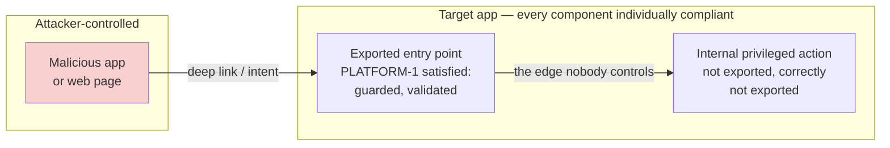

# Lab 03 — Find the Gap

**Difficulty:** Advanced
**Time:** 6–8 hours, plus whatever the hunt actually takes
**Prerequisites:** [`lab-02`](lab-02-map-a-known-app.md) completed with a finished result table,
[Chapter 71 §5](../README.md#5-security-perspective), a target with **real functionality and a real
backend** — InsecureBankv2, a client engagement you are authorised on, or an app you build yourself

---

## Objective

Find **one real finding that does not map cleanly to any MASVS control**, prove that it does not map,
and write it up so that a client's auditor accepts it anyway.

Then answer the question [README §12](../README.md#12-hands-on-labs) closes with: *which findings did
you produce that no checklist would have led you to?* Because that is your actual value, and this lab
is where you first find out whether you have any.

---

## Why this matters, and why this lab is hard on purpose

Every other lab in this chapter teaches you to use the standard. This one teaches you what the
standard cannot do, and it is the more important skill, because it is the one that does not
commoditise.

Here is the shape of the problem. A control set is a written record of failure modes that were (a)
known and (b) general enough to state in one sentence about any mobile app. Both filters matter:

- **Known** excludes everything novel. By definition.
- **General** excludes everything specific to your client's business. No committee can write a control
  about a refund flow, a loyalty-points ledger, or a two-person approval rule.

So there is a permanent, structural gap between "the app satisfies every control" and "the app is
safe". The gap is not a defect in MASVS. It is what a standard *is*.

> **🧠 Mental Model**
> Controls are written **per artefact and per component**: this file, this WebView, this key, this
> endpoint's transport. Real systems fail **between** things — between two components that are each
> correct, between the app and a server that each honour their half of a protocol differently,
> between what the app promises the user and what the system actually enforces. The standard has no
> vocabulary for "between", and that is where you should hunt.

> **⚠️ Warning — the failure mode of this lab**
> The lazy version of this exercise is to find an ordinary finding, notice that no control matches it
> *exactly*, and declare a gap. That is not a gap; that is not having read the standard carefully.
> Step 2 exists specifically to make that impossible, and you must complete it honestly. A tester who
> claims gaps that are really ignorance is worse than one who maps everything mechanically, because
> the mechanical tester is at least reproducible.

---

## Part A — Build the instrument

You cannot claim a finding is unmappable until you have a test for mapping that is stronger than
"feels like a fit".

### Step 1 — The counterfactual test

This is the whole instrument, and it is one question:

> **If the developer satisfied control C perfectly, in the way the standard intends, would this
> finding still exist?**

| Answer | Conclusion |
|---|---|
| **No** — satisfying C removes the finding | C is the right control. Map it and move on |
| **Yes** — the finding survives a perfect C | C is **not** the control, however similar the words are |

Apply it to a few known cases to calibrate:

| Finding | Candidate control | Counterfactual | Verdict |
|---|---|---|---|
| Refresh token in plaintext `shared_prefs` | STORAGE-1 | Store it correctly and the finding is gone | Maps. Clean |
| App sends PKCE; server accepts the exchange without a verifier | AUTH-1 | The app is *already* doing everything AUTH asks. Perfect app-side compliance changes nothing | **Does not map.** The obligation is the server's |
| Exported provider returns rows to any app | PLATFORM-1 | Guard the provider and the finding is gone | Maps. Clean |
| Two individually-correct components can be chained to bypass an approval step | PLATFORM-1 | Both components already satisfy PLATFORM-1 individually. The chain survives | **Does not map.** The failure is the composition |
| Analytics SDK transmits reading habits of a 6-year-old, disclosed in the privacy policy | PRIVACY-3 | Transparency is *already* satisfied. Disclosure does not remove the harm | **Does not map cleanly.** The harm is not a transparency failure |

**Question 1.** Take three findings from your [`lab-02`](lab-02-map-a-known-app.md) result table and
run the counterfactual on each. Did any mapping you made survive the test only because you did not
ask this question?

**Question 2.** Write the counterfactual test in your own words, in one sentence, as you would say it
to a junior tester who has just mapped a business-logic bug to STORAGE-1.

### Step 2 — Prove you looked, before you claim a gap

A gap claim is a claim about the *entire standard*, so it needs an exhaustive search, and the search
must be recorded. Build this table before you write the word "gap" anywhere:

| Category | Controls considered | Closest candidate | Counterfactual result | Why it fails |
|---|---|---|---|---|
| STORAGE | | | | |
| CRYPTO | | | | |
| AUTH | | | | |
| NETWORK | | | | |
| PLATFORM | | | | |
| CODE | | | | |
| RESILIENCE | | | | |
| PRIVACY | | | | |

All eight rows. Not the two you think are relevant — **all eight**, because the one you skipped is the
one a reviewer will find. Resolve the actual control list from the current checklist rather than from
memory or from [cheatsheet.md](../cheatsheet.md), so that your search is against the standard as it
is today.

**Question 3.** Which category surprised you by having a nearer candidate than you expected?

**Question 4.** For your closest candidate overall, write the strongest possible argument *for*
mapping it there. Now rebut your own argument. If you cannot rebut it convincingly, you do not have a
gap — you have a finding with an imperfect but legitimate mapping, and you should map it and say the
fit is imperfect.

> **🔍 Pentester's Note**
> This step is the difference between "I could not find a control" and "there is no control". The
> first is about you. The second is a claim about the document, and a claim about the document is
> something a reviewer can check. Only ever make the second one, and only with the table above behind
> it.

### Step 2b — Calibrate on a known set

Before hunting, check that your instrument is tuned. Ten candidate findings follow. For each,
decide **MAPS** or **GAP**, name the control or category if it maps, and give the counterfactual in
one clause. Write your answers before opening the solutions — a calibration you grade against an
answer you have already read measures nothing.

| # | Candidate finding |
|---|---|
| 1 | The app writes the user's full name and email address to the system log on every screen transition |
| 2 | The app's password-reset flow emails a link that never expires and is not single-use |
| 3 | Two exported activities are individually guarded; passing a crafted `Intent` to the first causes it to start the second with attacker-supplied extras |
| 4 | The app uses AES-GCM correctly, with a hardware-backed key, and derives the key from a user PIN with 1,000 PBKDF2 iterations |
| 5 | The API returns a different HTTP status for "user does not exist" and "wrong password", allowing account enumeration at 300 requests per second |
| 6 | Session tokens are correctly stored and correctly transmitted, but the server does not invalidate them when the user changes their password |
| 7 | The app's "delete my data" button removes local data and shows a confirmation; the server retains everything, which the privacy policy discloses in clause 14 |
| 8 | An exported `ContentProvider` returns rows to any installed app |
| 9 | Buying a subscription grants entitlement client-side after a receipt check that the app performs itself; the server never sees the receipt |
| 10 | The app ships a bundled image-decoding library three years out of date, with published vulnerabilities, but no attacker-reachable code path passes untrusted data to it |

**Question 4a.** How many did you mark GAP? If it is more than four you are probably being too
generous, and if it is zero you are probably being too strict. Both errors are worth knowing about
before you go hunting.

**Question 4b.** Two of the ten are genuinely arguable — reasonable testers disagree. Which two, and
what would settle it?

---

## Part B — Where gaps actually live

Six places, with the reason each one is structurally outside the standard. Hunt in these; do not wait
for a gap to fall out of a checklist run, because by construction it never will.

| Gap class | Why the standard cannot cover it | What to look for |
|---|---|---|
| **Server-side obligation** | MASVS is a *mobile application* standard. The server's duties are not its subject | Protocol halves: PKCE enforcement, token binding, nonce checks, replay windows, signature verification, idempotency keys |
| **Business logic** | No general control can describe your client's rules | Anything the app *presents* as a rule: limits, approvals, eligibility, pricing, quotas, sequencing |
| **Composition** | Controls are per component; systems fail between components | Two exported components that are individually guarded; a deep link plus a WebView; a grant plus a redirect |
| **State machine and time** | Controls are static properties; sessions are temporal | What happens across logout, token refresh, password change, device change, app upgrade, clock skew |
| **Economic and abuse** | Not a security control failure; a cost asymmetry | Unmetered expensive operations, enumeration oracles, free-tier abuse, notification/SMS cost amplification |
| **Harm despite compliance** | A control can be satisfied and the outcome still be wrong | Disclosed-but-harmful data flows; dark patterns in consent; lawful collection of data about children |

### Step 3 — Choose a hunting ground and build the promise list

Pick the class you will hunt. Then, before testing anything, write the **promise list**: everything
the app tells the user is true.

```text
notes/promises.txt
- "Only you can see your transactions"
- "Transfers over 1000 require approval from a second account holder"
- "Logging out ends your session on all devices"
- "Your reading data is never shared with advertisers"
- "Your subscription unlocks offline downloads"
```

Then test the promises. Not the controls — the promises.

This is the single most productive reframing in the lab. A control asks "is the token stored
securely?" A promise asks "can I see someone else's transactions?" The second question has a yes/no
answer that a client cares about, and it is not derivable from any control.

**Question 5.** Write at least eight promises for your target. Where did you get them from? (UI copy,
marketing site, privacy policy, terms of service, the support FAQ, and the client's own scope document
are all legitimate sources — and the privacy policy is the richest.)

**Question 6.** Which promises are enforced only in the app? Test each one by removing the app from
the equation entirely: replay the request the app would have sent, but wrong.

### Step 4 — The composition hunt, specifically

If you are hunting composition — the richest class for a mobile tester — the method is mechanical:

1. List every component that accepts input from outside the app. Include deep links, exported
   components, `PendingIntent` recipients, WebView-loadable origins, push handlers, and file imports.
2. List every component that performs a privileged action: writes credentials, grants a URI, launches
   an arbitrary intent, evaluates JavaScript, changes account state.
3. Draw an edge wherever the output of a member of list 1 can become the input of a member of list 2.
4. **Every edge is a hypothesis.** Test the edges, not the nodes.



The diagram is the whole gap class in one picture. `B` satisfies PLATFORM-1: it is guarded and it
validates its input. `C` satisfies PLATFORM-1: it is not exported at all. The **edge** between them is
not a component, so no control describes it, and the standard has nowhere to put the finding.

**Question 7.** Draw this graph for your target. How many edges did you find, and how many did you
test? An untested edge is not a pass.

---

## Part C — Build the proof

Reading about composition gaps is not the same as having one in your hands. Build the minimal case, so
that the argument is yours rather than borrowed.

### Step 5 — The two-component challenge

Write a small app, three screens at most, that satisfies **every** applicable MASVS control you can
name — and is broken.

A worked specification, which you should implement rather than merely read:

| Component | Declaration | Which controls it satisfies |
|---|---|---|
| `ShareActivity` | Exported, accepts a `content://` URI extra, validates the authority against an allow-list, requires no permission | PLATFORM-1: exported deliberately, input validated, no over-broad permission |
| `ExportActivity` | **Not** exported, writes the user's data to a URI it is handed, with the app's own UID | PLATFORM-1: not exported at all — the strictest possible state |
| Storage | Data at rest encrypted with a hardware-backed KeyStore key | STORAGE-1, CRYPTO-1, CRYPTO-2 |
| Transport | TLS with pinning and a valid backup pin | NETWORK-1, NETWORK-2 |

Now make `ShareActivity` construct an `Intent` for `ExportActivity` from data it received. Every
control above still holds. An attacker sends `ShareActivity` a URI pointing at their own provider, and
the app writes the user's decrypted data into the attacker's process — using the app's UID, which is
exactly the boundary the sandbox was protecting.

**Question 8.** Which control does the developer violate? Work through all eight categories with the
counterfactual test. Write down the answer you reach, and how long it took you to be sure.

**Question 9.** Write the remediation. Notice that the fix is not "satisfy control X" — it is a
statement about trust propagation between two components. Could a control have been written that
would have prevented it? Try drafting one, in one sentence. Then say why that sentence would be hard
to test mechanically, which is probably why it is not in the standard.

> **🔬 Under the Hood**
> This is not a contrived example. Intent-redirection chains of exactly this shape have been found
> repeatedly in shipped Android apps, and the reason they survive review is precisely that each
> component passes inspection on its own. The reviewer's eye is trained on components, because that
> is the unit the tooling and the standard both operate on. See
> [24-IPC](../../24-IPC/README.md) for the mechanism and
> [27-ContentProviders](../../27-ContentProviders/README.md) for the provider-side variant.

### Step 6 — Verify your own proof

Run your own control-by-control table against your app, exactly as in
[`lab-02`](lab-02-map-a-known-app.md). If any control legitimately fails, **fix it and re-run**. The
proof is only interesting when the table is clean and the app is still broken.

**Question 10.** How many iterations did it take before the table was clean? Each iteration you needed
is a control you had accidentally violated — which is itself a useful lesson about how easy that is.

---

## Part D — Write it up so it survives

A gap finding faces resistance that a mapped finding never does. The write-up has to survive three
specific challenges, and it should anticipate all three on the page.

### Step 7 — The write-up structure

Use the standard finding template from
[80-Appendix §6](../../80-Appendix/README.md#6-report-templates), with three additions:

| Added section | Content | Why |
|---|---|---|
| **Standards mapping** | Closest MASVS category, stated as closest and not as violated. Plus the external anchor: RFC, ASVS requirement, platform advisory, or the client's own stated policy | Gives compliance something to file it under without pretending the fit is exact |
| **Why no control applies** | Two or three sentences with the counterfactual argument made explicitly | Pre-empts "this isn't in MASVS so it isn't a finding" |
| **Severity derivation** | Impact reasoning from first principles, since no control severity is inherited | A gap finding's severity is *always* argued, never looked up |

A worked example of what the difference looks like on the page — the same finding mapped mechanically
and then mapped honestly — is
[`examples/finding-mapped-twice.md`](../examples/finding-mapped-twice.md).

**Question 11.** Write your finding. Then delete the standards mapping section and read it again.
Is it weaker? It should not be — the finding must stand on its own, with the mapping as a service to
the reader, not as its justification.

### Step 8 — Survive the three challenges

Write your answer to each of these, in the report, before anyone asks.

| Challenge | Who says it | Your answer must contain |
|---|---|---|
| **"This is not in MASVS, so it is out of scope"** | A compliance manager, or a competing vendor | That scope was defined by the agreed threat model, not by a document's table of contents; and the impact, restated in business terms |
| **"Our developers followed the standard, so this is not our bug"** | An engineering lead, defensively | Agreement — they *did* follow it — followed by the counterfactual: satisfying the control perfectly would not have prevented this. Then the remediation, which is concrete and does not require them to have been negligent |
| **"You made this up because you did not find anything real"** | Rare, blunt, and usually from someone who has been sold bad reports before | Reproduction steps, evidence, and the eight-row search table from Step 2, which shows you looked at the whole standard before concluding |

**Question 12.** Which challenge is hardest for *your* specific finding? Strengthen that section
first.

**Question 13.** Suppose the contract literally says "report findings mapped to MASVS controls". What
do you do? (Answer in the solutions — but write yours first, because the reasoning matters more than
the answer.)

### Step 9 — Answer the chapter's closing question

From [README §12](../README.md#12-hands-on-labs):

> Take a report you have written previously — or a public sample report — and map every finding to a
> MASVS control. Then answer two questions honestly: which categories did you not cover at all, and
> which findings did you produce that no checklist would have led you to?

Do it. Write both answers down.

**Question 14.** What fraction of your findings would a competent tool plus a checklist have produced?
That fraction is what your work has in common with a scanner. The remainder is your value, and if it
is zero this month, that is information rather than a verdict.

---

## Hints

<details>
<summary>Hint 1 — I cannot find anything that does not map</summary>

You are almost certainly hunting in the wrong place: inside the app's *artefacts* rather than in its
*behaviour*. Three redirections that reliably work:

- **Go to the server.** Take any request the app makes and change something the app would never
  change: a user ID, a currency, a quantity, an ordering, a repeated call. The app's compliance is
  irrelevant to what the server does with it.
- **Go to the promises.** Read the privacy policy and the terms of service, list the claims, and test
  each one as an assertion.
- **Go between components.** Draw the edge graph from Step 4. Untested edges are where the gaps are.

If the target is a training app with no backend and no business rules, it may genuinely have no gap
worth finding — that is what training apps are for. Switch to InsecureBankv2 with its backend running,
or build the Part C app.
</details>

<details>
<summary>Hint 2 — my "gap" keeps turning out to map to PLATFORM-1</summary>

Then it probably does, and that is a good outcome — you have learned the standard is broader than you
thought. PLATFORM-1 legitimately covers a great deal of IPC.

The counterfactual is what separates them. If the fix is "guard this component" or "validate this
input", it maps. If the fix is "do not propagate trust across this boundary even though both sides
are individually correct", it does not — the control has nothing to say about a component that is
*already* validating input, from a source it was *right* to accept it from.
</details>

<details>
<summary>Hint 3 — the client's compliance team will not accept an unmapped finding</summary>

Give them somewhere to file it without lying:

- Map it to the closest **category** (not control) and label the row "closest fit — see finding text".
- Add an external anchor they already recognise: an ASVS requirement for server-side issues, an RFC
  for protocol issues, a platform advisory for environmental issues, or their own written policy for
  business-logic issues. Their own policy is the strongest of the four, because they wrote it.
- Offer a separate appendix table: "findings outside the MAS control set". A named container is
  usually all a compliance process actually needs.
</details>

<details>
<summary>Hint 4 — how do I rate severity with no control to anchor to?</summary>

You never anchored to the control in the first place — see
[80-Appendix §5](../../80-Appendix/README.md#5-severity-cvss-and-business-impact). Severity always
came from the threat model. Answer the three questions in writing: who is the attacker, what do they
get, what must be true for it to work. A gap finding just makes the absence of a shortcut obvious.

If anything, gap findings are easier to rate honestly, because there is no control to hide behind.
</details>

<details>
<summary>Hint 5 — Part C: my app keeps failing a control I did not intend to fail</summary>

That is the lab working. The usual culprits, in order of frequency: `allowBackup` left at its default;
`targetSdk` too low, which re-enables implicit export; a debug build type injecting `debuggable`
during the manifest merge; and cleartext permitted because there is no network security config.

Fix each, re-run [32-Manifest's audit](../../32-Manifest/scripts/manifest-audit.py), and continue.
Getting a genuinely clean table is most of the work, and it is the part that makes the finished proof
convincing.
</details>

---

## Solution

<details>
<summary>Answers</summary>

**1.** The commonest survivor-that-should-not-have-survived is a business-logic or server-side finding
mapped to AUTH-1 because AUTH-1 mentions authorization. Run the counterfactual: if the app used
"secure authentication and authorization protocols" perfectly, would the server still return another
user's record? Yes. So AUTH-1 is the closest *category*, not the violated control — and the finding
text must say so.

**2.** Something like: "A control is the right one only if fixing the app to satisfy it would make the
bug go away. If the bug survives a perfect fix, you have picked a control that sounds similar and
means something else."

**3.** Most people are surprised by CODE-4 (validating and sanitising untrusted input), which is
broader than it first looks and legitimately absorbs a lot of parsing and injection findings that
testers instinctively file under PLATFORM. Being surprised here is good: it means the search was real.

**4.** The rebuttal is always the counterfactual, applied concretely and with the *fix* named. "If the
developer implemented [the control] exactly as the standard describes — [state what that looks like in
code] — the finding would still reproduce, because [the mechanism]." If you cannot write that
sentence with specifics, map the finding and note the imperfect fit. That is an honest outcome and
happens more often than finding a true gap.

**4a / 4b — the calibration set.**

| # | Verdict | Reasoning |
|---|---|---|
| 1 | **MAPS** — STORAGE-2 (and PRIVACY) | Stop logging the values and the finding is gone. Textbook unintended-channel leakage |
| 2 | **GAP** — server-side obligation | The reset link is generated, mailed and redeemed entirely by the server; the app never touches it. Perfect app-side compliance changes nothing. Closest category AUTH; anchor to OWASP ASVS |
| 3 | **GAP** — composition | Both components individually satisfy PLATFORM-1: one is guarded, one is not exported. The failure is the edge between them, and controls are written per component |
| 4 | **MAPS** — CRYPTO-2 | The trap is the phrase "AES-GCM correctly, hardware-backed". None of that survives a key derived from a four-to-six-digit PIN with 1,000 iterations: the key space is the PIN's, not the cipher's. Fix the derivation and the finding is gone |
| 5 | **ARGUABLE, lean GAP** — server-side | Enumeration and the absence of rate limiting are server behaviours. A reader who maps this to AUTH-1 is not being unreasonable, because AUTH-1 concerns authentication done to current best practice — but the *app* is doing nothing wrong, which is what the counterfactual asks |
| 6 | **ARGUABLE, lean GAP** — state machine and time | Session lifecycle on credential change is a server obligation. AUTH-1 can be read to cover session management generally, so this is a legitimate disagreement. **What settles both 5 and 6:** ask whether the app could have prevented it. If the answer is no, the control cannot be the one violated, whatever its title suggests |
| 7 | **MAPS** — PRIVACY-4 | The trap is the disclosure. Disclosing a practice satisfies PRIVACY-3 (transparency) and says nothing about PRIVACY-4 (the user actually being able to control their data). A delete button that does not delete is a control failure, not a gap |
| 8 | **MAPS** — PLATFORM-1 | Included so the set is not all gaps. Guard the provider and the finding is gone |
| 9 | **MAPS** — AUTH-1 | The trap is that it *feels* like a resilience or architecture issue. It is not: entitlement is authorization, and AUTH-1 is about authorization being enforced server-side. Note that perfect RESILIENCE would only raise the cost of defeating the client check, which is why RESILIENCE fails the counterfactual and AUTH-1 passes it |
| 10 | **MAPS** — CODE-3, at Informational severity | The trap is confusing *mapping* with *severity*. CODE-3 concerns the components the app ships, not their reachability. Unreachability is a severity argument, made in the finding text, not a reason to drop the mapping |

Score: four gaps at most (2, 3, and arguably 5 and 6). If you marked 4, 7, 9 or 10 as gaps, the
pattern is usually the same — a finding that *feels* novel or that a tool would not have found, which
is a fact about how it was discovered rather than about whether a control covers it.

**5.** The privacy policy is the richest source and the least used, because it is written by legal and
tested by nobody. It contains dozens of falsifiable assertions about data flows, and a traffic capture
tests every one of them directly. Marketing copy is second: "bank-grade security" is not falsifiable,
but "your data never leaves your device" is.

**6.** Replay the request with the app removed from the picture entirely — `curl`, or Burp Repeater
against a captured request. A promise enforced only in the app fails immediately, and it fails in a
way no code reading would have revealed, because the app's code is genuinely enforcing it.

**7.** Most testers find between five and fifteen edges on a real app and have tested two or three,
usually the ones a tool flagged. The untested remainder is the answer to "where were the gaps". Note
that the edge graph is also the single best artefact to hand a developer — they can usually see the
problem in it faster than you can explain it.

**8.** None, and that is the point of the exercise. Work through it: STORAGE is satisfied — data is
encrypted at rest. CRYPTO is satisfied — hardware-backed key, correct algorithm. NETWORK is satisfied
— TLS with pinning. PLATFORM-1 is satisfied by both components independently: one is exported
deliberately with validated input and no over-broad permission, the other is not exported at all.
CODE-4 is the nearest miss, and it fails the counterfactual: the input *was* validated, against the
allow-list the developer correctly designed. The failure is that a validated authority is not the
same as a trusted destination, and no control says so.

Most people take twenty minutes to be sure, and the twenty minutes are the lesson: the gap is not
obvious, which is exactly why these ship.

**9.** The remediation is that `ExportActivity` must derive its destination itself rather than accept
one, or that `ShareActivity` must not forward externally-supplied targets to internal components at
all. A candidate control sentence: "The app does not propagate externally-supplied component or URI
targets into internal privileged operations." It is hard to test mechanically because "privileged
operation" is app-specific and "propagate" requires taint analysis across the whole app — which is
precisely the reason such a control is not in a standard designed to be checkable by a human with a
device in an afternoon.

**10.** Two or three iterations is typical. The most frequent accidental violations are
`allowBackup` and a `targetSdk` that re-enables implicit export — both of which you fixed without
touching the actual vulnerability, which quietly demonstrates how orthogonal the control set is to the
bug.

**11.** It should read identically well. If deleting the mapping weakened it, the finding was leaning
on the standard for authority instead of on evidence and impact — rewrite it so the evidence carries
the weight.

**12.** For server-side and business-logic gaps it is usually the first challenge, because the client's
mobile scope genuinely did not include the backend and someone will say so. Pre-empt it in the scope
section, not in the finding: "backend behaviours discovered through the mobile client are reported
where they materially affect the mobile product's security, and are flagged as out of the mobile
control set."

For composition gaps it is usually the second, because the developers really did follow the guidance
and will feel accused. Lead with the agreement, then the counterfactual, then the fix.

**13.** You report it anyway, and you handle the contractual point separately. Concretely: put it in
the report under the closest category with an explicit "closest fit" label, add an appendix section
for findings outside the control set, raise it verbally with your engagement contact before delivery
so it is not a surprise, and — importantly — never let a contractual formality delete a real risk from
a document. A contract that would require you to suppress a genuine finding is a contract to
renegotiate, not a reason to suppress it. If the client insists it be removed, that instruction and
your response both belong in writing.

**14.** For most testers on most engagements the honest figure is somewhere between half and
three-quarters mechanically reproducible, and it drops as you get better. The useful move is to track
it over time rather than to feel bad about it once. A month where the answer is zero is a month you
spent on coverage, which is sometimes exactly what the client bought — but a *year* where it is zero
means you have become a very expensive scanner.

</details>

---

## Success criteria

- [ ] You can state the counterfactual test from memory and apply it without hesitating
- [ ] You completed the eight-row search table, all eight rows, against the current checklist
- [ ] You wrote the strongest argument *for* your closest mapping and then rebutted it
- [ ] You produced a promise list from the app's own copy, policy and terms — not from the standard
- [ ] You drew the component edge graph and tested edges rather than nodes
- [ ] You built the Part C app and got a genuinely clean control table with the bug still present
- [ ] Your write-up has a "why no control applies" section containing the counterfactual argument
- [ ] Your write-up reads just as strongly with the standards mapping deleted
- [ ] You pre-answered all three challenges in the document
- [ ] You never invented a control ID to make the finding look mapped
- [ ] You answered README §12's closing question honestly, including the uncomfortable half
- [ ] You can name which of the six gap classes your finding belongs to, and why

---

## Where next

| Then do | For |
|---|---|
| [`lab-04-portfolio-heatmap.md`](lab-04-portfolio-heatmap.md) | What becomes visible only across many apps — the systemic version of this lab |
| [`examples/finding-mapped-twice.md`](../examples/finding-mapped-twice.md) | The same finding written both ways, with the difference explained line by line |
| [24-IPC](../../24-IPC/README.md) | The mechanism behind the composition gap you built |
| [45-OAuth](../../45-OAuth/README.md) | The mechanism behind the canonical server-side gap |
| [80-Appendix §5](../../80-Appendix/README.md#5-severity-cvss-and-business-impact) | Rating a finding that inherits nothing from a control |
