# 71 — OWASP MAS · Mind Map

The map in [README §13](README.md#13-summary) is the revision version: eight branches, one line each,
sized to be memorised. **This is the working version.** It carries the full control tree — every
MASVS category with its individual controls and the concrete testing hook you would use for each —
plus the identifier schemes, the level/profile history, and the boundaries with other chapters.

Read it as three questions asked in order: *what is the standard made of*, *what does it require*,
*and what does it not do for you*.

---

## The whole standard, in one tree

```mermaid
mindmap
  root((OWASP MAS))
    Three documents plus a checklist
      MASVS — what must be true
        Eight category groups
        Roughly two dozen controls
        One short page per control
        Contains no test procedures at all
        Versioned — always state which
      MASWE — what goes wrong
        Weakness entries, MASWE-nnnn
        Grouped under MASVS categories
        The bridge from control to test
        Gives a finding its precise name
      MASTG — how to test it
        Tests, MASTG-TEST-nnnn
        Techniques, MASTG-TECH-nnnn
        Tools, MASTG-TOOL-nnnn
        Apps, MASTG-APP-nnnn
        Demos, MASTG-DEMO-nnnn
        Best practices, MASTG-BEST-nnnn
        Read the Evaluation section first
      MAS Checklist
        Joins every control to its tests
        The artefact a compliance team asks for
        Your coverage tracker, not your plan
      How they chain
        Planning runs downward
        Control then weakness then test
        Reporting runs upward
        Evidence then weakness then control then impact
    Categories and controls
      MASVS-STORAGE — data at rest
        STORAGE-1 — sensitive data stored securely
        STORAGE-2 — no leakage by unintended channels
        Hook — tar the data dir before and after a full exercise
        Hook — logcat filtered to the app pid
        Hook — adb backup and unpack what comes out
        Hook — recents thumbnail and clipboard
        Trap — encrypted on disk, plaintext in memory
        Chapters 33 Storage · 09 App Internals · 21 Sandbox
      MASVS-CRYPTO — algorithms and keys
        CRYPTO-1 — strong and correctly used cryptography
        CRYPTO-2 — sound key management
        Hook — Frida trace of Cipher, KeyGenerator, SecureRandom
        Hook — KeyStore key properties dump
        Hook — grep is a lead, never the evidence
        Trap — the library is fine, the parameters are not
        Chapters 34 Cryptography · 49 KeyStore
      MASVS-AUTH — identity and sessions
        AUTH-1 — server-enforced authentication and authorization
        AUTH-2 — local authentication done properly
        AUTH-3 — step-up for sensitive operations
        Hook — replay every endpoint with no session
        Hook — replay as a lower-privileged user
        Hook — is the biometric result bound to a CryptoObject
        Hook — does logout invalidate server-side
        Trap — the app UI is not the enforcement point
        Chapters 45 OAuth · 46 Tokens · 47 Authentication · 48 Biometrics
      MASVS-NETWORK — data in transit
        NETWORK-1 — all traffic secured to current practice
        NETWORK-2 — identity pinning for controlled endpoints
        Hook — full capture including non-HTTP
        Hook — present expired, self-signed and wrong-host certificates
        Hook — read network security config XML line by line
        Trap — an expired pin-set silently disables pinning
        Chapters 35 SSL · 36 Pinning · 44 Network Security Config
      MASVS-PLATFORM — the operating system surface
        PLATFORM-1 — IPC used securely
        PLATFORM-2 — WebViews used securely
        PLATFORM-3 — user interface used securely
        Hook — exported inventory from the shipped artefact
        Hook — invoke each component from a probe app
        Hook — enumerate every WebView and its settings
        Hook — overlay, screenshot, clipboard, deep link consent
        Trap — adb shell is UID 2000, not an app
        Chapters 24 IPC · 26 Intent · 27 Providers · 32 Manifest · 43 WebView
      MASVS-CODE — build and dependencies
        CODE-1 — requires an up-to-date platform version
        CODE-2 — can enforce its own update
        CODE-3 — no components with known vulnerabilities
        CODE-4 — untrusted input validated and sanitised
        Hook — dependency inventory fingerprinted from the APK
        Hook — targetSdk and every legacy behaviour it re-enables
        Hook — debug artefacts, mapping files, instrumentation tags
        Hook — enumerate every entry point that takes outside data
        Trap — most of the code was not written by the vendor
        Chapters 08 Build System · 17 Libraries · 52 Static Analysis
      MASVS-RESILIENCE — the hostile owner
        RESILIENCE-1 — platform integrity validated
        RESILIENCE-2 — anti-tampering
        RESILIENCE-3 — anti-static-analysis
        RESILIENCE-4 — anti-dynamic-analysis
        Hook — inventory the protections, then time each bypass
        Hook — ask whether the server consumes any verdict
        Orthogonal, never a higher tier
        In scope only when the device owner is the adversary
        Trap — bypassing is not the finding, what follows is
        Chapters 37 Root Detection · 38 to 42 Hardening · 67 Bypassing
      MASVS-PRIVACY — user data
        PRIVACY-1 — minimise access to data and resources
        PRIVACY-2 — prevent identification of the user
        PRIVACY-3 — transparency about collection and use
        PRIVACY-4 — user control over their data
        Hook — egress inventory by destination host
        Hook — compare egress against the published policy
        Hook — permission-by-permission justification against code
        Hook — does account deletion delete server-side
        Trap — lawful and disclosed can still be a harm worth reporting
        Chapters 17 Libraries · 23 Permissions · 33 Storage
    Levels, profiles and depth
      MASVS v1 defined L1, L2 and R inside the standard
      L1 — baseline hygiene for every app
      L2 — defence in depth for sensitive data
      R — resilience, orthogonal to both
      MASVS v2 removed the levels from the standard body
      Profiles and the checklist now carry that job
      Verify the current arrangement before promising a level
      Depth of verification is your scope statement, not the standard
      The data the app handles decides the level, not the label
    Identifiers and versions
      MASVS-CATEGORY-n — a control
      MASWE-nnnn — a weakness
      MASTG-TEST-nnnn — a procedure
      MSTG-CATEGORY-n — retired v1 requirement
      v1 had an ARCH group, v2 does not
      MASTG v1 was narrative, v2 is atomic and renumbered
      Never type a four-digit identifier from memory
      Resolve every identifier and record the date
      Translate historical reports by category, never by number
    Scoping an engagement
      Start from the threat model, not the checklist
      Sensitive data raises depth across every category
      Name the adversary before adding resilience
      Weight days by where the money is
      Write the plan as a list of tests you will run
      Reserve unstructured days for the novel functionality
      Record every exclusion with its reason
      Scope ASVS for the backend or say it is out
    What the standard gives you
      Coverage — you did not forget a category
      A shared language with a compliance team
      Year over year comparability
      Scaffolding for a junior tester
      Something to point at in a severity dispute
      Portfolio heatmaps that expose systemic causes
    What it cannot do
      Cannot assign severity
      Cannot judge what data is sensitive
      Cannot anticipate your client's business logic
      Weak on backend authorization, where severity lives
      Lags Android behaviour changes by a release or more
      Cannot tell you what you did not think to look for
      A floor, never a ceiling
    Failure modes to avoid
      Shipping tool output mapped to controls
      Stopping the day the checklist is complete
      Claiming a category after testing one control
      Proving platform findings from adb shell
      Recommending resilience with no named adversary
      Dropping a real finding that will not map
      Omitting the version statement
      Omitting the exclusions
    Where this chapter stops
      Techniques belong to their own chapters
      Severity and CVSS belong to chapter 80
      Report templates belong to chapter 80
      The engagement checklist belongs to chapter 80
      Chapter 71 owns scoping, mapping, coverage and limits
```

---

## How to read the tree

**The first branch is the machinery.** MASVS, MASWE and MASTG are not three views of the same
document; they are three different kinds of statement. MASVS makes claims that can be true or false
about an app. MASWE names the ways those claims become false. MASTG is procedure — it contains no
claims at all, only steps and an evaluation rule. The MAS Checklist is a join table over the first
and third. Confusing any two of these produces a confused report: citing a *test* where a *control*
belongs tells the reader what you did, not what is wrong.

**The second branch is the standard itself, and the leaves are the point.** Every control carries at
least one *hook* — the concrete act that turns "we assessed this control" from an assertion into an
artefact. If you cannot name the hook, you have read the control but not tested it. Read the traps
too: each one is a specific way a competent tester still reaches a wrong conclusion, and each is
drawn from a real reporting failure rather than from the document.

**The third and fourth branches are where reports rot.** Levels and identifiers both changed between
major versions, and both changed in ways that leave old text looking valid. A retired `MSTG-*` ID
does not announce that it is retired; it just quietly stops resolving. An "L2" claim does not
announce that the levels moved. Both are handled the same way — by version statement and by
translating meaning rather than numbers.

**The last four branches are the argument of the chapter.** Scoping is where judgement enters,
"what it cannot do" is why the checklist is a floor, the failure modes are what the floor looks like
when someone mistakes it for a ceiling, and the boundary branch keeps this chapter from restaging
material that belongs to [80-Appendix](../80-Appendix/README.md) or to the individual technical
chapters.

---

## Using the tree as a coverage instrument

The category branch has a deliberate shape: category → controls → hooks. That is exactly the shape of
a coverage table, and [`scripts/mas-coverage.py`](scripts/mas-coverage.py) emits it. Two practical
uses:

| Use | How |
|---|---|
| **Before an engagement** | Walk the category branch and strike out what the threat model excludes. What survives is your test plan; what you struck out is the exclusions section of your report — [`scripts/scope-checklist.py`](scripts/scope-checklist.py) does this mechanically and forces a reason for each exclusion |
| **After an engagement** | Walk it again with your findings list in hand. Every control with no finding and no evidence is a coverage gap, not a pass — that distinction is the whole of [`labs/lab-02-map-a-known-app.md`](labs/lab-02-map-a-known-app.md) |

And the branch that has no coverage instrument at all is "what it cannot do". Nothing in this tree
will lead you to the finding that matters most, which is why
[`labs/lab-03-find-the-gap.md`](labs/lab-03-find-the-gap.md) exists.
