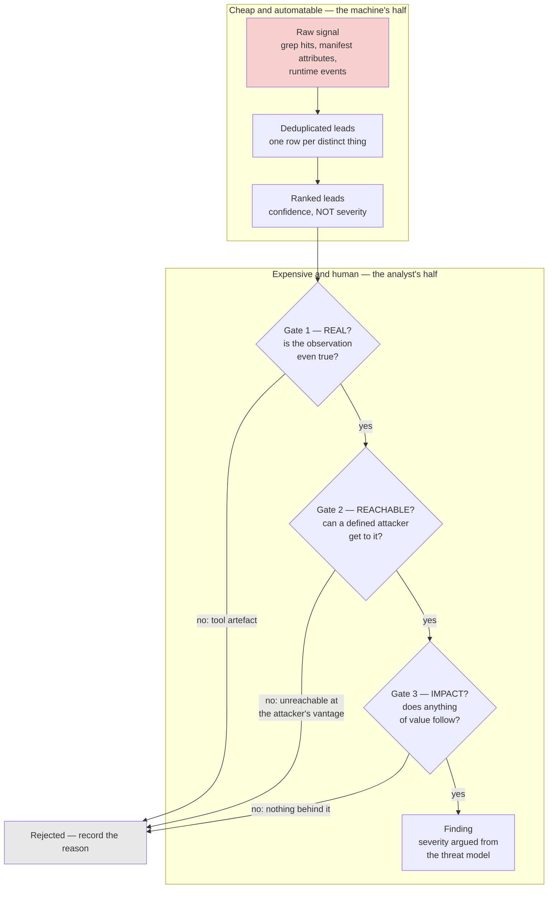
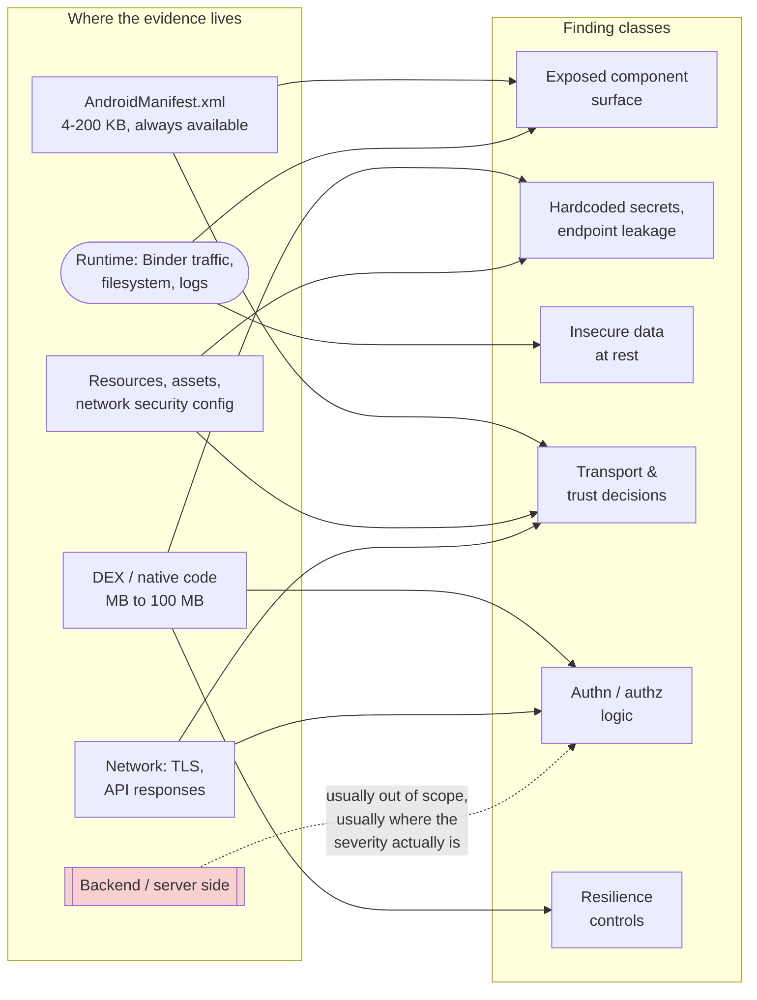
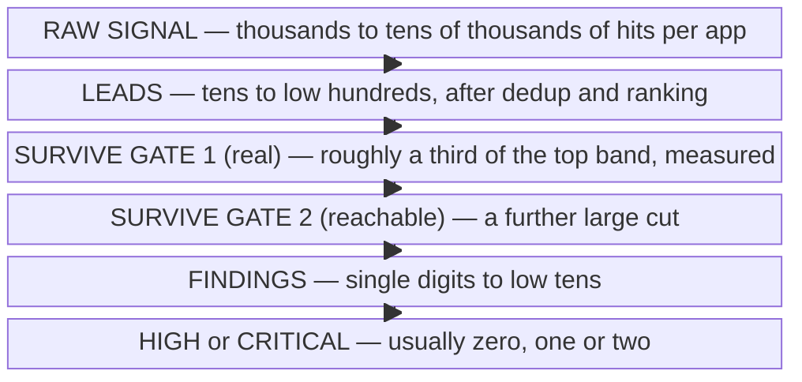
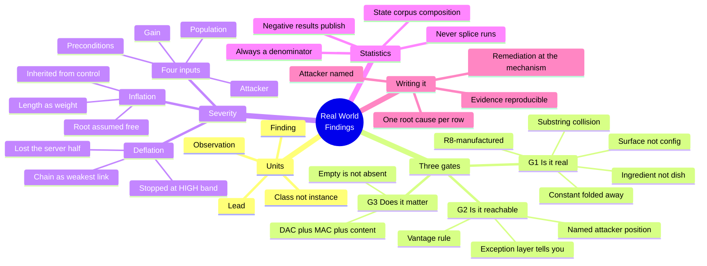

# 72 — Real World Findings

> After this chapter you will be able to say, of any Android observation, three things a client
> pays for: **what class of finding it is, how often that class turns out to be real, and what it
> is worth** — and then write it up so that a developer can fix it and an executive can fund it.

**Prerequisites:** [52-StaticAnalysis](../52-StaticAnalysis/README.md),
[51-DynamicAnalysis](../51-DynamicAnalysis/README.md),
[71-OWASP-Mobile](../71-OWASP-Mobile/README.md),
[32-Manifest](../32-Manifest/README.md), [23-Permissions](../23-Permissions/README.md)
**Applies to:** API 21–35. Every measurement in this chapter was taken on API 35 unless a row says
otherwise, and the chapter is explicit about which claims are version-gated.

---

## Table of Contents

1. [Introduction](#1-introduction)
2. [High-Level Architecture](#2-high-level-architecture)
3. [Deep Internal Working](#3-deep-internal-working)
4. [Source Code Walkthrough (AOSP)](#4-source-code-walkthrough-aosp)
5. [Security Perspective](#5-security-perspective)
6. [Reverse Engineering Perspective](#6-reverse-engineering-perspective)
7. [Dynamic Analysis](#7-dynamic-analysis)
8. [Static Analysis](#8-static-analysis)
9. [Examples](#9-examples)
10. [Common Interview Questions](#10-common-interview-questions)
11. [Common Mistakes](#11-common-mistakes)
12. [Hands-on Labs](#12-hands-on-labs)
13. [Summary](#13-summary)
14. [References](#14-references)

---

## 1. Introduction

### 1.1 The problem this chapter exists to solve

Imagine a building inspector who has been told to report every door that is unlocked. She walks a
large office block and comes back with two thousand unlocked doors. She is not wrong: every one of
those doors really is unlocked. She is also useless, because most of them are internal doors between
two rooms that the same people are allowed to be in, a hundred of them are fire doors that are
*required* by law to open, and the four that matter — the server room, the safe, the records
cupboard, the roof — are buried somewhere in a spreadsheet nobody will read.

The building's owner does not want a list of unlocked doors. He wants to know which doors let a
stranger reach something that would hurt him, how confident the inspector is, and what to do first.

That gap — between *what a tool can observe* and *what a client can act on* — is the entire subject
of this chapter. Everything up to here in this repository has taught you to observe. This chapter is
about the second half of the job, which is worth more and is taught almost nowhere: deciding which
observations are **findings**, deciding what each one is **worth**, and writing them so somebody
else can act.

> **📖 Definition — observation, lead, finding.**
> An **observation** is a fact about the app that you can demonstrate. "This Activity is declared
> `android:exported="true"` with no `android:permission`." An observation is either true or false
> and there is no judgement in it.
> A **lead** is an observation that *might* indicate a security problem and is worth spending time
> on. Leads are what a scanner emits.
> A **finding** is a lead that survived adjudication: you have established that a specific attacker,
> in a specific position, can do a specific thing, and you can say what it costs. A finding goes in
> the report. A lead does not.
>
> The three words are not synonyms and the whole professional difference lives in the gaps between
> them.

### 1.2 What would break if nobody did this

Suppose the profession skipped adjudication and shipped leads directly. Three things break, and all
three are things you can watch happen in real engagements.

**The client stops reading.** A report with four hundred entries has no priority, so the client
picks by convenience: the easy ones get fixed and the expensive ones — which is where the real risk
lives, because expensive-to-fix and important are correlated — are deferred forever. You have
optimised for the appearance of thoroughness and against actually reducing risk.

**The developers stop believing you.** A developer who is told that his Activity is a High-severity
vulnerability, investigates for two hours, and discovers it is the app's own launcher will discount
your *next* finding too. Credibility is a shared budget across every item in the report, and each
false positive spends some of it. This is why the arithmetic in this chapter is not pedantry: at
88% wrong in the top band, which is a number
[52-StaticAnalysis](../52-StaticAnalysis/README.md) actually measured, your report is mostly noise
about which you sounded confident.

**You stop learning.** If everything is a finding, you never find out which of your instincts were
right. The feedback loop that turns a junior tester into a senior one runs entirely through
adjudication: you predicted this would be exploitable, you tried, it was not, and *why* it was not
is the thing you now know.

### 1.3 Why this chapter is grounded in counts, not in blog posts

There is an enormous amount of writing about Android findings and most of it shares one defect: it
tells you a thing *can* be wrong without telling you how often it *is*. "Exported components can be
abused by a malicious app" is true and nearly useless, because it does not tell you whether you
should expect to write that finding once a year or once an hour, nor what fraction of the ones you
see will survive contact with a developer.

This repository is unusual in that it has spent its whole life measuring instead of asserting.
Before this chapter was written, the repository had already run at least eight independent
corpus sweeps against real applications and recorded the adjudicated outcome of each. This chapter's
job is to harvest those into a taxonomy with **base rates** attached, add its own corpus measurement,
and turn the result into reporting practice.

The single most-repeated result across every one of those sweeps is worth stating before anything
else, because it is the thesis:

> **🧠 Mental Model — a sweep produces leads, not findings.**
> Four chapters measured this independently, on different targets, with different tools, and got the
> same shape of answer every time:
>
> | Chapter | Raw signal | What survived |
> |---|---|---|
> | [52-StaticAnalysis](../52-StaticAnalysis/README.md) | 16,836 raw hits over a 17 MB commercial app | 168 leads; of a 17-lead HIGH band, **15 rejected by hand** |
> | [33-Storage](../33-Storage/README.md) | 132 high-confidence secret hits on real browser data | **132 false positives — all of them** |
> | [36-CertificatePinning](../36-CertificatePinning/README.md) | 12 of 14 apps show a pinning *surface* | **4** apps actually carry a pin value |
> | [64-Xposed](../64-Xposed/README.md) | `grep -i xposed` over 237 APKs: 1,141 occurrences | **0 findings** — every hit is the word "exposed" |
>
> Four measurements, one conclusion: **the funnel from signal to finding is steep, and the steepest
> part is at the end, where only judgement operates.**

### 1.4 What this chapter owns, and what it does not

This repository divides the subject deliberately, because "real world findings" is a phrase broad
enough to swallow six chapters if left alone.

| This chapter owns | Owned elsewhere |
|---|---|
| The **taxonomy** of finding classes, and how often each is real | The methodology that produces leads — [52-StaticAnalysis](../52-StaticAnalysis/README.md) for static, [51-DynamicAnalysis](../51-DynamicAnalysis/README.md) for runtime |
| **Base rates** and false-positive rates per class, measured across corpora | Novel vulnerability discovery — [70-VulnerabilityResearch](../70-VulnerabilityResearch/README.md) |
| **Severity** as an argument, and how it gets inflated | The MASVS/MASTG control framework and its mapping — [71-OWASP-Mobile](../71-OWASP-Mobile/README.md) |
| **Writing the finding**: what a good write-up contains and how bad ones fail | The severity *rubric* and report *templates* — [80-Appendix §5–§6](../80-Appendix/README.md#5-severity-cvss-and-business-impact) |
| Breadth: what turns up across many apps, expressed as counts | Depth: complete engagements told end to end, with the dead ends — [74-CaseStudies](../74-CaseStudies/README.md) |

The boundary with [74-CaseStudies](../74-CaseStudies/README.md) is the one to hold in mind while reading.
**This chapter's unit is the finding class and its evidence is counts across many apps.** That
chapter's unit is the story: a small number of engagements narrated in full, where the interesting
part is the reasoning and the wrong turns. If you want to know how often a vulnerable
`ContentProvider` shows up and what it is usually worth, you are in the right place. If you want to
watch somebody find one, you want the case studies.

The boundary with [71-OWASP-Mobile](../71-OWASP-Mobile/README.md) is subtler and more interesting,
because the two chapters **disagree in places and are supposed to**. That chapter describes the
control framework — what the MASVS says an app *should* do. This chapter describes what assessments
actually turn up. Those are different distributions, and §5.6 catalogues where they diverge: whole
MASVS controls that are violated by nearly every app without producing a single defensible finding,
and finding classes that dominate real reports while sitting under a control almost nobody tests.

### 1.5 Authorisation, and how findings get anonymised

Everything in this chapter was measured against devices and applications the author controls or is
authorised to test. That is not a formality — it is the load-bearing precondition, and it changes
what you are allowed to publish as much as what you are allowed to run.

> **⚠️ Warning — never name a vendor as vulnerable.**
> This chapter refers to its corpus as "243 packages on a stock Android 15 emulator image", "a 17 MB
> commercial app", "a banking app in the corpus". That is not coyness. Naming a real application
> alongside a security finding is, at best, a disclosure you were not authorised to make and, at
> worst, defamatory if your adjudication was wrong — and §5 of this chapter is a long argument that
> your adjudication is wrong more often than you think.
>
> The rule this repository follows and this chapter enforces: **describe the class, quantify the
> population, anonymise the instance.** "Twelve of fourteen apps present a pinning surface and four
> pin" is publishable and useful. The same sentence with product names attached is neither.

The same discipline applies to identifiers. This chapter names no CVE it has not verified, invents
no bug-bounty report URL, and cites no AOSP line number. Where the honest answer is "this is a known
class and I am not certain of the identifier", it says so and describes the class instead. A
fabricated CVE number in a client report is the single fastest way to destroy a career's worth of
credibility, and it is entirely avoidable: **the class is the useful part; the identifier is
decoration.**

---

## 2. High-Level Architecture

### 2.1 The adjudication pipeline

A finding is not discovered; it is *manufactured*, by a pipeline that turns a large number of cheap
signals into a small number of expensive claims. Each stage discards material, and each stage
discards it for a different reason. Understanding which stage rejected something is how you know
whether you have a false positive, an out-of-scope issue, or a genuine finding you cannot yet prove.



Read that diagram as two halves separated by a cost cliff. Everything above the dashed line is
mechanical: a script produces it, it scales to any number of apps, and it is worth almost nothing on
its own. Everything below it costs analyst minutes per item and is the only part a client is
actually buying.

The three gates are the chapter's backbone and they are ordered deliberately, cheapest first.
**Gate 1 asks whether the observation is even true** — most rejected leads die here, and they die
because of a defect in the *tool*, not the app. **Gate 2 asks whether a defined attacker can reach
it**, which is where the vantage rule bites and where most of the surviving leads die. **Gate 3 asks
whether anything of value sits behind it**, and it is the gate that separates a Medium from an
Informational.

A lead that fails any gate is not deleted. It is *recorded with its rejection reason*, because the
rejection reasons are the most reusable thing you produce: they become the tool's next filter, and
they are what you show a client who asks "did you look at X?".

### 2.2 Where each finding class comes from

The second thing to hold in your head is that finding classes are not evenly distributed across the
places you can look. Some classes are visible in a 4 KB manifest; some require a running app, a
proxy and an account; some are invisible to every technique in this repository. Knowing which is
which is how you plan an engagement and how you honestly caveat a report.



The dashed arrow is the most important line on the diagram. **A large share of the severity in a
mobile assessment lives on a server the mobile tester is not scoped to touch.** An app that sends a
user-controlled `accountId` to an endpoint is a client-side observation of, at most, Informational
severity; whether it is a critical broken-access-control finding depends entirely on what the server
does with it, and you cannot know that from the APK. §5.4 develops this into a rule, because it is
the single most common source of both over- and under-rating in mobile reports.

Notice also that the manifest — the smallest and cheapest artefact — feeds two of the six classes.
That is why manifest-derived findings dominate real reports by *count* while contributing little by
*severity*, and it is why this chapter's own corpus measurement in §3.5 is a manifest sweep: it is
the class where over-reporting is worst, so it is the class where honest base rates are worth most.

### 2.3 The severity funnel, drawn to scale



The block widths are not decorative; the collapse really is of this order. On the 17 MB commercial
application that [52-StaticAnalysis](../52-StaticAnalysis/README.md) swept, the whole-tree run
produced 16,836 raw hits which aggregated to 168 leads. A narrower run restricted to application
code produced 6,883 raw hits and 96 leads, of which 89 were displayed in three confidence bands —
17 HIGH, 49 MEDIUM, 23 LOW. Hand-adjudicating that HIGH band rejected **fifteen of the seventeen**,
and the chapter records the sentence that matters most: not one of the seventeen became a
High-severity finding by itself.

> **⚠️ Warning — do not splice two runs together.**
> The paragraph above deliberately keeps the 16,836/168 figures and the 17-HIGH figures attached to
> the runs that produced them, because they come from *different invocations* of the same tool over
> the same app. Writing "16,836 hits produced 17 HIGH leads, 15 of which were wrong" would be a
> tidier sentence and a false one. This is the commonest way a real number becomes a fake one: not
> by invention, but by joining two true statistics that never shared a denominator.

---

## 3. Deep Internal Working

This is the chapter's longest section. It defines each finding class precisely, gives its base rate
where this repository has measured one, and states the adjudication that separates its leads from
its findings.

### 3.1 What a finding class is, and why the unit matters

> **📖 Definition — finding class.**
> A **finding class** is a set of findings that share a *root cause*, a *detection method*, and a
> *remediation*. "Exported Activity with no permission guard" is a class. "The `ShareActivity` in
> version 4.2 is exported" is an instance.

Choosing the class as your unit has three consequences that shape everything downstream.

**It makes counting possible.** You cannot ask "how often is this real?" about an instance. You can
ask it about a class, and the answer is a number you can carry to the next engagement.

**It makes the report shorter and better.** Eleven exported components in one app with the same root
cause is **one finding with eleven instances**, not eleven findings. This is not a stylistic
preference: eleven separate entries imply eleven separate remediations, and the developer will fix
them one at a time and miss the twelfth. One finding that says "the export defaults in this module
are wrong; here are the eleven components affected and here is the pattern" produces a fix that also
catches the twelfth.

**It makes severity coherent.** Severity attaches to the class *as instantiated here* — the worst
instance sets the rating, and the others are evidence of prevalence, which is an aggravating factor.

### 3.2 The classes, and what each one actually is

The table below is this chapter's taxonomy. The "Typical real severity" column is deliberately not
the severity the class *can* reach; it is the severity that instances of it usually settle at once
adjudicated, which is a much less exciting and much more useful number.

| # | Class | What the observation is | Typical real severity | Chapter that owns the mechanism |
|---|---|---|---|---|
| F-01 | Exposed component surface | A component reachable by another app without an adequate guard | Info → Medium; High when it mutates state or leaks user data | [32](../32-Manifest/README.md), [27](../27-ContentProviders/README.md), [30](../30-Activities/README.md), [29](../29-BroadcastReceivers/README.md) |
| F-02 | Insecure data at rest | Sensitive data readable outside the app's protection boundary | Info → High, entirely determined by *what* the data is | [33](../33-Storage/README.md), [49](../49-KeyStore/README.md) |
| F-03 | Secrets and endpoints in the artefact | Credentials, keys or non-production hosts shipped in the build | Low → High; almost always over-rated | [52](../52-StaticAnalysis/README.md), [40](../40-Obfuscation/README.md) |
| F-04 | Transport and trust | Cleartext, weak TLS config, trust-store misuse, absent or broken pinning | Info → High | [35](../35-SSL/README.md), [44](../44-NetworkSecurityConfig/README.md), [36](../36-CertificatePinning/README.md) |
| F-05 | Authentication and session logic | Client-side gates, token handling, session lifetime, biometric binding | Medium → Critical, and this is where the Criticals are | [47](../47-Authentication/README.md), [46](../46-Tokens/README.md), [45](../45-OAuth/README.md), [48](../48-Biometrics/README.md) |
| F-06 | Cryptographic misuse | Wrong primitive, wrong mode, static IV, key material not hardware-bound | Low → High; frequently theoretical | [34](../34-Cryptography/README.md), [49](../49-KeyStore/README.md) |
| F-07 | WebView and content handling | JavaScript bridges, file access, `content://` handling, deep-link parsing | Medium → High | [43](../43-WebView/README.md), [26](../26-Intent/README.md) |
| F-08 | Resilience controls | Root/emulator/hook/tamper detection and its absence or weakness | **Informational unless a named adversary is in the threat model** | [37](../37-RootDetection/README.md), [38](../38-TamperDetection/README.md), [39](../39-EmulatorDetection/README.md), [67](../67-BypassingProtections/README.md) |
| F-09 | Third-party and supply chain | A bundled SDK's behaviour, permissions or vulnerabilities | Info → High; hardest to remediate | [17](../17-Libraries/README.md), [69](../69-MalwareAnalysis/README.md) |
| F-10 | Privacy and data handling | Collection, identifiers, retention, disclosure mismatch | Info → High; increasingly the class clients care most about | [23](../23-Permissions/README.md), [71](../71-OWASP-Mobile/README.md) |
| F-11 | Build and release hygiene | Debuggable builds, test artefacts, backup configuration, logging | Info → Medium; occasionally Critical by accident | [08](../08-Build-System/README.md), [41](../41-ProGuard/README.md), [42](../42-R8/README.md) |
| F-12 | Platform and device posture | Findings about the device or OS rather than the app | Usually **not a finding about the app at all** | [20](../20-Security-Architecture/README.md), [22](../22-SELinux/README.md), [61](../61-Fastboot/README.md) |

> **🔍 Pentester's Note — F-12 is where junior reports go wrong most spectacularly.**
> "The device can be rooted", "the bootloader can be unlocked", "the emulator has no hardware-backed
> keystore" are facts about the *platform*. They belong in the test-environment record, not in the
> findings table, unless the engagement's threat model names the device owner as the adversary. If
> it does, they are not findings either — they are the *premise* of the resilience findings in F-08.
> A report whose top finding is "the app runs on a rooted device" has confused its own methodology
> with the client's risk.

### 3.3 Gate 1 — is the observation even true?

Gate 1 rejects leads that are artefacts of the detection method. It is first because it is cheapest
and because failures here are the most embarrassing: you are not wrong about the app, you are wrong
about your own tool.

This repository has measured five distinct mechanisms by which a detector manufactures a false
positive. They are worth memorising as a checklist, because each one is invisible from inside the
tool that suffers from it.

| Mechanism | Measured instance | Source |
|---|---|---|
| **Substring collision** — a short token appears inside an unrelated word | `grep -i xposed` over 237 APKs: 58 apps matched, 1,141 occurrences, **1,141 explained by "exposed"/"Exposed", 0 unexplained** | [64-Xposed](../64-Xposed/README.md) |
| **Obfuscation-manufactured collision** — minified identifiers collide with short signatures | A `vxp` signature produced **16 STRONG hits, all 16 R8-generated class names** (`Lvxp;`, `Lavxp;`) | [64-Xposed](../64-Xposed/README.md) |
| **Ingredient mistaken for dish** — a generic API used by every SDK read as intent | A self-signature-check detector reported **18 of 18 apps**, because `getPackageInfo` is how every SDK reads its own `versionName`; corrected to **13 of 18** | [38-TamperDetection](../38-TamperDetection/README.md) |
| **Surface mistaken for configuration** — the code that *could* do a thing, present but unconfigured | **12 of 14 apps** carry a pinning surface; **4** carry a pin value | [36-CertificatePinning](../36-CertificatePinning/README.md) |
| **Shape mistaken for content** — data that matches the pattern of a secret but is not one | **132 of 132** high-confidence secret hits on real browser data were component-updater signature manifests | [33-Storage](../33-Storage/README.md) |

> **🧠 Mental Model — if a detector agrees with you about almost every sample, suspect the detector.**
> This is the repository's most-independently-rediscovered rule, and it has now fired four times:
> 38's 18-of-18, 52's 15-of-17-rejected top band, 64's 1,141-of-1,141, and 64's 16-of-16 `vxp` hits.
> A real security property is not uniformly distributed across a corpus. **Uniformity is the
> signature of a tautology.** When your scanner says every app does something, it has usually found
> a property of the platform, of the compiler, or of your regex.

The arithmetic test is the practical form of that rule, and it is the single most valuable habit in
this section: **explain every hit, or the signature is not evidence.** 64's sweep is exemplary
precisely because the arithmetic closes exactly — 1,141 occurrences, 1,141 accounted for, zero
unexplained. A sweep that says "58 apps matched, most of them look like false positives" has not
been adjudicated; it has been glanced at.

The rule 64 derived from its own defect generalises and this chapter adopts it: **never put a token
shorter than about eight characters in a high-confidence tier.** Its corollary is the
counter-intuitive part — because minification generates short lowercase identifiers, **the
false-positive rate of a short signature rises on better-protected applications.** The population
you most want to scan is the population your scanner is worst at.

There is a sixth mechanism which deserves its own treatment because its true-positive rate is not
merely low but provably **zero**:

> **🔬 Under the Hood — the compiler can delete the thing you are grepping for.**
> [47-Authentication](../47-Authentication/README.md) compiled a class that calls
> `setFlags(WindowManager.LayoutParams.FLAG_SECURE, …)` and then searched the output:
>
> ```
> b"FLAG_SECURE" present in SecureProbe.class : False
> b"FLAG_SECURE" present in classes.dex       : False
> b"setFlags"    present in classes.dex       : True
> b"8192"        present in classes.dex       : False
> ```
>
> `FLAG_SECURE` is a `public static final int`, so javac performs **constant folding** and the name
> never reaches the class file at all — the bytecode carries `const/16 v0, #int 8192` and nothing
> else. A string grep for `FLAG_SECURE` therefore has a true-positive rate of **zero**, in both
> directions: it cannot find apps that use the flag, and any hit it does report came from somewhere
> other than a use of the flag. An early revision of that chapter's own scanner reported "3 of 17
> apps use `FLAG_SECURE`" on that basis. **A detector whose true-positive rate is provably zero is
> worse than no detector**, because it produces a confident answer that is wrong both ways.
>
> The general lesson reaches far past one flag: **any `static final` primitive constant is invisible
> to string search in DEX.** Before you build a detector on an identifier, check that the identifier
> survives compilation.

### 3.3a A worked Gate 1 failure, committed by this repository

Every mechanism in §3.3 is easier to recognise in somebody else's work. Here is one this repository
committed, published, and propagated into six chapters before anyone re-ran it — and it is the
single most instructive item in this section, because the defect was not in a tool but in an
**unexamined vantage label**.

**The claim, as published.** [39-EmulatorDetection](../39-EmulatorDetection/README.md) reported that
`shell` could see **1,053** system properties against an app's **634** — a 419-property chasm,
offered as the quantitative backbone of the vantage rule. It is a wonderfully quotable number. It
was also wrong.

**What it actually was.** The "shell" figure had been taken with `adb root` in effect, or through
`su`. It was the **root** figure wearing a shell label. Re-measured across three stable runs:

| Vantage | Properties visible | `ro.boottime.*` |
|---|---:|---:|
| root | ~1062 | **111** |
| `shell` (uid 2000) | ~678 | **0** |
| app (`untrusted_app`) | ~638 | **0** |

**The tell was inside the original table, and nobody looked.** It listed `root` at 1050 and `shell`
at 1053 — two SELinux domains reported as seeing effectively the same property set when one is
subject to `boottime_prop` and the other is not. That is arithmetically implausible on its face. The
same defect appeared in the chapter's single-property transcript, which showed the *shell* reading
`ro.boottime.qemu-props`; the shell in fact gets an empty string.

Three lessons, each of which generalises well past one number.

**1. The claim survived because it was dramatic, not because it was checked.** A 419-property gap is
a better slide than a 40-property gap, so it was quoted onward — into six chapters, this one
included — and each citation made it look better established. **A number that makes a dramatic point
deserves more scrutiny than one that does not, and this one got less.** That is a base-rate and
adjudication failure of exactly the kind §3.3 catalogues, and it was committed here rather than by a
vendor. Note also that no amount of *citation* is evidence: six chapters repeating a figure is one
measurement, not six.

**2. The corrected numbers invert the practical advice.** The shell-to-app gap is ~40 properties;
the root-to-shell gap is ~384. So `adb shell` is a *decent* proxy for app reachability and a
*terrible* proxy for root. And for chapter 39's own subject the gap nearly vanishes: the practical
emulator-indicating signal set is **36 `init.svc.*` properties from the shell against 35 from an
app**. **Its most quotable statistic was also its least relevant one** — the property count was never
the thing that made the vantage rule true; `boottime_prop`'s invisibility to *both* unprivileged
domains was.

**3. The right protocol when you cannot reproduce someone else's measurement.** The divergence was
found by [74-CaseStudies](../74-CaseStudies/README.md), which did the correct thing and **changed nothing in
chapter 39**. It reported its own numbers, printed the exact command that produced them, and filed
the discrepancy as *unresolved*, leaving adjudication to the chapter that owned the claim.

> **🧠 Mental Model — an irreproducible measurement is a discrepancy, not a correction.**
> When you cannot reproduce another team's number, you have two hypotheses — their measurement is
> wrong, or yours is — and no basis yet for choosing. Publish your figure, publish your command,
> name the disagreement, and route it to whoever owns the original. Silently overwriting their
> number asserts an adjudication you have not performed; silently dropping your own result loses the
> only evidence that anything is wrong.
>
> This is the same discipline §5.4 demands for an out-of-scope backend, and the same one §7.3 applies
> to this chapter's own headline result. **"I could not reproduce this" is a publishable finding.**

The correction has been applied to chapter 39 and to every chapter that quoted it, this one
included. It is recorded here rather than quietly fixed, because a repository that hides its own
adjudication failures cannot credibly teach adjudication.

### 3.4 Gate 2 — is it reachable, and by whom?

Gate 2 is where the majority of *true* observations stop being findings. The observation is real;
the attacker cannot get to it.

The single most common failure at this gate is measuring from the wrong place. This repository calls
it the **vantage rule**, and it is the most-repeated measured finding in the whole corpus of
chapters — four chapters hit it independently, from four different directions.

| Chapter | Same question, two vantages |
|---|---|
| [39-EmulatorDetection](../39-EmulatorDetection/README.md) | System properties by vantage: **~1062 to root, ~678 to `shell`, ~638 to an app.** The entire `ro.boottime.*` family is typed `boottime_prop` and is invisible to `shell` *and* to an app — 111 properties visible only to root |
| [37](../37-RootDetection/README.md) / [59](../59-radare2/README.md) | `/system/xbin/su` on a stock AVD is **visible and setuid root** to `adb shell`, and **`Permission denied`** to an app, because `/system/xbin` is `0750 root:shell` |
| [48-Biometrics](../48-Biometrics/README.md) | `locksettings clear` as uid 2000 reports *"The device does not support lock screen"* — a **permission failure disguised as a capability failure** |
| [63-LSPosed](../63-LSPosed/README.md) | `new File("/data/adb/lspd").exists()` returns `false` from an app whether or not LSPosed is installed, because the refusal happens at `/data/adb` (`0700 root:root`) and `File.exists()` maps `ENOENT` and `EACCES` alike to `false` |

> **⚠️ Warning — a probe verified from `adb shell` has not been verified, and *root* is the gap that
> actually bites.**
> The failure is silent in *both* directions. A signal that fires only for a privileged vantage reads
> as a working check; a signal invisible to it reads as absent. Either run the probe as the app —
> `run-as`, a purpose-built probe APK, or Frida in-process — or label the result by the vantage that
> produced it and say so in the report.
>
> But be precise about *which* gap you are worried about, because the property counts above are not
> the shape most people assume. **The shell-to-app gap is about 40 properties; the root-to-shell gap
> is about 384.** Testing from `adb shell` is a mediocre-but-usable proxy for app reachability, and a
> catastrophic proxy for root. In practice the error that costs you a finding is rarely *"I tested
> from the shell"* — it is **"I tested from root and recorded it as shell"**, which is exactly the
> defect §3.3a dissects.
>
> The shell's residual privilege is quantified in [60-ADB](../60-ADB/README.md), and it does not come
> from the shell GID, which `platform.xml` grants only `INTERNET`. It comes from the
> `com.android.shell` **package**, which requests 200 permissions — 183 granted at install and
> **16 runtime permissions pre-granted `SYSTEM_FIXED`**, including `CAMERA`, `RECORD_AUDIO` and
> `READ_SMS`. Those 16 are why a shell result can still mislead even though the raw property counts
> are close, and they are what invalidated this chapter's own headline result in §7.3.

That is not an abstract concern for this chapter; §7.3 below contains a live demonstration where the
author's own reachability probe was rescued from a wrong conclusion by exactly this check.

Gate 2 also has a structural half that has nothing to do with vantage: **the attacker must be
definable.** Before you can say something is reachable you must say reachable *by whom*, and mobile
assessments have only a small number of legitimate attacker positions:

| Attacker position | What they control | Typical findings |
|---|---|---|
| **A malicious co-installed app**, no special privileges | Its own process; can send Intents, bind Services, query providers | F-01, F-07 |
| **A network attacker** on the same path | Can observe and modify traffic; may hold a CA the device trusts | F-04 |
| **The device owner**, hostile, with root | Everything on the device | F-08, and *only* F-08 |
| **A person with brief physical access** to an unlocked device | UI, ADB if enabled | F-02, F-11 |
| **A backend attacker** or another tenant | Server-side | F-05 — usually out of scope, see §5.4 |

A finding whose attacker is "someone who can already read the app's private data directory" is not a
finding; it is a restatement of the sandbox. This is the mistake that produces reports full of
"sensitive data stored in SharedPreferences", where the only attacker who can read it is root, and
root was never in the threat model.

### 3.5 A corpus measurement of the largest finding class

Everything above is inherited. This section is this chapter's own measurement, and it targets F-01 —
the exposed-component class — because it is the class most over-reported in real assessments and the
one where honest base rates are therefore worth most.

**Method, stated before the numbers, because the denominator is the finding.**

| | |
|---|---|
| Device | AVD `sdk_gphone16k_x86_64` (`emulator-5554`), **Android 15 / API 35**, x86_64, rooted with Magisk 30.7, Zygisk off |
| Corpus | **every package installed on the image: 243** |
| Extraction | `AndroidManifest.xml` pulled from each APK with `adb exec-out unzip -p`, **243 of 243 succeeded**; nothing written to the device |
| Parsing | [10-APK-Internals](../10-APK-Internals/README.md)'s `examples/parse_axml.py`, an independent binary-XML reader |
| Cross-check | every permission's protection level resolved a second time from `dumpsys package permissions` on the live device |

> **⚠️ Warning — read this denominator before reading any number below.**
> Of those 243 packages, **four are third-party**. This is a *platform* corpus: AOSP components,
> Google system applications and vendor overlays. It therefore supports statements about how the
> platform and its bundled applications are built, and supports **nothing whatsoever** about banking
> apps, retail apps, or any of the categories a commercial assessment actually targets. Where a
> figure below would be misleading without that caveat, the caveat is repeated inline. This is the
> same discipline [64-Xposed](../64-Xposed/README.md) applied to the same corpus when it declined to
> generalise a zero result from four third-party packages.

**The raw surface.**

```
packages on the image                         243
manifests parsed                              243
declared components (activity/alias/service/
  receiver/provider)                        6,465
components declared exported                2,674   (41.4% of all components)
apps with at least one exported component     137   (56.4% of apps)
```

Two thousand six hundred and seventy-four. A scanner that reports exported components as findings
would emit 2,674 rows against a stock phone image before a single third-party app was installed.
That number is the reason this class needs base rates.

**Adjudication step one: the guard.** Export without a guard is the actual claim; export *with* a
signature-level guard means only the platform signer can reach it.

| Guard on the exported component | Count | Share |
|---|---:|---:|
| **No guard at all** | 1,945 | 72.7% |
| `signature` / `signature`&#124;`privileged` | 646 | 24.2% |
| `dangerous` (a runtime permission) | 39 | 1.5% |
| `normal` (granted at install, to anyone who asks) | 26 | 1.0% |
| `internal` (API 31+, platform-only) | 5 | 0.2% |
| Guard named but not resolvable on this device | 13 | 0.5% |

**Adjudication step two: is there a declared reason to be reachable?** A component with an
`<intent-filter>` is exported *because that is how it is invoked* — a launcher, a share target, a
`VIEW` handler. A component exported with **no** intent-filter has been made reachable with no
declared reason, and that is the anomaly worth a human's time.

The funnel, with app counts alongside component counts:

| Stage | Components | Apps |
|---|---:|---:|
| 1. Declared exported | 2,674 | 137 |
| 2. …and not guarded by a signature-, dangerous- or internal-level permission | 1,990 | 116 |
| 3. …and carrying **no** `<intent-filter>` | **410** | 67 |
| 4. …and being a `ContentProvider` | **83** | 38 |

**Two mechanical steps that any scanner could apply, and most do not, shed 84.7% of the class.** The
survivors break down as 141 activities, 118 services, 83 providers, 63 activity-aliases and 5
receivers. Five of the 410 are in the four third-party packages, and 12 of the 83 providers declare
`grantUriPermissions`.

> **⚠️ Warning — step 2 has a definition inside it, and I got it wrong the first time.**
> A `<provider>` has **three** guards, not one: `android:readPermission` gates `query()`,
> `android:writePermission` gates `insert`/`update`/`delete`, and `android:permission` sets both
> unless overridden. My first version of the sweep folded all three into a single "guard" field with
> `writePermission` last in the fallback chain — so a provider carrying a **write** guard and **no
> read guard** was scored as guarded and dropped at step 2.
>
> That is precisely backwards for a read probe: a write-guarded, read-open provider is readable by
> anybody, which is the case you most want to keep. The defect cost six providers at step 4, and it
> silently excluded **the only authority in the whole corpus that returned rows** to the probe in
> §7.3. The shipped script now tracks `guard_read` and `guard_write` separately, and the numbers
> above are the corrected ones.
>
> The general lesson is the one §5.5 makes about coverage, arriving from the other direction: **a
> funnel step is a definition, and a definition you have not written down is one you cannot check.**
> Mine moved the step-4 population by 7% and hid my single most interesting result.

This is the shape of the whole chapter in one table. Nothing in steps 2 and 3 required judgement or
a running device — they are arithmetic over the same manifest the scanner already parsed. A tool
that reports 2,674 rows where 410 are defensible is not detecting more; it is detecting the same
thing and adjudicating less.

> **🔍 Pentester's Note — 410 is still not 410 findings.**
> Step 4 of that funnel is where the human work begins, not ends. Of the 410, the 83 providers are
> the ones with a plausible path to data, which is why §7.3 probes exactly those. The remaining 327
> need a per-component argument about what invoking them achieves — and in a platform corpus the
> answer is usually "nothing an attacker wants", because these are internal components of a
> system app that the system reaches by explicit component name.

**A finding class that has gone extinct, measured.** The classic form of F-01, taught in every
Android security course written before 2021, is the *implicitly* exported component: a component
that declares an `<intent-filter>` and omits `android:exported`, which the platform historically
treated as exported.

```
components with android:exported ABSENT              313  (of 6,465)
  ...of those, components carrying an intent-filter     0
apps targeting API 31 or above                       237  (of 243)
```

**Zero.** Not a small number — none. Android 12 (API 31) made it a build-time error to declare an
intent-filter without an explicit `android:exported`, and on a corpus where 237 of 243 packages
target API 31 or later, the class has been engineered out of existence. The 313 components that omit
the attribute all omit an intent-filter too, so they default to *not* exported and are correct.

> **🧠 Mental Model — finding classes have lifecycles, and checklists do not.**
> A checklist item is written once and copied forever. The platform, meanwhile, keeps closing
> classes by changing defaults. Implicit export is the cleanest example: a finding class that
> dominated Android reports for six years and is now unreachable on a modern `targetSdk`. If your
> methodology still allocates time to it, you are spending an engagement's budget on a check whose
> true-positive rate on modern apps is approaching zero. §5.6 lists the others.

**The application-level flags, and the over-reporting they generate.** The same 243 manifests, read
for the classic F-11 build-hygiene items:

| Observation | Apps | Share | Honest adjudication |
|---|---:|---:|---|
| `usesCleartextTraffic` **absent** | 196 | 80.7% | Of these, **195 target API 28+, where the platform default is already `false`.** A "cleartext traffic not disabled" check fires 196 times and is wrong 195 times |
| `usesCleartextTraffic` explicitly `true` | 27 | 11.1% | The real signal — but several are network-stack and captive-portal components for which cleartext is the function |
| `allowBackup` absent (default applies) | 176 | 72.4% | A checker that counts the default as a finding reports 205 of 243 apps |
| `allowBackup` explicitly `true` | 29 | 11.9% | Lead. Severity depends entirely on what is in the backup set |
| `allowBackup` explicitly `false` | 38 | 15.6% | — |
| `networkSecurityConfig` declared | 10 | 4.1% | — |
| `dataExtractionRules` declared (the API 31+ control) | **5** | 2.1% | The modern, granular backup control is barely used **even by the platform's own apps** |
| `fullBackupContent` declared (legacy control) | 7 | 2.9% | — |
| `sharedUserId` declared | 44 | 18.1% | Deprecated, and on a platform image mostly `android.uid.system` — a platform design decision, not a finding |
| Custom permission declared at `protectionLevel="normal"` | 126 | 51.9% | Lead only; see the precondition below |
| Custom permission declared with **no** `protectionLevel` | 4 | 1.6% | Defaults to `normal`. The sharper lead |
| `android:debuggable="true"` | **1** | 0.4% | And it is a locally built test application that this repository itself installed — see below |

The `usesCleartextTraffic` row is the best over-reporting example in the table and worth stating as a
number: **a naive check for that class has a false-positive rate of roughly 99.5% on this corpus**,
not because the apps are secure but because the check tests for the absence of an attribute whose
default already has the safe value. This is the exact structure of the `allowBackup` row too. Both
belong to a family worth naming: **the absent-attribute finding**, which is only ever valid if you
have first established what the platform does when the attribute is absent, *at the target's
`targetSdkVersion`*.

> **🔍 Pentester's Note — the one `debuggable` hit is the tester's own artefact.**
> Exactly one package on the image is debuggable, and it is a small locally built application
> installed for testing. That is worth dwelling on, because it is a failure mode you will meet:
> **your own instrumentation shows up in your own sweep.** If this had been an engagement, the one
> genuine-looking hit in the highest-severity build-hygiene class would have been mine. Keep a list
> of what you installed and subtract it before you count — and never let a tool-installed helper
> reach the findings table.

The custom-permission row needs its precondition stated, because 126 of 243 sounds alarming and is
not. [23-Permissions](../23-Permissions/README.md) measured that when **both** apps declare the same
permission name, the second install is refused with `INSTALL_FAILED_DUPLICATE_PERMISSION`,
symmetrically. Squatting therefore only works where the victim `<uses-permission>` a name it does
not itself `<permission>`-declare. So 126 is a count of *leads*; the finding requires the
declare/use mismatch, which is a second pass this sweep does not perform.

### 3.6 Gate 3 — is there anything behind it?

Gate 3 is the impact gate, and it is the one that produces Informational ratings — which are the
hardest ratings to write and the most professionally valuable.

[33-Storage](../33-Storage/README.md) provides the cleanest worked instance in the repository. An
ordinary app with **zero permissions** read another package's private-directory file on a stock
Enforcing device. Every instinct says High: cross-app read, sandbox bypass, no permissions needed.
The chapter rates it **Informational**, and the reasoning is the valuable part — the file's contents
are SDK feature flags. Nothing an attacker gains from them is worth anything.

That chapter's three-gate formulation is the right general tool and this chapter adopts it wholesale
for F-02: a storage observation is a finding only if **DAC** permits the path walk, **MAC**
(SELinux/MCS) permits the read, *and* the content matters. Two out of three is an observation.

The same structure recurs in every class:

| Class | The "nothing behind it" case |
|---|---|
| F-01 | An exported Activity that displays a static licence screen |
| F-02 | A world-readable file containing feature flags |
| F-03 | A hardcoded key that is a public API identifier, or a test fixture in a `@Preview` |
| F-04 | Cleartext to a host that serves only public, integrity-protected content |
| F-06 | ECB mode over data that is already public |

> **⚠️ Warning — "nothing behind it" is a claim you must support, not a default.**
> Gate 3 cuts both ways and it is where under-reporting lives. The 17 MB commercial app's most
> interesting finding was ranked **MEDIUM 0.50** by the tool and was a `Domain` enum shipping
> thirteen environments — production, pre-production, eight QA hosts and three staging hosts — in
> the production build. A tester scanning the HIGH band and stopping would have shipped a report
> containing nothing but the fifteen rejected leads. **Confidence ranking is not severity ranking**,
> and the tool cannot know which is which, because confidence is about the detector and severity is
> about the business.

### 3.7 Where severity actually comes from

Severity is an argument, not a lookup. [71-OWASP-Mobile](../71-OWASP-Mobile/README.md) states the
principle exactly — the control violation is a *fact*, the severity is an *argument* — and delegates
the rubric itself to [80-Appendix §5–§6](../80-Appendix/README.md#5-severity-cvss-and-business-impact).
This chapter does the same: **the rubric and the report templates live in 80; what this section owns
is the failure modes that push a rating away from the truth.**

There are exactly four inputs to a defensible severity, and a rating that cannot name all four is a
guess:

1. **Who is the attacker**, from the positions in §3.4, and are they in the client's threat model?
2. **What do they have to do** to reach it — preconditions, and how plausible each is?
3. **What do they get** — specific data, specific state change, specific accounts?
4. **How many users** does it affect, and is it repeatable at scale?

> **🧠 Mental Model — severity flows from the threat model down, never from the control up.**
> "This violates MASVS-STORAGE-1, therefore Medium" is a lookup and it is always wrong, even when
> the number it produces happens to be right. Two apps can violate the same control and deserve
> Low and High, and the control text is silent about why — which is precisely
> [71-OWASP-Mobile](../71-OWASP-Mobile/README.md)'s position.

The commonest inflation mechanisms, each of which this repository has an instance of:

| Inflation mechanism | What it looks like | The corrective |
|---|---|---|
| **Severity inherited from the class** | Every exported provider is High because exported providers *can* be High | Rate the instance. 83 of this chapter's 2,674 reached step 4 and most returned nothing |
| **Attacker assumed, not named** | "An attacker could…" with no statement of position | Name one of the five positions in §3.4, or drop the finding |
| **Root assumed for free** | A data-at-rest finding whose attacker needs root, in an engagement where root was not in scope | Root is a premise, not an attacker. See F-12 |
| **Length mistaken for weight** | A three-page write-up rated High because it took three pages | Write-up length measures your effort, not the client's risk |
| **Compensating controls ignored** | Rating a token-in-logs finding High when the token lives 90 seconds | Preconditions cut both ways |
| **Prevalence mistaken for severity** | Eleven instances of one root cause reported as eleven Mediums | One finding, eleven instances; prevalence is an aggravating factor within the rating |

And the under-rating mechanisms, which are rarer and more damaging because nobody reviews them:

| Under-rating mechanism | Instance |
|---|---|
| **Stopping at the confidence ranking** | The MEDIUM 0.50 lead was the real finding; the HIGH band was 88% wrong |
| **Treating a chain as its weakest link** | Three Informational observations that compose into account takeover are one High finding |
| **Discounting what you could not prove** | A finding you could not exploit because you lacked a second account is *untested*, not *absent* — say which |
| **Losing the server-side half** | See §5.4 |

### 3.8 Two readings are better than one, and their disagreement is data

The corpus sweep in §3.5 resolved every guard permission twice: once from the static manifests, once
from the running device's `dumpsys package permissions`. Two hundred and forty-five distinct
permissions were referenced as guards.

The first run, with the protection-level table I had written from memory:

```
distinct guard permissions referenced        245
  resolved by both readings                  236
    agreeing exactly                         225
    differing                                 11
  resolved by neither                          9
```

Eleven disagreements looks like eleven leads. **All eleven were defects in my own reader, and not one
was a difference in effect.** They split two ways. Three were protection level **4**, `internal`,
which was added in API 31 and which my level table simply did not contain — so my reader printed
`0x4` where the device said `internal`. The other eight were permissions my reader named
`signatureOrSystem`, protection level 3, which the device reports under its modern spelling
`signature|privileged`. Same permission, same effect, two names.

Adding `internal` to the table and re-running — which is what the shipped
[`scripts/manifest-corpus-sweep.py`](scripts/manifest-corpus-sweep.py) now does — moves those three
into agreement and leaves the eight:

```
distinct guard permissions referenced        245
    resolved by BOTH, agreeing               228
    resolved by BOTH, DIFFERING                8
    resolved by one reading only               0
    resolved by neither                        9
```

**Yield: eleven disagreements, two tool defects found, zero app defects.** That is a poor return in
findings and an excellent one in tool correctness, and it is the return you should expect. The eight
that remain are a *naming* difference the tool cannot resolve and should not try to — the honest
handling is to compare base levels by effect, not by string.

> **🔬 Under the Hood — when two readings disagree, the disagreement is a lead about your tool
> before it is a lead about the app.**
> This is [10-APK-Internals](../10-APK-Internals/README.md)'s thesis arriving from a different
> direction. That chapter builds an independent AXML parser precisely so that a *fourth* opinion
> exists, and states the ordering rule: when the parser and the device disagree, **the device is
> right**, because the device reports what `PackageManagerService` actually stored.
>
> The nine permissions neither reading resolved are the honest residue: guard names referencing
> packages that are not installed on this image. Those are not findings either — a component guarded
> by a permission no installed package declares is, on *this* device, effectively unguarded, which
> is a genuinely interesting sub-case and one I did not have the corpus to pursue.

The general form is worth carrying into every engagement: **a disagreement between two tools is the
cheapest lead you will ever get, and the majority of them are your own bugs.** Chase them anyway.
The cost is minutes; the alternative is a report built on a parser nobody has validated.

### 3.9 Reporting units: what actually goes in the table

| Property | Rule | Why |
|---|---|---|
| **Title** | A specific claim, not a category | "Exported provider `X` returns any user's records without a permission" beats "Insecure Data Storage" |
| **One row per root cause** | Not per instance, not per file | Drives one fix, not eleven |
| **Severity** | Argued from the threat model, with the four inputs from §3.7 named | A number without an argument is not reviewable |
| **Evidence** | Reproducible by the developer on their own build | A screenshot of your tool is not evidence |
| **Preconditions** | Stated in the finding, not buried in the methodology | They are half the severity |
| **Remediation** | As code, at the right altitude | "Set `android:exported="false"`" fixes one; "these components are exported by a shared Gradle module default" fixes the class |
| **Confidence** | Stated separately from severity where they differ | A High you are 60% sure of is a different object from a High you demonstrated |

---

## 4. Source Code Walkthrough (AOSP)

Findings are claims about how the platform behaves. This section traces two of the classes in §3.2
into AOSP so that you can defend a rating against a developer who says "that's not how it works" —
which is the moment a report is actually tested.

### 4.1 What "exported" means to the platform

The attribute is parsed in the package parser and stored on the component's `ComponentInfo`:

- `frameworks/base/core/java/android/content/pm/ComponentInfo.java` — carries the `exported`
  boolean that every later check reads.
- `frameworks/base/core/java/android/content/pm/parsing/` — the modern parsing path that reads
  `android:exported` out of the manifest and applies the default.

The default is the part worth knowing precisely, because the whole "implicit export" finding class
lived in it, and the class is now closed:

| Component | Default when `android:exported` is absent | Since |
|---|---|---|
| Activity, Service, Receiver | `true` if it has an `<intent-filter>`, else `false` | Always |
| Provider | `true` if `targetSdkVersion` < 17, else `false` | API 17 |
| Any of the above, with an `<intent-filter>` | **Build error** — the attribute must be explicit | API 31 (`targetSdk` 31+) |

The enforcement point is not the parser but `ActivityManagerService` and its friends at the moment
of the call. For Activities the check runs inside the activity starter, which consults
`ActivityStackSupervisor`/`ActivityStarter` and ultimately
`frameworks/base/services/core/java/com/android/server/am/ActivityManagerService.java`'s permission
helpers; for providers it is `ContentProvider.enforceReadPermissionInner` in
`frameworks/base/core/java/android/content/ContentProvider.java`.

That last one is the file to read if you assess providers, because it encodes the ordering that
decides most F-01 severities:

1. If the calling uid is the provider's own uid, or the caller holds the required permission, allow.
2. Otherwise, if the caller holds a **URI permission grant** for the specific URI, allow.
3. Otherwise throw `SecurityException`.

Step 2 is why `android:grantUriPermissions="true"` changes the class of a provider finding: it
introduces a path to the data that does not require the guard permission at all, provided the
attacker can persuade something to grant them a URI. This is the confused-deputy shape that
[27-ContentProviders](../27-ContentProviders/README.md) and [26-Intent](../26-Intent/README.md)
develop, and it is why my sweep in §3.5 recorded `grantUriPermissions` separately.

> **🔬 Under the Hood — the exception text is a finding-quality artefact.**
> `enforceReadPermissionInner` builds its `SecurityException` message with the calling pid, uid and
> the permission name. That message is what my probe in §7.3 keys on to distinguish "the framework
> refused me" from "the app's own code ran and threw". The distinction is not cosmetic — it is the
> difference between *not reachable* and *reachable via the wrong verb*, and §7.3 measures 25
> components sitting in the second category that a naive classifier would have discarded as errors.

### 4.2 Where the platform decides a permission's strength

The protection level that my §3.8 cross-check resolved lives in
`frameworks/base/core/java/android/content/pm/PermissionInfo.java`, which declares the base levels
as constants (`PROTECTION_NORMAL`, `PROTECTION_DANGEROUS`, `PROTECTION_SIGNATURE`, and the
deprecated `PROTECTION_SIGNATURE_OR_SYSTEM`) plus a wide set of `PROTECTION_FLAG_*` modifiers
(`PRIVILEGED`, `INSTALLER`, `ROLE`, and others) packed into the same integer.

Two facts from that file explain both halves of my 11 disagreements:

- `PROTECTION_SIGNATURE_OR_SYSTEM` has the value 3 and is deprecated in favour of
  `signature|privileged`. A manifest can still declare 3; the platform reports the modern spelling.
  Same effect, two names — which is why my reader called seven permissions something the device did
  not.
- `PROTECTION_INTERNAL` was added for API 31 and occupies base value 4. A level table written before
  that release has a hole exactly where my four remaining disagreements landed.

> **📖 Definition — `signature|privileged`.** A permission granted only to a package signed with the
> same certificate as the declarer **or** installed in a privileged system location. For an
> assessment this is effectively "unreachable by a third-party app", and it is why the 646
> signature-guarded components in §3.5 leave the funnel at step 2.

### 4.3 The backup path, because F-11 keeps getting it wrong

`allowBackup` is read by the package parser into `ApplicationInfo.FLAG_ALLOW_BACKUP`, and the
behaviour that a finding depends on is implemented in the backup transport and in
`frameworks/base/services/backup/`. Two platform facts change the severity of every `allowBackup`
finding and are frequently missing from reports:

- **`adb backup` is deprecated and does progressively less on modern releases.** A finding whose
  entire proof of concept is `adb backup` needs to state the API level it was demonstrated on.
- **`android:dataExtractionRules` (API 31+) supersedes `fullBackupContent`** and splits the policy
  into cloud backup and device-to-device transfer, which have different threat models. My corpus
  found it declared by **5 of 243** packages — so a finding that says "the app does not use the
  modern granular backup control" is describing something almost nobody does, which makes it a
  hardening recommendation, not a vulnerability.

---

## 5. Security Perspective

### 5.1 How attackers actually use these classes

Attackers do not work the taxonomy; they work the chain. The classes matter to the *report*, and the
chain matters to the *severity*, which is why §3.7 lists "treating a chain as its weakest link" as
an under-rating mechanism.

The chains that recur in real Android work:

| Chain | Composition | Why it beats its parts |
|---|---|---|
| **Deep link → WebView → bridge** | F-01 (browsable exported activity) + F-07 (JavaScript interface) | Each half is Medium at most; together, remote code reached from a link |
| **Exported provider → path traversal → private files** | F-01 + F-02 | Turns "a provider is exported" into arbitrary file read |
| **Log leakage → token → API** | F-11 + F-05 | The token is the whole account |
| **Non-production endpoint → weaker backend** | F-03 + server-side | The staging host is the finding; the production app merely names it |
| **Backup → credentials at rest → replay** | F-11 + F-02 + F-05 | Physical-access finding that becomes an account finding |

The fourth is worth expanding because it is the shape of the best finding in
[52-StaticAnalysis](../52-StaticAnalysis/README.md)'s commercial sweep. The observation is
inert — an enum in the production build naming thirteen environments. Its *value* is that
pre-production and QA hosts are routinely built with weaker authentication, more verbose errors and
older code, and the client's own release process just told the attacker where they are. The finding
is not "an enum contains hostnames"; it is "the production build enumerates the attack surface of
the non-production estate", and that sentence is what moves the rating.

### 5.2 How developers get here

None of these classes come from carelessness in the way reports imply. Each has a mechanism:

| Class | The mechanism that produces it |
|---|---|
| F-01 | A component is exported to make a feature work during development and never narrowed; or a shared build module sets the default |
| F-02 | Data is stored where it is convenient; the sensitivity is added to the same field two releases later |
| F-03 | A secret is added for a spike, moved to CI, and the constant is never deleted |
| F-04 | Cleartext is enabled for one internal host and the exception outlives it |
| F-05 | A client-side check is added for UX responsiveness and the server-side equivalent is assumed |
| F-08 | A resilience control is bought from a vendor and never adversarially tested |
| F-11 | A debug flag is flipped for a build and merged |

> **🔍 Pentester's Note — write the mechanism into the finding.**
> A remediation aimed at the mechanism outperforms one aimed at the instance by a large margin. "Set
> `exported=false` on these eleven components" gets eleven fixes and a twelfth regression next
> quarter. "These eleven inherit an export default from the shared feature-module template; change
> the template and add a lint rule" gets one fix that holds. This is also the difference between a
> report a client reads once and one they keep.

### 5.3 Real vulnerability classes, honestly identified

This section names classes rather than identifiers, deliberately.

- **Confused-deputy via URI permission grants.** An app with access to protected data is persuaded
  to grant a URI permission to an attacker. The mechanism is `Intent.FLAG_GRANT_READ_URI_PERMISSION`
  and the defect is a component that forwards an attacker-supplied `Intent` or `Uri`. Developed in
  [26-Intent](../26-Intent/README.md) and [27-ContentProviders](../27-ContentProviders/README.md).
- **Path traversal through a `FileProvider`-shaped provider.** `openFile` implementations that
  concatenate an attacker-controlled path segment. Detection is static, exploitation trivial,
  severity determined entirely by what is in the app's data directory.
- **Intent redirection.** A component that extracts a nested `Intent` from its own extras and starts
  it, lending the attacker its identity.
- **Task hijacking by affinity.** Historically a High. [30-Activities](../30-Activities/README.md)
  measured it on a real device and found effective affinities uid-namespaced, so the hijack failed —
  and identified the attack that *does* still work as the unglamorous one, a cross-app
  `startActivity()` without `FLAG_ACTIVITY_NEW_TASK` putting two packages in one task. That chapter
  rates the working attack High and a squatted affinity INFO, which is the inverse of most published
  checklists. **This is a finding class whose received severity is measurably backwards.**
- **JWT and session-token handling.** [46-Tokens](../46-Tokens/README.md) ran a nine-token gauntlet
  and found that **half the failure classes involve no forgery at all** — two accepted attacks
  carried a genuine, valid signature and failed on claim validation (`exp`, `aud`). A report that
  tests signature verification and stops has tested the half that usually works.
- **Broadcast trust.** [29-BroadcastReceivers](../29-BroadcastReceivers/README.md) measured that
  `INSTALL_REFERRER`, `c2dm.intent.RECEIVE` and `PROVIDER_CHANGED` are **not** protected broadcasts
  and are forgeable by an ordinary app, despite being widely trusted.

On CVEs: this chapter cites none it has not verified. If you need CVE identifiers for a report, take
them from the Android Security Bulletins directly and quote the bulletin month alongside the ID, so
a reader can check you. **An unverifiable identifier in a report is worse than no identifier**,
because it invites the client to check one thing and disbelieve everything.

### 5.4 The scope boundary that eats severity

The most consequential structural fact about mobile assessments: **the app is a client, and most of
the severity lives on the server.**

Consider the archetype. The app calls `GET /api/v2/accounts/{accountId}/statements` with an
`accountId` from local state. You change it. Three outcomes:

| Server behaviour | Finding | Severity |
|---|---|---|
| Returns another user's statements | Broken access control | **Critical** — and it is a *server* finding |
| Returns 403 | The client-side value is not a trust boundary | **Not a finding** |
| Untested — backend out of scope | "Client transmits a user-controllable object identifier; server-side authorisation was not in scope and was not tested" | **Informational, with an explicit gap** |

The third row is the professionally correct output when the backend is out of scope, and it is the
row most often written as one of the other two. Writing it as row one is a fabrication. Writing it
as row two is a silent assumption that the server is safe. **Writing it as row three converts an
untestable item into a scoping recommendation**, which is genuinely valuable to the client and is
how the next engagement gets funded.

> **⚠️ Warning — "out of scope" is not "secure".**
> Every report needs a section enumerating what was *not* tested and what the client should conclude
> from that: nothing. [51-DynamicAnalysis](../51-DynamicAnalysis/README.md) makes the sharpest
> version of this point — its most valuable result was a failure, where `am start` was absorbed by a
> pending permission dialog, all nine capture channels went silent, and **the report looked exactly
> like a well-behaved app doing nothing wrong.** A void run and a clean negative are
> indistinguishable in the artefact. Every dynamic session needs a liveness check before its silence
> means anything.

### 5.5 Coverage, and who is allowed to define the denominator

A coverage figure is a claim about the denominator, and the denominator is negotiable in a way that
quietly flatters you.

[51-DynamicAnalysis](../51-DynamicAnalysis/README.md) measured this on one app in one session. The
static artefact declared **4** components; the device's resolver tables reported **3**. Two were
reached.

```
against the DEVICE denominator (3):   2/3 = 67% covered
against the STATIC denominator (4):   2/4 = 50% covered
```

Same session, same evidence, a 17-point spread — and the flattering figure comes from letting the
device define the total. The missing component was an Activity started by explicit Intent from
inside the app, which is exactly the kind a resolver-table denominator hides.

That result also proves the dependency between static and dynamic work: **runtime evidence cannot
supply its own denominator.** If you report coverage, report the denominator and its source in the
same sentence, or do not report coverage.

The same trap has a static twin, measured by [29-BroadcastReceivers](../29-BroadcastReceivers/README.md):
**299 of 431 distinct broadcast actions (69%)** registered by third-party processes have zero
manifest-declared receivers anywhere on the device. Any APK-based tool — including this
repository's own manifest scanners, and including my §3.5 sweep — is blind to that majority. An
API 33 measurement corroborated it independently at 67% (214 of 321): different device, different
release, same conclusion. **My §3.5 numbers describe manifests, and manifests are a minority of the
broadcast surface.**

### 5.6 Where practice and the MASVS diverge

[71-OWASP-Mobile](../71-OWASP-Mobile/README.md) owns the framework; this section owns the honest
statement that the framework's shape and the real finding distribution are different. Neither is
wrong — they answer different questions. But a tester who assumes a one-to-one mapping will
misallocate an engagement.

| Divergence | What the framework implies | What assessments find |
|---|---|---|
| **MASVS-RESILIENCE is one category of eight** | Roughly an eighth of the effort | Consumes a disproportionate share of testing time and produces almost no defensible findings without a named adversary. [71](../71-OWASP-Mobile/README.md) puts it right: resilience recommended without a named adversary is expensive bad advice |
| **Controls are equally weighted** | Even coverage is good coverage | Severity is wildly uneven. F-05 holds nearly all the Criticals; F-08 holds nearly none |
| **Compliance percentages** | "72% compliant" reads as progress | As a work queue, useful. As a finding, no. As a number in a report, actively harmful |
| **Control violated ⇒ finding** | A failed control is reportable | A failed control is an *observation*. Every gate in §2.1 still applies |
| **Storage controls are prominent** | Data-at-rest findings should dominate | On modern devices with full-disk encryption and an intact sandbox, most data-at-rest findings collapse at Gate 2 to "an attacker with root can read it", and root was not in scope |
| **The framework is version-agnostic** | A checklist is durable | Classes go extinct. Implicit export: **0 of 6,465 components** on a modern corpus |

> **🧠 Mental Model — the framework is a completeness check, not a work plan.**
> Use MASVS to make sure you did not *forget* a category. Use base rates and the client's threat
> model to decide where the hours go. A report structured strictly by MASVS category tends to give
> equal prominence to the section with four Informational items and the section with the account
> takeover.

### 5.7 How malware and forensics change the questions

For malware work ([69-MalwareAnalysis](../69-MalwareAnalysis/README.md)) the taxonomy inverts:
"exported component with no guard" stops being a weakness and becomes a **command interface**, and
the interesting question is not "can an attacker reach this?" but "what is this *for*?". Resilience
controls flip from Informational to central, because they are the thing standing between you and the
sample's behaviour.

For forensics, the same manifest attributes are read as capability rather than risk: what could this
package have done, what would it have left behind, and which of my §3.5 counts represent capability
the package never exercised. The `allowBackup` and `dataExtractionRules` rows matter there in a way
they rarely do in an assessment.

---

## 6. Reverse Engineering Perspective

### 6.1 What a finding class looks like in decompiled output

Recognising a class in JADX output is a skill with a specific failure mode: decompiled Java is
*evidence toward* a finding, never the finding itself.

[56-JADX](../56-JADX/README.md) measured both halves of why. First, **jadx under-reports its own
failures by roughly 30×**: on a real 17.5 MB APK its console said `finished with errors, count: 61`
while the output tree contained **2,104 refused methods across 1,424 files**. A tester who trusts the
console summary believes a decompilation succeeded while two thousand methods are missing — and
absence of a finding in the missing 2,000 is not evidence of anything.

Second, and worse, **decompiled Java can silently disagree with the bytecode.** That chapter
constructed a method that decompiles to clean, warning-free Java returning **100** while the
bytecode returns **105**, and ships a program that runs both readings and prints both numbers. It
then failed to isolate the trigger across four variants and says so rather than inventing a cause.

> **⚠️ Warning — never build a finding on decompiled Java alone.**
> If the finding is load-bearing, confirm it in **Smali or at runtime**. The write-up should say
> which reading produced the claim. "Decompiled with jadx 1.4.7; confirmed in Smali" is one clause
> and it is the difference between a finding that survives developer review and one that does not.

### 6.2 The Smali shapes worth recognising

An exported component with no guard is a manifest fact, but the *interesting* half — what it does
with what you send it — is bytecode. The shape to recognise for an intent-redirection finding:

```smali
# The component takes an Intent out of its own extras and starts it.
# This is the confused-deputy primitive: the attacker supplies the inner
# Intent and the victim's identity carries it.
.method protected onCreate(Landroid/os/Bundle;)V
    .locals 2

    invoke-virtual {p0}, Lcom/example/ForwardActivity;->getIntent()Landroid/content/Intent;
    move-result-object v0

    const-string v1, "next"
    # getParcelableExtra returns attacker-controlled data
    invoke-virtual {v0, v1}, Landroid/content/Intent;->getParcelableExtra(Ljava/lang/String;)Landroid/os/Parcelable;
    move-result-object v0

    check-cast v0, Landroid/content/Intent;

    # started with the VICTIM's uid, not the attacker's
    invoke-virtual {p0, v0}, Lcom/example/ForwardActivity;->startActivity(Landroid/content/Intent;)V

    return-void
.end method
```

Three tokens make this recognisable regardless of obfuscation: `getParcelableExtra`, a `check-cast`
to `Landroid/content/Intent;`, and a `startActivity`/`startService` on the result. Names may be
minified; **the framework method signatures cannot be**, because they resolve against the platform.

> **🧠 Mental Model — obfuscation renames the app, never the platform.**
> Every finding whose signature is a *framework* call survives R8 intact. Every finding whose
> signature is an *application* identifier does not. That single fact tells you which of your
> detectors will still work on a hardened target — and, per §3.3, which will start manufacturing
> false positives on one.

### 6.3 What obfuscation does to your base rates

[42-R8](../42-R8/README.md) and [40-Obfuscation](../40-Obfuscation/README.md) between them
establish the corrections a corpus statistic needs on minified apps.

- **Kotlin metadata does not hand back original names wholesale.** A scan of 19 real APKs and over
  316,000 classes found zero decode failures, ten APKs carrying no metadata at all, and one carrying
  **1,393 empty shells** — so a naive `grep` reports 1,393 false positives. What does survive is
  **Kotlin property names**, structurally, because R8 renames JVM members and a property is not one.
- **R8 removed a `public static final String` with no build warning**, producing a runtime
  `NoSuchFieldException`; it models `Class.forName` but not `getDeclaredField`. Any finding that
  depends on a reflective lookup surviving needs to be demonstrated on the release build.
- **The unminified build leaked source filenames and the minified ones did not** — the inverse of
  the usual advice about `-renamesourcefileattribute`.
- **Do not compare APK sizes to judge whether shrinking worked.** Three builds were byte-identical
  at 12,757 bytes with DEX sizes of 7,384 / 2,920 / 7,180, because `apksigner` pads the signing
  block to a 4 KiB boundary. Compare the DEX.

There is one more correction and it is the most important for anyone quoting a corpus number: a
sweep over `base.apk` alone is measuring the wrong artefact for split-APK applications.
[38-TamperDetection](../38-TamperDetection/README.md) met this directly — one large app showed
**zero** controls in `base.apk` because its code ships in splits. A base rate computed over
`base.apk` is a base rate about `base.apk`.

---

## 7. Dynamic Analysis

Static work produces the lead; runtime work is usually what carries it through Gate 2. This section
is the runtime half of adjudication, and §7.3 is a live measurement.

### 7.1 The reachability question, asked properly

For an F-01 lead the question is exactly: *can a defined attacker invoke this, and what comes back?*
The commands differ by component type, and the vantage caveat from §3.4 applies to all of them.

```bash
# host -- start an exported Activity by explicit component
adb shell am start -n com.example.target/.SomeActivity

# host -- and read ALL of the -W output, not the exit code
adb shell am start -W -n com.example.target/.SomeActivity

# host -- send a broadcast to an exported receiver
adb shell am broadcast -n com.example.target/.SomeReceiver --es key value

# host -- query an exported provider (read-only)
adb shell content query --uri content://com.example.target.provider

# host -- what does the DEVICE think is exported? (the authoritative reading)
adb shell dumpsys package com.example.target
```

> **⚠️ Warning — `am start` succeeding is not the same as your Activity running.**
> [51-DynamicAnalysis](../51-DynamicAnalysis/README.md) measured a session where `am start -W`
> reported `Activity: com.android.permissioncontroller/.permission.ui.GrantPermissionsActivity` — a
> permission dialog had absorbed the start — and the delta report said "no change" on all nine
> capture channels. Read the whole `-W` output, check `dumpsys window | grep mCurrentFocus`, and
> check the process is still alive with `pidof`.

### 7.2 A Frida script for adjudicating exported components

The script below answers the Gate 2 question from inside the target process, which is the only place
the answer is trustworthy. It ships complete as
[`scripts/component-reachability.js`](scripts/component-reachability.js).

```javascript
// frida -U -f com.example.target -l scripts/component-reachability.js
// Records every Intent that reaches a component entry point, with the caller's
// identity, so you can prove reachability rather than assume it.
Java.perform(function () {
    var Binder = Java.use("android.os.Binder");

    function caller() {
        try {
            return "uid=" + Binder.getCallingUid() + " pid=" + Binder.getCallingPid();
        } catch (e) {
            return "uid=? (not in a binder transaction)";
        }
    }

    var Activity = Java.use("android.app.Activity");
    Activity.onCreate.overload("android.os.Bundle").implementation = function (b) {
        var i = this.getIntent();
        console.log("[ACTIVITY] " + this.getClass().getName() +
                    "  " + caller() +
                    "  intent=" + (i ? i.toUri(0) : "null"));
        return this.onCreate(b);
    };
});
```

The `Binder.getCallingUid()` call is the load-bearing part, and its trustworthiness is not an
assumption. [25-Binder](../25-Binder/README.md) demonstrated it: a probe wrote a chosen UID into
`sender_euid` and sent the transaction anyway. Claiming uid 0, claiming uid 1000, and claiming
nothing **all** produced the same `SecurityException` naming uid 2000. The kernel overwrites the
field. **Caller identity is unforgeable, so a `getCallingUid()` in your evidence is evidence.**

> **⚠️ Warning — `onBind` is the wrong place to read the caller.**
> [28-Services](../28-Services/README.md) measured a victim at uid 10310 logging
> `onBind … callingUid=10310` while the attacker was 10313, then the AIDL method one millisecond
> later correctly logging `uid=10313`. `onBind` is dispatched by the system, so the identity there
> is the service's own. If a *finding* rests on an access check placed in `onBind`, the finding is
> that the check is in the wrong place — and if your *evidence* comes from `onBind`, your evidence
> is wrong.

A second caveat, from [65-Hooking](../65-Hooking/README.md) and
[54-Objection](../54-Objection/README.md), because it produces false negatives in adjudication:
**a perfectly-installed hook can change nothing.** With plain `-O2` a function remained exported
while its body was inlined into the caller, so zero call sites targeted it; the hook installs,
verifies and has no effect. Objection's `android sslpinning disable` likewise **reported three
successful hooks against an app with no network code at all**, because the hooks target platform
classes. A "successful bypass" message is evidence that a hook installed, not that the app pinned.

### 7.3 A measured reachability probe

Everything above says reachability must be measured. This section measures it, on the 83 exported
providers that survived §3.5's funnel.

**Method.** Every exported `<provider>` in the 243-manifest corpus that declares no **read** guard
was queried once, read-only, with `content query --uri content://<authority>`. Nothing was written,
inserted, deleted or called, and nothing was left on the device. Eighty-two distinct authorities
were probed; a further three were skipped because their `android:authorities` is a
`TYPE_REFERENCE` whose value lives in `resources.arsc`, and emitting the raw integer would have
produced a nonsense authority and a nonsense negative (§8.2).

**Vantage, stated before the result, because it changes what the result means.** The probe ran from
`adb shell`, uid 2000. That is **not** an app vantage. The `com.android.shell` package holds
`READ_CONTACTS` as `granted=true, flags=[SYSTEM_FIXED|GRANTED_BY_DEFAULT|…]`, which I confirmed on
this device — so a contacts provider answering my query proves nothing about an unprivileged app.
This is a shell measurement and is labelled as one.

**Result.** The outcomes fall into five categories, and the categories are the finding:

| Outcome | Count | Share | What it means |
|---|---:|---:|---|
| **REACHABLE — returned rows** | 1 | 1.2% | Data crossed the boundary. Gate 2 passed; Gate 3 opens |
| **REACHABLE — empty result set** | 36 | 43.9% | The query executed and the table was empty. Gate 2 passed; Gate 3 **untested** |
| **REACHED — app code ran, `query()` unimplemented** | 22 | 26.8% | `UnsupportedOperationException` **from the app's own stack.** The framework let me in |
| **REACHED — app code ran, threw something else** | 2 | 2.4% | Same conclusion, different exception |
| **REFUSED — framework permission denial** | 8 | 9.8% | `SecurityException: Permission Denial` before the app ran. Gate 2 fails |
| **INDETERMINATE — authority root not a queryable path** | 13 | 15.9% | Needs a path segment. Not a negative result |

**Sixty-one of eighty-two (74.4%) were reachable in some form. Eight were actually refused.**

The middle rows are the ones that change practice, and my first classifier got them wrong. An
`UnsupportedOperationException: query not supported` *looks* like an error and sorts naturally into a
"failed" bucket — my first pass filed 25 of 82 as `OTHER ERROR` and I nearly reported a 30%
inconclusive rate. Reading the stack traces showed those exceptions are raised **by the target
application's own code**, which means the binder transaction landed, the framework's permission
check passed, and the provider was entered. That is a *reachable* provider that merely does not
implement `query` — and it may well implement `call`, `openFile` or `insert`.

> **🔍 Pentester's Note — the exception tells you which layer refused you, and that is the whole
> adjudication.**
> `SecurityException: Permission Denial: opening provider … requires …` comes from
> `ContentProvider.enforceReadPermissionInner` **before** the app runs: you are outside.
> `UnsupportedOperationException` from a stack frame inside the app's own class: you are inside and
> holding the wrong verb. A classifier that buckets both as "error" throws away the distinction that
> decides the finding. Grep the exception type, not the exit status.

**The single row-returning result is the one I must not report, and the reason is instructive.** The
one authority that returned data belongs to a platform telephony component whose only declared guard
is a `writePermission` — read-open by declaration, which is exactly the pattern my own tool bug was
hiding. It is tempting to call that the finding of the sweep. It is not, because **`adb shell` holds
telephony and contacts permissions that an app does not**, so the rows may have been returned to my
privileged vantage rather than to an attacker. The honest verdict on my own headline result is
*indeterminate pending an app-uid re-test*, and I did not have an authorised third-party app on that
image to run it from.

That is the vantage rule biting the author of the section that explains it, which is the most
useful thing that happened during this measurement. **A result you like is exactly the one to
re-check from the correct vantage.**

**What this measurement supports, and what it does not.** It supports: on a stock Android 15 image,
an exported provider with no read guard is usually genuinely reachable in some form, and the
platform's own permission model refuses fewer than one in ten of them **at a shell vantage**. It
does **not** support any claim about third-party apps — four of 243 packages were third-party — nor
about an app vantage. And "reachable, empty" is a statement about a freshly-provisioned emulator
with no user data, not about a real user's device, where several of those 36 would return rows.

> **⚠️ Warning — an empty result on a clean device is the single easiest way to under-report.**
> A provider that returns nothing on a fresh AVD may return a message history on a real phone. If
> you cannot populate the data, the honest write-up says "reachable; returned no rows on a
> freshly-provisioned device; the schema indicates it exposes X" — which is a Gate 2 pass and a Gate
> 3 *untested*, not a Gate 3 failure.

### 7.4 The liveness discipline

Every dynamic adjudication needs a control, for the reason §5.4 gave: a void run and a clean
negative produce identical reports.

| Check | Command | Catches |
|---|---|---|
| Did my start actually land? | `am start -W`, read the `Activity:` line | Dialogs and redirects absorbing the start |
| Is the app in front? | `adb shell "dumpsys window \| grep mCurrentFocus"` | A crashed or backgrounded target |
| Is it still alive? | `adb shell pidof com.example.target` | A target that died mid-session |
| Is my instrumentation attached to the right device? | `adb devices -l` before every session | `frida.get_usb_device()` selecting an emulator while a phone is attached |

That last row is not hypothetical. [68-ReverseEngineering](../68-ReverseEngineering/README.md)
found `frida -U` selecting the emulator while the phone holding its corpus was attached, and it is
the worst class of error because every subsequent measurement is internally consistent and about the
wrong target. That chapter then **identified the AVD and deliberately did not use it**, on the
grounds that correlating an API 35 runtime against an API 30 corpus would produce exactly the error
it warns about. Recording a device you chose not to use is as valuable as recording one you did.

---

## 8. Static Analysis

### 8.1 Building a corpus sweep that produces defensible numbers

The sweep in §3.5 ships as [`scripts/manifest-corpus-sweep.py`](scripts/manifest-corpus-sweep.py).
Its design rules are the transferable part:

1. **Report the denominator in the same output as the numerator.** Every count the script prints
   carries `of N`. A number without its denominator is not a measurement.
2. **Separate "absent" from "false".** Three-state logic everywhere — explicitly true, explicitly
   false, absent. The `usesCleartextTraffic` row in §3.5 exists only because the script keeps them
   apart; collapsing absent into "not disabled" is what manufactures a 99.5% false-positive rate.
3. **Resolve, do not assume.** Guard permissions are looked up, not pattern-matched, and looked up
   twice — statically and from the device.
4. **Emit the funnel, not the endpoint.** Every stage's count is printed, so a reader can see where
   the collapse happened and disagree with a specific step.
5. **Print what the corpus cannot support.** The script prints the third-party count next to the
   total, because that ratio is what bounds every conclusion.

```bash
# host -- pull manifests from a connected device and sweep them
python3 -B scripts/manifest-corpus-sweep.py --from-device --out ./sweep-out

# host -- sweep a directory of APKs you already have
python3 -B scripts/manifest-corpus-sweep.py --apk-dir ~/corpus --out ./sweep-out

# host -- just the funnel, no per-app detail
python3 -B scripts/manifest-corpus-sweep.py --from-device --funnel-only
```

> **⚠️ Warning — `adb shell` inside a `while read` loop eats the loop's input.**
> [64-Xposed](../64-Xposed/README.md)'s artefact probe printed **one row of a thirteen-row table**
> and exited cleanly, reading exactly like a device with nothing on it. `adb shell` inherits stdin.
> Put `< /dev/null` on every `adb` invocation inside a pipeline-fed loop. The Python script above
> sidesteps it by not using a shell loop at all, which is the more durable fix.

### 8.2 Reading the manifest for each class

| Class | What to extract | The adjudication that must follow |
|---|---|---|
| F-01 | `exported`, `permission`, `readPermission`, `writePermission`, `grantUriPermissions`, `<intent-filter>` presence, `<path-permission>` | Resolve the guard's protection level; check for an intent-filter; check `targetSdk` |
| F-04 | `usesCleartextTraffic`, `networkSecurityConfig`, and the referenced XML | Compare against the **default at this `targetSdk`**, not against absent |
| F-11 | `debuggable`, `testOnly`, `allowBackup`, `dataExtractionRules`, `fullBackupContent` | Subtract your own installed helpers before counting |
| F-10 | `<uses-permission>`, `<queries>`, `<uses-sdk>` | A requested permission is not a used one |
| F-12 | `sharedUserId`, `<uses-library>`, `android:process` | Usually a design fact, not a finding |

```bash
# host -- the canonical manifest read
aapt2 dump xmltree --file AndroidManifest.xml app.apk

# host -- the authoritative read, which is the device's
adb shell dumpsys package com.example.target | sed -n '/Activity Resolver Table/,/^$/p'

# host -- an independent third reading, for when the two disagree
python3 -B ../10-APK-Internals/examples/parse_axml.py --extract app.apk --json
```

> **🔍 Pentester's Note — an authority can be a resource reference, and your scanner will print a
> number.**
> My §7.3 probe found one provider whose `android:authorities` resolved to `2131820637`. That is a
> `TYPE_REFERENCE` — the manifest says `@string/…` and the real value lives in `resources.arsc`,
> which a bare AXML parser does not read. A scanner that prints the raw attribute produces a
> nonsense authority and a probe that queries it produces a nonsense negative. Resolve references
> against `resources.arsc` (`aapt2 dump resources`) or mark the row unresolved — do not silently
> emit the integer.

### 8.3 The blind spots in every static sweep, quantified

A static sweep's caveats section is not a formality; each of these is measured.

| Blind spot | Measured magnitude | Source |
|---|---|---|
| Runtime-registered broadcast receivers | **299 of 431 actions (69%)** have no manifest receiver anywhere on the device | [29](../29-BroadcastReceivers/README.md) |
| Code in splits, not `base.apk` | One app showed **zero** controls in `base.apk` because its code ships in splits | [38](../38-TamperDetection/README.md) |
| Compressed DEX invisible to raw-byte grep | **234 STORED vs 16 DEFLATED**, all 16 in `/data/app`, ten of them one browser's | [64](../64-Xposed/README.md) |
| Decompiler refusals | **2,104 refused methods across 1,424 files** while the console said 61 | [56](../56-JADX/README.md) |
| Constant-folded identifiers | `FLAG_SECURE` absent from `.class` **and** DEX | [47](../47-Authentication/README.md) |
| Native code behind JNI | Only **12.9%** of methods declared `native` resolve to an exported symbol — quote that figure only with its denominator | [68](../68-ReverseEngineering/README.md) |
| Dynamically loaded code | Not measured here; assume present and say so | [11](../11-Android-Runtime/README.md), [13](../13-ART/README.md) |

The last two rows are the ones that most often need a caveat sentence in a report. The 12.9% figure
in particular must never travel without its denominator — *of methods declared `native` in
`base.apk`, matched against symbols exported by arm64 libraries in the same file* — which is the
chapter's own instruction.

### 8.4 Grep patterns that work, and the ones that do not

```bash
# host -- WORKS: framework signatures survive minification
grep -rn "addJavascriptInterface\|setJavaScriptEnabled\|setAllowFileAccess" ./jadx-out/

# host -- WORKS: full-length, distinctive tokens
grep -rn "getParcelableExtra" ./jadx-out/ | grep -i "intent"

# host -- FAILS: constant-folded; true-positive rate zero (47-Authentication)
grep -rn "FLAG_SECURE" ./jadx-out/

# host -- FAILS: 100% false positive; "exposed" contains it (64-Xposed)
grep -rin "xposed" ./jadx-out/

# host -- FAILS on minified apps: short token, collides with R8 identifiers
grep -rn "vxp" ./jadx-out/
```

The rule that separates the two halves: **a pattern is usable if you can explain, in advance, every
category of thing that could match it.** If the answer includes "some English words" or "some
minified class names", it belongs in a low-confidence tier or nowhere.

---

## 9. Examples

Five graded examples, from a single observation to an engagement-level portfolio view.

### 9.1 Simple — one observation, adjudicated to nothing

**Observation.** `com.example.app/.LicenseActivity` is declared `android:exported="true"` with no
`android:permission` and no `<intent-filter>`.

**Gate 1 — real?** Yes. Confirmed in `aapt2 dump xmltree` and in `dumpsys package`.

**Gate 2 — reachable?** Yes. `adb shell am start -n com.example.app/.LicenseActivity` launches it,
and it launches from a co-installed app with no permissions.

**Gate 3 — impact?** The Activity renders a static open-source licence list from a bundled asset. It
accepts no extras, reads no state, writes nothing.

**Verdict: Informational**, reported as one line inside a grouped finding about export defaults.

**The write-up, in full:**

> **INFO-03 — Components exported without a functional requirement**
> Four components are declared `android:exported="true"` while carrying no `<intent-filter>`, so no
> external caller has a declared reason to reach them. Three render static content and one is a
> no-op receiver; none accepts attacker-controlled input, so there is no direct impact. They are
> reported because the export appears to be an inherited default rather than a decision, which means
> the same default will apply to future components that *do* handle input.
> **Attacker:** any co-installed application, no permissions required.
> **Remediation:** set `android:exported="false"` on the four components listed, and set the export
> default explicitly in the shared feature-module template so that new components opt in.

Note what that write-up does. It rates honestly, it names the attacker, it says why an Informational
is worth ink at all, and its remediation attacks the mechanism rather than the four instances.

### 9.2 Intermediate — the same class, a different verdict

**Observation.** `com.example.app.provider` is exported with no `readPermission`.

**Gate 1.** Real.

**Gate 2.** `content query --uri content://com.example.app.provider/messages` returns rows — from
`adb shell`. **This is where an intermediate tester stops and a senior one does not.** Shell holds
pre-granted permissions that an app does not. Re-run it from an unprivileged app:

```java
// examples/ProviderReachProbe.java -- run from a co-installed app with NO permissions
Cursor c = getContentResolver().query(
        Uri.parse("content://com.example.app.provider/messages"),
        null, null, null, null);
Log.i("PROBE", "rows=" + (c == null ? "null" : c.getCount()));
```

If that succeeds from a zero-permission app, Gate 2 passes for the attacker position that matters.

**Gate 3.** The rows contain message bodies and sender identifiers.

**Verdict: High.** Attacker is any co-installed app with no permissions; impact is disclosure of
user message content; no precondition beyond installation.

The distance between §9.1 and §9.2 is one gate and two levels of severity, and the only thing that
separated them was the answer to "what is behind it".

### 9.3 Advanced — a chain, where every link is Informational

Three observations, each of which a careful tester would rate Informational alone:

1. The app writes a session token to logcat at `DEBUG` on a failed refresh. On API 26+ an app cannot
   read another app's logs, so alone this is Informational.
2. `android:allowBackup="true"` with no `dataExtractionRules`.
3. The refresh token has no server-side revocation on logout — the client discards it locally.

Individually: Info, Info, Low. Chained, with an attacker who has brief physical access to an
unlocked device: the backup yields the token store, the token has not been revoked server-side, and
the logcat behaviour confirms the token format and lifetime. **The chain is a High**, and the
write-up must be a *single* finding that presents the chain, because reporting the three separately
guarantees that two get fixed and the risk survives.

> **🧠 Mental Model — a chain finding is rated at the chain, and remediated at the cheapest link.**
> Rate it High. Then say which single change breaks it — here, server-side revocation on logout —
> because that is what turns a High into a scheduled ticket instead of an argument.

### 9.4 Real application — the false-positive arithmetic, from the repository's own sweep

The clearest real-world instance this repository holds is
[52-StaticAnalysis](../52-StaticAnalysis/README.md)'s run against a 17 MB commercial application.
The funnel:

```
whole-tree run     20,091 files -> 16,836 raw hits -> 168 leads      (6 min 01 s)
app-code run                      6,883 raw hits ->  96 leads
                                                  ->  89 displayed
                                                       17 HIGH
                                                       49 MEDIUM
                                                       23 LOW
```

Hand-adjudicating the seventeen HIGH leads rejected fifteen — **88%** — in five distinct categories:

| Category | Count | Why it was wrong |
|---|---:|---|
| Documentation URLs from a logging façade | 7 | Constants inside a third-party library |
| Compose `@Preview` sample data | 3 | Test fixtures compiled into the release build |
| Vendor documentation and marketing URLs in an SDK | 3 | Not endpoints |
| An XMP namespace URI in an image library | 1 | A namespace identifier that is syntactically a URL |
| A framework diagnostic message URL | 1 | Emitted by the platform, not the app |

Not one of the seventeen became a High-severity finding by itself. The finding worth writing sat at
**MEDIUM 0.50**: a `Domain` enum enumerating thirteen environments — production, pre-production,
eight QA hosts and three staging hosts — in the shipped production build.

Five of those categories share a root cause worth naming, because it predicts the next false
positive: **third-party library content is compiled into your target and is indistinguishable from
it by any content-based signature.** Seven slf4j documentation links are not seven mistakes by the
app's developers; they are one property of a dependency. A scanner that scopes by *file path* — app
package versus bundled library — kills most of this band before a human sees it, which is exactly
the `--files app` scoping that produced the narrower run.

For contrast, the same tool against a small public training APK: 7,346 raw hits → 9 leads → **2
survived validation**. Different app, different order of magnitude, same shape.

### 9.5 Enterprise — a portfolio view, and what it is allowed to claim

At portfolio scale the question changes from "is this app secure" to "where should the security
budget go across forty apps". The unit becomes the class, and the output is a heatmap of class
against application.

This is exactly where fabricated precision creeps in, so the rules are strict:

| Rule | Why |
|---|---|
| Every cell states its **evidence level**: measured, observed, or inferred | A heatmap with uniform-looking cells hides that half were never tested |
| Denominators are printed next to percentages | "60% of apps" is meaningless without N |
| Classes with a known-zero true-positive rate are removed, not greyed out | Otherwise they are re-added next quarter |
| The corpus's composition is stated on the same page | See §3.5: a 243-package corpus with four third-party apps supports almost nothing about commercial apps |

My own §3.5 sweep is a worked example of a portfolio view with an honestly stated limit. It measured
243 applications and produced clean numbers, and the most important sentence attached to those
numbers is that **four of the 243 were third-party**. The counts describe how Android and Google
build system applications. Presented without that sentence, the same table would look like a survey
of the Android ecosystem, and it would be a fabrication.

> **🔍 Pentester's Note — the negative result is the one worth publishing.**
> Two of the strongest results in this chapter are zeros: implicit export at **0 of 6,465
> components**, and `grep -i xposed` at **0 findings from 1,141 occurrences**. Both are more useful
> than an impressive-sounding positive, because both let a reader delete a check from their
> methodology. A negative result with its denominator stated is a contribution; a positive result
> without one is a rumour.

---

## 10. Common Interview Questions

### Beginner

**Q. What is the difference between a vulnerability and a finding?**
A vulnerability is a property of the software. A finding is a *reported claim* that carries an
attacker, a demonstrated path, an impact and a severity argument. Not every vulnerability becomes a
finding — it may be unreachable in this configuration — and not every finding is a vulnerability;
Informational findings frequently describe hardening opportunities and design risks.

**Q. An app has an exported Activity with no permission. Is that a vulnerability?**
Not yet. It is an observation. Ask what the Activity does with the Intent it receives, whether it
has an intent-filter that explains the export, and what an attacker gains. On the corpus measured in
this chapter, 2,674 components were exported and two mechanical filters reduced the population worth
a human's attention to 410.

**Q. Why is severity not the same as confidence?**
Confidence is about your detector — how likely is it that this observation is real. Severity is
about the business — how much does it cost if it is. They are independent, and tools only ever
produce the first. The best finding in this repository's commercial sweep was ranked MEDIUM by
confidence while 88% of the HIGH-confidence band was wrong.

### Intermediate

**Q. You grep for `FLAG_SECURE` and get three hits across seventeen apps. What do you report?**
Nothing, and you fix the tool. `FLAG_SECURE` is a `public static final int`, so javac constant-folds
it and the identifier never reaches the class file or the DEX. The detector's true-positive rate is
zero, so all three hits came from something other than a use of the flag. To detect the flag you
must look for `setFlags`/`addFlags` calls with the value 8192, or observe screenshot behaviour at
runtime.

**Q. Your scanner reports the same control in 18 of 18 apps. What is your first move?**
Suspect the scanner. A real security property is not uniformly distributed; uniformity is the
signature of a tautology. The measured instance: a self-signature-check detector hit 18 of 18 because
`getPackageInfo` is how every SDK reads its own `versionName`. Splitting patterns into STRONG and
WEAK tiers and anchoring the regexes brought it to a defensible 13 of 18.

**Q. How do you decide whether an exported ContentProvider is a finding?**
Three gates. Real — confirm in `dumpsys package`, not just the manifest. Reachable — query it *from
an app uid*, not from `adb shell`, because shell holds pre-granted permissions. Impact — read what
comes back. And read the exception type if it fails: a framework `SecurityException` means you are
outside, while an `UnsupportedOperationException` from the app's own stack means you are inside with
the wrong verb, which is still a lead.

### Senior

**Q. A client asks why you rated a cross-app file read as Informational.**
Because impact is a gate, not a modifier. The read was real and the sandbox bypass was real; the
file contained SDK feature flags. Severity is an argument from the threat model — who the attacker
is, what they must do, what they get, and how many users are affected — and on the third input this
finding scores nothing. I would add that the finding is still worth reporting, because the
*structural* cause (a directory class carrying no per-app MCS categories) will apply to the next
file written there, which may not be feature flags.

**Q. How do you report coverage without lying?**
Report the denominator and its source in the same sentence. The same session in this repository
scored 67% or 50% depending on whether the device's resolver tables or the static manifest defined
the total — a 17-point spread from an unstated choice. Runtime evidence cannot supply its own
denominator, which is the mechanical reason static and dynamic passes are mutually dependent.

**Q. When is "the app does not detect root" a finding?**
When the engagement's threat model names the device owner as an adversary — for example, a licensing
or anti-fraud requirement — and even then it is a finding about a *control*, not a vulnerability.
Absent that, it is Informational at most, and reporting it as a High is the commonest way to burn
credibility, because the developer correctly knows it is unactionable.

### Staff Engineer

**Q. Design a triage process for a scanner that produces 5,000 hits per app.**
Three layers. First, mechanical adjudication that requires no judgement: deduplicate by root cause,
scope by file path so bundled library content is separated from application code, and apply
platform-default logic so absent attributes are not treated as misconfigurations. On the corpus in
this chapter that layer alone removed 85% of the largest class. Second, confidence ranking with an
explicit rule that no token under about eight characters may enter a high-confidence tier, since
minification manufactures collisions and does so *more* on better-protected apps. Third, human
adjudication of the top band **first**, with rejection reasons recorded and fed back as filters. The
critical design constraint is that layer three must be sampled across all bands, not just the top,
or you will systematically miss the MEDIUM-ranked real findings.

**Q. Two of your tools disagree about a manifest. How do you proceed?**
Treat it as a lead about the tools before a lead about the app, and get a third reading. In this
chapter's own cross-check, eleven disagreements across 245 permissions were **all** defects in my
static reader — seven were a deprecated protection-level spelling and four were a level added in API
31 that my table lacked. Zero were app defects. The ordering rule is that the device wins, because
`dumpsys` reports what `PackageManagerService` actually stored. But do chase every one, because the
cost is minutes and the alternative is a report built on a parser you have not validated.

### Principal Engineer

**Q. Your team's reports are technically correct and clients are not remediating. Diagnose it.**
Almost always a units-and-altitude problem rather than a quality problem. Check three things. Are
findings reported per instance rather than per root cause — eleven exported components as eleven
findings produces eleven tickets and a regression next quarter, where one finding about the shared
module template produces one durable fix. Is severity being inherited from the control rather than
argued from the client's threat model, which developers detect immediately and which discounts every
other rating in the document. And is the Informational band full of platform facts — "the device can
be rooted" — which signals to the reader that the report has not distinguished methodology from
risk. The fix is structural: report classes, argue severity from a named attacker, and move
platform posture into the test-environment record.

**Q. How would you build an organisational base-rate dataset, and what would you refuse to do with it?**
Record, for every finding across every engagement, the class, the adjudication outcome at each gate,
the final severity, and whether the client disputed it. Over time that yields per-class
true-positive rates and a calibration curve for your own severity assignments — which is the only
way to discover that your team systematically over-rates one class. What I would refuse to do is let
it drive severity directly. A base rate is a prior about where to spend hours; severity is a
posterior about *this* app's threat model. Using the first as the second is how a whole team drifts
into rating by pattern-matching. I would also refuse to publish it externally without collapsing it
to classes, because a per-client base-rate table is a map of which clients are weakest.

---

## 11. Common Mistakes

### 11.1 Developer mistakes

| Mistake | Why it happens | The fix |
|---|---|---|
| Exporting a component to make something work in development | The narrowest configuration is discovered last | Set the export default explicitly at the module template level, and lint it |
| Treating a client-side check as a control | It is visible, testable and feels like security | Every client check needs a server-side twin; the client one is UX |
| Relying on `allowBackup="false"` as a data-protection control | It reads like one | It restricts one transport. Use `dataExtractionRules` and do not put the secret there |
| Assuming obfuscation removes a string | R8 renames identifiers, not string constants | Test the release build; grep it yourself |
| Putting an access check in `onBind` | It looks like the entry point | `getCallingUid()` in `onBind` returns the service's own uid. Check in the transaction |
| Trusting a broadcast because it looks like a system one | The action name is a system-ish string | `INSTALL_REFERRER`, `c2dm.intent.RECEIVE` and `PROVIDER_CHANGED` are forgeable by any app |
| Assuming a `DELETE` removes data | SQL says it did | Deleted rows survive in the WAL — 61,832 bytes of it in one measured case |

### 11.2 Pentester mistakes

| Mistake | Consequence | The corrective |
|---|---|---|
| **Reporting leads as findings** | 88% of a HIGH band was wrong in one measured sweep | Adjudicate the top band by hand *first* |
| **Verifying from `adb shell`** | Silent failure in both directions | Run as the app, or label it a shell measurement |
| **Inheriting severity from the control** | Developers stop believing the whole report | Argue from a named attacker and a named impact |
| **Reporting per instance** | Eleven tickets, one regression | One finding per root cause |
| **Quoting a statistic without its denominator** | The number becomes folklore | Denominator in the same sentence, always |
| **Splicing two runs together** | A true number becomes a false one | Keep each figure attached to the run that produced it |
| **Counting your own instrumentation** | Your test app becomes a finding | Keep an install log and subtract it |
| **Treating an empty result as a negative** | Under-reporting on clean devices | "Reachable, no rows on a provisioned device" is a Gate 3 *untested* |
| **Grading a run on exit status** | A real bug reports success | Test the content. One measured heap overflow presented as exit 0 and total silence |
| **Reporting "the device can be rooted"** | Signals you cannot separate methodology from risk | Test-environment record, not findings table |
| **Fabricating an identifier** | Destroys credibility permanently | Describe the class; cite the bulletin month if you cite at all |
| **Assuming a hook that installed did something** | False negatives that look like clean results | Prove the behaviour changed, not that the hook attached |

### 11.3 Reverse engineer mistakes

| Mistake | Why it bites | The corrective |
|---|---|---|
| Building a finding on decompiled Java | Decompiled output can silently disagree with the bytecode — 100 versus 105 in one constructed case | Confirm load-bearing findings in Smali or at runtime, and say which |
| Trusting the decompiler's error count | jadx said 61; the tree held 2,104 refused methods across 1,424 files | Count the tree, not the summary |
| Sweeping `base.apk` on a split app | One app showed zero controls because its code ships in splits | Pull every split, and say which you analysed |
| Grepping raw APK bytes for DEX content | 16 of 250 DEX entries were DEFLATED and invisible — and they were the interesting ones | Extract and decompress; check the ZIP method |
| Building a detector on a short token | 16 STRONG hits, all R8 class names, worse on better-protected apps | Nothing under about eight characters in a high tier |
| Assuming a `static final` constant is greppable | `FLAG_SECURE` appears in neither `.class` nor DEX | Search for the folded value or the call site |
| Reading an attribute without resolving references | `android:authorities` came back as `2131820637` | Resolve against `resources.arsc` or mark unresolved |
| Assuming the identifier survived R8 | Kotlin *property* names survive; JVM member names do not | Check what you are actually matching on |

---

## 12. Hands-on Labs

The labs in this chapter deliberately do not teach you to find a bug. Every one of them makes you
**adjudicate** — triage a lead list, reject false positives with reasons, assign and defend a
severity, and write the finding. That is the skill this chapter exists for, and it is the one almost
no lab anywhere trains.

| Lab | Title | Difficulty | What it trains |
|---|---|---|---|
| 01 | [Build the base rate](labs/lab-01-build-the-base-rate.md) | Beginner–Intermediate | Run a corpus sweep, reproduce the funnel, and state honestly what your denominator can and cannot support |
| 02 | [The severity clinic](labs/lab-02-the-severity-clinic.md) | Intermediate | Rate twelve real observations and defend each; several must come out Informational |
| 03 | [Write the finding](labs/lab-03-write-the-finding.md) | Intermediate–Advanced | Turn raw observations into report-ready findings, and rewrite an inflated one downwards |
| 04 | [CTF — the peer review](labs/lab-04-ctf-the-peer-review.md) | Advanced | A complete draft report with planted defects. Find them all |

Lab 04 is the CTF and it inverts the usual challenge: you are not attacking an app, you are attacking
a *report*. Ten defects are planted, spanning every failure mode in §11.2, and the flag assembles
from the defect identifiers. It is the closest thing in this repository to what a senior tester
actually spends their afternoons doing.

---

## 13. Summary

### 13.1 Key points

- An **observation** is a fact, a **lead** is a candidate, a **finding** is an adjudicated claim with
  an attacker, an impact and a severity argument. The professional difference lives in those gaps.
- A sweep produces leads, not findings. Four independent measurements in this repository agree:
  16,836 hits → 168 leads with 15 of 17 HIGH rejected; 132 of 132 secret hits false; 12 of 14
  pinning surfaces with 4 real pins; 1,141 `xposed` occurrences with **zero** findings.
- **Three gates.** Is it real (tool defects), is it reachable (vantage and attacker position), does
  anything of value follow (impact). Most rejections happen at Gate 1 and most surprises at Gate 2.
- **If a detector agrees with you about almost every sample, suspect the detector.** Uniformity is
  the signature of a tautology, not of a vulnerability.
- **Never put a token shorter than about eight characters in a high-confidence tier**, and remember
  that short-token false positives get *worse* on better-protected apps.
- **A probe verified from `adb shell` has not been verified — and *root* mislabelled as shell is the
  error that actually costs you.** Properties visible: **~1062 to root, ~678 to shell, ~638 to an
  app**, so the shell-to-app gap is ~40 and the root-to-shell gap is ~384. Shell also holds 16
  pre-granted runtime permissions an app does not.
- **Severity is an argument from the threat model, never a lookup from the control.** Name the
  attacker, the preconditions, the gain and the population, or you do not have a rating.
- **Report one finding per root cause**, not per instance, and aim the remediation at the mechanism.
- **Every statistic travels with its denominator**, and never splice two runs together.
- Finding classes have lifecycles. Implicit export — the defining Android finding of the 2010s —
  scored **0 of 6,465 components** on a modern corpus.
- Measured here: 243 packages, 2,674 exported components, and two mechanical adjudication steps that
  shed **84.7%** of them. Of 82 read-unguarded exported provider authorities probed read-only, **61 were
  reachable in some form and 8 were actually refused**.
- The corpus that produced those numbers held **four third-party packages**. It says a great deal
  about how the platform is built and nothing about commercial applications, and saying so is the
  measurement's most important sentence.

### 13.2 Mind map



### 13.3 Condensed cheat-sheet

| Question | Answer |
|---|---|
| Scanner emitted 5,000 hits. First move? | Mechanical adjudication: dedupe by root cause, scope out library paths, apply platform defaults |
| Detector hits 18 of 18 apps | Suspect the detector. Split STRONG/WEAK and anchor |
| Signature is under 8 characters | Not allowed in a high-confidence tier |
| Verified it from `adb shell` | Not verified. Re-run as an app or label it |
| `SecurityException` from the framework | Outside. Gate 2 fails |
| `UnsupportedOperationException` from app code | Inside, wrong verb. Still a lead |
| Attribute absent | Look up the default at the target's `targetSdkVersion` before calling it a finding |
| Provider returned no rows | Gate 3 *untested*, not failed — the device may just be clean |
| Eleven instances, one cause | One finding, eleven instances listed |
| Severity from the MASVS control | Wrong by construction. Argue from the threat model |
| Backend out of scope | Informational plus an explicit gap. Never "not a finding", never Critical |
| Reporting coverage | Denominator and its source in the same sentence |
| Quoting someone else's statistic | Carry its denominator, or do not quote it |
| Found something you cannot exploit | *Untested*, not *absent*. Say which |
| Your own test app appears in the sweep | Subtract it. Keep an install log |

### 13.4 Quick revision

- What are the three gates, in order, and which rejects the most?
- Name three mechanisms by which a detector manufactures a false positive.
- Why does a `grep` for `FLAG_SECURE` have a true-positive rate of zero?
- Why do short signatures get *worse* on better-protected apps?
- What does `adb shell` have that an app uid does not, and how much of it?
- Give the four inputs to a defensible severity rating.
- Why is a `SecurityException` a different verdict from an `UnsupportedOperationException`?
- What is wrong with "60% of apps had this issue"?
- How many of 6,465 components on a modern corpus were implicitly exported, and why?
- When is "the app does not detect root" a finding?
- Why is reporting per instance worse than reporting per root cause?
- What is the one sentence that must accompany this chapter's 243-package statistics?

---

## 14. References

### Repository chapters this chapter depends on

| Chapter | What it supplies |
|---|---|
| [52-StaticAnalysis](../52-StaticAnalysis/README.md) | The sweep methodology, and the 16,836 → 168 → 15-of-17-rejected measurement |
| [51-DynamicAnalysis](../51-DynamicAnalysis/README.md) | Runtime methodology, the 67%-versus-50% denominator result, void runs |
| [71-OWASP-Mobile](../71-OWASP-Mobile/README.md) | The MASVS/MASTG framework and the mapping this chapter diverges from |
| [80-Appendix §5–§6](../80-Appendix/README.md#5-severity-cvss-and-business-impact) | The severity rubric and the report templates themselves |
| [33-Storage](../33-Storage/README.md) | 132-of-132 false positives; the three-gate severity model for data at rest |
| [36-CertificatePinning](../36-CertificatePinning/README.md) | Surface versus configuration: 12 of 14 against 4 of 14 |
| [64-Xposed](../64-Xposed/README.md) | The 1,141-of-1,141 substring result and the eight-character rule |
| [38-TamperDetection](../38-TamperDetection/README.md) | The 18-of-18 detector artefact and its correction to 13 of 18 |
| [47-Authentication](../47-Authentication/README.md) | The `FLAG_SECURE` constant-folding result; a 17-app authentication sweep |
| [39-EmulatorDetection](../39-EmulatorDetection/README.md) | The vantage rule with numbers — ~1062 / ~678 / ~638 properties for root / shell / app — and the corrected version of a figure this chapter had quoted wrongly (§3.3a) |
| [60-ADB](../60-ADB/README.md) | Why `adb shell` is privileged, and by exactly how much |
| [10-APK-Internals](../10-APK-Internals/README.md) | The independent AXML parser this chapter's sweep is built on |
| [32-Manifest](../32-Manifest/README.md) / [23-Permissions](../23-Permissions/README.md) | Component and permission semantics, and the squatting precondition |
| [27-ContentProviders](../27-ContentProviders/README.md) / [26-Intent](../26-Intent/README.md) | Provider access control and the confused-deputy primitive |
| [56-JADX](../56-JADX/README.md) | Decompiler under-reporting, and bytecode/Java divergence |
| [74-CaseStudies](../74-CaseStudies/README.md) | The narrative counterpart: whole engagements, told end to end |

### AOSP source

- `frameworks/base/core/java/android/content/pm/ComponentInfo.java` — where `exported` lives.
- `frameworks/base/core/java/android/content/pm/PermissionInfo.java` — protection levels and flags,
  including the deprecated `PROTECTION_SIGNATURE_OR_SYSTEM` and API 31's `PROTECTION_INTERNAL`.
- `frameworks/base/core/java/android/content/ContentProvider.java` — `enforceReadPermissionInner`,
  the ordering that decides most provider findings.
- `frameworks/base/services/core/java/com/android/server/am/ActivityManagerService.java` — the
  enforcement point for Activity and Service starts.
- `frameworks/base/services/backup/` — the backup path behind every `allowBackup` finding.

### Official documentation

- Android Developers — *App manifest overview*, in particular the `android:exported` requirement for
  `targetSdkVersion` 31 and above.
- Android Developers — *Back up user data* (`dataExtractionRules`, `fullBackupContent`), which
  separates cloud backup from device-to-device transfer.
- Android Developers — *Network security configuration*, and the `usesCleartextTraffic` default at
  `targetSdkVersion` 28 and above.
- Android Security Bulletins — the correct source for CVE identifiers. Quote the bulletin month
  alongside any ID so a reader can verify it.

### OWASP

- OWASP MASVS v2 — the eight categories used in [71-OWASP-Mobile](../71-OWASP-Mobile/README.md).
- OWASP MASTG — test procedures. Useful as a completeness check; not a work plan. See §5.6.
- OWASP Mobile Top 10 — useful for executive framing, and coarser than MASVS for technical work.

### Scoring and reporting

- FIRST — *Common Vulnerability Scoring System v3.1 Specification*, and its User Guide. Read the
  latter before using CVSS on a mobile finding: the environmental metrics are what make it usable,
  and they are what most reports omit.
- The severity rubric, the CVSS discussion and the finding template for this repository live in
  [80-Appendix §5–§6](../80-Appendix/README.md#5-severity-cvss-and-business-impact).

### Chapter files

- [`cheatsheet.md`](cheatsheet.md) — the tables from §13.3 and §3.2, printable.
- [`mindmap.md`](mindmap.md) — the full chapter map.
- [`faq.md`](faq.md) — the questions learners actually ask about adjudication and severity.
- [`references/README.md`](references/README.md) — annotated links and the related-chapters table.
- [`labs/`](labs/) — four adjudication labs, the last a CTF.
- [`examples/`](examples/) — graded report write-ups and the corpus data behind §3.5.
- [`scripts/`](scripts/) — the corpus sweep and the reachability probe, both executed.
