# 72 — Real World Findings: mind map

One map of the whole chapter. Read it outward from the centre: the units you work in, the three
gates that turn a lead into a finding, the severity argument, the statistics discipline that keeps
your numbers honest, and the write-up that carries all of it to the client.

```mermaid
mindmap
  root((72 Real World<br/>Findings))
    Units of work
      Observation
        A demonstrable fact
        No judgement in it
      Lead
        What a scanner emits
        Belongs in the triage queue
      Finding
        Attacker plus path plus impact
        Belongs in the report
      The unit is the CLASS
        Root cause, detection, remediation
        Not the instance
        One row per cause, N instances
    Gate 1 Is it real
      Failures are in the TOOL
      Substring collision
        1141 xposed hits
        1141 explained by exposed
        0 findings
      R8 manufactures collisions
        vxp gave 16 STRONG
        all 16 R8 class names
        WORSE on protected apps
      Ingredient not dish
        getPackageInfo gave 18 of 18
        corrected to 13 of 18
      Surface not configuration
        12 of 14 pinning surface
        4 of 14 actually pin
      Shape not content
        132 of 132 false positives
      Compiler deleted it
        FLAG_SECURE constant folded
        absent from class AND dex
        true positive rate ZERO
      Rules
        Uniformity means tautology
        Explain every hit
        Nothing under 8 chars in a high tier
    Gate 2 Is it reachable
      Name the attacker
        Co-installed app
        Network attacker
        Hostile device owner
        Brief physical access
        Backend or other tenant
      The vantage rule
        root 1062 shell 678 app 638
        shell to app gap is small
        root to shell gap is large
        the error is root labelled as shell
        shell holds 16 pregranted runtime perms
        A shell probe is not a verification
      Read the refusing layer
        SecurityException means outside
        App exception means INSIDE wrong verb
        No result means reachable and empty
      Measured
        82 authorities probed
        61 reachable in some form
        8 actually refused
    Gate 3 Does it matter
      Three sub gates for storage
        DAC permits the walk
        MAC permits the read
        Content is worth having
      Informational is a real verdict
        Zero permission cross app read
        rated Informational
        because it was feature flags
      Empty is not absent
        Clean device is not clean app
        Gate 3 UNTESTED not failed
    Severity is an argument
      Four inputs
        Attacker
        Preconditions
        Gain
        Population
      Inflation
        Inherited from the control
        Attacker assumed not named
        Root assumed for free
        Length mistaken for weight
        Prevalence as severity
      Deflation
        Stopped at the HIGH band
        Chain rated at weakest link
        Untested read as absent
        Lost the server side half
      Confidence is not severity
        88 percent of the HIGH band wrong
        the real finding sat at MEDIUM 0.50
    Statistics discipline
      Denominator in the same sentence
      Never splice two runs
      State corpus composition
        4 of 243 third party
        platform corpus proves nothing about banks
      Coverage
        67 percent or 50 percent
        same session same evidence
      Publish negative results
        0 of 6465 implicitly exported
        lets a reader delete a check
      Subtract your own instrumentation
        the one debuggable hit was mine
      A funnel step is a definition
        write it down or cannot check it
    The corpus measurement
      243 packages API 35
      6465 components
      2674 exported
      Funnel
        1990 not strongly guarded
        410 no intent filter
        83 providers
        84.7 percent shed mechanically
      Absent attribute traps
        cleartext absent on 196
        195 already safe by default
        allowBackup default reports 205 of 243
      Extinct class
        implicit export 0 of 6465
        API 31 made it a build error
      Two readings
        228 agree 8 differ
        all differences were MY parser
        the device wins
    Finding classes
      F01 Exposed components
      F02 Data at rest
      F03 Secrets and endpoints
      F04 Transport and trust
      F05 Auth and session
        where the Criticals are
      F06 Crypto misuse
      F07 WebView and content
      F08 Resilience
        Info without a named adversary
      F09 Supply chain
      F10 Privacy
      F11 Build hygiene
      F12 Platform posture
        usually not about the app
    Where practice diverges from MASVS
      Resilience is one of eight
        consumes far more than an eighth
      Controls equally weighted
        severity wildly uneven
      Compliance percentages
        work queue yes
        finding no
      Control violated is not a finding
      Classes go extinct
        frameworks are version agnostic
    Writing it
      Title is a claim not a category
      One row per root cause
      Evidence the developer can rerun
      Preconditions in the finding
      Vantage stated
      Not tested stated
      Remediation as code at the mechanism
      Ten point rubric
        6 vantage and 8 not tested
        most often lost
        most increase trust
    Ethics
      Never name a vendor as vulnerable
      Never fabricate an identifier
        class is useful
        identifier is decoration
      Describe class
      Quantify population
      Anonymise instance
      Authorised testing throughout
```

---

## How to use this map

**Reading a lead.** Start at *Gate 1*, work outward. If you cannot name the mechanism by which your
detector could be wrong, you have not passed Gate 1 — you have skipped it.

**Rating a finding.** Go to *Severity is an argument* and fill in the four inputs before you write a
band. If any of the four is blank, the rating is a guess, and the *Inflation* and *Deflation*
branches will tell you which direction you are about to guess in.

**Quoting a number.** Go to *Statistics discipline*. Every rule there exists because this repository
watched a true number become a false one.

**Reviewing someone else's report.** Use *Writing it* as the checklist and
[`labs/lab-04-ctf-the-peer-review.md`](labs/lab-04-ctf-the-peer-review.md) as the drill.

---

## The chapter in one sentence per branch

| Branch | The sentence |
|---|---|
| Units | An observation is a fact, a lead is a candidate, a finding is an adjudicated claim. |
| Gate 1 | If a detector agrees with you about almost every sample, suspect the detector. |
| Gate 2 | A probe verified from `adb shell` has not been verified. |
| Gate 3 | Reachable is not impactful, and empty on a clean device is untested rather than harmless. |
| Severity | It flows from the threat model down, never from the control up. |
| Statistics | Every number travels with its denominator, or it does not travel. |
| The corpus | Two mechanical steps shed 84.7% of the largest finding class. |
| Classes | They have lifecycles; checklists do not. |
| Divergence | The framework is a completeness check, not a work plan. |
| Writing | One finding per root cause, remediation aimed at the mechanism. |
| Ethics | Describe the class, quantify the population, anonymise the instance. |

---

## Related maps

- [52-StaticAnalysis](../52-StaticAnalysis/mindmap.md) — how the leads are produced.
- [51-DynamicAnalysis](../51-DynamicAnalysis/mindmap.md) — how runtime evidence is gathered.
- [71-OWASP-Mobile](../71-OWASP-Mobile/mindmap.md) — the control framework this chapter maps to and
  diverges from.
- [74-CaseStudies](../74-CaseStudies/README.md) — the narrative counterpart: engagements told end to end.
