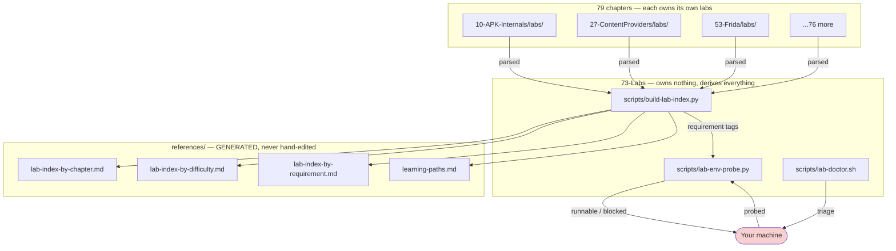
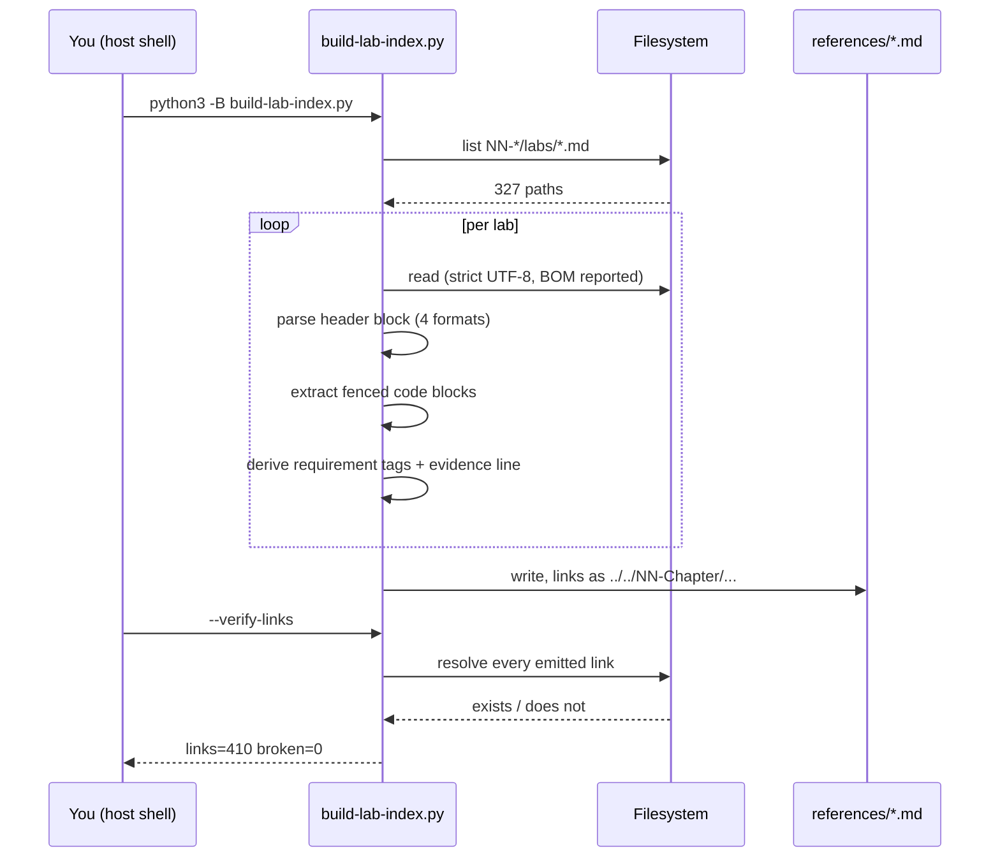
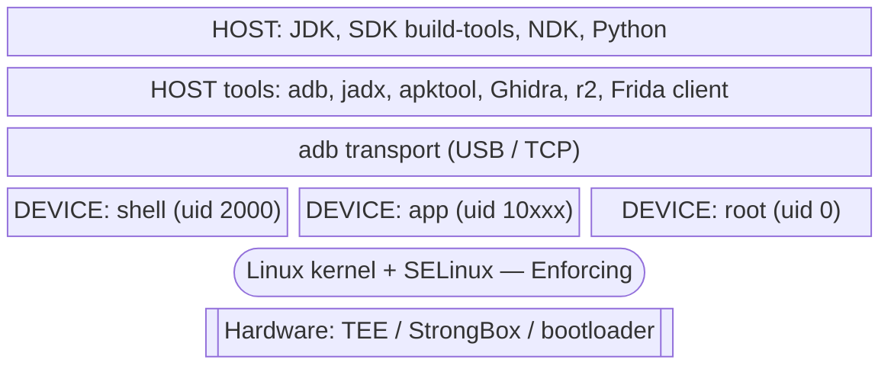
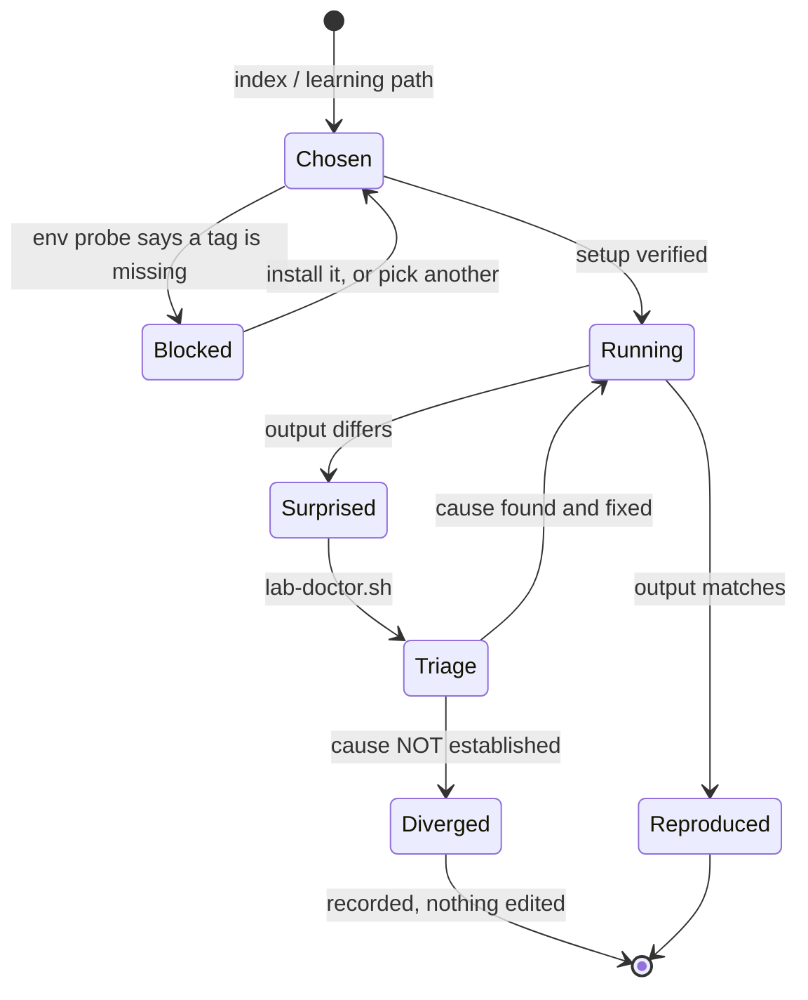
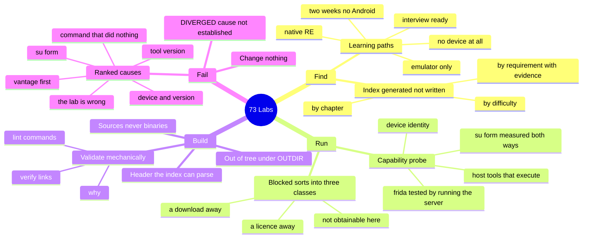

# 73 — Labs

> After this chapter you will be able to find any of this repository's 327 labs by what it teaches,
> what it costs and what it demands of your hardware; to know — measured, not guessed — which of them
> your own machine can run today and why the rest cannot; to follow an ordered route through them
> toward a stated goal instead of reading in chapter order; to build the environment they assume and
> diagnose it when it lies to you; to write a lab of your own that a stranger can reproduce; and to
> do the correct thing when a lab does not reproduce, which is the most common experience of running
> somebody else's work and the least documented.

**Prerequisites:** none formally. This chapter is a map, and a map is most useful before the
journey. It is most valuable after [00-Introduction](../00-Introduction/README.md), which builds the
toolchain this chapter **measures**.

**Applies to:** every chapter in this repository. The environment measurements are pinned to the
devices named beside them; the method is not.

---

## What this chapter is, and what it deliberately is not

**79 of this repository's 81 chapters ship labs — 327 of them, measured rather than estimated**
([§3.1](#31-what-the-corpus-actually-contains) has the count and the script that produced it). The
obvious version of chapter 73 collects them. That version would be roughly a third of the
repository's total length, would duplicate material that is already better placed next to the
mechanism it exercises, and would be stale within a week.

So this chapter contains **no copied labs at all**. It contains the six things no individual chapter
can contain, because each of them is a property of the corpus rather than of any member of it:

| | What | Where |
|---|---|---|
| **1** | **A generated index** of every lab — by chapter, by difficulty, by what it teaches, by what it *requires*. Built by script from the labs themselves, with the evidence line for every claim, so it cannot drift | [§3.2](#32-the-index-and-why-it-is-generated), [`references/`](references/) |
| **2** | **Learning paths.** Ordered routes for stated goals. 327 labs in reading order is not a curriculum | [§3.5](#35-learning-paths), [`references/learning-paths.md`](references/learning-paths.md) |
| **3** | **The lab environment, end to end and honestly** — what actually works on what hardware, including the four things on the verified setup that do not | [§3.6](#36-the-environment-what-actually-works-here)–[§3.9](#39-the-install-floor-and-three-refusals-that-look-alike) |
| **4** | **How to build a lab**, to this repository's conventions, and how to validate it mechanically | [§3.10](#310-how-to-build-a-lab), [Lab 03](labs/lab-03-write-a-lab-that-survives.md) |
| **5** | **What to do when a lab does not reproduce** — ranked causes, and why `DIVERGED, cause not established` is a complete answer | [§11.4](#114-when-a-lab-does-not-reproduce), [`examples/divergence-report.md`](examples/divergence-report.md) |
| **6** | **Labs that cross chapters**, which no single chapter can host: a capability survey over the whole corpus, a static→dynamic→report chain, a lab about writing labs, and a CTF spanning five chapters | [§12](#12-hands-on-labs) |

> **⚠️ Warning — the aggregator's temptation.** The failure mode of a chapter like this one is
> *concatenation*: gathering the material rather than doing the thing only an aggregator can do.
> Concatenation is easy to produce, looks comprehensive, and is worthless — it adds length without
> adding a single fact. Every section below either generates something from the corpus, measures
> something on real hardware, or teaches a handoff between chapters. If you find a paragraph here
> that merely restates another chapter, it is a defect.

---

## Table of Contents

- [1. Introduction](#1-introduction)
  - [1.1 What a lab is for, and why reading is not enough](#11-what-a-lab-is-for-and-why-reading-is-not-enough)
  - [1.2 What breaks without this chapter](#12-what-breaks-without-this-chapter)
  - [1.3 The three questions this chapter answers](#13-the-three-questions-this-chapter-answers)
- [2. High-Level Architecture](#2-high-level-architecture)
  - [2.1 The corpus as a system](#21-the-corpus-as-a-system)
  - [2.2 How the index is produced](#22-how-the-index-is-produced)
  - [2.3 The lab environment, as a stack](#23-the-lab-environment-as-a-stack)
  - [2.4 The lifecycle of one lab attempt](#24-the-lifecycle-of-one-lab-attempt)
- [3. Deep Internal Working](#3-deep-internal-working)
  - [3.1 What the corpus actually contains](#31-what-the-corpus-actually-contains)
  - [3.2 The index, and why it is generated](#32-the-index-and-why-it-is-generated)
  - [3.3 Deriving a requirement from a lab's text](#33-deriving-a-requirement-from-a-labs-text)
  - [3.4 The difficulty bands, and the six labs that declare none](#34-the-difficulty-bands-and-the-six-labs-that-declare-none)
  - [3.5 Learning paths](#35-learning-paths)
  - [3.6 The environment: what actually works here](#36-the-environment-what-actually-works-here)
  - [3.7 The su form, and the failure that reads as "not rooted"](#37-the-su-form-and-the-failure-that-reads-as-not-rooted)
  - [3.8 Frida: a capability that spans two machines](#38-frida-a-capability-that-spans-two-machines)
  - [3.9 The install floor, and three refusals that look alike](#39-the-install-floor-and-three-refusals-that-look-alike)
  - [3.10 How to build a lab](#310-how-to-build-a-lab)
  - [3.11 Building a target: sources, never binaries](#311-building-a-target-sources-never-binaries)
- [4. Source Code Walkthrough (AOSP)](#4-source-code-walkthrough-aosp)
  - [4.1 Where the install floor is enforced](#41-where-the-install-floor-is-enforced)
  - [4.2 Why `su 0` and `su -c` are different programs](#42-why-su-0-and-su--c-are-different-programs)
  - [4.3 Why `getCallingUid()` in `onReceive` is not the caller](#43-why-getcallinguid-in-onreceive-is-not-the-caller)
- [5. Security Perspective](#5-security-perspective)
  - [5.1 A lab machine executes untrusted code by design](#51-a-lab-machine-executes-untrusted-code-by-design)
  - [5.2 Deliberately vulnerable apps are a supply-chain risk](#52-deliberately-vulnerable-apps-are-a-supply-chain-risk)
  - [5.3 The device you test on is evidence](#53-the-device-you-test-on-is-evidence)
  - [5.4 Authorisation, and why a lab is not a licence](#54-authorisation-and-why-a-lab-is-not-a-licence)
  - [5.5 OWASP MASVS/MASTG mapping for the corpus](#55-owasp-masvsmastg-mapping-for-the-corpus)
- [6. Reverse Engineering Perspective](#6-reverse-engineering-perspective)
  - [6.1 Reading a lab as an artefact](#61-reading-a-lab-as-an-artefact)
  - [6.2 Recognising a fabricated output block](#62-recognising-a-fabricated-output-block)
  - [6.3 What a lab's requirements tell you about its author](#63-what-a-labs-requirements-tell-you-about-its-author)
- [7. Dynamic Analysis](#7-dynamic-analysis)
  - [7.1 Probing your own environment](#71-probing-your-own-environment)
  - [7.2 Triage when a lab fails](#72-triage-when-a-lab-fails)
  - [7.3 Establishing a vantage before you claim anything](#73-establishing-a-vantage-before-you-claim-anything)
- [8. Static Analysis](#8-static-analysis)
  - [8.1 Auditing the corpus without running anything](#81-auditing-the-corpus-without-running-anything)
  - [8.2 The checks this repository runs on itself](#82-the-checks-this-repository-runs-on-itself)
  - [8.3 Finding a lab without the index](#83-finding-a-lab-without-the-index)
- [9. Examples](#9-examples)
- [10. Common Interview Questions](#10-common-interview-questions)
- [11. Common Mistakes](#11-common-mistakes)
- [12. Hands-on Labs](#12-hands-on-labs)
- [13. Summary](#13-summary)
- [14. References](#14-references)

---

## 1. Introduction

### 1.1 What a lab is for, and why reading is not enough

Imagine learning to sail from a book. You could finish it able to describe a tack, name every part of
the rig, and explain the physics of a sail as an aerofoil. Then you get in a boat and discover
something the book could not tell you: that the boat does not respond immediately, that the wind is
not where the diagram put it, and that the thing you must actually learn is what to do in the second
after you got it wrong.

Security work is like this to an unusual degree, because the systems lie. Not metaphorically — a
command reports success and does nothing; a tool prints a version number for a program that cannot
run; a permission attribute makes a component unreachable while every scanner insists it is exposed.
Reading teaches you the model. **A lab teaches you the gap between the model and the machine**, and
that gap is where all the interesting security work lives.

> **📖 Definition — lab.** In this repository, a *lab* is a document that puts you in front of a real
> system, gives you a falsifiable goal, and lets you be wrong in a controlled way. It always has an
> objective, a setup, steps with expected output, success criteria you can check, and a cleanup. It
> is not a tutorial (which shows you a result) and not a cheatsheet (which reminds you of one).

### 1.2 What breaks without this chapter

Every chapter here is written to be read in isolation, which is right. It has a cost, and this
chapter exists to pay it.

**You cannot find anything.** There are 327 labs. Without an index, the only access path is reading
79 chapter READMEs. Nobody does that; in practice people do the labs in the first chapters they open
and never discover the ones that would have helped most.

**You do not know what you can run.** Every lab states its requirements in prose, in its own words,
in its own format. Nothing aggregates them, so you discover a blocker forty minutes in, having
already built the target. On the setup this chapter measured, **187 of 327 labs are blocked** — and
almost all of it is four missing downloads, which is a fact you would never learn one lab at a time.

**You have no route.** Reading order is chapter order, which is a dependency order for *concepts*
and emphatically not a learning order for *skills*. Someone preparing for an interview in three
weeks and someone with an emulator and no phone need different sequences, and neither is "start at
00 and continue".

**Nothing owns the handoffs.** Chapter 52 ends where static analysis ends. Chapter 51 begins where
dynamic analysis begins. **The gap between them is where findings die**, and no chapter can teach it,
because teaching it requires both at once.

**Nothing owns failure.** Every lab implicitly assumes it works. The single most common reader
experience is that it does not, and until this chapter that experience had no procedure attached.

### 1.3 The three questions this chapter answers

1. **"Which lab should I do?"** — the index and the learning paths.
2. **"Can I run it?"** — the environment survey, measured on your own machine.
3. **"It did not work. Now what?"** — triage, ranked causes, and the honest verdict.

Everything else here is in service of one of those three.

---

## 2. High-Level Architecture

### 2.1 The corpus as a system



The important property of that picture is the direction of every arrow into the aggregator: **73-Labs
reads from the chapters and never writes to them.** It owns no lab material of its own except the
four cross-chapter labs in §12, which exist precisely because they cannot live anywhere else. Your
machine is drawn as attacker-coloured because from the corpus's point of view it is the untrusted,
unknown variable — the one thing none of the 327 labs can see.

### 2.2 How the index is produced



Two design decisions in that diagram are load-bearing and both were paid for.

**The header block and the fenced code blocks are parsed separately from the prose.** A tool named in
running prose is a *mention*; a tool named in a lab's own prerequisites or invoked in a command is a
*requirement*. Collapsing the two produced 186 "labs needing Frida", one of which said only "without
root, without Frida".

**`--verify-links` resolves against the filesystem.** It does not inspect the strings. That is the
only check that catches a relative-depth error, and a relative-depth error in exactly this position
produced 1,495 broken links elsewhere in this repository — hidden for months inside a checker
exemption that never re-tested its own precondition.

### 2.3 The lab environment, as a stack



Read that stack as a set of **boundaries you must name before you make a claim.** The three device
rows are the vantages: they see different files, hold different permissions, and answer the same
question differently. The bottom row is drawn as hardware because on an emulator it is *simulated*,
which is why the eight `physical`-tagged labs are unrunnable there — not harder, unanswerable.

### 2.4 The lifecycle of one lab attempt



The state most people are missing is `Diverged`. Without it, a lab that does not reproduce has only
two exits — blame yourself and keep trying, or blame the lab and edit it — and both destroy
information. `Diverged` is a *terminal, respectable* state that preserves the question.

---

## 3. Deep Internal Working

### 3.1 What the corpus actually contains

Measured on 2026-08-16 by `scripts/build-lab-index.py --stats`. Nothing here is remembered:

```bash
# host — from 73-Labs
python3 -B scripts/build-lab-index.py --stats
```

| Quantity | Measured |
|---|---:|
| Chapters shipping labs | **79** |
| Lab markdown files | **327** |
| Beginner | 61 |
| Intermediate | 120 |
| Advanced | 66 |
| CTF | 74 |
| Difficulty not declared by the lab | 6 |

And by requirement — this is the table that decides what your afternoon looks like:

| Tag | Meaning | Labs |
|---|---|---:|
| `device` | needs an Android device or emulator | 269 |
| `frida` | needs Frida, at **both** ends | 128 |
| `jdk` | JDK plus SDK build-tools | 107 |
| `root` | needs root on the device | 82 |
| `apktool` | needs apktool | 72 |
| `no-root` | states in its own header that root is not needed | 69 |
| `no-device` | contains no `adb` invocation anywhere | 58 |
| `ndk` | native toolchain | 50 |
| `jadx` | needs jadx | 80 |
| `ghidra` / `xposed` | 14 each | 28 |
| `radare2` / `physical` | 8 each | 16 |
| `mobsf` / `proxy` | 6 each | 12 |
| `ida` / `aosp` | 4 each | 8 |
| `docker` | 3 | 3 |
| `drozer` | **0** | 0 |

> **🔍 Pentester's Note.** `drozer` reads zero, and that is a finding rather than a gap in the
> detector: two labs mention drozer in prose and neither invokes it. A tool this repository does not
> actually require is worth knowing about before you spend an evening installing it.

### 3.2 The index, and why it is generated

The four files in [`references/`](references/) are **generated artefacts** carrying a
`GENERATED FILE` banner. Editing them by hand is a defect, because the next run overwrites you.

| File | Grouping | Use it when |
|---|---|---|
| [`lab-index-by-chapter.md`](references/lab-index-by-chapter.md) | Reading order | You know the topic |
| [`lab-index-by-difficulty.md`](references/lab-index-by-difficulty.md) | Band | You have ninety minutes and want to be stretched, not stopped |
| [`lab-index-by-requirement.md`](references/lab-index-by-requirement.md) | Capability, **with an evidence line per lab** | You are deciding what to install, or auditing a claim |
| [`learning-paths.md`](references/learning-paths.md) | Curated route, generated contents | You have a goal and a deadline |

The argument for generating rather than transcribing is not effort. It is that **a transcribed index
is wrong the moment a chapter changes, and nothing tells you.** A generated one is wrong only until
somebody re-runs it, and the command is in the banner at the top of the file.

```bash
# host — regenerate all four
python3 -B scripts/build-lab-index.py

# host — and prove the links resolve
python3 -B scripts/build-lab-index.py --verify-links
```

```
links=410 broken=0
```

> **⚠️ Warning — relative depth, this repository's most expensive defect.**
> A file in `references/` or `labs/` is **two** levels below the repository root. A link from there
> to another chapter is `../../NN-Chapter/README.md`. The one-level form resolves *inside the
> chapter's own directory* and is silently wrong. `75-InterviewQuestions` emitted the one-level form
> from a generator and produced **1,495 broken links**, which a "forward reference" exemption in the
> checker hid for months — because the exemption never re-tested whether the target chapter was
> still unwritten. Two lessons, and the second is the general one: **verify links by resolving them,
> and give every exemption an expiry condition the tool evaluates.**

### 3.3 Deriving a requirement from a lab's text

A tag means: **this lab issues a command using this thing, or names it in its own prerequisites
block.** It does not mean the word appears in the file. Every tag carries the line that produced it:

```bash
# host
python3 -B scripts/build-lab-index.py --why 53-Frida/labs/lab-01-first-contact.md
```

```
53-Frida/labs/lab-01-first-contact.md
  title      : Lab 01 — First Contact
  difficulty : Beginner   (declared: Beginner)
  time       : 60–90 minutes
  lines      : 466
  tags:
    device       <- (the "AOSP" images) is rooted by default via `adb root`, which makes this lab friction-free:
    frida        <- python3 -m pip install --upgrade frida-tools
    python       <- python3 -m pip install --upgrade frida-tools
    root         <- a rooted device or emulator
```

The derivation rules, in the order they are applied:

| Order | Rule | Why |
|---|---|---|
| 1 | A denial in the **header block** wins outright | A lab writing "No root, no Frida, no proxy" is stating a contract |
| 2 | A denial anywhere in the file suppresses `root` | "No root required for any step" beats a `su` in a counter-example |
| 3 | Matches on lines saying "if you have", "optional", "if available" are **skipped**, and the search continues | An optional route is not a requirement |
| 4 | Otherwise, search the header block, then fenced code blocks | Contract first, then commands |
| 5 | Prose is consulted only for `physical`, and only for explicit phrases | "on a real device" in passing is not a requirement |
| 6 | A chapter's own tool is inherited by its labs | Three of 58-IDA's four labs drive IDA through its GUI and never type a command |

> **🔬 Under the Hood — why rule 3 exists.** Lab 02 of this chapter was tagged `apktool` on the
> strength of the line *"if you have apktool, which decodes resources as well"*. Skipping the match
> and continuing the search — rather than abandoning the tag — matters, because a lab may name a
> tool optionally in one place and necessarily in another, and only the second is a requirement.

### 3.4 The difficulty bands, and the six labs that declare none

Four bands. **The band is the level you need to finish, not the level you need to start**, so a lab
written "Beginner to Intermediate" is Intermediate.

| Band | What it means |
|---|---|
| Beginner | Assumes no prior Android security work. May still take three hours |
| Intermediate | Assumes you can read the chapter and drive `adb` without help |
| Advanced | Assumes you can build things and read disassembly |
| CTF | The method is withheld. There is a goal and a verifiable answer. By convention, last in its chapter |

The parser reads four header formats because the corpus uses four. Its first version reported 17
labs as declaring no difficulty; **twelve of those did declare one**, in two formats it did not know
(`> **Difficulty.** Beginner.` with a period inside the bold run, and
`> **Level:** Beginner · **Time:** …` with several fields on one line). The parser was wrong, not the
labs.

**After the fix, six labs genuinely declare nothing, and the index reports them as `unstated` rather
than assigning a guess.** One of them writes `**Level:** Core`, which is meaningful to a reader and
not a band. Recording an honest absence is better than manufacturing a value that looks like a
measurement.

> **🧠 Mental Model.** *A detector that disagrees with one sample is probably wrong about that
> sample. A detector that disagrees with a dozen is wrong about itself.* This is the repository's own
> rule and it has now fired in both directions — once when a question-parser reported a chapter as
> having no interview questions (the parser was wrong), and once here.

### 3.5 Learning paths

327 labs in reading order is a corpus, not a curriculum. [`references/learning-paths.md`](references/learning-paths.md)
gives five ordered routes. The chapter sequence is curated; the lab list under each step is
**generated**, so a path can never name a lab that has been renamed or deleted.

| Path | Goal | Budget |
|---|---|---|
| `two-weeks-no-android` | Two weeks, no Android background, no prior security work | 10 days, 3–4 h/day |
| `interview-ready` | Interview-ready in the shortest defensible time | 3 weeks of evenings |
| `emulator-only` | An emulator and nothing else — no phone, no bootloader, no TEE | Open-ended |
| `native-re` | The native and reverse-engineering track | 4–6 weeks |
| `no-device-at-all` | A laptop on a train | A week of commutes |

Each path states a **rule** as well as a sequence, and the rule is usually the more valuable half.
The `emulator-only` rule, for instance, is that the eight `physical`-tagged labs are not "harder on
an emulator" — they are unanswerable there, and attempting them teaches a wrong answer with a
straight face. The `native-re` rule is: do not start at Ghidra.

### 3.6 The environment: what actually works here

Everything below was measured on **AVD `sdk_gphone16k_x86_64`** (`emulator-5554`), the only device
attached while this chapter was written. Re-measure before trusting any of it.

```bash
# host
adb devices -l
adb shell getprop ro.build.version.release
adb shell getprop ro.build.version.sdk
adb shell getprop ro.product.cpu.abi
adb shell getprop ro.build.type
adb shell getenforce
adb shell getconf PAGE_SIZE
```

| Property | Measured |
|---|---|
| Model / device | `sdk_gphone16k_x86_64` / `emu64xa16k` |
| Android / API | **15 / 35** |
| ABI | `x86_64` |
| Build type | `userdebug`, `ro.debuggable=1` |
| Security patch | `2024-09-05` |
| SELinux | **Enforcing** |
| Page size | **16384** — 16 KiB pages |
| Root | **yes**, Magisk `30.7:MAGISK:R` at `/debug_ramdisk/magisk`, `/data/adb/modules` empty, Zygisk off |
| Working `su` form | **`su 0 <cmd>`** — `su -c` fails |
| `frida-server` | present, **does not link** |
| Bootloader | **none.** `ro.bootmode=unknown`; partitions are `metadata super vbmeta vda vdd` |

Host side:

| Tool | Measured |
|---|---|
| `javac` / `java` | 24.0.2 |
| Python | 3.13.3 |
| Node | v20.19.1 |
| `adb` | 1.0.41 |
| Frida (host) | 16.1.6 |
| jadx | 1.5.3 |
| SDK build-tools | 34.0.0, 35.0.0, **35.0.1** |
| SDK platforms | **`android-35` only** |
| NDK | 25.2.9519653 |
| `kotlinc` | bundled in Android Studio, **not on PATH** |
| `apktool`, Ghidra, radare2, mitmproxy | **absent** |
| `zip` / `unzip` | **absent** — this is Git Bash on Windows, and they are not part of Git for Windows |

Four of those rows are the ones that change what you can do, and each has its own section:
[the `su` form](#37-the-su-form-and-the-failure-that-reads-as-not-rooted),
[Frida](#38-frida-a-capability-that-spans-two-machines),
[the bootloader's absence](#23-the-lab-environment-as-a-stack), and
[16 KiB pages](#42-why-su-0-and-su--c-are-different-programs).

> **🔬 Under the Hood — 16 KiB pages are not cosmetic.** The kernel maps segments at page
> granularity. A native binary whose program headers assume 4 KiB alignment cannot be placed as its
> linker intended when the kernel enforces 16 KiB, and the process dies with SIGSEGV before `main`.
> This repository measured `int main(void){return 42;}` exiting **139** on this image. The fix is
> `-Wl,-z,max-page-size=16384`, and the failure has nothing to do with your code.

### 3.7 The su form, and the failure that reads as "not rooted"

```bash
# host — run both. One will fail, and that is not the finding.
adb shell "su 0 id"
adb shell "su -c id"
```

```
uid=0(root) gid=0(root) groups=0(root),1004(input),1007(log),1011(adb),... context=u:r:su:s0
su: invalid uid/gid '-c'
```

The device is rooted. The second command failed because this AVD's `su` is AOSP's, whose first
positional argument is a **uid** — so `-c` was parsed as a user name and rejected. A Magisk `su` on a
typical handset accepts `-c` and answers the other way round.

> **⚠️ Warning — and there is a third form, which is broken on every device.**
> <!-- lint:allow SU-DASH-C SU-DASH-C-BARE -- the broken form, quoted as the counter-example this warning teaches -->
> `adb shell su -c 'id'` mangles itself: the `adb shell` argument is re-parsed by the device's shell,
> which strips the quotes, so `su` receives `-c` and `id` as separate words. Depending on your `su`
> it runs only `id` or rejects the flag. Quote the whole remote command —
> `adb shell "su -c 'id'"` — or use `su 0 <cmd>`. A repository-wide sweep found **196 occurrences**
> of the broken form; **134 were repaired** and the rest were adjudicated as deliberate
> counter-examples and marked. Nobody wrote them carelessly; each one worked on its author's device.

### 3.8 Frida: a capability that spans two machines

```bash
# host
frida --version
adb shell "su 0 /data/local/tmp/frida-server --version"
```

```
16.1.6
...several hundred lines of: WARNING: linker: ... unused DT entry: unknown (type 0xa00010a arg 0x0)
CANNOT LINK EXECUTABLE "/data/local/tmp/frida-server": empty/missing DT_HASH/DT_GNU_HASH in
"/data/local/tmp/frida-server" (new hash type from the future?)
```

The host client is fine. The server binary is present, executable and the right architecture. It
still does not run, because it was built with a toolchain newer than this image's dynamic linker
understands. **This is a Frida-version problem, not a root problem** — `su 0 id` returns uid 0 on the
same device seconds later.

> **🔍 Pentester's Note — the trap inside the trap.** `frida-ps -U` **still enumerates processes** on
> this device. The failure appears only on attach. If you test Frida with `frida-ps`, you will
> conclude it works and then debug a script that was never going to run. **Test a capability with the
> operation you need it for.**

This single capability blocks **128 of 327** labs here, and it is also the cheapest to fix. Measured:
`--assume frida` takes runnable from **140 to 210**.

### 3.9 The install floor, and three refusals that look alike

Three install refusals have unrelated causes and unrelated fixes. Measured, using this chapter's own
target built at two different `targetSdk` values:

| Refusal | Cause | What works |
|---|---|---|
| `INSTALL_FAILED_DEPRECATED_SDK_VERSION` | The **platform's** floor: `targetSdk` below 24 | `adb install --bypass-low-target-sdk-block` |
| `INSTALL_FAILED_USER_RESTRICTED` | An **OEM** policy ("Install via USB"), measured on a MIUI handset | A root install from the device shell |
| `INSTALL_FAILED_UPDATE_INCOMPATIBLE` | **Signing-key** mismatch with the installed copy | Uninstall first |

```bash
# host — measured on the AVD
adb install /tmp/ch73-sdk23/chain-target.apk
```

```
Failure [INSTALL_FAILED_DEPRECATED_SDK_VERSION: App package must target at least SDK version 24,
but found 23]
```

```bash
# host
adb uninstall com.pentest.ch73.chain
adb install --bypass-low-target-sdk-block /tmp/ch73-sdk23/chain-target.apk
adb shell "dumpsys package com.pentest.ch73.chain | grep -m1 targetSdk"
```

```
Success
    versionCode=0 minSdk=23 targetSdk=23
```

> **⚠️ Warning.** The second refusal is the one that has cost this repository the most, because
> "Install canceled by user" is untrue — nobody cancelled anything. On the MIUI handset the working
> route was `adb push` followed by a root `pm install` from the device shell. On the API 35 AVD that
> same command needs `su 0 pm install -r <path>`, because its `su` rejects `-c`. **The fix for an
> install failure depends on which failure it is; read the string.**

### 3.10 How to build a lab

The full treatment is [Lab 03](labs/lab-03-write-a-lab-that-survives.md); the contract is here.

**Write in this order**, which is not the reading order: success criteria first, then the *measured*
output blocks, then the steps that produce them, then setup, then "why this matters", then "if it
did not work" from the failures you personally hit.

The header the index parses:

```markdown
**Difficulty:** Beginner | Intermediate | Advanced | CTF
**Time:** 60–90 minutes
**Prerequisites:** [Chapter NN §x](../README.md#...)
**Requires:** the honest list; mark optional things optional
**Device used to verify this lab:** model, Android version, API, ABI, build type, root status
```

The last line is the one people omit and the one reviewers read first. **A measured output with no
device attached to it cannot be reproduced, cannot be diverged from, and cannot be corrected.**

The skeleton is [`examples/lab-template.md`](examples/lab-template.md). Validate mechanically:

```bash
# host
python3 -B scripts/build-lab-index.py --why <your lab>        # header vs derived
python3 -B scripts/build-lab-index.py --verify-links          # every promised path
python3 -B scripts/lab-env-probe.py --match --chapter NN      # can a reader run it?
python3 -B ../76-CheatSheets/scripts/lint-commands.py --path . # command-shape defects
```

> **🧠 Mental Model.** **You cannot proofread your own environment out of your own document**,
> because your environment is the background against which you see everything else. The only cure is
> a program that does not share it. Every check above is that program.

### 3.11 Building a target: sources, never binaries

This repository ships **sources**, never built APKs. `.apk`, `.dex`, `.class`, `.so`, `.o`, `.jar`
and `.pyc` are on the artefact blocklist. A lab needing a target therefore ships the source and a
build script, and the build script writes **out of tree**.

The reference implementation is [`43-WebView/examples/build.sh`](../43-WebView/examples/build.sh).
This chapter's own is [`examples/build-chain-target.sh`](examples/build-chain-target.sh), which
builds with `aapt2 link` → `javac` → `d8` → `zipalign` → `apksigner` and generates its signing key
into `$OUTDIR` so no key is ever committed.

Three failures were hit building it on a stock Windows machine, and all three recur in every
no-Gradle build here:

| Failure | Cause | Fix |
|---|---|---|
| `javac: invalid flag: /c/Users/<you>/Desktop/Android` | The `@argfile` listed paths unquoted, and this repository's path contains a space | Quote every argfile line |
| `zip: command not found` | `zip` is not part of Git for Windows | Fall back to Python's `zipfile`, then the JDK's `jar` |
| `aapt2: failed to load XML file` on a file that exists | SDK tools are native Windows binaries and do not understand `/c/Users/...` | Every path through `cygpath -w` |

> **⚠️ Warning.** Two more that bite silently. `adb push` mangles an absolute *remote* path under
> MSYS — `/data/local/tmp` becomes `C:/Program Files/Git/data/local/tmp` — so set
> `MSYS_NO_PATHCONV=1` or quote the remote command. And **an XML comment must not contain a double
> hyphen**; `aapt2` rejects the file.

---

## 4. Source Code Walkthrough (AOSP)

This chapter's subject is the corpus, not a platform mechanism, so this section traces the three
platform behaviours the chapter's own measurements depend on. Each is a real AOSP path; no line
numbers are quoted, because line numbers move.

### 4.1 Where the install floor is enforced

The refusal in [§3.9](#39-the-install-floor-and-three-refusals-that-look-alike) is not `adb`'s. `adb`
forwards the APK to the package installer and reports what it is told.

- `frameworks/base/services/core/java/com/android/server/pm/InstallPackageHelper.java` — package
  scanning and the checks applied before an install commits, including the minimum-`targetSdk` gate
  whose failure surfaces as `INSTALL_FAILED_DEPRECATED_SDK_VERSION`.
- `frameworks/base/core/java/android/content/pm/PackageManager.java` — where the
  `INSTALL_FAILED_*` result constants are declared. Reading this file is the fastest way to see that
  the three refusals in §3.9 are genuinely different codes rather than one message with variations.
- `frameworks/base/services/core/java/com/android/server/pm/PackageManagerShellCommand.java` —
  implements `pm install` and its flags, which is where `--bypass-low-target-sdk-block` is accepted.

The call flow, from your shell to the decision: `adb install` → `pm install` in the device shell →
`PackageManagerShellCommand` → the installer session → `InstallPackageHelper`'s checks → a result
constant → back up the chain as a string. **The string you get is the last link in a five-step
chain**, which is why reading it precisely matters more than reacting to it.

### 4.2 Why `su 0` and `su -c` are different programs

There is no `su` in AOSP's shipping system image for a user build; the `su` you have came from your
rooting stack. That is the whole explanation for [§3.7](#37-the-su-form-and-the-failure-that-reads-as-not-rooted).

- `system/extras/su/su.c` — the AOSP `su`, present on `userdebug` and `eng` builds. Its argument
  handling takes an optional **uid** as the first positional argument, then a command. There is no
  `-c` flag, which is exactly why `su -c id` returns `su: invalid uid/gid '-c'` — the string `-c` was
  parsed as a user to become.
- Magisk's `su` is a different program with a different argument parser, deliberately modelled on the
  traditional Unix `su`, and it does accept `-c`.

> **🔬 Under the Hood.** Both binaries are called `su` and both sit on `PATH`. Nothing about the name
> tells you which parser you have, and the failure of the wrong one is indistinguishable at a glance
> from an absent `su`. **This is why the probe tests both forms rather than picking one**, and why
> the repository's convention is to state the form beside the device it belongs to.

### 4.3 Why `getCallingUid()` in `onReceive` is not the caller

Measured in [Lab 02 §6.3](labs/lab-02-the-chain-no-chapter-can-host.md): a receiver reached by a root
broadcast logged `uid 10210` — the receiving application's own uid, not the broadcaster's.

- `frameworks/base/core/java/android/os/Binder.java` — `getCallingUid()` returns the identity of the
  **current incoming binder transaction**. When there is no such transaction on the thread, it
  returns the calling process's own uid.
- `frameworks/base/core/java/android/app/ActivityThread.java` — where a broadcast is dispatched to
  the app. `onReceive` runs on the main thread from a scheduled message, **not** inside the binder
  transaction that delivered the broadcast to the process.
- `frameworks/base/services/core/java/com/android/server/am/BroadcastQueue.java` — the
  `system_server` side, which holds the sender's identity and does not pass it to `onReceive`.

The consequence is a real vulnerability class, not a lab artefact: **an app that "checks the caller"
in `onReceive` with `getCallingUid()` checks its own uid against itself.** The contrast worth knowing
is `ContentProvider.query()`, which *is* invoked inside the incoming transaction, and where the same
call does identify the caller.

---

## 5. Security Perspective

### 5.1 A lab machine executes untrusted code by design

That is its entire purpose, and it makes your lab machine the least trustworthy computer you own.

- **Do not use a machine holding client data** for an unrelated engagement. Cross-contamination
  between engagements is a contractual problem before it is a technical one.
- **Prefer a VM or a dedicated device you can roll back.** Snapshot before a malware chapter.
- **Assume anything you install on the test device is permanent.** Rooting stacks, Xposed modules and
  system CA changes persist and silently change later results — see [§5.3](#53-the-device-you-test-on-is-evidence).

### 5.2 Deliberately vulnerable apps are a supply-chain risk

Every lab target in this repository is built from source you can read, on your machine, with a key
generated at build time. That is deliberate, and the reason is worth stating: **a downloaded
"vulnerable app" binary is an unsigned-by-you executable of unknown provenance that you are about to
install on a device with developer options enabled.** The category has been abused.

- Prefer sources plus a build script. If you must use a prebuilt target, check its hash against the
  project's own published value.
- Never install a lab target on a device with a real account signed in.
- Uninstall when finished. Every lab in this chapter ends with a cleanup section that names the
  package.

### 5.3 The device you test on is evidence

A result is only as good as the device's posture, and posture is *invisible unless you check*. This
repository has measured a physical device whose system CA store had been replaced by a tmpfs with an
interception CA bind-mounted into it — meaning **a successful TLS intercept on that device did not
prove the app trusted user-installed CAs**, because the proxy CA was in the *system* store. A chapter
that had not checked would have published the opposite of the truth.

```bash
# host — before any trust-store claim
adb shell "mount | grep cacerts"
```

The general rule: **establish posture before measurement, and record it beside the result.** Root
status, SELinux mode, CA store, rooting stack, and which vantage you used.

### 5.4 Authorisation, and why a lab is not a licence

A lab teaches a technique against a target you built. It confers no authorisation to use that
technique anywhere else. The distinction is not pedantry — it is the entire legal basis of the work.

- **Written scope, before testing.** [00-Introduction lab 03](../00-Introduction/labs/lab-03-legal-scope-triage.md)
  is a whole lab on this and it is not optional reading.
- **Your own device is not "any device you can reach."** A test device on a shared network is still
  someone else's network.
- **Never name a real vendor or application as vulnerable** in notes you might share. This
  repository's convention is "a 17 MB commercial app".

### 5.5 OWASP MASVS/MASTG mapping for the corpus

This chapter maps to the MASTG's *process* rather than to a control, because that is what it is
about: the testing methodology and its evidence standards.

| MASVS/MASTG area | Where the corpus covers it |
|---|---|
| MASVS-STORAGE | Chapters 33, 49, and Lab 04 flag 4 here |
| MASVS-CRYPTO | Chapters 34, 36, 49; Lab 04 flag 1 here |
| MASVS-AUTH | Chapters 45, 46, 47, 48 |
| MASVS-NETWORK | Chapters 35, 36, 44 |
| MASVS-PLATFORM | Chapters 21, 23, 26, 27, 28, 29, 30, 32, 43 — and Labs 02 and 04 here |
| MASVS-CODE | Chapters 40, 41, 42, 52, 56 |
| MASVS-RESILIENCE | Chapters 37, 38, 39, 62, 63, 64, 67 |
| MASTG testing process | **This chapter** — the chain, the evidence standard, and the divergence procedure |

Use [`references/lab-index-by-chapter.md`](references/lab-index-by-chapter.md) to turn any row above
into a lab list.

---

## 6. Reverse Engineering Perspective

The artefact under analysis here is **a lab document**. Reading one adversarially is a real skill,
because you will rely on labs written by people whose environment you cannot see.

### 6.1 Reading a lab as an artefact

| What you look at | What it tells you |
|---|---|
| The **"verified on"** line | Whether any result in it is reproducible at all. Its absence is the strongest single signal |
| Whether outputs carry warnings | Real output is noisy. `apksigner` prints four lines about restricted methods before anything useful |
| Whether device and host commands are labelled | An unlabelled command is one run in the wrong place |
| Whether the `su` form matches the stated device | A mismatch means the author did not run it there |
| Whether there is an "if it did not work" section | It cannot be written without having failed |
| Whether anything is stated as **not** established | Its absence claims completeness, which is never true |

### 6.2 Recognising a fabricated output block

This is worth practising, because it is easy to do accidentally. The tells:

- **Too clean.** No warnings, no deprecation notices, no linker noise.
- **Round numbers.** Real byte counts and timings are not round.
- **Consistent formatting across tools** that do not format consistently.
- **Output that matches the prose too exactly**, including the prose's own wording.
- **A path that does not match the stated OS.** `/home/user/...` in a lab verified on Windows.

> **🔍 Pentester's Note.** This section exists because **it caught this chapter's own author.**
> Lab 01 first quoted a `--why` output block that had never been run: right format, plausible tags,
> believable line count, entirely invented. Running the command produced different tags, a different
> line count and weaker evidence. It was replaced. The lesson is not "be careful" — it is that
> plausible fabrication is the *default* output of writing quickly, and the only defence is running
> the command.

### 6.3 What a lab's requirements tell you about its author

```bash
# host
python3 -B scripts/build-lab-index.py --by requirement --out - | head -40
```

A lab requiring root for everything was probably written by someone who never tested without it, and
may overstate what an attacker can do. A lab requiring nothing but `adb` has usually been run more
times, by more people, on more devices. A lab requiring a `physical` device is making a claim an
emulator cannot check — treat its results as the least independently verified in the corpus, and
value them accordingly: they are also the ones nobody else can easily produce.

---

## 7. Dynamic Analysis

### 7.1 Probing your own environment

```bash
# host — from 73-Labs
python3 -B scripts/lab-env-probe.py                       # probe only
python3 -B scripts/lab-env-probe.py --match               # probe + corpus match
python3 -B scripts/lab-env-probe.py --match --list blocked
python3 -B scripts/lab-env-probe.py --match --chapter 53
python3 -B scripts/lab-env-probe.py --match --assume frida,proxy
python3 -B scripts/lab-env-probe.py --no-device --match
python3 -B scripts/lab-env-probe.py --match --json > "$HOME/manifest.json"
```

Measured on the AVD, final run:

```
Capability tags satisfied: device, docker, jadx, jdk, ndk, no-device, no-root, objection,
                           python, root

  runnable here : 140 / 327
  blocked       : 187 / 327

  Blocked by:
    frida       128 labs
    apktool      72 labs
    ghidra       14 labs
    xposed       14 labs
    radare2       8 labs
    physical      8 labs
    proxy         6 labs
    mobsf         6 labs
    aosp          4 labs
    ida           4 labs
```

The probe changes nothing. Every device command it issues is a read; the most invasive is `su 0 id`,
and it runs that because there is no honest way to establish root without asking.

> **⚠️ Warning.** Write the manifest **outside** the repository. It contains absolute paths from your
> machine and is exactly the kind of artefact the repository's checks reject.

### 7.2 Triage when a lab fails

```bash
# host
bash scripts/lab-doctor.sh
bash scripts/lab-doctor.sh --lab ../27-ContentProviders/labs/lab-01-enumerate-and-read.md --paths
```

It runs six checks in the order that resolves the most cases soonest: which device; which `su` form;
does `frida-server` actually run; does the lab's declared contract match your setup; do the paths it
promises exist; and — the one no script can settle — is your vantage the lab's vantage.

Measured on the AVD:

```
=== 2. root, and which su form
  [ ok ] rooted; working form is:  su 0 <cmd>
         `su -c` on this device says: su: invalid uid/gid '-c'

=== 3. frida
  [ ok ] host frida 16.1.6
  [FAIL] frida-server is present but does NOT run
         CANNOT LINK EXECUTABLE "/data/local/tmp/frida-server": empty/missing DT_HASH/DT_GNU_HASH
```

> **🔬 Under the Hood — why the script has no `set -e` and no `set -o pipefail`.** Every check in a
> diagnostic is *expected* to fail sometimes; `set -e` would abort on the first informative failure.
> And `set -o pipefail` turns `… | head -1` into a spurious failure when `head` closes the pipe and
> the writer takes SIGPIPE. **Every check tests content, never an exit status.**

### 7.3 Establishing a vantage before you claim anything

The single most repeated methodology error in this repository is a result measured from one identity
and reported as though from another.

| Vantage | uid | What it can do that the others cannot |
|---|---|---|
| Third-party app | 10xxx | The only vantage that models an actual attacker app |
| `shell` (over `adb`) | 2000 | Holds permissions no ordinary app holds. **Not an app** |
| root | 0 | Reads any file; reaches components `shell` cannot |
| The app itself | its own | Sees private state; via instrumentation or a hook |

```bash
# host — establish it, every time
adb shell id                      # shell
adb shell "su 0 id"               # root
adb shell "pm list packages -U <pkg>"   # the app's uid
```

**A worked example of why this is not pedantry**, from [Lab 02 §6](labs/lab-02-the-chain-no-chapter-can-host.md):
an exported receiver guarded by a `signature` permission was unreachable from `shell` and reachable
from root. `am broadcast` printed **byte-identical output in both cases** — `Broadcast completed:
result=0` — and only the application's own log distinguished them. If your evidence for a broadcast
finding is `am`'s output, you have no evidence.

---

## 8. Static Analysis

### 8.1 Auditing the corpus without running anything

```bash
# host — how many labs, in what bands, needing what
python3 -B scripts/build-lab-index.py --stats

# host — machine-readable, for your own tooling
python3 -B scripts/build-lab-index.py --format json --out ~/labs.json
python3 -B scripts/build-lab-index.py --format csv  --out ~/labs.csv

# host — which labs claim to need root, with the evidence line for each
python3 -B scripts/build-lab-index.py --by requirement --out - | sed -n '/^## `root`/,/^## /p'
```

```bash
# host — find every CTF
grep -rn "^\*\*Difficulty:\*\* *CTF" */labs/*.md

# host — every lab that names a device it was verified on
grep -rln "Device used to verify" */labs/*.md | wc -l
```

### 8.2 The checks this repository runs on itself

This repository verifies itself mechanically before any chapter is called finished. The full sweep
covers six things: committed build artefacts, mojibake, **every** relative markdown link resolved
against its own directory rather than against the repository root, raw C0 control bytes, byte-order
marks, and per-chapter completeness — section count, the four required files, and two or more
non-`.gitkeep` files in each of `labs/`, `examples/` and `scripts/`. Two parts of it ship as runnable
scripts you can point at any chapter: [`76-CheatSheets/scripts/check-anchors.py`](../76-CheatSheets/scripts/check-anchors.py)
for file paths and heading anchors, and [`76-CheatSheets/scripts/lint-commands.py`](../76-CheatSheets/scripts/lint-commands.py)
for command shapes; [`scripts/lab-doctor.sh`](scripts/lab-doctor.sh) runs the lab-level subset
against a single file. The four that matter most when adding a lab:

```powershell
# host, PowerShell — raw C0 control bytes anywhere. Must be zero.
Get-ChildItem -LiteralPath "73-Labs" -Recurse -File | ForEach-Object {
    $b = [System.IO.File]::ReadAllBytes($_.FullName)
    $n = @($b | Where-Object { ($_ -lt 0x20 -and $_ -notin 9,10,13) -or $_ -eq 0x7F }).Count
    if ($n) { "$($_.Name) $n" }
}
```

```powershell
# host, PowerShell — byte-order marks. A BOM is VALID UTF-8, so a decoder will not catch it.
Get-ChildItem -LiteralPath "73-Labs" -Recurse -File -Filter *.md | ForEach-Object {
    $b = [System.IO.File]::ReadAllBytes($_.FullName)
    if ($b.Length -ge 3 -and $b[0] -eq 0xEF -and $b[1] -eq 0xBB -and $b[2] -eq 0xBF) { "BOM: $($_.Name)" }
}
```

```bash
# host — build artefacts
find 73-Labs \( -name '__pycache__' -o -name '*.pyc' -o -name '*.class' -o -name '*.apk' \
     -o -name '*.dex' -o -name '*.so' -o -name '*.o' -o -name '*.jar' \)
```

```bash
# host — command-shape defects, including the su -c class
python3 -B ../76-CheatSheets/scripts/lint-commands.py --path .
```

> **⚠️ Warning — three traps in these checks themselves.**
> **`-Include` is silently ignored when combined with `-LiteralPath`** in PowerShell; use
> `Where-Object`. **A validity check is not a conformance check** — ten files in this repository
> carried a BOM and passed every UTF-8 decode, because `EF BB BF` decodes cleanly to U+FEFF. And
> **never pair `Get-Content -Raw` with `Set-Content -Encoding UTF8`**: `-Raw` reads a BOM-less UTF-8
> file using the ANSI codepage, so every multi-byte character decodes wrongly and writing it back
> makes the damage permanent. It corrupted 11 files here.

### 8.3 Finding a lab without the index

If the generated files are stale or absent, the corpus is still greppable:

```bash
# host — labs in a chapter, with their declared difficulty
grep -H -m1 -E '^\s*>?\s*\*\*(Difficulty|Level)' 27-ContentProviders/labs/*.md

# host — every lab that needs root, crudely
grep -rl "rooted device\|su 0 \|requires root" */labs/*.md | wc -l

# host — every lab that says it does NOT need root
grep -rl "No root required\|no root is required\|without root" */labs/*.md
```

Compare those crude counts against `--stats`. They will disagree, and **the disagreement is the
argument for the generated index**: a grep counts mentions, and a mention is not a requirement.

---

## 9. Examples

Five, graded. The first three are files in [`examples/`](examples/); the last two are commands.

### 9.1 Simple — the lab skeleton

[`examples/lab-template.md`](examples/lab-template.md). The header the index parses, the sections in
the order they should be *written* rather than read, and inline comments explaining why each exists.
Copy it into the chapter your lab belongs to.

### 9.2 Intermediate — the evidence ledger

[`examples/evidence-ledger.md`](examples/evidence-ledger.md). A table with a **vantage** column and a
five-word verdict vocabulary (`HYPOTHESIS`, `CONFIRMED`, `REFUTED`, `NOT TESTED`, `DIVERGED`). It
carries a fully worked example: four claims from Lab 02, of which three static severity predictions
were wrong and the most confident one did not survive contact with the device.

### 9.3 Advanced — a target built out of tree

[`examples/build-chain-target.sh`](examples/build-chain-target.sh) plus the sources in
[`examples/chain-target/`](examples/chain-target/). No Gradle, no network: `aapt2 link` → `javac` →
`d8` → `zipalign` → `apksigner`, with the signing key generated into `$OUTDIR`. It detects an OEM
install restriction and falls back to a root install, choosing the `su` form the device accepts.

```bash
# host
cd 73-Labs/examples
./build-chain-target.sh --install
./build-chain-target.sh --target-sdk 23        # to reproduce the install floor
./build-chain-target.sh --uninstall
```

### 9.4 Real application — planning an afternoon with numbers

```bash
# host
python3 -B scripts/lab-env-probe.py --match
python3 -B scripts/lab-env-probe.py --match --assume frida
python3 -B scripts/lab-env-probe.py --match --assume frida,apktool,ghidra,radare2
```

Measured: **140 → 210 → 288** of 327. A working `frida-server` alone is worth 70 labs, which is more
than any other single change you could make to that machine. That is a purchasing decision made with
a measurement instead of a feeling.

### 9.5 Enterprise — the corpus as data

```bash
# host — every lab, machine-readable, with derived requirements and evidence
python3 -B scripts/build-lab-index.py --format json --out ~/labs.json
```

```bash
# host — e.g. every Advanced lab runnable with no device
python3 -B - <<'PY'
import json, io
labs = json.load(io.open('/home/you/labs.json', encoding='utf-8'))
for lab in labs:
    if lab['difficulty'] == 'Advanced' and 'no-device' in lab['tags']:
        print(lab['relpath'])
PY
```

At team scale this is how you assign work: probe each engineer's machine, match against the corpus,
and hand out the labs their setup can actually run. It is also how you notice that your whole team is
blocked on one missing tool.

---

## 10. Common Interview Questions

### Beginner

**Q. What is the difference between a lab, a tutorial and a cheatsheet?**
A tutorial demonstrates a result; you follow and it works. A cheatsheet reminds you of a result you
already understand. A lab gives you a falsifiable goal and lets you be wrong — it has success
criteria you can check and a failure mode you are expected to hit. If the reader is never uncertain,
it is not a lab.

**Q. Why do you need a device at all if you can decompile the APK?**
Because static analysis sees the door and not the room. It can prove a component is reachable; it
cannot tell you what comes out of it. In this chapter's own chain lab, static analysis found an
exported provider and dynamic analysis found that the table behind it held a bearer credential —
which is the severity, and it was invisible statically.

**Q. What does "rooted" actually mean for a lab?**
That some process can obtain uid 0. It does not tell you *how* to obtain it: AOSP's `su` takes
`su 0 <cmd>` and Magisk's takes `su -c <cmd>`. Using the wrong form fails in a way that reads
exactly like "not rooted", and that misreading has cost real work in this repository.

**Q. Why does this repository ship sources instead of APKs?**
Three reasons: build artefacts are unreviewable, a downloaded "vulnerable app" binary is an unsigned
executable of unknown provenance that you are about to install on a developer-enabled device, and a
source plus a build script stays correct as toolchains change.

### Intermediate

**Q. `adb install` fails. Walk me through your diagnosis.**
Read the string, because three refusals look alike and have unrelated fixes.
`INSTALL_FAILED_DEPRECATED_SDK_VERSION` is the platform's `targetSdk` floor and
`--bypass-low-target-sdk-block` lifts it. `INSTALL_FAILED_USER_RESTRICTED` is an OEM policy — the
message says "Install canceled by user" and nobody cancelled anything — and a root `pm install` from
the device shell gets past it. `INSTALL_FAILED_UPDATE_INCOMPATIBLE` is a signing-key mismatch and
needs an uninstall first.

**Q. You run `am start` with an extra and nothing happens, but the command reports success. Why?**
The activity was already the top of its task, so the system delivered the intent to the running
instance rather than starting a new one; `onCreate` never re-ran and never read your extra. `am`
prints `Warning: Activity not started, intent has been delivered to currently running top-most
instance` — a diagnostic that is easy to miss in a wall of `Starting:` lines. The fix is an intent
flag that tears down the existing instance, not `force-stop`.

**Q. How would you decide which labs a new team member can run on day one?**
Probe their machine and match it against the corpus's derived requirements rather than asking them.
People do not know what they have — on the machine used here, `apktool` appeared on `PATH` and could
not execute, and `frida --version` printed a version for a server that fails to link.

**Q. What is a "vantage" and why does it belong in a report?**
The security identity a command ran as: a third-party app, `shell` (uid 2000), root, or the app
itself. They have different permissions and different SELinux domains, and they answer the same
question differently. A result taken from one and reported as though from another is wrong even when
every command succeeded.

### Senior

**Q. A scanner reports an exported receiver performing a destructive action, severity High. How do
you adjudicate it?**
By vantage, with evidence that is not the tool's own output. In this chapter's target, that receiver
is guarded by a `signature`-level permission: unreachable from an unprivileged app, unreachable from
`shell`, reachable from root, reachable from a co-signed package. `am broadcast` printed identical
output whether or not the receiver ran, so the only trustworthy signal was the application's log. The
finding is the four-row table, and the honest sentence is not "not exploitable" but "unreachable by
any caller we could construct, specifically X and Y, because the guarding permission is
`signature`-level and no co-signed package is present."

**Q. Why is `Binder.getCallingUid()` inside `onReceive` not the caller's uid?**
Because it returns the identity of the current incoming binder transaction, and `onReceive` does not
run inside one — a broadcast is dispatched to the app's main thread from a scheduled message, so the
call falls back to the process's own uid. `ContentProvider.query()` is the contrasting case: it *is*
invoked inside the incoming transaction. The consequence is a real bug class, because "check the
caller's uid in `onReceive`" is a defence apps actually ship.

**Q. You cannot reproduce a documented finding. What do you do?**
Rule out causes in order of frequency: vantage first, then device/version, then the `su` form, then
tool versions, then a command that succeeded and did nothing, and only last the possibility that the
original was wrong. If none of them resolves it, the verdict is `DIVERGED, cause not established` and
you change nothing. Resolving a divergence by assertion converts an open question into a confident
error that every future reader inherits.

### Staff Engineer

**Q. You are asked to build a lab programme for a team of ten with mixed hardware. How?**
Derive requirements from the material mechanically rather than asking authors to declare them —
authors declare what they remember, and this chapter measured a lab whose header said "no Frida"
while a section used root. Probe each machine. Match. Then treat the blocked table as a purchasing
decision: on the setup here, four downloads move 140 runnable labs to 288, and the emulator accounts
for only 8 of the 187 blocks. Without the measurement the obvious conclusion — "we need more
phones" — is wrong.

**Q. How do you keep an index of 327 items from going stale?**
Generate it, put the regeneration command in the file's own banner, and make the checker resolve what
it emits rather than inspect it. This repository learned the second half expensively: a link checker
had an exemption for "forward references to unwritten chapters" that never re-tested whether the
chapter was still unwritten, and it hid 1,512 broken links. **Every exemption needs an expiry
condition the tool evaluates, not a comment explaining when it applies.**

**Q. What is the argument against simply collecting all the labs into one document?**
It adds length without adding a fact, duplicates material better placed next to the mechanism it
exercises, and is stale immediately. The value an aggregator can add is exactly what no member of the
set has: navigation across it, capability matching against the reader's machine, routes through it,
the handoffs between its parts, and a procedure for when it fails.

### Principal Engineer

**Q. Your team's tooling reports zero defects. What is your first question?**
What question is it actually asking, as opposed to the one it appears to answer. Two failures of this
exact shape happened in this repository: a UTF-8 validity check that read as a conformance check and
missed ten BOMs, because `EF BB BF` decodes cleanly; and a link checker whose "broken" count excluded
a category that had quietly stopped being legitimate. **A check that answers a narrower question than
it appears to is worse than no check, because it is trusted.**

**Q. How do you build an evidence standard a team will actually follow?**
Make the honest answer cheap and the dishonest one expensive. A ledger with a mandatory vantage
column costs one word per row and makes the most common error visible. A verdict vocabulary that
includes `NOT TESTED` and `DIVERGED` means a gap has somewhere to go other than silence. Then set the
example at the top: publish your own divergences, including the ones where your own tooling produced
a false negative, because a team copies what leaders do with inconvenient results rather than what
they say about them.

**Q. When is "I could not establish this" the right thing to ship?**
Whenever it is true. The alternative is not knowledge; it is a guess wearing knowledge's clothes. A
recorded divergence is a question with a shape that the next person can answer with one more device.
A divergence resolved by assertion looks settled and will never be re-examined. The organisational
skill is making the first one publishable — which is a culture problem, not a documentation problem.

---

## 11. Common Mistakes

### 11.1 Developer mistakes

- **Shipping a lab with no "verified on" line.** Every result in it becomes unreproducible and
  uncorrectable. This is the single most common omission in the corpus.
- **Pasting output that was never observed.** Plausible fabrication is the *default* output of
  writing quickly. It caught this chapter's own author, in Lab 01, and only running the command
  exposed it.
- **Declaring requirements from memory.** Derive them, or at least check your header against a
  derivation. A lab here declared "no Frida" while another section used root.
<!-- lint:allow SU-DASH-C SU-DASH-C-BARE -- the broken form, quoted as the counter-example this bullet teaches -->
- **Writing `adb shell su -c 'cmd'`.** Broken everywhere. A sweep found 196 occurrences in this
  repository; each one worked on its author's machine.
- **Assuming your tools exist.** `zip`, `unzip` and `apktool` are all absent on a stock Windows +
  Git Bash setup. So is `kotlinc` on `PATH`.
- **Committing build artefacts.** Build out of tree. Run Python with `-B`.

### 11.2 Pentester mistakes

- **Reporting a vantage you did not have.** `adb shell` is uid 2000; it is neither an app nor root.
- **Using a command's own output as evidence.** `Broadcast completed: result=0` prints whether or not
  any receiver ran. `Starting:` prints whether or not the activity started.
- **Reading a host tool's version as a device capability.** `frida --version` says nothing about the
  device, and `frida-ps -U` enumerates processes on a device whose `frida-server` cannot link.
- **Reading a `su` failure as "not rooted."**
- **Testing on an emulator and reporting hardware conclusions.** Attestation, StrongBox and
  bootloader state are simulated there. Eight labs in this corpus are tagged `physical` for this
  reason.
- **Not establishing device posture first.** A modified system CA store will teach you the exact
  opposite of the truth about certificate trust.

### 11.3 Reverse engineer mistakes

- **Trusting a decoded manifest over the integer.** `protectionLevel=0x2` is what the package manager
  compares; a decoder's word for it is a convenience.
- **Believing a `grep` count is a requirement count.** A mention is not a requirement — this is why
  the index scopes derivation to headers and code blocks, and why a naive grep and `--stats`
  disagree.
- **Attaching to the wrong device.** With two devices attached, `frida.get_usb_device()` has picked
  the emulator while a phone was the intended target. A silent wrong-device attach is the worst kind,
  because every subsequent measurement is internally consistent and about the wrong thing.
- **Concluding from one run.** Especially where an app uid is involved: uids change across
  reinstalls, and this chapter measured one moving from 10210 to 10213.

### 11.4 When a lab does not reproduce

The most common reader experience, and the least documented. The procedure:

1. **Establish that you are talking about the same thing.** Model, release, API, ABI, build type,
   SELinux mode, and both `su` forms. Most divergences resolve here.
2. **Run the triage script.** `bash scripts/lab-doctor.sh --lab <path>`.
3. **Work the ranked causes**, in this order: vantage; device or version; `su` form; tool version; a
   command that succeeded and did nothing; and only last, the lab being wrong.
4. **If it still does not resolve**, the verdict is **`DIVERGED, cause not established`** — a complete
   and respectable outcome. Record what was claimed and where, what you observed verbatim, both
   environments in full, and which causes you ruled out and how.
5. **Change nothing** until you know why. Use
   [`examples/divergence-report.md`](examples/divergence-report.md).

> **⚠️ Warning.** A test blocked by your own tooling is `NOT TESTED`, not `REFUTED`. Establish that
> your test *could* have succeeded before recording that it did not. This chapter's Lab 02 §5.2
> contains a worked case where a command reported success and delivered nothing, which would have
> been recorded as a refutation by anyone not watching the log.

---

## 12. Hands-on Labs

Four labs, none of which duplicates any other chapter's, because each is about the corpus or the
handoffs rather than about a topic. All four were verified on the AVD described in
[§3.6](#36-the-environment-what-actually-works-here) — **including with a `frida-server` that does
not run**, which is why none of them requires Frida.

| # | Lab | Band | Requires |
|---|---|---|---|
| 01 | [The capability survey: what your setup can actually run](labs/lab-01-the-capability-survey.md) | Beginner | A device is optional |
| 02 | [The chain no chapter can host: static → dynamic → report](labs/lab-02-the-chain-no-chapter-can-host.md) | Intermediate | Device, JDK, SDK. Root optional |
| 03 | [Write a lab that survives someone else running it](labs/lab-03-write-a-lab-that-survives.md) | Intermediate | Python. No device for the validation half |
| 04 | [CTF: The Gauntlet](labs/lab-04-ctf-the-gauntlet.md) | **CTF** | Device, JDK, SDK. Root for flag 4 only |

**Lab 01** produces an evidence-backed manifest of which of the 327 labs your machine can run, and
sorts the blocked ones into three classes: a download away, a licence away, and not obtainable here.
It is distinct from [00-Introduction lab 01](../00-Introduction/labs/lab-01-build-your-lab.md), which
*installs* a toolchain; this one *measures* one and maps it onto the corpus.

**Lab 02** carries one target from "here is an APK" to "here is a report", across eight chapters
without stopping. Four static findings go into the dynamic stage; one dies there, two change severity
in directions static analysis could not predict, and one changes verdict depending on who is asking.
The handoffs are the subject.

**Lab 03** has you write an original lab and then **validate it mechanically** — because you cannot
proofread your own environment out of your own document. It records five defects the validation loop
found in this chapter's own tooling, including one fabricated output block.

**Lab 04** is the CTF: five flags across five chapters, each with a plausible decoy that arrives
first and survives casual checking. Solvable with no Frida, no proxy, no NDK and no third-party
decompiler.

---

## 13. Summary

### 13.1 Key points

- **This chapter copies nothing.** It generates, measures, routes, and documents failure — the four
  things a member of a set cannot do for the set.
- **327 labs across 79 chapters**, 74 of them CTFs, measured by script and re-measurable in one
  command.
- **A requirement is derived, not declared.** Every tag in the index carries the line of the lab that
  produced it, so any claim can be audited back to a sentence.
- **A tag means a command or a prerequisites line**, not a mention. Collapsing the two produced 186
  false "needs Frida" before it was fixed.
- **Verify links by resolving them.** The one-level relative path from a `references/` or `labs/`
  file is silently wrong and produced 1,495 broken links elsewhere here.
- **Runnability is a property of your setup AND of the probe, and both moved.** The first pass
  measured **140 of 327** runnable against the API 35 AVD. A later audit found the probe was
  resolving tools by command name only, so **apktool and Ghidra were installed and reported
  absent**; with that fixed and the Redmi attached it reads **173 of 327**. Four downloads take it
  to 288. The emulator accounts for 8 blocks, not the bulk of them. **Run the probe rather than
  quoting either number** — that is what it is for.
<!-- lint:allow SU-DASH-C SU-DASH-C-BARE -- the broken form, quoted as the counter-example this bullet teaches -->
- **`su 0 <cmd>` on the API 35 AVD; `su -c` fails.** `adb shell su -c 'cmd'` is broken everywhere.
- **A host tool's version is not a device capability.** `frida-server` here prints 16.1.6 on the host
  and cannot link on the device, while `frida-ps -U` still enumerates.
- **Name your vantage before you make a claim.** App, `shell`, root, or the app itself.
- **`DIVERGED, cause not established` is a complete answer**, and changing nothing is the correct
  action.

### 13.2 Mind map



### 13.3 Condensed cheat table

| Need | Command |
|---|---|
| Rebuild every index | `python3 -B scripts/build-lab-index.py` |
| Prove links resolve | `python3 -B scripts/build-lab-index.py --verify-links` |
| Corpus counts | `python3 -B scripts/build-lab-index.py --stats` |
| Why does this lab need that? | `python3 -B scripts/build-lab-index.py --why <relpath>` |
| What can I run? | `python3 -B scripts/lab-env-probe.py --match` |
| What is blocked, and by what? | `python3 -B scripts/lab-env-probe.py --match --list blocked` |
| What would Frida buy me? | `python3 -B scripts/lab-env-probe.py --match --assume frida` |
| Nothing but a laptop | `python3 -B scripts/lab-env-probe.py --no-device --match` |
| It does not work | `bash scripts/lab-doctor.sh --lab <path>` |
| Which `su` form? | `adb shell "su 0 id"` then `adb shell "su -c id"` |
| Does Frida really work? | `adb shell "su 0 /data/local/tmp/frida-server --version"` |
| Build a target | `cd examples && ./build-chain-target.sh --install` |

### 13.4 Quick revision

- How many labs, and how do you find out? — **327; `--stats`, never memory.**
- What does a requirement tag mean? — **A command or a prerequisites line. Not a mention.**
- Depth of a link from `labs/` to another chapter? — **`../../NN-Chapter/…`**
- The `su` form on the API 35 AVD? — **`su 0 <cmd>`. `su -c` returns `invalid uid/gid '-c'`.**
- Why is `frida --version` insufficient? — **It is the host. The server must be executed.**
- Three install refusals? — **SDK floor, OEM policy, signing-key mismatch. Different fixes.**
- What does `Broadcast completed: result=0` prove? — **Nothing. It prints either way.**
- `Binder.getCallingUid()` in `onReceive`? — **Not the caller. No incoming transaction.**
- Verdict when you cannot reproduce and cannot explain? — **`DIVERGED, cause not established`.**
- What do you edit when you record a divergence? — **Nothing.**

---

## 14. References

### This chapter's generated artefacts

| File | What it is |
|---|---|
| [`references/lab-index-by-chapter.md`](references/lab-index-by-chapter.md) | Every lab, in reading order |
| [`references/lab-index-by-difficulty.md`](references/lab-index-by-difficulty.md) | Every lab, by band, with the raw declaration |
| [`references/lab-index-by-requirement.md`](references/lab-index-by-requirement.md) | Every lab, by capability, **with the evidence line** |
| [`references/learning-paths.md`](references/learning-paths.md) | Five ordered routes, contents generated |
| [`references/README.md`](references/README.md) | Annotated links, and the related-chapters table |

### This chapter's scripts

| Script | What it does |
|---|---|
| [`scripts/build-lab-index.py`](scripts/build-lab-index.py) | Parses every lab; emits the four indexes; `--why`, `--stats`, `--verify-links` |
| [`scripts/lab-env-probe.py`](scripts/lab-env-probe.py) | Probes host and device; matches against the corpus |
| [`scripts/lab-doctor.sh`](scripts/lab-doctor.sh) | Six-step triage when a lab does not reproduce |

### Repository documents

- [STYLE-GUIDE.md](../STYLE-GUIDE.md) — the binding contract for every chapter.
- [`76-CheatSheets/scripts/lint-commands.py`](../76-CheatSheets/scripts/lint-commands.py) — the
  command-shape linter this chapter is gated on.
- [`76-CheatSheets/scripts/check-anchors.py`](../76-CheatSheets/scripts/check-anchors.py) — the
  link-and-anchor checker; this chapter is gated on 0 broken file paths and 0 broken anchors.
- The checks themselves, and the encoding and control-byte traps inside them, are in
  [§8.2](#82-the-checks-this-repository-runs-on-itself); the environment this chapter measures
  against — including the `su`-form split that reads as "not rooted" — is
  [§3.6](#36-the-environment-what-actually-works-here) and
  [§3.7](#37-the-su-form-and-the-failure-that-reads-as-not-rooted), established by hand in
  [Lab 01](labs/lab-01-the-capability-survey.md).

### AOSP source

- `frameworks/base/services/core/java/com/android/server/pm/InstallPackageHelper.java` — install
  checks, including the `targetSdk` floor.
- `frameworks/base/services/core/java/com/android/server/pm/PackageManagerShellCommand.java` —
  `pm install` and `--bypass-low-target-sdk-block`.
- `frameworks/base/core/java/android/content/pm/PackageManager.java` — the `INSTALL_FAILED_*`
  constants.
- `frameworks/base/core/java/android/os/Binder.java` — `getCallingUid()`.
- `frameworks/base/services/core/java/com/android/server/am/BroadcastQueue.java` — broadcast dispatch.
- `system/extras/su/su.c` — the AOSP `su`, and why it takes a uid rather than `-c`.

### Official documentation

- Android Developers — *Command-line tools*, `adb`, and `am`/`pm` shell commands.
- Android Developers — *Support 16 KB page sizes*, for the `max-page-size` link flag.
- Android Developers — *Permissions on Android*, for `protectionLevel` values.
- Android Open Source Project — *AVD and emulator* documentation.

### OWASP

- OWASP MASVS v2 — the control groups mapped in [§5.5](#55-owasp-masvsmastg-mapping-for-the-corpus).
- OWASP MASTG — the testing process this chapter's chain lab follows, and its evidence standards.

### Related chapters

| Chapter | Relationship |
|---|---|
| [00-Introduction](../00-Introduction/README.md) | **Installs** the toolchain this chapter measures. Do its lab 01 first |
| [51-DynamicAnalysis](../51-DynamicAnalysis/README.md) | Owns the dynamic stage; this chapter owns the handoff into it |
| [52-StaticAnalysis](../52-StaticAnalysis/README.md) | Owns the static stage; this chapter owns the handoff out of it |
| [60-ADB](../60-ADB/README.md) | Every device command here runs through it |
| [62-Magisk](../62-Magisk/README.md) | The root that the `su`-form section is about |
| [53-Frida](../53-Frida/README.md) | The capability that blocks the most labs on the measured setup |
| [71-OWASP-Mobile](../71-OWASP-Mobile/README.md) | The vocabulary the chain lab's report is written in |
| [72-RealWorldFindings](../72-RealWorldFindings/README.md) | Severity, defended under pushback |
| [74-CaseStudies](../74-CaseStudies/README.md) | Six worked investigations; the reference for `DIVERGED` |
| [75-InterviewQuestions](../75-InterviewQuestions/README.md) | The same aggregator problem, solved for §10s |
| [76-CheatSheets](../76-CheatSheets/README.md) | Reference condensations, and the command linter |
| [77-UsefulCommands](../77-UsefulCommands/README.md) | Commands without the surrounding method |
| [78-Diagrams](../78-Diagrams/README.md) | The repository's diagrams, aggregated |
| [80-Appendix](../80-Appendix/README.md) | Points here for the lab index |
