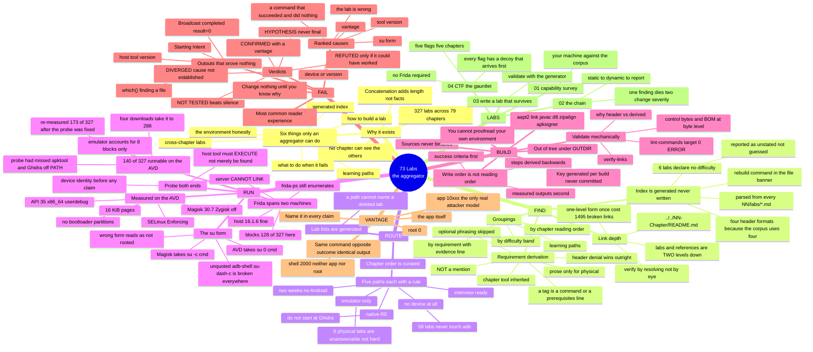

# 73 — Labs · Mind map

One map of the whole chapter. Prose in [README.md](README.md), commands in
[cheatsheet.md](cheatsheet.md).

---

## How to read this map

**The five verbs are the chapter.** FIND, ROUTE, RUN, BUILD, FAIL — everything else hangs off one of
them, and each corresponds to a question a reader actually arrives with.

**The branches that repeat are the ones that matter.** *Vantage* appears under RUN, FAIL and as its
own branch, because it is the most repeated methodology error in this repository. *Evidence* appears
under FIND (the index's evidence lines), BUILD (measured outputs) and FAIL (what proves nothing) for
the same reason: the chapter is largely about the difference between a claim and its support.

**The counts are timestamped, not constant.** 327 labs, 140 runnable, 128 blocked on Frida — all
measured on 2026-08-16 on one machine. Re-run `--stats` and `--match`; a generated number is a
measurement, and comparing your shape against this one is more useful than matching digits.
